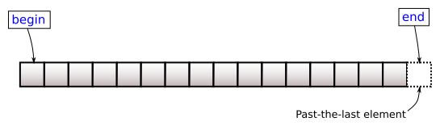

# <small>nlohmann::basic_json::</small>cbegin

```cpp
const_iterator cbegin() const noexcept;
```

Returns an iterator to the first element.



## Return value

iterator to the first element

## Exception safety

No-throw guarantee: this member function never throws exceptions.

## Complexity

Constant.

## Examples

??? example

    The following code shows an example for `cbegin()`.
    
    ```cpp
    #include <iostream>
    #include <nlohmann/json.hpp>
    
    using nlohmann::json;
    
    int main()
    {
        // create an array value
        const json array = {1, 2, 3, 4, 5};
    
        // get an iterator to the first element
        json::const_iterator it = array.cbegin();
    
        // serialize the element that the iterator points to
        std::cout << *it << '\n';
    }
    
    ```
    
    Output:
    
    ```json
    1
    
    ```

## See also

- [begin](begin.md) returns an iterator to the first element
- [cend](cend.md) returns a const iterator to one past the last element
- [crbegin](crbegin.md) returns a const reverse iterator to the last element
- [Iterators](../../features/iterators.md) - the article on iterators
- [basic_json_view::cbegin](../basic_json_view/cbegin.md) - the same iteration on a zero-copy view

## Version history

- Added in version 1.0.0.
