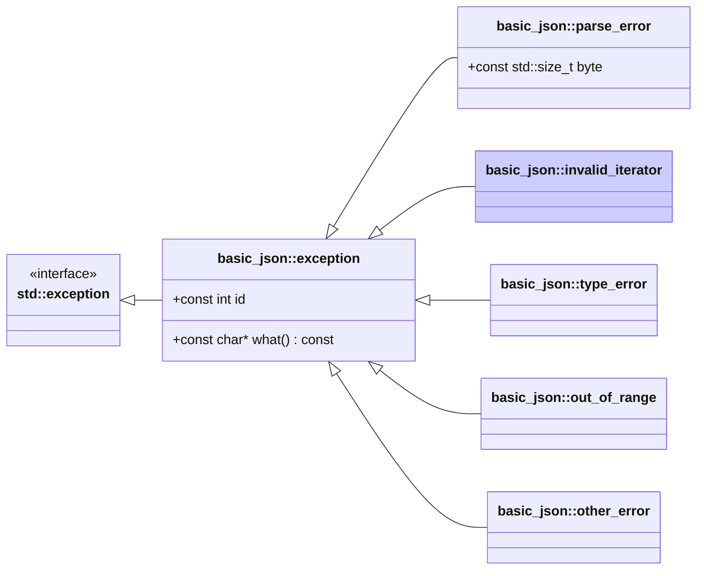

# <small>nlohmann::basic_json::</small>invalid_iterator

```cpp
class invalid_iterator : public exception;
```

This exception is thrown if iterators passed to a library function do not match the expected semantics.

Exceptions have ids 2xx (see [list of iterator errors](../../home/exceptions.md#iterator-errors)).



<p class="nj-caption" markdown>Class hierarchy of the library's exceptions; arrows point from a derived class to its
base class, and the highlighted box is `basic_json::invalid_iterator`.</p>

## Member functions

- **what** - returns explanatory string

## Member variables

- **id** - the id of the exception

## Examples

??? example

    The following code shows how a `invalid_iterator` exception can be caught.
    
    ```cpp
    #include <iostream>
    #include <nlohmann/json.hpp>
    
    using nlohmann::json;
    
    int main()
    {
        try
        {
            // calling iterator::key() on non-object iterator
            json j = "string";
            json::iterator it = j.begin();
            auto k = it.key();
        }
        catch (const json::invalid_iterator& e)
        {
            // output exception information
            std::cout << "message: " << e.what() << '\n'
                      << "exception id: " << e.id << '\n';
        }
    }
    
    ```
    
    Output:
    
    ```json
    message: [json.exception.invalid_iterator.207] cannot use key() for non-object iterators
    exception id: 207
    
    ```

## See also

- [`exception`](exception.md) - the base class of all exceptions thrown by the library
- [List of iterator errors](../../home/exceptions.md#iterator-errors) - overview of iterator errors (`invalid_iterator`)
- [`parse_error`](parse_error.md) - exceptions indicating a parse error
- [`type_error`](type_error.md) - exceptions indicating executing a member function with a wrong type
- [`out_of_range`](out_of_range.md) - exceptions indicating access out of the defined range
- [`other_error`](other_error.md) - exceptions indicating other library errors
- [Exceptions](../../home/exceptions.md) - all exceptions and their error codes
- [`JSON_DIAGNOSTICS`](../macros/json_diagnostics.md) - extended exception messages with the path of the failing value

## Version history

- Added in version 3.0.0.
