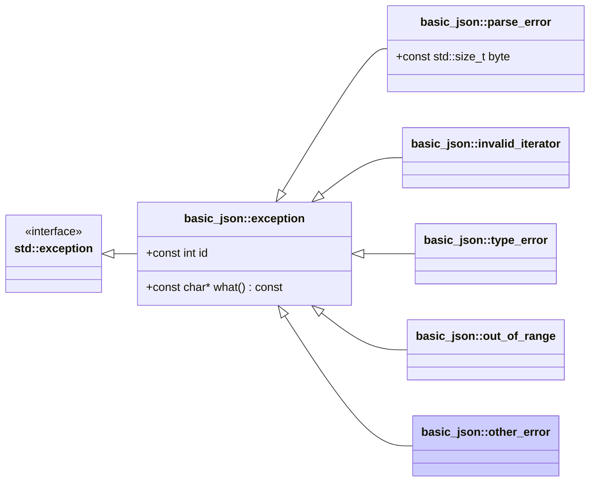

# <small>nlohmann::basic_json::</small>other_error

```cpp
class other_error : public exception;
```

This exception is thrown in case of errors that cannot be classified with the other exception types.

Exceptions have ids 5xx (see [list of other errors](../../home/exceptions.md#further-exceptions)).



<p class="nj-caption" markdown>Class hierarchy of the library's exceptions; arrows point from a derived class to its
base class, and the highlighted box is `basic_json::other_error`.</p>

## Member functions

- **what** - returns explanatory string

## Member variables

- **id** - the id of the exception

## Examples

??? example

    The following code shows how a `other_error` exception can be caught.
    
    ```cpp
    #include <iostream>
    #include <nlohmann/json.hpp>
    
    using nlohmann::json;
    using namespace nlohmann::literals;
    
    int main()
    {
        try
        {
            // executing a failing JSON Patch operation
            json value = R"({
                "best_biscuit": {
                    "name": "Oreo"
                }
            })"_json;
            json patch = R"([{
                "op": "test",
                "path": "/best_biscuit/name",
                "value": "Choco Leibniz"
            }])"_json;
            value.patch(patch);
        }
        catch (const json::other_error& e)
        {
            // output exception information
            std::cout << "message: " << e.what() << '\n'
                      << "exception id: " << e.id << '\n';
        }
    }
    
    ```
    
    Output:
    
    ```json
    message: [json.exception.other_error.501] unsuccessful: {"op":"test","path":"/best_biscuit/name","value":"Choco Leibniz"}
    exception id: 501
    
    ```

## See also

- [`exception`](exception.md) - the base class of all exceptions thrown by the library
- [List of other errors](../../home/exceptions.md#further-exceptions) - overview of further errors (`other_error`)
- [`parse_error`](parse_error.md) - exceptions indicating a parse error
- [`invalid_iterator`](invalid_iterator.md) - exceptions indicating errors with iterators
- [`type_error`](type_error.md) - exceptions indicating executing a member function with a wrong type
- [`out_of_range`](out_of_range.md) - exceptions indicating access out of the defined range
- [Exceptions](../../home/exceptions.md) - all exceptions and their error codes
- [`JSON_DIAGNOSTICS`](../macros/json_diagnostics.md) - extended exception messages with the path of the failing value

## Version history

- Added in version 3.0.0.
