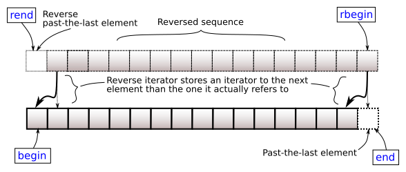

# <small>nlohmann::basic_json::</small>rend

```cpp
reverse_iterator rend() noexcept;
const_reverse_iterator rend() const noexcept;
```

Returns an iterator to the reverse-end; that is, one before the first element. This element acts as a placeholder,
attempting to access it results in undefined behavior.



## Return value

reverse iterator to the element following the last element

## Exception safety

No-throw guarantee: this member function never throws exceptions.

## Complexity

Constant.

## Examples

??? example

    The following code shows an example for `rend()`.
    
    ```cpp
    #include <iostream>
    #include <nlohmann/json.hpp>
    
    using json = nlohmann::json;
    
    int main()
    {
        // create an array value
        json array = {1, 2, 3, 4, 5};
    
        // get an iterator to the reverse-end
        json::reverse_iterator it = array.rend();
    
        // increment the iterator to point to the first element
        --it;
    
        // serialize the element that the iterator points to
        std::cout << *it << '\n';
    }
    
    ```
    
    Output:
    
    ```json
    1
    
    ```

## See also

- [rbegin](rbegin.md) returns a reverse iterator to the last element
- [crend](crend.md) returns a const reverse iterator to one before the first element
- [end](end.md) returns an iterator to one past the last element
- [Iterators](../../features/iterators.md) - the article on iterators

## Version history

- Added in version 1.0.0.
