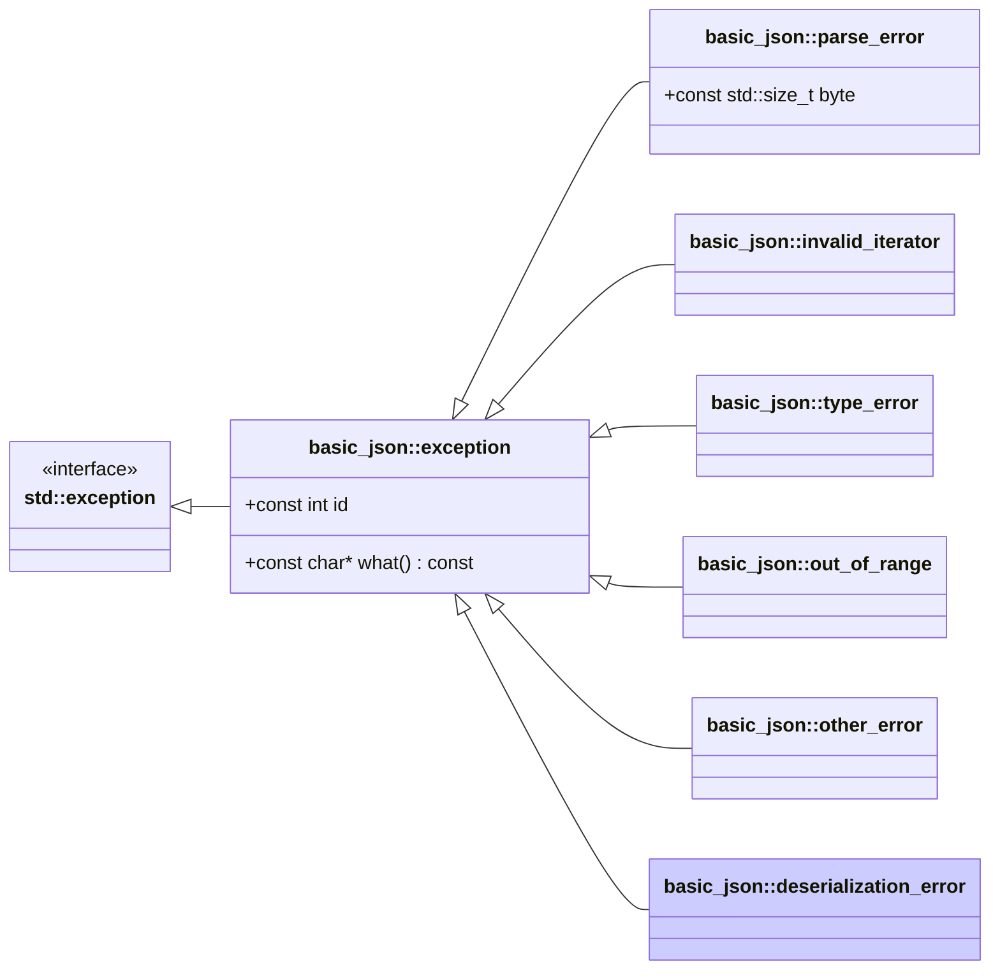

# <small>nlohmann::basic_json::</small>deserialization_error

```cpp
class deserialization_error : public exception;
```

This exception is thrown when a reflection-based [`deserialize`](deserialize.md) operation cannot map a value, for
example when a member expected to be a JSON object holds another type, or when an enum member holds a string that
matches no enumerator name.

Exceptions have ids 6xx (see [list of serde errors](../../home/exceptions.md#serde-errors)).



<p class="nj-caption" markdown>Class hierarchy of the library's exceptions; arrows point from a derived class to its
base class, and the highlighted box is `basic_json::deserialization_error`.</p>

## Member functions

- **what** - returns explanatory string

## Member variables

- **id** - the id of the exception

## Notes

This exception is only thrown when [`JSON_HAS_REFLECTION`](../macros/json_has_reflection.md) evaluates to `1`, as that
is the only situation in which [`serialize`](serialize.md) and [`deserialize`](deserialize.md) are available.

## Examples

??? example

    The following code shows how a `deserialization_error` exception can be caught.

    ```cpp
    import std;
    import nlohmann.json;

    using nlohmann::json;

    enum class Element { FIRE, WATER, WIND };
    struct Spell { std::string name; Element element = Element::FIRE; };

    int main() {
        json j = json::parse(R"({"name": "x", "element": "PLASMA"})");
        try {
            Spell s = j.deserialize<Spell>();
        } catch (const json::exception& e) {
            std::println("{}", e.what());
        }
    }
    ```

    Output:

    ```
    [json.exception.deserialization_error.602] member 'element' is not a known enumerator name
    ```

## See also

- [`exception`](exception.md) - the base class of all exceptions thrown by the library
- [List of serde errors](../../home/exceptions.md#serde-errors) - overview of the serde error codes
- [`serialize`](serialize.md) - map an object to a JSON value via reflection
- [`deserialize`](deserialize.md) - map a JSON value into an object via reflection
- [Exceptions](../../home/exceptions.md) - all exceptions and their error codes
- [`JSON_DIAGNOSTICS`](../macros/json_diagnostics.md) - extended exception messages with the path of the failing value

## Version history

- Added in version 3.13.0.
