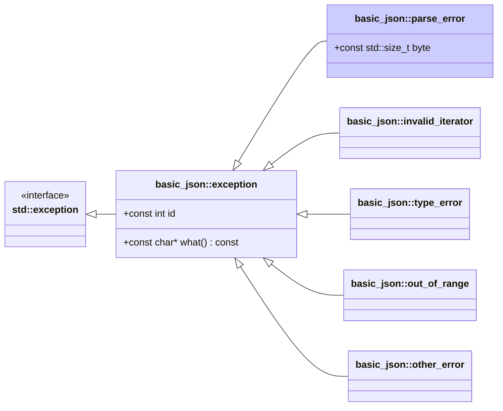

# <small>nlohmann::basic_json::</small>parse_error

```cpp
class parse_error : public exception;
```

The library throws this exception when a parse error occurs. Parse errors can occur during the deserialization of
JSON text, BJData, BON8, BSON, CBOR, MessagePack, UBJSON, as well as when using JSON Patch.

Member `byte` holds the byte index of the last read character in the input file (see note below).

Exceptions have ids 1xx (see [list of parse errors](../../home/exceptions.md#parse-errors)).



<p class="nj-caption" markdown>Class hierarchy of the library's exceptions; arrows point from a derived class to its
base class, and the highlighted box is `basic_json::parse_error`.</p>

## Member functions

- **what** - returns explanatory string

## Member variables

- **id** - the id of the exception
- **byte** - byte index of the parse error

## Notes

For an input with <i>n</i> bytes, 1 is the index of the first character and <i>n</i>+1 is the index of the terminating null byte
or the end of file. This also holds true when reading a byte vector for binary formats.

## Examples

??? example

    The following code shows how a `parse_error` exception can be caught.
    
    ```cpp
    --8<-- "examples/parse_error.cpp"
    ```
    
    Output:
    
    ```json
    --8<-- "examples/parse_error.output"
    ```

## See also

- [`exception`](exception.md) - the base class of all exceptions thrown by the library
- [List of parse errors](../../home/exceptions.md#parse-errors) - overview of parse errors (`parse_error`)
- [`invalid_iterator`](invalid_iterator.md) - exceptions indicating errors with iterators
- [`type_error`](type_error.md) - exceptions indicating executing a member function with a wrong type
- [`out_of_range`](out_of_range.md) - exceptions indicating access out of the defined range
- [`other_error`](other_error.md) - exceptions indicating other library errors
- [Parsing and Exceptions](../../features/parsing/parse_exceptions.md) - handling parse errors and locating them in the input
- [Working Without Exceptions](../../features/no_exceptions.md) - error handling when exceptions are disabled

## Version history

- Added in version 3.0.0.
