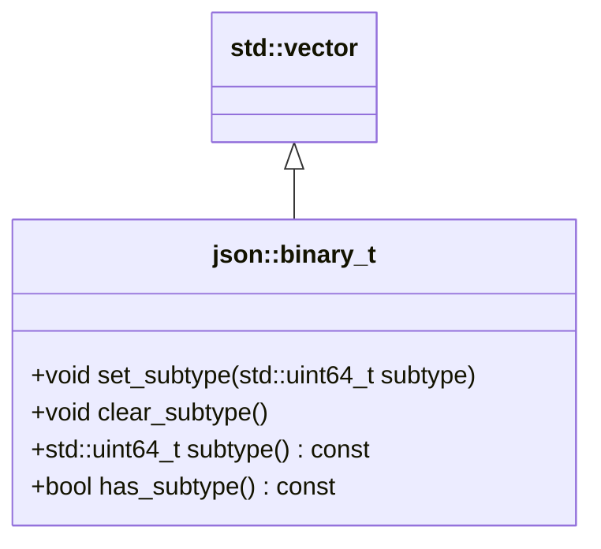

# Binary Values

The library implements several [binary formats](binary_formats/index.md) that encode JSON in an efficient way. Most of
these formats support binary values; that is, values that have semantics defined outside the library and only define a
sequence of bytes to be stored.

JSON itself does not have a binary value. As such, binary values are an extension that this library implements to store
values received by a binary format. Binary values are never created by the JSON parser and are only part of a
serialized JSON text if they have been created manually or via a binary format.

## API for binary values



<p class="nj-caption" markdown>Class diagram of `json::binary_t`: it derives from `std::vector<uint8_t>` and adds functions to set, clear, query, and test an optional subtype.</p>

By default, binary values are stored as `std::vector<std::uint8_t>`. This type can be changed by providing a template
parameter to the `basic_json` type. To store binary subtypes, the storage type is extended and exposed as
[`json::binary_t`](../api/basic_json/binary_t.md):

```cpp
auto binary = json::binary_t({0xCA, 0xFE, 0xBA, 0xBE});
auto binary_with_subtype = json::binary_t({0xCA, 0xFE, 0xBA, 0xBE}, 42);
```

There are several convenience functions to check and set the subtype:

```cpp
binary.has_subtype();                   // returns false
binary_with_subtype.has_subtype();      // returns true

binary_with_subtype.clear_subtype();
binary_with_subtype.has_subtype();      // returns false

binary_with_subtype.set_subtype(42);
binary.set_subtype(23);

binary.subtype();                       // returns 23
```

As `json::binary_t` is subclassing `std::vector<std::uint8_t>`, all member functions are available:

```cpp
binary.size();  // returns 4
binary[1];      // returns 0xFE
```

JSON values can be constructed from `json::binary_t`:

```cpp
json j = binary;
```

Binary values are primitive values just like numbers or strings, as reflected by
[`is_binary()`](../api/basic_json/is_binary.md) and [`is_primitive()`](../api/basic_json/is_primitive.md):

```cpp
j.is_binary();    // returns true
j.is_primitive(); // returns true
```

Given a binary JSON value, the `binary_t` can be accessed by reference via
[`get_binary()`](../api/basic_json/get_binary.md):

```cpp
j.get_binary().has_subtype();  // returns true
j.get_binary().size();         // returns 4
```

For convenience, binary JSON values can be constructed via [`json::binary`](../api/basic_json/binary.md):

```cpp
auto j2 = json::binary({0xCA, 0xFE, 0xBA, 0xBE}, 23);
auto j3 = json::binary({0xCA, 0xFE, 0xBA, 0xBE});

j2 == j;                        // returns true
j3.get_binary().has_subtype();  // returns false
j3.get_binary().subtype();      // returns std::uint64_t(-1) as j3 has no subtype
```


## Serialization

Binary values are serialized differently according to the formats.

### JSON

JSON does not have a binary type, and this library does not introduce a new type as this would break conformance.
Instead, binary values are serialized as an object with two keys: `bytes` holds an array of integers, and `subtype`
is an integer or `null`.

??? example "Example: serialize a binary value to JSON"

    Code:

    ```cpp
    // create a binary value of subtype 42
    json j;
    j["binary"] = json::binary({0xCA, 0xFE, 0xBA, 0xBE}, 42);
    
    // serialize to standard output
    std::cout << j.dump(2) << std::endl;
    ```
    
    Output:
    
    ```json
    {
      "binary": {
        "bytes": [202, 254, 186, 190],
        "subtype": 42
      }
    }
    ```

!!! warning "No roundtrip for binary values"

    The JSON parser will not parse the objects generated by binary values back to binary values. This is by design to
    remain standards compliant. Serializing binary values to JSON is only implemented for debugging purposes.

### BJData

[BJData](binary_formats/bjdata.md) Draft 3 supports binary values as optimized arrays of `B` (byte) elements, but no
subtypes. With `version = bjdata_version_t::draft3` and both `use_size` and `use_type` set, `to_bjdata` writes a binary
value as `[$B#...`, and `from_bjdata` reads it back as a binary value (without subtype). In all other cases, including
the default Draft 2 mode, the library follows the Draft 2 proposal and writes an array of integers (`U` in Draft 2, `B`
in Draft 3), which is read back as an array.

??? example "Example: serialize a binary value to BJData"

    Code:
    
    ```cpp
    // create a binary value of subtype 42 (will be ignored in BJData)
    json j;
    j["binary"] = json::binary({0xCA, 0xFE, 0xBA, 0xBE}, 42);

    // convert to BJData
    auto v = json::to_bjdata(j);      
    ```
            
    `v` is a `std::vector<std::uint8_t>` with the following 20 elements:

    ```c
    0x7B                                             // '{'
        0x69 0x06                                    // i 6 (length of the key)
        0x62 0x69 0x6E 0x61 0x72 0x79                // "binary"
        0x5B                                         // '['
            0x55 0xCA 0x55 0xFE 0x55 0xBA 0x55 0xBE  // content (each byte prefixed with 'U')
        0x5D                                         // ']'
    0x7D                                             // '}'
    ```

    The following code uses the type and size optimization for BJData:

    ```cpp
    // convert to BJData using the size and type optimization
    auto v = json::to_bjdata(j, true, true);
    ```

    The resulting vector has 22 elements; the optimization is not effective for examples with few values:

    ```c
    0x7B                                // '{'
        0x23 0x69 0x01                  // '#' 'i' 1 number of object members
        0x69 0x06                       // i 6 (length of the key)
        0x62 0x69 0x6E 0x61 0x72 0x79   // "binary"
        0x5B                            // '[' array
            0x24 0x55                   // '$' 'U' type of the array elements: unsigned integers
            0x23 0x69 0x04              // '#' i 4 number of array elements
            0xCA 0xFE 0xBA 0xBE         // content
    ```

    Note that subtype (42) is **not** serialized and that, in Draft 2 mode, BJData has **no binary type**, and deserializing `v` would
    yield the following value:

    ```json
    {
      "binary": [202, 254, 186, 190]
    }
    ```

### BON8

[BON8](binary_formats/bon8.md) neither supports binary values nor subtypes. The library serializes binary values as an
array of integers.

??? example "Example: serialize a binary value to BON8"

    Code:

    ```cpp
    // create a binary value of subtype 42 (will be ignored in BON8)
    json j;
    j["binary"] = json::binary({0xCA, 0xFE, 0xBA, 0xBE}, 42);

    // convert to BON8
    auto v = json::to_bon8(j);
    ```

    `v` is a `std::vector<std::uint8_t>` with the following 16 elements:

    ```c
    0x87                                     // object with 1 member
        0x62 0x69 0x6E 0x61 0x72 0x79        // "binary"
        0x84                                 // array with 4 elements
            0xC3 0x22 0xC3 0x56 0xC3 0x12 0xC3 0x16  // content (each byte, here all above 39, as a 2-byte integer)
    ```

    Note that the subtype is lost, and deserializing `v` would yield the following value:

    ```json
    {
      "binary": [202, 254, 186, 190]
    }
    ```

### BSON

[BSON](binary_formats/bson.md) supports binary values and subtypes. If a subtype is given, it is used and added as an
unsigned 8-bit integer; a subtype above 255 throws
[`out_of_range.415`](../home/exceptions.md#jsonexceptionout_of_range415). If no subtype is given, the generic binary
subtype 0x00 is used. The payload of the "old binary" subtype 0x02 is preceded by a second length, which the library
writes and removes again when reading; it is not part of the payload.

??? example "Example: serialize a binary value to BSON"

    Code:
    
    ```cpp
    // create a binary value of subtype 42
    json j;
    j["binary"] = json::binary({0xCA, 0xFE, 0xBA, 0xBE}, 42);

    // convert to BSON
    auto v = json::to_bson(j);      
    ```
            
    `v` is a `std::vector<std::uint8_t>` with the following 22 elements:
    
    ```c
    0x16 0x00 0x00 0x00                         // number of bytes in the document
        0x05                                    // binary value
            0x62 0x69 0x6E 0x61 0x72 0x79 0x00  // key "binary" + null byte
            0x04 0x00 0x00 0x00                 // number of bytes
            0x2a                                // subtype
            0xCA 0xFE 0xBA 0xBE                 // content
    0x00                                        // end of the document
    ```

    Note that the serialization preserves the subtype, and deserializing `v` would yield the following value:

    ```json
    {
      "binary": {
        "bytes": [202, 254, 186, 190],
        "subtype": 42
      }
    }
    ```

### CBOR

[CBOR](binary_formats/cbor.md) supports binary values and subtypes. Any binary value will be serialized as a byte
string; a subtype is serialized as a tag preceding it. When parsing, tags are only read back as subtypes with
`cbor_tag_handler_t::store` (see [`from_cbor`](../api/basic_json/from_cbor.md)). The library will choose the smallest
representation using the length of the byte array.

??? example "Example: serialize a binary value to CBOR"

    Code:
    
    ```cpp
    // create a binary value of subtype 42
    json j;
    j["binary"] = json::binary({0xCA, 0xFE, 0xBA, 0xBE}, 42);

    // convert to CBOR
    auto v = json::to_cbor(j);      
    ```
            
    `v` is a `std::vector<std::uint8_t>` with the following 15 elements:
    
    ```c
    0xA1                                   // map(1)
        0x66                               // text(6)
            0x62 0x69 0x6E 0x61 0x72 0x79  // "binary"
        0xD8 0x2A                          // tag(42)
        0x44                               // bytes(4)
            0xCA 0xFE 0xBA 0xBE            // content
    ```

    Note that the subtype is serialized as tag. However, parsing tagged values yield a parse error unless
    `json::cbor_tag_handler_t::ignore` or `json::cbor_tag_handler_t::store` is passed to
    [`json::from_cbor`](../api/basic_json/from_cbor.md) (see
    [`cbor_tag_handler_t`](../api/basic_json/cbor_tag_handler_t.md)).

    With `ignore`, the subtype is dropped (`"subtype": null`); with `store`, the tag is kept (`"subtype": 42`):

    ```json
    {
      "binary": {
        "bytes": [202, 254, 186, 190],
        "subtype": null
      }
    }
    ```

    ```json
    {
      "binary": {
        "bytes": [202, 254, 186, 190],
        "subtype": 42
      }
    }
    ```

### MessagePack

[MessagePack](binary_formats/messagepack.md) supports binary values and subtypes. If a subtype is given, the ext family
is used. The library will choose the smallest representation among fixext1, fixext2, fixext4, fixext8, fixext16, ext8,
ext16, and ext32. The subtype is then written as the signed 8-bit ext type: subtypes 128 to 255 map to the negative
(reserved) ext types, and on reading the ext type is exposed as an unsigned subtype from 0 to 255.

If no subtype is given, the bin family (bin8, bin16, bin32) is used.

??? example "Example: serialize a binary value to MessagePack"

    Code:
    
    ```cpp
    // create a binary value of subtype 42
    json j;
    j["binary"] = json::binary({0xCA, 0xFE, 0xBA, 0xBE}, 42);

    // convert to MessagePack
    auto v = json::to_msgpack(j);      
    ```
            
    `v` is a `std::vector<std::uint8_t>` with the following 14 elements:
    
    ```c
    0x81                                   // fixmap1
        0xA6                               // fixstr6
            0x62 0x69 0x6E 0x61 0x72 0x79  // "binary"
        0xD6                               // fixext4
            0x2A                           // subtype
            0xCA 0xFE 0xBA 0xBE            // content
    ```

    Note that the serialization preserves the subtype, and deserializing `v` would yield the following value:

    ```json
    {
      "binary": {
        "bytes": [202, 254, 186, 190],
        "subtype": 42
      }
    }
    ```

### UBJSON

[UBJSON](binary_formats/ubjson.md) neither supports binary values nor subtypes and proposes to serialize binary values
as an array of uint8 values. The library implements this translation.

??? example "Example: serialize a binary value to UBJSON"

    Code:
    
    ```cpp
    // create a binary value of subtype 42 (will be ignored in UBJSON)
    json j;
    j["binary"] = json::binary({0xCA, 0xFE, 0xBA, 0xBE}, 42);

    // convert to UBJSON
    auto v = json::to_ubjson(j);      
    ```
            
    `v` is a `std::vector<std::uint8_t>` with the following 20 elements:
    
    ```c
    0x7B                                             // '{'
        0x69 0x06                                    // i 6 (length of the key)
        0x62 0x69 0x6E 0x61 0x72 0x79                // "binary"
        0x5B                                         // '['
            0x55 0xCA 0x55 0xFE 0x55 0xBA 0x55 0xBE  // content (each byte prefixed with 'U')
        0x5D                                         // ']'
    0x7D                                             // '}'
    ```

    The following code uses the type and size optimization for UBJSON:

    ```cpp
    // convert to UBJSON using the size and type optimization
    auto v = json::to_ubjson(j, true, true);
    ```

    The resulting vector has 23 elements; the optimization is not effective for examples with few values:

    ```c
    0x7B                                // '{'
        0x24                            // '$' type of the object elements
        0x5B                            // '[' array
        0x23 0x69 0x01                  // '#' i 1 number of object elements
        0x69 0x06                       // i 6 (length of the key)
        0x62 0x69 0x6E 0x61 0x72 0x79   // "binary"
            0x24 0x55                   // '$' 'U' type of the array elements: unsigned integers
            0x23 0x69 0x04              // '#' i 4 number of array elements
            0xCA 0xFE 0xBA 0xBE         // content
    ```

    Note that subtype (42) is **not** serialized and that UBJSON has **no binary type**, and deserializing `v` would
    yield the following value:

    ```json
    {
      "binary": [202, 254, 186, 190]
    }
    ```

## See also

- [Binary formats](binary_formats/index.md) - the formats that can store binary values
- [`binary_t`](../api/basic_json/binary_t.md) - type for binary values
- [`byte_container_with_subtype`](../api/byte_container_with_subtype/index.md) - container for binary values with subtype
- [`binary`](../api/basic_json/binary.md) - create a binary value
- [`get_binary`](../api/basic_json/get_binary.md) - access the stored binary value
- [`is_binary`](../api/basic_json/is_binary.md) - check whether a value is binary
- [`cbor_tag_handler_t`](../api/basic_json/cbor_tag_handler_t.md) - store or ignore CBOR tags when parsing
