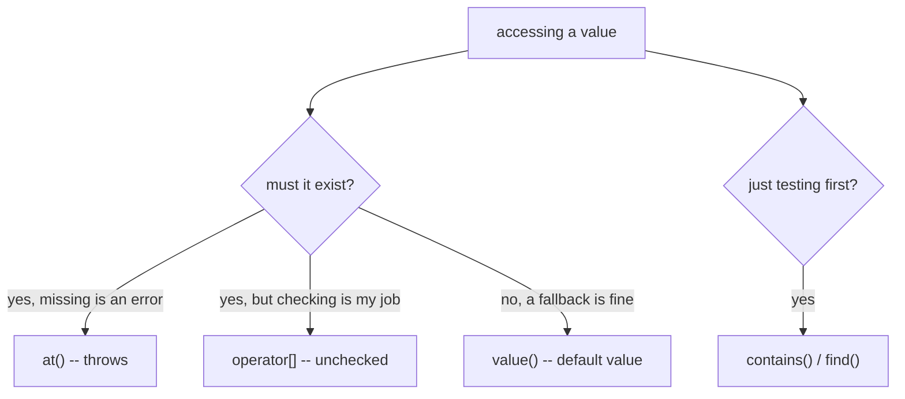

# Element Access

There are many ways elements in a JSON value can be accessed:

- unchecked access via [`operator[]`](unchecked_access.md)
- checked access via [`at`](checked_access.md)
- access with default value via [`value`](default_value.md)
- [iterators](../iterators.md)
- [JSON pointers](../json_pointer.md)

Testing whether a key or index exists before accessing it is also possible, with
[`contains`](../../api/basic_json/contains.md) or [`find`](../../api/basic_json/find.md) (which returns an iterator to
the value, or `end()` if it is not found).



## Does this key exist?

Use [`contains`](../../api/basic_json/contains.md) to test for a key; it does not modify the value and does not throw:

```cpp
json j = {{"name", "Mary"}, {"address", {{"city", "Berlin"}}}};

j.contains("name");                   // true
j.contains("age");                    // false
j.contains("city");                   // false: contains() only looks at the top level
j["address"].contains("city");        // true
j.contains(json::json_pointer("/address/city"));  // true: a JSON pointer tests a nested path in one call
```

If the value is needed afterwards, [`find`](../../api/basic_json/find.md) tests and accesses with a single lookup:

```cpp
if (auto it = j.find("name"); it != j.end())
{
    std::cout << *it << '\n';
}
```

`contains` also returns `true` for a key whose value is `null`; use `j.contains("k") && !j["k"].is_null()` if a
`null` should count as missing. To read a value with a fallback instead, see [`value`](default_value.md).

!!! warning "`operator[]` inserts missing keys"

    Like `#!cpp std::map::operator[]`, the non-const [`operator[]`](unchecked_access.md) adds a `null` value if the key
    is missing. Testing a key with it therefore *changes the object*:

    ```cpp
    json j = {{"foo", 1}};
    bool absent = j["bar"].is_null();   // true, but j is now {"bar": null, "foo": 1}
    ```

    Use `contains`/`find` to test, and [`at`](checked_access.md) to access a value that must exist (it throws an
    [`out_of_range`](../../home/exceptions.md#out-of-range) exception otherwise).

## See also

- [**operator[]**](../../api/basic_json/operator%5B%5D.md) - unchecked access
- [**at**](../../api/basic_json/at.md) - checked access
- [**value**](../../api/basic_json/value.md) - access with default value
- [**contains**](../../api/basic_json/contains.md) and [**find**](../../api/basic_json/find.md) - test for existence
- [**front**](../../api/basic_json/front.md) and [**back**](../../api/basic_json/back.md) - first and last element
- [**items**](../../api/basic_json/items.md) - iterate over keys and values
