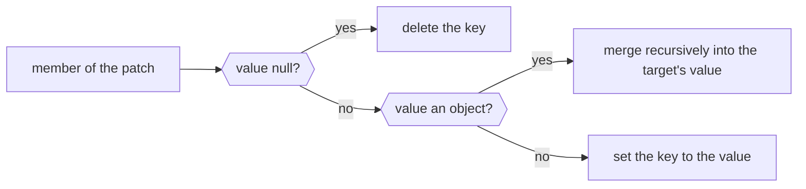

# JSON Merge Patch

The library supports JSON Merge Patch ([RFC 7396](https://tools.ietf.org/html/rfc7396)) as a patch format.
The merge patch format is primarily intended for use with the HTTP PATCH method as a means of describing a set of
modifications to a target resource's content. This function applies a merge patch to the current JSON value.

Instead of using [JSON Pointer](json_pointer.md) to specify values to be manipulated, it describes the changes using a
syntax that closely mimics the document being modified. Unlike [JSON Patch](json_patch.md), a JSON Merge Patch cannot
express every kind of change (e.g., it cannot reorder array elements or remove a specific array element), but it is
easier to read and write for object-shaped documents.

The function [`merge_diff`](../api/basic_json/merge_diff.md) creates a merge patch that changes one JSON value into
another.

The example below shows every rule in one patch, member by member:

<div class="nj-pointer-mpt" markdown>

| Rule | Key | Target | Patch | Result |
|------|-----|--------|-------|--------|
| <span class="nj-pointer-mp nj-pointer-mp--set">change value</span> | `title` | `#!json "Goodbye!"` | `#!json "Hello!"` | `#!json "Hello!"` |
| <span class="nj-pointer-mp nj-pointer-mp--add">add key</span> | `phoneNumber` | <span class="nj-pointer-mp-none">(no key)</span> | `#!json "+01-123-456-7890"` | `#!json "+01-123-456-7890"` |
| <span class="nj-pointer-mp nj-pointer-mp--del">null removes key</span> | `author.familyName` | `#!json "Doe"` | `#!json null` | <span class="nj-pointer-mp-none">(removed)</span> |
| <span class="nj-pointer-mp nj-pointer-mp--rec">object merges recursively</span> | `author` | `#!json {"givenName": "John", "familyName": "Doe"}` | `#!json {"familyName": null}` | `#!json {"givenName": "John"}` |
| <span class="nj-pointer-mp nj-pointer-mp--arr">array replaced whole</span> | `tags` | `#!json ["example", "sample"]` | `#!json ["example"]` | `#!json ["example"]` |
| <span class="nj-pointer-mp nj-pointer-mp--keep">unchanged key</span> | `content` | `#!json "This will be unchanged"` | <span class="nj-pointer-mp-none">(no key)</span> | `#!json "This will be unchanged"` |

</div>

An array in the patch replaces the array in the target, so a merge patch cannot change a single element. Each member of
the patch is applied like this; a patch that is not an object replaces the whole target.



<p class="nj-caption" markdown>How one member of a merge patch is applied: a `null` value deletes the key, an object is merged recursively, and any other value replaces the value of the key.</p>

!!! tip "Not a general deep merge"

    A merge patch is not a general deep merge: a `#!json null` value in the patch deletes the key from the target.
    To merge two objects recursively (e.g., defaults and user settings), use
    [`update`](../api/basic_json/update.md) with `merge_objects` set to `#!cpp true`; see
    [Merging objects](modifying_values.md#merging-objects).

??? example

    The following code shows how a JSON Merge Patch is applied to a JSON document.

    ```cpp
    --8<-- "examples/merge_patch.cpp"
    ```
    
    Output:

    ```json
    --8<-- "examples/merge_patch.output"
    ```

## See also

- [JSON Patch and Diff](json_patch.md) - a more expressive alternative that describes a sequence of operations
- [JSON Pointer](json_pointer.md) - the addressing scheme used by JSON Patch
- [`merge_patch`](../api/basic_json/merge_patch.md) - apply a JSON Merge Patch to a value
- [`merge_diff`](../api/basic_json/merge_diff.md) - create a JSON Merge Patch from two values
- Function [`update`](../api/basic_json/update.md) - merge objects, optionally recursively
- [Modifying values](modifying_values.md) - simple in-place modifications
