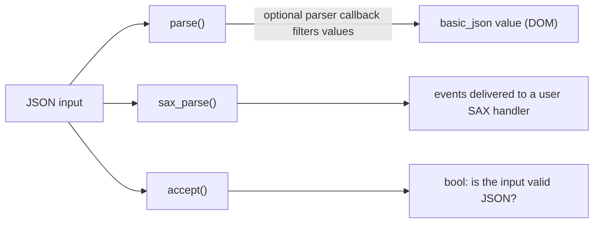

# Parsing

This library can create a JSON value from a wide range of inputs. This page gives an overview of the available parsing
functions and how they behave; the linked pages go into more detail.



## Input

The [`parse`](../../api/basic_json/parse.md) function reads a JSON value from an input. The input can be

- a string (`#!cpp std::string`, C string, or string literal),
- a `#!cpp std::istream` (e.g., an `#!cpp std::ifstream` reading from a file),
- a `#!cpp FILE*` pointer,
- a pair of iterators over a contiguous range (e.g., a `#!cpp std::vector<std::uint8_t>`), or
- a contiguous container.

```cpp
// parse from a string
json j = json::parse(R"({"happy": true, "pi": 3.141})");

// parse from a file
std::ifstream f("example.json");
json data = json::parse(f);
```

The input must be encoded in UTF-8; other encodings are not supported. A single input may contain only one JSON value.
Inputs consisting of multiple values separated by newlines are handled by the [JSON Lines](json_lines.md) format.

By default, the library rejects comments and trailing commas. Both can be enabled with parameters of the `parse`
function — see [comments](../comments.md) and [trailing commas](../trailing_commas.md).

## Strictness and trailing data

[`parse`](../../api/basic_json/parse.md) reads a single JSON value and requires the whole input to be consumed: any
non-whitespace data after the value is reported as a parse error. Use it when you want to guarantee that an input is
exactly one complete JSON document.

[`operator>>`](../../api/operator_gtgt.md) follows relaxed `#!cpp std::istream` semantics instead: it parses one JSON
value and leaves the stream positioned right after it, without requiring the rest of the stream to be consumed. This is
what makes it possible to read several concatenated values from the same stream, but it also means that "a valid
document followed by trailing bytes" is accepted rather than rejected. If you are validating conformance, or need to
reject any input that is not exactly one JSON document, prefer `parse`.

When using `operator>>` to read several concatenated values this way, a value that is a number must be followed by
whitespace, because `operator>>` consumes the character that terminates a number, unless
[`JSON_PRECISE_STREAM_POSITION`](../../api/macros/json_precise_stream_position.md) is defined to `1` — see the
[`operator>>` notes](../../api/operator_gtgt.md#notes) for details and examples.

## Input sources and performance

All inputs produce the same values and the same exceptions, but they are read in different ways, which makes some of
them faster than others:

| input                                                                                      | how it is read                                                                     |
|--------------------------------------------------------------------------------------------|------------------------------------------------------------------------------------|
| strings, string views, string literals, contiguous containers, pointer or iterator ranges over contiguous memory | the whole input is scanned in bulk: runs of string characters, numbers, and indentation are recognized several bytes at a time |
| `#!cpp std::istream` (`#!cpp std::ifstream`, `#!cpp std::istringstream`, ...)            | the characters the stream buffer holds are scanned in bulk like a string; the stream buffer is asked for more when they are used up |
| `#!cpp FILE*`                                                                              | one character at a time, with the file locked once for the whole parse              |
| other iterator ranges (e.g., `#!cpp std::list<char>`, `#!cpp std::istreambuf_iterator<char>`), wide strings | one character at a time                                                             |

Parsing a file from a `#!cpp std::ifstream` is therefore only about 10 to 20 % slower than reading the whole file into a
`#!cpp std::string` first and parsing that, and it needs no memory for a copy of the file. The stream is never read
ahead: after parsing, it is positioned exactly as if every character had been read one at a time, so
[`operator>>`](../../api/operator_gtgt.md) can still read several values from one stream (see also
[JSON Lines](json_lines.md)).

Two macros switch these optimizations off without changing any result:
[`JSON_DISABLE_STREAM_BULK_SCAN`](../../api/macros/json_disable_stream_bulk_scan.md) for stream buffers that do not
follow the usual `std::streambuf` contract, and
[`JSON_DISABLE_UNLOCKED_FILE_IO`](../../api/macros/json_disable_unlocked_file_io.md) for programs in which another
thread must use the same `#!cpp FILE` object while it is parsed.

## SAX vs. DOM parsing

The library offers two parsing models:

- **DOM parsing** (the default): the complete input is read and stored as an in-memory `basic_json` value that can be
  traversed and modified freely. This is what [`parse`](../../api/basic_json/parse.md) does, and it is the right choice
  for most use cases.
- **SAX parsing**: instead of building a value, the parser reports events (such as "a string was read" or "an object
  started") to a handler that you implement. This avoids building the full value in memory and is useful for very large
  inputs or when you only need to extract parts of the input. See the [SAX interface](sax_interface.md) for details and
  [`sax_parse`](../../api/basic_json/sax_parse.md) for the API.

You can influence a DOM parse without switching to the SAX interface by passing a
[parser callback](parser_callbacks.md), which is called during parsing and can, for example, discard parts of the input.

## Exceptions

When the input is not valid JSON, the `parse` function throws an exception by default. If exceptions are undesired or
unavailable, the parser can instead return a discarded value, or [`accept`](../../api/basic_json/accept.md) can be used
to only check whether an input is valid JSON. See [parsing and exceptions](parse_exceptions.md) for the available
options.

## See also

- [`parse`](../../api/basic_json/parse.md) - deserialize from a compatible input
- [`accept`](../../api/basic_json/accept.md) - check if the input is valid JSON
- [`sax_parse`](../../api/basic_json/sax_parse.md) - generate SAX events
- [JSON Lines](json_lines.md) - parse newline-delimited JSON
- [parser callbacks](parser_callbacks.md) - influence the parsing by a callback function
- [SAX interface](sax_interface.md) - implement a custom SAX handler
- [parsing and exceptions](parse_exceptions.md) - control error handling
- [parsing untrusted input](untrusted_input.md) - what to consider when parsing input from untrusted sources
