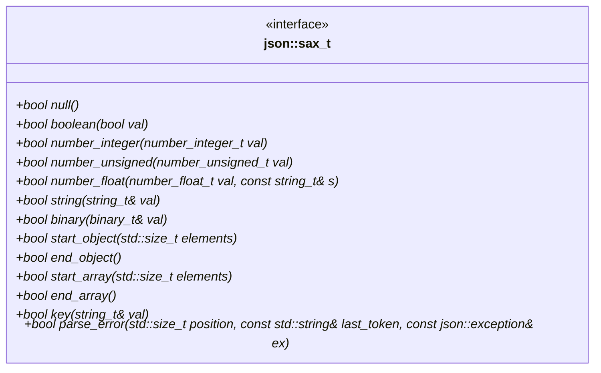

# SAX Interface

The library uses a SAX-like interface with the following functions:



<p class="nj-caption" markdown>The interface `json::sax_t`: one function per event, each returning `bool`; the functions marked with `*` are pure virtual.</p>

```cpp
// called when null is parsed
bool null();

// called when a boolean is parsed; value is passed
bool boolean(bool val);

// called when a signed or unsigned integer number is parsed; value is passed
bool number_integer(number_integer_t val);
bool number_unsigned(number_unsigned_t val);

// called when a floating-point number is parsed; value and original string is passed
bool number_float(number_float_t val, const string_t& s);

// called when a string is parsed; value is passed and can be safely moved away
bool string(string_t& val);
// called when a binary value is parsed; value is passed and can be safely moved away
bool binary(binary_t& val);

// called when an object or array begins or ends, resp. The number of elements is passed (or -1 if not known)
bool start_object(std::size_t elements);
bool end_object();
bool start_array(std::size_t elements);
bool end_array();
// called when an object key is parsed; value is passed and can be safely moved away
bool key(string_t& val);

// called when a parse error occurs; byte position, the last token, and an exception is passed
bool parse_error(std::size_t position, const std::string& last_token, const json::exception& ex);
```

The return value of each function determines whether parsing should proceed.

## Stepping through the events

The events for a small input, step by step, and what two different handlers do with them. Press *Play* or step with *Next*:

<div class="nj-sax nj-fig" id="sax-event-stepper" data-nj-sax role="group" aria-label="SAX events for the input {&quot;a&quot;:[1,true],&quot;b&quot;:&quot;x&quot;}, and the state of a handler after each event">
<div class="nj-sax__lane nj-sax__lane--text"><p class="nj-sax__h">input</p><p class="nj-sax__text"><code class="nj-sax__src">{"a":[1,true],"b":"x"}</code></p></div>
<div class="nj-sax__lane nj-sax__lane--events"><p class="nj-sax__h">events, in the order the parser calls them</p><ol class="nj-sax__events">
<li class="nj-sax-ev nj-sax-ev--os"><code>start_object(-1)</code></li>
<li class="nj-sax-ev nj-sax-ev--k"><code>key("a")</code></li>
<li class="nj-sax-ev nj-sax-ev--as"><code>start_array(-1)</code></li>
<li class="nj-sax-ev nj-sax-ev--v"><code>number_unsigned(1)</code></li>
<li class="nj-sax-ev nj-sax-ev--v"><code>boolean(true)</code></li>
<li class="nj-sax-ev nj-sax-ev--ae"><code>end_array()</code></li>
<li class="nj-sax-ev nj-sax-ev--k"><code>key("b")</code></li>
<li class="nj-sax-ev nj-sax-ev--v"><code>string("x")</code></li>
<li class="nj-sax-ev nj-sax-ev--oe"><code>end_object()</code></li>
</ol></div>
<div class="nj-sax__lane nj-sax__lane--state"><p class="nj-sax__h">handler: build a value tree, as <code>parse</code> does</p><div class="nj-sax__state"><pre class="nj-sax__tree"><code>{
  "a": [
    1,
    true
  ],
  "b": "x"
}</code></pre><p class="nj-sax__note">After <code>end_object()</code> the tree is complete and no container is open. The number of elements is passed as -1: the parser does not know it in advance.</p></div></div>
</div>

<p class="nj-caption" markdown>The three lanes show the input consumed so far, the events called so far, and the state of the selected handler (*build a tree* or *keep only /b*). Check *return false at this event* to stop the parse at the current event and see which events are no longer called.</p>

To implement your own SAX handler, proceed as follows:

1. Implement the SAX interface in a class. You can use class `nlohmann::json_sax<json>` as base class, but you can also use any class where the functions described above are implemented and public.
2. Create an object of your SAX interface class, e.g. `my_sax`.
3. Call `#!cpp bool json::sax_parse(input, &my_sax);` where the first parameter can be any input like a string or an input stream and the second parameter is a pointer to your SAX interface.

Note the `sax_parse` function only returns a `#!cpp bool` indicating the result of the last executed SAX event. It does not return `json` value - it is up to you to decide what to do with the SAX events. Furthermore, no exceptions are thrown in case of a parse error - it is up to you what to do with the exception object passed to your `parse_error` implementation. Internally, the SAX interface is used for the DOM parser (class `json_sax_dom_parser`) as well as the acceptor (`json_sax_acceptor`), see file `json_sax.hpp`.

## See also

- [json_sax](../../api/json_sax/index.md) - documentation of the SAX interface
- [sax_parse](../../api/basic_json/sax_parse.md) - SAX parser
