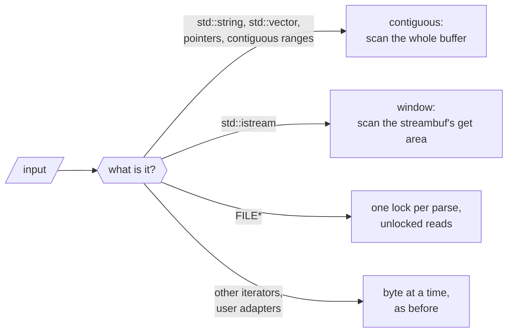
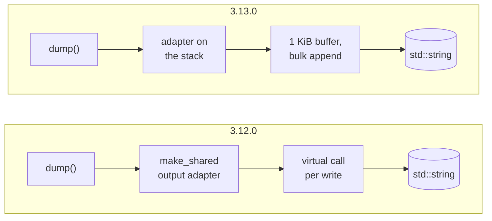

# How nlohmann/json 3.13.0 got 2.9× faster

<p class="nj-byline"><a href="https://github.com/nlohmann">Niels Lohmann</a> · <time datetime="2026-10-28">October 28, 2026</time></p>

<!-- Before publishing: set the date to the release date, and measure every number of this post again with the
     v3.13.0 tag (Appendix G describes the setup; tests/benchmarks/json_view/others/README.md has the commands of the
     comparison). Also refresh the line counts and the compile times in "The price". The numbers below are from the release candidate. -->

Since 2016, the [README](https://github.com/nlohmann/json#readme) of this library has said this about speed:

> There are certainly faster JSON libraries out there. However, if your goal is to speed up your development by adding
> JSON support with a single header, then this library is the way to go.

That sentence is still true, but the gap is a lot smaller now. Swap the 3.12.0 header for the 3.13.0 one and
recompile, and the 182 benchmarks of the library's own suite run 2.9× as fast on an Apple M1 Max (geometric mean),
without a line of your code changing. Parsing typical documents got three to four times as fast, and writing them
three to seven times. 3.13.0 also adds [`json_document`](../../features/json_view.md), a second way to
hold a parsed document, which competes with the fastest C++ and Rust JSON libraries; [How it
compares](#how-it-compares) has the numbers, including where it loses. The price is compile time: two small
example programs take 20 to 63 % longer to compile. A precompiled header or a C++20 module wins back most or all of
that in debug builds, and a quarter to four fifths of it in optimized builds ([The price](#the-price)).

This post is about *how*. None of the techniques is new: almost every one of them is borrowed from
[simdjson](https://github.com/simdjson/simdjson), [yyjson](https://github.com/ibireme/yyjson),
[fast_float](https://github.com/fastfloat/fast_float), [Żmij](https://github.com/vitaut/zmij),
[serde_json](https://github.com/serde-rs/json), [SQLite](https://sqlite.org),
[Boost.JSON](https://github.com/boostorg/json) or a textbook, and we name the source at each step. What we think is
worth writing about is the combination, and the conditions it had to work under: a C++11 header-only library with a
value type that is a template over its string, number, object and allocator types; input from strings, streams,
`FILE*`, iterator pairs, wide strings and user-defined adapters; output that had to stay the same byte for byte; and
error messages that had to keep pointing at the same byte. The few deliberate changes of output are listed in
[Appendix F](#f-behavior-changes).

Every number comes from a benchmark we ran for this post or from the pull request that made the change. The
[appendix](#appendix) describes the test files and the setup, has the full tables behind every chart, and lists the
pull requests behind each theme.

Fast paths are where the bugs are: they read 8 or 16 bytes at a time, skip work the slow path did, and are taken only
for some inputs. So each of them was checked against the slow path it replaces, down to the same error message at the
same byte, on millions of generated and fuzzed inputs. [Appendix J](#j-validation) lists the checks.

## The short version

The test files are the three of Milo Yip's [nativejson-benchmark](https://github.com/miloyip/nativejson-benchmark)
that JSON libraries have been measured with for a decade, `twitter.json` (strings, much of it Japanese), `citm_catalog.json` (many small objects, indented) and
`canada.json` (floating-point numbers), plus the 56 MB `jeopardy.json`. [Appendix A](#a-test-files) says what makes
each of them hard.

<div class="nj-fig-wrap" markdown>
--8<-- "images/perf_blog_overview.svg"
</div>

<p class="nj-caption" markdown>Speedup of 3.13.0 over 3.12.0 for a selection of workloads: the old time divided by the new one, Google Benchmark suite on an Apple M1 Max, median of 8 runs. More is better; the vertical line at 1× is 3.12.0. The times are in [Appendix B](#b-3120-against-3130).</p>

The rows above are chosen to show the range. All 182 benchmarks of the suite:

<div class="nj-fig-wrap" markdown>
--8<-- "images/perf_blog_distribution.svg"
</div>

<p class="nj-caption" markdown>How many of the suite's 182 benchmarks got how much faster. The two below 1× are copying a document without destroying it. Every row is in [Appendix B](#b-3120-against-3130).</p>

Half of the benchmarks got at least 2.9× as fast. Copying and comparing values gained the least, and the largest
gains come from fixing algorithms rather than tuning them (theme <a class="nj-theme" href="#theme-7" title="theme 7">7</a>).

Eight themes did most of the work:

<div class="nj-theme-list" markdown>

- <a class="nj-theme" href="#theme-1" title="theme 1">1</a> [Specialize for each input](#theme-1): a dedicated reader for strings, streams and `FILE*`, instead of one
  character at a time for all of them.
- <a class="nj-theme" href="#theme-2" title="theme 2">2</a> [Work on words, not bytes](#theme-2): 8 bytes per step with plain integer arithmetic, 16 with SSE2 and NEON.
- <a class="nj-theme" href="#theme-3" title="theme 3">3</a> [Own the number conversions](#theme-3): no `strtod`, no locale, no `snprintf`.
- <a class="nj-theme" href="#theme-4" title="theme 4">4</a> [Don't do unnecessary work](#theme-4): positions, copies and conversions that only matter on an error or for a
  rare caller.
- <a class="nj-theme" href="#theme-5" title="theme 5">5</a> [Read the assembly](#theme-5): stack canaries, missed inlining, aliasing and branches the compiler chose.
- <a class="nj-theme" href="#theme-6" title="theme 6">6</a> [Write through a cursor](#theme-6): no virtual call per character, no allocation per call, no branch per
  integer.
- <a class="nj-theme" href="#theme-7" title="theme 7">7</a> [Fix the algorithm first](#theme-7): seven operations were quadratic or worse.
- <a class="nj-theme" href="#theme-8" title="theme 8">8</a> [Build a different data structure](#theme-8) when the tree is the cost.

</div>

## Where the time went: a timeline

The suite compares two points. To see which change did what, we compiled one small benchmark against the header of
each of the 315 commits on `develop` that changed `json.hpp` or `json_view.hpp` since 3.12.0, and ran all of them
interleaved. Four of the eight workloads we followed:

- `parse()` of `citm_catalog.json`: the lexer's structure and whitespace handling, and building many small objects;
- `parse()` of `canada.json`: converting text to floating-point numbers;
- `dump()` of `twitter.json`: writing strings;
- `from_cbor()` of `twitter.json`: reading a binary format.

Each panel shows the speedup over 3.12.0 after each commit, on a logarithmic scale so that a step of 2× has the same
height everywhere. The badges above the steps name the theme below that explains them. Moving code around changes a
build's speed by a few percent on its own, so only the larger steps mean something.

<div class="nj-charts-grid-wrap" markdown>
<div class="nj-fig-wrap" markdown>
--8<-- "images/perf_blog_timeline_parse_citm.svg"
</div>
<div class="nj-fig-wrap" markdown>
--8<-- "images/perf_blog_timeline_parse_canada.svg"
</div>
<div class="nj-fig-wrap" markdown>
--8<-- "images/perf_blog_timeline_dump_twitter.svg"
</div>
<div class="nj-fig-wrap" markdown>
--8<-- "images/perf_blog_timeline_from_cbor_twitter.svg"
</div>
</div>

<p class="nj-caption" markdown>Speedup over 3.12.0 after each of the 315 commits that changed the headers, from 3.12.0 (left) to 3.13.0 (right). More is better; each point is the median of 4 interleaved runs of one build. The badges are theme numbers; "U" is a UTF-8 check that came and went. The other four workloads, and every labeled step with its pull request and size, are in [Appendix C](#c-the-timeline).</p>

A few things stand out:

- **There is no single big step.** Parsing `citm_catalog.json` got faster in about a dozen visible steps. The largest
  removed a buffer that only error messages read, which alone saved a third of the time. The next ones added the fast
  paths for contiguous input, derived positions only on error and skipped indentation eight bytes at a time; most
  other changes moved it by a few percent.
- **Writing had a few large steps.** `dump()` of `twitter.json` lost 70 % of its time in one change (a write buffer
  and bulk string copies), and `dump()` of `canada.json` 65 % in another (Żmij).
- **Regressions happen in between.** A UTF-8 check of every text string in the binary readers, byte by byte, made
  `from_cbor()` of `twitter.json` 37 % slower for 66 commits, until the readers were made lenient again by default, as
  in 3.12.0, with the check as an option. That decision was about the format specifications, which don't require a
  decoder to check, not about speed; the cost went with it. It never shipped in a release.
- **The input decides how big a step is.** Removing the error-message buffer measured 8 % on the benchmark of its pull
  request; on the indented `citm_catalog.json` it saved 35 %, because every space of the indentation went through
  that buffer.

## <span class="nj-theme">1</span> Specialize for each input { #theme-1 }

This is the function the 3.12.0 lexer called for **every** byte of input:

```cpp
char_int_type get()
{
    ++position.chars_read_total;
    ++position.chars_read_current_line;

    if (next_unget)
    {
        // just reset the next_unget variable and work with current
        next_unget = false;
    }
    else
    {
        current = ia.get_character();
    }

    if (JSON_HEDLEY_LIKELY(current != char_traits<char_type>::eof()))
    {
        token_string.push_back(char_traits<char_type>::to_char_type(current));
    }

    if (current == '\n')
    {
        ++position.lines_read;
        position.chars_read_current_line = 0;
    }

    return current;
}
```

<p class="nj-code-caption" markdown>The 3.12.0 lexer's `get()`, called for every byte of input.</p>

Two counters in memory, a branch for a pending `unget()`, a call into the input adapter, a `push_back()` into a
buffer that only an error message reads, and a branch for line breaks. The counters are members of the lexer, so the
compiler has to load, add and store them for every byte. A string or a number then copied each byte a second time into
the token buffer. That is a clean design: one interface works for a `std::string`, an `std::istream`, a `FILE*`, a
pair of iterators over a `std::list<char>`, or a user's own adapter. But it makes every input pay for the most limited
one.

3.13.0 has a dedicated reader for each kind of input and picks it at compile time:



<p class="nj-caption" markdown>The four kinds of input the lexer distinguishes in 3.13.0. Everything on the fast paths falls back to the byte path on anything unusual, so the result and the error messages stay the same.</p>

### Detecting the input in C++11

An input adapter can declare what it supports as static members (`supports_seek`,
`supports_bulk_scan`, and a few more). The lexer detects them with the detection idiom, so a user's adapter that
declares nothing keeps the byte path:

```cpp
template<typename A> using detect_supports_seek = decltype(A::supports_seek);
template<typename A>
constexpr bool input_adapter_supports_seek(std::true_type) { return A::supports_seek; }
template<typename A>
constexpr bool input_adapter_supports_seek(std::false_type) { return false; }

static constexpr bool seekable = input_adapter_supports_seek<InputAdapterType>(
    is_detected<detect_supports_seek, InputAdapterType> {});
static constexpr bool lazy_position = seekable;
```

<p class="nj-code-caption" markdown>Detecting a static member of the input adapter with the detection idiom: an adapter that doesn't declare `supports_seek` is not seekable.</p>

Without `if constexpr`, the flags select overloads by tag dispatch, `f(std::integral_constant<bool, lazy_position>{})`,
which also keeps MSVC from warning about constant conditions. `get()` still looks like the old one, but its position
and token bookkeeping are now calls whose `std::true_type` overloads are empty. For a `std::string`, what remains is
the branch on `next_unget` and the adapter's bounds check and pointer increment.

### Contiguous input

Containers with `data()` and `size()` over single-byte elements now become a `const char*`
range in every C++ standard, not only with C++20's contiguous iterators. `data()` and `size()` alone would be duck
typing, so the trait also requires the container's `value_type` to be the element type behind `data()`; a type whose
`size()` counts something else keeps the iterator path, which is slower but correct. On a pointer range, strings,
numbers and runs of whitespace are scanned in bulk (themes <a class="nj-theme" href="#theme-2" title="theme 2">2</a> and <a class="nj-theme" href="#theme-3" title="theme 3">3</a>). Every fast path defers to the byte path on
anything malformed, so error messages and byte positions stay the same, with one deliberate correction (the column
after a number at the end of a line). [Appendix J](#j-validation) describes how that was checked.

### Streams

An `std::istream` already has a buffer: the get area of its `streambuf`, `gptr()` to `egptr()`. The lexer
now scans that window in bulk and keeps the current token as a pointer into it. Those are protected members of
`std::streambuf`, and reaching them takes neither a cast nor a derived object:

```cpp
struct streambuf_access : std::streambuf
{
    static const char* get_ptr(std::streambuf* s) { return (s->*(&streambuf_access::gptr))(); }
    static const char* get_end(std::streambuf* s) { return (s->*(&streambuf_access::egptr))(); }
    static void bump(std::streambuf* s, int n)    { (s->*(&streambuf_access::gbump))(n); }
};
```

<p class="nj-code-caption" markdown>Reaching the protected get area of any `std::streambuf` through pointers to members, without a cast.</p>

A derived class may name a protected member of its base in a pointer to member, as long as it qualifies the name with
its own class. The resulting pointer has the type `char* (std::streambuf::*)() const`, and access is checked when the
name is used, not when the pointer is called, so it works on any `std::streambuf*`. The common alternative,
`static_cast<streambuf_access*>(sb)->gptr()`, is undefined behavior, because the object is not a `streambuf_access`.

Before the stream refills its get area, the adapter appends the part of the current token that is in it to a carry
buffer; only an error message ever reads the token text back. Nothing is read ahead: the adapter advances `gptr()`
by exactly what the lexer consumes, so the stream is left where it was before. On an M1 Max, parsing from an
`std::ifstream` used to take 1.8 to 2.5 times as long as reading the file into a string and parsing that; now it takes 11 to 18 % longer.

### `FILE*`

`std::fgetc` locks the `FILE` on every call. 3.13.0 locks it once per parse (`flockfile`, then
`getc_unlocked`; `_lock_file` and `_fgetc_nolock` with the Microsoft runtime). `flockfile` is recursive, so the binary
readers' `fread()` and a SAX handler's own `ftell()` keep working. On macOS, parsing `citm_catalog.json` from a
`FILE*` got 4.4 times as fast in the pull request's measurement; with glibc only 1.1 to 1.3 times,
because glibc's per-call locking is already cheap. Two details: MemorySanitizer builds keep `fgetc`, because glibc's inline `getc_unlocked`
reads a buffer that uninstrumented glibc filled; and a SAX handler that waits for another thread using the same
`FILE` now deadlocks, which the documentation says. Both paths can be switched off, with
[`JSON_DISABLE_STREAM_BULK_SCAN`](../../api/macros/json_disable_stream_bulk_scan.md) and
[`JSON_DISABLE_UNLOCKED_FILE_IO`](../../api/macros/json_disable_unlocked_file_io.md).

## <span class="nj-theme">2</span> Work on words, not bytes { #theme-2 }

### Eight bytes in a word

The core of a JSON lexer is "copy bytes until something interesting happens". In a string, the interesting bytes are
the closing quote, a backslash, a control character, and anything above 0x7F (UTF-8). This test checks eight bytes at
once with ordinary 64-bit arithmetic:

```cpp
// return a word whose high bit is set in every byte of v that needs
// individual handling; zero if all 8 bytes can be copied as they are
inline std::uint64_t swar_string_special(std::uint64_t v) noexcept
{
    constexpr std::uint64_t ones = 0x0101010101010101ull;
    constexpr std::uint64_t high = 0x8080808080808080ull;
    const std::uint64_t q = v ^ 0x2222222222222222ull; // '"'
    const std::uint64_t b = v ^ 0x5C5C5C5C5C5C5C5Cull; // '\\'
    const std::uint64_t has_quote     = (q - ones) & ~q & high;
    const std::uint64_t has_backslash = (b - ones) & ~b & high;
    const std::uint64_t has_control   = (v - 0x2020202020202020ull) & ~v & high; // < 0x20
    const std::uint64_t has_non_ascii = v & high;                                // >= 0x80
    return has_quote | has_backslash | has_control | has_non_ascii;
}
```

<p class="nj-code-caption" markdown>The eight-byte test of the string scanner, in portable C++11.</p>

XOR with the quote turns every quote byte into zero, and `(x - 0x01…01) & ~x & 0x80…80` sets the high bit of the
bytes that were zero: the "determine if a word has a zero byte" trick from Sean Eron Anderson's
[Bit Twiddling Hacks](https://graphics.stanford.edu/~seander/bithacks.html#ZeroInWord). The subtraction's borrow
runs only upwards, so it can flag a byte *after* a real hit, but never one before it: the lowest flag is always right,
and the number of trailing zero bits divided by eight is the index of the first special byte.

<div class="nj-fig-wrap" markdown>
--8<-- "images/perf_blog_swar.svg"
</div>

<p class="nj-caption" markdown>`swar_string_special()` on the last eight bytes of `"twitter",`: one word in, one flag out, and the count of trailing zero bits says how many bytes can be copied before the quote.</p>

Two details make this portable C++11. The word is loaded with `std::memcpy`, which compilers turn into one load and
which, unlike a `reinterpret_cast`, doesn't break the aliasing rules. And the load always produces the bytes in
little-endian order, so the first byte of the text is the lowest byte of the word everywhere; a big-endian target
assembles the word from bytes, which compilers fold into a load and a byte swap. Every loop checks that eight bytes
remain before it loads, and finishes the last seven bytes one at a time, so nothing is read past the input.

The same kind of word test now runs in several places:

- **Strings in the lexer,** including runs of well-formed multi-byte UTF-8, which are validated one sequence after
  the other without going back to the byte loop.
- **Numbers,** eight digits per step (theme <a class="nj-theme" href="#theme-3" title="theme 3">3</a>).
- **Indentation.** After a newline, `word ^ 0x2020…20` is zero for eight spaces; the first non-zero byte ends the
  indentation, and its trailing-zero count says how many spaces of the last word to skip as well. The idea is from
  [Glaze](https://github.com/stephenberry/glaze)'s `skip_matching_ws`, which compares with the previous line's indentation; comparing with spaces needs no
  state and works for any indentation width. A version that skipped only whole words was 5 to 12 % slower and gave
  nothing on two-space indentation, where the runs are often shorter than a word. With four-space indentation,
  validating `citm_catalog.json` got 22 to 30 % faster.
- **[`dump()`](../../api/basic_json/dump.md),** for runs of characters that need no escaping, with and without
  [`ensure_ascii`](../../api/basic_json/dump.md#parameters).

### 16 bytes with SSE2 and NEON

Where a vector unit is part of the baseline instruction set (SSE2 on x86-64, NEON on
64-bit Arm), the string paths take 16 bytes per step. Two details are worth stealing. A signed comparison
`byte < 0x20` catches control characters *and* every byte from 0x80, because those are negative as `int8_t`, so four
classes of bytes take three comparisons. And NEON has no equivalent of x86's `pmovmskb`, which turns a vector of
comparison results into a bit mask. The usual replacement, after
[Danila Kutenin](https://developer.arm.com/community/arm-community-blogs/b/servers-and-cloud-computing-blog/posts/porting-x86-vector-bitmask-optimizations-to-arm-neon),
shifts each 16-bit lane right by four
and narrows it to eight bits, which leaves four bits per input byte in a 64-bit integer:

```cpp
const uint8x16_t in = vld1q_u8(p);
const uint8x16_t quote_or_backslash = vorrq_u8(vceqq_u8(in, vdupq_n_u8('"')),
                                               vceqq_u8(in, vdupq_n_u8('\\')));
const uint8x16_t special = vorrq_u8(quote_or_backslash,
                                    vcltq_s8(vreinterpretq_s8_u8(in), vdupq_n_s8(0x20)));
const uint8x8_t nibbles = vshrn_n_u16(vreinterpretq_u16_u8(special), 4);
const std::uint64_t bits = vget_lane_u64(vreinterpret_u64_u8(nibbles), 0);
if (bits != 0)
{
    return p + (count_trailing_zeros(bits) >> 2u);   // four bits per byte
}
```

<p class="nj-code-caption" markdown>The NEON string scan: three comparisons for four classes of bytes, and a narrowing shift in place of `pmovmskb`.</p>

On `twitter.json`, the vector scan made `json::parse()` 5 % faster with Clang and 9 % with GCC on an M1 Max; on long
strings, 19 to 24 %. It did not win from the first byte. On the M1, starting with NEON made short strings 3 to 4 %
slower and the lexer's hot function bigger, so ARM runs four 8-byte words first and keeps the vector loop out of line;
x86-64 runs one word first. Inlining the vector code into the lexer cost 5 % of validating `jeopardy.json` on the M1,
although no string of that file is long enough to reach it: the vector constants occupied registers that every token
needed.

### Validating UTF-8 16 bytes at a time

Validating UTF-8 16 bytes at a time uses [simdjson](https://github.com/simdjson/simdjson)'s "lookup4" algorithm
([Keiser and Lemire, 2021](https://arxiv.org/abs/2010.03090)): three
16-entry tables, indexed by nibbles of a byte and of the byte before it, each give the set of errors that nibble
allows, and a pair of bytes is invalid if all three sets share an error. It needs `pshufb`, which is SSSE3 and not part
of baseline x86-64. The function is compiled with `__attribute__((target("ssse3")))`, out of line, and called only if
`cpuid` says so. The answer is cached in a constant-initialized `static std::atomic<int>`, so that neither a guarded
local static nor a global constructor is needed; threads that ask at the same time all store the same answer. On an
error, the code backs up to the start of the sequence and lets the byte path produce the error message.
[`JSON_NO_SIMD`](../../api/macros/json_no_simd.md) turns all vector code off.

### Short strings

Short strings are a different problem. Most keys and many values are short: `citm_catalog.json` averages 8 bytes
per string and `jeopardy.json` 14. For them, setting up a scan costs more than the scan. The first step took the idea
of [SQLite](https://sqlite.org/src/file/src/json.c)'s `jsonAppendString()`: check each byte of a string of up to 32 bytes against a 256-entry table of bytes
that can be written unchanged, and copy the string in one go if they all pass. 32 bytes was the best threshold on the
M1; 16 gained less, and 64 lost again. The second step replaced the table, where SSE2 or NEON is available, with
overlapping loads:

```cpp
// 16 <= n <= 32: two loads that overlap in the middle cover the whole string
const uint8x16_t a = vld1q_u8(p);
const uint8x16_t b = vld1q_u8(p + n - 16);
const uint8x16_t special = /* '"', '\\', < 0x20 or 0x7F, in a or in b */;
if (vmaxvq_u8(special) != 0)
{
    return false;          // nothing has been written yet; take the general path
}
vst1q_u8(d, a);
vst1q_u8(d + n - 16, b);   // the two stores overlap too, with the same bytes
```

<p class="nj-code-caption" markdown>Writing a string of 16 to 32 bytes with two overlapping loads and stores (NEON).</p>

Both loads lie inside the string, together they cover all of it, and all tests happen before the first store. Shorter
strings use the same trick with two overlapping 8-, 4- or 2-byte loads, so no `memcpy` with a length known only at run
time is left. On `twitter.json`,
this cut the instructions of `dump()` by 21 %.

### Escapes from a table

When the scanner stops at a quote, a backslash or a control character, the
writer copies its escape sequence from a table of 8-byte rows, padded with zeros, with the length in the last byte:

```cpp
{{'\\', 'u', '0', '0', '0', '0', 0, 6}},   // 0x00
{{'\\', 'n', 0, 0, 0, 0, 0, 2}},           // 0x0A
{{'\\', '"', 0, 0, 0, 0, 0, 2}},           // 0x22

std::memcpy(write_buffer.data() + write_buffer_pos, escape.data(), 8);   // always 8 bytes
write_buffer_pos += escape[7];                                         // keep only the real length
```

<p class="nj-code-caption" markdown>Three rows of the escape table, and how a row is written: always 8 bytes, then the real length.</p>

One 8-byte store and one add, with no branch on the length; the padding lies behind the write position and is
overwritten by the next write. The writer makes sure that 8 bytes are free before it copies. The idea is from [orjson](https://github.com/ijl/orjson)'s
`QUOTE_TAB`, which orjson took from [sonic-rs](https://github.com/cloudwego/sonic-rs). Dumping 100,000 log lines full of `\n`, `\t` and quotes got 23 % faster
on an M1 Max, but most of that came from writing straight into the write buffer instead of an intermediate one; the
table alone gained 2 to 7 %.

!!! note "Loop shape beats branch count"

    Not every change in this direction worked the first time. A change that removed one branch per whitespace byte
    made scanning deeply nested `dump(4)` output 3.2 times *slower* with Clang. It had rewritten
    `do { get(); } while (is_whitespace());` into `get(); while (is_whitespace()) { get_without_unget_check(); }`,
    and after that, neither Clang nor GCC kept the input's read and end pointers in registers: they reloaded them from
    memory on every character. `get(); if (is_whitespace()) { do { ... } while (is_whitespace()); }` fixed it.

## <span class="nj-theme">3</span> Own the number conversions { #theme-3 }

3.12.0 converted every floating-point number with `strtod` and every integer with `strtoull` or `strtoll`, after
copying the token into a buffer. `strtod` is correct, but general: it consults the locale for the decimal point, sets
`errno`, and handles any length of input. `std::from_chars` would avoid the locale, but it doesn't exist before C++17,
and libc++ has its floating-point overloads without defining `__cpp_lib_to_chars`, so macOS builds could not detect
it.

`canada.json`, a GeoJSON file of 111,126 numbers, shows what that costs. 108,528 of its numbers have 16 to 19
significant digits, like `-65.613616999999977`. The classic shortcut is Clinger's fast path
([Clinger, 1990](https://doi.org/10.1145/93542.93557)): write the number as its digits `w` times a power of ten,
convert `w` to a `double`, and multiply or divide it by that power of ten. If both are exact as `double`, that is, `w`
is at most 2⁵³ (9,007,199,254,740,992) and the power at most 10²², the operation rounds only once, and the result is
the correctly rounded `double`. For most of `canada.json`'s numbers, `w` doesn't fit into 53 bits.

3.13.0 converts numbers itself, without the C library and without the locale:


<p class="nj-caption" markdown>How 3.13.0 converts a decimal token to a `double`. Of `canada.json`'s 111,080 floating-point numbers, 9,742 take Clinger's fast path and 101,338 Eisel-Lemire; none has more than 19 digits.</p>

### Eight digits at a time

The lexer accumulates the value while it validates the token, so the digits are read once.
The core is [fast_float](https://github.com/fastfloat/fast_float)'s eight-digit conversion: three
multiplications instead of eight.

```cpp
// v: eight ASCII digits, the first digit in the lowest byte
std::uint32_t parse_eight_digits(std::uint64_t v) noexcept
{
    v = ((v & 0x0F0F0F0F0F0F0F0Fu) * 2561u) >> 8u;            // 2561 = 10 * 2^8 + 1
    v = ((v & 0x00FF00FF00FF00FFu) * 6553601u) >> 16u;        // 6553601 = 100 * 2^16 + 1
    v = ((v & 0x0000FFFF0000FFFFu) * 42949672960001u) >> 32u; // 10000 * 2^32 + 1
    return static_cast<std::uint32_t>(v);
}
```

<p class="nj-code-caption" markdown>fast_float's conversion of eight ASCII digits to their value, with three multiplications.</p>

The mask turns the characters into digit values. Multiplying by `10·2⁸ + 1` adds ten times each byte to the byte
above it, so after the shift every second byte holds a two-digit number: `"12345678"` becomes 12, 34, 56 and 78. The
second step does the same with pairs of bytes and a factor of 100 (1234 and 5678), the third with 32-bit halves and
10,000. Whether all eight bytes are digits is one more expression: a digit is 0x30 to 0x39, so its high nibble must be
3, and adding 6 must keep it 3. Integers of up to 18 digits and floats of up to 19 then need no overflow check at all.

### Clinger's fast path

Clinger's fast path is guarded by more than the two conditions above:

```cpp
#if !defined(FLT_EVAL_METHOD) || FLT_EVAL_METHOD == 0
if (exponent >= -22 && exponent <= 22 && w <= (std::uint64_t{1} << 53))
{
    double value = static_cast<double>(w);
    value = exponent < 0 ? value / exact_power_of_ten(-exponent)
                         : value * exact_power_of_ten(exponent);
    return negative ? -value : value;
}
#endif
```

<p class="nj-code-caption" markdown>Clinger's fast path: one correctly rounded multiplication or division, only without x87 extended precision.</p>

With x87 arithmetic (`FLT_EVAL_METHOD != 0`), the intermediate result has extended precision and is rounded twice, so
those targets skip the fast path and take the integer-only route below.

### Eisel-Lemire

[Eisel-Lemire](https://arxiv.org/abs/2101.11408), adapted from fast_float's `compute_float`, handles everything else with integers only: it multiplies
the digits with a 128-bit approximation of `5^q` from a table and takes the mantissa from the top of the product. For
up to 19 digits, that always suffices ([Mushtak and Lemire, 2023](https://arxiv.org/abs/2212.06644)). Longer numbers, rare in JSON, are bracketed by
their first 19 digits and that plus one; only if the two round differently are all digits compared with the exact
midpoint. [Appendix I](#i-details-of-the-themes) has the details. Because it is integer arithmetic, the result no
longer depends on the C locale. (JSON always uses `.`, but `strtod` expects the locale's decimal separator, so 3.12.0
replaced the `.` before calling it, which failed for separators longer than one byte, [#5660][5660].)
[Appendix J](#j-validation) describes how the conversion was checked against `strtod`.

### Writing: Żmij

For output, 3.12.0 used [Grisu2](https://doi.org/10.1145/1806596.1806623), which is fast but sometimes writes a 17th digit where 16 suffice.
3.13.0 ports [Żmij](https://github.com/vitaut/zmij) by Victor Zverovich to C++11. It writes the shortest decimal that
reads back as the same `double`, and the closest one if there are several. Its digit conversion, by Xiang JunBo, is
the parser's divide-by-multiplying idea run backwards on all lanes of a word at once ([Appendix
I](#i-details-of-the-themes) shows it), and with SSE2 or NEON, a sequence by Dougall Johnson (in
[Żmij's source](https://github.com/vitaut/zmij)) converts all 16 digits in one vector register.

One stall turned up on the way. The straightforward way to insert the decimal point stores the digits, loads them
back starting one byte further, and stores them shifted. That load overlaps two earlier, smaller stores, and an x86
core cannot forward such a load from its store buffer: it waits until the stores have reached the cache. The commit
measured that as about 25 % of the time to write a `double`. The vector version never goes through memory: it compares
a vector of positions 0 to 15 with the position of the point, keeps the digits before it, shifts the rest up one byte
in the register, puts `'.'` into the gap, and stores 16 bytes once.

In the pull request's measurement, `dump()` of `canada.json` got about three times as fast, on an M1 Max as well as
on an x86-64 Haswell machine with GCC and Clang. The changed output is listed in [Appendix F](#f-behavior-changes): 0.14 % of random
`double`s are written differently, all of them with the same or fewer digits, and all of them read back as the same
value.

## <span class="nj-theme">4</span> Don't do unnecessary work { #theme-4 }

A lot of what the 3.12.0 parser did was correct, cheap per call, and read by nobody in the common case.

### The token buffer

The old `get()` of theme <a class="nj-theme" href="#theme-1" title="theme 1">1</a> pushed every character into `token_string`, a buffer that only the "last
read" part of an error message uses. For seekable input, the lexer now remembers the offset where the token started
and copies the text from the input if an error happens. The pull request measured 8 % on its own benchmark; in the
timeline, parsing the indented `citm_catalog.json` got 35 % faster at that commit, because every space of the
indentation went through the buffer. For streams, the carry buffer of theme <a class="nj-theme" href="#theme-1" title="theme 1">1</a> does the same job; the per-character
copy had been about 20 % of what was left of a stream parse.

### Positions only on error

For input that can be seeked, the lexer no longer counts lines and columns.
The byte offset is the distance from the start, and lines and columns are recomputed only when an error message needs
them:

```cpp
std::size_t count_consumed_lines(std::size_t last_index, std::size_t& line_start) const
{
    const auto to = std::next(begin, last_index);
    using reverse_it = std::reverse_iterator<IteratorType>;
    const auto last_newline = std::find(reverse_it(to), reverse_it(begin), '\n');
    line_start = std::distance(begin, last_newline.base());   // column: offset - line_start
    return std::count(begin, last_newline.base(), '\n');      // line: newlines before it
}
```

<p class="nj-code-caption" markdown>Line and column of an error, computed from the byte offset only when an error message needs them.</p>

That is linear in the input, but only an error pays for it. It is what [serde_json's slice reader](https://github.com/serde-rs/json/blob/master/src/read.rs) does
(`position_of_index()` with `memrchr` and a newline count). A pending `unget()` is a flag, and the offset subtracts
one for it, so `unget()` does no position work at all. Measuring the two parts of the old `get()` separately on an M1
showed that the newline branch cost more than the counters: removing only the branch saved 16 % of validating an indented
`twitter.json`, removing only the increments 4 %. Parsing `citm_catalog.json` got 12 % faster.

### The text of float tokens

The lexer copied every float token into a buffer so that a SAX handler's
`number_float(val, s)` could see the original text: an out-of-line `std::string::append` per float, about 10 % of
parsing `canada.json`. The handlers behind [`parse()`](../../api/basic_json/parse.md) and [`accept()`](../../api/basic_json/accept.md) never look at it. The parser now recognizes them
by their exact type:

```cpp
template<typename SAX> struct sax_ignores_number_text : std::false_type {};
template<typename B, typename IA, bool Collect, typename L>
struct sax_ignores_number_text<json_sax_dom_parser<B, IA, Collect, L>> : std::true_type {};
template<typename B>
struct sax_ignores_number_text<json_sax_acceptor<B>> : std::true_type {};

// at the call site
sax->number_float(res, number_float_text(sax));   // an empty string for the handlers above
```

<p class="nj-code-caption" markdown>Recognizing the library's own SAX handlers, which never read the text of a float token.</p>

A class derived from `json_sax_dom_parser` does not match the specialization, so it keeps getting the exact text. For
every other handler, the lexer only records a pointer to the token and its length, and copies on the first
`get_string()`. That is safe for contiguous input, which has to outlive the parse anyway; in a stream's window, the
next refill could overwrite the text, so there the copy is made at once. The first version put the "is there pending
text?" check into the `get_string()` that keys and strings use too, and lost 2 to 3 % on string-heavy input; they now
call a separate function without the check. Parsing `canada.json` got 9 to 11 % faster.

### A copy that should have been a move

[`from_cbor()`](../../api/basic_json/from_cbor.md) and the other binary readers ended like this:

```cpp
return res ? result : basic_json(value_t::discarded);   // 3.12.0
```

<p class="nj-code-caption" markdown>The end of the 3.12.0 binary readers: the conditional operator copies `result`.</p>

`result` is a local, but the conditional operator's operand is an lvalue expression, and the implicit move on
`return` applies only to a returned name. So every successfully parsed value was deep-copied once and then destroyed.
3.13.0 assigns `discarded` to `result` on failure and returns `result` by name. Decoding a 2 MB CBOR document went
from 26.99 ms to 14.65 ms. The copy was also a stack-overflow risk: the copy constructor recursed once per level, for
a value the reader had already accepted.

### `ordered_json` growth

[`ordered_json`](../../api/ordered_json.md) stores its members in a `std::vector<std::pair<const std::string, json>>`.
Because the key is `const`, the pair's "move" constructor copies the key and can throw. When `std::vector` grows, it
uses `std::move_if_noexcept` to keep the strong exception guarantee, so for this element type it copies every element,
including the whole subtree behind every value. The library now grows the storage itself, in two phases:

```cpp
// phase 1, may throw but only touches tmp:
// copy the keys, default-construct the values, add the new element
Container tmp(this->get_allocator());
tmp.reserve((std::max)(size_type{1}, 2 * this->size()));
for (const auto& element : *this)
    tmp.emplace_back(std::piecewise_construct, std::forward_as_tuple(element.first),
                     std::forward_as_tuple());
tmp.emplace_back(std::forward<Args>(args)...);
// phase 2, cannot throw: move-assign the values, adopt the storage
auto it = tmp.begin();
for (auto& element : *this) { it->second = std::move(element.second); ++it; }
Container::swap(tmp);
```

<p class="nj-code-caption" markdown>How `ordered_map` grows its storage in two phases, without copying the values.</p>

The new element is constructed before any value is moved, so `j.emplace("new", std::move(j["old"]))` still works, and
the strong guarantee holds without a `try`, which matters because the library also builds with `-fno-exceptions`.
Parsing `twitter.json` into `ordered_json` needs a third of the allocations and, in the pull request's
measurement, about half the time. A trap on the way: compilers with the EDG front end (Intel's icpc, NVIDIA's nvc++)
consider that pair's move constructor
`noexcept`, so there the vector already "moves", the new path is not taken, and a key copy that throws during growth
calls `std::terminate`.

### Containers built one element at a time

The DOM parser used to `push_back` every element into its array, and
insert every member into its object as soon as it was parsed. Now all open arrays share one stack of elements; when
an array of up to 16 elements ends, it is constructed at its exact size from a range of move iterators, one
allocation. `ordered_json` objects collect up to 32 members the same way, with a linear duplicate-key check over that
short slice, and larger objects get a side table of hashes for that check from 64 members on. An `ordered_json` object
with very many members went from 43 million instructions to 1.9 million, and `ordered_json` now parses 1 to 15 %
*faster* than `json` in our suite, since `json`'s `std::map` still allocates a node per member. The binary readers
know their sizes up front and use a separate handler without the stack; sharing it had made them 5 to 12 % slower
with GCC.

### Smaller ones

The parser checks for the expected `:` or `,` before it falls into the lexer's general token switch
(−7 % on `citm_catalog.json`, a contribution by [@mvanslobbe](https://github.com/mvanslobbe)), and
[`to_cbor()`](../../api/basic_json/to_cbor.md) no longer
creates a temporary `basic_json` for every object key it writes (−55 % on `twitter.json`, by
[@alexprabhat99](https://github.com/alexprabhat99)).

!!! note "The same idea, measured twice"

    The SAX interface hands the lexer's buffer to the handler as `string_t&` and allows it to be moved from; the lexer
    starts each token with an empty buffer anyway. In September, moving string values instead of copying them saved
    2 to 3 %. Moving keys too was measured and dropped: the buffer is sized for the longest token so far, keys are
    short and values long, so moving a key hands a large buffer to a short string and the next value has to grow a
    new one, 11.9 % slower on 40,000 short strings. In October, with much of the lexer around it rewritten, keys were
    measured again: `parse()` of `twitter.json` got 3.3 % faster with Clang and 5.0 % with GCC, so keys are moved
    now too. An idea that lost once is worth measuring again when the code around it changes.

## <span class="nj-theme">5</span> Read the assembly { #theme-5 }

A good part of 3.13.0 came from reading what the compiler made of the hot loops, with Clang's `-Rpass-missed=inline`,
profiles, and instruction counts. None of the following shows up in the source as a problem.

### A stack canary on every token

The function that dispatches on the first byte of a token built the expected text
of `true`, `false` and `null` in local arrays:

```cpp
case 't':   // 3.12.0
{
    std::array<char_type, 4> true_literal = {{'t', 'r', 'u', 'e'}};
    return scan_literal(true_literal.data(), true_literal.size(), token_type::literal_true);
}
```

<p class="nj-code-caption" markdown>The 3.12.0 lexer's dispatch for `true`: a local array, and with it a stack canary.</p>

With `-fstack-protector-strong`, which Ubuntu's GCC enables by default and many distributions use for their packages,
*any* local array gives a function a stack canary: the prologue loads a secret (on x86-64 Linux from thread-local
storage) and stores it next to the locals, and every return compares it. That happens on every call, also for the `[`, `,` and `"` tokens that never touch the array; the
canary's load alone was 11 % of the function's samples. (Plain `-fstack-protector` only protects character arrays of
at least 8 bytes, so it didn't trigger here.) Now the literal is a string literal whose length is a template
parameter, compared with one `memcmp` of constant size, and the dispatch has no frame at all:

```cpp
case 't': return scan_literal("rue", token_type::literal_true);

template<std::size_t N>
JSON_HEDLEY_NEVER_INLINE token_type scan_literal(const char (&rest)[N], token_type return_type);
```

<p class="nj-code-caption" markdown>The 3.13.0 dispatch: a string literal whose length is a template parameter.</p>

`scan_literal()` is deliberately out of line: inlined, it made Clang's dispatch grow from 233 to 278 instructions,
and slower. Validating `canada.json` got 10.5 % faster with GCC on x86-64. The same change replaced the parser's
`std::vector<bool>` nesting stack, whose `push_back` GCC called out of line, with `std::vector<std::uint8_t>`; a bit
vector saves memory that a stack of nesting levels doesn't need.

### Exceptions that block inlining

A function that can throw builds the message, allocates the exception, and needs
a landing pad for every temporary, even if the throw never happens:

```cpp
if (JSON_HEDLEY_LIKELY(ptr != nullptr)) { return *ptr; }   // 3.12.0, get_ref()
JSON_THROW(type_error::create(303, detail::concat(
    "incompatible ReferenceType for get_ref, actual type is ", obj.type_name()), &obj));
```

<p class="nj-code-caption" markdown>The throw in 3.12.0's `get_ref()`: building the message makes the function too big to inline.</p>

That made [`get_ref()`](../../api/basic_json/get_ref.md), [`operator[]`](../../api/basic_json/operator%5B%5D.md), [`at()`](../../api/basic_json/at.md) and the
iterator operators too big to inline, and gave callers large
frames (192 bytes for `get_ref()` with GCC). 3.13.0 moves construction and `throw` into helpers marked
`[[noreturn]]` and never inlined, so the hot function keeps a test and a call:

```cpp
if (JSON_HEDLEY_LIKELY(ptr != nullptr)) { return *ptr; }
throw_incompatible_reference_type(obj);   // JSON_HEDLEY_NO_RETURN JSON_HEDLEY_NEVER_INLINE
```

<p class="nj-code-caption" markdown>The same function in 3.13.0: a test and a call of a helper that is never inlined.</p>

That fixed 27 sites; iterator arithmetic got six times as fast with Clang, and `std::sort` over a `json` array of
10,000 integers in user code 6 to 9 % faster. The value's own lifecycle had the same problem: the destructor, the copy
constructor and [`operator==`](../../api/basic_json/operator_eq.md) contained the code for every type, so they were too big to inline even for a number. Clang
reported about 380 call sites where they were not inlined. Now each starts with an inline test whether the value owns
memory, which Clang compiles to one bit test (`1 << type & 0x10E`), and the rest is out of line. `j == 5` went from 3.55 ns to
0.65 ns with Clang. It is not free: the probe translation unit grew by 13 % at `-O2`, and with GCC, `operator==` on
large documents got about 7 % slower.

### Aliasing

C++'s aliasing rules let a `char` lvalue access any object, so a store through a `char` pointer may
modify any object whose address the compiler can't rule out. In a writer that reaches its buffer through a pointer
and keeps its write position in a member, the compiler must assume that `buffer[pos++] = c` can change `pos` itself,
and stores and reloads it around every byte. Keeping the position in a
local variable whose address never escapes puts it in a register:

```cpp
std::size_t pos = write_buffer_pos;   // a local: no char store can reach it
// ... write_buffer[pos++] = digit; ...
write_buffer_pos = pos;               // published once at the end
```

<p class="nj-code-caption" markdown>Keeping the write position in a local, so that the compiler can keep it in a register.</p>

On a 4 MiB binary value, [`dump()`](../../api/basic_json/dump.md) went from 18.0 ms to 7.4 ms with this change alone. `json_document`'s writer and
the binary writers keep their cursors in locals for the same reason, and publish them before any call that could see
them.

### Inlining that disappears

Inlining is a budget per function. Once the string writer had grown, GCC 13 and 16
stopped inlining two tiny, unchanged helpers into the pretty-printing loop, and indented output got up to 13 % slower.
They are now forced inline. A change in one place silently made an unrelated loop slower; only a benchmark of indented
output noticed.

### Branches the compiler chose

[`json_document`](../../api/json_document.md) writes most floats of `canada.json` by deciding, from where the
`double` lies relative to its source text, which of two or three candidate digit strings to write. The conditions of
those selections depend on the digits, so they are as good as random:

```cpp
const bool up = from > 37 * one;
const bool shorter = biased_distance(from - (up ? 10 * one : 0)) < radius;
const std::uint64_t a = w - r10 + (up ? 10u : 0u);
return shorter ? a : b;
```

<p class="nj-code-caption" markdown>Selecting a candidate digit string: GCC 13 compiled the conditional operators as jumps.</p>

Clang compiled the `?:` as conditional moves; GCC 13 compiled them as jumps. With nothing to tell it that the
conditions are unpredictable, a branch that skips some work looks cheaper than computing both sides. [Callgrind](https://valgrind.org/docs/manual/cl-manual.html)'s branch
simulation counted 220,000 mispredictions per dump of `canada.json` with GCC, against 97,000 with Clang.
Written as masks, which have no branch form to reconstruct, the selections stay branch-free with GCC and Clang:

```cpp
// all ones or zero
std::uint64_t mask_if(bool b) { return std::uint64_t{0} - static_cast<std::uint64_t>(b); }
std::uint64_t select_if(bool b, std::uint64_t a, std::uint64_t c)
{
    return c ^ ((a ^ c) & mask_if(b));
}

const bool shorter = biased_distance(from - (mask_if(up) & (10 * one))) < radius;
const std::uint64_t a = w - r10 + (mask_if(up) & 10u);
return select_if(shorter, a, b);
```

<p class="nj-code-caption" markdown>The same selections written as masks, which stay branch-free with GCC and Clang.</p>

With GCC on x86-64, the mispredictions went down to 98,000, and the dump of `canada.json` got about 15 % faster with
5 % *more* instructions. Clang's code stayed as it was. We found this one while writing this post.

### Code size as a cost

[`get<std::array<int, 1000>>()`](../../api/basic_json/get.md) used a pack expansion, `{{ j.at(Idx).get<T>()... }}`. A pack
expansion is unrolled before the optimizer decides anything, so Clang emitted one function of about 28,000
instructions: a thousand inlined copies of the bounds and type checks. It didn't fit in the instruction cache, and its
time moved from 657 to 957 ns just by aligning the code differently. A loop needs 49 instructions.

!!! note "Instruction counts, not only time"

    On the x86-64 machine we used for checking, moving code by a few bytes changed the time of unrelated benchmarks
    by up to ±5 %. Many decisions were therefore made on instruction counts (callgrind on Linux, `/usr/bin/time -l` on
    macOS), checked against timings of builds with all functions and loops aligned to 64 bytes, and timed interleaved
    in one binary with several code layouts. The target, applied strictly in the later changes, was: at least 3 %
    faster, and no benchmark more than 1 % slower. Some changes accepted a small loss elsewhere and say so, such as
    the 7 % on GCC's `operator==` above. The branch example shows the limit of that rule: it is faster with more instructions.

## <span class="nj-theme">6</span> Write through a cursor { #theme-6 }

In 3.12.0, every [`dump()`](../../api/basic_json/dump.md) created its output adapter with `std::make_shared`, built a 512-character indentation
string, and the serializer wrote every structural character through a virtual call:

```cpp
o->write_characters("{\n", 2);
o->write_characters(indent_string.c_str(), new_indent);
o->write_character('\"');
```

<p class="nj-code-caption" markdown>How the 3.12.0 serializer wrote an object's opening brace and the start of a key: three virtual calls.</p>

The writing side changed in four steps, one per subsection below:



<p class="nj-caption" markdown>The text serializer's output path before and after the first two steps.</p>

### A buffer in the serializer

All writes go into a 1 KiB buffer that is flushed in bulk, so the virtual call happens once per KiB, and neighboring
writes can be merged. Runs longer than the buffer are written straight through, so they are not copied twice.

```cpp
void put_char(char c)
{
    if (JSON_HEDLEY_UNLIKELY(write_buffer_pos == write_buffer.size())) { flush(); }   // virtual
    write_buffer[write_buffer_pos++] = c;
}
```

<p class="nj-code-caption" markdown>Writing one character: the virtual call happens only when the buffer is full.</p>

### No allocation per call

The adapter lives on the stack, and the indentation string is created only when it is needed. A compact `dump()` of a
small object went from 4 heap allocations to 1, the returned string.

### A concrete sink for the binary writers

[`to_cbor()`](../../api/basic_json/to_cbor.md) and friends are templates over the sink type and write into a `std::vector` with no
virtual call. Byte order is now swapped with `__builtin_bswap*` (or `_byteswap_*` with MSVC) instead of `std::reverse`
on a byte array: compilers can recognize the reversal as a byte swap in a small function, but in the CBOR number path,
Clang emitted no `bswap` at all.

### A cursor instead of `vector::insert()`

After the previous step, writing an array of integers as CBOR was still no faster than in 3.12.0, and slower with GCC.
The profile said why: each number's one to eight bytes were appended with `vector::insert()`, which both standard
libraries implement as an out-of-line insert-anywhere routine; it took 30 % of the time, more than encoding the
numbers. The sink now keeps a cursor and a limit pointer, reserves space for a whole run of numbers at once, and writes
through the cursor:

```cpp
CharType* const start = oa.reserve(max_run * integer_encoding_space);   // one check per run
CharType* out = start;
for (n = 0; n < max_run && it != end && it->is_number_integer(); ++n, ++it)
{
    out += encode_integer(out, *it);
}
oa.commit(out - start);
```

<p class="nj-code-caption" markdown>Encoding a run of integers through a cursor, with one capacity check for the whole run.</p>

### Integers without branches

The last step also took the branches out of encoding an integer. After the bounds checks, mispredicted branches
accounted for about 40 % of the remaining time: the type, the sign and the 1-, 2-, 4- or 8-byte size class of each integer in a stream are
hard to predict. The encoder reads signed and unsigned integers through one masked path, looks the size class up from
the number of leading zero bits, and stores the head as one byte plus one 8-byte word, of which the caller keeps only
as many bytes as the class needs:

```cpp
// 1, 2, 3 or 4 if x fits 1, 2, 4 or 8 bytes, without a branch
static unsigned integer_size_class(const std::uint64_t x) noexcept
{
    static constexpr std::array<std::uint8_t, 64> size_class_by_leading_zeros = { /* ... */ };
    return size_class_by_leading_zeros[count_leading_zeros(x | 1u)];
}

std::size_t encode_first_byte_and_tail(CharType* out, std::uint8_t first_byte,
                                       unsigned size_class, std::uint64_t value) const noexcept
{
    out[0] = to_char_type(first_byte);
    const unsigned unused_bits = 64u - ((8u << size_class) >> 1u);
    const std::uint64_t tail = is_little_endian ? byteswap(value) >> unused_bits
                                                : value << unused_bits;
    // always 8 bytes; the caller keeps the first 0, 1, 2, 4 or 8
    std::memcpy(out + 1, &tail, sizeof(tail));
    return ((std::size_t{1} << size_class) >> 1u) + 1;
}
```

<p class="nj-code-caption" markdown>Encoding the head of a CBOR integer without a branch: the size class from a table, the tail as one 8-byte store.</p>

The table is a table because Clang vectorized the equivalent comparisons into slower code, and the unconditional
8-byte store is why `reserve()` asks for 9 bytes per integer. Writing an array of small signed integers as CBOR,
which had not got faster before, is now 4.2 times as fast as with 3.12.0 with Clang on an M1 Max, and 2.8 times with
GCC 13 on x86-64. One more
lesson from these changes: the loop over an array is a separate function that is never inlined. Inlined into the
function that writes any value, its register needs made every call of that function save more registers, once per
nested value, which cost `citm_catalog.json` 13 %.

## <span class="nj-theme">7</span> Fix the algorithm first { #theme-7 }

None of the micro-optimizations above matter much next to an algorithm that is quadratic. Seven operations were
quadratic or worse in 3.12.0. They are fixes of cases most programs never hit, not tuning, so they are not part of the
2.9× above (except `flatten()`, which the suite happens to measure); [Appendix D](#d-algorithmic-fixes) has the
numbers:

<div class="nj-fig-wrap" markdown>
--8<-- "images/perf_blog_cliffs.svg"
</div>

<p class="nj-caption" markdown>Operations that were quadratic or worse in 3.12.0, on a logarithmic scale; each arrow leads from the time with 3.12.0 to the time with 3.13.0. Less is better.</p>

### Comparing in one pass

The most instructive one is [`operator<`](../../api/basic_json/operator_lt.md). Before C++20, `json`'s `operator<` on two arrays or
objects called the `operator<` of `std::vector` or `std::map`, which is `std::lexicographical_compare`. For every pair of elements it asks `a < b` and,
if that is false, `b < a`. When the elements are themselves containers, both questions recurse into the whole
subtree, and when they are equal, both have to go all the way down. So each level of nesting doubles the work: two
equal values nested 20 levels deep took 5.7 ms, 30 levels 3.8 seconds, and 40 levels would take about an hour. That
matters to anyone who keeps `json` values in a `std::set`, uses them as `std::map` keys, or sorts them. Since C++20,
`operator<` is derived from [`operator<=>`](../../api/basic_json/operator_spaceship.md), which asks once and was never affected.

3.13.0 compares in one pass over an explicit stack of iterator pairs and gets "less", "equal", "greater" or
"unordered" for each pair at once, so the ordering question is asked once per element. Two subtleties were found by
comparing 68,121 results with the old code, not by reading it. `std::lexicographical_compare` steps over a pair it
cannot order (a NaN) and goes on, while the three-way version stops there, so the pass has a flag for which behavior
the caller needs. And object keys must be compared with `operator==` when testing equality, not with the object's comparator:
for `ordered_json`, that comparator is `std::equal_to`, and using it as "less" reports every equal key as smaller. The
single pass has a price: ordering flat arrays of numbers got 27 % slower, while flat objects got 34 % faster.

### Bounded recursion

The other side of this theme is depth. A value nested 100,000 levels deep used to crash `dump()`, the copy
constructor, `operator==`, `std::hash`, [`diff()`](../../api/basic_json/diff.md), [`flatten()`](../../api/basic_json/flatten.md) and the binary writers with a stack overflow, and
servers that copy JSON from clients hit that. Other libraries limit the depth of what they parse ([Boost.JSON](https://github.com/boostorg/json) at 32,
[serde_json](https://github.com/serde-rs/json) at 128, [simdjson](https://github.com/simdjson/simdjson) at 1024) or
work iteratively everywhere ([yyjson](https://github.com/ibireme/yyjson)). Making every walk iterative made `dump()`,
copying and merging 2 to 20 % slower on ordinary documents; [RapidJSON](https://github.com/Tencent/rapidjson)
keeps recursion as its default for the same
reason. So 3.13.0 bounds the recursion instead:

```cpp
constexpr std::size_t recursion_depth_limit() noexcept { return 128; }

static void destroy_bounded(basic_json& v, std::size_t depth) noexcept
{
    if (JSON_HEDLEY_UNLIKELY(depth >= detail::recursion_depth_limit()))
    {
        destroy_walk(v);   // deeper than 128 levels: no recursion at all (below)
        return;
    }
    // for each child that is a container: destroy_bounded(child, depth + 1)
    free_container(v);
}
```

<p class="nj-code-caption" markdown>Bounded recursion: recursive down to 128 levels, iterative below.</p>

The first 128 levels run the old recursive code, and only below that does an explicit stack, or the walk below, take
over. A document nested less deeply pays one comparison per container. Copying and comparing have fixed signatures and
can't take a depth argument, so they count the levels in a `thread_local` counter, about ten nanoseconds per copied
container.

### Destroying without a stack

The destructor's walk for deep values uses pointer reversal, the idea behind the
[Schorr-Waite graph marking algorithm](https://doi.org/10.1145/363534.363554): while it empties a container, the slot of that container's last child holds the
link back to the container's parent, so the way back needs no memory ([Appendix I](#i-details-of-the-themes) shows the
loop). The walk allocates nothing and calls nothing that can throw, which fixed two older bugs: the previous
destructor flattened children into a `std::vector`, which ignored the allocator type and could let `std::bad_alloc`
escape from a `noexcept` destructor. A test checks with a counting allocator that destroying any value allocates
nothing. Against 3.12.0, destroying a parsed document is
1.25 to 1.56 times as fast in our suite, and destroying an array of one million small objects 1.39 times.

## <span class="nj-theme">8</span> Build a different data structure { #theme-8 }

After all of the above, [`json::parse()`](../../api/basic_json/parse.md) is still bound by what it builds: one heap allocation per string, array and
object, and a `std::map` node per member, all of which have to be freed again. Many programs only parse a document,
read some fields and throw it away, or change a few values and write it back. For them, 3.13.0 adds
[`json_document`](../../features/json_view.md) and `json_view` in a new header, `<nlohmann/json_view.hpp>`. The two
figures below show what each parser makes of this 54-byte text:

```json
{"port": 6379, "price": 19.90, "tags": ["eu", "a\"b"]}
```

<p class="nj-code-caption" markdown>The example text of the next two figures.</p>

<div class="nj-fig-wrap" markdown>
--8<-- "images/json_view_layout_tree.svg"
</div>

<p class="nj-caption" markdown>What `json::parse()` builds: a tree in which every object, array and string is a separate heap allocation (dashed). The float is converted to the nearest `double` while parsing, so the original text `19.90` is gone: the stored value is 19.899999999999998578…, which `dump()` writes as `19.9`, the shortest text that reads back as the same `double`.</p>

<div class="nj-fig-wrap" markdown>
--8<-- "images/json_view_layout_index.svg"
</div>

<p class="nj-caption" markdown>What `json_document::parse()` builds from the same text: one flat index of nine 16-byte nodes in document order, which point back into the source text, plus a buffer for the one string with an escape. A `json_view` is two pointers, here to the array.</p>

### One flat index

The design is not ours either. [simdjson's tape](https://github.com/simdjson/simdjson/blob/master/doc/tape.md) and
[yyjson](https://github.com/ibireme/yyjson)'s immutable document are both flat arrays of fixed-size
entries in document order instead of trees of separate allocations, and yyjson's entries are 16 bytes, too. Ours:

```cpp
struct node
{
    node_kind     kind;    // object = 1, array = 2, string, number, ...
    std::uint8_t  flags;   // escaped, edited, moved, ...
    std::uint16_t extra;   // numbers: digits before and after the point; big objects: hash index
    std::uint32_t off;     // where the value starts in the source text (or in the arena)
    std::uint32_t len;     // strings and float tokens: bytes; containers: number of elements
    std::uint32_t next;    // containers: number of nodes in the subtree, including this one
};
static_assert(sizeof(node) == 16, "node must stay 16 bytes");
```

<p class="nj-code-caption" markdown>A node of `json_document`'s index: 16 bytes for every value.</p>

- **Skipping is an addition.** A container stores the size of its subtree, so the value after it is
  `n + (is_container(*n) ? n->next : 1)`, and the members of an object are a key node followed by the value's
  subtree. There are no pointers in the index; the parser fills in `next` when the container closes. `is_container()`
  is a single subtraction and comparison, `kind - 1u <= 1u`, which is why objects and arrays are numbered 1 and 2.
- **Strings stay in the input.** Only strings with escapes are decoded, into an arena. A document makes a handful of
  allocations, however many values it has. The price is that the text must outlive the document, unless you let the
  document own a copy ([`parse_copy()`](../../api/basic_json_document/parse_copy.md), or an rvalue `std::string`).
  Offsets are 32 bits, which limits a document to 4 GiB.
- **Integers are converted while their digits are in the cache,** into the last 8 bytes of their node.
- **Floats stay text until you read them.** The node records the number of digits before and after the point, and
  reading converts with the same Clinger/Eisel-Lemire code as `json::parse`. Converting them during the parse was
  tried and dropped: reading every number of `canada.json` got 4 to 7 % faster, but parsing it 36 to 90 % slower. A
  default `dump()` writes the shortest form of a float, as `json` does; [`number_format::source`](../../api/basic_json_view/number_format.md) copies the source
  text of every number instead.
- **SIMD and tables** as in theme <a class="nj-theme" href="#theme-2" title="theme 2">2</a>, and `\u` escapes decoded with a table, as yyjson's `read_hex_u16` does.
- **A hash index for big objects,** an idea from [Boost.JSON](https://github.com/boostorg/json). An object with 128 or more members gets an open-addressing
  table after parsing; looking up every key of a 10,000-member object went from 59.8 ms to 0.16 ms. The hash is not
  seeded, so crafted keys could make building the table quadratic. Probing is therefore capped at 64 slots: a key that
  would need more drops the table, and that one object falls back to a linear search. Neither parsing nor lookups can
  become quadratic.
- **First duplicate wins.** Lookups return the first of duplicate keys, as yyjson and simdjson do, because returning
  the last one meant scanning every object to its end and made lookups in small objects 1.6 to 3.4 times slower.
  `json::parse()` keeps the last one, so for a text with duplicate keys, the two can disagree; the documentation
  says so.

### It can be edited, too

A read-only index is the easy case, and a fair objection is that `json_document` is only
fast because it can't change. [`json_editable_document`](../../features/json_view.md#editing-a-document) has `set()`,
`insert()`, `erase()` and `push_back()`. An edit never writes into the source text and never moves the parsed index:

- a new scalar is written over its own node, with new string and number text in an append-only arena;
- new arrays and objects are allocated in chunks of nodes that never move;
- a container whose elements change is marked as moved and gets a separate list of its entries: links to the values,
  which stay where they are. The list doubles when it grows, so `push_back()` is amortized constant.

Views stay valid across edits, because values never move. Reading an edited container costs one flag test per
container and one test per element for a link; the link case is out of line, so that it compiles to a predicted
branch rather than a conditional select that would delay the following loads. A read-only document doesn't carry any
of this; an editable one that hasn't been edited reads within a few percent of it. And because untouched values keep
their source text, [`dump()`](../../api/basic_json_view/dump.md) with
`number_format::source` writes back a patched configuration file with its member order
and the spelling of every number (`19.90`) intact, which `json` (sorted keys) and `ordered_json` (`19.9`) can't.

The limits are documented: `set()` of a new key searches the object's members, so building a large object key by key
is quadratic, as with `ordered_json`, and an object that was edited loses its hash index and is searched linearly.
[How it compares](#how-it-compares) times the editable document against the mutable trees of other libraries.

## How it compares

"Which JSON library parses fastest?" has no answer, because "parsing" means different things in different libraries.
Some build a tree you can change, some a read-only index, some nothing at all. So we compare **use cases** instead:
tasks a program actually has, each of which every library may solve in whatever way it does best.

### Four ways to hold a JSON text

| approach | what you get | what it costs | libraries we measured |
| --- | --- | --- | --- |
| **mutable tree** | a value per JSON value, every string and number converted and owned; change anything | an allocation per container and often per string, all freed again | nlohmann/json `json`, [Boost.JSON](https://github.com/boostorg/json), [RapidJSON](https://github.com/Tencent/rapidjson), [sonic-cpp](https://github.com/bytedance/sonic-cpp), [Glaze](https://github.com/stephenberry/glaze) `generic`, [yyjson](https://github.com/ibireme/yyjson)'s mutable document; [serde_json](https://github.com/serde-rs/json), [sonic-rs](https://github.com/cloudwego/sonic-rs), [simd-json](https://github.com/simd-lite/simd-json) values |
| **flat document** | one array of fixed-size entries in document order; read in any order, many times | a few allocations; read-only, or extra bookkeeping to edit | nlohmann/json `json_document` (editable as `json_editable_document`), yyjson, [simdjson](https://github.com/simdjson/simdjson) DOM |
| **forward-only reading** | each value once, in document order: events (SAX) or a cursor | nothing is built; you can't go back | nlohmann/json [`sax_parse`](../../api/basic_json/sax_parse.md), RapidJSON `Reader`, Boost.JSON `basic_parser`, simdjson On-Demand, Glaze `lazy_json`; serde visitors in Rust |
| **into your own types** | the fields you declared, nothing else | a struct per document shape; other fields are skipped | Glaze reading into structs, serde with `derive`, nlohmann/json `from_json()` from `json` or from a view |

<p class="nj-table-caption" markdown>The kinds of representation the libraries in this comparison offer. Most libraries offer more than one.</p>

Which approach wins depends on the task, and a comparison of "parse" times across the rows of this table compares
different amounts of work. In nlohmann/json, `json` is the mutable tree and `json_document` the flat document, so we
show the library twice: its best way *with* `json_document` and its best way *without* it.

### Six use cases

Each starts from the file's text in a `std::string` (or a byte slice in Rust) and ends with everything the library
built freed again:

- **validate:** is this text valid JSON? Nothing is kept, so this measures the parser alone, as in a server that
  checks a request before it passes it on.
- **sum:** visit every value in document order, convert every number, and add them up. This measures walking a whole
  document and converting all of its numbers.
- **select:** read a few fields of every record, such as the id, the user name and the retweet count of every tweet,
  as a program does that needs only part of a response. A library that reads lazily can skip the rest.
- **edit:** change a value, remove a member and add a member in every record, then write the result as compact JSON:
  the round trip of a program that patches a message or a configuration.
- **minify:** read the text and write it as compact JSON, without whitespace. This measures reading and writing
  together, without changes in between.
- **write:** write a document that was parsed beforehand as compact JSON; only the writing is timed.

Each use case runs on each of the four test files, and each library may solve it in every way it offers: in place,
with a SAX handler, into structs, with a parser that is reused (measured, but not chosen). Before anything is timed,
every way's result is checked: the same values, the same string bytes, the same sum of all numbers to the last bit,
and an output that reads back as the expected document. The
[README of the programs](https://github.com/nlohmann/json/tree/develop/tests/benchmarks/json_view/others) lists every
way, the fields and edits per file, and the checks.

### Where the input comes from

Starting from a string in memory is how most JSON benchmarks work: it measures the library, not the disk
or the operating system. It is not neutral in every detail, though:

- The string has 64 bytes of spare capacity, so simdjson, which reads up to 64 bytes past the end, can use it without
  a copy. A program would load the file into such a buffer in the first place.
- yyjson, RapidJSON and simd-json can parse in place, which needs a buffer they may change. They get a copy, and the
  copy is part of their time: 10 to 30 µs for `twitter.json` on the Mac. Even so, yyjson's in-place parse is about
  as fast as its parse without a copy, which is measured too.
- `json_document` reads the string in place and keeps pointing into it. A document that owns its text
  ([`parse_copy()`](../../api/basic_json_document/parse_copy.md)) costs one copy more.
- Reading from files and streams is not part of the comparison.

### Checking less, on purpose

Some libraries can skip parts of the validation, and that is often why they are fast. A
lazy reader such as simdjson's On-Demand API or Glaze's `lazy_json` only looks at what you ask for; to step over the
rest, it matches brackets without looking inside, so reading a few fields of a large record costs little more than
finding them. A minifier only needs to find whitespace, not understand the values. Skipping the UTF-8 check is
RapidJSON's default and sonic-cpp's too. Each is a good choice for input that is known to be valid, for example text
your own program wrote a moment ago. To tell these ways apart, every way is also fed three broken inputs: the file cut
short by one byte, a stray comma, and an invalid UTF-8 byte in a string. A way that rejects all three validates fully,
and each cell shows the fastest such way. If a way that checks less is faster, it is shown in the right half of the
cell: "U" trusts UTF-8, "P" reads lazily or only removes whitespace.

<div class="nj-fig-wrap" markdown>
--8<-- "images/perf_blog_usecases_mac.svg"
</div>

<p class="nj-caption" markdown>Time per library and use case on an Apple M1 Max: each library's fastest fully validating way, as the geometric mean over `twitter.json`, `citm_catalog.json`, `canada.json` and `jeopardy.json`, relative to the fastest library, so that every file counts equally. Less is better. Where a way that checks less is at least 3 % faster, it is shown in the right half of the cell: "U" trusts UTF-8, "P" reads lazily or only removes whitespace. "n/a" means the library has no API for the use case. Hover over or tap a cell for the times per file and the way; the tables are in [Appendix E](#e-comparison-with-other-libraries).</p>

### Results on the Mac

On the Apple M1 Max, `json_document` is the fastest library that validates fully in all six use cases, and yyjson is
second in every column. That includes editing, where the editable document is faster than yyjson's mutable document:
the speed doesn't depend on being read-only.

Some caveats belong next to that:

- **The lead is not the same on every file.** On `twitter.json`, yyjson is within a few percent in *validate*, *sum*
  and *select*. Most of the lead comes from the indentation of `citm_catalog.json`, the floats of `canada.json` (next
  point) and the size of `jeopardy.json`.
- **Floats are converted only when read.** That helps `json_document` in *validate* and *select* on `canada.json`,
  where the others convert 111,080 floats nobody looks at. *sum* reads every number, so it is the fair comparison for
  floats; there, `json_document` is still slightly ahead of yyjson.
- **Number text can be copied.** With [`number_format::source`](../../api/basic_json_view/number_format.md), `json_document` writes each number by copying its text
  instead of formatting it, and RapidJSON can read numbers as strings and write them back unchanged. That would make
  writing `canada.json` with `json_document` four times as fast. The figures use neither: every library formats the
  numbers it converted.
- **Small documents.** On a 2.5 KB message, the fastest libraries take about a microsecond on the Mac and 1.5 to 2
  on x86-64. yyjson validates and sums
  it slightly faster than `json_document` on the Mac, and yyjson and simdjson sum it slightly faster with GCC on
  x86-64.

### Reading into structs

A view converts into your own types with the same [`from_json()`](../../features/arbitrary_types.md) as `json`, including the
ones the [`NLOHMANN_DEFINE_TYPE_*`](../../api/macros/nlohmann_define_type_non_intrusive.md) macros generate. That is as fast as picking the fields by hand from the view; only
for the many small records of `jeopardy.json` does it take a quarter longer. On the Mac, Glaze and serde_json, reading into
the same structs and checking everything, take 1.7 and 2.2 times as long (geometric mean over the four files). On a `json` value, `from_json()` costs about what
`json::parse()` costs.

### nlohmann/json without `json_document`

And nlohmann/json without `json_document`? `json` builds a tree of separate allocations, and it shows: for
*select*, *edit* and *minify* it takes several times as long as `json_document`, like Boost.JSON and RapidJSON. Where
no tree is needed, it is closer: on the Mac, [`json::accept()`](../../api/basic_json/accept.md) and a SAX handler are on par with Boost.JSON (on x86-64,
Boost.JSON is 20 to 35 % faster there), and `dump()` writes faster than Boost.JSON, RapidJSON, Glaze and
serde_json.

### Results on x86-64

On x86-64, the same programs ran on a Haswell server, pinned to one core and built with `-march=haswell`: with the
newest GCC, 16.2 (the figure below), and with GCC 13, the default of Ubuntu 24.04, and Clang 23 (both in
[Appendix E](#e-comparison-with-other-libraries)). The compiler matters less than one might think. On the Mac, GCC 16
and Clang 23 put the same library first in every column as Apple clang, and on x86-64, the three compilers disagree
only about *sum*.

<div class="nj-fig-wrap" markdown>
--8<-- "images/perf_blog_usecases_x86-gcc.svg"
</div>

<p class="nj-caption" markdown>The same comparison on an x86-64 Haswell server with GCC 16.2, with the same cells and halves as the figure above. Less is better; hover over or tap a cell for the times and the way. The figures for GCC 13 and Clang 23 are in [Appendix E](#e-comparison-with-other-libraries).</p>

`json_document` is the fastest in five of the six columns with GCC and in all six with Clang. Behind those means, it
loses on single files:

- **One pass over every value, with GCC.** simdjson's On-Demand API sums all numbers of `twitter.json`,
  `citm_catalog.json` and `canada.json` in 0.85 to 0.91 of `json_document`'s time with GCC 16. With Clang, `json_document` is
  ahead there, except on `canada.json`, where yyjson, which converts the floats during the parse, is faster than
  converting them on access, and simdjson is about as fast.
- **Fresh large documents.** For the 56 MB `jeopardy.json`, a fresh document needs a fresh 52 MB index, and on Linux
  the page faults of that much new memory are a large part of the time: copying the file into fresh memory alone
  takes about half as long as `json_document`'s parse. Boost.JSON's SAX parser and sonic-rs, which build nothing,
  validate and sum it in 0.63 to 0.77 of the time, and serde_json validates it in 0.85. Reusing the document cuts
  `json_document`'s time by 40 to 47 %, and its `read()` then validates `jeopardy.json` faster than any of them. On the Mac, a
  fresh document costs hardly more than a reused one.
- **Writing floats.** yyjson writes `canada.json` in 0.86 (GCC 16) to 0.93 (Clang) of the time, because
  `json_document` first converts most floats from their text. Writing the source text instead
  (`number_format::source`) avoids that.
- **Within a few percent.** With GCC, simdjson's DOM validates or selects from `twitter.json` and
  `citm_catalog.json` 1 to 4 % faster in some of the combinations.

The full tables, with each library's variants, are in [Appendix E](#e-comparison-with-other-libraries).

## What didn't work

The pull requests record the ideas that measured worse, which is as useful as the ones that made it:

| idea | result |
| --- | --- |
| make every walk iterative | 2–20 % slower on ordinary documents |
| move the key out of the lexer's reused buffer | 11.9 % slower (later a win, see theme <a class="nj-theme" href="#theme-4" title="theme 4">4</a>) |
| inline `scan_literal()` | Clang's dispatch grew from 233 to 278 instructions and got slower |
| short-string table for strings up to 64 bytes | lost against 32 |
| leave the serializer's buffers uninitialized | timings moved 18 % apart in opposite directions on two similar workloads, so dropped; done later, when instruction counts showed 170 instructions saved per `dump()` |
| out-of-line throw helpers for JSON Pointer lookups | no measurable gain, dropped |
| `json_document`: an "all ASCII" flag per string | `dump()` with `ensure_ascii` faster, but parsing 1–13 % slower |
| `json_document`: convert floats while parsing | `canada.json` parse 36–90 % slower |
| `json_document`: note a large object inline in the parse loop | `canada.json` 37 % slower |
| `json_document`: vector-scan every string in `set()` | 14–16 % slower on 16-byte strings |

<p class="nj-table-caption" markdown>Ideas that were measured and dropped. [Appendix H](#h-pull-requests-by-theme) links the pull requests that tried them.</p>

## The price

None of this is free at compile time. `json.hpp` grew from 25,526 to 45,556 lines (`json_view.hpp` is a separate
header of 9,555 lines that you only pay for if you include it). To see what that means for a program, we compiled two
small ones with both versions:

- `count_numbers` reads `twitter.json` and adds up all of its numbers, like the *sum* use case in
  [How it compares](#six-use-cases);
- `server_config` reads a configuration file into a struct with `to_json()` and `from_json()`, changes it, and writes
  it back with `dump(2)`.

Each is one translation unit. We timed it with the 3.12.0 and the 3.13.0 header, and then with 3.13.0 as a
precompiled header and as a C++20 module, in a debug build (`-O0`) and an optimized one (`-O2`):

<div class="nj-fig-wrap" markdown>
--8<-- "images/perf_blog_price.svg"
</div>

<p class="nj-caption" markdown>How much longer or shorter each program takes to compile than with 3.12.0, less is better: Apple clang 21 and GCC 16.2, CPU time of the compiler, median of 9 interleaved runs, C++20, Apple M1 Max. The one-off cost of building the precompiled header or the module is not included. Hover over a bar for the time in milliseconds; [Appendix G](#g-how-we-measured) has all times, the programs and the commands.</p>

3.13.0 takes 20 to 63 % longer to compile these programs. A good part of that is reading the header, and a
precompiled header or a module does that once instead of in every translation unit:

- **In debug builds,** which are what you wait for while you edit, a precompiled 3.13.0 compiles faster than 3.12.0
  with Apple clang, and within 10 % of it with GCC.
- **In optimized builds,** less of the increase goes away, because the optimizer still works through all the code a
  program instantiates. A precompiled header or a module wins back between a quarter and four fifths of it.
- **The one-off cost** is 0.9 s (Apple clang) or 2.3 s (GCC) to build the precompiled header, and 1.4 to 1.5 s or
  2.4 s to build the module, once per set of compiler flags. That pays for itself after two to six translation units.
- **Modules have caveats.** Apple clang needs `-fcxx-modules`, [module support](../../features/modules.md) still
  depends heavily on the compiler version, and macros don't cross a module boundary: with `import nlohmann.json;`,
  the `NLOHMANN_DEFINE_TYPE_*` macros aren't available, which is why `server_config` writes `to_json()` and
  `from_json()` by hand.

The [compile-time page](../../integration/compile_times.md) measures these and the other options, such as
including `<nlohmann/json_fwd.hpp>` in headers that only name `json`, and
[`JSON_NO_AUTOMATIC_UDLS`](../../api/macros/json_no_automatic_udls.md). We did not measure binary size or peak
memory.

## Thanks

Most of what is in this post was invented by other people.

**Code we adapted.** The library contains code adapted from these four projects. We use it under the MIT License,
and the source files that contain it carry the authors' copyright lines and say what was taken; the
[README](https://github.com/nlohmann/json#license) lists them too.

- [fast_float](https://github.com/fastfloat/fast_float) (Apache-2.0, MIT or BSL-1.0) by Daniel Lemire and
  contributors: the Eisel-Lemire algorithm, its table of powers of five, its digit comparison for long numbers, and
  its parsing of eight digits at a time (N. Mushtak and D. Lemire,
  ["Fast number parsing without fallback"](https://arxiv.org/abs/2212.06644), 2023).
  W. D. Clinger for the [fast path](https://doi.org/10.1145/93542.93557), M. Eisel for the algorithm.
- [Żmij](https://github.com/vitaut/zmij) (MIT) by Victor Zverovich, with the digit conversion of Xiang JunBo and the
  SIMD sequence and compressed powers of ten of Dougall Johnson: ported to C++11.
- [simdjson](https://github.com/simdjson/simdjson) (Apache-2.0 or MIT) by Daniel Lemire, Geoff Langdale, John Keiser
  and contributors: the "lookup4" UTF-8 check and its tables (J. Keiser and D. Lemire,
  ["Validating UTF-8 In Less Than One Instruction Per Byte"](https://arxiv.org/abs/2010.03090), 2021), in `json.hpp`'s
  lexer and in `json_view.hpp`.
- [yyjson](https://github.com/ibireme/yyjson) (MIT) by YaoYuan: table-driven `\u` decoding and the unrolled checks
  at fixed offsets in `json_view.hpp`'s parser.

**Ideas we took.** From these we took the idea, not their code, in the order they appear above:

- [serde_json](https://github.com/serde-rs/json) (MIT or Apache-2.0): deriving positions from the offset only on error.
- Sean Eron Anderson's [Bit Twiddling Hacks](https://graphics.stanford.edu/~seander/bithacks.html) (snippets in the
  public domain): the zero-byte test behind every word-at-a-time scan.
- [Glaze](https://github.com/stephenberry/glaze) (MIT): skipping indentation in 8-byte steps (`skip_matching_ws`).
- [SQLite](https://sqlite.org) (public domain): writing short strings with a table loop, as its `jsonAppendString()`
  does.
- [orjson](https://github.com/ijl/orjson) (Apache-2.0 or MIT; its escape table MPL-2.0) and
  [sonic-rs](https://github.com/cloudwego/sonic-rs) (Apache-2.0), from which orjson adapted it: escape sequences as
  fixed-size table rows (`QUOTE_TAB`).
- [simdjson](https://github.com/simdjson/simdjson)'s tape and [yyjson](https://github.com/ibireme/yyjson)'s 16-byte
  immutable document: a flat index in document order instead of a tree.
- [Boost.JSON](https://github.com/boostorg/json) (BSL-1.0): switching to a hash table for large objects.
- [RapidJSON](https://github.com/Tencent/rapidjson) (MIT): the measured reason to keep recursion as the default.

And the people who sent or shaped pull requests:

- [@gregmarr](https://github.com/gregmarr) reviewed most of them and suggested the sized-sentinel fast path, the peek
  design for exact stream positions, one SIMD switch for the whole library, and the vector check of `json_view`'s
  strings on edit;
- [@veselink1](https://github.com/veselink1) and [@michaelsam94](https://github.com/michaelsam94) wrote the allocator
  and exception-safety fixes for the destructor that [#5762][5762] took over; the non-recursive destructor itself
  goes back to [#1436](https://github.com/nlohmann/json/pull/1436) by [@nickaein](https://github.com/nickaein) in
  2019;
- [@commit-msuyog](https://github.com/commit-msuyog) gave the 128-bit multiplication behind Eisel-Lemire MSVC
  intrinsics ([#5782][5782]);
- [@ayush-singh-0601](https://github.com/ayush-singh-0601) started the fix for deep values in the binary writers;
- [@avionicharshit-byte](https://github.com/avionicharshit-byte) made `diff()` linear for shrinking arrays
  ([#5461][5461]);
- [@mvanslobbe](https://github.com/mvanslobbe) sped up the parser's separator check ([#5592][5592]);
- [@alexprabhat99](https://github.com/alexprabhat99) removed the temporary values behind CBOR and MessagePack object
  keys ([#5328][5328]).

`twitter.json`, `citm_catalog.json` and `canada.json` come from Milo Yip's
[nativejson-benchmark](https://github.com/miloyip/nativejson-benchmark) (MIT).

## Appendix

### A. Test files

| file | size | what it is | what makes it hard |
| --- | --: | --- | --- |
| `twitter.json` | 632 KB | 100 tweets from Twitter's search API, with their users | strings: 58 % of the bytes are keys and strings, 15 % of the bytes are non-ASCII (almost all of it Japanese text), and 13,345 keys |
| `citm_catalog.json` | 1.7 MB | a concert hall's catalog of events, performances and seat categories, in French | structure: 21,388 small objects and arrays, 14,392 integers, keys that average 8 bytes, and 71 % whitespace from indentation |
| `canada.json` | 2.3 MB | the outline of Canada in GeoJSON | numbers: 111,080 floating-point coordinates, most with 16 or 17 significant digits, in 56,045 arrays, and almost no whitespace |
| `jeopardy.json` | 56 MB | 216,930 Jeopardy! questions as one array of objects | size: 1.5 million short strings in objects of 7 members; far larger than the CPU caches |

<p class="nj-table-caption" markdown>The test files. The first three are from Milo Yip's [nativejson-benchmark](https://github.com/miloyip/nativejson-benchmark). The counts are of the parsed values; the share of whitespace, string and non-ASCII bytes is of the file as distributed. Several changes target the indentation of `citm_catalog.json`: in the timeline benchmark, a minified copy of it parses 1.9× as fast as with 3.12.0, against 3.3× for the file as distributed.</p>

### B. 3.12.0 against 3.13.0

The rows of the first chart:

| workload | 3.12.0 | 3.13.0 | speedup |
| --- | --: | --: | --: |
| `json::parse()` of `twitter.json` | 3.16 ms | 1.05 ms | 3.0× |
| `json::parse()` of `citm_catalog.json` | 7.20 ms | 1.75 ms | 4.1× |
| `json::parse()` of `canada.json` | 15.1 ms | 4.35 ms | 3.5× |
| `json::parse()` of `canada.json`, indented by 4 spaces | 33.8 ms | 5.02 ms | 6.7× |
| `ordered_json::parse()` of `citm_catalog.json` | 10.8 ms | 1.64 ms | 6.6× |
| `json::parse()` of `twitter.json` from an `std::ifstream` | 3.34 ms | 1.35 ms | 2.5× |
| `json::parse()` of `citm_catalog.json` from a `FILE*` | 34.6 ms | 7.26 ms | 4.8× |
| `json::accept()` of `citm_catalog.json` | 6.36 ms | 0.91 ms | 7.0× |
| `dump()` of `twitter.json` | 1.39 ms | 0.208 ms | 6.7× |
| `dump()` of `canada.json` | 6.63 ms | 2.25 ms | 2.9× |
| `dump(4)` of `citm_catalog.json` | 1.93 ms | 0.416 ms | 4.6× |
| `to_cbor()` of `twitter.json` | 0.638 ms | 0.142 ms | 4.5× |
| `from_cbor()` of `twitter.json` from memory | 3.00 ms | 0.965 ms | 3.1× |
| `from_cbor()` of `twitter.json` from a `FILE*` | 9.71 ms | 1.54 ms | 6.3× |
| `diff()` of `canada.json` with every eighth scalar changed | 38.3 ms | 3.67 ms | 10.4× |
| iterating over every value of `canada.json` | 0.861 ms | 0.320 ms | 2.7× |
| copying `citm_catalog.json` and destroying the copy | 1.61 ms | 1.45 ms | 1.11× |
| `==` of `citm_catalog.json` and a copy | 0.264 ms | 0.254 ms | 1.04× |

<p class="nj-table-caption" markdown>Time per call with 3.12.0 and 3.13.0, Google Benchmark suite on an Apple M1 Max, median of 8 runs; the speedup is the old time divided by the new one. The parse rows do not include destroying the result (the suite pauses the timer for that).</p>

??? info "All 182 benchmarks of the suite"

    | benchmark | 3.12.0 | 3.13.0 | speedup |
    | --- | --: | --: | --: |
    | `Accept/canada` | 12.7 ms | 2.26 ms | 5.61× |
    | `Accept/citm_catalog` | 6.36 ms | 909 µs | 6.99× |
    | `Accept/floats` | 113 ms | 24 ms | 4.72× |
    | `Accept/jeopardy` | 220 ms | 63.5 ms | 3.47× |
    | `Accept/signed_ints` | 115 ms | 28.5 ms | 4.04× |
    | `Accept/small_signed_ints` | 55.8 ms | 18.9 ms | 2.96× |
    | `Accept/twitter` | 2.46 ms | 458 µs | 5.36× |
    | `Accept/unsigned_ints` | 114 ms | 27.4 ms | 4.17× |
    | `BinaryToCbor/1024` | 304 ns | 95.9 ns | 3.17× |
    | `BinaryToCbor/128` | 247 ns | 110 ns | 2.24× |
    | `BinaryToCbor/16384` | 947 ns | 408 ns | 2.32× |
    | `BinaryToCbor/16` | 238 ns | 46.5 ns | 5.13× |
    | `BinaryToCbor/2048` | 333 ns | 114 ns | 2.92× |
    | `BinaryToCbor/256` | 270 ns | 86.3 ns | 3.12× |
    | `BinaryToCbor/32768` | 1.54 µs | 807 ns | 1.91× |
    | `BinaryToCbor/32` | 252 ns | 47.3 ns | 5.32× |
    | `BinaryToCbor/4096` | 402 ns | 159 ns | 2.53× |
    | `BinaryToCbor/512` | 291 ns | 92.8 ns | 3.14× |
    | `BinaryToCbor/64` | 251 ns | 81.6 ns | 3.07× |
    | `BinaryToCbor/8192` | 511 ns | 239 ns | 2.14× |
    | `BinaryToCbor/8` | 243 ns | 46.6 ns | 5.21× |
    | `Copy/canada` | 3.64 ms | 2.83 ms | 1.29× |
    | `Copy/citm_catalog` | 1.61 ms | 1.45 ms | 1.11× |
    | `Copy/twitter` | 797 µs | 722 µs | 1.10× |
    | `CopyAssign/canada` | 3.69 ms | 2.88 ms | 1.28× |
    | `CopyAssign/citm_catalog` | 1.67 ms | 1.48 ms | 1.13× |
    | `CopyAssign/twitter` | 805 µs | 735 µs | 1.09× |
    | `CopyOnly/canada` | 1.53 ms | 1.5 ms | 1.03× |
    | `CopyOnly/citm_catalog` | 735 µs | 784 µs | 0.94× |
    | `CopyOnly/twitter` | 394 µs | 399 µs | 0.99× |
    | `CopyRing/canada` | 3.69 ms | 2.89 ms | 1.28× |
    | `CopyRing/citm_catalog` | 1.7 ms | 1.51 ms | 1.13× |
    | `CopyRing/twitter` | 855 µs | 767 µs | 1.12× |
    | `DestroyOnly/canada` | 2.14 ms | 1.37 ms | 1.56× |
    | `DestroyOnly/citm_catalog` | 874 µs | 664 µs | 1.32× |
    | `DestroyOnly/twitter` | 402 µs | 323 µs | 1.25× |
    | `Diff/canada` | 38.3 ms | 3.67 ms | 10.4× |
    | `Diff/citm_catalog` | 6.74 ms | 1.07 ms | 6.29× |
    | `Diff/twitter` | 4.79 ms | 636 µs | 7.54× |
    | `Dump/canada / -` | 6.63 ms | 2.25 ms | 2.95× |
    | `Dump/canada / 4` | 8.9 ms | 2.99 ms | 2.97× |
    | `Dump/citm_catalog / -` | 1.38 ms | 291 µs | 4.74× |
    | `Dump/citm_catalog / 4` | 1.93 ms | 416 µs | 4.63× |
    | `Dump/floats / -` | 62.8 ms | 23.3 ms | 2.69× |
    | `Dump/floats / 4` | 71.1 ms | 24.1 ms | 2.95× |
    | `Dump/jeopardy / -` | 201 ms | 30.4 ms | 6.62× |
    | `Dump/jeopardy / 4` | 219 ms | 34.4 ms | 6.37× |
    | `Dump/signed_ints / -` | 23.4 ms | 16.2 ms | 1.45× |
    | `Dump/signed_ints / 4` | 31.8 ms | 16.8 ms | 1.89× |
    | `Dump/small_signed_ints / -` | 17.8 ms | 7.87 ms | 2.27× |
    | `Dump/small_signed_ints / 4` | 25 ms | 8.63 ms | 2.90× |
    | `Dump/twitter / -` | 1.39 ms | 208 µs | 6.67× |
    | `Dump/twitter / 4` | 1.56 ms | 248 µs | 6.31× |
    | `Dump/unsigned_ints / -` | 23.4 ms | 16.6 ms | 1.41× |
    | `Dump/unsigned_ints / 4` | 31.5 ms | 17.4 ms | 1.81× |
    | `Equal/canada` | 454 µs | 333 µs | 1.36× |
    | `Equal/citm_catalog` | 264 µs | 254 µs | 1.04× |
    | `Equal/twitter` | 141 µs | 126 µs | 1.12× |
    | `Flatten/canada` | 28.2 ms | 11.1 ms | 2.53× |
    | `Flatten/citm_catalog` | 6.44 ms | 2.96 ms | 2.17× |
    | `Flatten/twitter` | 3.49 ms | 2.01 ms | 1.74× |
    | `FlattenOrdered/citm_catalog` | 253 ms | 1.37 ms | 184× |
    | `FlattenOrdered/twitter` | 49.3 ms | 851 µs | 57.8× |
    | `FromBinaryBuffer/bjdata / canada` | 8.08 ms | 4.17 ms | 1.94× |
    | `FromBinaryBuffer/bjdata / twitter` | 3.12 ms | 963 µs | 3.24× |
    | `FromBinaryBuffer/bjdata_optimized / canada` | 8.53 ms | 2.93 ms | 2.91× |
    | `FromBinaryBuffer/bjdata_optimized / twitter` | 3.14 ms | 967 µs | 3.25× |
    | `FromBinaryBuffer/bson / canada` | 9.21 ms | 5.51 ms | 1.67× |
    | `FromBinaryBuffer/bson / citm_catalog` | 3.86 ms | 1.74 ms | 2.23× |
    | `FromBinaryBuffer/bson / twitter` | 3.07 ms | 998 µs | 3.08× |
    | `FromBinaryBuffer/cbor / canada` | 8.2 ms | 2.31 ms | 3.55× |
    | `FromBinaryBuffer/cbor / citm_catalog` | 3.7 ms | 1.46 ms | 2.53× |
    | `FromBinaryBuffer/cbor / floats` | 28.8 ms | 8.23 ms | 3.51× |
    | `FromBinaryBuffer/cbor / jeopardy` | 352 ms | 116 ms | 3.04× |
    | `FromBinaryBuffer/cbor / signed_ints` | 35.7 ms | 12.8 ms | 2.79× |
    | `FromBinaryBuffer/cbor / twitter` | 3 ms | 965 µs | 3.11× |
    | `FromBinaryBuffer/msgpack / canada` | 8.21 ms | 2.28 ms | 3.61× |
    | `FromBinaryBuffer/msgpack / citm_catalog` | 3.7 ms | 1.42 ms | 2.60× |
    | `FromBinaryBuffer/msgpack / jeopardy` | 354 ms | 110 ms | 3.22× |
    | `FromBinaryBuffer/msgpack / twitter` | 3.02 ms | 938 µs | 3.22× |
    | `FromBinaryBuffer/ubjson / canada` | 8.14 ms | 4.16 ms | 1.96× |
    | `FromBinaryBuffer/ubjson / citm_catalog` | 3.81 ms | 1.74 ms | 2.20× |
    | `FromBinaryBuffer/ubjson / jeopardy` | 367 ms | 115 ms | 3.19× |
    | `FromBinaryBuffer/ubjson / twitter` | 3.12 ms | 963 µs | 3.24× |
    | `FromBinaryBuffer/ubjson_optimized / canada` | 8.36 ms | 2.83 ms | 2.96× |
    | `FromBinaryBuffer/ubjson_optimized / twitter` | 3.13 ms | 960 µs | 3.26× |
    | `FromBinaryFile/bjdata / twitter` | 10.3 ms | 1.9 ms | 5.39× |
    | `FromBinaryFile/bson / twitter` | 9.98 ms | 1.78 ms | 5.60× |
    | `FromBinaryFile/cbor / canada` | 14.2 ms | 4.38 ms | 3.24× |
    | `FromBinaryFile/cbor / twitter` | 9.71 ms | 1.54 ms | 6.31× |
    | `FromBinaryFile/ubjson / canada` | 13.4 ms | 6.2 ms | 2.16× |
    | `FromBinaryFile/ubjson / twitter` | 10.4 ms | 1.91 ms | 5.47× |
    | `FromBinaryShape/containers / bjdata` | 14.1 ms | 7.05 ms | 2.01× |
    | `FromBinaryShape/containers / bson` | 17 ms | 9.81 ms | 1.73× |
    | `FromBinaryShape/containers / cbor` | 13.8 ms | 3.84 ms | 3.60× |
    | `FromBinaryShape/containers / msgpack` | 13.7 ms | 3.71 ms | 3.70× |
    | `FromBinaryShape/containers / ubjson_optimized` | 14.7 ms | 4.8 ms | 3.07× |
    | `FromBinaryShape/containers / ubjson` | 14.1 ms | 6.87 ms | 2.05× |
    | `FromBinaryShape/nested / bjdata` | 96 µs | 37.9 µs | 2.53× |
    | `FromBinaryShape/nested / bson` | 102 µs | 46.1 µs | 2.21× |
    | `FromBinaryShape/nested / cbor` | 93.1 µs | 34.4 µs | 2.70× |
    | `FromBinaryShape/nested / msgpack` | 90.4 µs | 34.2 µs | 2.64× |
    | `FromBinaryShape/nested / ubjson` | 96.1 µs | 37.8 µs | 2.54× |
    | `FromBinaryShape/scalars / bjdata` | 24.3 ms | 11.2 ms | 2.17× |
    | `FromBinaryShape/scalars / cbor` | 25.5 ms | 9.63 ms | 2.65× |
    | `FromBinaryShape/scalars / msgpack` | 24.1 ms | 9.78 ms | 2.46× |
    | `FromBinaryShape/scalars / ubjson` | 24.7 ms | 11.4 ms | 2.17× |
    | `FromCborChunkedString/10000 chunks` | 89.6 µs | 81.3 µs | 1.10× |
    | `FromMsgpack/canada` | 14.2 ms | 4.37 ms | 3.26× |
    | `FromMsgpack/citm_catalog` | 8.86 ms | 2.25 ms | 3.94× |
    | `FromMsgpack/floats` | 59.3 ms | 27.2 ms | 2.18× |
    | `FromMsgpack/jeopardy` | 1,120 ms | 181 ms | 6.17× |
    | `FromMsgpack/signed_ints` | 62 ms | 31.9 ms | 1.94× |
    | `FromMsgpack/small_signed_ints` | 62.8 ms | 33.4 ms | 1.88× |
    | `FromMsgpack/twitter` | 9.7 ms | 1.46 ms | 6.64× |
    | `FromMsgpack/unsigned_ints` | 55.1 ms | 27.2 ms | 2.02× |
    | `GetArray<std::array<int, 1000>>` | 2.23 µs | 630 ns | 3.54× |
    | `GetArray<std::deque<int>>` | 8.11 µs | 1.16 µs | 7.02× |
    | `GetArray<std::set<int>>` | 58.1 µs | 40.9 µs | 1.42× |
    | `GetArray<std::vector<int>>` | 6.59 µs | 655 ns | 10.1× |
    | `GetMap/citm_catalog` | 3.41 ms | 2.37 ms | 1.44× |
    | `GetVectorDouble/floats` | 6.62 ms | 641 µs | 10.3× |
    | `GetVectorInt/signed_ints` | 8.04 ms | 3.36 ms | 2.40× |
    | `Iterate/canada` | 861 µs | 320 µs | 2.69× |
    | `Iterate/citm_catalog` | 298 µs | 167 µs | 1.78× |
    | `Iterate/twitter` | 87.1 µs | 61.8 µs | 1.41× |
    | `JsonPointerAt/citm_catalog` | 1.81 ms | 1.11 ms | 1.63× |
    | `JsonPointerAt/twitter` | 780 µs | 585 µs | 1.33× |
    | `JsonPointerContains/citm_catalog` | 2.72 ms | 1.24 ms | 2.20× |
    | `JsonPointerContains/twitter` | 1.28 ms | 606 µs | 2.11× |
    | `JsonPointerParse/citm_catalog` | 5.65 ms | 2.17 ms | 2.60× |
    | `JsonPointerParse/twitter` | 2.41 ms | 979 µs | 2.46× |
    | `JsonPointerToString/citm_catalog` | 6.64 ms | 1.87 ms | 3.55× |
    | `JsonPointerToString/twitter` | 2.17 ms | 794 µs | 2.73× |
    | `ParseFILE/canada` | 52.2 ms | 13.9 ms | 3.76× |
    | `ParseFILE/citm_catalog` | 34.6 ms | 7.26 ms | 4.76× |
    | `ParseFILE/twitter` | 13.6 ms | 3.28 ms | 4.14× |
    | `ParseFile/canada` | 17.9 ms | 6.12 ms | 2.93× |
    | `ParseFile/citm_catalog` | 7.63 ms | 2.4 ms | 3.18× |
    | `ParseFile/floats` | 131 ms | 48.9 ms | 2.69× |
    | `ParseFile/jeopardy` | 327 ms | 157 ms | 2.08× |
    | `ParseFile/signed_ints` | 125 ms | 46.2 ms | 2.70× |
    | `ParseFile/small_signed_ints` | 63.1 ms | 31.4 ms | 2.01× |
    | `ParseFile/twitter` | 3.34 ms | 1.35 ms | 2.46× |
    | `ParseFile/unsigned_ints` | 122 ms | 44 ms | 2.77× |
    | `ParseIndented/canada / 4` | 33.8 ms | 5.02 ms | 6.74× |
    | `ParseIndented/citm_catalog / 4` | 7.28 ms | 1.75 ms | 4.15× |
    | `ParseIndented/jeopardy / 4` | 334 ms | 131 ms | 2.54× |
    | `ParseIndented/twitter / 4` | 3.58 ms | 1.11 ms | 3.24× |
    | `ParseStreamValues/ndjson` | 6.96 ms | 3.73 ms | 1.87× |
    | `ParseStreamValues/numbers` | 1.87 ms | 371 µs | 5.04× |
    | `ParseString/canada` | 15.1 ms | 4.35 ms | 3.46× |
    | `ParseString/citm_catalog` | 7.2 ms | 1.75 ms | 4.13× |
    | `ParseString/floats` | 119 ms | 30.2 ms | 3.93× |
    | `ParseString/jeopardy` | 305 ms | 130 ms | 2.35× |
    | `ParseString/signed_ints` | 120 ms | 31.4 ms | 3.80× |
    | `ParseString/small_signed_ints` | 60.5 ms | 21.9 ms | 2.77× |
    | `ParseString/twitter` | 3.16 ms | 1.05 ms | 3.02× |
    | `ParseString/unsigned_ints` | 118 ms | 30.3 ms | 3.90× |
    | `ParseStringOrdered/canada` | 15 ms | 4.29 ms | 3.49× |
    | `ParseStringOrdered/citm_catalog` | 10.8 ms | 1.64 ms | 6.58× |
    | `ParseStringOrdered/jeopardy` | 356 ms | 111 ms | 3.21× |
    | `ParseStringOrdered/twitter` | 4.32 ms | 911 µs | 4.75× |
    | `Patch/canada` | 9.81 ms | 3.36 ms | 2.92× |
    | `Patch/citm_catalog` | 2.49 ms | 1.61 ms | 1.55× |
    | `Patch/twitter` | 1.45 ms | 849 µs | 1.71× |
    | `SaxParse/canada` | 12.8 ms | 3.22 ms | 3.99× |
    | `SaxParse/citm_catalog` | 6.34 ms | 970 µs | 6.54× |
    | `SaxParse/twitter` | 2.47 ms | 472 µs | 5.23× |
    | `ToCbor/canada` | 1.37 ms | 546 µs | 2.51× |
    | `ToCbor/citm_catalog` | 1.02 ms | 258 µs | 3.96× |
    | `ToCbor/floats` | 8.85 ms | 1.88 ms | 4.69× |
    | `ToCbor/jeopardy` | 71.6 ms | 21.1 ms | 3.39× |
    | `ToCbor/signed_ints` | 11.3 ms | 2.77 ms | 4.09× |
    | `ToCbor/small_signed_ints` | 10.2 ms | 2.39 ms | 4.28× |
    | `ToCbor/twitter` | 638 µs | 142 µs | 4.50× |
    | `ToCbor/unsigned_ints` | 7.99 ms | 2.76 ms | 2.90× |
    | `ToJsonStrings/copy` | 5.83 ms | 5.54 ms | 1.05× |
    | `ToJsonStrings/move` | 5.84 ms | 3.02 ms | 1.93× |
    | `Unflatten/canada` | 40.5 ms | 10.7 ms | 3.76× |
    | `Unflatten/citm_catalog` | 9.66 ms | 3.47 ms | 2.78× |
    | `Unflatten/twitter` | 4.48 ms | 2.11 ms | 2.12× |

### C. The timeline

The other four workloads we followed:

- `accept()` of `twitter.json`: the lexer alone, since `accept()` only validates and builds nothing;
- `parse()` of `twitter.json` from an `std::ifstream`: reading from a stream instead of a string;
- `dump()` of `canada.json`: writing floating-point numbers;
- `to_cbor()` of `twitter.json`: writing a binary format.

<div class="nj-charts-grid-wrap" markdown>
<div class="nj-fig-wrap" markdown>
--8<-- "images/perf_blog_timeline_accept_twitter.svg"
</div>
<div class="nj-fig-wrap" markdown>
--8<-- "images/perf_blog_timeline_parse_twitter_ifstream.svg"
</div>
<div class="nj-fig-wrap" markdown>
--8<-- "images/perf_blog_timeline_dump_canada.svg"
</div>
<div class="nj-fig-wrap" markdown>
--8<-- "images/perf_blog_timeline_to_cbor_twitter.svg"
</div>
</div>

<p class="nj-caption" markdown>Speedup over 3.12.0 after each commit that changed the headers, for the four workloads not shown in the timeline section. More is better; the badges are theme numbers.</p>

The parse panels include destroying the result: the benchmark returns `json::parse(text).size()`, so the changes to
the destructor ([#5762][5762], [#5835][5835]) show up there too, as steps of up to 6 % in either direction. When
`accept()` of `twitter.json` got 2.5 % slower over the last 20 commits, we timed the two ends against each other in
one binary with six code layouts: they were equal within 0.2 %.

| workload | theme | pull request | change | step |
| --- | :-: | --- | --- | --: |
| `parse()` `citm_catalog.json` | <span class="nj-theme">4</span> | [#5234][5234] | the token buffer is filled only for error messages | −35 % |
| | <span class="nj-theme">1</span> | [#5283][5283] | fast paths for contiguous input | −19 % |
| | <span class="nj-theme">4</span> | [#5592][5592] | check for the expected `:` or `,` before the lexer's token switch | −7 % |
| | <span class="nj-theme">4</span> | [#5809][5809] | positions derived only on error | −12 % |
| | <span class="nj-theme">2</span> | [#5810][5810] | indentation skipped eight bytes at a time | −12 % |
| | <span class="nj-theme">4</span> | [#5882][5882] | arrays allocated once, at their final size | −6 % |
| `parse()` `canada.json` | <span class="nj-theme">4</span> | [#5234][5234] | the token buffer is filled only for error messages | −10 % |
| | <span class="nj-theme">1</span> | [#5283][5283] | fast paths for contiguous input | −24 % |
| | <span class="nj-theme">3</span> | [#5617][5617] | Eisel-Lemire instead of `strtod` | −9 % |
| | <span class="nj-theme">3</span> | [#5738][5738] | own float parser, string scan, `\u` table | −14 % |
| | <span class="nj-theme">3</span> | [#5851][5851] | digits accumulated while validating, eight at a time | −12 % |
| | <span class="nj-theme">4</span> | [#5882][5882] | arrays allocated once, at their final size | −15 % |
| `accept()` `twitter.json` | <span class="nj-theme">4</span> | [#5234][5234] | the token buffer is filled only for error messages | −18 % |
| | <span class="nj-theme">1</span> | [#5283][5283] | fast paths for contiguous input | −53 % |
| | <span class="nj-theme">4</span> | [#5592][5592] | check for the expected `:` or `,` before the lexer's token switch | −11 % |
| | <span class="nj-theme">4</span> | [#5809][5809] | positions derived only on error | −23 % |
| | <span class="nj-theme">2</span> | [#5810][5810] | indentation skipped eight bytes at a time | −9 % |
| | <span class="nj-theme">2</span> | [#5853][5853] | strings scanned 16 bytes at a time with SSE2 or NEON | −11 % |
| `parse()` `twitter.json`, `std::ifstream` | <span class="nj-theme">1</span> | [#5828][5828] | scanning the stream's get area in bulk | −48 % |
| | <span class="nj-theme">1</span> | [#5884][5884] | inline get-area path, binary reads | −5 % |
| `dump()` `twitter.json` | <span class="nj-theme">6</span> | [#5285][5285] | a write buffer and bulk copies of strings | −70 % |
| | <span class="nj-theme">2</span> | [#5738][5738] | own float parser, string scan, `\u` table | −19 % |
| | <span class="nj-theme">2</span> | [#5878][5878] | short strings checked with a table | −6 % |
| | <span class="nj-theme">2</span> | [#5883][5883] | strings of 16 to 32 bytes as two overlapping vectors | −34 % |
| `dump()` `canada.json` | <span class="nj-theme">6</span> | [#5285][5285] | a write buffer and bulk copies of strings | −8 % |
| | <span class="nj-theme">3</span> | [#5634][5634] | Żmij instead of Grisu2 | −65 % |
| `from_cbor()` `twitter.json` | <span class="nj-theme">1</span> | [#5233][5233] | binary strings read in bulk | −32 % |
| | <span class="nj-theme">4</span> | [#5501][5501] | the result moved instead of copied | −33 % |
| | <span class="nj-theme nj-theme--other">U</span> | [#5185][5185] | UTF-8 validation of every text string | +37 % |
| | <span class="nj-theme nj-theme--other">U</span> | [#5746][5746] | the validation made an option ([#5741][5741]) | −27 % |
| `to_cbor()` `twitter.json` | <span class="nj-theme">4</span> | [#5328][5328] | no temporary `basic_json` per object key (by [@alexprabhat99](https://github.com/alexprabhat99)) | −55 % |
| | <span class="nj-theme">6</span> | [#5824][5824] | a cursor instead of `vector::insert()` | −38 % |
| | <span class="nj-theme">6</span> | [#5885][5885] | runs of numbers encoded in a loop | −32 % |

<p class="nj-table-caption" markdown>The labeled steps of the timeline: the change in time at the first commit of each pull request, against the commit before it. [#5592][5592] is by [@mvanslobbe](https://github.com/mvanslobbe).</p>

### D. Algorithmic fixes

| operation | 3.12.0 | 3.13.0 | speedup | cause | PR |
| --- | --: | --: | --: | --- | --- |
| `diff()` of an array of 64,000 numbers against an empty array | 4,102 ms | 9.98 ms | 411× | each `remove` was inserted at the front of the patch | [#5461][5461] |
| `diff()` of an array of 20,000 objects against every second one of them | 119 ms | 3.85 ms | 31× | the same | [#5461][5461] |
| `parse()` with a callback that rejects half of 32,000 objects | 1,334 ms | 11.5 ms | 116× | each rejected value was searched for from the start of its parent | [#5457][5457] |
| `<` on two equal values nested 24 levels deep (C++11 to C++17) | 62.6 ms | 0.002 ms | exponential | `std::vector`'s `<` asks `a < b` and `b < a`, and both recurse | [#5390][5390] |
| `<` on `citm_catalog.json` and a copy, 10× (C++11 to C++17) | 274 ms | 3.81 ms | 72× | the same | [#5390][5390] |
| `flatten()` of `citm_catalog.json` as `ordered_json` | 253 ms | 1.37 ms | 184× | every new key was looked up linearly | [#5834][5834] |
| `to_bson()` of a value nested 200 levels deep, 100× | 19.5 ms | 0.566 ms | 34× | each document's size was computed by walking everything below it again | [#5553][5553] |
| 100,000 × `push_back()` on an `ordered_json` with [`JSON_DIAGNOSTICS`](../../api/macros/json_diagnostics.md) | 1,514 ms | 4.98 ms | 304× | every insert re-pointed the parent pointers of all elements | [#5832][5832] |
| 10,000 × `at(i)` on an `ordered_json` array with `JSON_DIAGNOSTICS` | 43.2 ms | 0.081 ms | 533× | the same | [#5832][5832] |

<p class="nj-table-caption" markdown>Operations that were quadratic or worse in 3.12.0, timed with both versions (C++17, `-O3`, median of 3 interleaved runs).</p>

### E. Comparison with other libraries

**Method.** The programs are in
[`tests/benchmarks/json_view/others`](https://github.com/nlohmann/json/tree/develop/tests/benchmarks/json_view/others),
whose README lists every variant, the pinned versions and checksums of every library, and the build commands. The
libraries: [yyjson](https://github.com/ibireme/yyjson) 0.13.0, [simdjson](https://github.com/simdjson/simdjson)
4.6.11, [sonic-cpp](https://github.com/bytedance/sonic-cpp) 1.0.2, [RapidJSON](https://github.com/Tencent/rapidjson)
(master, 24b5e7a), [Glaze](https://github.com/stephenberry/glaze) 9.0.0, [Boost.JSON](https://github.com/boostorg/json)
1.92, and in Rust [sonic-rs](https://github.com/cloudwego/sonic-rs) 0.5.10,
[simd-json](https://github.com/simd-lite/simd-json) 0.19.0 and [serde_json](https://github.com/serde-rs/json)
1.0.154. C++23 with
`-O3`; on the Mac Apple clang 21 (the compiler of the current Xcode), on x86-64 GCC 16.2, GCC 13 (Ubuntu 24.04's
default) and Clang 23 with `-march=haswell`, pinned to one core; Rust 1.99 with `-C target-cpu=haswell` on x86-64. Every
variant runs in every round, interleaved, each timed call after an untimed one; the time is the best of 2 × 30 rounds
(2 × 6 for `jeopardy.json`). Boost.JSON uses a monotonic resource and precise number parsing, RapidJSON
`kParseFullPrecisionFlag`, serde_json `float_roundtrip`: every library has to convert every number exactly.

**Validation levels.** A way validates fully if it rejects all three broken inputs (cut short by one byte, a
stray comma, an invalid UTF-8 byte in a string); "U" accepts the invalid UTF-8 byte; "P" accepts one of the other
two. These three probes are not a conformance suite; they separate the ways that check everything from those that
check less. sonic-cpp 1.0.2 does not check UTF-8. RapidJSON does only with `kParseValidateEncodingFlag`, and
serde_json reading into `IgnoredAny` or structs from bytes doesn't check the strings it skips, unless the input is
checked with `std::str::from_utf8` first; both are shown both ways. simdjson's On-Demand API, Glaze's `lazy_json`,
`simdjson::minify()` and Glaze's `minify_json()` don't validate what they skip, and Glaze's structs only with
`validate_skipped`.

**Choices.** A library's time is its fastest fully validating way per file; "(U …)" and "(P …)" give a faster
way that checks less. A cell of the figures is the geometric mean of a library's four times, divided by the smallest
such mean in its column. Variants that keep a parser or document across calls (simdjson's parsers,
`json_document::read()`) are measured but not chosen. Neither are variants that copy each number's text instead of
formatting it (`json_document` with `number_format::source`, RapidJSON with `kParseNumbersAsStringsFlag`); they matter
only for `canada.json` (`json_document`'s *write*: 398 µs instead of 1,621 µs on the Mac). nlohmann/json's struct
variants use the `NLOHMANN_DEFINE_TYPE_NON_INTRUSIVE` macro, Glaze's and serde's their reflection and `derive`; all
three declare the same fields.

<div class="nj-fig-wrap" markdown>
--8<-- "images/perf_blog_usecases_x86-clang.svg"
</div>

<p class="nj-caption" markdown>The use cases on the x86-64 Haswell server with Clang 23. Less is better; hover over or tap a cell for the times and the way.</p>

<div class="nj-fig-wrap" markdown>
--8<-- "images/perf_blog_usecases_x86-gcc13.svg"
</div>

<p class="nj-caption" markdown>The use cases on the x86-64 Haswell server with GCC 13, the default compiler of Ubuntu 24.04. Less is better; hover over or tap a cell for the times and the way.</p>

??? info "Times in µs on the Apple M1 Max"

    **validate**

    | library | variant | `twitter.json` | `citm_catalog.json` | `canada.json` | `jeopardy.json` | one status (2.5 KB) |
    | --- | --- | --: | --: | --: | --: | --: |
    | **nlohmann/json `json_document`** | accept, parse | 176 | 359 | 943 | 22,862 | 1.0 |
    | yyjson | insitu (copy), read | 180 | 473 | 1,493 | 30,542 | 0.9 |
    | simdjson | DOM | 221 | 493 | 2,104 | 27,311 | 1.1 |
    | sonic-rs (Rust) | Value | 329 | 684 | 1,930 | 32,169 | 1.4 |
    | Glaze | validate_json | 329 | 853 | 1,302 | 46,471 | 1.4 |
    | simd-json (Rust) | tape (copy) | 304 | 709 | 2,286 | 39,592 | 1.7 |
    | sonic-cpp | Document [U] | – (U 380) | – (U 982) | – (U 2,577) | – (U 41,571) | – (U 1.6) |
    | serde_json (Rust) | IgnoredAny [U], from_utf8 + IgnoredAny | 457 (U 354) | 1,105 (U 1,052) | 1,532 (U 1,459) | 47,547 (U 44,881) | 2.0 (U 1.7) |
    | nlohmann/json `json` | accept | 481 | 897 | 2,463 | 63,383 | 2.4 |
    | Boost.JSON | SAX | 536 | 1,017 | 3,065 | 55,102 | 2.3 |
    | RapidJSON | SAX, insitu (copy), insitu (copy) (no encoding check) [U] | 1,314 (U 704) | 1,568 (U 1,150) | 6,871 | 142,654 (U 65,584) | 6.1 (U 2.6) |

    **sum**

    | library | variant | `twitter.json` | `citm_catalog.json` | `canada.json` | `jeopardy.json` | one status (2.5 KB) |
    | --- | --- | --: | --: | --: | --: | --: |
    | **nlohmann/json `json_document`** | parse | 226 | 480 | 1,804 | 29,208 | 1.2 |
    | yyjson | insitu (copy), read | 229 | 573 | 1,937 | 37,916 | 1.1 |
    | simdjson | DOM, On-Demand | 256 | 608 | 2,594 | 33,706 | 1.3 |
    | sonic-rs (Rust) | visitor | 372 | 778 | 2,695 | 41,462 | 1.6 |
    | simd-json (Rust) | visitor (copy) | 372 | 866 | 2,727 | 48,506 | 2.0 |
    | sonic-cpp | Document [U] | – (U 427) | – (U 1,091) | – (U 2,976) | – (U 48,840) | – (U 1.9) |
    | nlohmann/json `json` | sax | 461 | 928 | 3,100 | 63,272 | 2.5 |
    | Boost.JSON | SAX | 537 | 1,020 | 3,046 | 54,818 | 2.3 |
    | serde_json (Rust) | visitor | 665 | 1,229 | 4,813 | 66,093 | 2.5 |
    | RapidJSON | SAX, insitu (copy), insitu (copy) (no encoding check) [U] | 1,331 (U 755) | 1,626 (U 1,258) | 6,924 | 149,474 (U 72,381) | 6.1 (U 2.9) |
    | Glaze | generic, lazy_json [P] | 1,323 | 2,845 | 9,777 | 151,441 | 6.7 (P 3.5) |

    **select**

    | library | variant | `twitter.json` | `citm_catalog.json` | `canada.json` | `jeopardy.json` | one status (2.5 KB) |
    | --- | --- | --: | --: | --: | --: | --: |
    | **nlohmann/json `json_document`** | parse, structs (from_json) | 187 | 367 | 987 | 24,409 | 1.0 |
    | yyjson | insitu (copy), read | 188 | 481 | 1,493 | 33,546 | 1.1 |
    | simdjson | DOM, On-Demand [P] | 231 (P 144) | 510 | 2,104 (P 646) | 32,075 (P 18,601) | 1.2 (P 0.8) |
    | Glaze | structs (validate_skipped), structs [P] | 312 (P 238) | 873 (P 252) | 1,304 (P 316) | 51,046 (P 41,037) | 1.4 (P 1.1) |
    | sonic-rs (Rust) | Value | 340 | 700 | 1,938 | 41,203 | 1.6 |
    | sonic-cpp | Document [U] | – (U 385) | – (U 992) | – (U 2,590) | – (U 46,922) | – (U 1.7) |
    | simd-json (Rust) | structs (copy) | 375 | 871 | 2,660 | 57,877 | 2.0 |
    | serde_json (Rust) | from_utf8 + structs, structs [U] | 483 (U 416) | 1,121 (U 1,082) | 1,532 (U 1,458) | 63,635 | 2.2 (U 1.9) |
    | Boost.JSON | parse | 889 | 1,490 | 3,632 | 96,757 | 3.8 |
    | RapidJSON | insitu (copy), insitu (copy) (no encoding check) [U] | 1,319 (U 703) | 1,572 (U 1,146) | 6,762 | 142,740 (U 66,763) | 6.4 (U 2.7) |
    | nlohmann/json `json` | parse, structs (from_json) | 1,357 | 2,439 | 6,066 | 179,366 | 7.5 |

    **edit**

    | library | variant | `twitter.json` | `citm_catalog.json` | `canada.json` | `jeopardy.json` | one status (2.5 KB) |
    | --- | --- | --: | --: | --: | --: | --: |
    | **nlohmann/json `json_document`** | editable | 290 | 560 | 2,742 | 58,265 | 1.9 |
    | yyjson | insitu (copy) + mut copy, mut copy | 438 | 900 | 3,694 | 84,447 | 2.4 |
    | sonic-cpp | Document [U] | – (U 490) | – (U 1,227) | – (U 5,655) | – (U 63,940) | – (U 2.6) |
    | sonic-rs (Rust) | Value | 634 | 1,264 | 4,379 | 140,693 | 3.8 |
    | simd-json (Rust) | borrowed (copy) | 934 | 2,111 | 7,695 | 111,832 | 5.3 |
    | Boost.JSON | parse | 1,367 | 1,999 | 6,542 | 157,555 | 6.6 |
    | nlohmann/json `json` | ordered_json, parse | 1,269 | 2,376 | 8,194 | 173,089 | 7.1 |
    | Glaze | generic | 1,503 | 3,223 | 11,125 | 187,294 | 8.2 |
    | RapidJSON | Document, insitu (copy), insitu (copy) (no encoding check) [U] | 1,917 (U 1,349) | 2,404 (U 1,987) | 13,880 | 224,650 (U 148,239) | 10.3 (U 6.5) |
    | serde_json (Rust) | Value | 2,001 | 3,287 | 9,670 | 248,681 | 9.3 |

    **minify**

    | library | variant | `twitter.json` | `citm_catalog.json` | `canada.json` | `jeopardy.json` | one status (2.5 KB) |
    | --- | --- | --: | --: | --: | --: | --: |
    | **nlohmann/json `json_document`** | parse + dump | 264 | 496 | 2,566 | 37,936 | 1.5 |
    | yyjson | insitu (copy) + write, read + write | 289 | 640 | 3,213 | 50,740 | 1.6 |
    | sonic-rs (Rust) | Value | 546 | 1,139 | 4,366 | 64,830 | 2.9 |
    | sonic-cpp | Document + Serialize [U] | – (U 497) | – (U 1,219) | – (U 5,658) | – (U 61,948) | – (U 2.5) |
    | simdjson | DOM + to_string, minify [P] | 590 (P 65.0) | 990 (P 178) | 8,949 (P 236) | 82,232 (P 5,929) | 3.7 (P 0.3) |
    | simd-json (Rust) | borrowed (copy) | 959 | 2,097 | 7,743 | 107,444 | 5.4 |
    | Boost.JSON | parse + serialize | 1,391 | 1,987 | 6,586 | 154,714 | 6.8 |
    | RapidJSON | Document + Writer, SAX to Writer, SAX to Writer (no encoding check) [U] | 1,497 (U 1,310) | 1,797 (U 1,699) | 14,455 | 181,502 (U 167,920) | 8.0 (U 7.3) |
    | nlohmann/json `json` | parse + dump | 1,592 | 2,694 | 8,280 | 200,923 | 8.5 |
    | Glaze | generic, minify_json [P] | 1,488 (P 283) | 3,208 (P 740) | 11,076 (P 1,808) | 172,917 (P 39,976) | 7.8 (P 1.3) |
    | serde_json (Rust) | Value | 1,999 | 3,240 | 9,748 | 227,301 | 9.2 |

    **write**

    | library | variant | `twitter.json` | `citm_catalog.json` | `canada.json` | `jeopardy.json` | one status (2.5 KB) |
    | --- | --- | --: | --: | --: | --: | --: |
    | **nlohmann/json `json_document`** | dump | 75.2 | 136 | 1,621 | 14,846 | 0.5 |
    | yyjson | write | 104 | 164 | 1,717 | 20,119 | 0.7 |
    | sonic-cpp | Serialize | 111 | 231 | 3,047 | 20,342 | 0.9 |
    | nlohmann/json `json` | dump | 220 | 286 | 2,240 | 30,983 | 1.2 |
    | Glaze | generic | 212 | 469 | 1,692 | 34,921 | 1.3 |
    | sonic-rs (Rust) | Value | 214 | 454 | 2,414 | 33,358 | 1.4 |
    | serde_json (Rust) | Value | 327 | 504 | 2,257 | 49,857 | 2.0 |
    | simd-json (Rust) | borrowed | 364 | 496 | 2,723 | 48,114 | 1.8 |
    | simdjson | to_string | 352 | 494 | 6,770 | 54,528 | 2.5 |
    | Boost.JSON | serialize | 499 | 503 | 2,868 | 62,964 | 2.8 |
    | RapidJSON | Writer | 592 | 818 | 6,947 | 81,580 | 3.8 |

??? info "Times in µs on x86-64 with GCC 16.2"

    **validate**

    | library | variant | `twitter.json` | `citm_catalog.json` | `canada.json` | `jeopardy.json` | one status (2.5 KB) |
    | --- | --- | --: | --: | --: | --: | --: |
    | **nlohmann/json `json_document`** | accept, parse | 304 | 733 | 1,682 | 78,594 | 1.5 |
    | sonic-rs (Rust) | IgnoredAny | 470 | 966 | 2,249 | 54,246 | 1.8 |
    | simdjson | DOM | 302 | 705 | 3,176 | 114,180 | 1.8 |
    | sonic-cpp | Document [U] | – (U 405) | – (U 935) | – (U 3,218) | – (U 95,565) | – (U 1.7) |
    | yyjson | insitu (copy), read | 394 | 956 | 3,322 | 130,978 | 1.6 |
    | serde_json (Rust) | IgnoredAny [U], from_utf8 + IgnoredAny | 634 (U 487) | 1,448 (U 1,370) | 2,402 (U 2,318) | 66,822 (U 59,801) | 2.4 (U 1.9) |
    | Glaze | validate_json | 727 | 1,983 | 2,571 | 76,361 | 2.6 |
    | Boost.JSON | SAX | 680 | 922 | 5,993 | 60,687 | 2.6 |
    | simd-json (Rust) | tape (copy) | 592 | 1,426 | 4,303 | 211,716 | 2.8 |
    | nlohmann/json `json` | accept | 817 | 1,614 | 4,402 | 92,387 | 4.1 |
    | RapidJSON | SAX (no encoding check) [U], insitu (copy), insitu (copy) (no encoding check) [U] | 1,250 (U 1,098) | 1,910 (U 1,607) | 10,181 | 150,241 (U 143,546) | 5.3 (U 3.6) |

    **sum**

    | library | variant | `twitter.json` | `citm_catalog.json` | `canada.json` | `jeopardy.json` | one status (2.5 KB) |
    | --- | --- | --: | --: | --: | --: | --: |
    | simdjson | On-Demand | 347 | 796 | 3,476 | 92,000 | 1.9 |
    | **nlohmann/json `json_document`** | parse | 383 | 932 | 3,874 | 93,197 | 2.0 |
    | sonic-rs (Rust) | visitor | 494 | 1,135 | 4,580 | 59,149 | 2.4 |
    | sonic-cpp | Document [U] | – (U 462) | – (U 1,125) | – (U 3,867) | – (U 106,727) | – (U 2.1) |
    | yyjson | insitu (copy), read | 448 | 1,094 | 3,955 | 136,684 | 1.9 |
    | Boost.JSON | SAX | 668 | 934 | 5,692 | 62,486 | 2.7 |
    | nlohmann/json `json` | sax | 790 | 1,624 | 5,671 | 93,964 | 3.9 |
    | simd-json (Rust) | visitor (copy) | 722 | 1,686 | 5,191 | 220,582 | 3.8 |
    | serde_json (Rust) | visitor | 1,318 | 2,299 | 7,610 | 123,810 | 4.3 |
    | RapidJSON | SAX (no encoding check) [U], insitu (copy), insitu (copy) (no encoding check) [U] | 1,296 (U 1,145) | 2,011 (U 1,688) | 10,601 | 170,083 (U 157,809) | 5.3 (U 3.9) |
    | Glaze | generic, lazy_json [P] | 2,940 | 5,528 | 17,830 | 390,814 (P 255,217) | 12.6 (P 6.3) |

    **select**

    | library | variant | `twitter.json` | `citm_catalog.json` | `canada.json` | `jeopardy.json` | one status (2.5 KB) |
    | --- | --- | --: | --: | --: | --: | --: |
    | **nlohmann/json `json_document`** | parse, structs (from_json) | 325 | 784 | 1,686 | 91,622 | 1.6 |
    | simdjson | DOM, On-Demand [P] | 315 (P 202) | 754 (P 642) | 3,190 (P 907) | 129,838 (P 50,352) | 1.9 (P 1.3) |
    | sonic-rs (Rust) | structs | 557 | 1,023 | 2,247 | 91,996 | 2.0 |
    | sonic-cpp | Document [U] | – (U 410) | – (U 952) | – (U 3,249) | – (U 106,866) | – (U 1.8) |
    | yyjson | insitu (copy) | 403 | 1,011 | 3,268 | 139,623 | 1.7 |
    | Glaze | structs (validate_skipped), structs [P] | 619 (P 360) | 2,238 (P 412) | 2,544 (P 433) | 96,608 (P 74,849) | 2.1 (P 1.5) |
    | serde_json (Rust) | from_utf8 + structs, structs [U] | 769 | 1,504 | 2,442 (U 2,323) | 108,386 | 3.1 (U 3.0) |
    | simd-json (Rust) | structs (copy) | 730 | 1,658 | 4,915 | 266,073 | 3.6 |
    | Boost.JSON | parse | 1,326 | 1,871 | 6,892 | 196,136 | 6.1 |
    | RapidJSON | Document (no encoding check) [U], insitu (copy), insitu (copy) (no encoding check) [U] | 1,274 (U 1,098) | 2,060 | 10,432 | 165,343 (U 156,012) | 5.2 (U 3.7) |
    | nlohmann/json `json` | parse, structs (from_json) | 3,643 | 6,199 | 11,694 | 605,646 | 14.5 |

    **edit**

    | library | variant | `twitter.json` | `citm_catalog.json` | `canada.json` | `jeopardy.json` | one status (2.5 KB) |
    | --- | --- | --: | --: | --: | --: | --: |
    | **nlohmann/json `json_document`** | editable | 552 | 1,082 | 5,801 | 198,867 | 3.1 |
    | sonic-cpp | Document [U] | – (U 629) | – (U 1,455) | – (U 8,594) | – (U 185,870) | – (U 3.5) |
    | yyjson | insitu (copy) + mut copy, mut copy | 801 | 1,641 | 7,402 | 313,182 | 3.7 |
    | sonic-rs (Rust) | Value | 1,189 | 2,384 | 8,007 | 413,714 | 6.6 |
    | Boost.JSON | parse | 1,771 | 2,496 | 12,504 | 311,015 | 8.6 |
    | RapidJSON | insitu (copy), insitu (copy) (no encoding check) [U] | 1,983 (U 1,799) | 2,859 | 19,769 | 298,015 (U 286,231) | 9.0 (U 7.5) |
    | simd-json (Rust) | borrowed (copy), owned (copy) | 2,071 | 4,465 | 16,360 | 416,658 | 9.0 |
    | nlohmann/json `json` | ordered_json | 3,046 | 5,087 | 15,464 | 863,465 | 13.8 |
    | Glaze | generic | 3,547 | 6,080 | 22,146 | 937,712 | 15.6 |
    | serde_json (Rust) | Value | 4,474 | 6,922 | 18,301 | 805,290 | 21.2 |

    **minify**

    | library | variant | `twitter.json` | `citm_catalog.json` | `canada.json` | `jeopardy.json` | one status (2.5 KB) |
    | --- | --- | --: | --: | --: | --: | --: |
    | **nlohmann/json `json_document`** | parse + dump | 482 | 1,001 | 5,856 | 159,533 | 2.5 |
    | yyjson | insitu (copy) + write, read + write | 658 | 1,268 | 6,934 | 210,677 | 2.9 |
    | sonic-cpp | Document + Serialize [U] | – (U 633) | – (U 1,436) | – (U 8,992) | – (U 178,113) | – (U 3.3) |
    | sonic-rs (Rust) | Value | 988 | 2,093 | 7,775 | 217,697 | 5.3 |
    | simdjson | DOM + to_string, minify [P] | 799 (P 104) | 1,461 (P 246) | 15,173 (P 365) | 310,524 (P 47,397) | 4.7 (P 0.5) |
    | Boost.JSON | parse + serialize | 1,803 | 2,480 | 13,545 | 324,721 | 8.7 |
    | simd-json (Rust) | borrowed (copy) | 1,924 | 4,375 | 15,278 | 419,474 | 8.7 |
    | RapidJSON | Document + Writer, SAX to Writer, SAX to Writer (no encoding check) [U] | 2,606 (U 1,820) | 2,810 (U 2,456) | 22,160 | 360,474 (U 277,281) | 13.6 (U 9.4) |
    | Glaze | generic, minify_json [P] | 3,394 (P 419) | 6,016 (P 1,301) | 23,223 (P 2,832) | 512,061 (P 92,190) | 15.1 (P 1.9) |
    | nlohmann/json `json` | parse + dump | 4,168 | 6,253 | 16,656 | 777,125 | 16.4 |
    | serde_json (Rust) | Value | 4,081 | 6,880 | 17,249 | 615,033 | 18.4 |

    **write**

    | library | variant | `twitter.json` | `citm_catalog.json` | `canada.json` | `jeopardy.json` | one status (2.5 KB) |
    | --- | --- | --: | --: | --: | --: | --: |
    | **nlohmann/json `json_document`** | dump | 155 | 253 | 3,899 | 69,593 | 1.0 |
    | yyjson | write | 190 | 320 | 3,349 | 69,582 | 1.2 |
    | sonic-cpp | Serialize | 259 | 510 | 5,269 | 76,584 | 1.5 |
    | nlohmann/json `json` | dump | 433 | 607 | 3,896 | 126,529 | 1.9 |
    | Glaze | generic | 367 | 688 | 4,097 | 134,165 | 1.9 |
    | sonic-rs (Rust) | Value | 442 | 935 | 3,954 | 100,889 | 2.6 |
    | Boost.JSON | serialize | 454 | 835 | 5,468 | 132,656 | 2.5 |
    | simd-json (Rust) | borrowed | 604 | 809 | 4,825 | 110,710 | 2.7 |
    | serde_json (Rust) | Value | 563 | 882 | 3,979 | 120,716 | 2.9 |
    | simdjson | to_string | 471 | 712 | 11,156 | 186,861 | 2.9 |
    | RapidJSON | Writer | 653 | 978 | 9,071 | 138,832 | 4.0 |

??? info "Times in µs on x86-64 with GCC 13"

    **validate**

    | library | variant | `twitter.json` | `citm_catalog.json` | `canada.json` | `jeopardy.json` | one status (2.5 KB) |
    | --- | --- | --: | --: | --: | --: | --: |
    | **nlohmann/json `json_document`** | accept, parse | 325 | 742 | 1,699 | 84,790 | 1.6 |
    | sonic-rs (Rust) | IgnoredAny | 470 | 966 | 2,249 | 54,246 | 1.8 |
    | simdjson | DOM | 328 | 810 | 3,178 | 121,064 | 1.9 |
    | Glaze | validate_json | 590 | 1,399 | 1,847 | 71,293 | 2.3 |
    | sonic-cpp | Document [U] | – (U 425) | – (U 1,032) | – (U 3,618) | – (U 95,772) | – (U 1.8) |
    | serde_json (Rust) | IgnoredAny [U], from_utf8 + IgnoredAny | 634 (U 487) | 1,448 (U 1,370) | 2,402 (U 2,318) | 66,822 (U 59,801) | 2.4 (U 1.9) |
    | yyjson | insitu (copy), read | 390 | 995 | 5,320 | 132,598 | 1.7 |
    | Boost.JSON | SAX | 738 | 1,007 | 5,465 | 59,249 | 3.2 |
    | simd-json (Rust) | tape (copy) | 592 | 1,426 | 4,303 | 211,716 | 2.8 |
    | nlohmann/json `json` | accept | 789 | 1,631 | 4,570 | 94,289 | 4.0 |
    | RapidJSON | SAX, SAX (no encoding check) [U], insitu (copy), insitu (copy) (no encoding check) [U] | 1,638 (U 1,135) | 2,230 (U 1,666) | 11,264 | 209,691 (U 157,274) | 7.3 (U 3.8) |

    **sum**

    | library | variant | `twitter.json` | `citm_catalog.json` | `canada.json` | `jeopardy.json` | one status (2.5 KB) |
    | --- | --- | --: | --: | --: | --: | --: |
    | simdjson | On-Demand | 358 | 817 | 3,407 | 90,338 | 2.0 |
    | **nlohmann/json `json_document`** | parse | 405 | 945 | 4,038 | 87,781 | 2.1 |
    | sonic-rs (Rust) | visitor | 494 | 1,135 | 4,580 | 59,149 | 2.4 |
    | sonic-cpp | Document [U] | – (U 482) | – (U 1,234) | – (U 4,412) | – (U 105,062) | – (U 2.2) |
    | yyjson | insitu (copy) | 447 | 1,148 | 5,959 | 138,001 | 2.0 |
    | Boost.JSON | SAX | 753 | 1,030 | 5,688 | 61,479 | 3.2 |
    | nlohmann/json `json` | sax | 807 | 1,647 | 5,962 | 100,804 | 4.1 |
    | simd-json (Rust) | visitor (copy) | 722 | 1,686 | 5,191 | 220,582 | 3.8 |
    | serde_json (Rust) | visitor | 1,318 | 2,299 | 7,610 | 123,810 | 4.3 |
    | RapidJSON | SAX, SAX (no encoding check) [U], insitu (copy), insitu (copy) (no encoding check) [U] | 1,679 (U 1,185) | 2,388 (U 1,768) | 11,030 | 216,612 (U 161,397) | 7.4 (U 4.1) |
    | Glaze | generic, lazy_json [P] | 3,206 (P 2,948) | 5,928 | 20,405 (P 16,203) | 403,975 (P 231,683) | 13.5 (P 6.0) |

    **select**

    | library | variant | `twitter.json` | `citm_catalog.json` | `canada.json` | `jeopardy.json` | one status (2.5 KB) |
    | --- | --- | --: | --: | --: | --: | --: |
    | **nlohmann/json `json_document`** | parse, structs (from_json) | 347 | 763 | 1,700 | 98,540 | 1.7 |
    | sonic-rs (Rust) | structs | 557 | 1,023 | 2,247 | 91,996 | 2.0 |
    | simdjson | DOM, On-Demand [P] | 337 (P 211) | 837 (P 804) | 3,283 (P 1,138) | 134,701 (P 51,878) | 2.1 (P 1.4) |
    | Glaze | structs (validate_skipped), structs [P] | 539 (P 348) | 1,475 (P 408) | 1,850 (P 449) | 99,194 (P 77,565) | 1.9 (P 1.5) |
    | sonic-cpp | Document [U] | – (U 419) | – (U 1,044) | – (U 3,675) | – (U 111,999) | – (U 1.9) |
    | yyjson | insitu (copy), read | 408 | 996 | 5,375 | 142,713 | 1.8 |
    | serde_json (Rust) | from_utf8 + structs, structs [U] | 769 | 1,504 | 2,442 (U 2,323) | 108,386 | 3.1 (U 3.0) |
    | simd-json (Rust) | structs (copy) | 730 | 1,658 | 4,915 | 266,073 | 3.6 |
    | Boost.JSON | parse | 1,605 | 1,903 | 7,605 | 214,973 | 6.7 |
    | RapidJSON | Document, Document (no encoding check) [U], insitu (copy), insitu (copy) (no encoding check) [U] | 1,779 (U 1,194) | 2,257 (U 1,923) | 12,214 | 226,825 (U 175,262) | 7.2 (U 3.9) |
    | nlohmann/json `json` | parse, structs (from_json) | 3,523 | 5,534 | 12,684 | 623,070 | 13.6 |

    **edit**

    | library | variant | `twitter.json` | `citm_catalog.json` | `canada.json` | `jeopardy.json` | one status (2.5 KB) |
    | --- | --- | --: | --: | --: | --: | --: |
    | **nlohmann/json `json_document`** | editable | 552 | 1,112 | 6,027 | 203,217 | 3.3 |
    | sonic-cpp | Document [U] | – (U 663) | – (U 1,572) | – (U 8,879) | – (U 181,438) | – (U 3.6) |
    | yyjson | insitu (copy) + mut copy, mut copy | 810 | 1,724 | 9,806 | 322,621 | 3.8 |
    | sonic-rs (Rust) | Value | 1,189 | 2,384 | 8,007 | 413,714 | 6.6 |
    | Boost.JSON | parse | 2,026 | 2,943 | 13,352 | 337,632 | 9.4 |
    | simd-json (Rust) | borrowed (copy), owned (copy) | 2,071 | 4,465 | 16,360 | 416,658 | 9.0 |
    | RapidJSON | Document (no encoding check) [U], insitu (copy), insitu (copy) (no encoding check) [U] | 2,511 (U 1,896) | 3,310 (U 2,942) | 20,627 | 362,717 (U 314,375) | 11.6 (U 7.9) |
    | nlohmann/json `json` | ordered_json | 3,156 | 5,280 | 16,247 | 922,463 | 15.0 |
    | Glaze | generic | 3,767 | 6,532 | 24,351 | 940,280 | 16.2 |
    | serde_json (Rust) | Value | 4,474 | 6,922 | 18,301 | 805,290 | 21.2 |

    **minify**

    | library | variant | `twitter.json` | `citm_catalog.json` | `canada.json` | `jeopardy.json` | one status (2.5 KB) |
    | --- | --- | --: | --: | --: | --: | --: |
    | **nlohmann/json `json_document`** | parse + dump | 497 | 1,028 | 5,930 | 156,014 | 2.6 |
    | yyjson | insitu (copy) + write, read + write | 657 | 1,326 | 9,202 | 195,618 | 3.1 |
    | sonic-cpp | Document + Serialize [U] | – (U 667) | – (U 1,568) | – (U 9,007) | – (U 174,144) | – (U 3.5) |
    | sonic-rs (Rust) | Value | 988 | 2,093 | 7,775 | 217,697 | 5.3 |
    | simdjson | DOM + to_string, minify [P] | 839 (P 128) | 1,588 (P 322) | 14,645 (P 469) | 292,317 (P 50,456) | 4.9 (P 0.6) |
    | Boost.JSON | parse + serialize | 1,931 | 2,902 | 13,756 | 328,321 | 9.8 |
    | simd-json (Rust) | borrowed (copy) | 1,924 | 4,375 | 15,278 | 419,474 | 8.7 |
    | RapidJSON | Document + Writer, SAX to Writer, SAX to Writer (no encoding check) [U] | 2,963 (U 1,872) | 3,189 (U 2,490) | 21,761 | 406,899 (U 282,973) | 15.7 (U 11.1) |
    | Glaze | generic, minify_json [P] | 3,647 (P 428) | 6,503 (P 1,144) | 25,082 (P 2,468) | 546,003 (P 94,867) | 16.1 (P 2.0) |
    | nlohmann/json `json` | parse + dump | 3,980 | 6,495 | 17,573 | 730,814 | 16.5 |
    | serde_json (Rust) | Value | 4,081 | 6,880 | 17,249 | 615,033 | 18.4 |

    **write**

    | library | variant | `twitter.json` | `citm_catalog.json` | `canada.json` | `jeopardy.json` | one status (2.5 KB) |
    | --- | --- | --: | --: | --: | --: | --: |
    | **nlohmann/json `json_document`** | dump | 153 | 271 | 3,934 | 72,106 | 0.9 |
    | yyjson | write | 216 | 331 | 3,620 | 76,733 | 1.2 |
    | sonic-cpp | Serialize | 270 | 533 | 5,100 | 80,556 | 1.5 |
    | Glaze | generic | 364 | 712 | 4,265 | 143,981 | 1.9 |
    | nlohmann/json `json` | dump | 441 | 628 | 4,091 | 129,455 | 2.0 |
    | sonic-rs (Rust) | Value | 442 | 935 | 3,954 | 100,889 | 2.6 |
    | simd-json (Rust) | borrowed | 604 | 809 | 4,825 | 110,710 | 2.7 |
    | serde_json (Rust) | Value | 563 | 882 | 3,979 | 120,716 | 2.9 |
    | Boost.JSON | serialize | 478 | 1,015 | 5,750 | 137,840 | 2.5 |
    | simdjson | to_string | 491 | 750 | 10,840 | 196,092 | 2.9 |
    | RapidJSON | Writer | 746 | 1,032 | 8,773 | 150,334 | 4.3 |

??? info "Times in µs on x86-64 with Clang 23"

    **validate**

    | library | variant | `twitter.json` | `citm_catalog.json` | `canada.json` | `jeopardy.json` | one status (2.5 KB) |
    | --- | --- | --: | --: | --: | --: | --: |
    | **nlohmann/json `json_document`** | accept, parse | 302 | 720 | 1,784 | 81,370 | 1.5 |
    | sonic-rs (Rust) | IgnoredAny | 470 | 966 | 2,249 | 54,246 | 1.8 |
    | simdjson | DOM | 311 | 736 | 3,343 | 115,626 | 1.8 |
    | yyjson | insitu (copy), read | 379 | 896 | 2,851 | 124,180 | 1.6 |
    | sonic-cpp | Document [U] | – (U 450) | – (U 1,026) | – (U 3,140) | – (U 98,200) | – (U 2.0) |
    | Glaze | validate_json | 621 | 1,402 | 1,806 | 76,164 | 2.6 |
    | serde_json (Rust) | IgnoredAny [U], from_utf8 + IgnoredAny | 634 (U 487) | 1,448 (U 1,370) | 2,402 (U 2,318) | 66,822 (U 59,801) | 2.4 (U 1.9) |
    | Boost.JSON | SAX | 596 | 923 | 6,234 | 56,654 | 2.4 |
    | nlohmann/json `json` | accept | 746 | 1,424 | 4,201 | 100,878 | 4.1 |
    | simd-json (Rust) | tape (copy) | 592 | 1,426 | 4,303 | 211,716 | 2.8 |
    | RapidJSON | SAX, SAX (no encoding check) [U], insitu (copy), insitu (copy) (no encoding check) [U] | 1,845 (U 1,227) | 2,150 (U 1,665) | 11,719 | 233,417 (U 156,744) | 8.6 (U 4.3) |

    **sum**

    | library | variant | `twitter.json` | `citm_catalog.json` | `canada.json` | `jeopardy.json` | one status (2.5 KB) |
    | --- | --- | --: | --: | --: | --: | --: |
    | **nlohmann/json `json_document`** | parse | 378 | 891 | 4,151 | 89,689 | 1.9 |
    | simdjson | DOM, On-Demand | 399 | 946 | 4,100 | 120,056 | 2.2 |
    | sonic-rs (Rust) | visitor | 494 | 1,135 | 4,580 | 59,149 | 2.4 |
    | yyjson | insitu (copy), read | 435 | 1,048 | 3,467 | 135,382 | 1.9 |
    | Boost.JSON | SAX | 582 | 927 | 5,935 | 56,310 | 2.4 |
    | sonic-cpp | Document [U] | – (U 504) | – (U 1,180) | – (U 3,736) | – (U 110,324) | – (U 2.2) |
    | nlohmann/json `json` | sax | 784 | 1,466 | 5,345 | 101,437 | 4.1 |
    | simd-json (Rust) | visitor (copy) | 722 | 1,686 | 5,191 | 220,582 | 3.8 |
    | serde_json (Rust) | visitor | 1,318 | 2,299 | 7,610 | 123,810 | 4.3 |
    | RapidJSON | SAX, SAX (no encoding check) [U], insitu (copy), insitu (copy) (no encoding check) [U] | 1,869 (U 1,237) | 2,172 (U 1,770) | 12,183 | 253,075 (U 163,826) | 8.4 (U 4.4) |
    | Glaze | generic, lazy_json [P] | 3,890 (P 2,829) | 7,282 | 25,798 (P 17,578) | 501,805 (P 223,672) | 16.7 (P 5.9) |

    **select**

    | library | variant | `twitter.json` | `citm_catalog.json` | `canada.json` | `jeopardy.json` | one status (2.5 KB) |
    | --- | --- | --: | --: | --: | --: | --: |
    | **nlohmann/json `json_document`** | parse, structs (from_json) | 324 | 728 | 1,784 | 89,731 | 1.6 |
    | simdjson | DOM, On-Demand [P] | 330 (P 210) | 743 (P 610) | 3,291 (P 861) | 129,470 (P 48,548) | 2.0 (P 1.3) |
    | yyjson | insitu (copy), read | 387 | 900 | 2,814 | 139,634 | 1.7 |
    | sonic-rs (Rust) | structs | 557 | 1,023 | 2,247 | 91,996 | 2.0 |
    | Glaze | structs (validate_skipped), structs [P] | 560 (P 345) | 1,329 (P 424) | 1,780 (P 463) | 93,674 (P 76,186) | 2.2 (P 1.7) |
    | sonic-cpp | Document [U] | – (U 461) | – (U 1,024) | – (U 3,030) | – (U 109,906) | – (U 2.0) |
    | serde_json (Rust) | from_utf8 + structs, structs [U] | 769 | 1,504 | 2,442 (U 2,323) | 108,386 | 3.1 (U 3.0) |
    | simd-json (Rust) | structs (copy) | 730 | 1,658 | 4,915 | 266,073 | 3.6 |
    | Boost.JSON | parse | 1,264 | 1,659 | 7,173 | 202,456 | 5.9 |
    | RapidJSON | insitu (copy), insitu (copy) (no encoding check) [U] | 1,901 (U 1,251) | 2,329 (U 1,936) | 11,814 | 251,223 (U 181,144) | 8.2 (U 4.3) |
    | nlohmann/json `json` | parse, structs (from_json) | 3,654 | 5,494 | 11,583 | 641,176 | 15.2 |

    **edit**

    | library | variant | `twitter.json` | `citm_catalog.json` | `canada.json` | `jeopardy.json` | one status (2.5 KB) |
    | --- | --- | --: | --: | --: | --: | --: |
    | **nlohmann/json `json_document`** | editable | 534 | 1,100 | 5,935 | 208,247 | 3.0 |
    | sonic-cpp | Document [U] | – (U 644) | – (U 1,508) | – (U 7,972) | – (U 184,491) | – (U 3.2) |
    | yyjson | insitu (copy) + mut copy, mut copy | 912 | 1,686 | 7,407 | 318,770 | 4.0 |
    | sonic-rs (Rust) | Value | 1,189 | 2,384 | 8,007 | 413,714 | 6.6 |
    | Boost.JSON | parse | 1,722 | 2,614 | 12,953 | 346,073 | 8.5 |
    | simd-json (Rust) | borrowed (copy), owned (copy) | 2,071 | 4,465 | 16,360 | 416,658 | 9.0 |
    | RapidJSON | insitu (copy), insitu (copy) (no encoding check) [U] | 2,565 (U 1,902) | 3,328 (U 2,859) | 22,449 (U 21,667) | 378,036 (U 321,177) | 11.8 (U 7.8) |
    | nlohmann/json `json` | ordered_json, parse | 3,058 | 5,099 | 16,378 | 920,570 | 14.7 |
    | serde_json (Rust) | Value | 4,474 | 6,922 | 18,301 | 805,290 | 21.2 |
    | Glaze | generic | 4,278 | 7,989 | 30,869 | 1,095,800 | 19.5 |

    **minify**

    | library | variant | `twitter.json` | `citm_catalog.json` | `canada.json` | `jeopardy.json` | one status (2.5 KB) |
    | --- | --- | --: | --: | --: | --: | --: |
    | **nlohmann/json `json_document`** | parse + dump | 474 | 993 | 5,445 | 153,155 | 2.4 |
    | yyjson | insitu (copy) + write, read + write | 625 | 1,256 | 6,261 | 212,043 | 3.1 |
    | sonic-cpp | Document + Serialize [U] | – (U 647) | – (U 1,487) | – (U 7,924) | – (U 182,940) | – (U 3.2) |
    | sonic-rs (Rust) | Value | 988 | 2,093 | 7,775 | 217,697 | 5.3 |
    | simdjson | DOM + to_string, minify [P] | 857 (P 103) | 1,543 (P 256) | 16,516 (P 373) | 326,881 (P 51,243) | 5.1 (P 0.5) |
    | Boost.JSON | parse + serialize | 1,758 | 2,553 | 12,744 | 358,018 | 9.0 |
    | simd-json (Rust) | borrowed (copy) | 1,924 | 4,375 | 15,278 | 419,474 | 8.7 |
    | RapidJSON | Document + Writer, SAX to Writer, SAX to Writer (no encoding check) [U] | 2,465 (U 1,928) | 2,829 (U 2,416) | 22,132 | 374,258 (U 269,637) | 13.2 (U 9.5) |
    | nlohmann/json `json` | parse + dump | 4,037 | 6,081 | 16,349 | 771,912 | 17.0 |
    | serde_json (Rust) | Value | 4,081 | 6,880 | 17,249 | 615,033 | 18.4 |
    | Glaze | generic, minify_json [P] | 4,215 (P 418) | 7,644 (P 1,062) | 29,762 (P 2,150) | 683,744 (P 93,265) | 18.7 (P 2.0) |

    **write**

    | library | variant | `twitter.json` | `citm_catalog.json` | `canada.json` | `jeopardy.json` | one status (2.5 KB) |
    | --- | --- | --: | --: | --: | --: | --: |
    | **nlohmann/json `json_document`** | dump | 152 | 272 | 3,634 | 68,840 | 0.9 |
    | yyjson | write | 219 | 364 | 3,380 | 75,136 | 1.3 |
    | sonic-cpp | Serialize | 231 | 475 | 4,851 | 69,344 | 1.2 |
    | nlohmann/json `json` | dump | 445 | 590 | 4,523 | 118,446 | 1.9 |
    | Glaze | generic | 413 | 725 | 4,239 | 137,011 | 2.1 |
    | sonic-rs (Rust) | Value | 442 | 935 | 3,954 | 100,889 | 2.6 |
    | Boost.JSON | serialize | 489 | 902 | 5,659 | 127,823 | 2.5 |
    | simd-json (Rust) | borrowed | 604 | 809 | 4,825 | 110,710 | 2.7 |
    | serde_json (Rust) | Value | 563 | 882 | 3,979 | 120,716 | 2.9 |
    | simdjson | to_string | 551 | 803 | 12,977 | 183,837 | 3.2 |
    | RapidJSON | Writer | 644 | 966 | 9,614 | 127,167 | 3.9 |

### F. Behavior changes

Visible changes that came with the speed:

- **Float output** ([#5634][5634]). Żmij writes the shortest decimal that reads back as the same `double`, and the
  closest one if there are several. Of one million random `double` bit patterns, 1,425 (0.14 %) are now written
  differently: 810 with fewer digits (`5.3165205877497296e+16` becomes `5.31652058774973e+16`), 615 with the same
  number of digits but the closer ones. They all read back as the same `double`, and none of one million short
  decimals changes. In `canada.json`, 69 of the 111,126 numbers come out differently.
- **Error positions** ([#5283][5283]). The column reported after a number at the end of a line is now correct; the
  fast paths otherwise report the same byte, line and column as 3.12.0, checked on 481,000 documents.
- **SAX float text** ([#5852][5852]). The built-in handlers behind `parse()` and `accept()` get an empty string as
  the text of a float token. A user-written SAX handler still gets the token's text.
- **`FILE*` locking** ([#5828][5828]). The lock is taken once and held for the whole parse instead of once per byte.
  The documentation mentions it, and an opt-out macro restores the old behavior.

### G. How we measured

**What is compared.** "3.12.0" is the released single header and "3.13.0" the released one. Both are compiled from the
*same* benchmark source, the Google Benchmark suite in
[`tests/benchmarks`](https://github.com/nlohmann/json/tree/develop/tests/benchmarks), with the BON8 benchmarks
removed because 3.12.0 has no BON8.

| | |
| --- | --- |
| machine | Apple M1 Max laptop on AC power, macOS 27.0.1 |
| compiler | Apple clang 21, libc++ |
| flags | `-O3 -flto -DNDEBUG`, the compiler's default standard, C++14 |
| suite | 2 rounds × 4 repetitions per version, random interleaving, each round started only when the load average was below 4; the median of all 8 |
| noise | the coefficient of variation was 3 % or less for 176 of the 182 rows with 3.12.0 and 178 with 3.13.0; the largest was 12 % |
| inputs | the files of [Appendix A](#a-test-files), and number-heavy files |

<p class="nj-table-caption" markdown>Setup of the Google Benchmark comparison of 3.12.0 and 3.13.0.</p>

**The other measurements.** The timeline is
[`tests/benchmarks/history`](https://github.com/nlohmann/json/tree/develop/tests/benchmarks/history): one program,
compiled against `single_include` of 3.12.0, of each of the 315 commits on `develop` that changed `json.hpp` or
`json_view.hpp` since, and of 3.13.0 (C++17, `-O3`, no LTO), 4 rounds in random order, median of the rounds. The
algorithmic fixes come from small extra programs (C++17, `-O3`, median of 3 interleaved runs). The comparison with
other libraries is described in [Appendix E](#e-comparison-with-other-libraries).

**Compile times.** The two programs of [The price](#the-price), each compiled as one translation unit with
`-std=c++20` (modules need it) and `-O0` or `-O2`, with Apple clang 21 and Homebrew GCC 16.2 on the M1 Max. The time is
the CPU time (user plus system) of the compiler process, the median of 9 rounds in which all 40 compilations ran in a
random order. The machine had other work running (load average 5 to 12), which CPU time is less sensitive to than wall
time; the slowest of the 9 runs was within 18 % of the fastest for every program, and within 30 % for building the
precompiled header with GCC. Every variant was also linked
and run once, with the same output from all of them.

| build | program | 3.12.0 | 3.13.0 | 3.13.0, PCH | 3.13.0, module |
| --- | --- | --: | --: | --: | --: |
| Apple clang `-O0` | `count_numbers` | 959 | 1,155 | 679 | 804 |
|  | `server_config` | 1,108 | 1,445 | 763 | 1,057 |
| Apple clang `-O2` | `count_numbers` | 1,269 | 1,868 | 1,364 | 1,513 |
|  | `server_config` | 1,577 | 2,354 | 1,749 | 2,141 |
| GCC 16 `-O0` | `count_numbers` | 1,444 | 2,346 | 1,579 | 1,662 |
|  | `server_config` | 1,985 | 2,782 | 2,113 | 2,181 |
| GCC 16 `-O2` | `count_numbers` | 2,327 | 3,453 | 2,972 | 2,895 |
|  | `server_config` | 2,889 | 4,389 | 3,942 | 3,826 |

<p class="nj-table-caption" markdown>Compile time in milliseconds of the two programs in [The price](#the-price) (CPU time of the compiler, median of 9 runs). Building the precompiled header took 876 and 931 ms with Apple clang (`-O0`, `-O2`) and 2,302 and 2,323 ms with GCC; building the module took 1,406 and 1,541 ms or 2,420 and 2,392 ms.</p>

??? example "The programs and the build commands"

    ```cpp
    // Reads a JSON file and adds up all of its numbers (the "sum" use case of the benchmark).
    #include <cstddef>
    #include <fstream>
    #include <iostream>
    #ifdef USE_MODULE
    import nlohmann.json;
    #else
    #include <nlohmann/json.hpp>
    #endif

    using nlohmann::json;

    static double sum_numbers(const json& j)
    {
        switch (j.type())
        {
            case json::value_t::array:
            case json::value_t::object:
            {
                double sum = 0;
                for (const auto& element : j)
                {
                    sum += sum_numbers(element);
                }
                return sum;
            }
            case json::value_t::number_integer:
            case json::value_t::number_unsigned:
            case json::value_t::number_float:
                return j.get<double>();
            default:
                return 0;
        }
    }

    int main(int argc, char* argv[])
    {
        if (argc != 2)
        {
            return 1;
        }
        std::ifstream in(argv[1]);
        const json j = json::parse(in);
        std::cout << sum_numbers(j) << '\n';
    }
    ```

    <p class="nj-code-caption" markdown>`count_numbers.cpp`.</p>

    ```cpp
    // Reads a configuration file into a struct, changes it, and writes it back indented.
    #include <fstream>
    #include <iostream>
    #include <string>
    #include <vector>
    #ifdef USE_MODULE
    import nlohmann.json;
    #else
    #include <nlohmann/json.hpp>
    #endif

    using nlohmann::json;

    struct server_config
    {
        std::string host;
        int port = 0;
        double timeout = 0;
        std::vector<std::string> tags;
    };

    void to_json(json& j, const server_config& c)
    {
        j = json{{"host", c.host}, {"port", c.port}, {"timeout", c.timeout}, {"tags", c.tags}};
    }

    void from_json(const json& j, server_config& c)
    {
        j.at("host").get_to(c.host);
        j.at("port").get_to(c.port);
        j.at("timeout").get_to(c.timeout);
        j.at("tags").get_to(c.tags);
    }

    int main(int argc, char* argv[])
    {
        if (argc != 3)
        {
            return 1;
        }
        std::ifstream in(argv[1]);
        auto config = json::parse(in).get<server_config>();
        config.port += 1;
        config.tags.push_back("updated");
        std::ofstream(argv[2]) << json(config).dump(2) << '\n';
    }
    ```

    <p class="nj-code-caption" markdown>`server_config.cpp`.</p>

    ```sh
    # Apple clang: the precompiled header (pch.hpp contains only #include <nlohmann/json.hpp>) ...
    clang++ -std=c++20 -O2 -I single_include -x c++-header pch.hpp -o pch.hpp.pch
    clang++ -std=c++20 -O2 -I single_include -include-pch pch.hpp.pch -c count_numbers.cpp
    # ... and the module
    clang++ -std=c++20 -O2 -fcxx-modules -I single_include -c -x c++-module src/modules/json.cppm \
        -fmodule-output=nlohmann.json.pcm -o json_mod.o
    clang++ -std=c++20 -O2 -fcxx-modules -fmodule-file=nlohmann.json=nlohmann.json.pcm -DUSE_MODULE \
        -c count_numbers.cpp

    # GCC 16 (Homebrew on macOS, add --sysroot=$(xcrun --show-sdk-path))
    g++-16 -std=c++20 -O2 -I single_include -x c++-header pch.hpp -o pch.hpp.gch
    g++-16 -std=c++20 -O2 -I single_include -include pch.hpp -Winvalid-pch -c count_numbers.cpp
    g++-16 -std=c++20 -O2 -fmodules -I single_include -c src/modules/json.cppm -o json_mod.o
    g++-16 -std=c++20 -O2 -fmodules -DUSE_MODULE -c count_numbers.cpp
    ```

    <p class="nj-code-caption" markdown>The commands for one program at `-O2`; the module variants are linked with `json_mod.o`.</p>

**What we did not measure.** The suite, the timeline and the algorithmic fixes ran on one Apple silicon laptop with
Clang. The comparison with other libraries also ran on an x86-64 Haswell server with GCC 16.2, GCC 13 and Clang 23, and
on the Mac with GCC 16.2 and Clang 23 as a check; that server shares its cores with other work, so its differences of
a few percent are noise. The theme sections quote x86-64 numbers where a pull request measured them, mostly with GCC
13 and Clang 18. Expect smaller gains for some workloads on x86-64 with glibc: its `FILE*`
locking is cheaper to begin with, and its allocator behaves differently. We did not measure on Windows, and we did not
measure binary size or memory use.

### H. Pull requests by theme

- <a class="nj-theme" href="#theme-1" title="theme 1">1</a> **Specialize for each input:** contiguous input [#5283][5283]; streams and `FILE*` [#5828][5828], [#5884][5884]; binary strings in bulk [#5233][5233].
- <a class="nj-theme" href="#theme-2" title="theme 2">2</a> **Work on words, not bytes:** word-at-a-time strings, UTF-8 runs and digits [#5283][5283], [#5738][5738],
  [#5851][5851]; indentation [#5810][5810]; `dump()` runs [#5285][5285]; SSE2 and NEON [#5853][5853],
  [#5628][5628]; `json_document` with `ensure_ascii` [#5879][5879]; short strings [#5878][5878], [#5883][5883];
  escape table [#5822][5822]; loop shape [#5490][5490].
- <a class="nj-theme" href="#theme-3" title="theme 3">3</a> **Own the number conversions:** Eisel-Lemire [#5617][5617]; long numbers [#5738][5738]; one pass over the
  digits [#5851][5851]; Żmij [#5634][5634]; MSVC intrinsics for the 128-bit multiplication [#5782][5782].
- <a class="nj-theme" href="#theme-4" title="theme 4">4</a> **Don't do unnecessary work:** float token text [#5852][5852]; token buffer [#5234][5234], [#5828][5828];
  positions on error [#5809][5809];
  binary readers' copy [#5501][5501]; `ordered_json` growth [#5609][5609]; arrays at their final size
  [#5882][5882]; moving keys [#5458][5458], [#5855][5855]; separator check [#5592][5592]; CBOR keys [#5328][5328].
- <a class="nj-theme" href="#theme-5" title="theme 5">5</a> **Read the assembly:** stack canary [#5854][5854]; exceptions and inlining [#5838][5838], [#5840][5840],
  [#5839][5839], [#5836][5836]; aliasing [#5633][5633]; forced inlining [#5878][5878]; branch-free selections
  [#5908][5908]; code size [#5902][5902].
- <a class="nj-theme" href="#theme-6" title="theme 6">6</a> **Write through a cursor:** write buffer [#5285][5285]; adapter on the stack [#5449][5449]; binary sinks
  [#5286][5286]; cursor and runs of numbers [#5824][5824], [#5885][5885].
- <a class="nj-theme" href="#theme-7" title="theme 7">7</a> **Fix the algorithm first:** `diff()` [#5461][5461]; parse callbacks [#5457][5457]; `operator<` [#5390][5390];
  `flatten()` [#5834][5834]; `to_bson()` [#5553][5553]; `JSON_DIAGNOSTICS` [#5832][5832]; bounded recursion
  [#5285][5285], [#5389][5389], [#5547][5547]; destructor [#5762][5762], [#5835][5835].
- <a class="nj-theme" href="#theme-8" title="theme 8">8</a> **Build a different data structure:** `json_document` [#5620][5620], [#5627][5627], [#5628][5628],
  [#5622][5622], [#5908][5908], [#5879][5879]; editing [#5630][5630], [#5888][5888], [#5919][5919], [#5926][5926].
- **Validation:** guard pages [#5826][5826]; differential fuzzing [#5827][5827]; float checks
  [#5617][5617], [#5908][5908]; mutation checks [#5878][5878].
- **The UTF-8 check that came and went:** [#5185][5185], [#5741][5741], [#5746][5746].

### I. Details of the themes

**Eisel-Lemire (theme <a class="nj-theme" href="#theme-3" title="theme 3">3</a>).** [fast_float](https://github.com/fastfloat/fast_float)'s `compute_float`, which 3.13.0
adapts, works with integers only. The value is `w · 10^q = w · 5^q · 2^q`, so it normalizes `w` to 64 significant
bits, multiplies it with a 128-bit approximation of `5^q` from a table of 651 entries, and takes the 53 bits of the mantissa plus one rounding
bit from the top of the product. The binary exponent comes from a fixed-point `log2(10)`. If the nine bits below the
rounding bit are all ones, the truncated part of the table entry could still carry into the result; then a second
multiplication with the next 64 bits of `5^q` decides, which happens for about one input in 512. Mushtak and Lemire
showed in 2023 that for up to 19 digits these 128 bits always suffice, so the algorithm needs no fallback. Exact ties
between two `double`s, the only place where rounding half to even matters, can only occur for small exponents, and
are handled there. (Clinger's fast path, by contrast, uses the floating-point unit and assumes the default rounding
mode, as `strtod`'s results do in practice.)

Numbers with more than 19 digits are rare in JSON. For them, Eisel-Lemire runs on the first 19 digits, `w`, and on
`w + 1`: the true value lies between the two, so if both give the same `double`, that is the answer. Only if they
differ does fast_float's digit comparison build the exact midpoint between the two candidates as a big integer and
compare all digits with it.

**Żmij's digits (theme <a class="nj-theme" href="#theme-3" title="theme 3">3</a>).** Żmij's digit conversion, by Xiang JunBo, is the same divide-by-multiplying idea as the
parser's, run backwards on all lanes of a word at once:

```cpp
// 12345678 -> the bytes 1, 2, 3, 4, 5, 6, 7, 8 (one digit per byte)
std::uint64_t eight_digit_bytes(std::uint64_t abcdefgh) noexcept
{
    // x / d as (x * (2^k / d + 1)) >> k
    const std::uint64_t abcd = (abcdefgh * (((1ull << 40) / 10000) + 1)) >> 40;
    const std::uint64_t abcd_efgh = abcdefgh + ((1ull << 32) - 10000) * abcd;
    const std::uint64_t ab_ef = ((abcd_efgh * (((1ull << 19) / 100) + 1)) >> 19) & 0x7F0000007Full;
    const std::uint64_t ab_cd_ef_gh = abcd_efgh + ((1ull << 16) - 100) * ab_ef;
    const std::uint64_t a_c_e_g =
        ((ab_cd_ef_gh * (((1ull << 10) / 10) + 1)) >> 10) & 0x000F000F000F000Full;
    return ab_cd_ef_gh + ((1ull << 8) - 10) * a_c_e_g;
}
```

<p class="nj-code-caption" markdown>Żmij's conversion of an eight-digit number to one digit per byte, in three steps of divide-by-multiplying.</p>

`(x · ⌈2^k / d⌉) >> k` is `x / d` for the range that occurs, and `x + (2^w − d) · (x / d)` rewrites `x` as
`(x / d) · 2^w + x mod d`: the quotient moves up into the next lane. Three steps split 8 digits into 4 + 4, 2 + 2 + 2 +
2, and single digits. A zero digit becomes a zero byte, so leading and trailing zeros are counted with a count of
leading or trailing zero bits instead of divisions.

**The destructor's walk (theme <a class="nj-theme" href="#theme-7" title="theme 7">7</a>).** While the destructor's walk empties a container, the slot of that container's
last child holds the link back to the container's parent:

```cpp
// descend into the last child of cur, reversing the link
basic_json& slot = last_child(cur);
take(tmp, slot);    // the child's contents
take(slot, prev);   // its slot now remembers cur's parent
take(prev, cur);    // cur becomes the parent
take(cur, tmp);     // the child becomes cur
// on the way up: read the parent back out of prev's last slot, pop that slot, free cur
```

<p class="nj-code-caption" markdown>One step down in the destructor's walk: the emptied slot remembers the way back.</p>

`take()` moves the 16 bytes of type and value and leaves a null behind. The way back needs no memory: the slot that
holds the link is the one being emptied, it stays the last child until the walk comes back up, and only then, after
the link is taken out, is it removed. A child is removed only when it is a scalar or an empty container, so each
removal destroys one level at most.

### J. Validation

A faster path is only useful if it gives the same result as the slow one, including the same error at the same byte.
These are the checks behind the themes:

- **Error positions** (theme <a class="nj-theme" href="#theme-1" title="theme 1">1</a>). The contiguous fast paths defer to the byte path on anything malformed. On 481,000
  documents, 298,333 of them with errors, the contiguous and the byte path reported the same exception, message, byte,
  line and column, except for the one deliberate correction listed in [Appendix F](#f-behavior-changes).
- **Stream windows** (theme <a class="nj-theme" href="#theme-1" title="theme 1">1</a>). A test `streambuf` hands out get areas of 1 to 4,096 bytes, so that every token
  crosses a window edge at every offset, and the result is compared with a `streambuf` without a get area, which
  takes the old path.
- **Differential fuzzing of the input kinds.** Every fuzz input is also parsed from an `std::istringstream`, from
  `std::list` iterators (the byte path) and from a `FILE*`, and the value, the exception id, the message and the byte
  offset must be identical ([#5827][5827]).
- **Guard pages.** The input is copied so that its last byte is the last readable byte of a page, and the next page
  is unmapped. AddressSanitizer misses an over-read into the slack of the same heap allocation, and fuzzers rarely end
  an input exactly at a page boundary; this test crashes on any over-read by one byte ([#5826][5826]).
- **Number conversion** (theme <a class="nj-theme" href="#theme-3" title="theme 3">3</a>). 6.5 million float tokens were compared with `strtod`, among them 60,000 exact
  halfway cases, and 900,000 hard cases from other test suites: all bit-identical. `json_document`'s batched float
  output is byte-identical to the general writer for 10⁹ generated tokens.
- **Unchanged output.** For this post, we checked that 3.13.0 writes the same bytes as 3.12.0 in all five binary
  formats for 39 test files, and the same JSON text for `twitter.json` and `citm_catalog.json`. The changes of float
  output are listed in [Appendix F](#f-behavior-changes).
- **Comparison** (theme <a class="nj-theme" href="#theme-7" title="theme 7">7</a>). The single-pass `operator<` was compared with the old code on 68,121 pairs of values.
- **Mutation checks.** Break a fast path on purpose (skip one byte too many, mark `"` as copyable) and make sure the
  tests notice. Marking the quote as copyable in the short-string table fails 4,551 assertions.
- **The comparison with other libraries.** Before anything is timed, every way's result is checked: the same values,
  the same string bytes, the same sum of all numbers to the last bit, and an output that reads back as the expected
  document ([Appendix E](#e-comparison-with-other-libraries)).

[5185]: https://github.com/nlohmann/json/pull/5185
[5233]: https://github.com/nlohmann/json/pull/5233
[5234]: https://github.com/nlohmann/json/pull/5234
[5283]: https://github.com/nlohmann/json/pull/5283
[5285]: https://github.com/nlohmann/json/pull/5285
[5286]: https://github.com/nlohmann/json/pull/5286
[5328]: https://github.com/nlohmann/json/pull/5328
[5389]: https://github.com/nlohmann/json/pull/5389
[5390]: https://github.com/nlohmann/json/pull/5390
[5449]: https://github.com/nlohmann/json/pull/5449
[5457]: https://github.com/nlohmann/json/pull/5457
[5458]: https://github.com/nlohmann/json/pull/5458
[5461]: https://github.com/nlohmann/json/pull/5461
[5490]: https://github.com/nlohmann/json/pull/5490
[5501]: https://github.com/nlohmann/json/pull/5501
[5547]: https://github.com/nlohmann/json/pull/5547
[5553]: https://github.com/nlohmann/json/pull/5553
[5592]: https://github.com/nlohmann/json/pull/5592
[5609]: https://github.com/nlohmann/json/pull/5609
[5617]: https://github.com/nlohmann/json/pull/5617
[5620]: https://github.com/nlohmann/json/pull/5620
[5622]: https://github.com/nlohmann/json/pull/5622
[5627]: https://github.com/nlohmann/json/pull/5627
[5628]: https://github.com/nlohmann/json/pull/5628
[5630]: https://github.com/nlohmann/json/pull/5630
[5633]: https://github.com/nlohmann/json/pull/5633
[5634]: https://github.com/nlohmann/json/pull/5634
[5660]: https://github.com/nlohmann/json/issues/5660
[5738]: https://github.com/nlohmann/json/pull/5738
[5741]: https://github.com/nlohmann/json/pull/5741
[5746]: https://github.com/nlohmann/json/pull/5746
[5762]: https://github.com/nlohmann/json/pull/5762
[5782]: https://github.com/nlohmann/json/pull/5782
[5809]: https://github.com/nlohmann/json/pull/5809
[5810]: https://github.com/nlohmann/json/pull/5810
[5822]: https://github.com/nlohmann/json/pull/5822
[5824]: https://github.com/nlohmann/json/pull/5824
[5826]: https://github.com/nlohmann/json/pull/5826
[5827]: https://github.com/nlohmann/json/pull/5827
[5828]: https://github.com/nlohmann/json/pull/5828
[5832]: https://github.com/nlohmann/json/pull/5832
[5834]: https://github.com/nlohmann/json/pull/5834
[5835]: https://github.com/nlohmann/json/pull/5835
[5836]: https://github.com/nlohmann/json/pull/5836
[5838]: https://github.com/nlohmann/json/pull/5838
[5839]: https://github.com/nlohmann/json/pull/5839
[5840]: https://github.com/nlohmann/json/pull/5840
[5851]: https://github.com/nlohmann/json/pull/5851
[5852]: https://github.com/nlohmann/json/pull/5852
[5853]: https://github.com/nlohmann/json/pull/5853
[5854]: https://github.com/nlohmann/json/pull/5854
[5855]: https://github.com/nlohmann/json/pull/5855
[5878]: https://github.com/nlohmann/json/pull/5878
[5879]: https://github.com/nlohmann/json/pull/5879
[5882]: https://github.com/nlohmann/json/pull/5882
[5883]: https://github.com/nlohmann/json/pull/5883
[5884]: https://github.com/nlohmann/json/pull/5884
[5885]: https://github.com/nlohmann/json/pull/5885
[5888]: https://github.com/nlohmann/json/pull/5888
[5902]: https://github.com/nlohmann/json/pull/5902
[5908]: https://github.com/nlohmann/json/pull/5908
[5919]: https://github.com/nlohmann/json/pull/5919
[5926]: https://github.com/nlohmann/json/pull/5926
