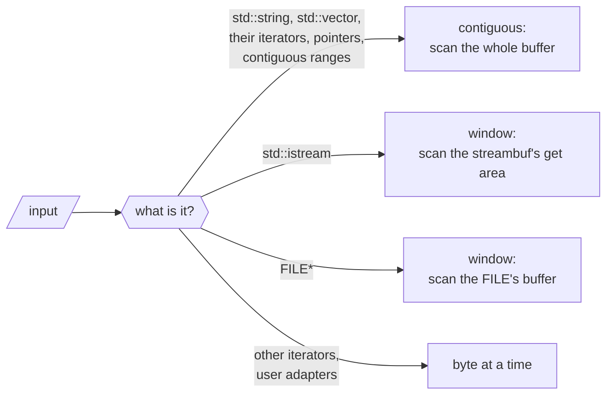
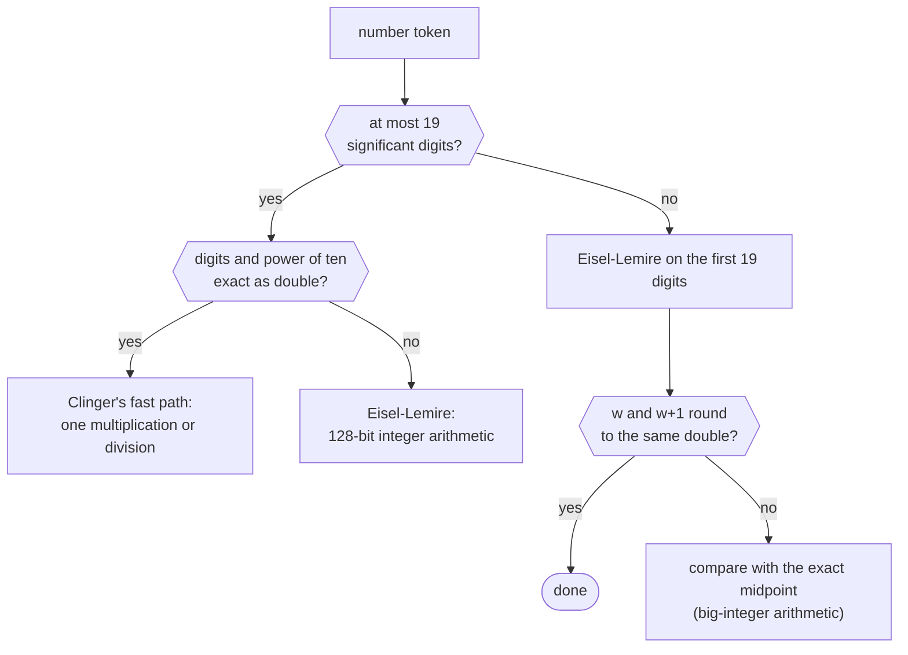
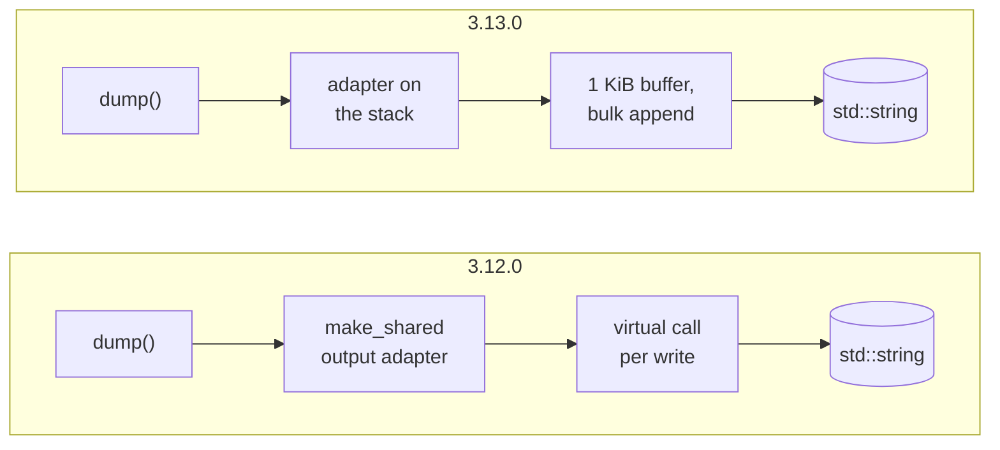
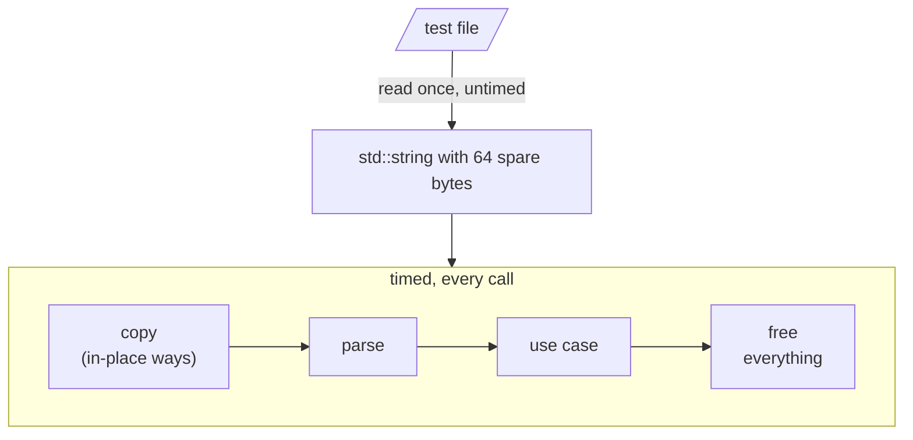

# How nlohmann/json 3.13.0 got 3× faster

<p class="nj-byline"><a href="https://github.com/nlohmann">Niels Lohmann</a> · <time datetime="2026-10-28">October 28,
2026</time></p>

<!-- Before publishing: set the date to the release date, and measure every number of this post again with the
     v3.13.0 tag (Appendix G describes the setup; tests/benchmarks/json_view/others/README.md has the commands of the
     comparison), including the line counts in "The price". The numbers below are from develop 7fc8312c64 with the
     open pull requests #6029, #6031, #6033 and #6039 merged (local branch local/all-prs-1107 at fcae242ac8, plus
     #6039 uncommitted), measured 11-07: suite, timeline (the commits after 11-03 and 3.13.0; the older points are from
     10-27 and 11-03), compile times (5 rounds), the stream gap, and the comparison on the Mac and on x86-64.
     Appendix D and the Intel MacBook Pro column of Appendix B are from 11-03 (the MacBook was not reachable), and so
     is the check with GCC 16 and Clang 23 on the Mac in "Results on x86-64". The Rust times are from 10-29 (Mac) and
     11-03 (x86-64), the x86-64 conformance run from 10-30. Once #6031 is merged, remove it from PENDING in
     scripts/figures/perf_blog.py. Merge tests/benchmarks/json_view/others before publishing (the links 404). -->

Since 2016, the [README](https://github.com/nlohmann/json#readme) of this library has said this about speed:

> There are certainly faster JSON libraries out there. However, if your goal is to speed up your development by adding
> JSON support with a single header, then this library is the way to go.

That sentence is still true, but the gap is a lot smaller now. Swap the 3.12.0 header for the 3.13.0 one, recompile, and
the 182 benchmarks of the library's own suite run 3.3× as fast on an Apple M1 Max (geometric mean; 3.1× on an Intel
MacBook Pro from 2016). Not a line of your code changes. Parsing typical documents got 3.5–5.1× as fast, and writing
them 2.9–6.6×. The new version also adds [`json_document`](../../features/json_view/index.md), a second way to hold a parsed
document, which competes with the fastest C++ and Rust JSON libraries; [How it compares](#how-it-compares) has the
numbers, including where it loses. The price is compile time: two small example programs take 36–68% longer to compile.
A precompiled header or a C++20 module wins back most or all of that in debug builds, and 41% to all of it in
optimized builds ([The price](#the-price)).

This post is about *how*. Hardly any of the techniques are new: we borrowed them from
[simdjson](https://github.com/simdjson/simdjson), [yyjson](https://github.com/ibireme/yyjson),
[fast_float](https://github.com/fastfloat/fast_float), [Żmij](https://github.com/vitaut/zmij),
[serde_json](https://github.com/serde-rs/json), [Glaze](https://github.com/stephenberry/glaze),
[SQLite](https://sqlite.org), [Boost.JSON](https://github.com/boostorg/json), [gnulib](https://www.gnu.org/software/gnulib/),
or a textbook, and we name the source at
each step. What is worth writing about is the *combination*, and the conditions it had to work under. It is a
header-only C++11 library whose 3.x API has been stable for almost nine years, and whose value type is a template over
its string, number, object, array, and allocator types. Input comes from strings, streams, `FILE*`, iterator pairs, wide
strings, and user-defined adapters. Output had to stay the same byte for byte, and error messages had to keep pointing
at the same byte. The few deliberate changes of output are listed in [Appendix F](#f-behavior-changes).

Every number comes from a benchmark we ran for this post or from the pull request that made the change. The
[appendix](#appendix) describes the test files and the setup, has the full tables behind every chart, and lists the pull
requests behind each theme.

Fast paths are where bugs hide: they run only for some inputs, so a mistake in one can go unnoticed until the right
input comes along. So every fast path was tested against the slow path it replaces, on millions of generated and fuzzed
inputs. Both had to return the same value, or fail with the same error message at the same byte. [Appendix
J](#j-validation) lists the checks.

## The short version

The test files are the three of Milo Yip's [nativejson-benchmark](https://github.com/miloyip/nativejson-benchmark) that
JSON libraries have been measured with for a decade, `twitter.json` (strings, much of it Japanese), `citm_catalog.json`
(many small objects, indented) and `canada.json` (floating-point numbers), plus the 56 MB `jeopardy.json`. [Appendix
A](#a-test-files) says what makes each of them hard.

<div class="nj-fig-wrap" markdown>
--8<-- "images/perf_blog_overview.svg"
</div>

<p class="nj-caption" markdown>Speedup of 3.13.0 over 3.12.0 for a selection of workloads: the old time divided by the
new one, Google Benchmark suite on an Apple M1 Max, median of 12 runs. More is better; the vertical line at 1× is
3.12.0. The times are in [Appendix B](#b-3120-against-3130).</p>

The rows above are chosen to show the range. All 182 benchmarks of the suite:

<div class="nj-fig-wrap" markdown>
--8<-- "images/perf_blog_distribution.svg"
</div>

<p class="nj-caption" markdown>How many of the suite's 182 benchmarks got how much faster. The two below 1× copy
`citm_catalog.json` and `twitter.json` without destroying the copy (0.95× and 0.99×). Every row is in [Appendix
B](#b-3120-against-3130).</p>

The median benchmark got 2.9× as fast. On an Intel MacBook Pro (Skylake), the median is 2.9× as well, but parsing
floating-point numbers gained more (`canada.json` 6.1× instead of 4.1×) and writing integers less (`dump()` 1.4–2.3×
instead of 2.2–3.7×); [Appendix B](#b-3120-against-3130) has both columns. Copying and comparing values gained the
least, and the largest gains come from fixing algorithms rather than tuning them (theme
<a class="nj-theme" href="#theme-7" title="theme 7">7</a>).

Eight themes did most of the work:

<div class="nj-theme-list" markdown>

- <a class="nj-theme" href="#theme-1" title="theme 1">1</a> [Specialize for each input source](#theme-1): a dedicated
  reader for each of strings, streams, and `FILE*`, instead of one character at a time for all of them.
- <a class="nj-theme" href="#theme-2" title="theme 2">2</a> [Work on words, not bytes](#theme-2): 8 bytes per step with
  plain integer arithmetic, 16 with SSE2 and NEON.
- <a class="nj-theme" href="#theme-3" title="theme 3">3</a> [Own the number conversions](#theme-3): no `strtod`, no
  locale.
- <a class="nj-theme" href="#theme-4" title="theme 4">4</a> [Don't do unnecessary work](#theme-4): positions, copies,
  and conversions that only matter on an error or for a rare caller.
- <a class="nj-theme" href="#theme-5" title="theme 5">5</a> [Read the assembly](#theme-5): stack canaries, missed
  inlining, aliasing, and branches the compiler chose.
- <a class="nj-theme" href="#theme-6" title="theme 6">6</a> [Write through a cursor](#theme-6): no virtual call per
  character, no allocation per call, no branch per integer.
- <a class="nj-theme" href="#theme-7" title="theme 7">7</a> [Fix the algorithm first](#theme-7): seven operations were
  quadratic or worse.
- <a class="nj-theme" href="#theme-8" title="theme 8">8</a> [Build a different data structure](#theme-8) when the tree
  is the cost.

</div>

## Where the time went: a timeline

The suite compares two points. To see which change did what, we compiled one small benchmark against the header of each
of the 358 commits on `develop` that changed `json.hpp` or `json_view.hpp` from 3.12.0 to November 7, and of 3.13.0, and
ran all of them interleaved. Four of the eight workloads we followed:

- `parse()` of `citm_catalog.json`: the lexer's structure and whitespace handling, and building many small objects;
- `parse()` of `canada.json`: converting text to floating-point numbers;
- `dump()` of `twitter.json`: writing strings;
- `from_cbor()` of `twitter.json`: reading a binary format.

Each panel shows the speedup over 3.12.0 after each commit, on a logarithmic scale. The badges above the steps name the
theme below that explains them. Moving code around changes a build's speed by a few percent on its own, so only the
larger steps mean something.

<div class="nj-charts-grid-wrap" markdown>
<div class="nj-fig-wrap" markdown>
--8<-- "images/perf_blog_timeline_parse_citm.svg"
</div>
<div class="nj-fig-wrap" markdown>
--8<-- "images/perf_blog_timeline_parse_canada.svg"
</div>
<div class="nj-fig-wrap" markdown>
--8<-- "images/perf_blog_timeline_dump_twitter.svg"
</div>
<div class="nj-fig-wrap" markdown>
--8<-- "images/perf_blog_timeline_from_cbor_twitter.svg"
</div>
</div>

<p class="nj-caption" markdown>Speedup over 3.12.0 after each of the 358 commits that changed the headers up to November
7, from 3.12.0 (left) to 3.13.0 (right). More is better; each point is the median of 4 runs of one build, taken in
random order (with 4 runs, the mean of the two middle ones). The badges are theme numbers; "U" is a UTF-8 check that
came and went. The other four workloads, and every labeled step with its pull request and size, are in [Appendix
C](#c-the-timeline).</p>

A few things stand out. A percentage for a step is relative to the time just before that step, not to the time of
3.12.0:

- **There is no single big step.** Parsing `citm_catalog.json` got faster in about six visible steps. The largest
  removed a buffer that only error messages read, which alone saved 35% of the time. The next ones added the fast paths
  for contiguous input, derived positions only on error, and skipped indentation eight bytes at a time; most other
  changes moved it by a few percent.
- **Writing had a few large steps.** `dump()` of `twitter.json` lost 70% of its time in one change (a write buffer and
  bulk string copies), and `dump()` of `canada.json` 65% in another (Żmij).
- **Regressions happen in between.** A UTF-8 check of every text string in the binary readers, byte by byte, made
  `from_cbor()` of `twitter.json` 37% slower for 66 commits, until the readers were made lenient again by default, as in
  3.12.0, with the check as an option. That decision was about the format specifications, which don't require a decoder
  to check, not about speed. The cost went with it. It never shipped in a release.
- **The input decides how big a step is.** Removing the error-message buffer measured 8% on the benchmark of its pull
  request; on the indented `citm_catalog.json` it saved 35%, because every space of the indentation went through that
  buffer.

## <span class="nj-theme">1</span> Specialize for each input source { #theme-1 }

This is the function the 3.12.0 lexer called for **every** byte of input:

```cpp
char_int_type get()
{
    ++position.chars_read_total;
    ++position.chars_read_current_line;

    if (next_unget)
    {
        // just reset the next_unget variable and work with current
        next_unget = false;
    }
    else
    {
        current = ia.get_character();
    }

    if (JSON_HEDLEY_LIKELY(current != char_traits<char_type>::eof()))
    {
        token_string.push_back(char_traits<char_type>::to_char_type(current));
    }

    if (current == '\n')
    {
        ++position.lines_read;
        position.chars_read_current_line = 0;
    }

    return current;
}
```

<p class="nj-code-caption" markdown>The 3.12.0 lexer's `get()`, called for every byte of input.</p>

Two counters in memory, a branch for a pending `unget()`, a call into the input adapter, a `push_back()` into a buffer
that only an error message reads, and a branch for line breaks. The counters are members of the lexer, so the compiler
has to load, add, and store them for every byte. A string or a number then copied each byte a second time into their
token buffer. That is a clean design: one interface works for a `std::string`, an `std::istream`, a `FILE*`, a pair of
iterators over a `std::list<char>`, or a user's own adapter. But it makes every input pay for the most limited one.

3.13.0 has a dedicated reader for each kind of input and picks it at compile time:



<p class="nj-caption" markdown>The four kinds of input the lexer distinguishes in 3.13.0. Everything on the fast paths
falls back to the byte path on anything unusual, so the result and the error messages stay the same. The `FILE*`
window needs glibc or Apple's C library; elsewhere, a `FILE*` is read one character at a time with one lock per
parse.</p>

### Detecting the input in C++11

An input adapter can declare what it supports as static members (`supports_seek`, `supports_bulk_scan`, and a few more).
The lexer detects them with the detection idiom, so a user's adapter that declares nothing keeps the byte path:

```cpp
template<typename A> using detect_supports_seek = decltype(A::supports_seek);
template<typename A>
constexpr bool input_adapter_supports_seek(std::true_type) { return A::supports_seek; }
template<typename A>
constexpr bool input_adapter_supports_seek(std::false_type) { return false; }

static constexpr bool seekable = input_adapter_supports_seek<InputAdapterType>(
    is_detected<detect_supports_seek, InputAdapterType> {});
static constexpr bool lazy_position = seekable;
```

<p class="nj-code-caption" markdown>Detecting a static member of the input adapter with the detection idiom: an adapter
that doesn't declare `supports_seek` is not seekable.</p>

Without `if constexpr`, the flags select overloads by tag dispatch, `f(std::integral_constant<bool, lazy_position>{})`,
which also keeps MSVC from warning about constant conditions. `get()` still looks like the old one, but its position and
token bookkeeping are now calls. For an adapter that can seek, their `std::true_type` overloads are empty and cost
nothing, because the position and the text of a token are derived only when an error message needs them (theme
<a class="nj-theme" href="#theme-4" title="theme 4">4</a>). For a `std::string`, what remains is the branch on
`next_unget` and the adapter's bounds check and pointer increment. For the most common calls, not even that remains:
they don't use the lexer at all ([One loop instead of two](#one-loop-instead-of-two)).

### Contiguous input

Containers with `data()` and `size()` over single-byte elements now become a pointer range in every C++ standard, not
only with C++20's contiguous iterators. `data()` and `size()` alone would be duck typing, so the trait also requires the
container's `value_type` to be the element type behind `data()`. A type whose `size()` counts something else keeps the
iterator path: slower, but correct. On a pointer range, the strings, the numbers and the indentation after a line break
are scanned in bulk (themes <a class="nj-theme" href="#theme-2" title="theme 2">2</a> and
<a class="nj-theme" href="#theme-3" title="theme 3">3</a>). Every fast path defers to the byte path on anything
malformed, so error messages and byte positions stay the same, with one deliberate correction (the column after a number
at the end of a line). [Appendix J](#j-validation) describes how that was checked.

A pair of iterators is harder. Before C++20, `s.begin()` and `s.end()` of a `std::string` can't be told from the
iterators of any other random-access container, so `json::parse(s.begin(), s.end())` was read one character at a time,
while `json::parse(s)` got all the bulk scans. The library now matches the iterator types of `std::string` and of a
`std::vector` of one-byte integers exactly, and turns the pair into the pointer range it covers. That made
`parse(s.begin(), s.end())` 1.7–2.0× as fast on the M1, and `accept()` 2.7–3.1×.

### One loop instead of two

Even on a pointer range, the parser and the lexer still talked through an interface: the parser asks for a token, the
lexer finds it and hands it over, and the parser dispatches on its type. The lexer's state, the current character, a
pending `unget()`, and where the token starts, lives in members, so it goes through memory on every token. After all of
the above, `json::accept()` of `twitter.json` still took 2.8× as long as `json_document::accept()` (theme
<a class="nj-theme" href="#theme-8" title="theme 8">8</a>), which reads the same bytes.

[yyjson](https://github.com/ibireme/yyjson)'s reader shows the alternative: one function that holds the input in a
local pointer and in which the grammar, the whitespace and the tokens are one loop. After a `:`, it tests for the
characters that can start a value right there, instead of returning a token type and dispatching on it. 3.13.0 adds
such a parser for input in one block of memory, `contiguous_parser`. Its stack of open arrays and objects is a 64-bit
word with one bit per level, so the kind of the enclosing container is a shift away and stays in a register; every 64
levels, the word is pushed to a vector. It doesn't build values itself: it drives the library's own SAX handlers, so
`parse()` builds the same `json` with the same code as before. It is used by `parse()` without a callback, by
`accept()`, and by `sax_parse()` with the user's own handler, each with the default options; everything else keeps the
old parser.

The hard part was the errors. A second parser would have to produce the same exception, message and position for
every malformed input, a large surface for small differences. So it doesn't report errors at all. It stops at the
token the old parser would reject, before it reports that token to the handler, and the old parser runs again on the
same input to report the error. `parse()` gives it a handler that only reports, and `sax_parse()` one that forwards
only `parse_error()` to the user's handler, so that no event arrives twice. An error at the end of a large input costs
`parse()` about 1.2× as much as before; valid input costs nothing extra.

On the M1, `accept()` got 1.6–2.0× as fast, `sax_parse()` 1.4–1.5×, and `parse()` 10–16% faster, about the same with
GCC and Clang on x86-64. In `accept()`, which needs no values, the parser also skips the digits of a number without
computing its value, except for the rare float whose exponent may reach the largest `double`: another 16% on
`canada.json`. The cost is about 1,000 lines of header, and a translation unit that parses a string and dumps it
compiles 3% slower at `-O0` and 9% at `-O2`.

### Streams

An `std::istream` already has a buffer: the get area of its `streambuf`, `gptr()` to `egptr()`. The lexer now scans that
window in bulk and keeps the current token as a pointer into it. Those are protected members of `std::streambuf`, and
reaching them takes neither a cast nor a derived object:

```cpp
struct streambuf_access : std::streambuf
{
    static const char* get_ptr(std::streambuf* s) { return (s->*(&streambuf_access::gptr))(); }
    static const char* get_end(std::streambuf* s) { return (s->*(&streambuf_access::egptr))(); }
    static void bump(std::streambuf* s, int n)    { (s->*(&streambuf_access::gbump))(n); }
};
```

<p class="nj-code-caption" markdown>Reaching the protected get area of any `std::streambuf` through pointers to members,
without a cast.</p>

A derived class may name a protected member of its base in a pointer to member, as long as it qualifies the name with
its own class. The resulting pointer has the type `char* (std::streambuf::*)() const`, and access is checked when the
name is used, not when the pointer is called, so it works on any `std::streambuf*`. The common alternative,
`static_cast<streambuf_access*>(sb)->gptr()`, is undefined behavior, because the object is not a `streambuf_access`.

Before the stream refills its get area, the adapter appends the part of the current token that is in it to a carry
buffer; only an error message ever reads the token text back. Nothing is read ahead: the adapter advances `gptr()` by
exactly what the lexer consumes, so the stream is left where it was before. On an M1 Max, parsing from an
`std::ifstream` took 1.8–2.5× as long as reading the file into a string and parsing that, in the pull request's
measurement before the change, and 9–16% longer after it. Since then, parsing a string got faster still, because the
fused parser of [One loop instead of two](#one-loop-instead-of-two) needs input in one block of memory, so a stream now
takes 25–38% longer than the string again (the file read with one `read()`, parsing `twitter.json`,
`citm_catalog.json`, and `canada.json`).

### `FILE*`

`std::fgetc` locks the `FILE` on every call. 3.13.0 locks it once per parse (`flockfile`, then `getc_unlocked`;
`_lock_file` and `_fgetc_nolock` with the Microsoft runtime). `flockfile` is recursive, so the binary readers' `fread()`
and a SAX handler's own `ftell()` keep working. Whereas parsing `citm_catalog.json` from a `FILE*` got 4.4× as fast on
macOS in the pull request's measurement, with glibc it got only 1.1–1.3× as fast, because glibc's per-call locking is
already cheap.

That still left a call per character, while a stream had its get area scanned in bulk. But a `FILE` has a buffer too,
and `getc_unlocked()` is a macro that reads it: glibc's compares `_IO_read_ptr` with `_IO_read_end`, Apple's counts
down `_r` and advances `_p`. The adapter now reads those same fields and offers the lexer the rest of the buffer as a
window, as for a stream. It consumes exactly the characters `getc_unlocked()` would have returned, so the file is
left where it was before, and when the C library is about to refill the buffer, the part of the current token in it is
kept for error messages. The idea is gnulib's
[`freadptr()`](https://github.com/coreutils/gnulib/blob/master/lib/freadptr.c), which knows these fields for many C
libraries. Parsing from a `FILE*` got another 2.0–2.6× faster on the M1 and 1.7–2.2× with glibc on x86-64, and
`accept()` 2.9–4.4×; it is now about as fast as parsing from an `std::ifstream`. uClibc
defines `__GLIBC__` but has other fields, so it is excluded, and other C libraries keep reading one character at a
time.

Two details: MemorySanitizer builds keep `fgetc`, because glibc's inline `getc_unlocked` reads a buffer that
uninstrumented glibc filled. And a SAX handler that waits for another thread using the same `FILE` now deadlocks, as the
documentation says. Both paths can be switched off, with
[`JSON_DISABLE_STREAM_BULK_SCAN`](../../api/macros/json_disable_stream_bulk_scan.md) and
[`JSON_DISABLE_UNLOCKED_FILE_IO`](../../api/macros/json_disable_unlocked_file_io.md); the second turns the `FILE`
window off as well, as it needs the lock for the whole parse.

## <span class="nj-theme">2</span> Work on words, not bytes { #theme-2 }

The core of a JSON lexer is "copy bytes until something interesting happens". Theme 1 gave it ranges of bytes. This
theme reads them a word at a time.

### Eight bytes in a word

In a string, the interesting bytes are the closing quote, a backslash, a control character, and anything above 0x7F
(UTF-8). This test checks eight bytes at once with ordinary 64-bit arithmetic:

```cpp
// return a word whose high bit is set in every byte of v that needs
// individual handling; zero if all 8 bytes can be copied as they are
inline std::uint64_t swar_string_special(std::uint64_t v) noexcept
{
    constexpr std::uint64_t ones = 0x0101010101010101ull;
    constexpr std::uint64_t high = 0x8080808080808080ull;
    const std::uint64_t q = v ^ 0x2222222222222222ull; // '"'
    const std::uint64_t b = v ^ 0x5C5C5C5C5C5C5C5Cull; // '\\'
    const std::uint64_t has_quote     = (q - ones) & ~q & high;
    const std::uint64_t has_backslash = (b - ones) & ~b & high;
    const std::uint64_t has_control   = (v - 0x2020202020202020ull) & ~v & high; // < 0x20
    const std::uint64_t has_non_ascii = v & high;                                // >= 0x80
    return has_quote | has_backslash | has_control | has_non_ascii;
}
```

<p class="nj-code-caption" markdown>The eight-byte test of the string scanner, in portable C++11.</p>

XOR with the quote turns every quote byte into zero, and `(x - 0x01…01) & ~x & 0x80…80` sets the high bit of the bytes
that were zero: the "determine if a word has a zero byte" trick from Sean Eron Anderson's [Bit Twiddling
Hacks](https://graphics.stanford.edu/~seander/bithacks.html#ZeroInWord). The subtraction's borrow runs only upwards, so
it can flag a byte *after* a real hit, but never one before it: the lowest flag is always right, and the number of
trailing zero bits divided by eight is the index of the first special byte.

The code above is the readable form, and it does more work than it needs to. The `& ~x` of the zero-byte test only
keeps bytes from 0x80 out of the result, and `has_non_ascii` flags exactly those bytes anyway. So all three `& ~x`
terms can go, and the whole test becomes one expression:

```cpp
return ((q - ones) | (b - ones) | (v - 0x2020202020202020ull) | v) & high;
```

<p class="nj-code-caption" markdown>The same test without the redundant `& ~x` terms.</p>

Clang finds this reduction on its own; GCC doesn't, and emitted 24 instructions per word instead of 16. With GCC on
x86-64, writing it out made validating `twitter.json` and `citm_catalog.json` 5–7% faster and `dump()` 2–3%. The
masks of both forms are the same for every pair of adjacent byte values and for 1.3 billion random words.

<div class="nj-fig-wrap" markdown>
--8<-- "images/perf_blog_swar.svg"
</div>

<p class="nj-caption" markdown>`swar_string_special()` on the last eight bytes of `"twitter",`: one word in, one flag
out, and the count of trailing zero bits says how many bytes can be copied before the quote.</p>

Two details make this portable C++11. The word is loaded with `std::memcpy`, which compilers turn into one load and
which, unlike a `reinterpret_cast`, doesn't break the aliasing rules. And the load always produces the bytes in
little-endian order, so the first byte of the text is the lowest byte of the word everywhere; a big-endian target
assembles the word from bytes, which compilers fold into a load and a byte swap. Every loop checks that eight bytes
remain before it loads, and finishes the remaining one to seven bytes one at a time, so nothing is read past the
input.

The same kind of word test now runs in several places:

- **Strings in the lexer,** including runs of well-formed multi-byte UTF-8, which are validated one sequence after the
  other without going back to the byte loop.
- **Numbers,** eight digits per step (theme <a class="nj-theme" href="#theme-3" title="theme 3">3</a>).
- **Indentation.** After a newline, `word ^ 0x2020…20` is zero for eight spaces; the first non-zero byte ends the
  indentation, and its trailing-zero count says how many spaces of the last word to skip as well. The idea is from
  [Glaze](https://github.com/stephenberry/glaze)'s `skip_matching_ws`, which compares with the previous line's
  indentation; comparing with spaces needs no state and works for any indentation width. A version that skipped only
  whole words validated 5–12% slower and gave nothing on two-space indentation, where the runs are often shorter than a
  word. With four-space indentation, validating `citm_catalog.json` got 22–30% faster.
- **[`dump()`](../../api/basic_json/dump.md),** for runs of characters that need no escaping, with and without
  [`ensure_ascii`](../../api/basic_json/dump.md#parameters).
- **The binary formats,** for the zero byte that ends a BSON key, and for the UTF-8 check of strings with
  `error_handler_t::strict`. On the M1, reading `canada.json` from BSON got 14% faster, and writing `twitter.json` as
  UTF-8-checked CBOR 14%.

### 16 bytes with SSE2 and NEON

Where a vector unit is part of the baseline instruction set (SSE2 on x86-64, NEON on 64-bit Arm), the string paths take
16 bytes per step. Three details are worth repeating. A signed comparison `byte < 0x20` catches control characters
*and* every byte from 0x80, because those are negative as `int8_t`. Flipping bit 1 first folds the quote into that
comparison too: `c ^ 2` maps 0x00–0x1F onto themselves and the quote (0x22) onto 0x20, keeps the bytes from 0x80
negative, and maps every other ASCII byte to 33 or more. So `(int8_t)(c ^ 2) < 33` finds three of the four classes of
bytes, and only the backslash needs a comparison of its own (Daniel Lemire, ["Detect control characters, quotes and
backslashes efficiently using
SWAR"](https://lemire.me/blog/2025/04/13/detect-control-characters-quotes-and-backslashes-efficiently-using-swar/),
2025; ruby/json uses the same trick in its SIMD scan). Neither GCC nor Clang finds this one on its own. And NEON has no
equivalent of x86's `pmovmskb`, which turns a vector of comparison results into a bit mask. The usual replacement, by
[Danila
Kutenin](https://developer.arm.com/community/arm-community-blogs/b/servers-and-cloud-computing-blog/posts/porting-x86-vector-bitmask-optimizations-to-arm-neon),
shifts each 16-bit lane right by four and narrows it to eight bits, which leaves four bits per input byte in a 64-bit
integer:

```cpp
while (e - p >= 16)
{
    const uint8x16_t in = vld1q_u8(p);
    // the backslash, and (c ^ 2) < 33 as int8_t for the quote, the control
    // characters and the bytes from 0x80
    const uint8x16_t special = vorrq_u8(vceqq_u8(in, vdupq_n_u8('\\')),
                                        vcltq_s8(vreinterpretq_s8_u8(veorq_u8(in, vdupq_n_u8(2))),
                                                 vdupq_n_s8(33)));
    // each byte of special is 0x00 or 0xFF; shifting each 16-bit lane right by 4 and
    // keeping its low byte leaves 4 bits per input byte
    const uint8x8_t nibbles = vshrn_n_u16(vreinterpretq_u16_u8(special), 4);
    const std::uint64_t bits = vget_lane_u64(vreinterpret_u64_u8(nibbles), 0);
    if (bits != 0)
    {
        return p + (count_trailing_zeros(bits) >> 2u);   // four bits per byte
    }
    p += 16;
}
```

<p class="nj-code-caption" markdown>The NEON string scan: two comparisons for four classes of bytes, and a narrowing
shift in place of `pmovmskb`.</p>

On `twitter.json`, the vector scan made `json::parse()` 5% faster with Clang and 9% with GCC on an M1 Max; on long
strings, 19–24%. It did not win from the first byte. On the M1, starting with NEON made short strings 3–4% slower and
the rest of the lexer bigger. So ARM runs four 8-byte words first and keeps the vector loop out of line, while x86-64
runs one word first. Inlining the vector code into the lexer cost 5% of validating `jeopardy.json` on the M1, although
no string of that file is long enough to reach it: the scan function, which runs once per token, saved more registers
and needed a stack slot.

[`json_document`](../../features/json_view/index.md), the new document type of `json_view.hpp`, also skips the digits after a
decimal point 16 bytes at a time with SSE2: a compare and a bit mask instead of a branch per digit, about 33% of the
instructions for a 12-digit fraction. Parsing `canada.json` got 22% faster on x86-64, a file of 10,000 floats 28–32%.

One row got slower: with GCC 16, `citm_catalog.json` took 8% longer with the same number of instructions, because more
of its hot jumps now crossed a 32-byte boundary. The microcode fix for Intel's JCC erratum makes that slow on our
server. Assembling with `-Wa,-mbranches-within-32B-boundaries` shrinks the loss to about 4%, but a header-only library
can't choose the assembler flags of the programs that include it, so we left the code as it is, and all numbers in this
post are measured without that flag.

### Validating UTF-8 16 bytes at a time

Validating UTF-8 16 bytes at a time uses [simdjson](https://github.com/simdjson/simdjson)'s "lookup4" algorithm ([Keiser
and Lemire, 2021](https://arxiv.org/abs/2010.03090)): three 16-entry tables, indexed by nibbles of a byte and of the
byte before it, each give the set of errors that nibble allows, and a pair of bytes is invalid if all three sets share
an error. It needs `pshufb`, which is SSSE3 and not part of baseline x86-64. The function is compiled with
`__attribute__((target("ssse3")))`, out of line, and called only if `cpuid` says so. The result of that query is cached
in a constant-initialized `static std::atomic<int>`, so that neither a guarded local static nor a global constructor is
needed; threads that ask at the same time all store the same answer. On an error, the code backs up to the start of the
sequence and lets the byte path produce the error message. [`JSON_NO_SIMD`](../../api/macros/json_no_simd.md) turns all
vector code off.

### Short strings

Short strings are a different problem. Most keys and many values are short: `citm_catalog.json` averages 8 bytes per
string and `jeopardy.json` 14. For them, setting up a scan costs more than the scan. The first step took the idea of
[SQLite](https://sqlite.org/src/file/src/json.c)'s `jsonAppendString()`: check each byte of a string of up to 32 bytes
against a 256-entry table of bytes that can be written unchanged, and copy the string in one go if they all pass. 32
bytes was the best threshold on the M1; 16 gained less, and 64 lost again. The second step replaced the table, where
SSE2 or NEON is available, with overlapping loads, the trick that `memcpy` implementations such as glibc's use for short
copies:

```cpp
// 16 <= n <= 32: two loads that overlap in the middle cover the whole string
const uint8x16_t a = vld1q_u8(p);
const uint8x16_t b = vld1q_u8(p + n - 16);
const uint8x16_t special = /* '"', '\\', < 0x20 or 0x7F, in a or in b */;
if (vmaxvq_u8(special) != 0)
{
    return false;          // nothing has been written yet; take the general path
}
vst1q_u8(d, a);
vst1q_u8(d + n - 16, b);   // the two stores overlap too, with the same bytes
```

<p class="nj-code-caption" markdown>Writing a string of 16–32 bytes with two overlapping loads and stores (NEON).</p>

<div class="nj-fig-wrap" markdown>
--8<-- "images/perf_blog_overlap.svg"
</div>

<p class="nj-caption" markdown>The code above on `profile_link_color`, a key of `twitter.json`.</p>

On `twitter.json`, this cut the instructions of `dump()` by 21%. Shorter strings use the same trick with two overlapping
8-, 4-, or 2-byte loads, so no `memcpy` with a length known only at run time is left.

### Escapes from a table

When the scanner stops at a quote, a backslash, or a control character, the writer copies its escape sequence from a
table of 8-byte rows, padded with zeros, with the length in the last byte:

```cpp
{{'\\', 'u', '0', '0', '0', '0', 0, 6}},   // 0x00
{{'\\', 'n', 0, 0, 0, 0, 0, 2}},           // 0x0A
{{'\\', '"', 0, 0, 0, 0, 0, 2}},           // 0x22

std::memcpy(write_buffer.data() + write_buffer_pos, escape.data(), 8);   // always 8 bytes
write_buffer_pos += escape[7];                                         // keep only the real length
```

<p class="nj-code-caption" markdown>Three rows of the escape table, and how a row is written: always 8 bytes, then the
real length.</p>

One 8-byte store and one add, with no branch on the length; the padding lies behind the write position and is
overwritten by the next write. The writer makes sure that 8 bytes are free before it copies. The idea is from
[orjson](https://github.com/ijl/orjson)'s `QUOTE_TAB`, which orjson took from
[sonic-rs](https://github.com/cloudwego/sonic-rs). Although dumping 100,000 log lines full of `\n`, `\t`, and quotes got
23% faster on an M1 Max, most of that came from writing straight into the write buffer instead of an intermediate one.
The table alone gained 2–7%.

## <span class="nj-theme">3</span> Own the number conversions { #theme-3 }

3.12.0 converted every floating-point number with `strtod` and every integer with `strtoull` or `strtoll`, after copying
the token into a buffer. `strtod` is correct, but general: it consults the locale for the decimal point, sets `errno`,
and handles any length of input. `std::from_chars` would avoid the locale, but it doesn't exist before C++17, and libc++
has its floating-point overloads without defining `__cpp_lib_to_chars`, so macOS builds could not detect it.

`canada.json`, a GeoJSON file of 111,126 numbers, shows what that costs. 108,528 of its numbers have 16 or 17
significant digits, like `-65.613616999999977`. The classic shortcut is Clinger's fast path ([Clinger,
1990](https://doi.org/10.1145/93542.93557)): write the number as its digits `w` times a power of ten, convert `w` to a
`double`, and multiply or divide it by that power of ten. If both are exact as `double`, that is, `w` is at most 2⁵³
(9,007,199,254,740,992) and the power at most 10²², the operation rounds only once, and the result is the correctly
rounded `double`. For most of `canada.json`'s numbers, `w` doesn't fit into 53 bits.

3.13.0 converts `float` and `double` numbers itself, without the C library and without the locale:



<p class="nj-caption" markdown>How 3.13.0 converts a decimal token to a `double`. Of `canada.json`'s 111,080
floating-point numbers, 9,742 take Clinger's fast path and 101,338 Eisel-Lemire; none has more than 19 digits.</p>

### Eight digits at a time

On contiguous input and stream windows, the lexer accumulates the value while it validates the token, so the digits are
read once. The core is [fast_float](https://github.com/fastfloat/fast_float)'s eight-digit conversion: three
multiplications instead of eight.

```cpp
// v: eight ASCII digits, the first digit in the lowest byte
std::uint32_t parse_eight_digits(std::uint64_t v) noexcept
{
    v = ((v & 0x0F0F0F0F0F0F0F0Fu) * 2561u) >> 8u;            // 2561 = 10 * 2^8 + 1
    v = ((v & 0x00FF00FF00FF00FFu) * 6553601u) >> 16u;        // 6553601 = 100 * 2^16 + 1
    v = ((v & 0x0000FFFF0000FFFFu) * 42949672960001u) >> 32u; // 10000 * 2^32 + 1
    return static_cast<std::uint32_t>(v);
}
```

<p class="nj-code-caption" markdown>fast_float's conversion of eight ASCII digits to their value, with three
multiplications.</p>

<div class="nj-fig-wrap" markdown>
--8<-- "images/perf_blog_digits.svg"
</div>

<p class="nj-caption" markdown>`parse_eight_digits()` on `"12345678"`: multiplying by `10·2⁸ + 1` adds ten times each
byte to the byte above it, and the shift and the next mask keep every second lane.</p>

Checking that all eight bytes are digits takes one more expression. A digit is a byte from 0x30 to 0x39. In hexadecimal,
its upper half is 3 and its lower half is at most 9. Adding 6 tests the lower half: 0x39 + 6 = 0x3F still has the upper
half 3, but 0x3A + 6 = 0x40 carries into it. So a byte is a digit exactly if its upper half is 3 both before and after
adding 6, and with masks, that is one comparison for all eight bytes. An integer of up to 18 digits always fits into an
`int64_t`, and 19 digits into a `uint64_t`, so they need no overflow check.

### Clinger's fast path

Clinger's fast path is guarded by more than the two conditions above:

```cpp
#if !defined(FLT_EVAL_METHOD) || FLT_EVAL_METHOD == 0
if (exponent >= -22 && exponent <= 22 && w <= (std::uint64_t{1} << 53))
{
    double value = static_cast<double>(w);
    value = exponent < 0 ? value / exact_power_of_ten(-exponent)
                         : value * exact_power_of_ten(exponent);
    return negative ? -value : value;
}
#endif
```

<p class="nj-code-caption" markdown>Clinger's fast path: one correctly rounded multiplication or division, only without
x87 extended precision.</p>

With x87 arithmetic (`FLT_EVAL_METHOD != 0`), the intermediate result has extended precision and is rounded twice, so
those targets skip the fast path and take the integer-only route below.

### Eisel-Lemire

[Eisel-Lemire](https://arxiv.org/abs/2101.11408), adapted from fast_float's `compute_float`, handles everything else
with integers only: it multiplies the digits with a 128-bit approximation of `5^q` from a table and takes the mantissa
from the top of the product. For up to 19 digits, that always suffices ([Mushtak and Lemire,
2023](https://arxiv.org/abs/2212.06644)). Longer numbers, rare in JSON, are bracketed by their first 19 digits and that
plus one; only if the two round differently are all digits compared with the exact midpoint. [Appendix
I](#i-details-of-the-themes) has the details. Because it is integer arithmetic, the result no longer depends on the C
locale. (JSON always uses `.`, but `strtod` expects the locale's decimal separator, so 3.12.0 replaced the `.` before
calling it, which [failed for separators longer than one byte][5660].) [Appendix J](#j-validation) describes how the
conversion was checked against `strtod`.

### Writing: Żmij

For output, 3.12.0 used [Grisu2](https://doi.org/10.1145/1806596.1806623), which is fast but sometimes writes a 17th
digit where 16 suffice. 3.13.0 ports [Żmij](https://github.com/vitaut/zmij) by Victor Zverovich to C++11. It writes the
shortest decimal that reads back as the same `double`, and the closest one if there are several. Its digit conversion,
by Xiang JunBo, is the parser's divide-by-multiplying idea run backwards on all lanes of a word at once ([Appendix
I](#i-details-of-the-themes) shows it), and with SSE2 or NEON, Żmij's vector code (the NEON version by Dougall Johnson,
the SSE version by Tobias Schlüter) converts all 16 digits in one vector register.

One stall turned up on the way. To make room for the decimal point, the code first wrote all 16 digits, as two 8-byte
stores, and then moved the digits after the point one byte to the right: it loaded them and stored them one byte
further. That load came right after the two stores and read part of each. A CPU can hand a load the data of one store
that hasn't reached the cache yet, but it can't combine two, so the load had to wait until both stores were written. The
commit measured that wait as about 25% of the time to write a `double`. The vector version avoids memory: it keeps the
digits in a register, moves the ones after the point up by one byte there, puts `'.'` into the gap, and stores all 16
bytes once.

In the pull request's measurement, `dump()` of `canada.json` got about 3× as fast, on an M1 Max as well as on an x86-64
server with GCC and Clang. The changed output is listed in [Appendix F](#f-behavior-changes): 0.14% of random `double`s
are written differently, all of them with the same or fewer digits, and all of them read back as the same value.

## <span class="nj-theme">4</span> Don't do unnecessary work { #theme-4 }

A lot of what the 3.12.0 parser did was correct, cheap per call, and read by nobody in the common case.

### The token buffer

The old `get()` of theme <a class="nj-theme" href="#theme-1" title="theme 1">1</a> pushed every character into
`token_string`, a buffer that only the "last read" part of an error message uses. For seekable input, the lexer now
remembers the offset where the token started and copies the text from the input if an error happens. This is the 35%
step of the timeline: in the indented `citm_catalog.json`, every space of the indentation went through the buffer. For
streams, the carry buffer of theme <a class="nj-theme" href="#theme-1" title="theme 1">1</a> does the same job; the
per-character copy had been about 20% of what was left of a stream parse.

[`accept()`](../../api/basic_json/accept.md) went one step further: it doesn't copy strings and keys at all. The lexer
and the parser take a template parameter that drops values, so `accept()` gets its own instantiation without the copies.
That made validating `twitter.json` 11–13% faster on x86-64, and 19 files of simdjson's examples 12% by geometric mean.

### Positions only on error

For input that can be seeked, the lexer no longer counts lines and columns. The byte offset is the distance from the
start, and lines and columns are recomputed only when an error message needs them:

```cpp
std::size_t count_consumed_lines(std::size_t last_index, std::size_t& line_start) const
{
    const auto to = std::next(begin, last_index);
    using reverse_it = std::reverse_iterator<IteratorType>;
    const auto last_newline = std::find(reverse_it(to), reverse_it(begin), '\n');
    line_start = std::distance(begin, last_newline.base());   // column: offset - line_start
    return std::count(begin, last_newline.base(), '\n');      // line: newlines before it
}
```

<p class="nj-code-caption" markdown>Line and column of an error, computed from the byte offset only when an error
message needs them.</p>

That is linear in the input, but only an error pays for it. It is what [serde_json's slice
reader](https://github.com/serde-rs/json/blob/master/src/read.rs) does (`position_of_index()` with `memrchr` and a
newline count). A pending `unget()` is a flag, and the offset subtracts one for it, so `unget()` does no position work
at all. Measuring the two parts of the old `get()` separately on an M1 showed that the newline branch cost more than the
counters: removing only the branch saved 16% of validating an indented `twitter.json`, removing only the increments 4%.
Parsing `citm_catalog.json` got 12% faster.

### The text of float tokens

The lexer copied every float token into a buffer so that a SAX handler's `number_float(val, s)` could see the original
text: an out-of-line `std::string::append` per float, about 10% of parsing `canada.json`. The handlers behind
[`parse()`](../../api/basic_json/parse.md) and [`accept()`](../../api/basic_json/accept.md) never look at it. The parser
now recognizes them by their exact type:

```cpp
template<typename SAX> struct sax_ignores_number_text : std::false_type {};
template<typename B, typename IA, bool Collect, typename L>
struct sax_ignores_number_text<json_sax_dom_parser<B, IA, Collect, L>> : std::true_type {};
template<typename B>
struct sax_ignores_number_text<json_sax_acceptor<B>> : std::true_type {};
// json_sax_dom_callback_parser likewise

// at the call site
sax->number_float(res, number_float_text(sax));   // an empty string for the handlers above
```

<p class="nj-code-caption" markdown>Recognizing the library's own SAX handlers, which never read the text of a float
token.</p>

A class derived from `json_sax_dom_parser` does not match the specialization, so it keeps getting the exact text. For
every other handler, the lexer only records a pointer to the token and its length, and copies on the first
`get_string()`. That is safe for contiguous input, which has to outlive the parse anyway; in a stream's window, the next
refill could overwrite the text, so there the copy is made at once. The first version put the "is there pending text?"
check into the `get_string()` that keys and strings use too, and lost 2–3% on string-heavy input. Keys and strings now
call a separate function without the check. Parsing `canada.json` got 9–11% faster.

### A copy that should have been a move

[`from_cbor()`](../../api/basic_json/from_cbor.md) and the other binary readers ended like this:

```cpp
return res ? result : basic_json(value_t::discarded);   // 3.12.0
```

<p class="nj-code-caption" markdown>The end of the 3.12.0 binary readers: the conditional operator copies `result`.</p>

`result` is a local, but the conditional operator's operand is an lvalue expression, and the implicit move on `return`
applies only to a returned name. So every successfully parsed value was deep-copied once and then destroyed. 3.13.0
assigns `discarded` to `result` on failure and returns `result` by name. Decoding a 2 MB CBOR document went from 26.99
ms to 14.65 ms. The copy was also a stack-overflow risk: the copy constructor recursed once per level, for a value the
reader had already accepted.

### `ordered_json` growth

[`ordered_json`](../../api/ordered_json.md) stores its members in a `std::vector<std::pair<const std::string, json>>`.
Because the key is `const`, the pair's "move" constructor copies the key and can throw. When `std::vector` grows, it
uses `std::move_if_noexcept` to keep the strong exception guarantee, so for this element type it copies every element,
including the whole subtree behind every value. The library now grows the storage itself, in two phases:

```cpp
// phase 1, may throw but only touches tmp:
// copy the keys, default-construct the values, add the new element
Container tmp(this->get_allocator());
tmp.reserve((std::max)(size_type{1}, 2 * this->size()));
for (const auto& element : *this)
    tmp.emplace_back(std::piecewise_construct, std::forward_as_tuple(element.first),
                     std::forward_as_tuple());
tmp.emplace_back(std::forward<Args>(args)...);
// phase 2, cannot throw: move-assign the values, adopt the storage
auto it = tmp.begin();
for (auto& element : *this) { it->second = std::move(element.second); ++it; }
Container::swap(tmp);
```

<p class="nj-code-caption" markdown>How `ordered_map` grows its storage in two phases, without copying the values.</p>

The new element is constructed before any value is moved, so `j.emplace("new", std::move(j["old"]))` still works, and
the strong guarantee holds without a `try`, which matters because the library also builds with `-fno-exceptions`.
Parsing `twitter.json` into `ordered_json` needs 33% of the allocations and, in the pull request's measurement, about
50% of the time. Unfortunately, compilers with the EDG front end (Intel's icpc, NVIDIA's nvc++) consider that pair's
move constructor `noexcept`. There, the vector already "moves", the new path is not taken, and a key copy that throws
during growth calls `std::terminate`.

### Containers built one element at a time

The DOM parser used to `push_back` every element into its array, and insert every member into its object as soon as it
was parsed. Now all open arrays share one stack of elements; when an array of up to 16 elements ends, it is constructed
at its exact size from a range of move iterators, one allocation. `ordered_json` objects collect up to 32 members the
same way, with a linear duplicate-key check over that short slice, and larger objects get a side table of hashes for
that check from 64 members on. An `ordered_json` object with very many members went from 43 million instructions to 1.9
million, and `ordered_json` now parses 1–15% *faster* than `json` in our suite, since `json`'s `std::map` still
allocates a node per member. The binary readers know their sizes up front and use a separate handler without the stack;
sharing it had made them 5–12% slower with GCC.

The binary readers also stopped taking every element through their general dispatch. When an array opens, the CBOR and
MessagePack readers read the numbers, booleans, and nulls that follow in one loop, and the UBJSON and BJData readers do
the same for arrays with a type marker. Reading an array of a million integers from CBOR or MessagePack got 42–47%
faster, and `canada.json` 10%. Arrays of one element skip the loop: in 1,000 arrays nested in each other, each entered
it only to find another array, which cost 6–8%. Now the loop costs nested arrays nothing measurable, and costs 100,000
arrays `[1,2]` at most 1.5%.

### Smaller ones

The parser checks for the expected `:` or `,` before it falls into the lexer's general token switch (−7% on
`citm_catalog.json`, a contribution by [@mvanslobbe](https://github.com/mvanslobbe)), and
[`to_cbor()`](../../api/basic_json/to_cbor.md) no longer creates a temporary `basic_json` for every object key it writes
(−55% on `twitter.json`, by [@alexprabhat99](https://github.com/alexprabhat99)). And the binary readers wrote every
byte of a string twice: they grew the string with `resize()`, which fills it with zeros, and then copied the bytes over
the zeros. The zero fill alone was 5% of the instructions of `from_cbor()`. A string that the input holds in one block
is now appended from it directly, after its claimed length has been checked against the input, so a huge claimed
length still allocates nothing. Reading `twitter.json` and `citm_catalog.json` from CBOR and MessagePack got 5–9%
faster on the M1, 3–9% on x86-64.

!!! note "The same idea, measured twice"

    The SAX interface hands the lexer's buffer to the handler as `string_t&` and allows it to be moved from; the lexer
    starts each token with an empty buffer anyway. In September, moving string values instead of copying them saved
    2–3%. We measured moving keys too, and dropped it. The buffer is sized for the longest token so far, and keys are
    short while values are long. So moving a key hands a large buffer to a short string, and the next value has to grow
    a new one: 11.9% slower on 40,000 short strings. In October, with much of the lexer around it rewritten, moving keys
    was measured again: `parse()` of `twitter.json` got 3.3% faster with Clang and 5.0% with GCC, so keys are moved now
    too. An idea that lost once is worth measuring again when the code around it changes.

## <span class="nj-theme">5</span> Read the assembly { #theme-5 }

A good part of 3.13.0 came from reading what the compiler made of the hot loops, with Clang's `-Rpass-missed=inline`,
profiles, and instruction counts. None of the following shows up in the source as a problem.

### A stack canary on every token

The function that dispatches on the first byte of a token built the expected text of `true`, `false`, and `null` in
local arrays:

```cpp
case 't':   // 3.12.0
{
    std::array<char_type, 4> true_literal = {{'t', 'r', 'u', 'e'}};
    return scan_literal(true_literal.data(), true_literal.size(), token_type::literal_true);
}
```

<p class="nj-code-caption" markdown>The 3.12.0 lexer's dispatch for `true`: a local array, and with it a stack canary.</p>

With `-fstack-protector-strong`, which Ubuntu's GCC enables by default and many distributions use for their packages,
*any* local array gives a function a stack canary: the prologue loads a secret (on x86-64 Linux from thread-local
storage) and stores it next to the locals, and every return compares it. Even worse, that happens on every call, also
for the `[`, `,` and `"` tokens that never touch the array. The canary's load alone was 11% of the function's samples.
(Plain `-fstack-protector` only protects character arrays of at least 8 bytes, so it didn't trigger here.) Now the
literal is a string literal whose length is a template parameter, compared on contiguous input with one `memcmp` of
constant size, and the dispatch has no canary and no array on the stack:

```cpp
case 't': return scan_literal("rue", token_type::literal_true);

template<std::size_t N>
JSON_HEDLEY_NEVER_INLINE token_type scan_literal(const char (&rest)[N], token_type return_type);
```

<p class="nj-code-caption" markdown>The 3.13.0 dispatch: a string literal whose length is a template parameter.</p>

`scan_literal()` is deliberately out of line: inlined, it made Clang's dispatch grow from 233 to 278 instructions, and
slower. Together with the next change, validating `canada.json` got 10.5% faster with GCC on x86-64. The same change
replaced the parser's `std::vector<bool>` nesting stack, whose `push_back` GCC called out of line, with
`std::vector<std::uint8_t>`; a bit vector saves memory that a stack of nesting levels doesn't need.

### Exceptions that block inlining

A function that can throw builds the message, allocates the exception, and needs a landing pad for every temporary, even
if the throw never happens:

```cpp
if (JSON_HEDLEY_LIKELY(ptr != nullptr)) { return *ptr; }   // 3.12.0, get_ref()
JSON_THROW(type_error::create(303, detail::concat(
    "incompatible ReferenceType for get_ref, actual type is ", obj.type_name()), &obj));
```

<p class="nj-code-caption" markdown>The throw in 3.12.0's `get_ref()`: building the message makes the function too big
to inline.</p>

That made [`get_ref()`](../../api/basic_json/get_ref.md), [`operator[]`](../../api/basic_json/operator%5B%5D.md),
[`at()`](../../api/basic_json/at.md) and the iterator operators too big to inline, and gave callers large frames (192
bytes for `get_ref()` with GCC). 3.13.0 moves construction and `throw` into helpers marked `[[noreturn]]` and never
inlined, so the hot function keeps a test and a call:

```cpp
if (JSON_HEDLEY_LIKELY(ptr != nullptr)) { return *ptr; }
throw_incompatible_reference_type(obj);   // JSON_HEDLEY_NO_RETURN JSON_HEDLEY_NEVER_INLINE
```

<p class="nj-code-caption" markdown>The same function in 3.13.0: a test and a call of a helper that is never inlined.</p>

That fixed 27 throw sites. Iterator arithmetic got 6× as fast with Clang, and `std::sort` over a `json` array of 10,000
integers in user code 6–9% faster.

The value's own lifecycle had the same problem: the destructor, the copy constructor, and
[`operator==`](../../api/basic_json/operator_eq.md) contained the code for every type, so they were too big to inline
even for a number. Clang reported about 380 call sites where they were not inlined. Now the destructor and the copy
constructor start with an inline test whether the value owns memory, which Clang compiles to one bit test
(`1 << type & 0x10E`), `operator==` with one for two scalars of the same type, and the rest is out of line. `j == 5`
went from 3.55 ns to 0.65 ns with Clang. It is not free: a test file of `extern "C"` wrappers around the library's
functions, which we compile to check what gets inlined, grew by 13% at `-O2`, and with GCC, `operator==` on large
documents got about 7% slower.

### Aliasing

C++ allows a `char` to access any object, so a store through a `char` pointer may change any object whose address the
compiler can't rule out. In a writer that keeps its write position `pos` in a member, `buffer[pos++] = c` therefore
costs more than it looks: the compiler can't prove that the store of `c` didn't overwrite `pos` itself, so it writes
`pos` to memory before every character and loads it again after. A local variable whose address never escapes can't be
reached by any store, and stays in a register:

```cpp
std::size_t pos = write_buffer_pos;   // a local: no char store can reach it
// ... write_buffer[pos++] = digit; ...
write_buffer_pos = pos;               // published once at the end
```

<p class="nj-code-caption" markdown>Keeping the write position in a local, so that the compiler can keep it in a
register.</p>

On a 4 MiB binary value, [`dump()`](../../api/basic_json/dump.md) went from 18.0 ms to 7.4 ms with this change alone.
`json_document`'s writer and the binary writers keep their cursors in locals for the same reason, and publish them
before any call that could see them.

### Loop shape beats branch count

A change that removed one branch per whitespace byte made scanning long runs of indentation 1.75–3.2× *slower* with
Clang and GCC. It had rewritten `do { get(); } while (is_whitespace());` into
`get(); while (is_whitespace()) { get_ignoring_pending_unget(); }`, and the assembly showed why it lost: neither
compiler kept the input's read and end pointers in registers any more, and both reloaded them from memory on every
character. Restoring the do-while shape, `get(); if (is_whitespace()) { do { ... } while (is_whitespace()); }`, fixed
it. We don't know why the while loop lost the registers, only that the do-while shape gets them back.

### Inlining that disappears

Inlining is a budget per function. Once the string writer had grown, GCC 13 and 16 stopped inlining two tiny, unchanged
helpers into the pretty-printing loop, and indented output got up to 13% slower. They are now forced inline. A change in
one place silently made an unrelated loop slower; only a benchmark of indented output noticed.

### Branches the compiler chose

[`json_document`](../../api/json_document.md) writes most floats of `canada.json` by deciding, from where the `double`
lies relative to its source text, which of two or three candidate digit strings to write. The conditions of those
selections depend on the digits, so they are as good as random:

```cpp
const bool up = from > 37 * one;
const bool shorter = biased_distance(from - (up ? 10 * one : 0)) < radius;
const std::uint64_t a = w - r10 + (up ? 10u : 0u);
return shorter ? a : b;
```

<p class="nj-code-caption" markdown>Selecting a candidate digit string: GCC 13 compiled the conditional operators as
jumps.</p>

Clang compiled the `?:` as conditional moves; GCC 13 compiled them as jumps. With nothing to tell it that the conditions
are unpredictable, a branch that skips some work looks cheaper than computing both sides.
[Callgrind](https://valgrind.org/docs/manual/cl-manual.html)'s branch simulation counted 220,000 mispredictions per dump
of `canada.json` with GCC, against 97,000 with Clang. Written as masks, which have no branch form to reconstruct, the
selections stay branch-free with GCC and Clang:

```cpp
// all ones or zero
std::uint64_t mask_if(bool b) { return std::uint64_t{0} - static_cast<std::uint64_t>(b); }
std::uint64_t select_if(bool b, std::uint64_t a, std::uint64_t c)
{
    return c ^ ((a ^ c) & mask_if(b));
}

const bool shorter = biased_distance(from - (mask_if(up) & (10 * one))) < radius;
const std::uint64_t a = w - r10 + (mask_if(up) & 10u);
return select_if(shorter, a, b);
```

<p class="nj-code-caption" markdown>The same selections written as masks, which stay branch-free with GCC and Clang.</p>

With GCC on x86-64, the mispredictions went down to 98,000, and the dump of `canada.json` got about 15% faster with 5%
*more* instructions. With Clang, the time stayed the same. We found this one while writing this post.

### Code size as a cost

[`get<std::array<int, 1000>>()`](../../api/basic_json/get.md) used a pack expansion, `{{ j.at(Idx).get<T>()... }}`. A
pack expansion is unrolled before the optimizer decides anything, so once `at()` had become small enough to inline,
Clang emitted one function of about 28,000 instructions (with 3.12.0, about 8,000): a thousand inlined copies of the
bounds and type checks. Its time moved from 657 to 957 ns just by aligning the code differently. A loop needs 49
instructions.

!!! note "Instruction counts, not only time"

    On the x86-64 machine we used for checking, moving code by a few bytes changed the time of unrelated benchmarks by
    up to ±5%. Many decisions were therefore made on instruction counts (callgrind on Linux, `/usr/bin/time -l` on
    macOS), checked against timings of builds with all functions and loops aligned to 64 bytes, and timed interleaved in
    one binary with several code layouts. The target, applied strictly in the later changes, was: at least 3% faster,
    and no benchmark more than 1% slower. Some changes accepted a small loss elsewhere and say so, such as the 7% on
    GCC's `operator==` above. The branch example shows the limit of that rule: it is faster with more instructions.

## <span class="nj-theme">6</span> Write through a cursor { #theme-6 }

In 3.12.0, every [`dump()`](../../api/basic_json/dump.md) created its output adapter with `std::make_shared`, built a
512-character indentation string, and the serializer wrote every structural character through a virtual call:

```cpp
o->write_characters("{\n", 2);
o->write_characters(indent_string.c_str(), new_indent);
o->write_character('\"');
```

<p class="nj-code-caption" markdown>How the 3.12.0 serializer wrote an object's opening brace and the start of a key:
three virtual calls.</p>

The writing side changed in five steps, one per subsection below:



<p class="nj-caption" markdown>The text serializer's output path before and after the first two steps.</p>

### A buffer in the serializer

All writes go into a 1 KiB buffer that is flushed in bulk, so the virtual call happens once per KiB, and neighboring
writes can be merged. Runs longer than the buffer are written straight through, so they are not copied twice.

```cpp
void put_char(char c)
{
    if (JSON_HEDLEY_UNLIKELY(write_buffer_pos == write_buffer.size())) { flush(); }   // virtual
    write_buffer[write_buffer_pos++] = c;
}
```

<p class="nj-code-caption" markdown>Writing one character: the virtual call happens only when the buffer is full.</p>

### No allocation per call

The adapter lives on the stack, and there is no indentation string any more: `dump(4)` writes the spaces straight into
the buffer. A compact `dump()` of a small object went from 4 heap allocations to 1 with libstdc++ (3 to 1 with libc++):
the returned string, and none if it fits into the string's small buffer.

### A concrete sink for the binary writers

The overloads of [`to_cbor()`](../../api/basic_json/to_cbor.md) and friends that return a `std::vector` use a writer
that is a template over the sink type, with no virtual call. Byte order is now swapped with `__builtin_bswap*` (or
`_byteswap_*` with MSVC) instead of `std::reverse` on a byte array: compilers can recognize the reversal as a byte swap
in a small function, but in the CBOR number path, Clang emitted no `bswap` at all. Writing into a vector also allows
[`to_bson()`](../../api/basic_json/to_bson.md) to make one pass instead of two, because a vector can be written to at
any position: BSON puts the size of every document in front of it, so the writer used to walk the value once for the
sizes and once to write. It now writes a placeholder and fills in the size when the document is complete, 12–20% faster
on the M1. Streams and other output adapters, which can only append, still take two passes.

### A cursor instead of `vector::insert()`

After the previous step, writing an array of integers as CBOR was still no faster than in 3.12.0, and slower with GCC.
The profile said why: each number's one to eight bytes were appended with `vector::insert()`, which both standard
libraries implement as an out-of-line insert-anywhere routine; it took 30% of the time, more than encoding the numbers.
The sink now keeps a cursor and a limit pointer, reserves space for a whole run of numbers at once, and writes through
the cursor:

```cpp
CharType* const start = oa.reserve(max_run * integer_encoding_space);   // one check per run
CharType* out = start;
for (n = 0; n < max_run && it != end && it->is_number_integer(); ++n, ++it)
{
    out += encode_integer(out, *it);
}
oa.commit(out - start);
```

<p class="nj-code-caption" markdown>Encoding a run of integers through a cursor, with one capacity check for the whole
run.</p>

The cursor needs the vector to be as long as the space it writes into, so the sink grew it with `resize()` to its whole
new capacity. That zeroes the new bytes, so every doubling zeroed megabytes of fresh memory at once: it faulted in all
the pages and pushed them out of the cache before the writer got there. The writers had gained much less on x86-64 than
on the M1 (writing an array of numbers as CBOR got 2.4× as fast on a Skylake laptop and 4.8× on the M1 Max), and this
was part of the reason: page faults, zeroing and copies on reallocation of a 9–80 MB output were 30–76% of the 3.13.0
time on x86-64. The sink still reserves the same capacity, but now resizes the vector only to 64 KiB ahead of the
cursor, a window that is still in the cache when the writer's stores arrive. On x86-64, writing large arrays of numbers
got 9–26% faster; on the M1, 1–2.5%.

### Integers without branches

The last step also took the branches out of encoding an integer. After the bounds checks, mispredicted branches
accounted for about 40% of the remaining time: the type, the sign, and the 1-, 2-, 4-, or 8-byte size class of each
integer in a stream are hard to predict. The encoder reads signed and unsigned integers through one masked path, looks
the size class up from the number of leading zero bits, and stores the head as one byte plus one 8-byte word, of which
the caller keeps only as many bytes as the class needs:

```cpp
// 1, 2, 3 or 4 if x fits 1, 2, 4 or 8 bytes, without a branch
static unsigned integer_size_class(const std::uint64_t x) noexcept
{
    static constexpr std::array<std::uint8_t, 64> size_class_by_leading_zeros = { /* ... */ };
    return size_class_by_leading_zeros[count_leading_zeros(x | 1u)];
}

std::size_t encode_first_byte_and_tail(CharType* out, std::uint8_t first_byte,
                                       unsigned size_class, std::uint64_t value) const noexcept
{
    out[0] = to_char_type(first_byte);
    const unsigned unused_bits = 64u - ((8u << size_class) >> 1u);
    const std::uint64_t tail = is_little_endian ? byteswap(value) >> unused_bits
                                                : value << unused_bits;
    // always 8 bytes; the caller keeps the first 0, 1, 2, 4 or 8
    std::memcpy(out + 1, &tail, sizeof(tail));
    return ((std::size_t{1} << size_class) >> 1u) + 1;
}
```

<p class="nj-code-caption" markdown>Encoding the head of a CBOR integer without a branch: the size class from a table,
the tail as one 8-byte store.</p>

The table is a table because Clang vectorized the equivalent comparisons into slower code, and the unconditional 8-byte
store is why `reserve()` asks for 9 bytes per integer. Writing an array of small signed integers as CBOR, which had not
gotten faster before, is now 4.2× as fast as with 3.12.0 with Clang on an M1 Max, and was 2.8× as fast with GCC 13 on
x86-64 when the change was made. One more lesson from these changes: the loop over an array is a separate function that
is never inlined. Inlined into the function that writes any value, its register needs made every call of that function
save more registers, once per nested value, which cost `citm_catalog.json` 13%.

## <span class="nj-theme">7</span> Fix the algorithm first { #theme-7 }

None of the micro-optimizations above matter much next to an algorithm that is quadratic. Seven operations were
quadratic or worse in 3.12.0. They are fixes of cases most programs never hit, not tuning, so they are not part of the
3.0× above (except `flatten()`, which the suite happens to measure); [Appendix D](#d-algorithmic-fixes) has the numbers:

<div class="nj-fig-wrap" markdown>
--8<-- "images/perf_blog_cliffs.svg"
</div>

<p class="nj-caption" markdown>Operations that were quadratic or worse in 3.12.0, on a logarithmic scale; each arrow
leads from the time with 3.12.0 to the time with 3.13.0. Less is better.</p>

### Comparing in one pass

The most instructive one is [`operator<`](../../api/basic_json/operator_lt.md). Before C++20, `json`'s `operator<` on
two arrays or objects called the `operator<` of `std::vector` or `std::map`, which is `std::lexicographical_compare`.
For every pair of elements it asks `a < b` and, if that is false, `b < a`. When the elements are themselves containers,
both questions recurse into the whole subtree, and when they are equal, both have to go all the way down. So each level
of nesting doubles the work: two equal values nested 20 levels deep took 5.7 ms, 30 levels 3.8 seconds, and 40 levels
would take about an hour. That matters to anyone who keeps `json` values in a `std::set`, uses them as `std::map` keys,
or sorts them. Since C++20, `operator<` is derived from [`operator<=>`](../../api/basic_json/operator_spaceship.md),
which asks once and was never affected.

3.13.0 compares in one pass over an explicit stack of iterator pairs and gets "less", "equal", "greater" or "unordered"
for each pair at once, so the ordering question is asked once per element. We found two subtleties by comparing 68,121
results with the old code, not by reading it. `std::lexicographical_compare` steps over a pair it cannot order (a NaN)
and goes on, while the three-way version stops there, so the pass has a flag for which behavior the caller needs. And
object keys must be compared with `operator==` when testing equality, not with the object's comparator: for
`ordered_json`, that comparator is `std::equal_to`, and using it as "less" reports every equal key as smaller. The
single pass has a price: ordering flat arrays of numbers got 27% slower, while flat objects got 34% faster, in the pull
request's measurement.

### Bounded recursion

The other side of this theme is depth. A value nested 100,000 levels deep used to crash `dump()`, the copy constructor,
`std::hash`, [`flatten()`](../../api/basic_json/flatten.md) and the BSON and UBJSON writers with a stack overflow, and
in optimized builds `operator==`, [`diff()`](../../api/basic_json/diff.md) and the other binary writers at 300,000
levels; servers that copy JSON from clients hit that. Other libraries limit the depth of what they parse
([Boost.JSON](https://github.com/boostorg/json) at 32, [serde_json](https://github.com/serde-rs/json) at 128,
[simdjson](https://github.com/simdjson/simdjson) at 1024) or parse and write iteratively
([yyjson](https://github.com/ibireme/yyjson)), and [RapidJSON](https://github.com/Tencent/rapidjson) parses recursively
unless asked otherwise. We tried making every walk iterative, but that made `dump()`, copying and merging up to 20%
slower on ordinary documents. So 3.13.0 bounds the recursion instead:

```cpp
constexpr std::size_t recursion_depth_limit() noexcept { return 128; }

static void destroy_bounded(basic_json& v, std::size_t depth) noexcept
{
    if (JSON_HEDLEY_UNLIKELY(depth >= detail::recursion_depth_limit()))
    {
        destroy_walk(v);   // deeper than 128 levels: no recursion at all (below)
        return;
    }
    // for each child that is a container: destroy_bounded(child, depth + 1)
    free_container(v);
}
```

<p class="nj-code-caption" markdown>Bounded recursion: recursive down to 128 levels, iterative below.</p>

The first 128 levels run the old recursive code, and only below that does an explicit stack, or the walk below, take
over. A document nested less deeply pays one comparison per container. Testing for equality walks `std::vector` and
`std::map` itself and passes the depth as an argument. Copying can't do that cheaply: the containers' copy constructors
call ours for every element, and a copy that inserts element by element so that it can pass the depth measured 4–16%
slower, because `std::map`'s own copy clones its tree without comparing a single key. So copying counts the levels in a
`thread_local` counter instead, about ten nanoseconds per copy of a small object. Three more operations use the same
counter: converting a value from another `basic_json` specialization, the ordering comparisons (`<`, `<=>` and the
operators derived from them), and equality for custom container types, whose own `operator==` calls ours.

### Destroying without a stack

The destructor's walk for deep values uses pointer reversal, the idea behind the [Schorr-Waite graph marking
algorithm](https://doi.org/10.1145/363534.363554): while it empties a container, the slot of that container's last child
holds the link back to the container's parent, so the way back needs no memory ([Appendix I](#i-details-of-the-themes)
shows the loop). The walk allocates nothing and calls nothing that can throw, which fixed two older bugs: the previous
destructor flattened children into a `std::vector`, which ignored the allocator type and could let `std::bad_alloc`
escape from a `noexcept` destructor. A test checks with a counting allocator that destroying any value allocates
nothing. Against 3.12.0, destroying a parsed document is 1.24–1.55× as fast in our suite, and destroying an array of one
million small objects 1.39×.

## <span class="nj-theme">8</span> Build a different data structure { #theme-8 }

After all of the above, [`json::parse()`](../../api/basic_json/parse.md) is still bound by what it builds: one heap
allocation per string, array and object, and a `std::map` node per member, all of which have to be freed again. Many
programs only parse a document, read some fields and throw it away, or change a few values and write it back. For them,
3.13.0 adds [`json_document`](../../features/json_view/index.md) and `json_view` in a new header, `<nlohmann/json_view.hpp>`.
The two figures below show what each parser makes of this 54-byte text:

```json
{"port": 6379, "price": 19.90, "tags": ["eu", "a\"b"]}
```

<p class="nj-code-caption" markdown>The example text of the next two figures.</p>

<div class="nj-fig-wrap" markdown>
--8<-- "images/json_view_layout_tree.svg"
</div>

<p class="nj-caption" markdown>What `json::parse()` builds: a tree in which every object, array, and string is a
separate heap allocation (dashed). The float is converted to the nearest `double` while parsing, so the original text
`19.90` is gone: the stored value is 19.899999999999998578…, which `dump()` writes as `19.9`, the shortest text that
reads back as the same `double`.</p>

<div class="nj-fig-wrap" markdown>
--8<-- "images/json_view_layout_index.svg"
</div>

<p class="nj-caption" markdown>What `json_document::parse()` builds from the same text: one flat index of nine 16-byte
nodes in document order, which point back into the source text, plus a buffer for the one string with an escape. A
`json_view` is two pointers, here to the array.</p>

### One flat index

The design is not ours either. [simdjson's tape](https://github.com/simdjson/simdjson/blob/master/doc/tape.md) and
[yyjson](https://github.com/ibireme/yyjson)'s immutable document are both flat arrays of fixed-size entries in document
order instead of trees of separate allocations, and yyjson's entries are 16 bytes, too. Ours:

```cpp
struct node
{
    node_kind     kind;    // object = 1, array = 2, string, number, ...
    std::uint8_t  flags;   // escaped, edited, moved, ...
    std::uint16_t extra;   // numbers: digits before and after the point; big objects: hash index
    std::uint32_t off;     // where the value starts in the source text (or in the arena)
    std::uint32_t len;     // strings and float tokens: bytes; containers: number of elements
    std::uint32_t next;    // containers: number of nodes in the subtree, including this one
};
static_assert(sizeof(node) == 16, "node must stay 16 bytes");
```

<p class="nj-code-caption" markdown>A node of `json_document`'s index: 16 bytes for every value.</p>

- **Skipping is an addition.** A container stores the size of its subtree, so the value after it is
  `n + (is_container(*n) ? n->next : 1)`, and the members of an object are a key node followed by the value's subtree.
  There are no pointers in the parsed index (edits add links, below); the parser fills in `next` when the container
  closes. `is_container()` is a single subtraction and comparison, `kind - 1u <= 1u`, which is why objects and arrays
  are numbered 1 and 2.
- **Strings stay in the input.** Only strings with escapes are decoded, into an arena. A document makes only a handful
  of allocations, no matter how many values it has. The price is that the text must outlive the document, unless the
  document owns it: [`parse_copy()`](../../api/basic_json_document/parse_copy.md) copies the text, and parsing an
  rvalue `std::string` moves it into the document. Input that can't be read as one contiguous block of bytes, such as a
  stream or a `FILE*`, is read into a buffer that the document owns, too. Offsets are 32 bits, which limits a document
  to 4 GiB.
- **Integers are converted while their digits are in the cache,** into the last 8 bytes of their node.
- **Floats stay text until you read them.** The node records the number of digits before and after the point, and
  reading converts with the same Clinger/Eisel-Lemire code as `json::parse`. We tried converting them during the parse.
  Although parsing `canada.json` and reading every number got 4–7% faster, parsing alone got 36–90% slower, so we
  dropped it. A default `dump()` writes the shortest form of a float, as `json` does;
  [`number_format::source`](../../api/basic_json_view/number_format.md) copies the source text of every number instead.
- **SIMD and tables** as in theme <a class="nj-theme" href="#theme-2" title="theme 2">2</a>, and `\u` escapes are
  decoded with a table, as in yyjson.
- **A hash index for big objects,** an idea from [Boost.JSON](https://github.com/boostorg/json). An object with 128 or
  more members gets an open-addressing table after parsing; looking up every key of a 10,000-member object went from
  59.8 ms to 0.16 ms. The hash is not seeded, so crafted keys could make building the table quadratic. Probing is
  therefore capped at 64 slots: a key that would need more drops the table, and that one object falls back to a linear
  search. Parsing can't become quadratic, and a lookup is never slower than the linear search of a small object.
- **Validating writes no index.** [`json_document::accept()`](../../api/basic_json_document/accept.md) runs a second
  instantiation of the same builder with a template parameter that turns every store off, so the checks are the same
  code, but no node is written and no escaped string is decoded. On x86-64 that made it 17–31% faster on `twitter.json`,
  `citm_catalog.json` and `canada.json`, and the 56 MB `jeopardy.json` no longer needs 52 MB of fresh memory just to be
  validated.
- **First duplicate wins.** Lookups return the first of duplicate keys, as yyjson and simdjson do, because returning the
  last one meant scanning every object to its end and made lookups in small objects 1.6–3.4× slower. `json::parse()`
  keeps the last one, so for a text with duplicate keys, the two can disagree; the documentation says so.

### It can be edited, too

A read-only index is the easy case, and a fair objection is that `json_document` is only fast because it can't change.
[`json_editable_document`](../../features/json_view/editing.md) has `set()`, `insert()`, `erase()` and
`push_back()`. An edit never writes into the source text and never moves the parsed index:

- a new scalar is written over its own node, with new string and number text in an append-only arena;
- new arrays and objects are allocated in chunks of nodes that never move;
- a container whose elements change is marked as moved and gets a separate list of its entries: links to the values,
  which stay where they are. The list doubles when it grows, so `push_back()` is amortized constant.

Views stay valid across edits, because values never move. Reading an edited container costs one flag test per container
and one test per element for a link. The link case is out of line, so that it compiles to a predicted branch rather than
a conditional select that would delay the following loads. Whereas a read-only document carries none of this, an
editable one that hasn't been edited reads within 2% of it on most rows and within 8% on the worst. And because
untouched values keep their source text, [`dump()`](../../api/basic_json_view/dump.md) with `number_format::source`
writes back a patched configuration file with its member order and the spelling of every number (`19.90`) intact, which
`json` (sorted keys) and `ordered_json` (`19.9`) can't.

The limits are documented: `set()` of a new key searches the object's members, so building a large object key by key is
quadratic, as with `ordered_json`, and an object that was edited loses its hash index and is searched linearly. [How it
compares](#how-it-compares) times the editable document against the mutable trees of other libraries.

## How it compares

"Which JSON library parses fastest?" has no answer, because "parsing" means different things in different libraries.
They hold a parsed JSON text in four different ways:

| approach | what you get | what it costs | libraries we measured |
| --- | --- | --- | --- |
| **mutable tree** | a value per JSON value, every string and number converted and owned; change anything | an allocation per container and often per string, all freed again | nlohmann/json `json`, [Boost.JSON](https://github.com/boostorg/json), [RapidJSON](https://github.com/Tencent/rapidjson), [sonic-cpp](https://github.com/bytedance/sonic-cpp), [Glaze](https://github.com/stephenberry/glaze) `generic`, [yyjson](https://github.com/ibireme/yyjson)'s mutable document; [serde_json](https://github.com/serde-rs/json), [sonic-rs](https://github.com/cloudwego/sonic-rs), [simd-json](https://github.com/simd-lite/simd-json) values |
| **flat document** | one array of small entries in document order; read in any order, many times | a few allocations; read-only, or extra bookkeeping to edit | nlohmann/json `json_document` (editable as `json_editable_document`), yyjson, [simdjson](https://github.com/simdjson/simdjson) DOM |
| **forward-only reading** | each value once, in document order: events (SAX) or a cursor | nothing is built; you can't go back | nlohmann/json [`sax_parse`](../../api/basic_json/sax_parse.md), RapidJSON `Reader`, Boost.JSON `basic_parser`, simdjson On-Demand, Glaze `lazy_json`; serde visitors in Rust |
| **into your own types** | the fields you declared, nothing else | a struct per document shape; other fields are skipped | Glaze reading into structs, serde with `derive`, nlohmann/json `from_json()` from `json` or from a view |

<p class="nj-table-caption" markdown>The kinds of representation the libraries in this comparison offer. Most libraries
offer more than one.</p>

So a comparison of parse times across the rows of this table compares different amounts of work. Instead, we compare
**use cases**: tasks a program actually has, each of which every library may solve in whatever way it does best. In
nlohmann/json, `json` is the mutable tree and `json_document` the flat document, so we show the library twice: its best
way *with* `json_document` and its best way *without* it.

### Six use cases

Each starts from the file's text in a `std::string` (or a byte slice in Rust) and ends with everything the library built
freed again:

- **validate:** is this text valid JSON? Nothing is kept, so this measures the parser alone, as in a server that checks
  a request before it passes it on.
- **sum:** visit every value in document order, convert every number, and add them up. This measures walking a whole
  document and converting all of its numbers.
- **select:** read a few fields of every record, such as the id, the user name, and the retweet count of every tweet, as
  a program does that needs only part of a response. A library that reads lazily can skip the rest.
- **edit:** change a value, remove a member, and add a member in every record, then write the result as compact JSON:
  the round trip of a program that patches a message or a configuration.
- **minify:** read the text and write it as compact JSON, without whitespace. This measures reading and writing
  together, without changes in between.
- **write:** write a document that was parsed beforehand as compact JSON; only the writing is timed.

Each use case runs on each of the four test files, and each library may solve it in every way it offers: in place, with
a SAX handler, into structs, with a parser that is reused (measured, but not chosen). Before anything is timed, every
way's result is checked: the same values, the same string bytes, the same sum of all numbers (to the last bit where they
are added in the same order), and an output that reads back as the expected document. The [README of the
programs](https://github.com/nlohmann/json/tree/develop/tests/benchmarks/json_view/others) lists every way, the fields
and edits per file, and the checks.

### Where the input comes from

Starting from a string in memory is how most JSON benchmarks work: it measures the library, not the disk or the
operating system. It is not neutral in every detail, though:

- The string has 64 bytes of spare capacity, so simdjson, which reads up to 64 bytes past the end, can use it without a
  copy. A program would load the file into such a buffer in the first place.
- yyjson, RapidJSON, and simd-json can parse in place, which changes the buffer. So every call gets a fresh copy of the
  string, and the copy counts toward their time: 11–14 µs for `twitter.json` on the Mac, and 30–46 µs on x86-64, where
  fresh memory costs page faults. yyjson's normal read makes the same copy internally, which is why both ways take about
  as long. A server that validates a request and then passes it on needs the copy. A program that reads a file into a
  buffer it owns can skip it, so we also timed the in-place ways with the copy made before the timer starts. On the Mac,
  yyjson then comes 3–5% closer, and on `twitter.json` it validates and selects 1–2% faster than `json_document`. On
  x86-64, it ties `json_document` in *sum* with Clang and takes 1.04× and 1.15× its time with GCC 16 and GCC 13.
- `json_document` reads the string in place and keeps pointing into it. A document that owns its text
  ([`parse_copy()`](../../api/basic_json_document/parse_copy.md)) costs one copy more: 3–5% on the Mac.
- Reading from files and streams is not part of the comparison.



<p class="nj-caption" markdown>What one timed call of a use case contains. For *write*, the document is parsed before
the timer starts, so only the writing is timed. Every way's result is checked before anything is timed.</p>

### Checking less, on purpose

Some libraries can skip parts of the validation, and that is often why they are fast. A lazy reader such as simdjson's
On-Demand API or Glaze's `lazy_json` only looks at what you ask for; to step over the rest, it matches brackets without
looking inside, so reading a few fields of a large record costs little more than finding them. A minifier only needs to
find whitespace, not understand the values. Skipping the UTF-8 check is RapidJSON's default and sonic-cpp's too. Each is
a good choice for input that is known to be valid, for example text your own program wrote a moment ago. To tell these
ways apart, every way is also fed four broken inputs: the file cut short by one byte, a stray comma, an invalid UTF-8
byte in a string, and garbage after the value. A way that rejects all four validates fully, and each cell shows the
fastest such way. A way that checks or does less appears in the right half of the cell, with a letter that the caption
explains.

A word on who set the rules: we wrote every library's benchmark code, chose the files and the rules, and tuned 3.13.0 on
the same machines and files. No maintainer of the other libraries has reviewed their code. If you know a faster way for
any of them, please open an issue, and we will rerun the comparison. To check ourselves, we also ran files and a
conformance suite we never tuned on ([below](#files-and-checks-we-didnt-choose)).

<div class="nj-fig-wrap" markdown>
--8<-- "images/perf_blog_usecases_mac.svg"
</div>

<p class="nj-caption" markdown>Time per library and use case on an Apple M1 Max: each library's fastest fully validating
way, as the geometric mean over `twitter.json`, `citm_catalog.json`, `canada.json` and `jeopardy.json`, so that every
file counts equally, divided by the fastest library's mean, which therefore shows 1.00. Less is better. Where a way that
checks or does less is at least 3% faster, it is shown in the right half of the cell: "U" trusts UTF-8, "P" reads
lazily, only removes whitespace or, in one Glaze cell on x86-64, doesn't check what follows the value, and "N" copies
number text instead of formatting it. "n/a" means the library has no API for the use case. Hover over or tap a cell for
the times per file and the way; the tables are in [Appendix E](#e-comparison-with-other-libraries). sonic-cpp's README
lists only x86-64 Linux; we show it on the Mac anyway.</p>

### Results on the Mac

On the Apple M1 Max, among the ways that reject all four broken inputs, `json_document` has the lowest mean on the four
files in all six use cases, and yyjson is the next library in every column; in *validate*, `json::accept()` comes in
between (1.38× against yyjson's 1.41×). That includes editing, where the editable document is
faster than yyjson's mutable document: the speed doesn't depend on being read-only.

Some caveats belong next to that:

- **The lead is not the same on every file.** On `twitter.json`, yyjson is within 4–7% in *validate*, *sum*, and
  *select*. Most of the lead comes from `citm_catalog.json`, the floats of `canada.json` (next point) and the size of
  `jeopardy.json`.
- **Floats are converted only when read.** That helps `json_document` in *validate* and *select* on `canada.json`, where
  most others convert 111,080 floats nobody looks at. Libraries that can skip the conversion use that mode there, but
  only Boost.JSON gains much: it validates `canada.json` in 47% of the time. *sum* reads every number, so it is the fair
  comparison for floats; there, `json_document` is still slightly ahead of yyjson.
- **Checking less pays in *select*.** If the input needn't be checked fully, simdjson's On-Demand API and Glaze reading
  into structs select in 0.76× and 0.81× `json_document`'s time (Glaze is faster only on `citm_catalog.json` and
  `canada.json`), and in 0.55–0.61× on x86-64: the right halves of the *select* column.
- **Indentation.** Two of the four files are indented, which theme
  <a class="nj-theme" href="#theme-2" title="theme 2">2</a> helps. On minified copies of `twitter.json` and
  `citm_catalog.json`, yyjson comes closer in *sum* (1.11 → 1.01) and a little in *validate* (1.27 → 1.24), and
  `json_document` stays first.
- **Number text can be copied.** With [`number_format::source`](../../api/basic_json_view/number_format.md),
  `json_document` writes each number by copying its text instead of formatting it, and yyjson and RapidJSON can read
  numbers as text and write them back unchanged. The output keeps the source's spelling of each number, which is all a
  minifier needs. It makes writing `canada.json` with `json_document` 4.1× as fast and minifying it 1.9× as fast; the
  "N" halves of *edit*, *minify*, and *write* show it.
- **Small documents.** On a 2.5 KB message, the fastest libraries take about a microsecond on the Mac and 1.1–2 on
  x86-64. yyjson validates and sums it as fast as `json_document` on the Mac, and with GCC on x86-64, simdjson and
  yyjson sum it as fast.

### Reading into structs

A view can be converted into your own types with the same [`from_json()`](../../features/arbitrary_types.md) as `json`,
including the ones the [`NLOHMANN_DEFINE_TYPE_*`](../../api/macros/nlohmann_define_type_non_intrusive.md) macros
generate. That is as fast as picking the fields by hand from the view; only for the many small records of
`jeopardy.json` does it take 22% longer. On the Mac, Glaze, serde_json, and Boost.JSON's `parse_into`, reading into the
same structs and checking everything, take 1.7×, 2.3×, and 3.1× as long (geometric mean over the four files). On a
`json` value, reading into the structs takes about as long as `json::parse()` alone.

### nlohmann/json without `json_document`

And nlohmann/json without `json_document`? `json` builds a tree of separate allocations, and it shows: for *select*,
*edit*, and *minify* it takes several times as long as `json_document`, like Boost.JSON and RapidJSON. Where no tree is
needed, the fused parser ([One loop instead of two](#one-loop-instead-of-two)) puts it among the fastest:
[`json::accept()`](../../api/basic_json/accept.md) validates the four files in 1.38× `json_document`'s time on the Mac,
ahead of every other library, and a SAX handler sums them in 1.34×, behind only yyjson and simdjson. Boost.JSON takes
1.8× and 1.5× as long as `json` there, and 1.2–1.4× and 1.1–1.3× on x86-64. `dump()` writes faster than Boost.JSON,
RapidJSON and serde_json, and about as fast as Glaze.

Much of Boost.JSON's lead in building a tree comes from its allocator: here it builds the tree in a
`monotonic_resource`, an arena that is freed in one go, which saves it 27–40%. With its default allocator, which
allocates every string, array, and object on its own as `json` does, `boost::json::parse()` with precise numbers takes
13–17% longer than `json::parse()` on `twitter.json`, 19–20% longer on `citm_catalog.json`, and 2% less time on
`canada.json` (on the Mac, freeing the tree included).

### Results on x86-64

On x86-64, the same programs ran on a virtual server with Ubuntu 26.04 whose CPU presents itself as Haswell, pinned to
one core. We built them with `-march=haswell` and three compilers: the newest GCC, 16.2 (the figure below), GCC 13.4,
and Clang 23 (both in [Appendix E](#e-comparison-with-other-libraries)). The compiler matters less than one might think.
On the Mac, GCC 16 and Clang 23 put the same library first in every column as Apple clang, and on x86-64, the three
compilers disagree only about *sum*.

<div class="nj-fig-wrap" markdown>
--8<-- "images/perf_blog_usecases_x86-gcc.svg"
</div>

<p class="nj-caption" markdown>The same comparison on the x86-64 server with GCC 16.2, with the same cells and halves as
the figure above. Less is better; hover over or tap a cell for the times and the way. The figures for GCC 13 and Clang
23 are in [Appendix E](#e-comparison-with-other-libraries).</p>

`json_document` has the lowest mean in five of the six columns with every compiler. The exception is *sum*, where
simdjson is ahead with GCC, and `json` with a SAX handler with GCC 13 and Clang 23 (with Clang by 5%, all of it on
`jeopardy.json`; below). This machine is noisy, though: between two runs, a library's time relative to
`json_document`'s moved by up to 7–8% (95th percentile; 2.4% on the Mac), so a lead of 5% is no result. In *validate*,
the next library takes 1.8–2.0× as long, or 1.6–1.7× if every library may reuse its parser, because validating no
longer builds an index (theme <a class="nj-theme" href="#theme-8" title="theme 8">8</a>). The only way in between is
`json::accept()` at 1.3–1.7×, which builds nothing either ([One loop instead of two](#one-loop-instead-of-two)).
Behind those means, `json_document` loses on single files:

- **One pass over every value, with GCC.** simdjson's On-Demand API sums all numbers of `twitter.json`,
  `citm_catalog.json`, and `canada.json` in 0.76–0.97× `json_document`'s time with GCC 16 (0.79–0.92× with GCC 13). With
  Clang, `json_document` is ahead there, except on `canada.json`, where yyjson, which converts the floats during the
  parse, is faster than converting them on access, and on `citm_catalog.json`, where `json`'s SAX handler and
  Boost.JSON's are 1–3% faster.
- **Fresh large documents.** For the 56 MB `jeopardy.json`, a fresh document needs a fresh 52 MB index, and on Linux the
  page faults of that much new memory are a large part of the time: copying the file into fresh memory alone takes about
  50% as long as `json_document`'s parse. Boost.JSON's SAX parser and sonic-rs, which build nothing, sum it in
  0.64–0.71× the time, and `json`'s SAX handler in 0.70–0.75×. Reusing the document cuts `json_document`'s time by
  41–43%, to 51 ms, less than sonic-rs's 60 ms. Validating needs no index: `json_document::accept()` takes 33–35 ms,
  `json::accept()` 39–40 ms, and no other library validates `jeopardy.json` faster, even reused (the next is simdjson's
  reused parser at 48–52 ms). On the Mac, a fresh document costs hardly more than a reused one.
- **Writing floats.** yyjson writes `canada.json` in 0.84–0.93× the time (and Glaze with GCC 13 and `json`'s `dump()`
  with GCC 16, which start from `double`s, in 0.98× and 0.99×), because `json_document` first converts most floats from
  their text. Writing the source text instead (`number_format::source`, the "N" half) avoids that.
- **simdjson's DOM.** It selects from `citm_catalog.json` 19% faster with GCC 16 and 7–13% faster with GCC 13 and Clang
  23, and from `twitter.json` 2–4% faster with GCC. Boost.JSON, Glaze, sonic-rs, sonic-cpp, and yyjson are ahead in a
  few more cells, by 1–10%: summing `citm_catalog.json` (Boost.JSON with GCC), and selecting from or writing
  `jeopardy.json`. Most of that is within the noise.

The full tables, with each library's variants, are in [Appendix E](#e-comparison-with-other-libraries).

### Files and checks we didn't choose { #files-and-checks-we-didnt-choose }

The four files are the ones 3.13.0 was tuned on, so we also ran *validate*, *sum*, *minify*, and *write* on the 19 other
files of simdjson's [`jsonexamples`](https://github.com/simdjson/simdjson-data/tree/master/jsonexamples). By geometric
mean, `json_document` stays the fastest in *validate*, *minify*, and *write* on every compiler, and in *sum* with Clang
and on the Mac; with GCC, simdjson sums in 0.87–0.88× its time. `json::accept()` validates them in 1.4–1.6× the time
of `json_document` on x86-64, close to simdjson (1.44–1.46×), the fastest other library. File by file, for *validate*:

<div class="nj-fig-wrap" markdown>
--8<-- "images/perf_blog_heldout.svg"
</div>

<p class="nj-caption" markdown>*validate* on the 19 files: `json_document`'s fastest fully validating way against the
fastest other library's, per file; below 1.0× it is the fastest. Less is better. The right column names the next library
on x86-64 (GCC 16.2).</p>

`json_document` validates 18 of the 19 files fastest with GCC 16, Clang 23, and on the Mac: simdjson ties on
`google_maps_api_response` with GCC 16, Boost.JSON on `mesh.pretty` with Clang 23, and simdjson validates
`apache_builds` 7% faster on the Mac. With GCC 13 it is 17: simdjson validates `google_maps_api_response` 6% faster,
and Boost.JSON `mesh.pretty` 10% faster (1% in the first of our two runs on November 7). Before validating
without an index (theme <a class="nj-theme" href="#theme-8" title="theme 8">8</a>) and skipping fraction digits 16 bytes
at a time (theme <a class="nj-theme" href="#theme-2" title="theme 2">2</a>), Boost.JSON validated the number-heavy files
up to 1.5× as fast on x86-64.

The four probes are broken inputs that tell full validation from less ([Appendix E](#e-comparison-with-other-libraries)
lists them). As a further check, every *validate* way also ran the 318 files of
[JSONTestSuite](https://github.com/nst/JSONTestSuite). [Appendix E](#e-comparison-with-other-libraries) lists the
exceptions, one of them ours. The suite also found that Glaze's generic reader accepts garbage after the value by
default, so the figures use its strict option.

We did not measure memory use, a CPU with AVX-512, MSVC, writing from structs, or streaming input.

## What didn't work

The pull requests record the ideas that measured worse, which is as useful as the ones that made it:

| idea | result |
| --- | --- |
| make every walk iterative | up to 20% slower on ordinary documents |
| move the key out of the lexer's reused buffer | 11.9% slower (later a win, see theme <a class="nj-theme" href="#theme-4" title="theme 4">4</a>) |
| inline `scan_literal()` | Clang's dispatch grew from 233 to 278 instructions and got slower |
| short-string table for strings up to 64 bytes | lost against 32 |
| leave the serializer's buffers uninitialized | timings moved 18% apart in opposite directions on two similar workloads, so dropped; done later, when instruction counts showed 170 instructions saved per `dump()` |
| move the throws of the JSON Pointer lookups out of line too | no measurable gain, dropped; they stay inline |
| `json_document`: an "all ASCII" flag per string | `dump()` with `ensure_ascii` faster, but parsing 1–13% slower |
| `json_document`: convert floats while parsing | `canada.json` parse 36–90% slower |
| `json_document`: note a large object inline in the parse loop | `canada.json` 37% slower |
| `json_document`: vector-scan every string in `set()` | 14–16% slower on 16-byte strings |

<p class="nj-table-caption" markdown>Ideas that were measured and dropped. [Appendix H](#h-pull-requests-by-theme) links
the pull requests that tried them.</p>

## The price

None of this is free at compile time. `json.hpp` grew from 25,526 to 48,025 lines (`json_view.hpp` is a separate header
of 11,909 lines that you only pay for if you include it). To see what that means for a program, we compiled two small
ones with both versions:

- `count_numbers` reads `twitter.json` and adds up all of its numbers, like the *sum* use case in [How it
  compares](#six-use-cases);
- `server_config` reads a configuration file into a struct with `to_json()` and `from_json()`, changes it, and writes it
  back with `dump(2)`.

Each is one translation unit. We timed it with the 3.12.0 and the 3.13.0 header, and then with 3.13.0 as a precompiled
header and as a C++20 module, in a debug build (`-O0`) and an optimized one (`-O2`):

<div class="nj-fig-wrap" markdown>
--8<-- "images/perf_blog_price.svg"
</div>

<p class="nj-caption" markdown>How much longer or shorter each program takes to compile than with 3.12.0, less is
better: Apple clang 21 and GCC 16.2, CPU time of the compiler, median of 5 interleaved runs, C++20, Apple M1 Max. The
one-off cost of building the precompiled header or the module is not included. Hover over a bar for the time in
milliseconds; [Appendix G](#g-how-we-measured) has all times, the programs, and the commands.</p>

3.13.0 takes 36–68% longer to compile these programs. A good part of that is reading the header, and a precompiled
header or a module does that once instead of in every translation unit:

- **In debug builds,** which are what you wait for while you edit, a precompiled 3.13.0 compiles faster than 3.12.0 with
  Apple clang, and within 12–15% of it with GCC.
- **In optimized builds,** less of the increase goes away, because the optimizer still works through all the code a
  program instantiates. A precompiled header or a module wins back 41% to all of it.
- **The one-off cost** is 0.9 s (Apple clang) or 2.3 s (GCC) to build the precompiled header, and 1.4 s or 2.3 s to
  build the module, once per set of compiler flags. A precompiled header pays for itself after two to four translation
  units, a module after three to six.
- **Modules have caveats.** Apple clang needs `-fcxx-modules`, [module support](../../features/modules.md) still depends
  heavily on the compiler version, and macros don't cross a module boundary: with `import nlohmann.json;`, the
  `NLOHMANN_DEFINE_TYPE_*` macros aren't available, which is why `server_config` writes `to_json()` and `from_json()` by
  hand.

The [compile-time page](../../integration/compile_times.md) measures these and the other options, such as including
`<nlohmann/json_fwd.hpp>` in headers that only name `json`, and
[`JSON_NO_AUTOMATIC_UDLS`](../../api/macros/json_no_automatic_udls.md). We did not measure binary size or peak memory.

## Summing up

Hardly any of the techniques in this post are new. What we think made the difference is their combination, under the
conditions of a header-only C++11 library whose API and output had to stay the same.

## Thanks

Most of what is in this post was invented by other people.

**Code we adapted.** The library contains code adapted from these four projects. We use it under the MIT License, and
the source files that contain it carry the authors' copyright lines and say what was taken; the
[README](https://github.com/nlohmann/json#license) lists them too.

- [fast_float](https://github.com/fastfloat/fast_float) (Apache-2.0, MIT, or BSL-1.0) by Daniel Lemire and contributors:
  the Eisel-Lemire algorithm, its table of powers of five, its digit comparison for long numbers, and its parsing of
  eight digits at a time (N. Mushtak and D. Lemire, ["Fast number parsing without
  fallback"](https://arxiv.org/abs/2212.06644), 2023). W. D. Clinger for the [fast
  path](https://doi.org/10.1145/93542.93557), M. Eisel for the algorithm.
- [Żmij](https://github.com/vitaut/zmij) (MIT) by Victor Zverovich, with the digit conversion of Xiang JunBo, the NEON
  sequence and compressed powers of ten of Dougall Johnson, and the SSE support of Tobias Schlüter: ported to C++11.
- [simdjson](https://github.com/simdjson/simdjson) (Apache-2.0 or MIT) by Daniel Lemire, Geoff Langdale, John Keiser,
  and contributors: the "lookup4" UTF-8 check and its tables (J. Keiser and D. Lemire, ["Validating UTF-8 In Less Than
  One Instruction Per Byte"](https://arxiv.org/abs/2010.03090), 2021), in `json.hpp`'s lexer and in `json_view.hpp`.
- [yyjson](https://github.com/ibireme/yyjson) (MIT) by YaoYuan: table-driven `\u` decoding and the unrolled checks at
  fixed offsets in `json_view.hpp`'s parser.

**Ideas we took.** From these we took the idea, not their code, in the order they appear above:

- [serde_json](https://github.com/serde-rs/json) (MIT or Apache-2.0): deriving positions from the offset only on error.
- Sean Eron Anderson's [Bit Twiddling Hacks](https://graphics.stanford.edu/~seander/bithacks.html) (snippets in the
  public domain): the zero-byte test behind every word-at-a-time scan.
- [Glaze](https://github.com/stephenberry/glaze) (MIT): skipping indentation in 8-byte steps (`skip_matching_ws`).
- [SQLite](https://sqlite.org) (public domain): writing short strings with a table loop, as its `jsonAppendString()`
  does.
- [orjson](https://github.com/ijl/orjson) (Apache-2.0 or MIT; its escape table MPL-2.0) and
  [sonic-rs](https://github.com/cloudwego/sonic-rs) (Apache-2.0), from which orjson adapted it: escape sequences as
  fixed-size table rows (`QUOTE_TAB`).
- [simdjson](https://github.com/simdjson/simdjson)'s tape and [yyjson](https://github.com/ibireme/yyjson)'s 16-byte
  immutable document: a flat index in document order instead of a tree.
- [Boost.JSON](https://github.com/boostorg/json) (BSL-1.0): switching to a hash table for large objects.
- [RapidJSON](https://github.com/Tencent/rapidjson) (MIT): recursion as the default, iterative parsing as an option.

I thank the people who sent or shaped pull requests:

- [@gregmarr](https://github.com/gregmarr) reviewed most of them and suggested the sized-sentinel fast path, the peek
  design for exact stream positions, one SIMD switch for the whole library, and the vector check of `json_view`'s
  strings on edit;
- [@veselink1](https://github.com/veselink1) and [@michaelsam94](https://github.com/michaelsam94) wrote the allocator
  and exception-safety fixes for the destructor that 3.13.0 [took over][5762]; the non-recursive destructor itself goes
  back to [a pull request](https://github.com/nlohmann/json/pull/1436) by [@nickaein](https://github.com/nickaein) in
  2019;
- [@commit-msuyog](https://github.com/commit-msuyog) gave the 128-bit multiplication behind Eisel-Lemire MSVC
  intrinsics;
- [@ayush-singh-0601](https://github.com/ayush-singh-0601) started the fix for deep values in the binary writers;
- [@avionicharshit-byte](https://github.com/avionicharshit-byte) made `diff()` linear for shrinking arrays;
- [@mvanslobbe](https://github.com/mvanslobbe) sped up the parser's separator check;
- [@alexprabhat99](https://github.com/alexprabhat99) removed the temporary values behind CBOR and MessagePack object
  keys.

`twitter.json`, `citm_catalog.json` and `canada.json` come from Milo Yip's
[nativejson-benchmark](https://github.com/miloyip/nativejson-benchmark) (MIT).

## Appendix

### A. Test files

| file | size | what it is | what makes it hard |
| --- | --: | --- | --- |
| `twitter.json` | 632 KB | 100 tweets from Twitter's search API, with their users | strings: 58% of the bytes are keys and strings, 15% of the bytes are non-ASCII (almost all of it Japanese text), and 13,345 keys |
| `citm_catalog.json` | 1.7 MB | a concert hall's catalog of events, performances and seat categories, in French | structure: 21,388 small objects and arrays, 14,392 integers, keys that average 8 bytes, and 71% whitespace from indentation |
| `canada.json` | 2.3 MB | the outline of Canada in GeoJSON | numbers: 111,080 floating-point coordinates, most with 16 or 17 significant digits, in 56,045 arrays, and almost no whitespace |
| `jeopardy.json` | 56 MB | 216,930 Jeopardy! questions as one array of objects | size: 1.5 million short strings in objects of 7 members; far larger than the CPU caches |

<p class="nj-table-caption" markdown>The test files. The first three are from Milo Yip's
[nativejson-benchmark](https://github.com/miloyip/nativejson-benchmark). The counts are of the parsed values; the share
of whitespace, string, and non-ASCII bytes is of the file as distributed. Several changes target the indentation of
`citm_catalog.json`: in the timeline benchmark, a minified copy of it parses 1.9× as fast as with 3.12.0, against 3.4×
for the file as distributed.</p>

### B. 3.12.0 against 3.13.0

The rows of the first chart:

| workload | 3.12.0 | 3.13.0 | speedup | Intel |
| --- | --: | --: | --: | --: |
| `json::parse()` of `twitter.json` | 3.21 ms | 0.921 ms | 3.5× | 2.6× |
| `json::parse()` of `citm_catalog.json` | 7.40 ms | 1.45 ms | 5.1× | 3.5× |
| `json::parse()` of `canada.json` | 15.2 ms | 3.73 ms | 4.1× | 6.1× |
| `json::parse()` of `canada.json`, indented by 4 spaces | 34.2 ms | 4.61 ms | 7.4× | 8.0× |
| `ordered_json::parse()` of `citm_catalog.json` | 11.0 ms | 1.34 ms | 8.2× | 6.6× |
| `json::parse()` of `twitter.json` from an `std::ifstream` | 3.40 ms | 1.38 ms | 2.5× | 2.3× |
| `json::parse()` of `citm_catalog.json` from a `FILE*` | 35.0 ms | 2.34 ms | 14.9× | 5.7× |
| `json::accept()` of `citm_catalog.json` | 6.48 ms | 0.474 ms | 13.7× | 8.4× |
| `dump()` of `twitter.json` | 1.41 ms | 0.214 ms | 6.6× | 5.7× |
| `dump()` of `canada.json` | 6.71 ms | 2.31 ms | 2.9× | 3.3× |
| `dump(4)` of `citm_catalog.json` | 1.95 ms | 0.422 ms | 4.6× | 4.1× |
| `to_cbor()` of `twitter.json` | 0.637 ms | 0.144 ms | 4.4× | 6.7× |
| `from_cbor()` of `twitter.json` from memory | 3.09 ms | 0.879 ms | 3.5× | 2.8× |
| `from_cbor()` of `twitter.json` from a `FILE*` | 9.92 ms | 1.07 ms | 9.2× | 6.5× |
| `diff()` of `canada.json` with every eighth scalar changed | 39.2 ms | 3.75 ms | 10.4× | 11.2× |
| iterating over every value of `canada.json` | 0.874 ms | 0.445 ms | 2.0× | 2.0× |
| copying `citm_catalog.json` and destroying the copy | 1.65 ms | 1.49 ms | 1.11× | 1.12× |
| `==` of `citm_catalog.json` and a copy | 0.264 ms | 0.261 ms | 1.01× | 0.95× |

<p class="nj-table-caption" markdown>Time per call with 3.12.0 and 3.13.0, Google Benchmark suite on an Apple M1 Max,
median of 12 runs; the speedup is the old time divided by the new one. The Intel column is the speedup on the Intel
MacBook Pro of [Appendix G](#g-how-we-measured). The parse rows do not include destroying the result (the suite pauses
the timer for that).</p>

??? info "All 182 benchmarks of the suite"

    | benchmark | 3.12.0 | 3.13.0 | speedup | Intel |
    | --- | --: | --: | --: | --: |
    | `Accept/canada` | 12.8 ms | 1.34 ms | 9.51× | 13× |
    | `Accept/citm_catalog` | 6.48 ms | 474 µs | 13.7× | 8.45× |
    | `Accept/floats` | 114 ms | 17.2 ms | 6.63× | 12.2× |
    | `Accept/jeopardy` | 218 ms | 27.9 ms | 7.82× | 6.64× |
    | `Accept/signed_ints` | 116 ms | 23.4 ms | 4.96× | 4.99× |
    | `Accept/small_signed_ints` | 56.5 ms | 13.2 ms | 4.29× | 3.90× |
    | `Accept/twitter` | 2.49 ms | 234 µs | 10.6× | 6.89× |
    | `Accept/unsigned_ints` | 115 ms | 22.8 ms | 5.03× | 4.95× |
    | `BinaryToCbor/1024` | 315 ns | 108 ns | 2.92× | 3.67× |
    | `BinaryToCbor/128` | 266 ns | 114 ns | 2.33× | 2.27× |
    | `BinaryToCbor/16384` | 950 ns | 418 ns | 2.27× | 3.46× |
    | `BinaryToCbor/16` | 246 ns | 49.9 ns | 4.93× | 6.33× |
    | `BinaryToCbor/2048` | 340 ns | 127 ns | 2.68× | 3.74× |
    | `BinaryToCbor/256` | 280 ns | 91.8 ns | 3.05× | 3.33× |
    | `BinaryToCbor/32768` | 1.58 µs | 838 ns | 1.88× | 2.11× |
    | `BinaryToCbor/32` | 262 ns | 50.3 ns | 5.21× | 6.24× |
    | `BinaryToCbor/4096` | 432 ns | 174 ns | 2.48× | 3.48× |
    | `BinaryToCbor/512` | 297 ns | 102 ns | 2.91× | 3.02× |
    | `BinaryToCbor/64` | 259 ns | 84.3 ns | 3.08× | 3.78× |
    | `BinaryToCbor/8192` | 527 ns | 254 ns | 2.08× | 3.30× |
    | `BinaryToCbor/8` | 251 ns | 49.9 ns | 5.02× | 6.18× |
    | `Copy/canada` | 3.69 ms | 2.9 ms | 1.27× | 1.17× |
    | `Copy/citm_catalog` | 1.65 ms | 1.49 ms | 1.11× | 1.12× |
    | `Copy/twitter` | 811 µs | 729 µs | 1.11× | 1.14× |
    | `CopyAssign/canada` | 3.74 ms | 2.94 ms | 1.27× | 1.19× |
    | `CopyAssign/citm_catalog` | 1.65 ms | 1.54 ms | 1.08× | 1.12× |
    | `CopyAssign/twitter` | 818 µs | 752 µs | 1.09× | 1.07× |
    | `CopyOnly/canada` | 1.54 ms | 1.52 ms | 1.01× | 1.00× |
    | `CopyOnly/citm_catalog` | 755 µs | 795 µs | 0.95× | 0.93× |
    | `CopyOnly/twitter` | 407 µs | 410 µs | 0.99× | 1.02× |
    | `CopyRing/canada` | 3.75 ms | 2.93 ms | 1.28× | 1.20× |
    | `CopyRing/citm_catalog` | 1.75 ms | 1.55 ms | 1.13× | 1.20× |
    | `CopyRing/twitter` | 876 µs | 784 µs | 1.12× | 1.15× |
    | `DestroyOnly/canada` | 2.16 ms | 1.38 ms | 1.56× | 1.32× |
    | `DestroyOnly/citm_catalog` | 896 µs | 682 µs | 1.31× | 1.20× |
    | `DestroyOnly/twitter` | 406 µs | 327 µs | 1.24× | 1.15× |
    | `Diff/canada` | 39.2 ms | 3.75 ms | 10.4× | 11.2× |
    | `Diff/citm_catalog` | 6.92 ms | 1.09 ms | 6.33× | 7.78× |
    | `Diff/twitter` | 4.93 ms | 640 µs | 7.71× | 8.79× |
    | `Dump/canada / -` | 6.71 ms | 2.31 ms | 2.90× | 3.34× |
    | `Dump/canada / 4` | 8.82 ms | 3.03 ms | 2.91× | 2.82× |
    | `Dump/citm_catalog / -` | 1.39 ms | 296 µs | 4.71× | 3.93× |
    | `Dump/citm_catalog / 4` | 1.95 ms | 422 µs | 4.62× | 4.09× |
    | `Dump/floats / -` | 63.5 ms | 23.8 ms | 2.67× | 2.50× |
    | `Dump/floats / 4` | 72 ms | 24.7 ms | 2.92× | 2.71× |
    | `Dump/jeopardy / -` | 202 ms | 30.6 ms | 6.59× | 3.75× |
    | `Dump/jeopardy / 4` | 220 ms | 34.4 ms | 6.42× | 2.61× |
    | `Dump/signed_ints / -` | 23.7 ms | 10.7 ms | 2.21× | 1.44× |
    | `Dump/signed_ints / 4` | 32 ms | 11.4 ms | 2.82× | 2.01× |
    | `Dump/small_signed_ints / -` | 17.9 ms | 7.93 ms | 2.25× | 1.81× |
    | `Dump/small_signed_ints / 4` | 25.1 ms | 8.81 ms | 2.84× | 2.21× |
    | `Dump/twitter / -` | 1.41 ms | 214 µs | 6.60× | 5.75× |
    | `Dump/twitter / 4` | 1.59 ms | 249 µs | 6.38× | 5.18× |
    | `Dump/unsigned_ints / -` | 23.6 ms | 8.07 ms | 2.92× | 1.58× |
    | `Dump/unsigned_ints / 4` | 31.7 ms | 8.51 ms | 3.73× | 2.30× |
    | `Equal/canada` | 463 µs | 336 µs | 1.38× | 1.38× |
    | `Equal/citm_catalog` | 264 µs | 261 µs | 1.01× | 0.95× |
    | `Equal/twitter` | 139 µs | 129 µs | 1.08× | 1.02× |
    | `Flatten/canada` | 28.7 ms | 11.2 ms | 2.56× | 2.68× |
    | `Flatten/citm_catalog` | 6.44 ms | 3.01 ms | 2.14× | 2.45× |
    | `Flatten/twitter` | 3.53 ms | 2.05 ms | 1.72× | 2.19× |
    | `FlattenOrdered/citm_catalog` | 256 ms | 1.41 ms | 182× | 185× |
    | `FlattenOrdered/twitter` | 50 ms | 864 µs | 57.9× | 46.1× |
    | `FromBinaryBuffer/bjdata / canada` | 8.15 ms | 4.17 ms | 1.95× | 2.02× |
    | `FromBinaryBuffer/bjdata / twitter` | 3.18 ms | 893 µs | 3.56× | 2.87× |
    | `FromBinaryBuffer/bjdata_optimized / canada` | 8.74 ms | 2.42 ms | 3.61× | 3.51× |
    | `FromBinaryBuffer/bjdata_optimized / twitter` | 3.16 ms | 885 µs | 3.57× | 2.86× |
    | `FromBinaryBuffer/bson / canada` | 9.33 ms | 4.27 ms | 2.18× | 2.20× |
    | `FromBinaryBuffer/bson / citm_catalog` | 3.92 ms | 1.61 ms | 2.43× | 2.59× |
    | `FromBinaryBuffer/bson / twitter` | 3.18 ms | 910 µs | 3.49× | 3.08× |
    | `FromBinaryBuffer/cbor / canada` | 8.39 ms | 2.08 ms | 4.03× | 3.86× |
    | `FromBinaryBuffer/cbor / citm_catalog` | 3.71 ms | 1.32 ms | 2.81× | 2.81× |
    | `FromBinaryBuffer/cbor / floats` | 29.2 ms | 5.48 ms | 5.32× | 3.64× |
    | `FromBinaryBuffer/cbor / jeopardy` | 353 ms | 101 ms | 3.50× | 3.43× |
    | `FromBinaryBuffer/cbor / signed_ints` | 36 ms | 9.78 ms | 3.68× | 2.37× |
    | `FromBinaryBuffer/cbor / twitter` | 3.09 ms | 879 µs | 3.52× | 2.83× |
    | `FromBinaryBuffer/msgpack / canada` | 8.26 ms | 2.1 ms | 3.94× | 3.92× |
    | `FromBinaryBuffer/msgpack / citm_catalog` | 3.72 ms | 1.29 ms | 2.89× | 2.94× |
    | `FromBinaryBuffer/msgpack / jeopardy` | 357 ms | 96.9 ms | 3.68× | 3.51× |
    | `FromBinaryBuffer/msgpack / twitter` | 3.06 ms | 850 µs | 3.60× | 3.02× |
    | `FromBinaryBuffer/ubjson / canada` | 8.13 ms | 4.14 ms | 1.96× | 2.13× |
    | `FromBinaryBuffer/ubjson / citm_catalog` | 3.82 ms | 1.66 ms | 2.31× | 2.44× |
    | `FromBinaryBuffer/ubjson / jeopardy` | 366 ms | 101 ms | 3.61× | 3.40× |
    | `FromBinaryBuffer/ubjson / twitter` | 3.15 ms | 896 µs | 3.52× | 2.90× |
    | `FromBinaryBuffer/ubjson_optimized / canada` | 8.51 ms | 2.39 ms | 3.56× | 3.67× |
    | `FromBinaryBuffer/ubjson_optimized / twitter` | 3.12 ms | 882 µs | 3.54× | 2.88× |
    | `FromBinaryFile/bjdata / twitter` | 10.4 ms | 1.45 ms | 7.18× | 5.89× |
    | `FromBinaryFile/bson / twitter` | 10.3 ms | 1.24 ms | 8.33× | 6.21× |
    | `FromBinaryFile/cbor / canada` | 14.3 ms | 2.41 ms | 5.96× | 3.68× |
    | `FromBinaryFile/cbor / twitter` | 9.92 ms | 1.07 ms | 9.23× | 6.46× |
    | `FromBinaryFile/ubjson / canada` | 13.6 ms | 6.23 ms | 2.17× | 2.50× |
    | `FromBinaryFile/ubjson / twitter` | 10.5 ms | 1.46 ms | 7.20× | 5.90× |
    | `FromBinaryShape/containers / bjdata` | 14.3 ms | 7.24 ms | 1.98× | 2.05× |
    | `FromBinaryShape/containers / bson` | 17.4 ms | 7.98 ms | 2.18× | 2.20× |
    | `FromBinaryShape/containers / cbor` | 13.9 ms | 3.93 ms | 3.54× | 3.49× |
    | `FromBinaryShape/containers / msgpack` | 13.8 ms | 3.88 ms | 3.55× | 3.52× |
    | `FromBinaryShape/containers / ubjson_optimized` | 15 ms | 4.49 ms | 3.34× | 3.34× |
    | `FromBinaryShape/containers / ubjson` | 14.4 ms | 7.27 ms | 1.98× | 2.03× |
    | `FromBinaryShape/nested / bjdata` | 96.4 µs | 38.2 µs | 2.52× | 2.50× |
    | `FromBinaryShape/nested / bson` | 103 µs | 42.5 µs | 2.41× | 2.42× |
    | `FromBinaryShape/nested / cbor` | 93.8 µs | 35.4 µs | 2.65× | 2.57× |
    | `FromBinaryShape/nested / msgpack` | 92 µs | 34.9 µs | 2.64× | 2.60× |
    | `FromBinaryShape/nested / ubjson` | 96.5 µs | 37.9 µs | 2.54× | 2.50× |
    | `FromBinaryShape/scalars / bjdata` | 24.8 ms | 11.5 ms | 2.16× | 2.22× |
    | `FromBinaryShape/scalars / cbor` | 25.7 ms | 5.69 ms | 4.51× | 3.56× |
    | `FromBinaryShape/scalars / msgpack` | 24.4 ms | 5.57 ms | 4.39× | 3.69× |
    | `FromBinaryShape/scalars / ubjson` | 24.9 ms | 11.6 ms | 2.15× | 2.03× |
    | `FromCborChunkedString/10000 chunks` | 90.9 µs | 61.5 µs | 1.48× | 1.09× |
    | `FromMsgpack/canada` | 14.4 ms | 2.4 ms | 5.97× | 3.63× |
    | `FromMsgpack/citm_catalog` | 9.04 ms | 1.67 ms | 5.42× | 4.60× |
    | `FromMsgpack/floats` | 59.8 ms | 28.2 ms | 2.12× | 2.89× |
    | `FromMsgpack/jeopardy` | 1,140 ms | 112 ms | 10.2× | 6.80× |
    | `FromMsgpack/signed_ints` | 63.1 ms | 32.7 ms | 1.93× | 2.44× |
    | `FromMsgpack/small_signed_ints` | 63.4 ms | 35.3 ms | 1.80× | 2.33× |
    | `FromMsgpack/twitter` | 9.99 ms | 1.01 ms | 9.87× | 6.76× |
    | `FromMsgpack/unsigned_ints` | 56.1 ms | 28.2 ms | 1.99× | 2.77× |
    | `GetArray<std::array<int, 1000>>` | 2.24 µs | 641 ns | 3.50× | 5.38× |
    | `GetArray<std::deque<int>>` | 8.16 µs | 1.17 µs | 6.96× | 4.75× |
    | `GetArray<std::set<int>>` | 58.8 µs | 41.6 µs | 1.42× | 1.30× |
    | `GetArray<std::vector<int>>` | 6.73 µs | 671 ns | 10.0× | 4.10× |
    | `GetMap/citm_catalog` | 3.44 ms | 2.44 ms | 1.41× | 1.48× |
    | `GetVectorDouble/floats` | 6.7 ms | 651 µs | 10.3× | 2.98× |
    | `GetVectorInt/signed_ints` | 8.07 ms | 3.41 ms | 2.37× | 2.02× |
    | `Iterate/canada` | 874 µs | 445 µs | 1.96× | 2.02× |
    | `Iterate/citm_catalog` | 302 µs | 158 µs | 1.91× | 1.53× |
    | `Iterate/twitter` | 87.3 µs | 58.9 µs | 1.48× | 1.20× |
    | `JsonPointerAt/citm_catalog` | 1.85 ms | 1.16 ms | 1.60× | 1.47× |
    | `JsonPointerAt/twitter` | 791 µs | 600 µs | 1.32× | 1.14× |
    | `JsonPointerContains/citm_catalog` | 2.74 ms | 1.25 ms | 2.18× | 2.51× |
    | `JsonPointerContains/twitter` | 1.32 ms | 620 µs | 2.13× | 2.16× |
    | `JsonPointerParse/citm_catalog` | 5.73 ms | 2.21 ms | 2.59× | 3.74× |
    | `JsonPointerParse/twitter` | 2.47 ms | 1.01 ms | 2.45× | 3.18× |
    | `JsonPointerToString/citm_catalog` | 6.65 ms | 1.9 ms | 3.51× | 4.61× |
    | `JsonPointerToString/twitter` | 2.14 ms | 812 µs | 2.63× | 2.66× |
    | `ParseFILE/canada` | 52.9 ms | 6.02 ms | 8.79× | 5.46× |
    | `ParseFILE/citm_catalog` | 35 ms | 2.34 ms | 14.9× | 5.73× |
    | `ParseFILE/twitter` | 13.8 ms | 1.35 ms | 10.2× | 4.24× |
    | `ParseFile/canada` | 17.7 ms | 6.23 ms | 2.84× | 4.67× |
    | `ParseFile/citm_catalog` | 7.86 ms | 2.47 ms | 3.18× | 2.98× |
    | `ParseFile/floats` | 129 ms | 48.4 ms | 2.67× | 5.68× |
    | `ParseFile/jeopardy` | 330 ms | 156 ms | 2.12× | 2.23× |
    | `ParseFile/signed_ints` | 128 ms | 46.6 ms | 2.74× | 3.41× |
    | `ParseFile/small_signed_ints` | 64.5 ms | 33.4 ms | 1.93× | 2.57× |
    | `ParseFile/twitter` | 3.4 ms | 1.38 ms | 2.46× | 2.33× |
    | `ParseFile/unsigned_ints` | 123 ms | 47.3 ms | 2.61× | 3.52× |
    | `ParseIndented/canada / 4` | 34.2 ms | 4.61 ms | 7.41× | 8.02× |
    | `ParseIndented/citm_catalog / 4` | 7.45 ms | 1.46 ms | 5.11× | 3.49× |
    | `ParseIndented/jeopardy / 4` | 339 ms | 114 ms | 2.96× | 2.46× |
    | `ParseIndented/twitter / 4` | 3.61 ms | 975 µs | 3.70× | 2.60× |
    | `ParseStreamValues/ndjson` | 7.08 ms | 3.72 ms | 1.91× | 2.06× |
    | `ParseStreamValues/numbers` | 1.93 ms | 388 µs | 4.97× | 6.06× |
    | `ParseString/canada` | 15.2 ms | 3.73 ms | 4.08× | 6.13× |
    | `ParseString/citm_catalog` | 7.4 ms | 1.45 ms | 5.11× | 3.46× |
    | `ParseString/floats` | 120 ms | 25 ms | 4.80× | 8.68× |
    | `ParseString/jeopardy` | 303 ms | 113 ms | 2.68× | 2.32× |
    | `ParseString/signed_ints` | 121 ms | 28.7 ms | 4.22× | 4.29× |
    | `ParseString/small_signed_ints` | 60.8 ms | 17.7 ms | 3.43× | 3.38× |
    | `ParseString/twitter` | 3.21 ms | 921 µs | 3.49× | 2.60× |
    | `ParseString/unsigned_ints` | 120 ms | 28.5 ms | 4.21× | 4.23× |
    | `ParseStringOrdered/canada` | 15.3 ms | 3.78 ms | 4.04× | 6.21× |
    | `ParseStringOrdered/citm_catalog` | 11 ms | 1.34 ms | 8.18× | 6.59× |
    | `ParseStringOrdered/jeopardy` | 360 ms | 98.1 ms | 3.67× | 3.38× |
    | `ParseStringOrdered/twitter` | 4.41 ms | 804 µs | 5.49× | 4.93× |
    | `Patch/canada` | 10.1 ms | 3.41 ms | 2.97× | 2.46× |
    | `Patch/citm_catalog` | 2.54 ms | 1.65 ms | 1.54× | 1.38× |
    | `Patch/twitter` | 1.49 ms | 870 µs | 1.72× | 1.45× |
    | `SaxParse/canada` | 12.9 ms | 2.5 ms | 5.15× | 8.84× |
    | `SaxParse/citm_catalog` | 6.44 ms | 655 µs | 9.82× | 6.85× |
    | `SaxParse/twitter` | 2.49 ms | 334 µs | 7.45× | 5.91× |
    | `ToCbor/canada` | 1.39 ms | 555 µs | 2.51× | 2.27× |
    | `ToCbor/citm_catalog` | 1.03 ms | 260 µs | 3.97× | 5.60× |
    | `ToCbor/floats` | 8.94 ms | 1.85 ms | 4.84× | 1.94× |
    | `ToCbor/jeopardy` | 71.5 ms | 21.1 ms | 3.39× | 2.87× |
    | `ToCbor/signed_ints` | 11.4 ms | 2.74 ms | 4.15× | 1.83× |
    | `ToCbor/small_signed_ints` | 10.3 ms | 2.38 ms | 4.33× | 2.78× |
    | `ToCbor/twitter` | 637 µs | 144 µs | 4.41× | 6.67× |
    | `ToCbor/unsigned_ints` | 8.05 ms | 2.74 ms | 2.94× | 1.48× |
    | `ToJsonStrings/copy` | 5.86 ms | 5.6 ms | 1.05× | 1.05× |
    | `ToJsonStrings/move` | 5.92 ms | 3.05 ms | 1.94× | 1.78× |
    | `Unflatten/canada` | 41.8 ms | 10.8 ms | 3.86× | 4.32× |
    | `Unflatten/citm_catalog` | 9.8 ms | 3.54 ms | 2.77× | 3.32× |
    | `Unflatten/twitter` | 4.57 ms | 2.17 ms | 2.11× | 2.42× |

### C. The timeline

The other four workloads we followed:

- `accept()` of `twitter.json`: the lexer alone, since `accept()` only validates and builds nothing;
- `parse()` of `twitter.json` from an `std::ifstream`: reading from a stream instead of a string;
- `dump()` of `canada.json`: writing floating-point numbers;
- `to_cbor()` of `twitter.json`: writing a binary format.

<div class="nj-charts-grid-wrap" markdown>
<div class="nj-fig-wrap" markdown>
--8<-- "images/perf_blog_timeline_accept_twitter.svg"
</div>
<div class="nj-fig-wrap" markdown>
--8<-- "images/perf_blog_timeline_parse_twitter_ifstream.svg"
</div>
<div class="nj-fig-wrap" markdown>
--8<-- "images/perf_blog_timeline_dump_canada.svg"
</div>
<div class="nj-fig-wrap" markdown>
--8<-- "images/perf_blog_timeline_to_cbor_twitter.svg"
</div>
</div>

<p class="nj-caption" markdown>Speedup over 3.12.0 after each commit that changed the headers, for the four workloads
not shown in the timeline section. More is better; the badges are theme numbers.</p>

The parse panels include destroying the result: the benchmark returns `json::parse(text).size()`, so the changes to the
destructor ([#5762][5762], [#5835][5835]) show up there too, as steps of up to 6% in either direction. When `accept()`
of `twitter.json` got 2.5% slower over the last 20 commits, we timed the two ends against each other in one binary with
six code layouts: they were equal within 0.2%.

| workload | theme | pull request | change | step |
| --- | :-: | --- | --- | --: |
| `parse()` `citm_catalog.json` | <span class="nj-theme">4</span> | [#5234][5234] | the token buffer is filled only for error messages | −35% |
| | <span class="nj-theme">1</span> | [#5283][5283] | fast paths for contiguous input | −19% |
| | <span class="nj-theme">4</span> | [#5592][5592] | check for the expected `:` or `,` before the lexer's token switch | −7% |
| | <span class="nj-theme">4</span> | [#5809][5809] | positions derived only on error | −12% |
| | <span class="nj-theme">2</span> | [#5810][5810] | indentation skipped eight bytes at a time | −12% |
| | <span class="nj-theme">4</span> | [#5882][5882] | arrays allocated once, at their final size | −6% |
| | <span class="nj-theme">1</span> | [#6031][6031] | one loop for parser and lexer on contiguous input | −12% |
| `parse()` `canada.json` | <span class="nj-theme">4</span> | [#5234][5234] | the token buffer is filled only for error messages | −10% |
| | <span class="nj-theme">1</span> | [#5283][5283] | fast paths for contiguous input | −24% |
| | <span class="nj-theme">3</span> | [#5617][5617] | Eisel-Lemire instead of `strtod` | −9% |
| | <span class="nj-theme">3</span> | [#5738][5738] | own float parser, string scan, `\u` table | −14% |
| | <span class="nj-theme">3</span> | [#5851][5851] | digits accumulated while validating, eight at a time | −12% |
| | <span class="nj-theme">4</span> | [#5882][5882] | arrays allocated once, at their final size | −15% |
| | <span class="nj-theme">1</span> | [#6031][6031] | one loop for parser and lexer on contiguous input | −16% |
| `accept()` `twitter.json` | <span class="nj-theme">4</span> | [#5234][5234] | the token buffer is filled only for error messages | −18% |
| | <span class="nj-theme">1</span> | [#5283][5283] | fast paths for contiguous input | −53% |
| | <span class="nj-theme">4</span> | [#5592][5592] | check for the expected `:` or `,` before the lexer's token switch | −11% |
| | <span class="nj-theme">4</span> | [#5809][5809] | positions derived only on error | −23% |
| | <span class="nj-theme">2</span> | [#5810][5810] | indentation skipped eight bytes at a time | −9% |
| | <span class="nj-theme">2</span> | [#5853][5853] | strings scanned 16 bytes at a time with SSE2 or NEON | −11% |
| | <span class="nj-theme">1</span> | [#6031][6031] | one loop for parser and lexer on contiguous input | −51% |
| `parse()` `twitter.json`, `std::ifstream` | <span class="nj-theme">1</span> | [#5828][5828] | scanning the stream's get area in bulk | −48% |
| | <span class="nj-theme">1</span> | [#5884][5884] | inline get-area path, binary reads | −5% |
| `dump()` `twitter.json` | <span class="nj-theme">6</span> | [#5285][5285] | a write buffer and bulk copies of strings | −70% |
| | <span class="nj-theme">2</span> | [#5738][5738] | own float parser, string scan, `\u` table | −19% |
| | <span class="nj-theme">2</span> | [#5878][5878] | short strings checked with a table | −6% |
| | <span class="nj-theme">2</span> | [#5883][5883] | strings of 16–32 bytes as two overlapping vectors | −34% |
| `dump()` `canada.json` | <span class="nj-theme">6</span> | [#5285][5285] | a write buffer and bulk copies of strings | −8% |
| | <span class="nj-theme">3</span> | [#5634][5634] | Żmij instead of Grisu2 | −65% |
| `from_cbor()` `twitter.json` | <span class="nj-theme">1</span> | [#5233][5233] | binary strings read in bulk | −32% |
| | <span class="nj-theme">4</span> | [#5501][5501] | the result moved instead of copied | −33% |
| | <span class="nj-theme nj-theme--other">U</span> | [#5185][5185], [#5531][5531] | UTF-8 validation of every text string | +37% |
| | <span class="nj-theme nj-theme--other">U</span> | [#5746][5746] | the validation made an option ([#5741][5741]) | −27% |
| | <span class="nj-theme">4</span> | [#6028][6028] | binary strings appended without filling them with zeros first | −6% |
| `to_cbor()` `twitter.json` | <span class="nj-theme">4</span> | [#5328][5328] | no temporary `basic_json` per object key (by [@alexprabhat99](https://github.com/alexprabhat99)) | −55% |
| | <span class="nj-theme">6</span> | [#5824][5824] | a cursor instead of `vector::insert()` | −38% |
| | <span class="nj-theme">6</span> | [#5885][5885] | runs of numbers encoded in a loop | −32% |

<p class="nj-table-caption" markdown>The labeled steps of the timeline: the change in time at the first commit of each
pull request, against the commit before it; for [#6031][6031], which was not merged yet, the step to 3.13.0.
[#5592][5592] is by [@mvanslobbe](https://github.com/mvanslobbe).</p>

### D. Algorithmic fixes

| operation | 3.12.0 | 3.13.0 | speedup | cause | PR |
| --- | --: | --: | --: | --- | --- |
| `diff()` of an array of 64,000 numbers against an empty array | 4,237 ms | 10.8 ms | 394× | each `remove` was inserted at the front of the patch | [#5461][5461] |
| `diff()` of an array of 20,000 objects against every second one of them | 122 ms | 4.13 ms | 29× | the same | [#5461][5461] |
| `parse()` with a callback that rejects half of 32,000 objects | 1,398 ms | 12.1 ms | 116× | each rejected value was searched for from the start of its parent | [#5457][5457] |
| `<` on two equal values nested 24 levels deep (C++11 to C++17) | 64.4 ms | 0.002 ms | exponential | `std::vector`'s `<` asks `a < b` and `b < a`, and both recurse | [#5390][5390] |
| `<` on `citm_catalog.json` and a copy, 10× (C++11 to C++17) | 284 ms | 3.94 ms | 72× | the same | [#5390][5390] |
| `flatten()` of `citm_catalog.json` as `ordered_json` | 271 ms | 1.45 ms | 187× | every new key was looked up linearly | [#5834][5834] |
| `to_bson()` of a value nested 200 levels deep, 100× | 20.3 ms | 0.352 ms | 58× | each document's size was computed by walking everything below it again | [#5553][5553], [#5979][5979] |
| 100,000 × `push_back()` on an `ordered_json` with [`JSON_DIAGNOSTICS`](../../api/macros/json_diagnostics.md) | 1,589 ms | 5.32 ms | 299× | every insert re-pointed the parent pointers of all elements | [#5832][5832] |
| 10,000 × `at(i)` on an `ordered_json` array with `JSON_DIAGNOSTICS` | 45.9 ms | 0.088 ms | 522× | the same | [#5832][5832] |

<p class="nj-table-caption" markdown>Operations that were quadratic or worse in 3.12.0, timed with both versions (C++17,
`-O3`, median of 3 interleaved runs).</p>

### E. Comparison with other libraries

**Method.** The programs are in
[`tests/benchmarks/json_view/others`](https://github.com/nlohmann/json/tree/develop/tests/benchmarks/json_view/others),
whose README lists every variant, the pinned versions and checksums of every library, and the build commands. The
libraries: [yyjson](https://github.com/ibireme/yyjson) 0.13.0, [simdjson](https://github.com/simdjson/simdjson) 5.1.1,
[sonic-cpp](https://github.com/bytedance/sonic-cpp) 1.0.2, [RapidJSON](https://github.com/Tencent/rapidjson) (master,
24b5e7a, as its last release is from 2016), [Glaze](https://github.com/stephenberry/glaze) 9.1.0,
[Boost.JSON](https://github.com/boostorg/json) 1.92, and in Rust [sonic-rs](https://github.com/cloudwego/sonic-rs)
0.5.10, [simd-json](https://github.com/simd-lite/simd-json) 0.19.0 and [serde_json](https://github.com/serde-rs/json)
1.0.154. C++23 with `-O3`; on the Mac Apple clang 21 (the compiler of the current Xcode), on x86-64 GCC 16.2, GCC 13.4
and Clang 23 with `-march=haswell` on Ubuntu 26.04, pinned to one core; Rust 1.99 with `-C target-cpu=haswell` on
x86-64. The Rust times on the Mac are from October 29; the Rust programs haven't changed since. Every variant runs in
every round, in a different order each round (a shuffle with a fixed seed), each timed call after an untimed one; the
time is the best of 2 × 30 rounds (2 × 6 for `jeopardy.json`). Boost.JSON uses a monotonic resource and precise number
parsing, RapidJSON `kParseFullPrecisionFlag` (except in *validate*, which reads no number), serde_json
`float_roundtrip`: every number a library converts has to be exact. That rule, like the others here, is our choice.
Between the two runs, a C++ library's time relative to `json_document`'s moved by 0.6% at the median and 2.4% at the
95th percentile on the Mac, and by 1.7–2.0% and 7–8% on x86-64 (the Rust programs were not run again).

**Validation levels.** A way validates fully if it rejects all four broken inputs (cut short by one byte, a stray comma,
an invalid UTF-8 byte in a string, garbage after the value); "U" accepts the invalid UTF-8 byte; "P" accepts one of the
other three. The probes separate the ways that check everything from those that check less; JSONTestSuite is the
conformance check. sonic-cpp 1.0.2 does not check UTF-8. RapidJSON does only with `kParseValidateEncodingFlag`, and
serde_json reading into `IgnoredAny` or structs from bytes doesn't check the strings it skips, unless the input is
checked with `std::str::from_utf8` first; both are shown both ways. simdjson's On-Demand API, Glaze's `lazy_json`,
`simdjson::minify()` and Glaze's `minify_json()` don't validate what they skip, Glaze's structs only with
`validate_skipped`, and Glaze's generic reader rejects garbage after the value only with `validate_trailing_whitespace`
(its strict variants also set `escape_control_characters`, without which it writes control characters unescaped).

**Conformance.** Every *validate* way ran the 318 files of [JSONTestSuite](https://github.com/nst/JSONTestSuite), on the
Mac with the headers of November 3 and on x86-64 with those of October 30 (the Mac's results didn't change). No way
rejected a file that must be accepted. Of those that must be rejected, a few got through: `123` followed by a NUL byte
in nlohmann/json and RapidJSON (nlohmann/json treats NUL as the end of the input;
[`JSON_STRICT_NUL_HANDLING`](../../api/macros/json_strict_nul_handling.md) changes that for `json` and `json_document`),
an incomplete UTF-8 byte-order mark in RapidJSON, an invalid `\u` escape in sonic-rs's `IgnoredAny`, and, in 17 files,
garbage after the value in Glaze's generic reader without `validate_trailing_whitespace`. sonic-rs, and RapidJSON's SAX
reader with GCC 16.2 on x86-64, crash with a stack overflow on 100,000 nested arrays. Neither machine has AVX-512, so
simdjson's fastest kernel never ran, and yyjson and simdjson are compiled as separate files without link-time
optimization, while the header-only libraries inline into the benchmark. Built with link-time optimization, and simdjson
as C++23 like the rest, they moved by less than 3% against `json_document` on average (Apple clang and GCC 16).

**Choices.** A library's time is its fastest fully validating way per file; "(U …)", "(P …)" and "(N …)" give a faster
way that checks or does less. A cell of the figures is the geometric mean of a library's four times, divided by the
smallest such mean in its column. Variants that keep a parser or document across calls are measured but not chosen, and
so are in-place ways with the copy made before the timer starts; with every library reused, the first place in each
column stays the same. Variants that leave numbers unconverted while reading are chosen where they pass the checks
(yyjson's and RapidJSON's raw numbers, Boost.JSON's `number_precision::none`). Variants that write each number by
copying its text instead of formatting it (`json_document` with `number_format::source`, yyjson's and RapidJSON's raw
numbers) count as doing less, "N": their output keeps the source's spelling of each number. They matter most for
`canada.json`. Glaze's `generic` with `double` numbers fails the checks wherever it has to write the 64-bit ids of
`twitter.json`. The struct variants of nlohmann/json, Glaze, simdjson, and serde read into the same types; Boost.JSON's
`parse_into` has no type that skips a value, so it holds a little more.

<div class="nj-fig-wrap" markdown>
--8<-- "images/perf_blog_usecases_x86-clang.svg"
</div>

<p class="nj-caption" markdown>The use cases on the x86-64 server with Clang 23. Less is better; hover over or tap a
cell for the times and the way.</p>

<div class="nj-fig-wrap" markdown>
--8<-- "images/perf_blog_usecases_x86-gcc13.svg"
</div>

<p class="nj-caption" markdown>The use cases on the x86-64 server with GCC 13.4. Less is better; hover over or tap a
cell for the times and the way.</p>

??? info "Times in µs on the Apple M1 Max"

    **validate**

    | library | variant | `twitter.json` | `citm_catalog.json` | `canada.json` | `jeopardy.json` | one status (2.5 KB) |
    | --- | --- | --: | --: | --: | --: | --: |
    | **nlohmann/json `json_document`** | accept | 172 | 313 | 905 | 20,926 | 0.9 |
    | yyjson | insitu (copy), read | 183 | 476 | 1,487 | 30,922 | 0.9 |
    | nlohmann/json `json` | accept | 234 | 456 | 1,253 | 27,563 | 1.1 |
    | simdjson | DOM | 215 | 460 | 1,890 | 28,890 | 1.1 |
    | sonic-rs (Rust) | Value | 326 | 681 | 1,939 | 31,450 | 1.4 |
    | Glaze | validate_json | 333 | 854 | 1,302 | 46,251 | 1.4 |
    | simd-json (Rust) | tape (copy) | 289 | 698 | 2,278 | 38,874 | 1.7 |
    | sonic-cpp | Document [U] | – (U 382) | – (U 985) | – (U 2,579) | – (U 40,996) | – (U 1.7) |
    | serde_json (Rust) | IgnoredAny [U], from_utf8 + IgnoredAny | 452 (U 354) | 1,103 (U 1,047) | 1,556 (U 1,451) | 46,517 (U 44,984) | 2.0 (U 1.7) |
    | Boost.JSON | SAX, SAX (numbers: none) | 540 | 990 | 1,449 | 54,480 | 2.4 |
    | RapidJSON | SAX (default precision), SAX (string stream, default precision), SAX (string stream, default precision) (no encoding check) [U], insitu (copy), insitu (copy) (no encoding check) [U] | 1,318 (U 706) | 1,391 (U 1,033) | 1,971 | 133,695 (U 64,732) | 6.1 (U 2.7) |

    **sum**

    | library | variant | `twitter.json` | `citm_catalog.json` | `canada.json` | `jeopardy.json` | one status (2.5 KB) |
    | --- | --- | --: | --: | --: | --: | --: |
    | **nlohmann/json `json_document`** | parse | 219 | 493 | 1,803 | 28,898 | 1.2 |
    | yyjson | insitu (copy), read | 231 | 571 | 1,875 | 37,817 | 1.1 |
    | simdjson | DOM, On-Demand | 249 | 572 | 2,398 | 34,994 | 1.3 |
    | nlohmann/json `json` | sax | 303 | 602 | 2,208 | 44,688 | 1.6 |
    | sonic-rs (Rust) | visitor | 364 | 778 | 2,703 | 41,361 | 1.7 |
    | simd-json (Rust) | visitor (copy) | 354 | 866 | 2,717 | 47,518 | 2.0 |
    | sonic-cpp | Document [U] | – (U 428) | – (U 1,098) | – (U 2,975) | – (U 48,487) | – (U 1.9) |
    | Boost.JSON | SAX | 538 | 1,028 | 3,084 | 54,765 | 2.3 |
    | serde_json (Rust) | visitor | 652 | 1,242 | 4,772 | 66,568 | 2.5 |
    | Glaze | generic (double) [P], generic (double, strict), lazy_json [P] | 974 | 2,057 | 6,338 | 100,272 | 4.9 (P 3.5) |
    | RapidJSON | SAX, SAX (string stream), SAX (string stream) (no encoding check) [U], insitu (copy) (no encoding check) [U] | 1,332 (U 738) | 1,472 (U 1,157) | 6,448 | 136,330 (U 71,646) | 6.2 (U 2.9) |

    **select**

    | library | variant | `twitter.json` | `citm_catalog.json` | `canada.json` | `jeopardy.json` | one status (2.5 KB) |
    | --- | --- | --: | --: | --: | --: | --: |
    | **nlohmann/json `json_document`** | parse | 183 | 363 | 944 | 24,801 | 1.0 |
    | yyjson | insitu (copy), read, read (raw numbers) | 191 | 480 | 1,489 | 32,777 | 1.1 |
    | simdjson | DOM, On-Demand (key selectors) [P], On-Demand [P], On-Demand structs [P] | 192 (P 128) | 454 (P 356) | 1,893 (P 571) | 30,714 (P 19,633) | 1.2 (P 0.8) |
    | Glaze | structs (validate_skipped), structs [P] | 314 (P 238) | 852 (P 253) | 1,303 (P 310) | 47,692 (P 36,013) | 1.4 (P 1.2) |
    | sonic-rs (Rust) | Value | 333 | 691 | 1,936 | 40,660 | 1.7 |
    | sonic-cpp | Document [U] | – (U 385) | – (U 993) | – (U 2,611) | – (U 46,356) | – (U 1.7) |
    | simd-json (Rust) | structs (copy) | 364 | 914 | 2,657 | 57,697 | 2.1 |
    | serde_json (Rust) | from_utf8 + structs, structs [U] | 480 (U 410) | 1,125 (U 1,084) | 1,560 (U 1,455) | 62,378 | 2.3 (U 1.9) |
    | Boost.JSON | parse, parse_into structs | 623 | 1,208 | 3,638 | 67,923 | 2.7 |
    | nlohmann/json `json` | parse | 1,208 | 2,128 | 5,088 | 163,712 | 6.6 |
    | RapidJSON | Document (string stream), Document (string stream) (no encoding check) [U], insitu (copy), insitu (copy) (no encoding check) [U] | 1,314 (U 701) | 1,578 (U 1,166) | 6,814 | 144,649 (U 67,617) | 6.6 (U 2.8) |

    **edit**

    | library | variant | `twitter.json` | `citm_catalog.json` | `canada.json` | `jeopardy.json` | one status (2.5 KB) |
    | --- | --- | --: | --: | --: | --: | --: |
    | **nlohmann/json `json_document`** | editable, editable (source numbers) [N] | 288 | 559 | 2,737 (N 1,504) | 58,019 | 1.9 |
    | yyjson | insitu (copy) + mut copy, mut copy | 440 | 904 | 3,692 | 84,466 | 2.4 |
    | sonic-cpp | Document [U] | – (U 488) | – (U 1,218) | – (U 5,662) | – (U 63,697) | – (U 2.6) |
    | sonic-rs (Rust) | Value | 634 | 1,257 | 4,396 | 140,936 | 3.8 |
    | simd-json (Rust) | borrowed (copy) | 948 | 2,102 | 7,654 | 110,693 | 5.4 |
    | nlohmann/json `json` | ordered_json, parse | 1,115 | 2,065 | 7,348 | 162,216 | 6.3 |
    | Boost.JSON | parse | 1,355 | 1,997 | 6,522 | 157,849 | 6.6 |
    | Glaze | generic (strict), generic [P] | 1,527 | 3,216 | 11,033 | 183,648 | 8.4 |
    | RapidJSON | Document, Document (string stream), insitu (copy), insitu (copy) (no encoding check) [U] | 1,924 (U 1,356) | 2,393 (U 1,992) | 13,711 | 224,328 (U 147,902) | 10.5 (U 6.5) |
    | serde_json (Rust) | Value | 2,009 | 3,316 | 9,666 | 251,931 | 9.6 |

    **minify**

    | library | variant | `twitter.json` | `citm_catalog.json` | `canada.json` | `jeopardy.json` | one status (2.5 KB) |
    | --- | --- | --: | --: | --: | --: | --: |
    | **nlohmann/json `json_document`** | parse + dump, parse + dump (source numbers) [N] | 261 (N 252) | 496 | 2,570 (N 1,343) | 37,624 | 1.5 |
    | yyjson | insitu (copy) + write, read (raw numbers) + write [N], read + write | 298 | 642 | 3,222 (N 2,523) | 51,001 | 1.6 |
    | simdjson | DOM + to_string, minify [P] | 425 (P 62.5) | 850 (P 168) | 5,094 (P 227) | 61,202 (P 5,756) | 2.3 (P 0.3) |
    | sonic-rs (Rust) | Value | 535 | 1,134 | 4,377 | 64,832 | 3.0 |
    | sonic-cpp | Document + Serialize [U] | – (U 504) | – (U 1,217) | – (U 5,634) | – (U 61,988) | – (U 2.5) |
    | simd-json (Rust) | borrowed (copy) | 952 | 2,111 | 7,658 | 108,130 | 5.5 |
    | Boost.JSON | parse + serialize | 1,407 | 2,003 | 6,555 | 154,865 | 6.8 |
    | nlohmann/json `json` | parse + dump | 1,446 | 2,406 | 7,328 | 182,132 | 7.7 |
    | RapidJSON | Document + Writer, SAX to Writer, SAX to Writer (raw numbers) [N], SAX to Writer (string stream), SAX to Writer (string stream) (no encoding check) [U] | 1,523 (U 1,044) | 1,803 (U 1,499) | 14,378 (N 11,568) | 174,958 (U 123,908) | 8.0 (U 4.9) |
    | Glaze | generic (strict), minify_json [P] | 1,512 (P 284) | 3,245 (P 747) | 11,112 (P 1,746) | 172,173 (P 40,439) | 8.1 (P 1.4) |
    | serde_json (Rust) | Value | 2,004 | 3,290 | 9,792 | 227,369 | 9.5 |

    **write**

    | library | variant | `twitter.json` | `citm_catalog.json` | `canada.json` | `jeopardy.json` | one status (2.5 KB) |
    | --- | --- | --: | --: | --: | --: | --: |
    | **nlohmann/json `json_document`** | dump, dump (source numbers) [N] | 76.2 (N 72.8) | 139 | 1,625 (N 398) | 14,861 | 0.5 |
    | yyjson | write | 101 | 167 | 1,719 | 19,937 | 0.7 |
    | sonic-cpp | Serialize | 114 | 240 | 3,109 | 20,327 | 0.9 |
    | nlohmann/json `json` | dump | 216 | 287 | 2,274 | 30,928 | 1.2 |
    | Glaze | generic, generic (strict) | 212 | 476 | 1,702 | 34,032 | 1.3 |
    | simdjson | to_string | 201 | 416 | 3,186 | 32,185 | 1.3 |
    | sonic-rs (Rust) | Value | 212 | 446 | 2,419 | 33,366 | 1.5 |
    | serde_json (Rust) | Value | 322 | 490 | 2,286 | 49,967 | 2.0 |
    | simd-json (Rust) | borrowed | 355 | 478 | 2,728 | 47,412 | 1.8 |
    | Boost.JSON | serialize | 499 | 511 | 2,873 | 63,201 | 2.9 |
    | RapidJSON | Writer | 596 | 836 | 6,928 | 80,160 | 4.0 |

??? info "Times in µs on x86-64 with GCC 16.2"

    **validate**

    | library | variant | `twitter.json` | `citm_catalog.json` | `canada.json` | `jeopardy.json` | one status (2.5 KB) |
    | --- | --- | --: | --: | --: | --: | --: |
    | **nlohmann/json `json_document`** | accept | 254 | 515 | 892 | 33,006 | 1.2 |
    | nlohmann/json `json` | accept | 370 | 883 | 2,441 | 39,142 | 1.3 |
    | sonic-rs (Rust) | IgnoredAny | 501 | 970 | 2,249 | 54,369 | 1.8 |
    | Boost.JSON | SAX, SAX (numbers: none) | 683 | 913 | 1,642 | 57,932 | 2.9 |
    | yyjson | insitu (copy), read, read (raw numbers) | 393 | 930 | 2,140 | 122,230 | 1.6 |
    | simdjson | DOM | 297 | 687 | 3,165 | 111,631 | 1.7 |
    | sonic-cpp | Document [U] | – (U 404) | – (U 923) | – (U 3,216) | – (U 93,142) | – (U 1.7) |
    | serde_json (Rust) | IgnoredAny [U], from_utf8 + IgnoredAny | 624 (U 484) | 1,440 (U 1,370) | 2,406 (U 2,314) | 64,720 (U 58,247) | 2.4 (U 1.9) |
    | Glaze | validate_json | 705 | 1,971 | 2,532 | 74,805 | 2.5 |
    | simd-json (Rust) | tape (copy) | 567 | 1,430 | 4,359 | 207,551 | 2.9 |
    | RapidJSON | SAX (default precision) (no encoding check) [U], SAX (string stream) (no encoding check) [U], SAX (string stream, default precision), insitu (copy), insitu (copy) (no encoding check) [U] | 1,215 (U 1,052) | 1,550 (U 1,427) | 3,625 | 125,139 (U 104,342) | 4.9 (U 3.2) |

    **sum**

    | library | variant | `twitter.json` | `citm_catalog.json` | `canada.json` | `jeopardy.json` | one status (2.5 KB) |
    | --- | --- | --: | --: | --: | --: | --: |
    | simdjson | On-Demand | 344 | 809 | 3,405 | 90,960 | 1.9 |
    | **nlohmann/json `json_document`** | parse | 384 | 1,066 | 3,526 | 88,527 | 1.9 |
    | nlohmann/json `json` | sax | 533 | 1,113 | 4,134 | 66,403 | 2.3 |
    | sonic-rs (Rust) | visitor | 501 | 1,123 | 4,397 | 59,583 | 2.5 |
    | sonic-cpp | Document [U] | – (U 458) | – (U 1,120) | – (U 3,887) | – (U 107,494) | – (U 2.0) |
    | yyjson | insitu (copy), read | 445 | 1,093 | 3,948 | 133,860 | 1.9 |
    | Boost.JSON | SAX | 690 | 956 | 5,762 | 62,051 | 2.9 |
    | simd-json (Rust) | visitor (copy) | 681 | 1,650 | 5,083 | 210,185 | 3.5 |
    | serde_json (Rust) | visitor | 1,311 | 2,288 | 7,127 | 129,497 | 4.6 |
    | RapidJSON | SAX (string stream), SAX (string stream) (no encoding check) [U], insitu (copy), insitu (copy) (no encoding check) [U] | 1,256 (U 1,099) | 1,713 (U 1,635) | 9,547 (U 9,105) | 127,564 (U 113,500) | 5.1 (U 3.4) |
    | Glaze | generic (double) [P], generic (double, strict), lazy_json [P] | 2,317 | 4,068 | 10,333 | 237,723 | 8.3 (P 6.3) |

    **select**

    | library | variant | `twitter.json` | `citm_catalog.json` | `canada.json` | `jeopardy.json` | one status (2.5 KB) |
    | --- | --- | --: | --: | --: | --: | --: |
    | **nlohmann/json `json_document`** | parse | 325 | 863 | 1,302 | 87,940 | 1.6 |
    | yyjson | insitu (copy), read, read (raw numbers) | 402 | 954 | 2,127 | 140,491 | 1.7 |
    | sonic-rs (Rust) | structs | 504 | 1,033 | 2,328 | 90,486 | 2.0 |
    | simdjson | DOM, On-Demand (key selectors) [P], On-Demand [P] | 311 (P 178) | 698 (P 494) | 3,141 (P 674) | 130,228 (P 48,492) | 1.9 (P 1.1) |
    | sonic-cpp | Document [U] | – (U 408) | – (U 942) | – (U 3,166) | – (U 110,763) | – (U 1.8) |
    | Glaze | structs (validate_skipped), structs [P] | 608 (P 345) | 1,978 (P 401) | 2,521 (P 415) | 90,807 (P 67,456) | 2.1 (P 1.5) |
    | serde_json (Rust) | from_utf8 + structs, structs [U] | 701 | 1,532 | 2,529 (U 2,402) | 107,316 | 3.0 |
    | Boost.JSON | parse, parse_into structs | 883 | 1,286 | 6,690 | 101,286 | 3.6 |
    | simd-json (Rust) | structs (copy) | 679 | 1,731 | 5,144 | 239,164 | 3.5 |
    | RapidJSON | Document (string stream), Document (string stream) (no encoding check) [U], insitu (copy), insitu (copy) (no encoding check) [U] | 1,217 (U 1,056) | 1,807 | 9,688 | 152,275 | 5.0 (U 3.5) |
    | nlohmann/json `json` | parse, structs (from_json) | 2,984 | 4,548 | 9,124 | 383,108 | 15.2 |

    **edit**

    | library | variant | `twitter.json` | `citm_catalog.json` | `canada.json` | `jeopardy.json` | one status (2.5 KB) |
    | --- | --- | --: | --: | --: | --: | --: |
    | **nlohmann/json `json_document`** | editable, editable (source numbers) [N] | 538 | 1,214 | 5,640 (N 2,140) | 193,024 | 3.1 |
    | sonic-cpp | Document [U] | – (U 620) | – (U 1,426) | – (U 8,466) | – (U 181,035) | – (U 3.3) |
    | yyjson | insitu (copy) + mut copy, mut copy | 786 | 1,642 | 7,599 | 303,303 | 3.8 |
    | sonic-rs (Rust) | Value | 1,197 | 2,389 | 7,744 | 390,952 | 6.9 |
    | Boost.JSON | parse | 1,859 | 2,513 | 12,765 | 348,703 | 8.8 |
    | RapidJSON | Document (string stream), Document (string stream) (no encoding check) [U], insitu (copy), insitu (copy) (no encoding check) [U] | 1,896 (U 1,749) | 2,754 | 19,359 | 269,071 (U 259,148) | 9.1 (U 7.5) |
    | simd-json (Rust) | borrowed (copy), owned (copy) | 1,862 | 4,194 | 14,896 | 391,369 | 9.0 |
    | nlohmann/json `json` | ordered_json, parse | 2,535 | 4,484 | 13,526 | 635,912 | 12.4 |
    | Glaze | generic (strict), generic [P] | 3,364 | 6,036 | 21,592 | 652,302 (P 631,009) | 15.6 |
    | serde_json (Rust) | Value | 4,042 | 6,586 | 16,631 | 632,766 | 17.6 |

    **minify**

    | library | variant | `twitter.json` | `citm_catalog.json` | `canada.json` | `jeopardy.json` | one status (2.5 KB) |
    | --- | --- | --: | --: | --: | --: | --: |
    | **nlohmann/json `json_document`** | parse + dump, parse + dump (source numbers) [N] | 478 | 1,152 | 5,209 (N 2,150) | 152,631 (N 145,664) | 2.6 (N 2.4) |
    | yyjson | insitu (copy) + write, read (raw numbers) + write [N], read + write | 610 | 1,277 (N 1,221) | 6,630 (N 2,860) | 199,086 | 3.0 |
    | sonic-cpp | Document + Serialize [U] | – (U 636) | – (U 1,498) | – (U 8,354) | – (U 173,180) | – (U 3.3) |
    | simdjson | DOM + to_string, minify [P] | 666 (P 93.3) | 1,354 (P 279) | 8,606 (P 314) | 280,739 (P 46,006) | 3.9 (P 0.5) |
    | sonic-rs (Rust) | Value | 1,000 | 2,097 | 7,795 | 215,280 | 5.4 |
    | Boost.JSON | parse + serialize | 1,783 | 2,498 | 12,367 | 329,300 | 8.9 |
    | RapidJSON | SAX to Writer (raw numbers) [N], SAX to Writer (string stream), SAX to Writer (string stream) (no encoding check) [U] | 1,851 (U 1,710) | 2,429 | 18,810 (N 14,205) | 229,769 | 9.0 (U 6.7) |
    | simd-json (Rust) | borrowed (copy) | 1,889 | 4,196 | 15,716 | 414,377 | 9.2 |
    | nlohmann/json `json` | parse + dump | 3,369 | 5,399 | 13,402 | 493,302 | 18.4 |
    | Glaze | generic (strict), minify_json [P] | 3,243 (P 417) | 6,175 (P 1,299) | 20,961 (P 2,699) | 451,368 (P 93,794) | 15.3 (P 2.1) |
    | serde_json (Rust) | Value | 4,012 | 6,583 | 17,306 | 509,702 | 16.5 |

    **write**

    | library | variant | `twitter.json` | `citm_catalog.json` | `canada.json` | `jeopardy.json` | one status (2.5 KB) |
    | --- | --- | --: | --: | --: | --: | --: |
    | **nlohmann/json `json_document`** | dump, dump (source numbers) [N] | 154 (N 139) | 251 (N 229) | 3,946 (N 831) | 64,776 | 0.9 (N 0.8) |
    | yyjson | write | 185 | 318 | 3,330 | 67,531 | 1.3 |
    | sonic-cpp | Serialize | 258 | 508 | 5,077 | 72,262 | 1.6 |
    | nlohmann/json `json` | dump | 413 | 611 | 3,905 | 113,990 | 1.8 |
    | simdjson | to_string | 346 | 610 | 5,580 | 158,670 | 1.8 |
    | Glaze | generic | 377 | 730 | 4,050 | 129,720 | 2.0 |
    | sonic-rs (Rust) | Value | 434 | 927 | 3,987 | 109,176 | 2.8 |
    | Boost.JSON | serialize | 451 | 832 | 5,570 | 138,780 | 2.4 |
    | simd-json (Rust) | borrowed | 582 | 800 | 5,147 | 122,623 | 2.8 |
    | serde_json (Rust) | Value | 550 | 887 | 4,005 | 134,163 | 3.3 |
    | RapidJSON | Writer | 638 | 984 | 8,886 | 131,435 | 3.9 |

??? info "Times in µs on x86-64 with GCC 13.4"

    **validate**

    | library | variant | `twitter.json` | `citm_catalog.json` | `canada.json` | `jeopardy.json` | one status (2.5 KB) |
    | --- | --- | --: | --: | --: | --: | --: |
    | **nlohmann/json `json_document`** | accept | 267 | 664 | 986 | 34,874 | 1.2 |
    | nlohmann/json `json` | accept | 312 | 686 | 2,345 | 38,948 | 1.3 |
    | sonic-rs (Rust) | IgnoredAny | 501 | 970 | 2,249 | 54,369 | 1.8 |
    | Glaze | validate_json | 584 | 1,402 | 1,837 | 71,382 | 2.3 |
    | Boost.JSON | SAX, SAX (numbers: none) | 730 | 934 | 1,637 | 60,745 | 3.2 |
    | yyjson | insitu (copy), read, read (raw numbers) | 394 | 984 | 2,222 | 128,528 | 1.6 |
    | simdjson | DOM | 309 | 737 | 3,183 | 115,296 | 1.8 |
    | sonic-cpp | Document [U] | – (U 409) | – (U 1,025) | – (U 3,561) | – (U 96,607) | – (U 1.5) |
    | serde_json (Rust) | IgnoredAny [U], from_utf8 + IgnoredAny | 624 (U 484) | 1,440 (U 1,370) | 2,406 (U 2,314) | 64,720 (U 58,247) | 2.4 (U 1.9) |
    | simd-json (Rust) | tape (copy) | 567 | 1,430 | 4,359 | 207,551 | 2.9 |
    | RapidJSON | SAX (default precision) (no encoding check) [U], SAX (string stream) (no encoding check) [U], SAX (string stream, default precision), SAX (string stream, default precision) (no encoding check) [U], insitu (copy), insitu (copy) (no encoding check) [U] | 1,201 (U 1,033) | 1,931 (U 1,487) | 4,114 (U 3,966) | 145,137 (U 127,587) | 4.8 (U 3.2) |

    **sum**

    | library | variant | `twitter.json` | `citm_catalog.json` | `canada.json` | `jeopardy.json` | one status (2.5 KB) |
    | --- | --- | --: | --: | --: | --: | --: |
    | simdjson | On-Demand | 356 | 819 | 3,291 | 94,267 | 1.9 |
    | **nlohmann/json `json_document`** | parse | 387 | 1,036 | 3,704 | 89,477 | 1.9 |
    | nlohmann/json `json` | sax | 451 | 941 | 3,816 | 64,406 | 2.3 |
    | sonic-rs (Rust) | visitor | 501 | 1,123 | 4,397 | 59,583 | 2.5 |
    | sonic-cpp | Document [U] | – (U 459) | – (U 1,209) | – (U 4,247) | – (U 103,731) | – (U 1.9) |
    | yyjson | insitu (copy), read | 443 | 1,146 | 5,974 | 129,054 | 2.0 |
    | Boost.JSON | SAX | 746 | 1,025 | 5,370 | 63,333 | 3.3 |
    | simd-json (Rust) | visitor (copy) | 681 | 1,650 | 5,083 | 210,185 | 3.5 |
    | serde_json (Rust) | visitor | 1,311 | 2,288 | 7,127 | 129,497 | 4.6 |
    | RapidJSON | SAX (no encoding check) [U], SAX (string stream), SAX (string stream) (no encoding check) [U], insitu (copy), insitu (copy) (no encoding check) [U] | 1,256 (U 1,085) | 2,114 (U 1,750) | 11,059 | 155,532 (U 128,734) | 5.2 (U 3.5) |
    | Glaze | generic (double, strict), lazy_json [P] | 2,341 | 4,037 | 10,434 | 249,828 (P 219,119) | 8.5 (P 5.9) |

    **select**

    | library | variant | `twitter.json` | `citm_catalog.json` | `canada.json` | `jeopardy.json` | one status (2.5 KB) |
    | --- | --- | --: | --: | --: | --: | --: |
    | **nlohmann/json `json_document`** | parse, structs (from_json) | 329 | 855 | 1,360 | 90,597 | 1.6 |
    | yyjson | insitu (copy), read, read (raw numbers) | 397 | 994 | 2,228 | 140,073 | 1.8 |
    | sonic-rs (Rust) | structs | 504 | 1,033 | 2,328 | 90,486 | 2.0 |
    | simdjson | DOM, On-Demand (key selectors) [P], On-Demand [P] | 323 (P 186) | 748 (P 508) | 3,189 (P 707) | 126,288 (P 50,215) | 2.0 (P 1.2) |
    | Glaze | structs (validate_skipped), structs [P] | 523 (P 338) | 1,473 (P 406) | 1,853 (P 434) | 89,506 (P 66,029) | 1.9 (P 1.4) |
    | sonic-cpp | Document [U] | – (U 412) | – (U 1,044) | – (U 3,632) | – (U 106,188) | – (U 1.7) |
    | serde_json (Rust) | from_utf8 + structs, structs [U] | 701 | 1,532 | 2,529 (U 2,402) | 107,316 | 3.0 |
    | simd-json (Rust) | structs (copy) | 679 | 1,731 | 5,144 | 239,164 | 3.5 |
    | Boost.JSON | parse, parse_into structs | 899 | 1,353 | 7,011 | 100,039 | 3.9 |
    | RapidJSON | Document (no encoding check) [U], insitu (copy), insitu (copy) (no encoding check) [U] | 1,207 (U 1,037) | 1,947 (U 1,847) | 11,910 | 164,386 (U 147,489) | 5.0 (U 3.4) |
    | nlohmann/json `json` | parse, structs (from_json) | 3,032 | 4,466 | 9,085 | 376,812 | 15.7 |

    **edit**

    | library | variant | `twitter.json` | `citm_catalog.json` | `canada.json` | `jeopardy.json` | one status (2.5 KB) |
    | --- | --- | --: | --: | --: | --: | --: |
    | **nlohmann/json `json_document`** | editable, editable (source numbers) [N] | 530 | 1,209 | 5,792 (N 2,621) | 193,925 | 3.1 |
    | sonic-cpp | Document [U] | – (U 632) | – (U 1,583) | – (U 8,734) | – (U 184,592) | – (U 3.4) |
    | yyjson | insitu (copy) + mut copy, mut copy | 841 | 1,719 | 9,803 | 309,935 | 3.8 |
    | sonic-rs (Rust) | Value | 1,197 | 2,389 | 7,744 | 390,952 | 6.9 |
    | Boost.JSON | parse | 1,889 | 2,952 | 13,537 | 346,542 | 9.6 |
    | RapidJSON | Document (no encoding check) [U], insitu (copy), insitu (copy) (no encoding check) [U] | 1,920 (U 1,747) | 2,977 (U 2,823) | 21,152 | 293,851 (U 280,165) | 9.3 (U 7.6) |
    | simd-json (Rust) | borrowed (copy), owned (copy) | 1,862 | 4,194 | 14,896 | 391,369 | 9.0 |
    | nlohmann/json `json` | ordered_json, parse | 2,503 | 4,414 | 13,479 | 622,816 | 12.7 |
    | Glaze | generic (strict), generic [P] | 3,474 | 6,531 (P 6,302) | 23,193 | 673,526 | 16.5 (P 16.0) |
    | serde_json (Rust) | Value | 4,042 | 6,586 | 16,631 | 632,766 | 17.6 |

    **minify**

    | library | variant | `twitter.json` | `citm_catalog.json` | `canada.json` | `jeopardy.json` | one status (2.5 KB) |
    | --- | --- | --: | --: | --: | --: | --: |
    | **nlohmann/json `json_document`** | parse + dump, parse + dump (source numbers) [N] | 475 | 1,102 | 5,414 (N 2,372) | 144,877 | 2.5 |
    | yyjson | insitu (copy) + write, read (raw numbers) + write [N], read + write | 600 | 1,316 (N 1,264) | 9,151 (N 2,994) | 201,645 | 3.1 |
    | sonic-cpp | Document + Serialize [U] | – (U 647) | – (U 1,563) | – (U 8,917) | – (U 176,625) | – (U 3.4) |
    | simdjson | DOM + to_string, minify [P] | 689 (P 122) | 1,394 (P 336) | 8,457 (P 426) | 292,576 (P 49,731) | 4.1 (P 0.6) |
    | sonic-rs (Rust) | Value | 1,000 | 2,097 | 7,795 | 215,280 | 5.4 |
    | Boost.JSON | parse + serialize | 1,907 | 2,950 | 13,662 | 342,183 | 10.2 |
    | simd-json (Rust) | borrowed (copy) | 1,889 | 4,196 | 15,716 | 414,377 | 9.2 |
    | RapidJSON | SAX to Writer, SAX to Writer (raw numbers) (no encoding check) [U N], SAX to Writer (string stream), SAX to Writer (string stream) (no encoding check) [U] | 2,746 (U 1,824) | 3,162 (U 2,672) | 21,674 (U N 15,166) | 381,832 (U 259,100) | 15.6 (U 8.5) |
    | nlohmann/json `json` | parse + dump | 3,417 | 5,153 | 13,425 | 504,511 | 18.5 |
    | Glaze | generic (strict), minify_json [P] | 3,359 (P 417) | 6,437 (P 1,116) | 23,896 (P 2,113) | 480,814 (P 97,812) | 15.9 (P 1.9) |
    | serde_json (Rust) | Value | 4,012 | 6,583 | 17,306 | 509,702 | 16.5 |

    **write**

    | library | variant | `twitter.json` | `citm_catalog.json` | `canada.json` | `jeopardy.json` | one status (2.5 KB) |
    | --- | --- | --: | --: | --: | --: | --: |
    | **nlohmann/json `json_document`** | dump, dump (source numbers) [N] | 152 (N 147) | 260 | 3,811 (N 997) | 72,196 | 0.9 |
    | yyjson | write | 180 | 325 | 3,548 | 71,044 | 1.2 |
    | sonic-cpp | Serialize | 268 | 543 | 5,057 | 75,734 | 1.7 |
    | Glaze | generic | 336 | 682 | 3,750 | 133,730 | 1.8 |
    | nlohmann/json `json` | dump | 413 | 617 | 4,036 | 124,865 | 1.9 |
    | simdjson | to_string | 360 | 636 | 5,363 | 169,032 | 1.9 |
    | sonic-rs (Rust) | Value | 434 | 927 | 3,987 | 109,176 | 2.8 |
    | simd-json (Rust) | borrowed | 582 | 800 | 5,147 | 122,623 | 2.8 |
    | Boost.JSON | serialize | 474 | 1,003 | 6,012 | 148,120 | 2.5 |
    | serde_json (Rust) | Value | 550 | 887 | 4,005 | 134,163 | 3.3 |
    | RapidJSON | Writer | 661 | 1,015 | 8,980 | 136,957 | 4.1 |

??? info "Times in µs on x86-64 with Clang 23"

    **validate**

    | library | variant | `twitter.json` | `citm_catalog.json` | `canada.json` | `jeopardy.json` | one status (2.5 KB) |
    | --- | --- | --: | --: | --: | --: | --: |
    | **nlohmann/json `json_document`** | accept | 250 | 509 | 1,032 | 34,454 | 1.1 |
    | nlohmann/json `json` | accept | 335 | 711 | 2,018 | 39,513 | 1.4 |
    | sonic-rs (Rust) | IgnoredAny | 501 | 970 | 2,249 | 54,369 | 1.8 |
    | Boost.JSON | SAX, SAX (numbers: none) | 570 | 903 | 1,678 | 55,087 | 2.3 |
    | simdjson | DOM | 302 | 721 | 3,202 | 116,859 | 1.7 |
    | yyjson | insitu (copy), read, read (raw numbers) | 383 | 887 | 2,572 | 123,640 | 1.6 |
    | sonic-cpp | Document [U] | – (U 451) | – (U 998) | – (U 3,031) | – (U 95,823) | – (U 1.8) |
    | Glaze | validate_json | 594 | 1,230 | 2,139 | 73,235 | 2.5 |
    | serde_json (Rust) | IgnoredAny [U], from_utf8 + IgnoredAny | 624 (U 484) | 1,440 (U 1,370) | 2,406 (U 2,314) | 64,720 (U 58,247) | 2.4 (U 1.9) |
    | simd-json (Rust) | tape (copy) | 567 | 1,430 | 4,359 | 207,551 | 2.9 |
    | RapidJSON | SAX (default precision), SAX (default precision) (no encoding check) [U], SAX (string stream, default precision), SAX (string stream, default precision) (no encoding check) [U], insitu (copy), insitu (copy) (no encoding check) [U] | 1,798 (U 1,173) | 1,944 (U 1,504) | 4,019 | 232,684 (U 128,516) | 8.1 (U 4.1) |

    **sum**

    | library | variant | `twitter.json` | `citm_catalog.json` | `canada.json` | `jeopardy.json` | one status (2.5 KB) |
    | --- | --- | --: | --: | --: | --: | --: |
    | **nlohmann/json `json_document`** | parse | 366 | 941 | 3,680 | 86,966 | 1.8 |
    | nlohmann/json `json` | sax | 431 | 914 | 3,824 | 60,439 | 2.1 |
    | simdjson | DOM, On-Demand | 391 | 969 | 4,121 | 116,855 | 2.2 |
    | sonic-rs (Rust) | visitor | 501 | 1,123 | 4,397 | 59,583 | 2.5 |
    | yyjson | insitu (copy), read | 436 | 1,048 | 3,454 | 133,577 | 1.9 |
    | sonic-cpp | Document [U] | – (U 504) | – (U 1,176) | – (U 3,701) | – (U 104,509) | – (U 2.1) |
    | Boost.JSON | SAX | 580 | 928 | 5,715 | 55,874 | 2.3 |
    | simd-json (Rust) | visitor (copy) | 681 | 1,650 | 5,083 | 210,185 | 3.5 |
    | serde_json (Rust) | visitor | 1,311 | 2,288 | 7,127 | 129,497 | 4.6 |
    | RapidJSON | SAX, SAX (no encoding check) [U], SAX (string stream), SAX (string stream) (no encoding check) [U], insitu (copy), insitu (copy) (no encoding check) [U] | 1,846 (U 1,229) | 2,176 (U 1,761) | 10,561 | 239,499 (U 131,510) | 8.4 (U 4.3) |
    | Glaze | generic (double) [P], generic (double, strict), lazy_json [P] | 2,374 | 3,982 | 11,930 | 261,204 (P 198,036) | 9.0 (P 5.6) |

    **select**

    | library | variant | `twitter.json` | `citm_catalog.json` | `canada.json` | `jeopardy.json` | one status (2.5 KB) |
    | --- | --- | --: | --: | --: | --: | --: |
    | **nlohmann/json `json_document`** | parse, structs (from_json) | 316 | 783 | 1,368 | 91,736 | 1.6 |
    | yyjson | insitu (copy), read (raw numbers) | 386 | 891 | 2,572 | 135,813 | 1.7 |
    | sonic-rs (Rust) | structs | 504 | 1,033 | 2,328 | 90,486 | 2.0 |
    | simdjson | DOM, On-Demand (key selectors) [P], On-Demand [P] | 318 (P 182) | 728 (P 494) | 3,213 (P 692) | 129,986 (P 50,660) | 2.0 (P 1.1) |
    | Glaze | structs (validate_skipped), structs [P] | 542 (P 337) | 1,369 (P 416) | 1,846 (P 447) | 83,907 (P 68,455) | 2.2 (P 1.6) |
    | sonic-cpp | Document [U] | – (U 454) | – (U 1,015) | – (U 3,025) | – (U 112,621) | – (U 2.0) |
    | serde_json (Rust) | from_utf8 + structs, structs [U] | 701 | 1,532 | 2,529 (U 2,402) | 107,316 | 3.0 |
    | Boost.JSON | parse, parse_into structs | 760 | 1,388 | 7,026 | 97,008 | 3.2 |
    | simd-json (Rust) | structs (copy) | 679 | 1,731 | 5,144 | 239,164 | 3.5 |
    | RapidJSON | Document (string stream) (no encoding check) [U], insitu (copy), insitu (copy) (no encoding check) [U] | 1,806 (U 1,184) | 2,303 (U 1,929) | 11,395 | 257,762 (U 171,716) | 8.7 (U 4.3) |
    | nlohmann/json `json` | parse, structs (from_json) | 3,181 | 4,583 | 9,599 | 405,734 | 18.9 |

    **edit**

    | library | variant | `twitter.json` | `citm_catalog.json` | `canada.json` | `jeopardy.json` | one status (2.5 KB) |
    | --- | --- | --: | --: | --: | --: | --: |
    | **nlohmann/json `json_document`** | editable, editable (source numbers) [N] | 519 | 1,152 | 5,671 (N 2,502) | 195,716 | 3.0 |
    | sonic-cpp | Document [U] | – (U 642) | – (U 1,497) | – (U 8,153) | – (U 184,321) | – (U 3.3) |
    | yyjson | insitu (copy) + mut copy, mut copy | 833 | 1,674 | 7,249 | 316,652 | 4.2 |
    | sonic-rs (Rust) | Value | 1,197 | 2,389 | 7,744 | 390,952 | 6.9 |
    | Boost.JSON | parse | 1,716 | 2,578 | 13,427 | 354,510 | 8.9 |
    | simd-json (Rust) | borrowed (copy), owned (copy) | 1,862 | 4,194 | 14,896 | 391,369 | 9.0 |
    | RapidJSON | Document (string stream) (no encoding check) [U], insitu (copy), insitu (copy) (no encoding check) [U] | 2,478 (U 1,842) | 3,261 (U 2,887) | 21,686 | 378,727 (U 294,727) | 13.1 (U 8.3) |
    | nlohmann/json `json` | ordered_json, parse | 2,452 | 4,402 | 14,765 | 646,489 | 12.6 |
    | serde_json (Rust) | Value | 4,042 | 6,586 | 16,631 | 632,766 | 17.6 |
    | Glaze | generic (strict), generic [P] | 3,896 | 7,671 | 28,104 (P 27,111) | 723,675 | 20.2 |

    **minify**

    | library | variant | `twitter.json` | `citm_catalog.json` | `canada.json` | `jeopardy.json` | one status (2.5 KB) |
    | --- | --- | --: | --: | --: | --: | --: |
    | **nlohmann/json `json_document`** | parse + dump, parse + dump (source numbers) [N] | 472 | 1,055 | 5,041 (N 2,363) | 149,143 | 2.5 |
    | yyjson | read (raw numbers) + write [N], read + write | 626 | 1,261 | 6,179 (N 3,426) | 200,886 | 3.3 |
    | sonic-cpp | Document + Serialize [U] | – (U 655) | – (U 1,474) | – (U 7,856) | – (U 169,992) | – (U 3.5) |
    | simdjson | DOM + to_string, minify [P] | 706 (P 99.0) | 1,411 (P 270) | 8,125 (P 329) | 270,332 (P 42,546) | 4.3 (P 0.5) |
    | sonic-rs (Rust) | Value | 1,000 | 2,097 | 7,795 | 215,280 | 5.4 |
    | Boost.JSON | parse + serialize | 1,722 | 2,573 | 12,678 | 330,878 | 9.0 |
    | simd-json (Rust) | borrowed (copy) | 1,889 | 4,196 | 15,716 | 414,377 | 9.2 |
    | RapidJSON | Document + Writer, SAX to Writer, SAX to Writer (no encoding check) [U], SAX to Writer (raw numbers) (no encoding check) [U N], SAX to Writer (string stream), SAX to Writer (string stream) (no encoding check) [U] | 2,456 (U 1,794) | 2,864 (U 2,444) | 21,753 (U N 14,707) | 338,985 (U 252,656) | 13.6 (U 7.5) |
    | nlohmann/json `json` | parse + dump | 3,525 | 5,178 | 14,024 | 506,705 | 20.6 |
    | serde_json (Rust) | Value | 4,012 | 6,583 | 17,306 | 509,702 | 16.5 |
    | Glaze | generic (strict), minify_json [P] | 3,801 (P 422) | 7,482 (P 1,051) | 26,932 (P 2,140) | 544,342 (P 87,842) | 19.2 (P 2.1) |

    **write**

    | library | variant | `twitter.json` | `citm_catalog.json` | `canada.json` | `jeopardy.json` | one status (2.5 KB) |
    | --- | --- | --: | --: | --: | --: | --: |
    | **nlohmann/json `json_document`** | dump, dump (source numbers) [N] | 158 (N 153) | 279 | 3,637 (N 982) | 67,366 | 0.9 |
    | yyjson | write | 216 | 367 | 3,366 | 73,272 | 1.4 |
    | sonic-cpp | Serialize | 228 | 474 | 4,766 | 66,619 | 1.3 |
    | nlohmann/json `json` | dump | 438 | 599 | 4,458 | 116,318 | 1.9 |
    | Glaze | generic, generic (strict) | 396 | 725 | 4,107 | 132,573 | 2.1 |
    | simdjson | to_string | 382 | 661 | 4,787 | 162,220 | 2.1 |
    | sonic-rs (Rust) | Value | 434 | 927 | 3,987 | 109,176 | 2.8 |
    | Boost.JSON | serialize | 478 | 913 | 5,610 | 141,994 | 2.6 |
    | simd-json (Rust) | borrowed | 582 | 800 | 5,147 | 122,623 | 2.8 |
    | serde_json (Rust) | Value | 550 | 887 | 4,005 | 134,163 | 3.3 |
    | RapidJSON | Writer | 633 | 960 | 9,388 | 127,319 | 3.8 |

### F. Behavior changes

Visible changes that came with the speed:

- **Float output** ([#5634][5634]). Żmij writes the shortest decimal that reads back as the same `double`, and the
  closest one if there are several. Of one million random `double` bit patterns, 1,425 (0.14%) are now written
  differently: 810 with fewer digits (`5.3165205877497296e+16` becomes `5.31652058774973e+16`), 615 with the same number
  of digits but the closer ones. They all read back as the same `double`, and none of one million short decimals
  changes. In `canada.json`, 69 of the 111,126 numbers come out differently.
- **Error positions** ([#5283][5283]). The column reported after a number at the end of a line is now correct; the fast
  paths otherwise report the same byte, line, and column as the byte path, checked on 481,000 documents.
- **SAX float text** ([#5852][5852]). The built-in handlers behind `parse()` and `accept()` get an empty string as the
  text of a float token. A user-written SAX handler still gets the token's text.
- **`FILE*` locking** ([#5828][5828]). The lock is taken once and held for the whole parse instead of once per byte. The
  documentation mentions it, and an opt-out macro restores the old behavior.

### G. How we measured

**What is compared.** "3.12.0" is the released single header and "3.13.0" the released one. Both are compiled from the
*same* benchmark source, the Google Benchmark suite in
[`tests/benchmarks`](https://github.com/nlohmann/json/tree/develop/tests/benchmarks), with the BON8 benchmarks removed
because 3.12.0 has no BON8.

| | |
| --- | --- |
| machine | Apple M1 Max laptop on AC power, macOS 27.0.1 |
| compiler | Apple clang 21, libc++ |
| flags | `-O3 -flto -DNDEBUG`, the compiler's default standard, C++14 |
| suite | 3 rounds × 4 repetitions per version, random interleaving, each round of a version started only when the load average was below 4 and repeated when it rose above 5 while running; the rounds of a version differed by less than 1% overall; the median of all 12 |
| noise | the coefficient of variation was 3% or less for 180 of the 182 rows with 3.12.0 and 179 with 3.13.0; the largest was 5.4% (`Iterate/twitter` with 3.13.0), not counting two disturbed runs: two repetitions of a 0.4 µs benchmark with 3.12.0 that took 2.4× as long, and one of a 46 ms one with 3.13.0 that took 1.4× as long |
| inputs | the files of [Appendix A](#a-test-files), and number-heavy files |
| Intel check | the suite again on a MacBook Pro (15-inch, 2016) with an Intel Core i7-6920HQ (Skylake, 4 cores), macOS 12.0.1, Apple clang 13, the same flags with C++11; started below a load of 3, repeated above 4; the first round of each version dropped (3.12.0's was 4.7% slower than the others); the coefficient of variation was 3% or less for 120 rows with 3.12.0 and 161 of 234 with 3.13.0, so single rows are less reliable than on the M1 Max; geometric mean 3.07×, and two rows below 1×: copying `citm_catalog.json` without destroying the copy (0.93×) and `==` of it and a copy (0.95×), both in each round |

<p class="nj-table-caption" markdown>Setup of the Google Benchmark comparison of 3.12.0 and 3.13.0.</p>

**The other measurements.** The timeline is
[`tests/benchmarks/history`](https://github.com/nlohmann/json/tree/develop/tests/benchmarks/history): one program,
compiled against `single_include` of 3.12.0, of each of the 358 commits on `develop` up to November 7 that changed
`json.hpp` or `json_view.hpp` since, and of 3.13.0 (C++17, `-O3`, no LTO), 4 rounds in random order, median of the
rounds (the mean of the two middle ones). Two commits that don't compile on their own are left out. The commits up to
October 27 were run on October 27, those up to November 2 on November 3, and the later ones and 3.13.0 on November 7,
each time together with twelve of the earlier commits as a check: per workload, their median moved by 1.5% or less
(3% for `json_view`'s parse of `canada.json`, which only three of them have). The algorithmic fixes come from small
extra programs (C++17, `-O3`, median of 3 interleaved runs). The comparison with other libraries is described in
[Appendix E](#e-comparison-with-other-libraries).

**Compile times.** The two programs of [The price](#the-price), each compiled as one translation unit with `-std=c++20`
(modules need it) and `-O0` or `-O2`, with Apple clang 21 and Homebrew GCC 16.2 on the M1 Max. The time is the CPU time
(user plus system) of the compiler process, the median of 5 rounds in which all 40 compilations ran in a random order.
The slowest of the 5 runs was within 14% of the fastest for every program and every build of the precompiled header or
the module. Every variant was also linked and run once, with the same output from all of them.

| build | program | 3.12.0 | 3.13.0 | 3.13.0, PCH | 3.13.0, module |
| --- | --- | --: | --: | --: | --: |
| Apple clang `-O0` | `count_numbers` | 831 | 1,131 | 639 | 790 |
|  | `server_config` | 963 | 1,313 | 774 | 1,037 |
| Apple clang `-O2` | `count_numbers` | 1,328 | 1,898 | 1,312 | 1,491 |
|  | `server_config` | 1,584 | 2,251 | 1,779 | 1,926 |
| GCC 16 `-O0` | `count_numbers` | 1,417 | 2,385 | 1,593 | 1,604 |
|  | `server_config` | 1,878 | 2,820 | 2,152 | 2,180 |
| GCC 16 `-O2` | `count_numbers` | 2,159 | 3,465 | 2,765 | 2,740 |
|  | `server_config` | 2,878 | 4,388 | 3,722 | 3,774 |

<p class="nj-table-caption" markdown>Compile time in milliseconds of the two programs in [The price](#the-price) (CPU
time of the compiler, median of 5 runs). Building the precompiled header took 917 and 879 ms with Apple clang (`-O0`,
`-O2`) and 2,306 and 2,264 ms with GCC; building the module took 1,399 and 1,433 ms or 2,339 and 2,325 ms.</p>

??? example "The programs and the build commands"

    ```cpp
    // Reads a JSON file and adds up all of its numbers (the "sum" use case of the benchmark).
    #include <cstddef>
    #include <fstream>
    #include <iostream>
    #ifdef USE_MODULE
    import nlohmann.json;
    #else
    #include <nlohmann/json.hpp>
    #endif

    using nlohmann::json;

    static double sum_numbers(const json& j)
    {
        switch (j.type())
        {
            case json::value_t::array:
            case json::value_t::object:
            {
                double sum = 0;
                for (const auto& element : j)
                {
                    sum += sum_numbers(element);
                }
                return sum;
            }
            case json::value_t::number_integer:
            case json::value_t::number_unsigned:
            case json::value_t::number_float:
                return j.get<double>();
            default:
                return 0;
        }
    }

    int main(int argc, char* argv[])
    {
        if (argc != 2)
        {
            return 1;
        }
        std::ifstream in(argv[1]);
        const json j = json::parse(in);
        std::cout << sum_numbers(j) << '\n';
    }
    ```

    <p class="nj-code-caption" markdown>`count_numbers.cpp`.</p>

    ```cpp
    // Reads a configuration file into a struct, changes it, and writes it back indented.
    #include <fstream>
    #include <iostream>
    #include <string>
    #include <vector>
    #ifdef USE_MODULE
    import nlohmann.json;
    #else
    #include <nlohmann/json.hpp>
    #endif

    using nlohmann::json;

    struct server_config
    {
        std::string host;
        int port = 0;
        double timeout = 0;
        std::vector<std::string> tags;
    };

    void to_json(json& j, const server_config& c)
    {
        j = json{{"host", c.host}, {"port", c.port}, {"timeout", c.timeout}, {"tags", c.tags}};
    }

    void from_json(const json& j, server_config& c)
    {
        j.at("host").get_to(c.host);
        j.at("port").get_to(c.port);
        j.at("timeout").get_to(c.timeout);
        j.at("tags").get_to(c.tags);
    }

    int main(int argc, char* argv[])
    {
        if (argc != 3)
        {
            return 1;
        }
        std::ifstream in(argv[1]);
        auto config = json::parse(in).get<server_config>();
        config.port += 1;
        config.tags.push_back("updated");
        std::ofstream(argv[2]) << json(config).dump(2) << '\n';
    }
    ```

    <p class="nj-code-caption" markdown>`server_config.cpp`.</p>

    ```sh
    # Apple clang: the precompiled header (pch.hpp contains only #include <nlohmann/json.hpp>) ...
    clang++ -std=c++20 -O2 -I single_include -x c++-header pch.hpp -o pch.hpp.pch
    clang++ -std=c++20 -O2 -I single_include -include-pch pch.hpp.pch -c count_numbers.cpp
    # ... and the module
    clang++ -std=c++20 -O2 -fcxx-modules -I single_include -c -x c++-module src/modules/json.cppm \
        -fmodule-output=nlohmann.json.pcm -o json_mod.o
    clang++ -std=c++20 -O2 -fcxx-modules -fmodule-file=nlohmann.json=nlohmann.json.pcm -DUSE_MODULE \
        -c count_numbers.cpp

    # GCC 16 (Homebrew on macOS, add --sysroot=$(xcrun --show-sdk-path))
    g++-16 -std=c++20 -O2 -I single_include -x c++-header pch.hpp -o pch.hpp.gch
    g++-16 -std=c++20 -O2 -I single_include -include pch.hpp -Winvalid-pch -c count_numbers.cpp
    g++-16 -std=c++20 -O2 -fmodules -I single_include -c src/modules/json.cppm -o json_mod.o
    g++-16 -std=c++20 -O2 -fmodules -DUSE_MODULE -c count_numbers.cpp
    ```

    <p class="nj-code-caption" markdown>The commands for one program at `-O2`; the module variants are linked with
    `json_mod.o`.</p>

**What we did not measure.** The timeline and the algorithmic fixes ran on one Apple silicon laptop with Clang, the
suite also on an Intel laptop with Clang. The comparison with other libraries also ran on an x86-64 server with GCC
16.2, GCC 13, and Clang 23, and on the Mac with GCC 16.2 and Clang 23 as a check. That server is a virtual machine with
8 cores that present themselves as Haswell; its timings show the penalty of the microcode fix for Intel's JCC erratum,
which Haswell doesn't have, so the real CPU is probably a later one. It shares its cores with other work, so its
differences of a few percent are noise. The theme sections quote x86-64 numbers where a pull request measured them,
mostly with GCC 13 and Clang 18. Expect smaller gains for some workloads on x86-64 with glibc: its `FILE*` locking is
cheaper to begin with, so taking it once per parse gains less, its allocator behaves differently, and fresh output
memory costs more page faults. We did not measure on Windows, and we did not measure binary size or memory use.

### H. Pull requests by theme

- <a class="nj-theme" href="#theme-1" title="theme 1">1</a> **Specialize for each input source:** contiguous input
  [#5283][5283]; streams and `FILE*` [#5828][5828], [#5884][5884]; the buffer of a `FILE` [#6030][6030]; iterator
  pairs [#6029][6029]; one loop for parser and lexer [#6031][6031]; binary strings in bulk [#5233][5233]; sized
  sentinels [#5268][5268].
- <a class="nj-theme" href="#theme-2" title="theme 2">2</a> **Work on words, not bytes:** word-at-a-time strings, UTF-8
  runs, and digits [#5283][5283], [#5738][5738], [#5851][5851]; indentation [#5810][5810]; `dump()` runs [#5285][5285];
  SSE2 and NEON [#5853][5853], [#5628][5628]; `json_document` with `ensure_ascii` [#5879][5879]; short strings
  [#5878][5878], [#5883][5883]; escape table [#5822][5822]; loop shape [#5490][5490]; fraction digits [#5971][5971];
  BSON keys [#5968][5968]; UTF-8 checks of binary strings [#5982][5982]; one SIMD macro set [#5921][5921]; fewer
  operations per word and vector [#6033][6033].
- <a class="nj-theme" href="#theme-3" title="theme 3">3</a> **Own the number conversions:** Eisel-Lemire [#5617][5617];
  long numbers [#5738][5738]; one pass over the digits [#5851][5851]; Żmij [#5634][5634]; long integers in `dump()`
  [#5964][5964]; MSVC intrinsics for the 128-bit multiplication [#5782][5782].
- <a class="nj-theme" href="#theme-4" title="theme 4">4</a> **Don't do unnecessary work:** float token text
  [#5852][5852]; token buffer [#5234][5234], [#5828][5828]; positions on error [#5809][5809]; binary readers' copy
  [#5501][5501]; `ordered_json` growth [#5609][5609]; arrays at their final size [#5882][5882]; moving keys
  [#5458][5458], [#5855][5855]; separator check [#5592][5592]; CBOR keys [#5328][5328]; `accept()` without copies
  [#5978][5978]; runs of scalars in binary arrays [#5975][5975], [#5980][5980], [#5981][5981], [#6008][6008]; BJData
  marker list [#5555][5555]; `from_json()` into containers [#5833][5833]; binary strings without a zero fill
  [#6028][6028].
- <a class="nj-theme" href="#theme-5" title="theme 5">5</a> **Read the assembly:** stack canary [#5854][5854];
  exceptions and inlining [#5838][5838], [#5840][5840], [#5839][5839], [#5836][5836]; aliasing [#5633][5633]; forced
  inlining [#5878][5878]; branch-free selections [#5908][5908]; code size [#5902][5902]; the order of the iterator's
  type tests [#6039][6039].
- <a class="nj-theme" href="#theme-6" title="theme 6">6</a> **Write through a cursor:** write buffer [#5285][5285];
  adapter on the stack [#5449][5449]; binary sinks [#5286][5286]; cursor and runs of numbers [#5824][5824],
  [#5885][5885]; `to_bson()` in one pass [#5979][5979]; a window instead of zeroing the whole capacity [#6020][6020].
- <a class="nj-theme" href="#theme-7" title="theme 7">7</a> **Fix the algorithm first:** `diff()` [#5461][5461]; parse
  callbacks [#5457][5457]; `operator<` [#5390][5390]; `flatten()` [#5834][5834]; `unflatten()` [#5793][5793]; JSON
  Pointer and Patch [#5861][5861], [#5886][5886]; `to_bson()` [#5553][5553]; `JSON_DIAGNOSTICS` [#5832][5832]; bounded
  recursion [#5285][5285], [#5389][5389], [#5547][5547]; destructor [#5762][5762], [#5835][5835].
- <a class="nj-theme" href="#theme-8" title="theme 8">8</a> **Build a different data structure:** `json_document`
  [#5620][5620], [#5627][5627], [#5628][5628], [#5622][5622], [#5908][5908], [#5879][5879]; `accept()` without an index
  [#5970][5970]; reading and indexing [#5888][5888], [#5915][5915], [#5889][5889], [#5890][5890]; editing [#5630][5630],
  [#5919][5919], [#5926][5926].
- **Validation:** guard pages [#5826][5826]; differential fuzzing [#5827][5827]; float checks [#5617][5617],
  [#5908][5908]; mutation checks [#5878][5878].
- **The UTF-8 check that came and went:** [#5185][5185], [#5531][5531], [#5741][5741], [#5746][5746].

### I. Details of the themes

**Eisel-Lemire (theme <a class="nj-theme" href="#theme-3" title="theme 3">3</a>).**
[fast_float](https://github.com/fastfloat/fast_float)'s `compute_float`, which 3.13.0 adapts, works with integers only.
The value is `w · 10^q = w · 5^q · 2^q`, so it normalizes `w` to 64 significant bits, multiplies it with a 128-bit
approximation of `5^q` from a table of 651 entries, and takes the 53 bits of the mantissa plus one rounding bit from the
top of the product. The binary exponent comes from a fixed-point `log2(10)`. If the nine bits below the rounding bit are
all ones, the truncated part of the table entry could still carry into the result; then a second multiplication with the
next 64 bits of `5^q` decides, which happens for about one input in 512. Mushtak and Lemire showed in 2023 that for up
to 19 digits these 128 bits always suffice, so the algorithm needs no fallback. Exact ties between two `double`s, the
only place where rounding half to even matters, can only occur for small exponents, and are handled there. (Clinger's
fast path, by contrast, uses the floating-point unit and assumes the default rounding mode.)

Numbers with more than 19 digits are rare in JSON. For them, Eisel-Lemire runs on the first 19 digits, `w`, and on
`w + 1`: the true value lies between the two, so if both give the same `double`, that is the answer. Only if they differ
does fast_float's digit comparison build the exact midpoint between the two candidates as a big integer and compare all
digits with it.

**Żmij's digits (theme <a class="nj-theme" href="#theme-3" title="theme 3">3</a>).** Żmij's digit conversion, by Xiang
JunBo, is the same divide-by-multiplying idea as the parser's, run backwards on all lanes of a word at once:

```cpp
// 12345678 -> the bytes 1, 2, 3, 4, 5, 6, 7, 8 (one digit per byte)
std::uint64_t eight_digit_bytes(std::uint64_t abcdefgh) noexcept
{
    // x / d as (x * (2^k / d + 1)) >> k
    const std::uint64_t abcd = (abcdefgh * (((1ull << 40) / 10000) + 1)) >> 40;
    const std::uint64_t abcd_efgh = abcdefgh + ((1ull << 32) - 10000) * abcd;
    const std::uint64_t ab_ef = ((abcd_efgh * (((1ull << 19) / 100) + 1)) >> 19) & 0x7F0000007Full;
    const std::uint64_t ab_cd_ef_gh = abcd_efgh + ((1ull << 16) - 100) * ab_ef;
    const std::uint64_t a_c_e_g =
        ((ab_cd_ef_gh * (((1ull << 10) / 10) + 1)) >> 10) & 0x000F000F000F000Full;
    return ab_cd_ef_gh + ((1ull << 8) - 10) * a_c_e_g;
}
```

<p class="nj-code-caption" markdown>Żmij's conversion of an eight-digit number to one digit per byte, in three steps of
divide-by-multiplying.</p>

`(x · ⌈2^k / d⌉) >> k` is `x / d` for the range that occurs, and `x + (2^w − d) · (x / d)` rewrites `x` as
`(x / d) · 2^w + x mod d`: the quotient moves up into the next lane. Three steps split 8 digits into 4 + 4, 2 + 2 + 2 +
2, and single digits. A zero digit becomes a zero byte, so leading and trailing zeros are counted with a count of
leading or trailing zero bits instead of divisions.

**The destructor's walk (theme <a class="nj-theme" href="#theme-7" title="theme 7">7</a>).** While the destructor's walk
empties a container, the slot of that container's last child holds the link back to the container's parent:

```cpp
// descend into the last child of cur, reversing the link
basic_json& slot = last_child(cur);
take(tmp, slot);    // the child's contents
take(slot, prev);   // its slot now remembers cur's parent
take(prev, cur);    // cur becomes the parent
take(cur, tmp);     // the child becomes cur
// on the way up: read the parent back out of prev's last slot, pop that slot, free cur
```

<p class="nj-code-caption" markdown>One step down in the destructor's walk: the emptied slot remembers the way back.</p>

`take()` moves the 16 bytes of type and value and leaves a null behind. The way back needs no memory: the slot that
holds the link is the one being emptied, it stays the last child until the walk comes back up, and only then, after the
link is taken out, is it removed. A child is removed only when it is a scalar or an empty container, so each removal
destroys one level at most.

### J. Validation

A faster path is only useful if it gives the same result as the slow one, including the same error at the same byte.
These are the checks behind the themes:

- **Error positions** (theme <a class="nj-theme" href="#theme-1" title="theme 1">1</a>). The contiguous fast paths defer
  to the byte path on anything malformed. On 481,000 documents, 298,333 of them with errors, the contiguous and the byte
  path reported the same exception, message, byte, line and column, except for the one deliberate correction listed in
  [Appendix F](#f-behavior-changes).
- **Stream windows** (theme <a class="nj-theme" href="#theme-1" title="theme 1">1</a>). A test `streambuf` hands out get
  areas of 1–4,096 bytes, so that every token crosses a window edge at every offset, and the result is compared with a
  `streambuf` without a get area, which takes the old path. The `FILE` window is checked the same way, with `FILE`
  buffers of 1 to 70 bytes, unbuffered files, and characters pushed back with `ungetc()` before the parse, on macOS and
  glibc.
- **The fused parser** (theme <a class="nj-theme" href="#theme-1" title="theme 1">1</a>). `contiguous_parser` is
  compared with the byte path on corner cases of literals, numbers, escapes, surrogates and UTF-8, on 1,500 generated
  documents, every truncation of the short ones and random mutations, and on nesting across the 64-level words of its
  stack: the same values with the same number types and float bits, the same exception messages, the same `accept()`
  verdicts and the same `sax_parse()` events, also for handlers that stop early (242,118 assertions). A fuzzer that
  compares the `sax_parse()` events of both paths ran 9 million inputs without a finding.
- **Differential fuzzing of the input kinds.** Every fuzz input is also parsed from an `std::istringstream`, from
  `std::list` iterators (the byte path) and from a `FILE*`, and the value, the exception id, the message, and the byte
  offset must be identical ([#5827][5827]).
- **Guard pages.** The input is copied so that its last byte is the last readable byte of a page, and the next page is
  unmapped. AddressSanitizer misses an over-read into the slack of the same heap allocation, and fuzzers rarely end an
  input exactly at a page boundary; this test crashes on any over-read by one byte ([#5826][5826]).
- **Number conversion** (theme <a class="nj-theme" href="#theme-3" title="theme 3">3</a>). 6.5 million float tokens were
  compared with `strtod`, among them 60,000 exact halfway cases, and 900,000 hard cases from other test suites: all
  bit-identical. `json_document`'s batched float output is byte-identical to the general writer for 10⁹ generated
  tokens.
- **Unchanged output.** For this post, we checked that 3.13.0 writes the same bytes as 3.12.0 in all five binary formats
  for 39 test files, and the same JSON text for `twitter.json` and `citm_catalog.json`. The changes of float output are
  listed in [Appendix F](#f-behavior-changes).
- **`json_document` against `json`.** A fuzzer parses every input with both and requires the same verdict, the same
  value and the same error message, from a borrowed string and from an exact-size buffer without a closing NUL
  ([`fuzzer-parse_json_view.cpp`](https://github.com/nlohmann/json/blob/develop/tests/src/fuzzer-parse_json_view.cpp)).
- **Comparison** (theme <a class="nj-theme" href="#theme-7" title="theme 7">7</a>). The single-pass `operator<` was
  compared with the old code on 68,121 pairs of values.
- **Mutation checks.** Break a fast path on purpose (skip one byte too many, mark `"` as copyable) and make sure the
  tests notice. Marking the quote as copyable in the short-string table fails 4,551 assertions.
- **The comparison with other libraries.** Before anything is timed, every way's result is checked: the same values, the
  same string bytes, the same sum of all numbers (to the last bit where they are added in the same order), and an output
  that reads back as the expected document. The expected values come from nlohmann/json; the Rust programs compute their
  own with serde_json, and the two agree ([Appendix E](#e-comparison-with-other-libraries)).

[5185]: https://github.com/nlohmann/json/pull/5185
[5233]: https://github.com/nlohmann/json/pull/5233
[5234]: https://github.com/nlohmann/json/pull/5234
[5268]: https://github.com/nlohmann/json/pull/5268
[5283]: https://github.com/nlohmann/json/pull/5283
[5285]: https://github.com/nlohmann/json/pull/5285
[5286]: https://github.com/nlohmann/json/pull/5286
[5328]: https://github.com/nlohmann/json/pull/5328
[5389]: https://github.com/nlohmann/json/pull/5389
[5390]: https://github.com/nlohmann/json/pull/5390
[5449]: https://github.com/nlohmann/json/pull/5449
[5457]: https://github.com/nlohmann/json/pull/5457
[5458]: https://github.com/nlohmann/json/pull/5458
[5461]: https://github.com/nlohmann/json/pull/5461
[5490]: https://github.com/nlohmann/json/pull/5490
[5501]: https://github.com/nlohmann/json/pull/5501
[5531]: https://github.com/nlohmann/json/pull/5531
[5547]: https://github.com/nlohmann/json/pull/5547
[5553]: https://github.com/nlohmann/json/pull/5553
[5555]: https://github.com/nlohmann/json/pull/5555
[5592]: https://github.com/nlohmann/json/pull/5592
[5609]: https://github.com/nlohmann/json/pull/5609
[5617]: https://github.com/nlohmann/json/pull/5617
[5620]: https://github.com/nlohmann/json/pull/5620
[5622]: https://github.com/nlohmann/json/pull/5622
[5627]: https://github.com/nlohmann/json/pull/5627
[5628]: https://github.com/nlohmann/json/pull/5628
[5630]: https://github.com/nlohmann/json/pull/5630
[5633]: https://github.com/nlohmann/json/pull/5633
[5634]: https://github.com/nlohmann/json/pull/5634
[5660]: https://github.com/nlohmann/json/issues/5660
[5738]: https://github.com/nlohmann/json/pull/5738
[5741]: https://github.com/nlohmann/json/pull/5741
[5746]: https://github.com/nlohmann/json/pull/5746
[5762]: https://github.com/nlohmann/json/pull/5762
[5782]: https://github.com/nlohmann/json/pull/5782
[5793]: https://github.com/nlohmann/json/pull/5793
[5809]: https://github.com/nlohmann/json/pull/5809
[5810]: https://github.com/nlohmann/json/pull/5810
[5822]: https://github.com/nlohmann/json/pull/5822
[5824]: https://github.com/nlohmann/json/pull/5824
[5826]: https://github.com/nlohmann/json/pull/5826
[5827]: https://github.com/nlohmann/json/pull/5827
[5828]: https://github.com/nlohmann/json/pull/5828
[5832]: https://github.com/nlohmann/json/pull/5832
[5833]: https://github.com/nlohmann/json/pull/5833
[5834]: https://github.com/nlohmann/json/pull/5834
[5835]: https://github.com/nlohmann/json/pull/5835
[5836]: https://github.com/nlohmann/json/pull/5836
[5838]: https://github.com/nlohmann/json/pull/5838
[5839]: https://github.com/nlohmann/json/pull/5839
[5840]: https://github.com/nlohmann/json/pull/5840
[5851]: https://github.com/nlohmann/json/pull/5851
[5852]: https://github.com/nlohmann/json/pull/5852
[5853]: https://github.com/nlohmann/json/pull/5853
[5854]: https://github.com/nlohmann/json/pull/5854
[5855]: https://github.com/nlohmann/json/pull/5855
[5861]: https://github.com/nlohmann/json/pull/5861
[5878]: https://github.com/nlohmann/json/pull/5878
[5879]: https://github.com/nlohmann/json/pull/5879
[5882]: https://github.com/nlohmann/json/pull/5882
[5883]: https://github.com/nlohmann/json/pull/5883
[5884]: https://github.com/nlohmann/json/pull/5884
[5885]: https://github.com/nlohmann/json/pull/5885
[5886]: https://github.com/nlohmann/json/pull/5886
[5888]: https://github.com/nlohmann/json/pull/5888
[5889]: https://github.com/nlohmann/json/pull/5889
[5890]: https://github.com/nlohmann/json/pull/5890
[5902]: https://github.com/nlohmann/json/pull/5902
[5908]: https://github.com/nlohmann/json/pull/5908
[5915]: https://github.com/nlohmann/json/pull/5915
[5919]: https://github.com/nlohmann/json/pull/5919
[5921]: https://github.com/nlohmann/json/pull/5921
[5926]: https://github.com/nlohmann/json/pull/5926
[5964]: https://github.com/nlohmann/json/pull/5964
[5968]: https://github.com/nlohmann/json/pull/5968
[5970]: https://github.com/nlohmann/json/pull/5970
[5971]: https://github.com/nlohmann/json/pull/5971
[5975]: https://github.com/nlohmann/json/pull/5975
[5978]: https://github.com/nlohmann/json/pull/5978
[5979]: https://github.com/nlohmann/json/pull/5979
[5980]: https://github.com/nlohmann/json/pull/5980
[5981]: https://github.com/nlohmann/json/pull/5981
[5982]: https://github.com/nlohmann/json/pull/5982
[6008]: https://github.com/nlohmann/json/pull/6008
[6020]: https://github.com/nlohmann/json/pull/6020
[6028]: https://github.com/nlohmann/json/pull/6028
[6029]: https://github.com/nlohmann/json/pull/6029
[6030]: https://github.com/nlohmann/json/pull/6030
[6031]: https://github.com/nlohmann/json/pull/6031
[6033]: https://github.com/nlohmann/json/pull/6033
[6039]: https://github.com/nlohmann/json/pull/6039
