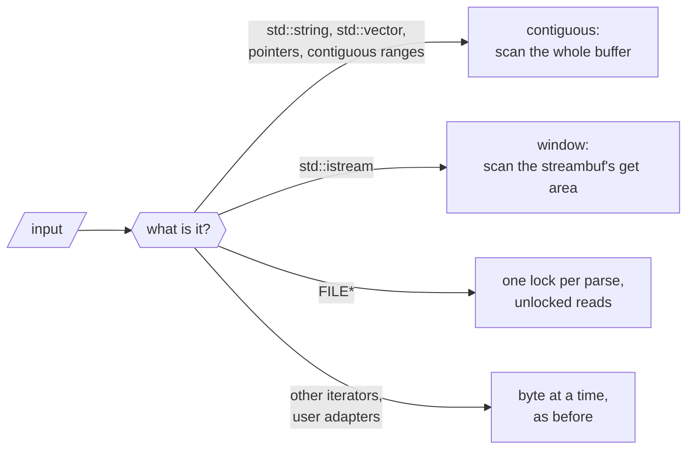
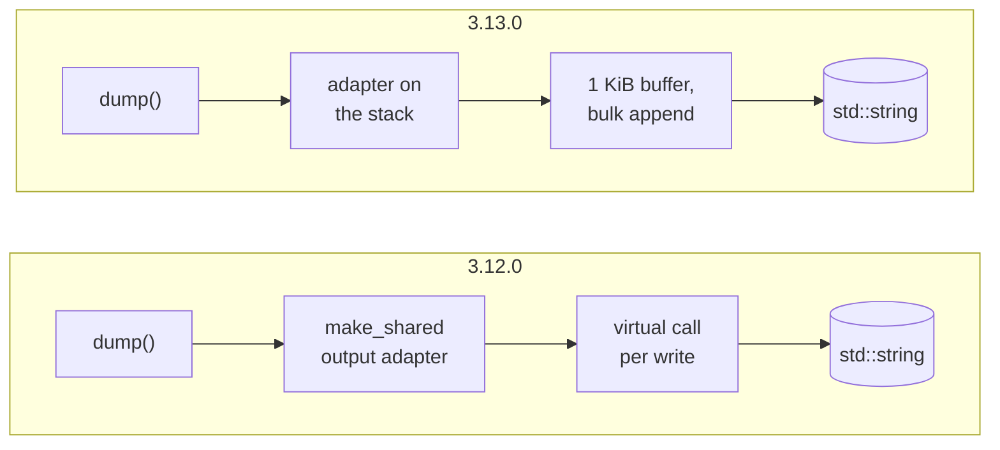

# How nlohmann/json 3.13.0 got 2.9× faster

<p class="nj-byline"><a href="https://github.com/nlohmann">Niels Lohmann</a> · <time datetime="2026-10-28">October 28, 2026</time></p>

Since 2016, the README of this library has said this about speed:

> There are certainly faster JSON libraries out there. However, if your goal is to speed up your development by adding
> JSON support with a single header, then this library is the way to go.

That sentence is still true, but the gap is a lot smaller now. Swap the 3.12.0 header for the 3.13.0 one and recompile,
and the 182 benchmarks of the library's suite run on average 2.9× as fast, without a line of your code changing.
Parsing the 1.7 MB `citm_catalog.json` takes 1.75 ms instead of 7.20 ms, and `dump()` of documents made of objects
and strings is 4.7 to 6.7× as fast. The new read-only [`json_document`](../../features/json_view.md) parses and
writes faster than the other document parsers we measured on Apple silicon, including yyjson, simdjson and
sonic-rs, and ties with simdjson on x86-64. It is not the fastest everywhere; [section 8](#8-build-a-different-data-structure)
says where it loses.

This post is about *how*. None of the techniques is new: almost every one of them is borrowed from simdjson, yyjson,
fast_float, Żmij, serde_json, SQLite, Boost.JSON or a textbook, and we name the source at each step. What we think is
worth writing about is the combination, and the conditions it had to work under: a C++11 header-only library with a
value type that is a template over its string, number, object and allocator types, input from strings, streams,
`FILE*`, iterator pairs, wide strings and user-defined adapters, output that had to stay byte-for-byte the same (with one deliberate exception, see theme 3), and error messages that had to keep pointing at the same byte.

We tried to be careful about what we claim. Every number below comes either from a benchmark we ran for this post
(described in [How we measured](#how-we-measured)) or from the description of the pull request that made the change,
which we link. The PR numbers were measured at the time against the state before the PR, often on more than one
machine, and say so.

## The short version

Most rows below use three files from Milo Yip's [nativejson-benchmark](https://github.com/miloyip/nativejson-benchmark)
that JSON libraries have been measured with for a decade, plus one large file. They stress different parts of a
parser:

| file | size | what it is | what makes it hard |
| --- | --: | --- | --- |
| `twitter.json` | 632 KB | 100 tweets from Twitter's search API, with their users | strings: 58 % of the bytes are keys and strings, 15 % of the bytes are non-ASCII (almost all of it Japanese text), and 13,345 keys |
| `citm_catalog.json` | 1.7 MB | a concert hall's catalog of events, performances and seat categories, in French | structure: 21,388 small objects and arrays, 14,392 integers, keys that average 8 bytes, and 71 % whitespace from indentation |
| `canada.json` | 2.3 MB | the outline of Canada in GeoJSON | numbers: 111,080 floating-point coordinates, most with 16 or 17 significant digits, in 56,045 arrays, and almost no whitespace |
| `jeopardy.json` | 56 MB | 216,930 Jeopardy! questions as one array of objects | size: 1.5 million short strings in objects of 7 members; far larger than the CPU caches |

<p class="nj-table-caption" markdown>The test files. The counts are of the parsed values; the share of whitespace, string and non-ASCII bytes is of the file as distributed.</p>

Apple M1 Max, Apple clang 21, `-O3 -flto`, the compiler's default standard (C++14); the same benchmark source for both
headers. The parse rows do not include destroying the result (the suite pauses the timer for that):

| workload | 3.12.0 | 3.13.0 | speedup |
| --- | --: | --: | --: |
| `json::parse()` of `twitter.json` | 3.16 ms | 1.05 ms | 3.0× |
| `json::parse()` of `citm_catalog.json` | 7.20 ms | 1.75 ms | 4.1× |
| `json::parse()` of `canada.json` | 15.1 ms | 4.35 ms | 3.5× |
| `json::parse()` of `canada.json`, indented by 4 spaces | 33.8 ms | 5.02 ms | 6.7× |
| `ordered_json::parse()` of `citm_catalog.json` | 10.8 ms | 1.64 ms | 6.6× |
| `json::parse()` of `twitter.json` from an `std::ifstream` | 3.34 ms | 1.35 ms | 2.5× |
| `json::parse()` of `citm_catalog.json` from a `FILE*` | 34.6 ms | 7.26 ms | 4.8× |
| `json::accept()` of `citm_catalog.json` | 6.36 ms | 0.91 ms | 7.0× |
| `dump()` of `twitter.json` | 1.39 ms | 0.208 ms | 6.7× |
| `dump()` of `canada.json` | 6.63 ms | 2.25 ms | 2.9× |
| `dump(4)` of `citm_catalog.json` | 1.93 ms | 0.416 ms | 4.6× |
| `to_cbor()` of `twitter.json` | 0.638 ms | 0.142 ms | 4.5× |
| `from_cbor()` of `twitter.json` from memory | 3.00 ms | 0.965 ms | 3.1× |
| `from_cbor()` of `twitter.json` from a `FILE*` | 9.71 ms | 1.54 ms | 6.3× |
| `diff()` of `canada.json` with every eighth scalar changed | 38.3 ms | 3.67 ms | 10.4× |
| iterating over every value of `canada.json` | 0.861 ms | 0.320 ms | 2.7× |
| copying `citm_catalog.json` and destroying the copy | 1.61 ms | 1.45 ms | 1.11× |
| `==` of `citm_catalog.json` and a copy | 0.264 ms | 0.254 ms | 1.04× |

<p class="nj-table-caption" markdown>Time per call with 3.12.0 and 3.13.0, Google Benchmark suite, median of 8 runs; the speedup is the old time divided by the new one.</p>

<div class="nj-fig-wrap" markdown>
--8<-- "images/perf_blog_overview.svg"
</div>

<p class="nj-caption" markdown>The speedups of the table above as bars. More is better; the vertical line at 1× is 3.12.0.</p>

The average over all 182 benchmarks of the suite is 2.93× (geometric mean); none got slower except the time of a
copy alone, 0.94 to 1.03× (copying and destroying together is 1.09 to 1.29× as fast). We have not measured where the
copy's few percent go; one known cost is the counter that bounds its recursion, about ten nanoseconds per copied
container in [#5389][5389]'s measurement. Copying and comparing gained the least.

One thing to keep in mind about `citm_catalog.json`: as distributed, it is indented, and 71 % of its 1.7 MB are
whitespace. Several changes below help exactly that. A minified copy of it parses 1.9× as fast as with 3.12.0 in our
timeline, against 3.3× for the file as distributed.

Eight themes did most of the work:

1. [Ask the input what it is](#1-ask-the-input-what-it-is), instead of reading every source one character at a time.
2. [Work on words, not bytes](#2-work-on-words-not-bytes): 8 bytes per step with plain integer arithmetic, 16 with
   SSE2 on x86-64 and NEON on 64-bit Arm.
3. [Own the number conversions](#3-own-the-number-conversions): no `strtod`, no locale, no `snprintf`.
4. [Don't do work nobody reads](#4-dont-do-work-nobody-reads): positions, copies and conversions that only matter on
   an error or for a rare caller.
5. [Read the assembly](#5-read-the-assembly): stack canaries, missed inlining and failed store forwarding.
6. [Write through a cursor](#6-write-through-a-cursor): no virtual call per character, no allocation per call, no
   branch per integer.
7. [Fix the algorithm first](#7-fix-the-algorithm-first): seven operations were quadratic or worse.
8. [Build a different data structure](#8-build-a-different-data-structure) when you only want to read.

## Where the time went: a timeline

The suite compares two points. To see which change did what, we compiled one small benchmark against the header of
every commit on `develop` that changed `json.hpp` or `json_view.hpp` since 3.12.0, 315 of them, and ran all of them interleaved
(details in [How we measured](#how-we-measured)). Each panel is one workload, chosen so that each exercises a
different part of the library:

- `parse()` of `citm_catalog.json`: the lexer's structure and whitespace handling, and building many small objects;
- `parse()` of `canada.json`: converting text to floating-point numbers;
- `accept()` of `twitter.json`: the lexer alone, since `accept()` only validates and builds nothing;
- `parse()` of `twitter.json` from an `std::ifstream`: reading from a stream instead of a string;
- `dump()` of `twitter.json` and of `canada.json`: writing strings and writing floating-point numbers;
- `from_cbor()` and `to_cbor()` of `twitter.json`: reading and writing a binary format.

Each panel shows the speedup over 3.12.0 after each commit on a logarithmic scale, so that a step of 2× has the same
height everywhere; the labels name the pull requests behind the largest steps. Each point is one build, and moving code around changes a
build's speed by a few percent on its own, so only the larger steps mean something. When `accept()` of
`twitter.json` got 2.5 % slower over the last 20 commits, we timed the two ends against each other in one binary
with six code layouts: they were equal within 0.2 %.

<div class="nj-charts-grid-wrap" markdown>
<div class="nj-fig-wrap" markdown>
--8<-- "images/perf_blog_timeline_parse_citm.svg"
</div>
<div class="nj-fig-wrap" markdown>
--8<-- "images/perf_blog_timeline_parse_canada.svg"
</div>
<div class="nj-fig-wrap" markdown>
--8<-- "images/perf_blog_timeline_accept_twitter.svg"
</div>
<div class="nj-fig-wrap" markdown>
--8<-- "images/perf_blog_timeline_parse_twitter_ifstream.svg"
</div>
<div class="nj-fig-wrap" markdown>
--8<-- "images/perf_blog_timeline_dump_twitter.svg"
</div>
<div class="nj-fig-wrap" markdown>
--8<-- "images/perf_blog_timeline_dump_canada.svg"
</div>
<div class="nj-fig-wrap" markdown>
--8<-- "images/perf_blog_timeline_from_cbor_twitter.svg"
</div>
<div class="nj-fig-wrap" markdown>
--8<-- "images/perf_blog_timeline_to_cbor_twitter.svg"
</div>
</div>

<p class="nj-caption" markdown>Speedup over 3.12.0 of eight workloads after each of the 315 commits that changed the headers, from 3.12.0 (left) to the 3.13.0 candidate (right). More is better; each point is the median of 4 interleaved runs of one build.</p>

A few things stand out:

- **There is no single big step.** Parsing `citm_catalog.json` got faster in about a dozen visible steps; the largest
  are a buffer that only error messages read ([#5234][5234], −35 %), the contiguous-input fast paths
  ([#5283][5283], −20 %), and two consecutive PRs that each took 12 %: positions derived only on error
  ([#5809][5809]) and skipping indentation eight bytes at a time ([#5810][5810]). Most other PRs each moved it by 2
  to 7 %.
- **Writing had a few large steps.** `dump()` of `twitter.json` lost 70 % of its time in one PR ([#5285][5285]: the
  write buffer and the bulk string copy), and `dump()` of `canada.json` 65 % in another ([#5634][5634]: Żmij).
- **Some steps come from outside.** Two of the larger ones were contributed: [#5592][5592] by
  [@mvanslobbe](https://github.com/mvanslobbe) checks for the expected `:` or `,` before the lexer's token switch
  (−7 % on `citm_catalog.json`), and [#5328][5328] by [@alexprabhat99](https://github.com/alexprabhat99) stopped
  creating a temporary `basic_json` for every object key that `to_cbor()` writes (−55 %).
- **Regressions happen in between.** [#5185][5185] added UTF-8 validation of every text string to the binary
  readers, byte by byte. `from_cbor()` of `twitter.json` then took 37 % longer for 66 commits, until
  [#5746][5746] (with [#5741][5741]) made the readers lenient again by default, as in 3.12.0, and the check an
  option. That decision was about the format specifications, which don't require a decoder to check, not about
  speed; the cost went with it. It never shipped in a release.
- **The parse panels include destroying the result.** The benchmark returns `json::parse(text).size()`, so the
  destructor PRs ([#5762][5762], [#5835][5835]) show up in the parse panels too, as steps of up to 6 % in either
  direction.
- **The input decides how big a step is.** #5234 measured 8 % on its own benchmark; on the indented
  `citm_catalog.json` the same change saved 35 %, because every space went through the buffer it removed.

## 1. Ask the input what it is

This is the function the 3.12.0 lexer called for **every** byte of input:

```cpp
char_int_type get()
{
    ++position.chars_read_total;
    ++position.chars_read_current_line;

    if (next_unget)
    {
        // just reset the next_unget variable and work with current
        next_unget = false;
    }
    else
    {
        current = ia.get_character();
    }

    if (JSON_HEDLEY_LIKELY(current != char_traits<char_type>::eof()))
    {
        token_string.push_back(char_traits<char_type>::to_char_type(current));
    }

    if (current == '\n')
    {
        ++position.lines_read;
        position.chars_read_current_line = 0;
    }

    return current;
}
```

Two counters in memory, a branch for a pending `unget()`, a call into the input adapter, a `push_back()` into a
buffer that only an error message reads, and a branch for line breaks. A string or a number then copied each byte a
second time into the token buffer. That is a clean design: one interface works for a `std::string`, an `std::istream`,
a `FILE*`, a pair of iterators over a `std::list<char>`, or a user's own adapter. But it makes every input pay for the
most limited one.

3.13.0 asks the input what it can do and picks a path at compile time:



<p class="nj-caption" markdown>The four kinds of input the lexer distinguishes in 3.13.0. Everything on the fast paths falls back to the byte path on anything unusual, so the result and the error messages stay the same.</p>

**Contiguous input** ([#5283][5283]). `std::string`, `std::vector<char>` and the like now go through a pointer-based
adapter in every C++ standard, not only C++20. On top of that, strings, numbers and runs of whitespace are scanned in
bulk (themes 2 and 3). Every fast path defers to the byte path on anything malformed, so error messages and `byte`
positions stay the same, with one deliberate correction (the column after a number at the end of a line); the PR
checked that on 481,000 documents.

**Positions only when someone asks** ([#5809][5809]). For seekable input, the lexer no longer counts lines and
columns while it reads. The byte offset is the distance from the start; lines and columns are recomputed from the
consumed input when an error message needs them. This is what serde_json's slice reader does. On an M1 Max, it made
parsing `citm_catalog.json` 11.8 % faster and validating an indented `twitter.json` 22 % faster.

**Streams** ([#5828][5828], [#5884][5884]). An `std::istream` already has a buffer: the get area of its `streambuf`
(`gptr()` to `egptr()`). The lexer now scans that window in bulk, keeps the current token as a pointer into it, and
copies only the part that is about to be refilled. Nothing is read ahead, so the stream is left exactly where it was
before. Reaching the protected get area takes no cast: member pointers formed in a class derived from
`std::streambuf`, so the access rule for protected members applies as intended. Before, parsing from an
`std::ifstream` took 1.8 to 2.5 times as long as reading the file into a string first; after #5828, it takes 11 to
18 % longer.

**`FILE*`** ([#5828][5828]). `std::fgetc` locks the `FILE` on every call. 3.13.0 locks it once per parse
(`flockfile`, then `getc_unlocked`; `_lock_file` and `_fgetc_nolock` with the Microsoft runtime). On macOS, this made
parsing `citm_catalog.json` from a `FILE*` 4.4 times as fast (34.1 ms to 7.8 ms). With glibc the gain was only 1.1 to
1.3×, because glibc's per-call locking is already cheap. The lock is held for the whole parse, which the documentation
now mentions, and both changes have opt-out macros.

## 2. Work on words, not bytes

The core of a JSON lexer is "copy bytes until something interesting happens". In a string, the interesting bytes are
the closing quote, a backslash, a control character, and anything above 0x7F (UTF-8). This test checks eight bytes at
once with ordinary 64-bit arithmetic:

```cpp
// return a word whose high bit is set in every byte of v that needs
// individual handling; zero if all 8 bytes can be copied as they are
inline std::uint64_t swar_string_special(std::uint64_t v) noexcept
{
    constexpr std::uint64_t ones = 0x0101010101010101ull;
    constexpr std::uint64_t high = 0x8080808080808080ull;
    const std::uint64_t q = v ^ 0x2222222222222222ull; // '"'
    const std::uint64_t b = v ^ 0x5C5C5C5C5C5C5C5Cull; // '\\'
    const std::uint64_t has_quote     = (q - ones) & ~q & high;
    const std::uint64_t has_backslash = (b - ones) & ~b & high;
    const std::uint64_t has_control   = (v - 0x2020202020202020ull) & ~v & high; // < 0x20
    const std::uint64_t has_non_ascii = v & high;                                // >= 0x80
    return has_quote | has_backslash | has_control | has_non_ascii;
}
```

XOR with the quote turns every quote byte into zero, and `(x - 0x01…01) & ~x & 0x80…80` sets the high bit of the
bytes that were zero: the "determine if a word has a zero byte" trick from Sean Eron Anderson's
[Bit Twiddling Hacks](https://graphics.stanford.edu/~seander/bithacks.html#ZeroInWord). When the result is not
zero, the number of trailing zero bits divided by eight is the index of the first special byte. The subtraction can
also flag a byte *after* a real hit (a borrow), but never one before it, so the lowest flag is always right.

<div class="nj-fig-wrap" markdown>
--8<-- "images/perf_blog_swar.svg"
</div>

<p class="nj-caption" markdown>`swar_string_special()` on the last eight bytes of `"twitter",`: one word in, one flag out, and the count of trailing zero bits says how many bytes can be copied before the quote.</p>

The same kind of word test, written in standard C++11 with a `memcpy` load and a fallback for big-endian targets,
now runs in many places:

| where | what it skips | PR |
| --- | --- | --- |
| lexer: strings | runs of ordinary characters, and runs of well-formed multi-byte UTF-8 | [#5283][5283], [#5738][5738] |
| lexer: indentation | eight spaces per step after a newline, an idea from Glaze's `skip_matching_ws` | [#5810][5810] |
| lexer: numbers | eight digits per step, as fast_float does | [#5738][5738], [#5851][5851] |
| `dump()` | runs that need no escaping, with and without `ensure_ascii` | [#5285][5285] |
| `json_view` `dump()` | ASCII runs with `ensure_ascii` | [#5879][5879] |

<p class="nj-table-caption" markdown>Where the eight-byte test is used in 3.13.0, and the pull requests that added it.</p>

Where a vector unit is part of the baseline instruction set (SSE2 on x86-64, NEON on 64-bit Arm), the string paths
use 16 bytes per step ([#5853][5853], [#5628][5628]). Non-ASCII text is validated 16 bytes at a time with simdjson's
"lookup4" UTF-8 check (Keiser and Lemire, 2021). That is the one place that needs more than the baseline: on x86-64
it uses SSSE3, which is checked once per process with `cpuid`. `JSON_NO_SIMD` turns all vector code off. On
`twitter.json`, #5853 made `json::parse()` 5 % faster with Clang and 9 % with GCC on an M1 Max; on long strings, 19
to 24 %.

**Short strings are a different problem.** Most keys and many values are short: `citm_catalog.json` averages 8 bytes
per string and `jeopardy.json` 14. For them, setting up a scan costs more than the scan. [#5878][5878] took the idea
of SQLite's `jsonAppendString()`: check each byte of a string of up to 32 bytes against a 256-entry table of bytes
that can be written unchanged, and copy the string in one go if they all pass. 32 bytes was the best threshold on the
M1; 16 gained less, and 64 lost again. [#5883][5883] then replaced the table, where SSE2 or NEON is available, with two
overlapping loads: a string of 16 to 32 characters is two 16-byte vectors that overlap in the middle, tested once and
stored with two stores, together with its quotes. That cut the instructions of `twitter.json`'s `dump()` by 21 %.
The table stays as the fallback for other targets.

**Escapes come from a table, too.** When the scanner stops at a quote, a backslash or a control character,
[#5822][5822] copies its escape sequence from a table of 8-byte rows (padded with zeros, length in the last byte)
straight into the write buffer: one 8-byte copy and one add, an idea from orjson's `QUOTE_TAB` (which orjson took
from sonic-rs). On an M1 Max, that
made dumping 100,000 log lines full of `\n`, `\t` and quotes 23 % faster. Most of that, the PR found, comes from
writing straight into the write buffer instead of going through an intermediate one; the table alone gained 2 to
7 %.

!!! note "Loop shape beats branch count"

    Not every change in this direction worked the first time. The first version of [#5490][5490] removed one
    branch per whitespace byte and made deeply nested `dump(4)` output parse 3.2 times *slower* with Clang. The
    rewritten loop no longer let either compiler keep the input's read and end pointers in registers, so both
    reloaded them from memory on every character. Restoring the original `do`-`while` shape, guarded by an `if`,
    fixed it.

## 3. Own the number conversions

3.12.0 converted every floating-point number with `strtod` and every integer with `strtoull` or `strtoll`, after
copying the token into a buffer. `strtod` is correct, but general: it consults the locale for the decimal point, sets
`errno`, and handles any length of input.

`canada.json`, a GeoJSON file of 111,126 numbers, shows what that costs. 108,528 of its numbers have 16 to 19
significant digits, like `-65.613616999999977`. The classic shortcut, Clinger's fast path, needs the digits to fit
into the 53 bits of a `double` (at most 9,007,199,254,740,992) and the power of ten to be exact (at most 10²²): then a
single multiplication or division is correctly rounded. For most of `canada.json`'s numbers, the digits don't fit.

3.13.0 converts numbers itself, without the C library and without the locale:


<p class="nj-caption" markdown>How 3.13.0 converts a decimal token to a `double`. Of `canada.json`'s 111,080 floating-point numbers, 9,742 take Clinger's fast path and 101,338 Eisel-Lemire; none has more than 19 digits.</p>

The Eisel-Lemire algorithm is adapted from fast_float's `compute_float` ([#5617][5617]), and it gives the correctly
rounded result for up to 19 digits without a fallback (Mushtak and Lemire, 2023). For longer numbers,
[#5738][5738] added fast_float's digit comparison. The table of 128-bit powers of five is fast_float's too. Then
[#5851][5851] stopped scanning the digits twice: the lexer now accumulates the value while it validates the token,
eight digits at a time with fast_float's `is_eight_digits` and `parse_eight_digits`, and a float of up to 19 digits
goes straight into the conversion with no call left on the way.

For output, 3.12.0 used Grisu2, which is fast but sometimes writes a 17th digit where 16 suffice.
[#5634][5634] ported [Żmij](https://github.com/vitaut/zmij) by Victor Zverovich to C++11. It writes the shortest
decimal that reads back as the same `double`, and the closest one if there are several. Its digit conversion, by
Xiang JunBo, turns eight digits into text per step, and the SIMD sequence by Dougall Johnson formats all 16 digits
in one vector register, decimal point included. The PR found one more stall on the way: the old code stored the
digits and immediately loaded them again shifted by one byte, and a load that overlaps two smaller stores can't be
forwarded from the store buffer. On an M1 Max, `dump()` of `canada.json` went from 6,987 µs to 2,405 µs (−66 %), and
on an x86-64 Haswell machine by −70 % (GCC 13) and −72 % (Clang 18).

That one is not free of visible change. Of one million random `double` bit patterns, 1,425 (0.14 %) are now written
differently: 810 with fewer digits (`5.3165205877497296e+16` becomes `5.31652058774973e+16`), 615 with the same
number of digits but the closer ones. They all read back as the same `double`, and none of one million short
decimals changes. In `canada.json`, 69 of the 111,126 numbers come out differently.

## 4. Don't do work nobody reads

A lot of what the 3.12.0 parser did was correct, cheap per call, and read by nobody in the common case.

- **The text of float tokens** ([#5852][5852]). The lexer copied every float token into a buffer so that a SAX
  handler's `number_float(val, s)` could see the original text. That copy was about 10 % of parsing `canada.json`.
  The built-in handlers behind `parse()` and `accept()` never look at it, so they now get an empty string, and the
  lexer copies the text only for user handlers that might.
- **The token buffer** ([#5234][5234]). `get()` pushed every character into `token_string`, a buffer that only the
  "last read" part of an error message uses. For contiguous input, the lexer now remembers where the token started and
  rebuilds that text from the input if an error happens. The PR measured 8 % on its own benchmark; in the timeline,
  parsing the indented `citm_catalog.json` got 35 % faster at that commit, because every space of the indentation
  went through the buffer. [#5828][5828] did the same for streams, where the copy was about 20 % of the remaining
  cost.
- **Positions** (#5809, above): lines and columns are counted only when an error message needs them.
- **Copies that should have been moves.** `from_cbor()` and the other binary readers ended with
  `return res ? result : basic_json(value_t::discarded);`. The conditional operator's operand is an lvalue, so there
  is no implicit move: every successfully parsed value was deep-copied once and then destroyed. Returning it by move
  ([#5501][5501]) took decoding a 2 MB CBOR document from 26.99 ms to 14.65 ms.
- **`ordered_json` growth** ([#5609][5609]). `ordered_json` stores its members in a
  `std::vector<std::pair<const std::string, json>>`. Because the key is `const`, the pair's move constructor copies
  the key and can throw, so `std::vector` copies every element when it grows, including the whole subtree of every
  value. The library now grows that storage itself: keys copied, values moved. Parsing `twitter.json` into
  `ordered_json` dropped from 60,456 to 19,182 allocations and from 3.20 ms to 1.70 ms.
- **Members that are inserted one at a time** ([#5882][5882]). The DOM parser now allocates each array once, at its
  final size, and collects the members of an `ordered_json` object until the object is complete; big objects get
  a hash table for the duplicate-key check. An object with very many members went
  from 43 million instructions to 1.9 million. Since then, `ordered_json` parses 1 to 15 % *faster* than `json` in our suite, whose `std::map` still allocates a node per member.

!!! note "The same idea, measured twice"

    Moving the key out of the lexer's buffer instead of copying it sounds like a free win. In September,
    [#5458][5458] measured it: 3.5 % faster on `citm_catalog.json`, but 1.8 % slower on `jeopardy.json` and 11.9 %
    slower on 40,000 short strings, so only string values were moved. In October, with much of the lexer around it
    rewritten, [#5855][5855] measured again: `parse()` of `twitter.json` got 3.3 % faster, so keys are moved
    now too. An idea that lost once is worth measuring again when the code around it changes.

## 5. Read the assembly

A good part of 3.13.0 came from reading the code the compiler produced for the hot loops, with Clang's
`-Rpass-missed=inline`, profiles, and instruction counts. A few things that turned up:

- **A stack canary on every token** ([#5854][5854]). The function that dispatches on the first byte of a token built
  the expected text of `true`, `false` and `null` in local `std::array`s. With `-fstack-protector-strong`, the
  default on Ubuntu, any local array gives the whole function a stack canary that is set and checked on every call:
  the canary's load alone was 11 % of the function's samples. Now the literal is passed as a string literal with its
  length as a template parameter. The same PR replaced the parser's `std::vector<bool>` nesting stack, whose
  `push_back` GCC called out of line, with `std::vector<std::uint8_t>`.
- **Exceptions that block inlining** ([#5838][5838], [#5840][5840], [#5839][5839]). Building an exception message
  inline (`concat(...)`, `create(...)`) made functions like `get_ref`, `operator[]` and the iterator operators too big
  to inline. Moving construction and `throw` into never-inlined helpers fixed 27 sites. The same for the lifecycle:
  Clang reported about 380 call sites where the copy constructor, the destructor or a comparison was not inlined,
  even for a scalar. With the scalar case inline and the rest out of line, `j == 5` went from 3.55 ns to 0.65 ns
  with Clang. It is not free: the probe translation unit grew by 13 % at `-O2`, and with GCC, `==` on large
  documents got about 7 % slower.
- **Aliasing** ([#5633][5633]). Stores through a `char*` may alias anything, so a write position kept in a member is
  reloaded after every store. `json_view`'s writer keeps it in a local variable instead.
- **Inlining that disappears** ([#5878][5878]). Once `dump_escaped()` had grown, GCC 13 and 16 stopped inlining two
  small helpers into the pretty-printing loop, and indented output got up to 13 % slower. They are now forced inline.
- **Branches the compiler chose** ([#5908][5908]). `json_document` writes most floats of `canada.json` by
  deciding, from the position of the double relative to the token, which of two or three candidate digit strings
  to write. The conditions of those `?:` selections depend on the digits, so they are as good as random. Clang
  compiled them as conditional moves; GCC 13 compiled them as jumps, and the processor guessed wrong about once per
  float (callgrind's branch simulation: 220,000 mispredictions per dump with GCC, 97,000 with Clang). Writing the
  selections as bit masks, which no compiler turns into a jump, made the dump of `canada.json` with GCC on x86-64
  about 15 % faster, with 5 % *more* instructions; Clang's code stayed as it was. We found this one while writing
  this post.
- **Code size as a cost** ([#5902][5902]). `get<std::array<int, 1000>>()` used a pack expansion that compiled to one
  function of about 28,000 instructions: a thousand inlined copies of the bounds and type checks. A loop needs 49.

!!! note "Instruction counts, not only time"

    On the x86-64 machine we used for checking, moving code by a few bytes changed the time of unrelated benchmarks
    by up to ±5 %. Many decisions in these PRs were therefore made on instruction counts (callgrind on Linux,
    `/usr/bin/time -l` on macOS), checked against timings of builds with all functions and loops aligned to 64
    bytes, and timed interleaved in one binary with several code layouts. The target, applied strictly in the later
    PRs, was: at least 3 % faster, and no benchmark more than 1 % slower. Some PRs accepted a small loss elsewhere
    and say so, such as the 7 % on GCC's `==` above.

## 6. Write through a cursor

In 3.12.0, every `dump()` created its output adapter with `std::make_shared`, and the serializer wrote every
structural character through a virtual call:

```cpp
o->write_characters("{\n", 2);
o->write_characters(indent_string.c_str(), new_indent);
o->write_character('\"');
```

The writing side changed in four steps:



<p class="nj-caption" markdown>The text serializer's output path before and after [#5285][5285] and [#5449][5449].</p>

1. **A buffer in the serializer** ([#5285][5285]): all writes go into a 1 KiB buffer that is flushed in bulk, so the
   virtual call happens once per KiB.
2. **No allocation per call** ([#5449][5449]): the adapter lives on the stack. Together with an indentation string
   that [#5285][5285] creates only when needed, a compact `dump()` of a small object went from 4 heap allocations to
   1, the returned string.
3. **Binary writers get a concrete sink** ([#5286][5286]): `to_cbor()` and friends write into a `std::vector` through
   a value-type sink, with no virtual call. The same PR replaced `std::reverse` for byte order with
   `__builtin_bswap*`, after finding that Clang had emitted no `bswap` instruction at all in the CBOR number path.
4. **A cursor instead of `vector::insert()`** ([#5824][5824], [#5885][5885]). After step 3, writing an array of
   integers as CBOR was still no faster than in 3.12.0, and slower with GCC. The profile said why: each number's
   one to eight bytes were appended with `vector::insert()`, an out-of-line insert-anywhere routine, which took 30 %
   of the time. The sink now reserves space ahead and writes through a pointer, and runs of numbers are encoded in a
   loop without a call per element.

The last step also took the branches out of encoding an integer. The size of each integer in a stream is hard to
predict, so the encoder looks the size class up from the number of leading zero bits and stores the head as one byte
plus one 8-byte word, of which the caller keeps only as many bytes as the class needs:

```cpp
// 1, 2, 3 or 4 if x fits 1, 2, 4 or 8 bytes, without a branch
static unsigned integer_size_class(const std::uint64_t x) noexcept
{
    static constexpr std::array<std::uint8_t, 64> size_class_by_leading_zeros = { /* ... */ };
    return size_class_by_leading_zeros[count_leading_zeros(x | 1u)];
}

std::size_t encode_first_byte_and_tail(CharType* out, std::uint8_t first_byte,
                                       unsigned size_class, std::uint64_t value) const noexcept
{
    out[0] = to_char_type(first_byte);
    const unsigned unused_bits = 64u - ((8u << size_class) >> 1u);
    const std::uint64_t tail = is_little_endian ? byteswap(value) >> unused_bits : value << unused_bits;
    std::memcpy(out + 1, &tail, sizeof(tail));  // always 8 bytes; the caller keeps the first 0, 1, 2, 4 or 8
    return ((std::size_t{1} << size_class) >> 1u) + 1;
}
```

Against 3.12.0, writing an array of small signed integers as CBOR went from 0.97× to 4.19× with Clang on an M1 Max,
and from 0.94× to 2.77× with GCC 13 on x86-64 ([#5824][5824]).

## 7. Fix the algorithm first

None of the micro-optimizations above matter much next to an algorithm that is quadratic. These are the ones found and
fixed in this release cycle, measured on the same machine:

| operation | 3.12.0 | 3.13.0 | speedup | cause | PR |
| --- | --: | --: | --: | --- | --- |
| `diff()` of an array of 64,000 numbers against an empty array | 4,102 ms | 9.98 ms | 411× | each `remove` was inserted at the front of the patch | [#5461][5461] |
| `diff()` of an array of 20,000 objects against every second one of them | 119 ms | 3.85 ms | 31× | the same | [#5461][5461] |
| `parse()` with a callback that rejects half of 32,000 objects | 1,334 ms | 11.5 ms | 116× | each rejected value was searched for from the start of its parent | [#5457][5457] |
| `<` on two equal values nested 24 levels deep (C++11 to C++17) | 62.6 ms | 0.002 ms | exponential | `std::vector`'s `<` asks `a < b` and `b < a`, and both recurse | [#5390][5390] |
| `<` on `citm_catalog.json` and a copy, 10× (C++11 to C++17) | 274 ms | 3.81 ms | 72× | the same | [#5390][5390] |
| `flatten()` of `citm_catalog.json` as `ordered_json` | 253 ms | 1.37 ms | 184× | every new key was looked up linearly | [#5834][5834] |
| `to_bson()` of a value nested 200 levels deep, 100× | 19.5 ms | 0.566 ms | 34× | each document's size was computed by walking everything below it again | [#5553][5553] |
| 100,000 × `push_back()` on an `ordered_json` with `JSON_DIAGNOSTICS` | 1,514 ms | 4.98 ms | 304× | every insert re-pointed the parent pointers of all elements | [#5832][5832] |
| 10,000 × `at(i)` on an `ordered_json` array with `JSON_DIAGNOSTICS` | 43.2 ms | 0.081 ms | 533× | the same | [#5832][5832] |

<p class="nj-table-caption" markdown>Operations that were quadratic or worse in 3.12.0, timed with both versions (C++17, `-O3`, median of 3 interleaved runs).</p>

<div class="nj-fig-wrap" markdown>
--8<-- "images/perf_blog_cliffs.svg"
</div>

<p class="nj-caption" markdown>The times of the table above on a logarithmic scale; each arrow leads from the time with 3.12.0 to the time with 3.13.0. Less is better.</p>

The `<` case matters to anyone who keeps `json` values in a `std::set`, uses them as `std::map` keys, or sorts them
before C++20. Each level of nesting doubled the work: two equal values nested 30 levels deep took 3.8 seconds to
compare in [#5390][5390]'s measurement, and nothing about such a value is unusual. Since C++20, `<` is derived from
`<=>`, which asks once.

The other side of this theme is recursion. A value nested 100,000 levels deep used to crash `dump()`, the copy
constructor, `==`, `hash`, `diff()`, `flatten()` and the binary writers with a stack overflow. The obvious fix,
making every walk iterative, measured 2 % to 20 % slower on ordinary documents ([#5285][5285]), 3 % to 9 % for
copying ([#5389][5389]), and 10 % to 14 % for merging ([#5547][5547]). RapidJSON keeps recursion as its default for
the same reason. 3.13.0 therefore bounds the recursion instead: the first 128 levels run the old recursive code, and
only below that does an explicit stack take over. A document nested less deeply pays only for counting the levels.

Destruction got its own trick ([#5762][5762]). Instead of a heap-allocated stack, the destructor uses pointer
reversal, the idea behind the Schorr-Waite graph marking algorithm: while it empties a container, that container's
last child slot stores the link back to its parent. Destroying any value now allocates nothing and never recurses.
Against 3.12.0, destroying a parsed document is 1.25 to 1.56 times as fast in our suite, and destroying an array of
one million small objects 1.39 times (125 ms to 90 ms).

## 8. Build a different data structure

After all of the above, `json::parse()` is still bound by what it builds: one heap allocation per string, array and
object, and a `std::map` node per member. Many programs only parse a document, read some fields and throw it away.
For them, 3.13.0 adds [`json_document`](../../features/json_view.md) and `json_view` in a new header,
`<nlohmann/json_view.hpp>`. The two figures below show what each parser makes of this 54-byte text:

```json
{"port": 6379, "price": 19.90, "tags": ["eu", "a\"b"]}
```

<div class="nj-fig-wrap" markdown>
--8<-- "images/json_view_layout_tree.svg"
</div>

<p class="nj-caption" markdown>What `json::parse()` builds: a tree in which every object, array and string is a separate heap allocation (dashed). The float is converted to a `double` while parsing, so the original text `19.90` is gone.</p>

<div class="nj-fig-wrap" markdown>
--8<-- "images/json_view_layout_index.svg"
</div>

<p class="nj-caption" markdown>What `json_document::parse()` builds from the same text: one flat index of nine 16-byte nodes in document order, which point back into the source text, plus a buffer for the one string with an escape. A `json_view` is two pointers, here to the array.</p>


The design is not ours either. simdjson's tape and yyjson's immutable document are both flat arrays of fixed-size
entries in document order instead of trees of separate allocations, and yyjson's entries are 16 bytes, too. What
`json_document` does:

- **One 16-byte node per value and per key, in document order** ([#5620][5620]). Strings stay in the input; only
  strings with escapes are decoded into an arena. Integers are converted while their digits are in the cache. A
  container stores the size of its subtree, so a reader can step over it in constant time. A document makes a
  handful of allocations, however many values it has.
- **Floats stay text until you read them.** The parser records where the integer digits, fraction and exponent are,
  and converts on access with the same Clinger/Eisel-Lemire code as `json::parse`. We prototyped converting them
  during the parse and dropped it ([#5908][5908]): reading every number of `canada.json` got 4 to 7 % faster, but
  parsing it 36 to 90 % slower.
- **SIMD where the baseline has it** ([#5628][5628]): strings scanned 16 bytes at a time with SSE2 or NEON, and
  non-ASCII text validated with simdjson's lookup4 check. `\u` escapes are decoded with a table, as yyjson's
  `read_hex_u16` does.
- **A hash index for big objects** ([#5628][5628]): an object with 128 or more members gets an open-addressing
  table after parsing, an idea from Boost.JSON. Looking up every key of a 10,000-member object went from 59.8 ms to
  0.16 ms. The hash is not seeded, so the probe length is capped; if crafted keys exceed the cap, that object falls
  back to a linear search, and parsing can't become quadratic.
- **First duplicate wins.** Lookups return the first of duplicate keys, as yyjson and simdjson do, because
  returning the last one meant scanning every object to its end and made lookups in small objects 1.6 to 3.4 times
  slower ([#5622][5622]).

### How it compares

We compared `json_document` with eleven other engines. In C++: yyjson 0.13.0, simdjson 4.6.11 (its DOM and its
On-Demand API), sonic-cpp 1.0.2, RapidJSON (master, 24b5e7a), Glaze 9.0.0 (its `generic_u64` DOM, its `lazy_json`,
and reading straight into structs), and Boost.JSON (1.92 on the Mac, 1.83 on x86-64). In Rust: sonic-rs 0.5.10, simd-json 0.19.0 and serde_json
1.0.154. Plus `json::parse`. Before anything is timed, every engine must report the same number of values, the same
number of string bytes, and a bit-identical sum of all numbers in document order. That means every engine converts
every number exactly; RapidJSON guarantees that only with `kParseFullPrecisionFlag`, so that is what it runs with
(with its default flags it happened to produce the same values for these files, and those rows are in the data).

The workloads: *parse* (build the document and free it), *traverse* (parse, then visit every value and convert every
number), *select* (parse, then read a few fields of every record), *parse+dump*, and *dump* (write a document that
was parsed beforehand; only the writing is timed). We ran them on the M1 Max with
Apple clang 21 (and Rust 1.99), and on the x86-64 Haswell server with GCC 13 and Clang 18 (`-march=haswell`, one
pinned core). That server has other work running, so differences of a few percent there are noise. Glaze 9 could
not be built with Clang 18 on it (Clang 18 can't use GCC 13's `std::expected`), and the Rust engines ran on the Mac
only.

Parse times in µs on the M1 Max, a fresh document each time (C++23 and Rust `--release`, `-O3`, best of 30
interleaved rounds):

| engine | `twitter.json` (632 KB) | `citm_catalog.json` (1.7 MB) | `canada.json` (2.3 MB) | `jeopardy.json` (56 MB) |
| --- | --: | --: | --: | --: |
| nlohmann/json `json_document` | **183** | **364** | **943** | **22,681** |
| yyjson | 194 | 478 | 1,489 | 30,342 |
| simdjson DOM | 202 | 486 | 2,097 | 26,904 |
| sonic-rs (Rust) | 302 | 664 | 1,907 | 30,202 |
| sonic-cpp | 379 | 986 | 2,580 | 40,804 |
| simd-json (Rust, input copy included) | 567 | 1,616 | 4,939 | 59,364 |
| Boost.JSON | 868 | 1,483 | 2,481 | 88,925 |
| RapidJSON | 1,183 | 1,613 | 7,358 | 143,044 |
| serde_json (Rust) | 1,202 | 2,337 | 6,836 | 139,829 |
| Glaze `generic_u64` | 1,268 | 2,727 | 9,262 | 132,273 |
| nlohmann/json `json::parse` | 1,352 | 2,386 | 5,915 | 163,750 |

<p class="nj-table-caption" markdown>Parse times in µs, less is better: a fresh document per call, built and freed, on an Apple M1 Max. The fastest engine of each file is in bold.</p>

<div class="nj-fig-wrap" markdown>
--8<-- "images/perf_blog_view.svg"
</div>

<p class="nj-caption" markdown>The parse times of the table above as throughput (file size divided by time), more is better. RapidJSON, Glaze, serde_json and simd-json are left out to keep the chart readable; they are in the table.</p>

Writing, with each document parsed beforehand, so that only the writing of compact JSON into a new string is timed.
Before anything is timed, every output must read back as the same values, with bit-identical numbers, so every
engine writes every float exactly:

| engine | `twitter.json` | `citm_catalog.json` | `canada.json` | `jeopardy.json` |
| --- | --: | --: | --: | --: |
| nlohmann/json `json_document` | **74.5** | **133** | **1,625** | **14,757** |
| yyjson | 104 | 166 | 1,716 | 20,134 |
| sonic-cpp | 105 | 222 | 3,044 | 19,836 |
| Glaze `generic_u64` | 208 | 469 | 1,700 | 34,367 |
| sonic-rs (Rust) | 213 | 444 | 2,417 | 33,818 |
| nlohmann/json `json::dump` | 217 | 286 | 2,244 | 31,205 |
| serde_json (Rust) | 329 | 487 | 2,236 | 52,629 |
| simdjson DOM | 354 | 498 | 6,816 | 54,833 |
| simd-json (Rust) | 358 | 473 | 2,707 | 47,998 |
| Boost.JSON | 498 | 501 | 2,942 | 63,392 |
| RapidJSON | 592 | 815 | 6,999 | 83,397 |

<p class="nj-table-caption" markdown>Write times in µs, less is better: compact output of a document parsed beforehand, on an Apple M1 Max, best of 2 × 30 interleaved rounds (2 × 6 for `jeopardy.json`). The fastest engine of each file is in bold. Boost.JSON writes some floats of `canada.json` with more digits, so its output is 9 % larger.</p>

<div class="nj-fig-wrap" markdown>
--8<-- "images/perf_blog_view_dump.svg"
</div>

<p class="nj-caption" markdown>The write times of the table above as throughput (size of the compact output divided by time), more is better, for the engines of the parse chart.</p>

On the Mac, `json_document` writes fastest on every file, 1.05 to 1.40 times ahead of the next engine. Part of that is its
design, not the writer: a string that had no escape sequence in the source has nothing to escape, so it is copied
from the source text without being scanned, and integers are copied as their source text. Floats are formatted
anew with Żmij (theme 3), and since `json_document` keeps floats as text, a float of more than 15 significant digits
is first converted from its digits to a `double`. That is why `canada.json` is the closest race on the Mac (Glaze
takes 1.05 times as long, yyjson 1.06) and is lost on x86-64, where yyjson takes 0.95 (GCC) and 0.91 (Clang) of
`json_document`'s time. With GCC it was 0.78, and even `json::dump()`, which has the `double`s already, was
faster, until the change described in [theme 5](#5-read-the-assembly).


The fastest *other* engine for each workload, as its time divided by nlohmann/json's `json_document`'s, over the
four files above: above 1, `json_document` is ahead; below 1, it is behind.

| workload | M1 Max, Apple clang 21 | x86-64, GCC 13 | x86-64, Clang 18 |
| --- | --- | --- | --- |
| parse | 1.06–1.58 (yyjson, simdjson DOM) | 0.97–1.01 (simdjson DOM) on `twitter`, `citm_catalog`; 1.89 on `canada`; **0.71** (sonic-cpp) on `jeopardy` | 0.96–0.97 (simdjson DOM) on `twitter`, `citm_catalog`; 1.21–1.56 on `canada`, `jeopardy` |
| traverse | 1.04–1.18 (yyjson, simdjson On-Demand) | **0.58–0.86** (simdjson On-Demand) | **0.86**–1.20 (sonic-cpp, simdjson On-Demand, yyjson) |
| select | **0.34–0.84** (Glaze structs, simdjson On-Demand) | **0.26–0.65** | **0.33–0.86** |
| parse+dump | 1.18–1.35 (yyjson) | 1.20–1.52 (yyjson, sonic-cpp) | 1.16–1.27 (yyjson, sonic-cpp) |
| dump | 1.05–1.40 (yyjson, Glaze, sonic-cpp) | 1.23–1.34 (yyjson) on `twitter`, `citm_catalog`; **0.95** (yyjson) on `canada`; 0.99 (yyjson) on `jeopardy` | 1.28–1.33 (yyjson) on `twitter`, `citm_catalog`; **0.91** (yyjson) on `canada`; **0.95** (sonic-cpp) on `jeopardy` |

<p class="nj-table-caption" markdown>Time of the fastest other engine divided by the time of nlohmann/json's `json_document`, as a range over the four files, with the engines that were fastest; below 1, nlohmann/json is behind.</p>

So, is it the fastest JSON parser? Not in general. Among the parsers that build a document you can read in any
order, it is the fastest at parsing and writing back in every configuration we ran, and the fastest at parsing on
Apple silicon. On x86-64 it ties with simdjson's DOM on typical documents. Where it loses:

- **Reading a few known fields.** simdjson's On-Demand API builds nothing and reads forward only; Glaze reading into
  structs that declare just the needed fields skips everything else without building it. Both are faster for
  *select*, Glaze by up to 3.8× on `canada.json`, where it skips the coordinates.
- **One pass over everything on x86-64 with GCC.** simdjson On-Demand visits every value in 0.58 to 0.86 of the time.
- **Fresh large documents on Linux.** A fresh 56 MB `jeopardy.json` pays for the page faults of a new index of
  3.25 million 16-byte nodes (52 MB). With GCC, sonic-cpp parses it in 0.71 of the time. Reusing the document (`read()`) halves `json_document`'s time
  there, and then it is ahead of a reused simdjson parser (0.53 against 0.61 of the fresh time).
- **Float-heavy documents, measured fairly.** `json_document` converts a float when you read it; the others convert
  while parsing. The `canada.json` parse row flatters it; *traverse* is the fair comparison, and there it is
  1.04× ahead on the Mac and behind sonic-cpp with Clang on x86-64 (0.88).
- **Writing floats on x86-64.** Writing a document it parsed beforehand, `json_document` is behind yyjson on
  `canada.json` (0.95 with GCC, 0.91 with Clang), because it first converts most floats from their text, and ties
  on `jeopardy.json` (0.95 to 0.99).
- **Small documents.** On a 2.5 KB message, all document parsers take about a microsecond, and yyjson and
  simdjson's DOM are as fast or a few percent faster.

And `json::parse`? Boost.JSON builds a mutable tree as `json` does, so it is the fair comparison. It is 1.6 to 2.4
times as fast on the Mac, and 2.4 to 4.5 times on the x86-64 server. For writing, the comparison goes the other way:
`json::dump()` writes 1.3 to 2.3 times as fast as Boost.JSON's `serialize()` on the Mac. On the x86-64 server it is
1.1 to 1.6 times as fast on three files, but Boost.JSON writes `jeopardy.json` 4 % (Clang) to 12 % (GCC) faster. On the Mac it is also ahead of RapidJSON, simdjson's DOM and simd-json on every file, and of sonic-rs and
serde_json on all but one file each, where they are within 2 %.

The programs are in
[`tests/benchmarks/json_view/others`](https://github.com/nlohmann/json/tree/develop/tests/benchmarks/json_view/others),
with the pinned versions and checksums of every library.

## What didn't work

The PRs record the ideas that measured worse, which is as useful as the ones that made it:

| idea | result | where |
| --- | --- | --- |
| make every walk iterative | 2–20 % slower on ordinary documents | [#5285][5285], [#5389][5389], [#5547][5547] |
| move the key out of the lexer's reused buffer | 11.9 % slower (later a win, see above) | [#5458][5458] |
| inline `scan_literal()` | Clang's dispatch grew from 233 to 278 instructions and got slower | [#5854][5854] |
| short-string table for strings up to 64 bytes | lost against 32 | [#5878][5878] |
| leave the serializer's buffers uninitialized | timings moved 18 % apart in opposite directions on two similar workloads, so dropped; done later in [#5883][5883], where instruction counts showed 170 instructions saved per `dump()` | [#5285][5285] |
| out-of-line throw helpers for JSON Pointer lookups | no measurable gain, dropped | [#5836][5836] |
| `json_view`: an "all ASCII" flag per string | `dump()` with `ensure_ascii` faster, but parsing 1–13 % slower | [#5879][5879] |
| `json_view`: convert floats while parsing | `canada.json` parse 36–90 % slower | [#5908][5908] |
| `json_view`: note a large object inline in the parse loop | `canada.json` 37 % slower | [#5628][5628] |
| `json_view`: vector-scan every string in `set()` | 14–16 % slower on 16-byte strings | [#5926][5926] |

<p class="nj-table-caption" markdown>Ideas that were measured and dropped, from the pull requests that tried them.</p>

## Making fast paths safe

Fast paths are where the bugs are: they read in 8- and 16-byte steps, they skip validation that the slow path did, and
they are taken only for some inputs. A large part of these PRs is checking them:

- **Guard pages** ([#5826][5826]): the input is copied so that its last byte is the last readable byte of a page, and
  the next page is unmapped. AddressSanitizer misses an over-read into the slack of the same heap allocation, and
  fuzzers rarely end an input exactly at a page boundary; this test crashes on any over-read by one byte.
- **Differential fuzzing of the input kinds** ([#5827][5827]): every fuzz input is also parsed from an
  `std::istringstream`, from `std::list` iterators (the byte path) and from a `FILE*`, and the value, the exception
  id, the message and the byte offset must be identical.
- **Differential checks at scale**: 6.5 million float tokens against `strtod` including 60,000 exact halfway cases
  ([#5617][5617]); `json_view`'s batched float output byte-identical to the general writer for 10⁹ generated tokens
  ([#5908][5908]). For this post, we checked that 3.13.0 writes the same bytes as 3.12.0 in all five binary formats
  for 39 test files, and the same JSON text for `twitter.json` and `citm_catalog.json`.
- **Mutation checks**: break the fast path on purpose (skip one byte too many, mark `"` as copyable) and make sure the
  tests notice. In [#5878][5878], marking the quote as copyable fails 4,551 assertions.

## The price

None of this is free at compile time. `json.hpp` grew from 25,526 to 45,582 lines (`json_view.hpp` is a separate
header of 11,310 lines that you only pay for if you include it). Apple clang 21 at `-O2`, median of 9 compilations:

| translation unit | 3.12.0 | 3.13.0 | 3.13.0 with `JSON_NO_AUTOMATIC_UDLS` |
| --- | --: | --: | --: |
| only includes `json.hpp` | 528 ms | 709 ms (+34 %) | 508 ms (−4 %) |
| parses, dumps and writes CBOR | 1,175 ms | 1,885 ms (+60 %) | 1,858 ms (+58 %) |

<p class="nj-table-caption" markdown>Compile time of one translation unit, Apple clang 21, `-O2`, median of 9 compilations; less is better.</p>

We have not broken the second row down by change. [`JSON_NO_AUTOMATIC_UDLS`](../../api/macros/json_no_automatic_udls.md) moves the
`_json` literals into their own header and more than makes up for the first row; the
[compile-time page](../../integration/compile_times.md) lists the other options.

## How we measured

**What is compared.** "3.12.0" is the released single header. "3.13.0" is `develop` at
[84c542164](https://github.com/nlohmann/json/commit/84c5421644) with seven of the maintainer's open, non-draft pull requests that touch code
merged in ([#5890][5890], [#5908][5908], [#5914][5914], [#5926][5926], [#5936][5936], [#5945][5945],
[#5947][5947]) and amalgamated. Merging #5890 onto today's `develop` left one duplicate member declaration, which we
removed; nothing else was changed. Both are compiled from the *same* benchmark source, the Google Benchmark suite in
[`tests/benchmarks`](https://github.com/nlohmann/json/tree/develop/tests/benchmarks), with the BON8 benchmarks
removed because 3.12.0 has no BON8.

The x86-64 rows for *dump* and *parse+dump* of `canada.json` include one later commit of #5908
([9fad526888](https://github.com/nlohmann/json/commit/9fad526888), the change at the end of theme 5), measured again
for this post; the other files' rows are from the runs before it. That commit changes neither the instructions nor
the mispredicted branches of dumping `twitter.json` or `citm_catalog.json` (callgrind, GCC 13 and Clang 18), and on
the M1 Max it changes the dump of `canada.json` by about 1 % (cycles).

| | |
| --- | --- |
| machine | Apple M1 Max laptop on AC power, macOS 27.0.1 |
| compiler | Apple clang 21, libc++ |
| flags | `-O3 -flto -DNDEBUG`, the compiler's default standard, C++14 (the timeline and `json_view` comparisons: C++17, `-O3`, no LTO) |
| suite | 2 rounds × 4 repetitions per version, random interleaving, each round started only when the load average was below 4; the median of all 8 |
| noise | the coefficient of variation was 3 % or less for 176 of the 182 rows with 3.12.0 and 178 with 3.13.0; the largest was 12 % |
| inputs | `twitter.json`, `citm_catalog.json` and `canada.json` from [nativejson-benchmark](https://github.com/miloyip/nativejson-benchmark), a 56 MB `jeopardy.json`, and number-heavy files |

<p class="nj-table-caption" markdown>Setup of the Google Benchmark comparison of 3.12.0 and 3.13.0.</p>

The cliffs come from small extra programs (C++17, `-O3`, median of 3 interleaved runs). The timeline is
[`tests/benchmarks/history`](https://github.com/nlohmann/json/tree/develop/tests/benchmarks/history): one program,
compiled against `single_include` of 3.12.0, of each of the 315 commits on `develop` that changed `json.hpp` or `json_view.hpp` since, and of the candidate, 4 rounds in random order, median of
the rounds. The `json_view` comparison is
[`tests/benchmarks/json_view/compare.py`](https://github.com/nlohmann/json/tree/develop/tests/benchmarks/json_view)
with pinned downloads of yyjson 0.13.0, simdjson 4.6.11 and Boost.JSON 1.92.0, 30 interleaved rounds, best round;
every engine must produce the same values, strings and sums of numbers before anything is timed.

**What we did not measure.** All of our numbers are from one Apple silicon laptop with Clang. The PRs quote numbers
from an x86-64 Haswell server with GCC 13 and Clang 18 where they had them; that server shares its cores with other
work, so we did not run a second set of tables there and quote its timings only where a PR did. Expect smaller
gains for some workloads on x86-64 with glibc: its `FILE*` locking is cheaper to begin with, and its allocator
behaves differently. We did not test Windows for speed at all.

## Thanks

Most of what is in this post was invented by other people. Each library is listed with its license in
parentheses.

**Code we adapted.** The library contains code adapted from these four projects. We use it under the MIT License,
and the source files that contain it carry the authors' copyright lines and say what was taken; the
[README](https://github.com/nlohmann/json#license) lists them too.

- [fast_float](https://github.com/fastfloat/fast_float) (Apache-2.0, MIT or BSL-1.0) by Daniel Lemire and
  contributors: the Eisel-Lemire algorithm, its table of powers of five, its digit comparison for long numbers, and
  its parsing of eight digits at a time (N. Mushtak and D. Lemire, "Fast number parsing without fallback", 2023).
  W. D. Clinger for the fast path, M. Eisel for the algorithm.
- [Żmij](https://github.com/vitaut/zmij) (MIT) by Victor Zverovich, with the digit conversion of Xiang JunBo and the
  SIMD sequence and compressed powers of ten of Dougall Johnson: ported to C++11.
- [simdjson](https://github.com/simdjson/simdjson) (Apache-2.0 or MIT) by Daniel Lemire, Geoff Langdale, John Keiser
  and contributors: the "lookup4" UTF-8 check and its tables (J. Keiser and D. Lemire, "Validating UTF-8 In Less
  Than One Instruction Per Byte", 2021), in `json.hpp`'s lexer and in `json_view.hpp`.
- [yyjson](https://github.com/ibireme/yyjson) (MIT) by YaoYuan: table-driven `\u` decoding and the unrolled checks
  at fixed offsets in `json_view.hpp`'s parser.

**Ideas we took.** From these we took the idea, not their code, in the order they appear above:

- [serde_json](https://github.com/serde-rs/json) (MIT or Apache-2.0): deriving positions from the offset only on error.
- Sean Eron Anderson's [Bit Twiddling Hacks](https://graphics.stanford.edu/~seander/bithacks.html) (snippets in the
  public domain): the zero-byte test behind every word-at-a-time scan.
- [Glaze](https://github.com/stephenberry/glaze) (MIT): skipping indentation in 8-byte steps (`skip_matching_ws`).
- [SQLite](https://sqlite.org) (public domain): writing short strings with a table loop, as its `jsonAppendString()`
  does.
- [orjson](https://github.com/ijl/orjson) (Apache-2.0 or MIT; its escape table MPL-2.0) and
  [sonic-rs](https://github.com/cloudwego/sonic-rs) (Apache-2.0), from which orjson adapted it: escape sequences as
  fixed-size table rows (`QUOTE_TAB`).
- [simdjson](https://github.com/simdjson/simdjson)'s tape and [yyjson](https://github.com/ibireme/yyjson)'s 16-byte
  immutable document: a flat index in document order instead of a tree.
- [Boost.JSON](https://github.com/boostorg/json) (BSL-1.0): switching to a hash table for large objects.
- [RapidJSON](https://github.com/Tencent/rapidjson) (MIT): the measured reason to keep recursion as the default.

And the people who sent or shaped pull requests: [@gregmarr](https://github.com/gregmarr) reviewed most of them and
suggested the sized-sentinel fast path, the peek design for exact stream positions, one SIMD switch for the whole
library, and the vector check of `json_view`'s strings on edit; [@veselink1](https://github.com/veselink1) and
[@michaelsam94](https://github.com/michaelsam94) wrote the allocator and exception-safety fixes for the destructor
that [#5762][5762] took over (the non-recursive destructor itself goes back to
[#1436](https://github.com/nlohmann/json/pull/1436) by [@nickaein](https://github.com/nickaein) in 2019);
[@commit-msuyog](https://github.com/commit-msuyog) gave the 128-bit multiplication behind Eisel-Lemire MSVC
intrinsics ([#5782][5782]); [@ayush-singh-0601](https://github.com/ayush-singh-0601) started the fix for deep values in the binary writers;
[@avionicharshit-byte](https://github.com/avionicharshit-byte) made `diff()` linear for shrinking arrays
([#5461][5461]); [@mvanslobbe](https://github.com/mvanslobbe) sped up the parser's separator check ([#5592][5592]);
and [@alexprabhat99](https://github.com/alexprabhat99) removed the temporary values behind CBOR and MessagePack
object keys ([#5328][5328]).
`twitter.json`, `citm_catalog.json` and `canada.json` come from Milo Yip's
[nativejson-benchmark](https://github.com/miloyip/nativejson-benchmark) (MIT).

[5185]: https://github.com/nlohmann/json/pull/5185
[5234]: https://github.com/nlohmann/json/pull/5234
[5283]: https://github.com/nlohmann/json/pull/5283
[5285]: https://github.com/nlohmann/json/pull/5285
[5286]: https://github.com/nlohmann/json/pull/5286
[5328]: https://github.com/nlohmann/json/pull/5328
[5389]: https://github.com/nlohmann/json/pull/5389
[5390]: https://github.com/nlohmann/json/pull/5390
[5449]: https://github.com/nlohmann/json/pull/5449
[5457]: https://github.com/nlohmann/json/pull/5457
[5458]: https://github.com/nlohmann/json/pull/5458
[5461]: https://github.com/nlohmann/json/pull/5461
[5490]: https://github.com/nlohmann/json/pull/5490
[5501]: https://github.com/nlohmann/json/pull/5501
[5547]: https://github.com/nlohmann/json/pull/5547
[5553]: https://github.com/nlohmann/json/pull/5553
[5592]: https://github.com/nlohmann/json/pull/5592
[5609]: https://github.com/nlohmann/json/pull/5609
[5617]: https://github.com/nlohmann/json/pull/5617
[5620]: https://github.com/nlohmann/json/pull/5620
[5622]: https://github.com/nlohmann/json/pull/5622
[5627]: https://github.com/nlohmann/json/pull/5627
[5628]: https://github.com/nlohmann/json/pull/5628
[5633]: https://github.com/nlohmann/json/pull/5633
[5634]: https://github.com/nlohmann/json/pull/5634
[5738]: https://github.com/nlohmann/json/pull/5738
[5741]: https://github.com/nlohmann/json/pull/5741
[5746]: https://github.com/nlohmann/json/pull/5746
[5762]: https://github.com/nlohmann/json/pull/5762
[5782]: https://github.com/nlohmann/json/pull/5782
[5809]: https://github.com/nlohmann/json/pull/5809
[5810]: https://github.com/nlohmann/json/pull/5810
[5822]: https://github.com/nlohmann/json/pull/5822
[5824]: https://github.com/nlohmann/json/pull/5824
[5826]: https://github.com/nlohmann/json/pull/5826
[5827]: https://github.com/nlohmann/json/pull/5827
[5828]: https://github.com/nlohmann/json/pull/5828
[5832]: https://github.com/nlohmann/json/pull/5832
[5834]: https://github.com/nlohmann/json/pull/5834
[5835]: https://github.com/nlohmann/json/pull/5835
[5836]: https://github.com/nlohmann/json/pull/5836
[5838]: https://github.com/nlohmann/json/pull/5838
[5839]: https://github.com/nlohmann/json/pull/5839
[5840]: https://github.com/nlohmann/json/pull/5840
[5851]: https://github.com/nlohmann/json/pull/5851
[5852]: https://github.com/nlohmann/json/pull/5852
[5853]: https://github.com/nlohmann/json/pull/5853
[5854]: https://github.com/nlohmann/json/pull/5854
[5855]: https://github.com/nlohmann/json/pull/5855
[5878]: https://github.com/nlohmann/json/pull/5878
[5879]: https://github.com/nlohmann/json/pull/5879
[5882]: https://github.com/nlohmann/json/pull/5882
[5883]: https://github.com/nlohmann/json/pull/5883
[5884]: https://github.com/nlohmann/json/pull/5884
[5885]: https://github.com/nlohmann/json/pull/5885
[5890]: https://github.com/nlohmann/json/pull/5890
[5902]: https://github.com/nlohmann/json/pull/5902
[5908]: https://github.com/nlohmann/json/pull/5908
[5914]: https://github.com/nlohmann/json/pull/5914
[5926]: https://github.com/nlohmann/json/pull/5926
[5936]: https://github.com/nlohmann/json/pull/5936
[5945]: https://github.com/nlohmann/json/pull/5945
[5947]: https://github.com/nlohmann/json/pull/5947
