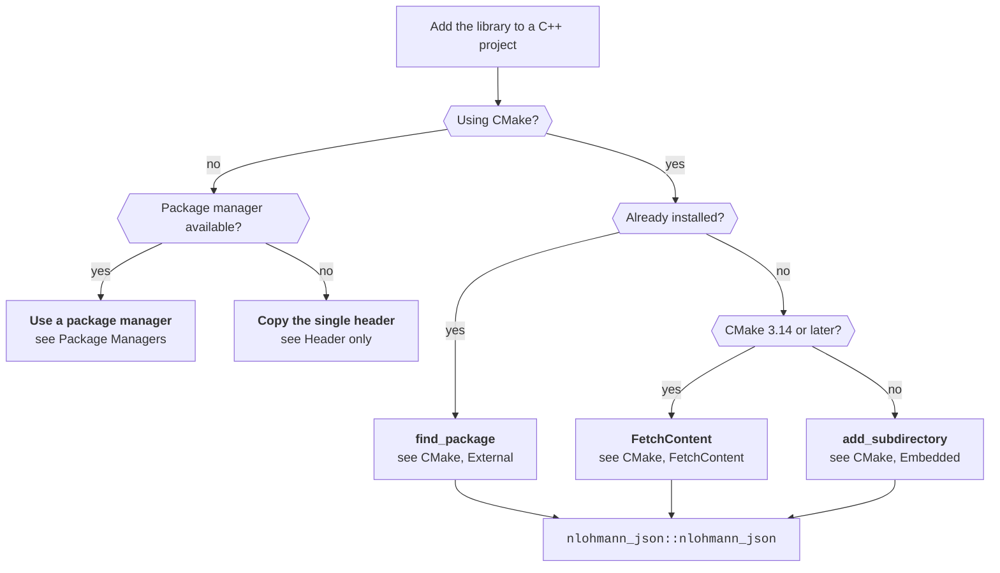

# Integration

There are several ways to add this header-only library to a C++ project. The following flowchart summarizes how to
pick one:



<p class="nj-caption" markdown>Choosing an integration method: answer the questions in the hexagons from top to bottom to reach a method. All CMake methods end at the same target, `nlohmann_json::nlohmann_json`; the list below links to each method.</p>

- **Single header**: copy [`json.hpp`](#header-only) into your project; no build-system integration required.
- **CMake**, see [CMake](cmake.md):
    - [`find_package()`](cmake.md#external) if the library is already installed;
    - [`FetchContent`](cmake.md#fetchcontent) to download it at configure time (CMake 3.14 or later);
    - [`add_subdirectory()`](cmake.md#embedded) to embed a vendored copy of the source tree;
    - or [support both](cmake.md#supporting-both) with an option that selects installed or vendored.
- **Package managers**: install the library with Homebrew, Conan, vcpkg, or one of the many others; see
  [Package Managers](package_managers.md) for the full list.
- **pkg-config**: if you use bare Makefiles instead of CMake, [pkg-config](pkg-config.md) supplies the include flags
  for an already-installed library.

Once the library is integrated, see the [Migration Guide](migration_guide.md) for how to keep your code future-proof
across releases.

## Header only

[`json.hpp`](https://github.com/nlohmann/json/blob/develop/single_include/nlohmann/json.hpp) is the single required
file in `single_include/nlohmann` or [released here](https://github.com/nlohmann/json/releases). You need to add

```cpp
#include <nlohmann/json.hpp>

// for convenience
using nlohmann::json;
```

to the files you want to process JSON and set the necessary switches to enable C++11 (e.g., `-std=c++11` for GCC and
Clang).

!!! tip "Which file do I download?"

    For a project without a package manager, the library itself, including the `_json` literals, is **one file**:
    [`json.hpp`](https://github.com/nlohmann/json/releases/latest/download/json.hpp) from the
    [releases page](https://github.com/nlohmann/json/releases). You do not need to clone the repository, build
    anything, or link a library. Put the file in a directory named `nlohmann` that is on your include path (for
    example `third_party/nlohmann/json.hpp` with `-I third_party`), so that `#include <nlohmann/json.hpp>` works.
    Download the companion headers listed below only if you use them: `json_view.hpp` for the
    [zero-copy views](../features/json_view.md), `json_fwd.hpp` for forward declarations, and `json_literals.hpp` if
    you define `JSON_NO_AUTOMATIC_UDLS`. Keep them in the same `nlohmann` directory.

    Do not copy only parts of the repository's `include/` directory: the headers in it include each other and must be
    kept together. If your IDE reports "cannot open source file" while the compiler succeeds, the compiler's include
    path is set correctly but the IDE's is not; add the same directory to the IDE's include paths.

You can further use file
[`single_include/nlohmann/json_fwd.hpp`](https://github.com/nlohmann/json/blob/develop/single_include/nlohmann/json_fwd.hpp)
for forward declarations (see [Compile times](compile_times.md)), and file
[`single_include/nlohmann/json_literals.hpp`](https://github.com/nlohmann/json/blob/develop/single_include/nlohmann/json_literals.hpp)
for the user-defined string literals if you define
[`JSON_NO_AUTOMATIC_UDLS`](../api/macros/json_no_automatic_udls.md).

For the read-only, non-owning [`basic_json_document`](../api/basic_json_document/index.md)/[`basic_json_view`](../api/basic_json_view/index.md)
types, additionally include
[`single_include/nlohmann/json_view.hpp`](https://github.com/nlohmann/json/blob/develop/single_include/nlohmann/json_view.hpp);
see [Zero-copy JSON views](../features/json_view.md).

## Notes for builds and distribution

**Reproducible and path-independent builds.** The runtime assertions use `assert`, which embeds the name of the source
file (`__FILE__`) in the binary. Release builds do not contain them, because they define `NDEBUG`. If you compile with
assertions enabled and need binaries that do not depend on the build directory, either define `NDEBUG` or map the
prefix of the path with the compiler option `-ffile-prefix-map=<old>=<new>` (GCC 8 and later, Clang 10 and later). See
[Runtime assertions](../features/assertions.md).

**There is no separate source file to compile.** The library is header-only, so there is no `.cpp` that could be
built with different options than the code that includes it. It is also not available as a precompiled library. To
compile the library with optimizations in an otherwise unoptimized build (for example to parse large files in a debug
build, which is slow because of the unoptimized code and the checks of the debug standard library), keep the code that
uses `json` in a separate source file and set the options for that file only. [Compile times](compile_times.md)
shows how to [instantiate `basic_json` once](compile_times.md#instantiate-basic_json-once).

**Debugger visualization.** The Natvis file works with the Visual Studio debugger, including the `cppvsdbg` engine in
Visual Studio Code, but not with debuggers that wrap LLDB, such as `codelldb`; see [Debugging](../home/debugging.md).

## See also

- [CMake](cmake.md) - integrate the library into a CMake project
- [Package managers](package_managers.md)
- [pkg-config](pkg-config.md)
- [Compile times](compile_times.md) - reduce the compile time overhead
- [Migration guide](migration_guide.md) - upgrade from an earlier version
- [Releases](../home/releases/index.md)
