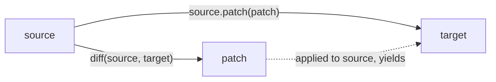

# JSON Patch and Diff

## Patches

JSON Patch ([RFC 6902](https://tools.ietf.org/html/rfc6902)) defines a JSON document structure for expressing a sequence
of operations to apply to a JSON document. Operations address locations in the document using
[JSON Pointer](json_pointer.md) paths. With the [`patch`](../api/basic_json/patch.md) function, a JSON Patch is applied
to the current JSON value by executing all operations from the patch, yielding the patched document as a new value.

The following steps through one operation of each kind. The first three operations are those of the example below; the
other three continue on its result.

<div class="nj-patch" data-nj-patch markdown>

| Operation                                                   | Before                                         | After                                           |
|-------------------------------------------------------------|------------------------------------------------|-------------------------------------------------|
| `{"op": "replace", "path": "/baz", "value": "boo"}`         | `{"baz": "qux", "foo": "bar"}`                 | `{"baz": "boo", "foo": "bar"}`                  |
| `{"op": "add", "path": "/hello", "value": ["world"]}`       | `{"baz": "boo", "foo": "bar"}`                 | `{"baz": "boo", "foo": "bar", "hello": ["world"]}` |
| `{"op": "remove", "path": "/foo"}`                          | `{"baz": "boo", "foo": "bar", "hello": ["world"]}` | `{"baz": "boo", "hello": ["world"]}`        |
| `{"op": "move", "from": "/baz", "path": "/hello/1"}`        | `{"baz": "boo", "hello": ["world"]}`           | `{"hello": ["world", "boo"]}`                   |
| `{"op": "copy", "from": "/hello/0", "path": "/greeting"}`   | `{"hello": ["world", "boo"]}`                  | `{"greeting": "world", "hello": ["world", "boo"]}` |
| `{"op": "test", "path": "/greeting", "value": "world"}`     | `{"greeting": "world", "hello": ["world", "boo"]}` | unchanged (a failed test throws)            |

</div>

<p class="nj-caption" markdown>Stepper through the six operations: *Next* applies the next operation, *Back* undoes it, and *Reset* returns to the original document. The current operation is highlighted in the patch list, and the lines it changes are marked in the document.</p>

!!! tip "Applying a patch without copying"

    [`patch`](../api/basic_json/patch.md) leaves the original value unchanged and returns the patched result as a copy.
    If the document is large and the original value is no longer needed,
    [`patch_inplace`](../api/basic_json/patch_inplace.md) applies the same operations in place instead.

!!! note "Duplicate member names"

    Duplicate member names inside an operation object are resolved by the parser before the patch is applied (the last
    one is kept, see [`object_t`](../api/basic_json/object_t.md#behavior)), so
    `#!json {"op": "add", "op": "remove", "path": "/a"}` is a `remove` operation.

??? example "Example: apply a JSON Patch"

    The following code shows how a JSON patch is applied to a value.

    ```cpp
    #include <iostream>
    #include <iomanip>
    #include <nlohmann/json.hpp>
    
    using nlohmann::json;
    using namespace nlohmann::literals;
    
    int main()
    {
        // the original document
        json doc = R"(
            {
              "baz": "qux",
              "foo": "bar"
            }
        )"_json;
    
        // the patch
        json patch = R"(
            [
              { "op": "replace", "path": "/baz", "value": "boo" },
              { "op": "add", "path": "/hello", "value": ["world"] },
              { "op": "remove", "path": "/foo"}
            ]
        )"_json;
    
        // apply the patch
        json patched_doc = doc.patch(patch);
    
        // output original and patched document
        std::cout << std::setw(4) << doc << "\n\n"
                  << std::setw(4) << patched_doc << '\n';
    }
    
    ```
    
    Output:

    ```json
    {
        "baz": "qux",
        "foo": "bar"
    }
    
    {
        "baz": "boo",
        "hello": [
            "world"
        ]
    }
    
    ```

## Diff

The library can also calculate a JSON patch (i.e., a **diff**) given two JSON values with the
[`diff`](../api/basic_json/diff.md) function.



<p class="nj-caption" markdown>How `diff` and `patch` relate: `diff(source, target)` yields a patch, and applying that patch to the source yields the target.</p>

!!! success "Invariant"

    For two JSON values *source* and *target*, the following code yields true:

    ```cpp
    source.patch(diff(source, target)) == target;
    ```

    The equality holds up to [`operator==`](../api/basic_json/operator_eq.md), with these exceptions:

    - `NaN` and [discarded](../api/basic_json/is_discarded.md) values are not equal to themselves, so the invariant
      cannot hold for them. `diff` emits a `replace` operation for such a value, and a `NaN` in a patch is serialized
      as `#!json null`.
    - Numbers that compare equal produce no operation even if their types differ: `diff(1, 1.0)`, `diff(1u, 1)`, and
      `diff(0.0, -0.0)` return `#!json []`, so the patched value keeps the number type of *source*.
    - A [binary value](binary_values.md) in a patch is serialized as an object
      (`#!json {"bytes":[...],"subtype":null}`), so a patch that was dumped and parsed again no longer holds a binary
      value.

??? example "Example: create a JSON Patch from the difference of two values"

    The following code shows how a JSON patch is created as a diff for two JSON values.

    ```cpp
    #include <iostream>
    #include <iomanip>
    #include <nlohmann/json.hpp>
    
    using nlohmann::json;
    using namespace nlohmann::literals;
    
    int main()
    {
        // the source document
        json source = R"(
            {
                "baz": "qux",
                "foo": "bar"
            }
        )"_json;
    
        // the target document
        json target = R"(
            {
                "baz": "boo",
                "hello": [
                    "world"
                ]
            }
        )"_json;
    
        // create the patch
        json patch = json::diff(source, target);
    
        // roundtrip
        json patched_source = source.patch(patch);
    
        // output patch and roundtrip result
        std::cout << std::setw(4) << patch << "\n\n"
                  << std::setw(4) << patched_source << '\n';
    }
    
    ```
    
    Output:

    ```json
    [
        {
            "op": "replace",
            "path": "/baz",
            "value": "boo"
        },
        {
            "op": "remove",
            "path": "/foo"
        },
        {
            "op": "add",
            "path": "/hello",
            "value": [
                "world"
            ]
        }
    ]
    
    {
        "baz": "boo",
        "hello": [
            "world"
        ]
    }
    
    ```

## See also

- [JSON Pointer](json_pointer.md) - the addressing scheme used for patch paths
- [JSON Merge Patch](merge_patch.md) - a simpler, less expressive alternative patch format
- [`patch`](../api/basic_json/patch.md) - apply a JSON Patch, returning the result as a copy
- [`patch_inplace`](../api/basic_json/patch_inplace.md) - apply a JSON Patch without copying
- [`diff`](../api/basic_json/diff.md) - compute a JSON Patch from two values
- [`json_pointer`](../api/json_pointer/index.md) - type to represent JSON Pointers
- [`merge_diff`](../api/basic_json/merge_diff.md) - compute a JSON Merge Patch from two values
- [Modifying values](modifying_values.md) - simple in-place modifications
