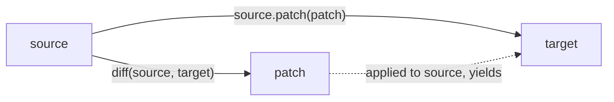

# JSON Patch and Diff

## Patches

JSON Patch ([RFC 6902](https://tools.ietf.org/html/rfc6902)) defines a JSON document structure for expressing a sequence
of operations to apply to a JSON document. Operations address locations in the document using
[JSON Pointer](json_pointer.md) paths. With the [`patch`](../api/basic_json/patch.md) function, a JSON Patch is applied
to the current JSON value by executing all operations from the patch, yielding the patched document as a new value.

!!! tip "Applying a patch without copying"

    [`patch`](../api/basic_json/patch.md) leaves the original value unchanged and returns the patched result as a copy.
    If the document is large and the original value is no longer needed,
    [`patch_inplace`](../api/basic_json/patch_inplace.md) applies the same operations in place instead.

??? example "Example: apply a JSON Patch"

    The following code shows how a JSON patch is applied to a value.

    ```cpp
    #include <iostream>
    #include <iomanip>
    #include <nlohmann/json.hpp>
    
    using json = nlohmann::json;
    using namespace nlohmann::literals;
    
    int main()
    {
        // the original document
        json doc = R"(
            {
              "baz": "qux",
              "foo": "bar"
            }
        )"_json;
    
        // the patch
        json patch = R"(
            [
              { "op": "replace", "path": "/baz", "value": "boo" },
              { "op": "add", "path": "/hello", "value": ["world"] },
              { "op": "remove", "path": "/foo"}
            ]
        )"_json;
    
        // apply the patch
        json patched_doc = doc.patch(patch);
    
        // output original and patched document
        std::cout << std::setw(4) << doc << "\n\n"
                  << std::setw(4) << patched_doc << std::endl;
    }
    
    ```
    
    Output:

    ```json
    {
        "baz": "qux",
        "foo": "bar"
    }
    
    {
        "baz": "boo",
        "hello": [
            "world"
        ]
    }
    
    ```

## Diff

The library can also calculate a JSON patch (i.e., a **diff**) given two JSON values with the
[`diff`](../api/basic_json/diff.md) function.



!!! success "Invariant"

    For two JSON values *source* and *target*, the following code yields always true:

    ```cpp
    source.patch(diff(source, target)) == target;
    ```

??? example "Example: create a JSON Patch from the difference of two values"

    The following code shows how a JSON patch is created as a diff for two JSON values.

    ```cpp
    #include <iostream>
    #include <iomanip>
    #include <nlohmann/json.hpp>
    
    using json = nlohmann::json;
    using namespace nlohmann::literals;
    
    int main()
    {
        // the source document
        json source = R"(
            {
                "baz": "qux",
                "foo": "bar"
            }
        )"_json;
    
        // the target document
        json target = R"(
            {
                "baz": "boo",
                "hello": [
                    "world"
                ]
            }
        )"_json;
    
        // create the patch
        json patch = json::diff(source, target);
    
        // roundtrip
        json patched_source = source.patch(patch);
    
        // output patch and roundtrip result
        std::cout << std::setw(4) << patch << "\n\n"
                  << std::setw(4) << patched_source << std::endl;
    }
    
    ```
    
    Output:

    ```json
    [
        {
            "op": "replace",
            "path": "/baz",
            "value": "boo"
        },
        {
            "op": "remove",
            "path": "/foo"
        },
        {
            "op": "add",
            "path": "/hello",
            "value": [
                "world"
            ]
        }
    ]
    
    {
        "baz": "boo",
        "hello": [
            "world"
        ]
    }
    
    ```

## See also

- [JSON Pointer](json_pointer.md) - the addressing scheme used for patch paths
- [JSON Merge Patch](merge_patch.md) - a simpler, less expressive alternative patch format
- [`patch`](../api/basic_json/patch.md) - apply a JSON Patch, returning the result as a copy
- [`patch_inplace`](../api/basic_json/patch_inplace.md) - apply a JSON Patch without copying
- [`diff`](../api/basic_json/diff.md) - compute a JSON Patch from two values
