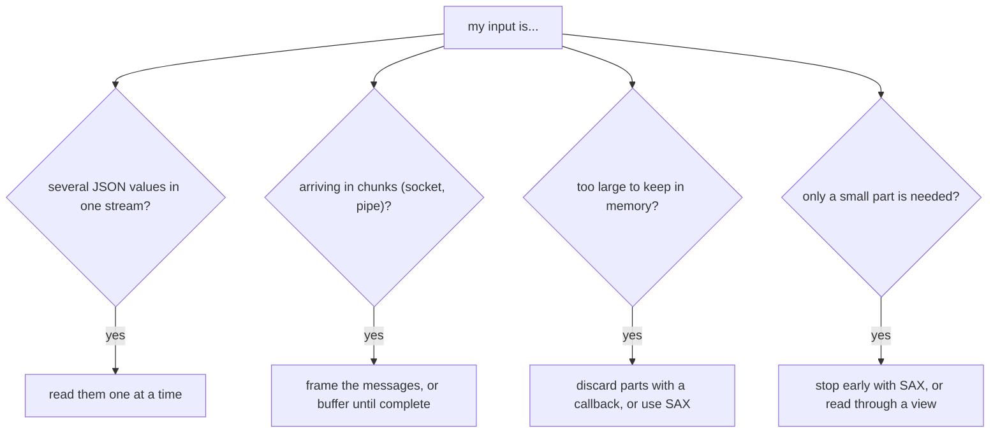

# Large, Streamed, and Partial Input

[`parse`](../../api/basic_json/parse.md) reads exactly one complete JSON value and builds it in memory. It cannot be
paused and resumed, and it does not hand back a half-parsed value when the input ends early. This page shows what to do
when the input does not fit that model: it arrives in pieces, it contains several values, or it is too large to hold
as a `json` value.



<p class="nj-caption" markdown>Questions about the input and the approach this page describes for each; an input can match more than one question.</p>

## Several values in one stream

For newline-delimited input, read line by line and parse each line, as described in [JSON Lines](json_lines.md). For
values that are simply concatenated, [`operator>>`](../../api/operator_gtgt.md) reads one value and leaves the stream
positioned after it. Check for the end of the stream before each read, because a read at the end throws:

??? example "Example: read concatenated values"

    ```cpp
    #include <iostream>
    #include <sstream>
    #include <nlohmann/json.hpp>
    
    using json = nlohmann::json;
    
    int main()
    {
        std::istringstream input(R"({"a":1} [2,3] 4 "s")");
    
        // check for the end of the stream before each read, because a read at the end throws
        json j;
        while (input >> std::ws && input.peek() != std::char_traits<char>::eof())
        {
            input >> j;
            std::cout << j << '\n';
        }
    }
    
    ```

    Output:

    ```
    {"a":1}
    [2,3]
    4
    "s"
    
    ```

The same works for binary formats. [`from_cbor`](../../api/basic_json/from_cbor.md) and its relatives accept
`#!cpp strict = false` to stop after the first value and leave the rest of the stream untouched; `tellg()` then reports
how many bytes the value took:

??? example "Example: read one CBOR value and find out how many bytes it used"

    ```cpp
    #include <iostream>
    #include <sstream>
    #include <nlohmann/json.hpp>
    
    using json = nlohmann::json;
    
    int main()
    {
        // a CBOR value followed by other data
        const std::vector<std::uint8_t> cbor = json::to_cbor(json{1, 2, 3});
        std::string data(cbor.begin(), cbor.end());
        data += "TRAILING";
    
        std::istringstream input(data);
        json j = json::from_cbor(input, false); // strict = false: stop after the first value
    
        std::cout << "value: " << j << '\n';
        std::cout << "bytes used: " << input.tellg() << '\n';
    
        std::string rest;
        input >> rest;
        std::cout << "remaining input: " << rest << '\n';
    }
    
    ```

    Output:

    ```
    value: [1,2,3]
    bytes used: 4
    remaining input: TRAILING
    
    ```

## Input arriving in chunks

A socket, pipe, or HTTP body hands over data in pieces of arbitrary size, and a piece can end in the middle of a
number, a string, or an object. The parser does not keep state between calls, so there are two ways to deal with this.

**Frame the messages.** The most robust approach is a protocol that says where a value ends: one value per line
([JSON Lines](json_lines.md)), a length prefix, or a delimiter. Collect the bytes of one message and parse them when
the frame is complete. Prefer this whenever you control the protocol.

**Buffer until the value is complete.** If the data has no framing, append every chunk to a buffer and try to parse
it. A parse error at the very end of the buffer means that the input ended prematurely, while an error anywhere else is
a real syntax error. The member `byte` of the [`parse_error`](../../home/exceptions.md#jsonexceptionparse_error101)
exception is one past the buffer size in the first case:

??? example "Example: buffer chunks until the value is complete"

    ```cpp
    #include <iostream>
    #include <nlohmann/json.hpp>
    
    using json = nlohmann::json;
    
    std::string buffer;
    
    // call for every chunk; returns true and sets `value` once the buffer holds one complete JSON value
    bool push(const std::string& chunk, json& value)
    {
        buffer += chunk;
        try
        {
            value = json::parse(buffer);
            buffer.clear();
            return true;
        }
        catch (const json::parse_error& e)
        {
            if (e.byte == buffer.size() + 1)
            {
                return false; // the input ends prematurely: wait for more data
            }
            throw; // a real syntax error
        }
    }
    
    int main()
    {
        json value;
        const auto chunks = {"{\"na", "me\": \"Ma", "ry\", \"l", "ist\": [1, 2", ", 3]}"};
        for (const std::string chunk : chunks)
        {
            std::cout << "chunk " << chunk << " -> " << (push(chunk, value) ? "complete" : "incomplete") << '\n';
        }
        std::cout << value << '\n';
    
        // a syntax error in the middle is not mistaken for missing data
        try
        {
            push("[1, ]", value);
        }
        catch (const json::parse_error& e)
        {
            std::cout << e.what() << '\n';
        }
    }
    
    ```

    Output:

    ```
    chunk {"na -> incomplete
    chunk me": "Ma -> incomplete
    chunk ry", "l -> incomplete
    chunk ist": [1, 2 -> incomplete
    chunk , 3]} -> complete
    {"list":[1,2,3],"name":"Mary"}
    [json.exception.parse_error.101] parse error at line 1, column 5: syntax error while parsing value - unexpected ']'; expected '[', '{', or a literal
    
    ```

The example feeds a document in five chunks. The first four are reported as incomplete, and a syntax error is reported as
such, not as missing data.

The chunks of the example, and the bytes each attempt parses again:

<div class="nj-fig-wrap" markdown>
<svg class="nj-fig nj-fig--sax-buf" viewBox="0 0 700 442" role="img" aria-labelledby="fig-sax-buf-title fig-sax-buf-desc" xmlns="http://www.w3.org/2000/svg">
<title id="fig-sax-buf-title">Buffering chunks until the value is complete: five chunks of {&quot;name&quot;: &quot;Mary&quot;, &quot;list&quot;: [1, 2, 3]} appended to a buffer.</title>
<desc id="fig-sax-buf-desc">After chunks 1 to 4 the buffer has 4, 12, 19, and 30 bytes, and parsing it fails at byte 5, 13, 20, and 31: one past the end, so the input is incomplete and the program waits for more. After chunk 5 the buffer of 35 bytes parses as one complete value. For the input [1, ] of 5 bytes the error is at byte 5, before the end, so it is a real syntax error. Every attempt parses the buffer from byte 1, so 4 + 12 + 19 + 30 + 35 = 100 bytes are parsed for a 35-byte value, and the work grows quadratically.</desc>
<text class="fg-h" x="16" y="24">chunk</text>
<text class="fg-h" x="96" y="24">buffer, parsed from byte 1 each time</text>
<text class="fg-h" x="420" y="24">result</text>
<text class="fg-note fg-note--l" x="16" y="67">chunk 1</text>
<rect class="nj-sax-new" x="96" y="50" width="36.6" height="24" rx="4"/>
<text class="nj-sax-buf" x="96" y="67" xml:space="preserve">{&quot;na</text>
<path class="nj-sax-caret nj-sax-s-wait" d="M133.8 76 l-5 8 h10 z"/>
<text class="nj-sax-status nj-sax-s-wait" x="420" y="61">error at byte 5 = size + 1</text>
<text class="fg-note fg-note--l" x="420" y="77">incomplete: wait for more</text>
<text class="fg-note fg-note--l" x="16" y="117">chunk 2</text>
<rect class="nj-sax-old" x="93" y="100" width="36.6" height="24" rx="4"/>
<rect class="nj-sax-new" x="129.6" y="100" width="70.2" height="24" rx="4"/>
<text class="nj-sax-buf" x="96" y="117" xml:space="preserve">{&quot;name&quot;: &quot;Ma</text>
<path class="nj-sax-caret nj-sax-s-wait" d="M201 126 l-5 8 h10 z"/>
<text class="nj-sax-status nj-sax-s-wait" x="420" y="111">error at byte 13 = size + 1</text>
<text class="fg-note fg-note--l" x="420" y="127">incomplete: wait for more</text>
<text class="fg-note fg-note--l" x="16" y="167">chunk 3</text>
<rect class="nj-sax-old" x="93" y="150" width="103.8" height="24" rx="4"/>
<rect class="nj-sax-new" x="196.8" y="150" width="61.8" height="24" rx="4"/>
<text class="nj-sax-buf" x="96" y="167" xml:space="preserve">{&quot;name&quot;: &quot;Mary&quot;, &quot;l</text>
<path class="nj-sax-caret nj-sax-s-wait" d="M259.8 176 l-5 8 h10 z"/>
<text class="nj-sax-status nj-sax-s-wait" x="420" y="161">error at byte 20 = size + 1</text>
<text class="fg-note fg-note--l" x="420" y="177">incomplete: wait for more</text>
<text class="fg-note fg-note--l" x="16" y="217">chunk 4</text>
<rect class="nj-sax-old" x="93" y="200" width="162.6" height="24" rx="4"/>
<rect class="nj-sax-new" x="255.6" y="200" width="95.4" height="24" rx="4"/>
<text class="nj-sax-buf" x="96" y="217" xml:space="preserve">{&quot;name&quot;: &quot;Mary&quot;, &quot;list&quot;: [1, 2</text>
<path class="nj-sax-caret nj-sax-s-wait" d="M352.2 226 l-5 8 h10 z"/>
<text class="nj-sax-status nj-sax-s-wait" x="420" y="211">error at byte 31 = size + 1</text>
<text class="fg-note fg-note--l" x="420" y="227">incomplete: wait for more</text>
<text class="fg-note fg-note--l" x="16" y="267">chunk 5</text>
<rect class="nj-sax-old" x="93" y="250" width="255" height="24" rx="4"/>
<rect class="nj-sax-new" x="348" y="250" width="45" height="24" rx="4"/>
<text class="nj-sax-buf" x="96" y="267" xml:space="preserve">{&quot;name&quot;: &quot;Mary&quot;, &quot;list&quot;: [1, 2, 3]}</text>
<text class="nj-sax-status nj-sax-s-ok" x="420" y="261">parsed, size 35</text>
<text class="fg-note fg-note--l" x="420" y="277">complete: one value</text>
<path class="nj-sax-sep" d="M16 290 H684"/>
<text class="fg-note fg-note--l" x="16" y="325">other input</text>
<rect class="nj-sax-new" x="96" y="308" width="45" height="24" rx="4"/>
<text class="nj-sax-buf" x="96" y="325" xml:space="preserve">[1, ]</text>
<path class="nj-sax-caret nj-sax-s-err" d="M133.8 334 l-5 8 h10 z"/>
<text class="nj-sax-status nj-sax-s-err" x="420" y="319">error at byte 5, size 5</text>
<text class="fg-note fg-note--l" x="420" y="335">before the end: a real error</text>
<text class="fg-note fg-note--l" x="16" y="366">Bytes parsed: 4 + 12 + 19 + 30 + 35 = 100 for a value of 35 bytes.</text>
<text class="fg-note fg-note--l" x="16" y="386">Every attempt starts again at byte 1, so the total work grows</text>
<text class="fg-note fg-note--l" x="16" y="406">quadratically with the size of the value.</text>
</svg>

</div>

<p class="nj-caption" markdown>Each row is one parse attempt on the growing buffer: an error at the byte after the end of the buffer means the value is incomplete, an error before the end is a real syntax error. The last line adds up the bytes parsed over all attempts.</p>

!!! warning "Limits of buffering"

    - The buffer must contain exactly one value. Data that belongs to the next value is a syntax error. Use framing if
      values follow each other without a separator.
    - A number at the end of the buffer is a complete value, even if more digits are still to come (`12` may be the
      start of `123`). Buffering cannot detect this; use framing for top-level numbers.
    - Every attempt parses the buffer from the beginning, so the total work grows quadratically with the size of the
      value. Limit the size of the buffer for input you do not trust (see [untrusted input](untrusted_input.md)).

## Input too large for memory

The input does not have to become one huge `json` value. The two tools below process it piece by piece.

How the memory use develops while a large array of records is parsed (illustrative, not a measurement):

<div class="nj-fig-wrap" markdown>
<svg class="nj-fig nj-fig--sax-mem" viewBox="0 0 660 312" role="img" aria-labelledby="fig-sax-mem-title fig-sax-mem-desc" xmlns="http://www.w3.org/2000/svg">
<title id="fig-sax-mem-title">Illustrative memory use over time while a large array of records is parsed, not a measurement.</title>
<desc id="fig-sax-mem-desc">Four curves. D&#8203;OM, parse(): rises steadily until the whole tree is in memory. json_document: starts at about the size of the text, which it keeps, and grows a little while its index is built. Parser callback that discards every record: stays flat at the size of one record. S&#8203;AX: stays flat and lowest, because no value is built and only what the handler keeps is in memory.</desc>
<path class="nj-sax-axis" d="M56 36 V272 H448"/>
<text class="fg-h" x="16" y="24">memory</text>
<text class="fg-note fg-note--l" x="56" y="294">time: records parsed</text>
<text class="fg-note fg-note--r nj-sax-illus" x="648" y="24">illustrative, not a measurement</text>
<path class="nj-sax-curve nj-sax-c-dom" d="M56 268 L440 52"/>
<path class="nj-sax-curve nj-sax-c-doc" d="M56 168 L440 146"/>
<path class="nj-sax-curve nj-sax-c-cb" d="M56 250 L88 238 L88 250 L120 238 L120 250 L152 238 L152 250 L184 238 L184 250 L216 238 L216 250 L248 238 L248 250 L280 238 L280 250 L312 238 L312 250 L344 238 L344 250 L376 238 L376 250 L408 238 L408 250 L440 238 L440 250"/>
<path class="nj-sax-curve nj-sax-c-sax" d="M56 264 H440"/>
<text class="nj-sax-lab nj-sax-c-dom" x="456" y="48">D&#8203;OM: parse()</text>
<text class="fg-note fg-note--l" x="456" y="65">the whole tree</text>
<text class="nj-sax-lab nj-sax-c-doc" x="456" y="142">json_document</text>
<text class="fg-note fg-note--l" x="456" y="159">the text plus its index</text>
<text class="nj-sax-lab nj-sax-c-cb" x="456" y="227">callback, discard</text>
<text class="fg-note fg-note--l" x="456" y="244">one record at a time</text>
<text class="nj-sax-lab nj-sax-c-sax" x="456" y="269">S&#8203;AX</text>
<text class="fg-note fg-note--l" x="456" y="286">only what the handler keeps</text>
</svg>

</div>

<p class="nj-caption" markdown>Memory use over the number of records parsed: `parse()` keeps the whole tree, `json_document` the text plus its index, a discarding callback one record at a time, and SAX only what the handler keeps.</p>

### Handle and discard elements with a callback

A [parser callback](parser_callbacks.md) is called for every finished value. If it returns `#!cpp false`, the value is
discarded and its memory is released at once. For a file that consists of one huge array (or one huge object) of
records, handle each record at depth 1 and discard it:

??? example "Example: handle and discard each record of a large array"

    ```cpp
    #include <iostream>
    #include <sstream>
    #include <nlohmann/json.hpp>
    
    using json = nlohmann::json;
    
    void handle(const json& record)
    {
        std::cout << "handling " << record << '\n';
    }
    
    int main()
    {
        std::istringstream file(R"([{"id": 1}, {"id": 2}, {"id": 3}])");
    
        json result = json::parse(file, [](int depth, json::parse_event_t event, json & record)
        {
            if (depth == 1 && event == json::parse_event_t::object_end)
            {
                handle(record);
                return false; // discard the record
            }
            return true;
        });
    
        std::cout << "result: " << result << '\n';
    }
    
    ```

    Output:

    ```
    handling {"id":1}
    handling {"id":2}
    handling {"id":3}
    result: []
    
    ```

Only one record is in memory at any time. The same recipe, with more detail, is in the
[parser callbacks](parser_callbacks.md#recipe-streaming-a-large-homogeneous-array) page. To skip entire members you do not
need, discard them when their key is read; see the [example](parser_callbacks.md) for `parse_event_t::key`.

### Extract a few values and stop with SAX

With the [SAX interface](sax_interface.md), no value is built at all, and **returning `#!cpp false` from any handler
function stops the parser**. [`sax_parse`](../../api/basic_json/sax_parse.md) then returns `#!cpp false`, and the rest
of the input is not read. The example finds the first `id` in a document without parsing the remainder:

??? example "Example: stop parsing as soon as a value is found"

    ```cpp
    #include <iostream>
    #include <nlohmann/json.hpp>
    
    using json = nlohmann::json;
    
    struct find_id : nlohmann::json_sax<json>
    {
        bool next_is_id = false;
        json::number_unsigned_t id = 0;
    
        bool key(std::string& name) override
        {
            next_is_id = (name == "id");
            return true;
        }
    
        bool number_unsigned(json::number_unsigned_t value) override
        {
            if (next_is_id)
            {
                id = value;
                return false; // found: stop parsing
            }
            return true;
        }
    
        bool null() override
        {
            return true;
        }
        bool boolean(bool /*val*/) override
        {
            return true;
        }
        bool number_integer(json::number_integer_t /*val*/) override
        {
            return true;
        }
        bool number_float(json::number_float_t /*val*/, const std::string& /*s*/) override
        {
            return true;
        }
        bool string(std::string& /*val*/) override
        {
            return true;
        }
        bool binary(json::binary_t& /*val*/) override
        {
            return true;
        }
        bool start_object(std::size_t /*elements*/) override
        {
            return true;
        }
        bool end_object() override
        {
            return true;
        }
        bool start_array(std::size_t /*elements*/) override
        {
            return true;
        }
        bool end_array() override
        {
            return true;
        }
        bool parse_error(std::size_t /*position*/, const std::string& /*last_token*/, const json::exception& /*ex*/) override
        {
            return false;
        }
    };
    
    int main()
    {
        find_id handler;
        const bool completed = json::sax_parse(R"({"x": [1, 2, 3], "id": 42, "rest": [4, 5, 6]})", &handler);
    
        std::cout << std::boolalpha;
        std::cout << "parse completed: " << completed << '\n';
        std::cout << "id: " << handler.id << '\n';
    }
    
    ```

    Output:

    ```
    parse completed: false
    id: 42
    
    ```

Note that `sax_parse` returns `#!cpp false` both when a handler stopped the parse and when the input is invalid, so
record the reason in the handler (here: `id`) if you need to tell the two apart.

### Read parts of a large document with a view

If the whole text is available and you only need to read some of it, a [`json_document`](../json_view.md) from
`<nlohmann/json_view.hpp>` (added in version 3.13.0) avoids the `basic_json` tree altogether: it keeps the text, builds a flat index of the values,
and gives read-only [views](../../api/basic_json_view/index.md) of the parts you look at. Only what you
[`materialize()`](../../api/basic_json_view/materialize.md) becomes a `basic_json` value. See
[Zero-copy JSON views](../json_view.md) for details and for the lifetime rules.

## See also

- [Parsing](index.md) - overview of the parsing functions
- [JSON Lines](json_lines.md) - newline-delimited JSON
- [Parser callbacks](parser_callbacks.md) - discard values while parsing
- [SAX interface](sax_interface.md) - event-based parsing
- [Zero-copy JSON views](../json_view.md) - read parts of a large document without building a tree
- [Untrusted input](untrusted_input.md) - limits for input you do not control
- [`operator>>`](../../api/operator_gtgt.md) - deserialize from stream
- [`parse`](../../api/basic_json/parse.md) - deserialize from a compatible input
- [`sax_parse`](../../api/basic_json/sax_parse.md) - generate SAX events
- [`JSON_PRECISE_STREAM_POSITION`](../../api/macros/json_precise_stream_position.md) - leave the stream positioned right after a parsed number
- [`JSON_DISABLE_STREAM_BULK_SCAN`](../../api/macros/json_disable_stream_bulk_scan.md) - read a `std::istream` one character at a time
