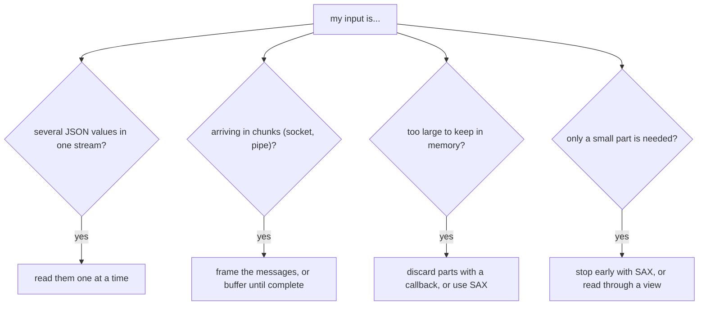

# Large, Streamed, and Partial Input

[`parse`](../../api/basic_json/parse.md) reads exactly one complete JSON value and builds it in memory. It cannot be
paused and resumed, and it does not hand back a half-parsed value when the input ends early. This page shows what to do
when the input does not fit that model: it arrives in pieces, it contains several values, or it is too large to hold
as a `json` value.



## Several values in one stream

For newline-delimited input, read line by line and parse each line, as described in [JSON Lines](json_lines.md). For
values that are simply concatenated, [`operator>>`](../../api/operator_gtgt.md) reads one value and leaves the stream
positioned after it. Check for the end of the stream before each read, because a read at the end throws:

??? example "Example: read concatenated values"

    ```cpp
    #include <iostream>
    #include <sstream>
    #include <nlohmann/json.hpp>
    
    using json = nlohmann::json;
    
    int main()
    {
        std::istringstream input(R"({"a":1} [2,3] 4 "s")");
    
        // check for the end of the stream before each read, because a read at the end throws
        json j;
        while (input >> std::ws && input.peek() != std::char_traits<char>::eof())
        {
            input >> j;
            std::cout << j << '\n';
        }
    }
    
    ```

    Output:

    ```
    {"a":1}
    [2,3]
    4
    "s"
    
    ```

The same works for binary formats. [`from_cbor`](../../api/basic_json/from_cbor.md) and its relatives accept
`#!cpp strict = false` to stop after the first value and leave the rest of the stream untouched; `tellg()` then reports
how many bytes the value took:

??? example "Example: read one CBOR value and find out how many bytes it used"

    ```cpp
    #include <iostream>
    #include <sstream>
    #include <nlohmann/json.hpp>
    
    using json = nlohmann::json;
    
    int main()
    {
        // a CBOR value followed by other data
        const std::vector<std::uint8_t> cbor = json::to_cbor(json{1, 2, 3});
        std::string data(cbor.begin(), cbor.end());
        data += "TRAILING";
    
        std::istringstream input(data);
        json j = json::from_cbor(input, false); // strict = false: stop after the first value
    
        std::cout << "value: " << j << '\n';
        std::cout << "bytes used: " << input.tellg() << '\n';
    
        std::string rest;
        input >> rest;
        std::cout << "remaining input: " << rest << '\n';
    }
    
    ```

    Output:

    ```
    value: [1,2,3]
    bytes used: 4
    remaining input: TRAILING
    
    ```

## Input arriving in chunks

A socket, pipe, or HTTP body hands over data in pieces of arbitrary size, and a piece can end in the middle of a
number, a string, or an object. The parser does not keep state between calls, so there are two ways to deal with this.

**Frame the messages.** The most robust approach is a protocol that says where a value ends: one value per line
([JSON Lines](json_lines.md)), a length prefix, or a delimiter. Collect the bytes of one message and parse them when
the frame is complete. Prefer this whenever you control the protocol.

**Buffer until the value is complete.** If the data has no framing, append every chunk to a buffer and try to parse
it. A parse error at the very end of the buffer means that the input ended prematurely, while an error anywhere else is
a real syntax error. The member `byte` of the [`parse_error`](../../home/exceptions.md#jsonexceptionparse_error101)
exception is one past the buffer size in the first case:

??? example "Example: buffer chunks until the value is complete"

    ```cpp
    #include <iostream>
    #include <nlohmann/json.hpp>
    
    using json = nlohmann::json;
    
    std::string buffer;
    
    // call for every chunk; returns true and sets `value` once the buffer holds one complete JSON value
    bool push(const std::string& chunk, json& value)
    {
        buffer += chunk;
        try
        {
            value = json::parse(buffer);
            buffer.clear();
            return true;
        }
        catch (const json::parse_error& e)
        {
            if (e.byte == buffer.size() + 1)
            {
                return false; // the input ends prematurely: wait for more data
            }
            throw; // a real syntax error
        }
    }
    
    int main()
    {
        json value;
        const auto chunks = {"{\"na", "me\": \"Ma", "ry\", \"l", "ist\": [1, 2", ", 3]}"};
        for (const std::string chunk : chunks)
        {
            std::cout << "chunk " << chunk << " -> " << (push(chunk, value) ? "complete" : "incomplete") << '\n';
        }
        std::cout << value << '\n';
    
        // a syntax error in the middle is not mistaken for missing data
        try
        {
            push("[1, ]", value);
        }
        catch (const json::parse_error& e)
        {
            std::cout << e.what() << '\n';
        }
    }
    
    ```

    Output:

    ```
    chunk {"na -> incomplete
    chunk me": "Ma -> incomplete
    chunk ry", "l -> incomplete
    chunk ist": [1, 2 -> incomplete
    chunk , 3]} -> complete
    {"list":[1,2,3],"name":"Mary"}
    [json.exception.parse_error.101] parse error at line 1, column 5: syntax error while parsing value - unexpected ']'; expected '[', '{', or a literal
    
    ```

The example feeds a document in five chunks. The first four are reported as incomplete, and a syntax error is reported as
such, not as missing data.

!!! warning "Limits of buffering"

    - The buffer must contain exactly one value. Data that belongs to the next value is a syntax error. Use framing if
      values follow each other without a separator.
    - A number at the end of the buffer is a complete value, even if more digits are still to come (`12` may be the
      start of `123`). Buffering cannot detect this; use framing for top-level numbers.
    - Every attempt parses the buffer from the beginning, so the total work grows quadratically with the size of the
      value. Limit the size of the buffer for input you do not trust (see [untrusted input](untrusted_input.md)).

## Input too large for memory

The input does not have to become one huge `json` value. The two tools below process it piece by piece.

### Handle and discard elements with a callback

A [parser callback](parser_callbacks.md) is called for every finished value. If it returns `#!cpp false`, the value is
discarded and its memory is released at once. For a file that consists of one huge array (or one huge object) of
records, handle each record at depth 1 and discard it:

??? example "Example: handle and discard each record of a large array"

    ```cpp
    #include <iostream>
    #include <sstream>
    #include <nlohmann/json.hpp>
    
    using json = nlohmann::json;
    
    void handle(const json& record)
    {
        std::cout << "handling " << record << '\n';
    }
    
    int main()
    {
        std::istringstream file(R"([{"id": 1}, {"id": 2}, {"id": 3}])");
    
        json result = json::parse(file, [](int depth, json::parse_event_t event, json & record)
        {
            if (depth == 1 && event == json::parse_event_t::object_end)
            {
                handle(record);
                return false; // discard the record
            }
            return true;
        });
    
        std::cout << "result: " << result << '\n';
    }
    
    ```

    Output:

    ```
    handling {"id":1}
    handling {"id":2}
    handling {"id":3}
    result: []
    
    ```

Only one record is in memory at any time. The same recipe, with more detail, is in the
[parser callbacks](parser_callbacks.md#recipe-streaming-a-large-homogeneous-array) page. To skip entire members you do not
need, discard them when their key is read; see the [example](parser_callbacks.md) for `parse_event_t::key`.

### Extract a few values and stop with SAX

With the [SAX interface](sax_interface.md), no value is built at all, and **returning `#!cpp false` from any handler
function stops the parser**. [`sax_parse`](../../api/basic_json/sax_parse.md) then returns `#!cpp false`, and the rest
of the input is not read. The example finds the first `id` in a document without parsing the remainder:

??? example "Example: stop parsing as soon as a value is found"

    ```cpp
    #include <iostream>
    #include <nlohmann/json.hpp>
    
    using json = nlohmann::json;
    
    struct find_id : nlohmann::json_sax<json>
    {
        bool next_is_id = false;
        json::number_unsigned_t id = 0;
    
        bool key(std::string& name) override
        {
            next_is_id = (name == "id");
            return true;
        }
    
        bool number_unsigned(json::number_unsigned_t value) override
        {
            if (next_is_id)
            {
                id = value;
                return false; // found: stop parsing
            }
            return true;
        }
    
        bool null() override
        {
            return true;
        }
        bool boolean(bool /*val*/) override
        {
            return true;
        }
        bool number_integer(json::number_integer_t /*val*/) override
        {
            return true;
        }
        bool number_float(json::number_float_t /*val*/, const std::string& /*s*/) override
        {
            return true;
        }
        bool string(std::string& /*val*/) override
        {
            return true;
        }
        bool binary(json::binary_t& /*val*/) override
        {
            return true;
        }
        bool start_object(std::size_t /*elements*/) override
        {
            return true;
        }
        bool end_object() override
        {
            return true;
        }
        bool start_array(std::size_t /*elements*/) override
        {
            return true;
        }
        bool end_array() override
        {
            return true;
        }
        bool parse_error(std::size_t /*position*/, const std::string& /*last_token*/, const json::exception& /*ex*/) override
        {
            return false;
        }
    };
    
    int main()
    {
        find_id handler;
        const bool completed = json::sax_parse(R"({"x": [1, 2, 3], "id": 42, "rest": [4, 5, 6]})", &handler);
    
        std::cout << std::boolalpha;
        std::cout << "parse completed: " << completed << '\n';
        std::cout << "id: " << handler.id << '\n';
    }
    
    ```

    Output:

    ```
    parse completed: false
    id: 42
    
    ```

Note that `sax_parse` returns `#!cpp false` both when a handler stopped the parse and when the input is invalid, so
record the reason in the handler (here: `id`) if you need to tell the two apart.

### Read parts of a large document with a view

If the whole text is available and you only need to read some of it, a [`json_document`](../json_view.md) from
`<nlohmann/json_view.hpp>` (added in version 3.13.0) avoids the `basic_json` tree altogether: it keeps the text, builds a flat index of the values,
and gives read-only [views](../../api/basic_json_view/index.md) of the parts you look at. Only what you
[`materialize()`](../../api/basic_json_view/materialize.md) becomes a `basic_json` value. See
[Zero-copy JSON views](../json_view.md) for details and for the lifetime rules.

## See also

- [Parsing](index.md) - overview of the parsing functions
- [JSON Lines](json_lines.md) - newline-delimited JSON
- [Parser callbacks](parser_callbacks.md) - discard values while parsing
- [SAX interface](sax_interface.md) - event-based parsing
- [Zero-copy JSON views](../json_view.md) - read parts of a large document without building a tree
- [Untrusted input](untrusted_input.md) - limits for input you do not control
