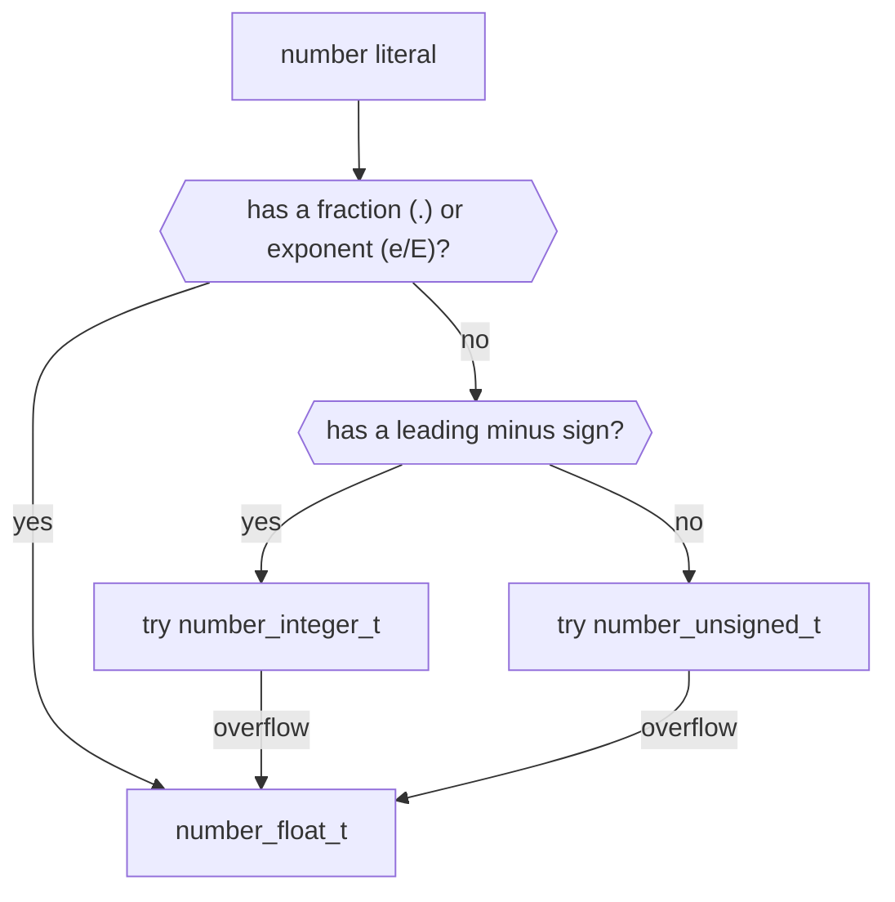

# Number Handling

This document describes how the library is handling numbers.

## Background

This section briefly summarizes how the JSON specification describes how numbers should be handled.

### JSON number syntax

JSON defines the syntax of numbers as follows:

!!! quote "[RFC 8259](https://tools.ietf.org/html/rfc8259#section-6), Section 6"

    The representation of numbers is similar to that used in most
    programming languages.  A number is represented in base 10 using
    decimal digits.  It contains an integer component that may be
    prefixed with an optional minus sign, which may be followed by a
    fraction part and/or an exponent part.  Leading zeros are not
    allowed.

    A fraction part is a decimal point followed by one or more digits.
    
    An exponent part begins with the letter E in uppercase or lowercase,
    which may be followed by a plus or minus sign.  The E and optional
    sign are followed by one or more digits.

The following railroad diagram from [json.org](https://json.org) visualizes the number syntax:

<div class="railroad-wrap" markdown>
<svg class="railroad" viewBox="0 0 860 214" role="img" aria-labelledby="rr-title" xmlns="http://www.w3.org/2000/svg">
<title id="rr-title">Railroad diagram of the J&#8203;SON number syntax: optional minus, then 0 or a digit from 1 to 9 followed by digits, then an optional fraction (a dot and digits) and an optional exponent (e or E, an optional sign, and digits).</title>
<g class="rr-track" fill="none" stroke="currentColor" stroke-opacity=".6" stroke-width="2" stroke-linecap="round" stroke-linejoin="round">
<path d="M8 44 L850 44"/>
<path d="M24 44 L31 44 Q38 44 38 51 L38 82 Q38 92 48 92 L59 92"/>
<path d="M85 92 L96 92 Q106 92 106 82 L106 51 Q106 44 113 44 L120 44"/>
<path d="M120 44 L127 44 Q134 44 134 51 L134 82 Q134 92 144 92 L160 92"/>
<path d="M242 92 L370 92 Q380 92 380 82 L380 52 Q380 44 388 44 L396 44"/>
<path d="M242 92 L250 92 Q258 92 258 100 L258 126 Q258 136 268 136 L278 136"/>
<path d="M332 136 L340 136 Q348 136 348 128 L348 92"/>
<path d="M340 136 L340 160 Q340 170 330 170 L280 170 Q270 170 270 160 L270 136"/>
<path d="M396 44 L403 44 Q410 44 410 51 L410 84.5 Q410 92 417.5 92 L425 92"/>
<path d="M451 92 L462 92"/>
<path d="M524 92 L524 116 Q524 126 514 126 L466 126 Q456 126 456 116 L456 92"/>
<path d="M516 92 L523 92 Q530 92 530 85 L530 52 Q530 44 538 44 L546 44"/>
<path d="M546 44 L553 44 Q560 44 560 51 L560 83.5 Q560 92 568.5 92 L577 92"/>
<path d="M546 44 L553 44 Q560 44 560 51 L560 127.5 Q560 136 568.5 136 L577 136"/>
<path d="M603 92 L728 92"/>
<path d="M603 136 L611.5 136 Q620 136 620 127.5 L620 92"/>
<path d="M640 92 L647 92 Q654 92 654 99 L654 128 Q654 136 662 136 L670 136"/>
<path d="M640 92 L647 92 Q654 92 654 99 L654 172 Q654 180 662 180 L670 180"/>
<path d="M696 136 L704 136 Q712 136 712 128 L712 92"/>
<path d="M696 180 L704 180 Q712 180 712 172 L712 92"/>
<path d="M728 92 L746 92"/>
<path d="M808 92 L808 116 Q808 126 798 126 L748 126 Q738 126 738 116 L738 92"/>
<path d="M800 92 L808 92 Q816 92 816 84 L816 52 Q816 44 824 44 L832 44"/>
</g>
<polygon class="rr-arrow" points="2,38 12,44 2,50"/>
<polygon class="rr-arrow" points="846,38 858,44 846,50"/>
<circle class="rr-bg" cx="72" cy="92" r="13"/>
<circle class="rr-t" cx="72" cy="92" r="13"/>
<circle class="rr-bg" cx="257" cy="44" r="13"/>
<circle class="rr-t" cx="257" cy="44" r="13"/>
<rect class="rr-bg" x="160" y="78" width="82" height="28" rx="6"/>
<rect class="rr-n" x="160" y="78" width="82" height="28" rx="6"/>
<rect class="rr-bg" x="278" y="122" width="54" height="28" rx="6"/>
<rect class="rr-n" x="278" y="122" width="54" height="28" rx="6"/>
<circle class="rr-bg" cx="438" cy="92" r="13"/>
<circle class="rr-t" cx="438" cy="92" r="13"/>
<rect class="rr-bg" x="462" y="78" width="54" height="28" rx="6"/>
<rect class="rr-n" x="462" y="78" width="54" height="28" rx="6"/>
<circle class="rr-bg" cx="590" cy="92" r="13"/>
<circle class="rr-t" cx="590" cy="92" r="13"/>
<circle class="rr-bg" cx="590" cy="136" r="13"/>
<circle class="rr-t" cx="590" cy="136" r="13"/>
<circle class="rr-bg" cx="683" cy="136" r="13"/>
<circle class="rr-t" cx="683" cy="136" r="13"/>
<circle class="rr-bg" cx="683" cy="180" r="13"/>
<circle class="rr-t" cx="683" cy="180" r="13"/>
<rect class="rr-bg" x="746" y="78" width="54" height="28" rx="6"/>
<rect class="rr-n" x="746" y="78" width="54" height="28" rx="6"/>
<text class="rr-c" x="72" y="97">&#8722;</text>
<text class="rr-c" x="257" y="49">0</text>
<text class="rr-b" x="201" y="97">digit 1&#8211;9</text>
<text class="rr-b" x="305" y="141">digit</text>
<text class="rr-c" x="438" y="97">.</text>
<text class="rr-b" x="489" y="97">digit</text>
<text class="rr-c" x="590" y="97">e</text>
<text class="rr-c" x="590" y="141">E</text>
<text class="rr-c" x="683" y="141">&#8722;</text>
<text class="rr-c" x="683" y="185">+</text>
<text class="rr-b" x="773" y="97">digit</text>
<text class="rr-l rr-name" x="24" y="32">number</text>
<text class="rr-l" x="420" y="32">fraction</text>
<text class="rr-l" x="580" y="32">exponent</text>
</svg>

</div>

<p class="nj-caption" markdown>Read the diagram from left to right: every path along the lines spells a valid number, made of an optional minus sign, an integer part, an optional fraction, and an optional exponent.</p>

### Number interoperability

On number interoperability, the following remarks are made:

!!! quote "[RFC 8259](https://tools.ietf.org/html/rfc8259#section-6), Section 6"

    This specification allows implementations to set limits on the range
    and precision of numbers accepted.  Since software that implements
    IEEE 754 binary64 (double precision) numbers [IEEE754] is generally
    available and widely used, good interoperability can be achieved by
    implementations that expect no more precision or range than these
    provide, in the sense that implementations will approximate JSON
    numbers within the expected precision.  A JSON number such as 1E400
    or 3.141592653589793238462643383279 may indicate potential
    interoperability problems, since it suggests that the software that
    created it expects receiving software to have greater capabilities
    for numeric magnitude and precision than is widely available.
    
    Note that when such software is used, numbers that are integers and
    are in the range [-2<sup>53</sup>+1, 2<sup>53</sup>-1] are interoperable in the
    sense that implementations will agree exactly on their numeric
    values.

## Library implementation

This section describes how this library implements the above number specification.

### Number storage

In the default [`json`](../../api/json.md) type, numbers are stored as `#!c std::uint64_t`, `#!c std::int64_t`, and
`#!c double`, respectively. Thereby, `#!c std::uint64_t` and `#!c std::int64_t` are used only if they can store the 
number without loss of precision. If this is impossible (e.g., if the number is too large), the number is stored as
`#!c double`.

Positive integers are stored as `#!c std::uint64_t`, while negative integers are stored as `#!c std::int64_t`. This
distinction is determined at parse time: if the JSON number has a leading minus sign, it uses signed integer storage;
otherwise, it uses unsigned integer storage.



<p class="nj-caption" markdown>How the parser picks the storage type of a number literal: a fraction or exponent always gives `number_float_t`; otherwise the sign selects the signed or unsigned integer type, and a value that overflows it is stored as `number_float_t`.</p>

!!! info "Notes"

    - Numbers with a decimal digit or scientific notation are always stored as `#!c double`.
    - The number types can be changed, see [Template number types](#template-number-types). 
    - The library converts integers and floating-point numbers itself, independent of the locale. Floating-point
      numbers are correctly rounded (to nearest, ties to even). Only a `#!c long double` that is not IEEE 754 binary64
      (e.g., the 80-bit x87 format) is converted with `#!cpp std::from_chars` where available, or else with
      [`std::strtold`](https://en.cppreference.com/w/cpp/string/byte/strtof). For that call, the library temporarily
      replaces the `.` with the decimal point of the current locale (which may be longer than one byte, e.g., in
      `fa_IR.UTF-8`), so the result does not depend on the locale either. Changing the locale in another thread during
      parsing is undefined behavior of the C library, though. Before version 3.13.0, the conversion was realized by
      [`std::strtoull`](https://en.cppreference.com/w/cpp/string/byte/strtoul),
      [`std::strtoll`](https://en.cppreference.com/w/cpp/string/byte/strtol), and `std::strtod`, respectively.

!!! example "Examples"

    - Integer `#!c -12345678912345789123456789` is smaller than `#!c INT64_MIN` and will be stored as floating-point
      number `#!c -1.2345678912345788e+25`.
    - Integer `#!c 1E3` will be stored as floating-point number `#!c 1000.0`.

### Number limits

- Any 64-bit signed or unsigned integer can be stored without loss of precision.
- Numbers exceeding the limits of `#!c double` (i.e., numbers whose rounded value is not satisfying
[`std::isfinite`](https://en.cppreference.com/w/cpp/numeric/math/isfinite) such as `#!c 1E400`) will throw exception
[`json.exception.out_of_range.406`](../../home/exceptions.md#jsonexceptionout_of_range406) during parsing. Numbers too
small for `#!c double` (such as `#!c 1E-400`) become zero, with the sign of the number.
- Floating-point numbers are rounded to the next number representable as `double`. For instance
`#!c 3.141592653589793238462643383279` is stored as [`0x400921fb54442d18`](https://float.exposed/0x400921fb54442d18).
This is the same behavior as the code `#!c double x = 3.141592653589793238462643383279;`.

!!! success "Interoperability"

    - The library is interoperable with respect to the specification, because its supported range [-2<sup>63</sup>, 2<sup>64</sup>-1] is
      larger than the described range [-2<sup>53</sup>+1, 2<sup>53</sup>-1].
    - All integers outside the range [-2<sup>63</sup>, 2<sup>64</sup>-1], as well as floating-point numbers are stored as `double`.
      This also concurs with the specification above.

### Zeros

The JSON number grammar allows for different ways to express zero, and this library will store zeros differently:

| Literal | Stored value and type  | Serialization |
|---------|------------------------|---------------|
| `0`     | `#!c std::uint64_t(0)` | `0`           |
| `-0`    | `#!c std::int64_t(0)`  | `0`           |
| `0.0`   | `#!c double(0.0)`      | `0.0`         |
| `-0.0`  | `#!c double(-0.0)`     | `-0.0`        |
| `0E0`   | `#!c double(0.0)`      | `0.0`         |
| `-0E0`  | `#!c double(-0.0)`     | `-0.0`        |

That is, `-0` is stored as a signed integer, but the serialization does not reproduce the `-`.

The literals mentioned on this page, parsed with `json::parse` and serialized with `dump()` (checked against the
library; pick one or type it to see the row):

<div class="nj-charts-num" markdown>

| Literal | Stored as (`type()`) | `dump()` |
|---------|----------------------|----------|
| `0` | `number_unsigned` (`std::uint64_t`) | `0` |
| `-0` | `number_integer` (`std::int64_t`) | `0` |
| `-0.0` | `number_float` (`double`) | `-0.0` |
| `1E3` | `number_float` (`double`) | `1000.0` |
| `-12345678912345789123456789` | `number_float` (`double`) | `-1.2345678912345788e+25` |
| `18446744073709551615` | `number_unsigned` (`std::uint64_t`) | `18446744073709551615` |
| `18446744073709551616` | `number_float` (`double`) | `1.8446744073709552e+19` |
| `-9223372036854775808` | `number_integer` (`std::int64_t`) | `-9223372036854775808` |
| `1E400` | exception `out_of_range.406` | (nothing, parsing fails) |
| `1E-400` | `number_float` (`double`) | `0.0` |
| `3.141592653589793238462643383279` | `number_float` (`double`) | `3.141592653589793` |
| `2555.5599999999999` | `number_float` (`double`) | `2555.56` |
| `0.0000972439793401814` | `number_float` (`double`) | `9.72439793401814e-05` |
| `12345E-5` | `number_float` (`double`) | `0.12345` |

</div>

<p class="nj-caption" markdown>Each row shows how a literal is stored and how `dump()` writes it back. The explorer only knows the literals in this list; other input is reported as not in the verified list.</p>

### Number serialization

- Integer numbers are serialized as is; that is, no scientific notation is used.
- Floating-point numbers are serialized with the fewest digits that read back as the same value (the closest such
  digits if there are several), in the layout of the `#!c %g` printf modifier: `#!c 1.5`, `#!c 100.0`, `#!c 1e+100`.
  Doubles are converted with the algorithm of [Żmij](https://github.com/vitaut/zmij), floats with Grisu2, which
  can write more digits than necessary.

!!! hint "Notes regarding precision of floating-point numbers"

    As described above, floating-point numbers are rounded to the nearest double and serialized with the shortest
    representation to allow round-tripping. This can yield confusing examples:

    - The serialization can have fewer decimal places than the input: `#!c 2555.5599999999999` will be serialized as
      `#!c 2555.56`. The reverse can also be true.
    - The serialization can be in scientific notation even if the input is not: `#!c 0.0000972439793401814` will be 
      serialized as `#!c 9.72439793401814e-05`. The reverse can also be true: `#!c 12345E-5` will be serialized as
      `#!c 0.12345`.
    - Conversions from `#!c float` to `#!c double` can also introduce rounding errors:
        ```cpp
        float f = 0.3;
        json j = f;
        std::cout << j << '\n';
        ```
        yields `#!c 0.30000001192092896`.

    All examples here can be reproduced by passing the original double value to

    ```cpp
    std::printf("%.*g\n", std::numeric_limits<double>::max_digits10, double_value);
    ```

#### NaN handling

NaN (not-a-number) cannot be expressed with the number syntax described above and are in fact explicitly excluded:

!!! quote "[RFC 8259](https://tools.ietf.org/html/rfc8259#section-6), Section 6"

    Numeric values that cannot be represented in the grammar below (such
    as Infinity and NaN) are not permitted.

That is, there is no way to *parse* a NaN value. However, assignments can store NaN values in a JSON value.

This library serializes NaN values as `#!js null`. This corresponds to the behavior of JavaScript's
[`JSON.stringify`](https://www.w3schools.com/js/js_json_stringify.asp) function.

!!! example

    The following example shows how a NaN value is stored in a `json` value.

    ```cpp
    int main()
    {
        double val = std::numeric_limits<double>::quiet_NaN();
        std::cout << "val=" << val << std::endl;
        json j = val;
        std::cout << "j=" << j.dump() << std::endl;
        val = j;
        std::cout << "val=" << val << std::endl;
    }
    ```
    
    output:
    
    ```
    val=nan
    j=null
    val=nan
    ```

### Number comparison

Floating-point numbers inside JSON values are compared with `#!c json::number_float_t::operator==` which is
`#!c double::operator==` by default.

!!! example "Alternative comparison functions"

    To compare floating-point while respecting an epsilon, an alternative
    [comparison function](https://github.com/mariokonrad/marnav/blob/master/include/marnav/math/floatingpoint.hpp#L34-#L39)
    could be used, for instance
    
    ```cpp
    template<typename T, typename = typename std::enable_if<std::is_floating_point<T>::value, T>::type>
    inline bool is_same(T a, T b, T epsilon = std::numeric_limits<T>::epsilon()) noexcept
    {
        return std::abs(a - b) <= epsilon;
    }
    ```
    Or you can self-define an operator equal function like this:
    
    ```cpp
    bool my_equal(const_reference lhs, const_reference rhs)
    {
        const auto lhs_type = lhs.type();
        const auto rhs_type = rhs.type();
        if (lhs_type == rhs_type)
        {
            switch(lhs_type)
            {
                // self_defined case
                case value_t::number_float:
                    return std::abs(lhs - rhs) <= std::numeric_limits<float>::epsilon();
        
                // other cases remain the same with the original
                ...
            }
        }
        ...
    }
    ```
    
    (see [#703](https://github.com/nlohmann/json/issues/703) for more information.)
    
!!! note

    NaN values never compare equal to themselves or to other NaN values. See [#514](https://github.com/nlohmann/json/issues/514).

### Number conversion

Just like the C++ language itself, the `get` family of functions allows conversions between unsigned and signed
integers, and between integers and floating-point values. This behavior may be surprising.

!!! warning "Unconditional number conversions"

    ```cpp hl_lines="3"
    double d = 42.3;                          // non-integer double value 42.3
    json jd = d;                              // stores double value 42.3
    std::int64_t i = jd.get<std::int64_t>();  // now i==42; no warning or error is produced
    ```

    Note the last line with throw a [`json.exception.type_error.302`](../../home/exceptions.md#jsonexceptiontype_error302)
    exception if `jd` is not a numerical type, for instance a string.

    Numeric conversions are performed according to the corresponding C++ conversion rules. The library does not perform
    range checks when converting between numeric types.
    
    In particular, conversions from floating-point values to integer types, or conversions to integer types with a
    smaller range than the stored value, may produce implementation-defined or undefined behavior if the source value
    cannot be represented by the target type.
    
    Applications requiring checked conversions should inspect the stored number type with
    [`is_number_float()`](../../api/basic_json/is_number_float.md),
    [`is_number_integer()`](../../api/basic_json/is_number_integer.md),
    [`is_number_unsigned()`](../../api/basic_json/is_number_unsigned.md), or
    [`type()`](../../api/basic_json/type.md), and perform explicit range checks before converting to a narrower type.

The rationale is twofold:

1. JSON does not define a number type or precision (see above).
2. C++ also allows silently converting between number types.

!!! success "Conditional number conversion"

    The code above can be solved by explicitly checking the nature of the value with members such as
    [`is_number_integer()`](../../api/basic_json/is_number_integer.md) or
    [`is_number_unsigned()`](../../api/basic_json/is_number_unsigned.md):

    ```cpp hl_lines="2"
    // check if jd is really integer-valued
    if (jd.is_number_integer())
    {
        // if so, do the conversion and use i
        std::int64_t i = jd.get<std::int64_t>();
        // ...
    }
    else
    {
        // otherwise, take appropriate action
        // ...
    }
    ```

    Note this approach also has the advantage that it can react on non-numerical JSON value types such as strings.

    (Example taken from [#777](https://github.com/nlohmann/json/issues/777#issuecomment-459968458).)

### Determine number types

As the example in [Number conversion](#number-conversion) shows, there are different functions to determine the type of
the stored number:

- [`is_number()`](../../api/basic_json/is_number.md) returns `#!c true` for any number type
- [`is_number_integer()`](../../api/basic_json/is_number_integer.md) returns `#!c true` for signed and unsigned integers
- [`is_number_unsigned()`](../../api/basic_json/is_number_unsigned.md) returns `#!c true` for unsigned integers only
- [`is_number_float()`](../../api/basic_json/is_number_float.md) returns `#!c true` for floating-point numbers
- [`type_name()`](../../api/basic_json/type_name.md) returns `#!c "number"` for any number type
- [`type()`](../../api/basic_json/type.md) returns a different enumerator of
  [`value_t`](../../api/basic_json/value_t.md) for all number types

| function                                                             | unsigned integer  | signed integer   | floating-point | string         |
|----------------------------------------------------------------------|-------------------|------------------|----------------|----------------|
| [`is_number()`](../../api/basic_json/is_number.md)                   | `#!c true`        | `#!c true`       | `#!c true`     | `#!c false`    |
| [`is_number_integer()`](../../api/basic_json/is_number_integer.md)   | `#!c true`        | `#!c true`       | `#!c false`    | `#!c false`    |
| [`is_number_unsigned()`](../../api/basic_json/is_number_unsigned.md) | `#!c true`        | `#!c false`      | `#!c false`    | `#!c false`    |
| [`is_number_float()`](../../api/basic_json/is_number_float.md)       | `#!c false`       | `#!c false`      | `#!c true`     | `#!c false`    |
| [`type_name()`](../../api/basic_json/type_name.md)                   | `#!c "number"`    | `#!c "number"`   | `#!c "number"` | `#!c "string"` |
| [`type()`](../../api/basic_json/type.md)                             | `number_unsigned` | `number_integer` | `number_float` | `string`       |

<p class="nj-table-caption" markdown>Return value of each function for a value that stores an unsigned integer, a signed integer, or a floating-point number, and for a string for comparison.</p>

### Template number types

The number types can be changed with template parameters.

| position | number type       | default type        | possible values                                |
|----------|-------------------|---------------------|------------------------------------------------|
| 5        | signed integers   | `#!c std::int64_t`  | `#!c std::int32_t`, `#!c std::int16_t`, etc.   |
| 6        | unsigned integers | `#!c std::uint64_t` | `#!c std::uint32_t`, `#!c std::uint16_t`, etc. |
| 7        | floating-point    | `#!c double`        | `#!c float`, `#!c long double`                 |

!!! info "Constraints on number types"

    - The type for signed integers must be convertible from `#!c long long`. The type for floating-point numbers is used
      in case of overflow.
    - The type for unsigned integers must be convertible from `#!c unsigned long long`.  The type for floating-point
      numbers is used in case of overflow.
    - The type for unsigned integers can also be the same signed type as the type for signed integers (e.g.,
      `#!c std::int64_t` for both). Then every integer is stored as a signed integer, and
      [`is_number_unsigned()`](../../api/basic_json/is_number_unsigned.md) is always `#!c false`, see
      [Template Parameter Requirements](template_parameters.md#same-type-for-both).
    - The type for floating-point numbers must be distinct from the integer types.
    - Only `#!c double`, `#!c float`, and `#!c long double` are supported for floating-point numbers.

!!! example

    A `basic_json` type that uses `#!c long double` as floating-point type.

    ```cpp hl_lines="1"
    using json_ld = nlohmann::json::with_float_t<long double>;
    ```

    Note values should then be parsed with `json_ld::parse` rather than `json::parse` as the latter would parse
    floating-point values to `#!c double` before then converting them to `#!c long double`.

## See also

- [Types](index.md) - how all value types are stored
- [Converting values](../conversions.md) - convert numbers to C++ types
- [`number_integer_t`](../../api/basic_json/number_integer_t.md) - the signed integer type
- [`number_unsigned_t`](../../api/basic_json/number_unsigned_t.md) - the unsigned integer type
- [`number_float_t`](../../api/basic_json/number_float_t.md) - the floating-point type
- [`is_number`](../../api/basic_json/is_number.md) - check for a number of any kind
