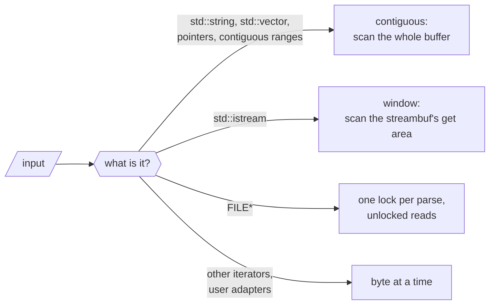
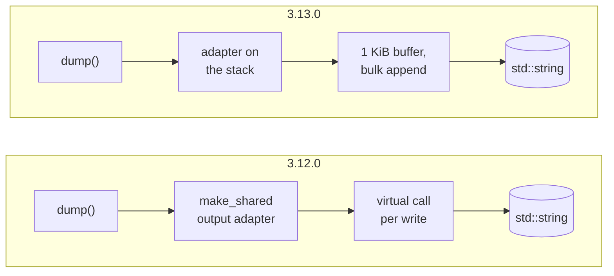
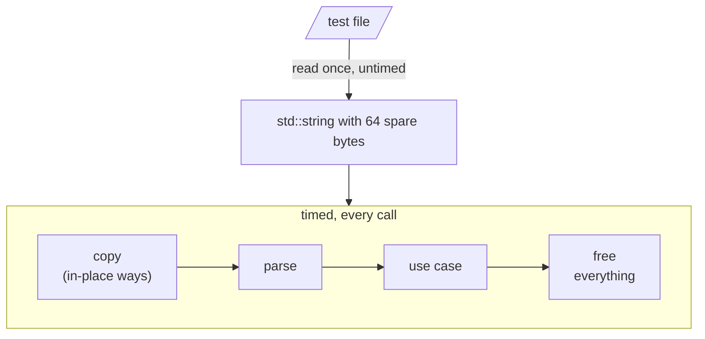

# How nlohmann/json 3.13.0 got 3× faster

<p class="nj-byline"><a href="https://github.com/nlohmann">Niels Lohmann</a> · <time datetime="2026-10-28">October 28,
2026</time></p>

<!-- Before publishing: set the date to the release date, and measure every number of this post again with the
     v3.13.0 tag (Appendix G describes the setup; tests/benchmarks/json_view/others/README.md has the commands of the
     comparison), including the line counts in "The price". The numbers below are from develop baba5db36f with the
     open non-draft pull requests #5998, #6001, #6002 and #6017-#6019 merged (local branch local/all-prs-1103 at
     5c8ccf2f38), all measured 11-03: suite (rounds 2 and 3; round 1 ran under load), timeline (the commits after
     10-27 and 3.13.0; the older points are from 10-27, checked with 12 of them), Appendix D, compile times (5
     rounds), the stream gap, the comparison on the Mac and on x86-64, and the suite on the Intel MacBook Pro. The Mac's
     Rust times are from 10-29 and the x86-64 conformance run from 10-30. The x86-64 server now runs Ubuntu 26.04, so
     "GCC 13" is 13.4 (10-31: 13.3 on Ubuntu 24.04). Merge tests/benchmarks/json_view/others before publishing (the
     links 404). -->

Since 2016, the [README](https://github.com/nlohmann/json#readme) of this library has said this about speed:

> There are certainly faster JSON libraries out there. However, if your goal is to speed up your development by adding
> JSON support with a single header, then this library is the way to go.

That sentence is still true, but the gap is a lot smaller now. Swap the 3.12.0 header for the 3.13.0 one, recompile, and
the 182 benchmarks of the library's own suite run 3.0× as fast on an Apple M1 Max (geometric mean; 3.1× on an Intel
MacBook Pro from 2016). Not a line of your code changes. Parsing typical documents got 3.1–4.3× as fast, and writing
them 3.0–6.7×. The new version also adds [`json_document`](../../features/json_view/index.md), a second way to hold a parsed
document, which competes with the fastest C++ and Rust JSON libraries; [How it compares](#how-it-compares) has the
numbers, including where it loses. The price is compile time: two small example programs take 34–62% longer to compile.
A precompiled header or a C++20 module wins back most or all of that in debug builds, and 41–91% of it in optimized
builds ([The price](#the-price)).

This post is about *how*. Hardly any of the techniques are new: we borrowed them from
[simdjson](https://github.com/simdjson/simdjson), [yyjson](https://github.com/ibireme/yyjson),
[fast_float](https://github.com/fastfloat/fast_float), [Żmij](https://github.com/vitaut/zmij),
[serde_json](https://github.com/serde-rs/json), [Glaze](https://github.com/stephenberry/glaze),
[SQLite](https://sqlite.org), [Boost.JSON](https://github.com/boostorg/json), or a textbook, and we name the source at
each step. What is worth writing about is the *combination*, and the conditions it had to work under. It is a
header-only C++11 library whose 3.x API has been stable for almost nine years, and whose value type is a template over
its string, number, object, array, and allocator types. Input comes from strings, streams, `FILE*`, iterator pairs, wide
strings, and user-defined adapters. Output had to stay the same byte for byte, and error messages had to keep pointing
at the same byte. The few deliberate changes of output are listed in [Appendix F](#f-behavior-changes).

Every number comes from a benchmark we ran for this post or from the pull request that made the change. The
[appendix](#appendix) describes the test files and the setup, has the full tables behind every chart, and lists the pull
requests behind each theme.

Fast paths are where bugs hide: they run only for some inputs, so a mistake in one can go unnoticed until the right
input comes along. So every fast path was tested against the slow path it replaces, on millions of generated and fuzzed
inputs. Both had to return the same value, or fail with the same error message at the same byte. [Appendix
J](#j-validation) lists the checks.

## The short version

The test files are the three of Milo Yip's [nativejson-benchmark](https://github.com/miloyip/nativejson-benchmark) that
JSON libraries have been measured with for a decade, `twitter.json` (strings, much of it Japanese), `citm_catalog.json`
(many small objects, indented) and `canada.json` (floating-point numbers), plus the 56 MB `jeopardy.json`. [Appendix
A](#a-test-files) says what makes each of them hard.

<div class="nj-fig-wrap" markdown>
<svg class="nj-fig nj-charts nj-charts--blog" viewBox="0 0 560 604" role="img" aria-labelledby="nj-blog-overview nj-blog-overview-d" xmlns="http://www.w3.org/2000/svg">
<title id="nj-blog-overview">Speedup of 3.13.0 over 3.12.0 per workload, Apple M1 Max, Apple clang</title>
<desc id="nj-blog-overview-d">Horizontal bars of the speedup, more is better. twitter.json 3.1x; citm_catalog.json 4.2x; canada.json 3.4x; canada.json, indented 6.5x; citm, ordered_json 6.8x; twitter, std::ifstream 2.5x; citm, FILE* 4.7x; citm, accept() 7.1x; dump() twitter 6.7x; dump() canada 3.0x; dump(4) citm 4.7x; to_cbor() twitter 4.6x; twitter, memory 3.4x; twitter, FILE* 6.6x; diff() canada 10x; iterate canada 2.7x; copy + destroy citm 1.13x; == citm 1.06x.</desc>
<text class="nj-charts-panel" x="8" y="20">Parsing</text>
<text class="nj-charts-panel" x="8" y="244">Writing</text>
<text class="nj-charts-panel" x="8" y="372">Reading C&#8203;BOR</text>
<text class="nj-charts-panel" x="8" y="452">Values</text>
<line class="nj-charts-grid" x1="220" y1="8" x2="220" y2="560"/>
<text class="nj-charts-tick" x="220" y="576">1&#215;</text>
<line class="nj-charts-grid" x1="250" y1="8" x2="250" y2="560"/>
<text class="nj-charts-tick" x="250" y="576">2&#215;</text>
<line class="nj-charts-grid" x1="280" y1="8" x2="280" y2="560"/>
<text class="nj-charts-tick" x="280" y="576">3&#215;</text>
<line class="nj-charts-grid" x1="310" y1="8" x2="310" y2="560"/>
<text class="nj-charts-tick" x="310" y="576">4&#215;</text>
<line class="nj-charts-grid" x1="340" y1="8" x2="340" y2="560"/>
<text class="nj-charts-tick" x="340" y="576">5&#215;</text>
<line class="nj-charts-grid" x1="370" y1="8" x2="370" y2="560"/>
<text class="nj-charts-tick" x="370" y="576">6&#215;</text>
<line class="nj-charts-grid" x1="400" y1="8" x2="400" y2="560"/>
<text class="nj-charts-tick" x="400" y="576">7&#215;</text>
<line class="nj-charts-grid" x1="430" y1="8" x2="430" y2="560"/>
<text class="nj-charts-tick" x="430" y="576">8&#215;</text>
<line class="nj-charts-grid" x1="460" y1="8" x2="460" y2="560"/>
<text class="nj-charts-tick" x="460" y="576">9&#215;</text>
<line class="nj-charts-grid" x1="490" y1="8" x2="490" y2="560"/>
<text class="nj-charts-tick" x="490" y="576">10&#215;</text>
<line class="nj-charts-grid" x1="520" y1="8" x2="520" y2="560"/>
<text class="nj-charts-tick" x="520" y="576">11&#215;</text>
<text class="nj-charts-rowlabel nj-charts-tick--r" x="182" y="42" text-anchor="end">twitter.json</text>
<path class="nj-charts-c1" d="M190 30 H280.2 Q284.2 30 284.2 34 V41 Q284.2 45 280.2 45 H190 Z"><title>twitter.json: 3.1&#215;</title></path>
<text class="nj-charts-val" x="289.2" y="42">3.1&#215;</text>
<text class="nj-charts-rowlabel nj-charts-tick--r" x="182" y="66" text-anchor="end">citm_catalog.json</text>
<path class="nj-charts-c1" d="M190 54 H313.5 Q317.5 54 317.5 58 V65 Q317.5 69 313.5 69 H190 Z"><title>citm_catalog.json: 4.2&#215;</title></path>
<text class="nj-charts-val" x="322.5" y="66">4.2&#215;</text>
<text class="nj-charts-rowlabel nj-charts-tick--r" x="182" y="90" text-anchor="end">canada.json</text>
<path class="nj-charts-c1" d="M190 78 H286.5 Q290.5 78 290.5 82 V89 Q290.5 93 286.5 93 H190 Z"><title>canada.json: 3.4&#215;</title></path>
<text class="nj-charts-val" x="295.5" y="90">3.4&#215;</text>
<text class="nj-charts-rowlabel nj-charts-tick--r" x="182" y="114" text-anchor="end">canada.json, indented</text>
<path class="nj-charts-c1" d="M190 102 H381.3 Q385.3 102 385.3 106 V113 Q385.3 117 381.3 117 H190 Z"><title>canada.json, indented: 6.5&#215;</title></path>
<text class="nj-charts-val" x="390.3" y="114">6.5&#215;</text>
<text class="nj-charts-rowlabel nj-charts-tick--r" x="182" y="138" text-anchor="end">citm, ordered_json</text>
<path class="nj-charts-c1" d="M190 126 H391.5 Q395.5 126 395.5 130 V137 Q395.5 141 391.5 141 H190 Z"><title>citm, ordered_json: 6.8&#215;</title></path>
<text class="nj-charts-val" x="400.5" y="138">6.8&#215;</text>
<text class="nj-charts-rowlabel nj-charts-tick--r" x="182" y="162" text-anchor="end">twitter, std::ifstream</text>
<path class="nj-charts-c1" d="M190 150 H261 Q265 150 265 154 V161 Q265 165 261 165 H190 Z"><title>twitter, std::ifstream: 2.5&#215;</title></path>
<text class="nj-charts-val" x="270" y="162">2.5&#215;</text>
<text class="nj-charts-rowlabel nj-charts-tick--r" x="182" y="186" text-anchor="end">citm, FILE*</text>
<path class="nj-charts-c1" d="M190 174 H328.2 Q332.2 174 332.2 178 V185 Q332.2 189 328.2 189 H190 Z"><title>citm, FILE*: 4.7&#215;</title></path>
<text class="nj-charts-val" x="337.2" y="186">4.7&#215;</text>
<text class="nj-charts-rowlabel nj-charts-tick--r" x="182" y="210" text-anchor="end">citm, accept()</text>
<path class="nj-charts-c1" d="M190 198 H398.1 Q402.1 198 402.1 202 V209 Q402.1 213 398.1 213 H190 Z"><title>citm, accept(): 7.1&#215;</title></path>
<text class="nj-charts-val" x="407.1" y="210">7.1&#215;</text>
<text class="nj-charts-rowlabel nj-charts-tick--r" x="182" y="266" text-anchor="end">dump() twitter</text>
<path class="nj-charts-c1" d="M190 254 H387 Q391 254 391 258 V265 Q391 269 387 269 H190 Z"><title>dump() twitter: 6.7&#215;</title></path>
<text class="nj-charts-val" x="396" y="266">6.7&#215;</text>
<text class="nj-charts-rowlabel nj-charts-tick--r" x="182" y="290" text-anchor="end">dump() canada</text>
<path class="nj-charts-c1" d="M190 278 H275.4 Q279.4 278 279.4 282 V289 Q279.4 293 275.4 293 H190 Z"><title>dump() canada: 3.0&#215;</title></path>
<text class="nj-charts-val" x="284.4" y="290">3.0&#215;</text>
<text class="nj-charts-rowlabel nj-charts-tick--r" x="182" y="314" text-anchor="end">dump(4) citm</text>
<path class="nj-charts-c1" d="M190 302 H327 Q331 302 331 306 V313 Q331 317 327 317 H190 Z"><title>dump(4) citm: 4.7&#215;</title></path>
<text class="nj-charts-val" x="336" y="314">4.7&#215;</text>
<text class="nj-charts-rowlabel nj-charts-tick--r" x="182" y="338" text-anchor="end">to_cbor() twitter</text>
<path class="nj-charts-c1" d="M190 326 H323.7 Q327.7 326 327.7 330 V337 Q327.7 341 323.7 341 H190 Z"><title>to_cbor() twitter: 4.6&#215;</title></path>
<text class="nj-charts-val" x="332.7" y="338">4.6&#215;</text>
<text class="nj-charts-rowlabel nj-charts-tick--r" x="182" y="394" text-anchor="end">twitter, memory</text>
<path class="nj-charts-c1" d="M190 382 H287.7 Q291.7 382 291.7 386 V393 Q291.7 397 287.7 397 H190 Z"><title>twitter, memory: 3.4&#215;</title></path>
<text class="nj-charts-val" x="296.7" y="394">3.4&#215;</text>
<text class="nj-charts-rowlabel nj-charts-tick--r" x="182" y="418" text-anchor="end">twitter, FILE*</text>
<path class="nj-charts-c1" d="M190 406 H383.7 Q387.7 406 387.7 410 V417 Q387.7 421 383.7 421 H190 Z"><title>twitter, FILE*: 6.6&#215;</title></path>
<text class="nj-charts-val" x="392.7" y="418">6.6&#215;</text>
<text class="nj-charts-rowlabel nj-charts-tick--r" x="182" y="474" text-anchor="end">diff() canada</text>
<path class="nj-charts-c1" d="M190 462 H499.8 Q503.8 462 503.8 466 V473 Q503.8 477 499.8 477 H190 Z"><title>diff() canada: 10&#215;</title></path>
<text class="nj-charts-val" x="508.8" y="474">10&#215;</text>
<text class="nj-charts-rowlabel nj-charts-tick--r" x="182" y="498" text-anchor="end">iterate canada</text>
<path class="nj-charts-c1" d="M190 486 H267.9 Q271.9 486 271.9 490 V497 Q271.9 501 267.9 501 H190 Z"><title>iterate canada: 2.7&#215;</title></path>
<text class="nj-charts-val" x="276.9" y="498">2.7&#215;</text>
<text class="nj-charts-rowlabel nj-charts-tick--r" x="182" y="522" text-anchor="end">copy + destroy citm</text>
<path class="nj-charts-c1" d="M190 510 H219.9 Q223.9 510 223.9 514 V521 Q223.9 525 219.9 525 H190 Z"><title>copy + destroy citm: 1.13&#215;</title></path>
<text class="nj-charts-val" x="228.9" y="522">1.13&#215;</text>
<text class="nj-charts-rowlabel nj-charts-tick--r" x="182" y="546" text-anchor="end">== citm</text>
<path class="nj-charts-c1" d="M190 534 H217.8 Q221.8 534 221.8 538 V545 Q221.8 549 217.8 549 H190 Z"><title>== citm: 1.06&#215;</title></path>
<text class="nj-charts-val" x="226.8" y="546">1.06&#215;</text>
<line class="nj-charts-ref" x1="220" y1="8" x2="220" y2="560"/>
<line class="nj-charts-zero" x1="190" y1="8" x2="190" y2="560"/>
<text class="nj-charts-tick" x="355" y="594">speedup over 3.12.0 (3.12.0 = 1&#215;), more is better</text>
</svg>

</div>

<p class="nj-caption" markdown>Speedup of 3.13.0 over 3.12.0 for a selection of workloads: the old time divided by the
new one, Google Benchmark suite on an Apple M1 Max, median of 8 runs. More is better; the vertical line at 1× is 3.12.0.
The times are in [Appendix B](#b-3120-against-3130).</p>

The rows above are chosen to show the range. All 182 benchmarks of the suite:

<div class="nj-fig-wrap" markdown>
<svg class="nj-fig nj-charts nj-charts--blog" viewBox="0 0 560 250" role="img" aria-labelledby="nj-blog-dist nj-blog-dist-d" xmlns="http://www.w3.org/2000/svg">
<title id="nj-blog-dist">Speedup of 3.13.0 over 3.12.0 for all 182 benchmarks of the suite</title>
<desc id="nj-blog-dist-d">Bars counting the benchmarks per speedup range: below 1x: 1; 1 to 1.5x: 22; 1.5 to 2x: 12; 2 to 3x: 60; 3 to 5x: 58; 5 to 10x: 25; 10x or more: 4. Median 2.9x, geometric mean 3.0x.</desc>
<line class="nj-charts-grid" x1="52" y1="196" x2="548" y2="196"/>
<text class="nj-charts-tick nj-charts-tick--r" x="46" y="200">0</text>
<line class="nj-charts-grid" x1="52" y1="144.571" x2="548" y2="144.571"/>
<text class="nj-charts-tick nj-charts-tick--r" x="46" y="148.571">20</text>
<line class="nj-charts-grid" x1="52" y1="93.1429" x2="548" y2="93.1429"/>
<text class="nj-charts-tick nj-charts-tick--r" x="46" y="97.1429">40</text>
<line class="nj-charts-grid" x1="52" y1="41.7143" x2="548" y2="41.7143"/>
<text class="nj-charts-tick nj-charts-tick--r" x="46" y="45.7143">60</text>
<rect class="nj-charts-c2" x="60.0" y="193.4" width="54.9" height="2.6" rx="3"><title>below 1&#215;: 1</title></rect>
<text class="nj-charts-val" x="87.4" y="188.4" text-anchor="middle">1</text>
<text class="nj-charts-tick" x="87.4" y="212.0">below 1&#215;</text>
<rect class="nj-charts-c1" x="130.9" y="139.4" width="54.9" height="56.6" rx="3"><title>1 to 1.5&#215;: 22</title></rect>
<text class="nj-charts-val" x="158.3" y="134.4" text-anchor="middle">22</text>
<text class="nj-charts-tick" x="158.3" y="212.0">1 to 1.5&#215;</text>
<rect class="nj-charts-c1" x="201.7" y="165.1" width="54.9" height="30.9" rx="3"><title>1.5 to 2&#215;: 12</title></rect>
<text class="nj-charts-val" x="229.1" y="160.1" text-anchor="middle">12</text>
<text class="nj-charts-tick" x="229.1" y="212.0">1.5 to 2&#215;</text>
<rect class="nj-charts-c1" x="272.6" y="41.7" width="54.9" height="154.3" rx="3"><title>2 to 3&#215;: 60</title></rect>
<text class="nj-charts-val" x="300.0" y="36.7" text-anchor="middle">60</text>
<text class="nj-charts-tick" x="300.0" y="212.0">2 to 3&#215;</text>
<rect class="nj-charts-c1" x="343.4" y="46.9" width="54.9" height="149.1" rx="3"><title>3 to 5&#215;: 58</title></rect>
<text class="nj-charts-val" x="370.9" y="41.9" text-anchor="middle">58</text>
<text class="nj-charts-tick" x="370.9" y="212.0">3 to 5&#215;</text>
<rect class="nj-charts-c1" x="414.3" y="131.7" width="54.9" height="64.3" rx="3"><title>5 to 10&#215;: 25</title></rect>
<text class="nj-charts-val" x="441.7" y="126.7" text-anchor="middle">25</text>
<text class="nj-charts-tick" x="441.7" y="212.0">5 to 10&#215;</text>
<rect class="nj-charts-c1" x="485.1" y="185.7" width="54.9" height="10.3" rx="3"><title>10&#215; or more: 4</title></rect>
<text class="nj-charts-val" x="512.6" y="180.7" text-anchor="middle">4</text>
<text class="nj-charts-tick" x="512.6" y="212.0">10&#215; or more</text>
<line class="nj-charts-axis" x1="52" y1="196" x2="548" y2="196"/>
<text class="nj-charts-tick" x="300" y="240">speedup over 3.12.0, more is better</text>
<text class="nj-charts-tick" transform="rotate(-90)" x="-106" y="14">number of benchmarks</text>
</svg>

</div>

<p class="nj-caption" markdown>How many of the suite's 182 benchmarks got how much faster. The one below 1× is copying
`citm_catalog.json` without destroying the copy. Every row is in [Appendix B](#b-3120-against-3130).</p>

The median benchmark got 2.9× as fast. On an Intel MacBook Pro (Skylake), the median is 2.9× as well, but parsing
floating-point numbers gained more (`canada.json` 6.1× instead of 3.4×) and writing integers less (`dump()` 1.4–2.3×
instead of 2.2–3.8×); [Appendix B](#b-3120-against-3130) has both columns. Copying and comparing values gained the
least, and the largest gains come from fixing algorithms rather than tuning them (theme
<a class="nj-theme" href="#theme-7" title="theme 7">7</a>).

Eight themes did most of the work:

<div class="nj-theme-list" markdown>

- <a class="nj-theme" href="#theme-1" title="theme 1">1</a> [Specialize for each input source](#theme-1): a dedicated
  reader for each of strings, streams, and `FILE*`, instead of one character at a time for all of them.
- <a class="nj-theme" href="#theme-2" title="theme 2">2</a> [Work on words, not bytes](#theme-2): 8 bytes per step with
  plain integer arithmetic, 16 with SSE2 and NEON.
- <a class="nj-theme" href="#theme-3" title="theme 3">3</a> [Own the number conversions](#theme-3): no `strtod`, no
  locale.
- <a class="nj-theme" href="#theme-4" title="theme 4">4</a> [Don't do unnecessary work](#theme-4): positions, copies,
  and conversions that only matter on an error or for a rare caller.
- <a class="nj-theme" href="#theme-5" title="theme 5">5</a> [Read the assembly](#theme-5): stack canaries, missed
  inlining, aliasing, and branches the compiler chose.
- <a class="nj-theme" href="#theme-6" title="theme 6">6</a> [Write through a cursor](#theme-6): no virtual call per
  character, no allocation per call, no branch per integer.
- <a class="nj-theme" href="#theme-7" title="theme 7">7</a> [Fix the algorithm first](#theme-7): seven operations were
  quadratic or worse.
- <a class="nj-theme" href="#theme-8" title="theme 8">8</a> [Build a different data structure](#theme-8) when the tree
  is the cost.

</div>

## Where the time went: a timeline

The suite compares two points. To see which change did what, we compiled one small benchmark against the header of each
of the 351 commits on `develop` that changed `json.hpp` or `json_view.hpp` from 3.12.0 to November 3, and of 3.13.0, and
ran all of them interleaved. Four of the eight workloads we followed:

- `parse()` of `citm_catalog.json`: the lexer's structure and whitespace handling, and building many small objects;
- `parse()` of `canada.json`: converting text to floating-point numbers;
- `dump()` of `twitter.json`: writing strings;
- `from_cbor()` of `twitter.json`: reading a binary format.

Each panel shows the speedup over 3.12.0 after each commit, on a logarithmic scale. The badges above the steps name the
theme below that explains them. Moving code around changes a build's speed by a few percent on its own, so only the
larger steps mean something.

<div class="nj-charts-grid-wrap" markdown>
<div class="nj-fig-wrap" markdown>
<svg class="nj-fig nj-charts nj-charts--timeline" viewBox="0 0 340 270" role="img" aria-labelledby="nj-blog-tl-parse_citm nj-blog-tl-parse_citm-d" xmlns="http://www.w3.org/2000/svg">
<title id="nj-blog-tl-parse_citm">parse() citm_catalog.json: speedup over 3.12.0 by commit</title>
<desc id="nj-blog-tl-parse_citm-d">parse() citm_catalog.json: speedup over 3.12.0 at each of 353 commits, ending at 3.3x. Labeled steps, by theme: 4, 1, 4, 4, 2, 4.</desc>
<text class="nj-charts-panel" x="8" y="18">parse() citm_catalog.json</text>
<line class="nj-charts-grid" x1="44" y1="208" x2="330" y2="208"/>
<text class="nj-charts-tick nj-charts-tick--r" x="38" y="212">1&#215;</text>
<line class="nj-charts-grid" x1="44" y1="160.667" x2="330" y2="160.667"/>
<text class="nj-charts-tick nj-charts-tick--r" x="38" y="164.667">2&#215;</text>
<line class="nj-charts-grid" x1="44" y1="113.333" x2="330" y2="113.333"/>
<text class="nj-charts-tick nj-charts-tick--r" x="38" y="117.333">4&#215;</text>
<line class="nj-charts-grid" x1="44" y1="66" x2="330" y2="66"/>
<text class="nj-charts-tick nj-charts-tick--r" x="38" y="70">8&#215;</text>
<line class="nj-charts-axis" x1="44" y1="208" x2="44" y2="212"/>
<text class="nj-charts-tick" x="44" y="225">3.12.0</text>
<line class="nj-charts-axis" x1="117.938" y1="208" x2="117.938" y2="212"/>
<text class="nj-charts-tick" x="117.938" y="225">Sep 2026</text>
<line class="nj-charts-axis" x1="198.375" y1="208" x2="198.375" y2="212"/>
<text class="nj-charts-tick" x="198.375" y="225">Oct</text>
<polyline class="nj-charts-json" points="44.0,208.0 44.8,208.0 44.8,208.2 45.6,208.2 45.6,207.8 46.4,207.8 46.4,207.5 47.2,207.5 47.2,206.5 48.1,206.5 48.1,208.3 48.9,208.3 48.9,207.3 49.7,207.3 49.7,206.8 50.5,206.8 50.5,207.8 51.3,207.8 51.3,206.8 52.1,206.8 52.1,207.3 52.9,207.3 52.9,207.6 53.8,207.6 53.8,207.8 54.6,207.8 54.6,207.0 55.4,207.0 55.4,207.3 56.2,207.3 56.2,207.2 57.0,207.2 57.0,207.4 57.8,207.4 57.8,207.5 58.6,207.5 58.6,207.4 59.4,207.4 59.4,206.6 60.2,206.6 60.2,207.6 61.1,207.6 61.1,207.6 61.9,207.6 61.9,207.2 62.7,207.2 62.7,207.0 63.5,207.0 63.5,207.6 64.3,207.6 64.3,206.7 65.1,206.7 65.1,207.4 65.9,207.4 65.9,206.8 66.8,206.8 66.8,207.3 67.6,207.3 67.6,207.7 68.4,207.7 68.4,207.9 69.2,207.9 69.2,207.2 70.0,207.2 70.0,206.4 70.8,206.4 70.8,207.6 71.6,207.6 71.6,206.4 72.4,206.4 72.4,208.0 73.2,208.0 73.2,207.4 74.1,207.4 74.1,206.5 74.9,206.5 74.9,207.5 75.7,207.5 75.7,207.2 76.5,207.2 76.5,206.9 77.3,206.9 77.3,207.6 78.1,207.6 78.1,207.6 78.9,207.6 78.9,207.0 79.8,207.0 79.8,206.9 80.6,206.9 80.6,208.0 81.4,208.0 81.4,207.6 82.2,207.6 82.2,206.6 83.0,206.6 83.0,206.8 83.8,206.8 83.8,207.3 84.6,207.3 84.6,206.9 85.4,206.9 85.4,207.6 86.2,207.6 86.2,207.1 87.1,207.1 87.1,207.6 87.9,207.6 87.9,207.9 88.7,207.9 88.7,178.2 89.5,178.2 89.5,177.5 90.3,177.5 90.3,177.7 91.1,177.7 91.1,177.6 91.9,177.6 91.9,177.7 92.8,177.7 92.8,177.1 93.6,177.1 93.6,176.8 94.4,176.8 94.4,177.7 95.2,177.7 95.2,177.6 96.0,177.6 96.0,176.8 96.8,176.8 96.8,177.8 97.6,177.8 97.6,177.0 98.4,177.0 98.4,176.8 99.2,176.8 99.2,178.0 100.1,178.0 100.1,178.1 100.9,178.1 100.9,177.6 101.7,177.6 101.7,177.6 102.5,177.6 102.5,177.4 103.3,177.4 103.3,177.6 104.1,177.6 104.1,177.8 104.9,177.8 104.9,177.5 105.8,177.5 105.8,177.9 106.6,177.9 106.6,177.7 107.4,177.7 107.4,175.9 108.2,175.9 108.2,177.5 109.0,177.5 109.0,177.6 109.8,177.6 109.8,177.6 110.6,177.6 110.6,176.9 111.4,176.9 111.4,177.5 112.2,177.5 112.2,177.4 113.1,177.4 113.1,177.4 113.9,177.4 113.9,176.9 114.7,176.9 114.7,177.9 115.5,177.9 115.5,177.3 116.3,177.3 116.3,176.6 117.1,176.6 117.1,177.4 117.9,177.4 117.9,177.5 118.8,177.5 118.8,177.5 119.6,177.5 119.6,177.4 120.4,177.4 120.4,177.0 121.2,177.0 121.2,177.7 122.0,177.7 122.0,176.2 122.8,176.2 122.8,176.9 123.6,176.9 123.6,177.5 124.4,177.5 124.4,177.8 125.3,177.8 125.3,177.8 126.1,177.8 126.1,177.9 126.9,177.9 126.9,177.3 127.7,177.3 127.7,177.5 128.5,177.5 128.5,177.4 129.3,177.4 129.3,177.1 130.1,177.1 130.1,162.5 130.9,162.5 130.9,162.2 131.8,162.2 131.8,161.8 132.6,161.8 132.6,162.2 133.4,162.2 133.4,161.2 134.2,161.2 134.2,160.7 135.0,160.7 135.0,159.4 135.8,159.4 135.8,160.3 136.6,160.3 136.6,160.4 137.4,160.4 137.4,160.6 138.2,160.6 138.2,159.5 139.1,159.5 139.1,160.4 139.9,160.4 139.9,159.6 140.7,159.6 140.7,160.0 141.5,160.0 141.5,159.9 142.3,159.9 142.3,160.2 143.1,160.2 143.1,159.6 143.9,159.6 143.9,160.8 144.8,160.8 144.8,160.1 145.6,160.1 145.6,159.1 146.4,159.1 146.4,159.7 147.2,159.7 147.2,159.9 148.0,159.9 148.0,160.5 148.8,160.5 148.8,160.2 149.6,160.2 149.6,159.9 150.4,159.9 150.4,160.5 151.2,160.5 151.2,160.5 152.1,160.5 152.1,160.6 152.9,160.6 152.9,159.7 153.7,159.7 153.7,159.5 154.5,159.5 154.5,160.0 155.3,160.0 155.3,160.2 156.1,160.2 156.1,160.0 156.9,160.0 156.9,160.6 157.8,160.6 157.8,159.9 158.6,159.9 158.6,160.2 159.4,160.2 159.4,160.1 160.2,160.1 160.2,160.8 161.0,160.8 161.0,159.2 161.8,159.2 161.8,159.6 162.6,159.6 162.6,159.2 163.4,159.2 163.4,160.0 164.2,160.0 164.2,159.4 165.1,159.4 165.1,159.6 165.9,159.6 165.9,159.5 166.7,159.5 166.7,160.1 167.5,160.1 167.5,159.0 168.3,159.0 168.3,159.4 169.1,159.4 169.1,160.2 169.9,160.2 169.9,161.4 170.8,161.4 170.8,161.7 171.6,161.7 171.6,161.6 172.4,161.6 172.4,160.3 173.2,160.3 173.2,161.1 174.0,161.1 174.0,161.2 174.8,161.2 174.8,161.7 175.6,161.7 175.6,161.2 176.4,161.2 176.4,160.4 177.2,160.4 177.2,161.6 178.1,161.6 178.1,160.6 178.9,160.6 178.9,161.4 179.7,161.4 179.7,161.3 180.5,161.3 180.5,161.3 181.3,161.3 181.3,161.7 182.1,161.7 182.1,161.2 182.9,161.2 182.9,160.1 183.8,160.1 183.8,160.9 184.6,160.9 184.6,161.5 185.4,161.5 185.4,160.6 186.2,160.6 186.2,161.9 187.0,161.9 187.0,161.4 187.8,161.4 187.8,160.1 188.6,160.1 188.6,160.6 189.4,160.6 189.4,162.0 190.2,162.0 190.2,161.5 191.1,161.5 191.1,162.0 191.9,162.0 191.9,161.3 192.7,161.3 192.7,162.3 193.5,162.3 193.5,162.1 194.3,162.1 194.3,160.8 195.1,160.8 195.1,161.5 195.9,161.5 195.9,161.4 196.8,161.4 196.8,162.2 197.6,162.2 197.6,161.4 198.4,161.4 198.4,161.4 199.2,161.4 199.2,161.8 200.0,161.8 200.0,160.7 200.8,160.7 200.8,160.5 201.6,160.5 201.6,160.5 202.4,160.5 202.4,159.3 203.2,159.3 203.2,159.4 204.1,159.4 204.1,160.4 204.9,160.4 204.9,160.1 205.7,160.1 205.7,160.4 206.5,160.4 206.5,160.4 207.3,160.4 207.3,160.8 208.1,160.8 208.1,159.8 208.9,159.8 208.9,159.4 209.8,159.4 209.8,160.5 210.6,160.5 210.6,160.1 211.4,160.1 211.4,160.7 212.2,160.7 212.2,160.6 213.0,160.6 213.0,159.5 213.8,159.5 213.8,161.1 214.6,161.1 214.6,161.3 215.4,161.3 215.4,161.0 216.2,161.0 216.2,160.8 217.1,160.8 217.1,159.6 217.9,159.6 217.9,161.0 218.7,161.0 218.7,160.6 219.5,160.6 219.5,160.6 220.3,160.6 220.3,161.4 221.1,161.4 221.1,159.8 221.9,159.8 221.9,160.2 222.8,160.2 222.8,155.4 223.6,155.4 223.6,156.1 224.4,156.1 224.4,155.2 225.2,155.2 225.2,156.3 226.0,156.3 226.0,156.1 226.8,156.1 226.8,155.8 227.6,155.8 227.6,156.5 228.4,156.5 228.4,155.8 229.2,155.8 229.2,155.9 230.1,155.9 230.1,155.7 230.9,155.7 230.9,155.0 231.7,155.0 231.7,156.1 232.5,156.1 232.5,156.5 233.3,156.5 233.3,156.3 234.1,156.3 234.1,155.6 234.9,155.6 234.9,154.9 235.8,154.9 235.8,155.8 236.6,155.8 236.6,155.5 237.4,155.5 237.4,155.0 238.2,155.0 238.2,155.2 239.0,155.2 239.0,155.4 239.8,155.4 239.8,155.4 240.6,155.4 240.6,155.6 241.4,155.6 241.4,156.0 242.3,156.0 242.3,155.7 243.1,155.7 243.1,147.1 243.9,147.1 243.9,138.2 244.7,138.2 244.7,138.0 245.5,138.0 245.5,137.7 246.3,137.7 246.3,137.6 247.1,137.6 247.1,137.8 247.9,137.8 247.9,137.7 248.8,137.7 248.8,137.2 249.6,137.2 249.6,137.3 250.4,137.3 250.4,137.5 251.2,137.5 251.2,137.1 252.0,137.1 252.0,135.2 252.8,135.2 252.8,135.1 253.6,135.1 253.6,132.3 254.4,132.3 254.4,133.6 255.2,133.6 255.2,133.4 256.1,133.4 256.1,133.9 256.9,133.9 256.9,133.2 257.7,133.2 257.7,132.9 258.5,132.9 258.5,131.7 259.3,131.7 259.3,132.8 260.1,132.8 260.1,133.0 260.9,133.0 260.9,132.8 261.8,132.8 261.8,132.8 262.6,132.8 262.6,132.6 263.4,132.6 263.4,133.3 264.2,133.3 264.2,131.7 265.0,131.7 265.0,132.3 265.8,132.3 265.8,132.7 266.6,132.7 266.6,133.3 267.4,133.3 267.4,131.5 268.2,131.5 268.2,132.3 269.1,132.3 269.1,133.4 269.9,133.4 269.9,132.1 270.7,132.1 270.7,132.8 271.5,132.8 271.5,131.2 272.3,131.2 272.3,130.8 273.1,130.8 273.1,130.8 273.9,130.8 273.9,129.9 274.8,129.9 274.8,130.1 275.6,130.1 275.6,131.1 276.4,131.1 276.4,129.7 277.2,129.7 277.2,129.2 278.0,129.2 278.0,129.7 278.8,129.7 278.8,129.8 279.6,129.8 279.6,128.6 280.4,128.6 280.4,130.0 281.2,130.0 281.2,130.0 282.1,130.0 282.1,129.4 282.9,129.4 282.9,129.3 283.7,129.3 283.7,130.1 284.5,130.1 284.5,129.6 285.3,129.6 285.3,125.7 286.1,125.7 286.1,125.7 286.9,125.7 286.9,125.7 287.8,125.7 287.8,126.1 288.6,126.1 288.6,126.1 289.4,126.1 289.4,125.2 290.2,125.2 290.2,125.8 291.0,125.8 291.0,126.1 291.8,126.1 291.8,125.7 292.6,125.7 292.6,125.7 293.4,125.7 293.4,125.7 294.2,125.7 294.2,124.7 295.1,124.7 295.1,126.1 295.9,126.1 295.9,126.2 296.7,126.2 296.7,125.8 297.5,125.8 297.5,126.2 298.3,126.2 298.3,125.9 299.1,125.9 299.1,125.8 299.9,125.8 299.9,125.8 300.8,125.8 300.8,125.7 301.6,125.7 301.6,126.6 302.4,126.6 302.4,125.5 303.2,125.5 303.2,126.4 304.0,126.4 304.0,126.1 304.8,126.1 304.8,126.7 305.6,126.7 305.6,125.8 306.4,125.8 306.4,125.9 307.2,125.9 307.2,125.5 308.1,125.5 308.1,126.4 308.9,126.4 308.9,126.9 309.7,126.9 309.7,126.0 310.5,126.0 310.5,125.8 311.3,125.8 311.3,126.2 312.1,126.2 312.1,126.3 312.9,126.3 312.9,125.9 313.8,125.9 313.8,125.4 314.6,125.4 314.6,127.1 315.4,127.1 315.4,126.0 316.2,126.0 316.2,126.4 317.0,126.4 317.0,125.6 317.8,125.6 317.8,125.7 318.6,125.7 318.6,125.5 319.4,125.5 319.4,125.5 320.2,125.5 320.2,125.4 321.1,125.4 321.1,126.1 321.9,126.1 321.9,125.4 322.7,125.4 322.7,125.9 323.5,125.9 323.5,125.5 324.3,125.5 324.3,125.9 325.1,125.9 325.1,125.0 325.9,125.0 325.9,124.6 326.8,124.6 326.8,125.0 327.6,125.0 327.6,124.9 328.4,124.9 328.4,125.0 329.2,125.0 329.2,125.1 330.0,125.1 330.0,125.9"/>
<circle class="nj-charts-json-dot" cx="88.7" cy="178.2" r="3.5"><title>#5234: 1.55&#215;</title></circle>
<line class="nj-charts-grid" stroke-dasharray="2 2" x1="88.7" y1="54.0" x2="88.7" y2="173.2"/>
<circle class="nj-theme-dot" cx="88.7" cy="46.0" r="7.5"/>
<text class="nj-theme-num" x="88.7" y="50.0" text-anchor="middle">4</text>
<circle class="nj-charts-json-dot" cx="130.1" cy="162.5" r="3.5"><title>#5283: 1.95&#215;</title></circle>
<line class="nj-charts-grid" stroke-dasharray="2 2" x1="130.1" y1="54.0" x2="130.1" y2="157.5"/>
<circle class="nj-theme-dot" cx="130.1" cy="46.0" r="7.5"/>
<text class="nj-theme-num" x="130.1" y="50.0" text-anchor="middle">1</text>
<circle class="nj-charts-json-dot" cx="222.8" cy="155.4" r="3.5"><title>#5592: 2.2&#215;</title></circle>
<line class="nj-charts-grid" stroke-dasharray="2 2" x1="222.8" y1="54.0" x2="222.8" y2="150.4"/>
<circle class="nj-theme-dot" cx="222.8" cy="46.0" r="7.5"/>
<text class="nj-theme-num" x="222.8" y="50.0" text-anchor="middle">4</text>
<circle class="nj-charts-json-dot" cx="243.1" cy="147.1" r="3.5"><title>#5809: 2.4&#215;</title></circle>
<circle class="nj-charts-json-dot" cx="243.9" cy="138.2" r="3.5"><title>#5810: 2.8&#215;</title></circle>
<line class="nj-charts-grid" stroke-dasharray="2 2" x1="243.9" y1="36.0" x2="243.9" y2="133.2"/>
<circle class="nj-theme-dot" cx="234.9" cy="28.0" r="7.5"/>
<text class="nj-theme-num" x="234.9" y="32.0" text-anchor="middle">4</text>
<circle class="nj-theme-dot" cx="252.9" cy="28.0" r="7.5"/>
<text class="nj-theme-num" x="252.9" y="32.0" text-anchor="middle">2</text>
<circle class="nj-charts-json-dot" cx="285.3" cy="125.7" r="3.5"><title>#5882: 3.3&#215;</title></circle>
<line class="nj-charts-grid" stroke-dasharray="2 2" x1="285.3" y1="54.0" x2="285.3" y2="120.7"/>
<circle class="nj-theme-dot" cx="285.3" cy="46.0" r="7.5"/>
<text class="nj-theme-num" x="285.3" y="50.0" text-anchor="middle">4</text>
<line class="nj-charts-axis" x1="44" y1="208" x2="330" y2="208"/>
<text class="nj-charts-note" x="8" y="262">speedup over 3.12.0 (log scale), more is better</text>
</svg>

</div>
<div class="nj-fig-wrap" markdown>
<svg class="nj-fig nj-charts nj-charts--timeline" viewBox="0 0 340 270" role="img" aria-labelledby="nj-blog-tl-parse_canada nj-blog-tl-parse_canada-d" xmlns="http://www.w3.org/2000/svg">
<title id="nj-blog-tl-parse_canada">parse() canada.json: speedup over 3.12.0 by commit</title>
<desc id="nj-blog-tl-parse_canada-d">parse() canada.json: speedup over 3.12.0 at each of 353 commits, ending at 2.8x. Labeled steps, by theme: 4, 1, 3, 3, 3, 4.</desc>
<text class="nj-charts-panel" x="8" y="18">parse() canada.json</text>
<line class="nj-charts-grid" x1="44" y1="208" x2="330" y2="208"/>
<text class="nj-charts-tick nj-charts-tick--r" x="38" y="212">1&#215;</text>
<line class="nj-charts-grid" x1="44" y1="137" x2="330" y2="137"/>
<text class="nj-charts-tick nj-charts-tick--r" x="38" y="141">2&#215;</text>
<line class="nj-charts-grid" x1="44" y1="66" x2="330" y2="66"/>
<text class="nj-charts-tick nj-charts-tick--r" x="38" y="70">4&#215;</text>
<line class="nj-charts-axis" x1="44" y1="208" x2="44" y2="212"/>
<text class="nj-charts-tick" x="44" y="225">3.12.0</text>
<line class="nj-charts-axis" x1="117.938" y1="208" x2="117.938" y2="212"/>
<text class="nj-charts-tick" x="117.938" y="225">Sep 2026</text>
<line class="nj-charts-axis" x1="198.375" y1="208" x2="198.375" y2="212"/>
<text class="nj-charts-tick" x="198.375" y="225">Oct</text>
<polyline class="nj-charts-json" points="44.0,208.0 44.8,208.0 44.8,208.2 45.6,208.2 45.6,208.1 46.4,208.1 46.4,207.7 47.2,207.7 47.2,207.2 48.1,207.2 48.1,208.0 48.9,208.0 48.9,208.2 49.7,208.2 49.7,207.8 50.5,207.8 50.5,208.5 51.3,208.5 51.3,207.3 52.1,207.3 52.1,208.0 52.9,208.0 52.9,209.1 53.8,209.1 53.8,208.5 54.6,208.5 54.6,208.1 55.4,208.1 55.4,207.7 56.2,207.7 56.2,209.8 57.0,209.8 57.0,208.6 57.8,208.6 57.8,208.1 58.6,208.1 58.6,208.1 59.4,208.1 59.4,207.0 60.2,207.0 60.2,207.8 61.1,207.8 61.1,207.6 61.9,207.6 61.9,208.1 62.7,208.1 62.7,208.4 63.5,208.4 63.5,207.8 64.3,207.8 64.3,207.4 65.1,207.4 65.1,208.3 65.9,208.3 65.9,207.3 66.8,207.3 66.8,207.8 67.6,207.8 67.6,207.9 68.4,207.9 68.4,207.9 69.2,207.9 69.2,207.5 70.0,207.5 70.0,207.5 70.8,207.5 70.8,208.1 71.6,208.1 71.6,208.1 72.4,208.1 72.4,207.9 73.2,207.9 73.2,207.8 74.1,207.8 74.1,207.1 74.9,207.1 74.9,207.6 75.7,207.6 75.7,207.8 76.5,207.8 76.5,207.3 77.3,207.3 77.3,207.6 78.1,207.6 78.1,208.6 78.9,208.6 78.9,206.5 79.8,206.5 79.8,208.0 80.6,208.0 80.6,208.7 81.4,208.7 81.4,208.0 82.2,208.0 82.2,207.7 83.0,207.7 83.0,208.4 83.8,208.4 83.8,207.9 84.6,207.9 84.6,207.5 85.4,207.5 85.4,207.9 86.2,207.9 86.2,207.4 87.1,207.4 87.1,207.5 87.9,207.5 87.9,208.5 88.7,208.5 88.7,197.5 89.5,197.5 89.5,197.9 90.3,197.9 90.3,196.9 91.1,196.9 91.1,197.0 91.9,197.0 91.9,197.7 92.8,197.7 92.8,196.0 93.6,196.0 93.6,197.3 94.4,197.3 94.4,198.1 95.2,198.1 95.2,197.4 96.0,197.4 96.0,197.0 96.8,197.0 96.8,197.5 97.6,197.5 97.6,197.3 98.4,197.3 98.4,197.7 99.2,197.7 99.2,197.7 100.1,197.7 100.1,197.6 100.9,197.6 100.9,196.9 101.7,196.9 101.7,197.9 102.5,197.9 102.5,197.9 103.3,197.9 103.3,197.6 104.1,197.6 104.1,197.6 104.9,197.6 104.9,197.6 105.8,197.6 105.8,198.1 106.6,198.1 106.6,198.0 107.4,198.0 107.4,195.3 108.2,195.3 108.2,196.6 109.0,196.6 109.0,197.9 109.8,197.9 109.8,197.0 110.6,197.0 110.6,196.3 111.4,196.3 111.4,196.8 112.2,196.8 112.2,196.6 113.1,196.6 113.1,196.6 113.9,196.6 113.9,197.7 114.7,197.7 114.7,197.5 115.5,197.5 115.5,198.1 116.3,198.1 116.3,195.9 117.1,195.9 117.1,197.5 117.9,197.5 117.9,197.6 118.8,197.6 118.8,196.7 119.6,196.7 119.6,197.0 120.4,197.0 120.4,198.0 121.2,198.0 121.2,197.0 122.0,197.0 122.0,197.2 122.8,197.2 122.8,196.6 123.6,196.6 123.6,197.0 124.4,197.0 124.4,197.2 125.3,197.2 125.3,197.6 126.1,197.6 126.1,197.8 126.9,197.8 126.9,197.2 127.7,197.2 127.7,197.6 128.5,197.6 128.5,197.3 129.3,197.3 129.3,197.0 130.1,197.0 130.1,168.6 130.9,168.6 130.9,169.7 131.8,169.7 131.8,170.1 132.6,170.1 132.6,168.9 133.4,168.9 133.4,168.3 134.2,168.3 134.2,169.9 135.0,169.9 135.0,168.7 135.8,168.7 135.8,168.3 136.6,168.3 136.6,169.7 137.4,169.7 137.4,170.9 138.2,170.9 138.2,168.1 139.1,168.1 139.1,170.2 139.9,170.2 139.9,169.1 140.7,169.1 140.7,170.1 141.5,170.1 141.5,168.5 142.3,168.5 142.3,169.7 143.1,169.7 143.1,170.1 143.9,170.1 143.9,169.8 144.8,169.8 144.8,169.1 145.6,169.1 145.6,167.2 146.4,167.2 146.4,169.7 147.2,169.7 147.2,168.6 148.0,168.6 148.0,170.3 148.8,170.3 148.8,169.7 149.6,169.7 149.6,168.7 150.4,168.7 150.4,169.3 151.2,169.3 151.2,172.3 152.1,172.3 152.1,171.2 152.9,171.2 152.9,169.1 153.7,169.1 153.7,167.8 154.5,167.8 154.5,169.3 155.3,169.3 155.3,169.1 156.1,169.1 156.1,168.5 156.9,168.5 156.9,168.7 157.8,168.7 157.8,168.6 158.6,168.6 158.6,169.0 159.4,169.0 159.4,168.5 160.2,168.5 160.2,170.9 161.0,170.9 161.0,169.9 161.8,169.9 161.8,168.0 162.6,168.0 162.6,168.8 163.4,168.8 163.4,168.5 164.2,168.5 164.2,168.5 165.1,168.5 165.1,169.9 165.9,169.9 165.9,169.1 166.7,169.1 166.7,168.6 167.5,168.6 167.5,168.6 168.3,168.6 168.3,169.4 169.1,169.4 169.1,169.1 169.9,169.1 169.9,170.2 170.8,170.2 170.8,178.0 171.6,178.0 171.6,177.3 172.4,177.3 172.4,167.7 173.2,167.7 173.2,168.5 174.0,168.5 174.0,168.7 174.8,168.7 174.8,168.5 175.6,168.5 175.6,168.8 176.4,168.8 176.4,168.0 177.2,168.0 177.2,168.2 178.1,168.2 178.1,167.7 178.9,167.7 178.9,167.5 179.7,167.5 179.7,168.1 180.5,168.1 180.5,168.3 181.3,168.3 181.3,168.1 182.1,168.1 182.1,168.1 182.9,168.1 182.9,167.5 183.8,167.5 183.8,166.5 184.6,166.5 184.6,169.1 185.4,169.1 185.4,168.6 186.2,168.6 186.2,168.5 187.0,168.5 187.0,168.1 187.8,168.1 187.8,167.3 188.6,167.3 188.6,168.0 189.4,168.0 189.4,168.3 190.2,168.3 190.2,168.6 191.1,168.6 191.1,169.0 191.9,169.0 191.9,166.6 192.7,166.6 192.7,169.4 193.5,169.4 193.5,169.3 194.3,169.3 194.3,167.3 195.1,167.3 195.1,168.5 195.9,168.5 195.9,167.1 196.8,167.1 196.8,169.4 197.6,169.4 197.6,168.9 198.4,168.9 198.4,167.4 199.2,167.4 199.2,168.4 200.0,168.4 200.0,168.5 200.8,168.5 200.8,166.9 201.6,166.9 201.6,168.7 202.4,168.7 202.4,165.7 203.2,165.7 203.2,167.0 204.1,167.0 204.1,166.6 204.9,166.6 204.9,167.4 205.7,167.4 205.7,167.6 206.5,167.6 206.5,167.2 207.3,167.2 207.3,167.4 208.1,167.4 208.1,166.6 208.9,166.6 208.9,166.2 209.8,166.2 209.8,168.4 210.6,168.4 210.6,167.2 211.4,167.2 211.4,166.7 212.2,166.7 212.2,166.5 213.0,166.5 213.0,166.0 213.8,166.0 213.8,167.4 214.6,167.4 214.6,167.3 215.4,167.3 215.4,167.3 216.2,167.3 216.2,168.3 217.1,168.3 217.1,166.4 217.9,166.4 217.9,167.9 218.7,167.9 218.7,166.9 219.5,166.9 219.5,168.0 220.3,168.0 220.3,167.9 221.1,167.9 221.1,167.0 221.9,167.0 221.9,160.5 222.8,160.5 222.8,154.8 223.6,154.8 223.6,155.7 224.4,155.7 224.4,154.9 225.2,154.9 225.2,155.9 226.0,155.9 226.0,156.3 226.8,156.3 226.8,155.9 227.6,155.9 227.6,155.9 228.4,155.9 228.4,156.0 229.2,156.0 229.2,156.2 230.1,156.2 230.1,155.7 230.9,155.7 230.9,154.9 231.7,154.9 231.7,155.2 232.5,155.2 232.5,156.4 233.3,156.4 233.3,155.1 234.1,155.1 234.1,155.0 234.9,155.0 234.9,154.0 235.8,154.0 235.8,155.0 236.6,155.0 236.6,154.8 237.4,154.8 237.4,156.0 238.2,156.0 238.2,155.0 239.0,155.0 239.0,156.4 239.8,156.4 239.8,154.7 240.6,154.7 240.6,154.2 241.4,154.2 241.4,155.6 242.3,155.6 242.3,155.9 243.1,155.9 243.1,153.1 243.9,153.1 243.9,154.8 244.7,154.8 244.7,154.7 245.5,154.7 245.5,139.8 246.3,139.8 246.3,139.2 247.1,139.2 247.1,140.2 247.9,140.2 247.9,139.7 248.8,139.7 248.8,140.5 249.6,140.5 249.6,140.0 250.4,140.0 250.4,139.9 251.2,139.9 251.2,140.2 252.0,140.2 252.0,135.7 252.8,135.7 252.8,136.3 253.6,136.3 253.6,138.4 254.4,138.4 254.4,137.9 255.2,137.9 255.2,138.7 256.1,138.7 256.1,137.2 256.9,137.2 256.9,137.6 257.7,137.6 257.7,137.0 258.5,137.0 258.5,135.6 259.3,135.6 259.3,136.4 260.1,136.4 260.1,137.9 260.9,137.9 260.9,137.5 261.8,137.5 261.8,137.1 262.6,137.1 262.6,135.5 263.4,135.5 263.4,137.0 264.2,137.0 264.2,135.3 265.0,135.3 265.0,137.0 265.8,137.0 265.8,135.6 266.6,135.6 266.6,137.2 267.4,137.2 267.4,135.8 268.2,135.8 268.2,138.0 269.1,138.0 269.1,137.5 269.9,137.5 269.9,139.2 270.7,139.2 270.7,140.1 271.5,140.1 271.5,127.4 272.3,127.4 272.3,121.3 273.1,121.3 273.1,121.7 273.9,121.7 273.9,120.9 274.8,120.9 274.8,122.0 275.6,122.0 275.6,120.2 276.4,120.2 276.4,119.5 277.2,119.5 277.2,121.6 278.0,121.6 278.0,119.3 278.8,119.3 278.8,119.8 279.6,119.8 279.6,120.0 280.4,120.0 280.4,120.9 281.2,120.9 281.2,119.0 282.1,119.0 282.1,119.4 282.9,119.4 282.9,120.3 283.7,120.3 283.7,120.4 284.5,120.4 284.5,119.2 285.3,119.2 285.3,102.2 286.1,102.2 286.1,102.4 286.9,102.4 286.9,102.2 287.8,102.2 287.8,102.4 288.6,102.4 288.6,102.0 289.4,102.0 289.4,101.3 290.2,101.3 290.2,101.9 291.0,101.9 291.0,102.3 291.8,102.3 291.8,102.0 292.6,102.0 292.6,101.9 293.4,101.9 293.4,101.9 294.2,101.9 294.2,100.7 295.1,100.7 295.1,102.8 295.9,102.8 295.9,102.3 296.7,102.3 296.7,102.0 297.5,102.0 297.5,102.2 298.3,102.2 298.3,102.2 299.1,102.2 299.1,102.2 299.9,102.2 299.9,102.9 300.8,102.9 300.8,101.9 301.6,101.9 301.6,106.4 302.4,106.4 302.4,101.8 303.2,101.8 303.2,103.3 304.0,103.3 304.0,103.2 304.8,103.2 304.8,102.5 305.6,102.5 305.6,101.5 306.4,101.5 306.4,102.4 307.2,102.4 307.2,102.0 308.1,102.0 308.1,103.1 308.9,103.1 308.9,103.7 309.7,103.7 309.7,101.9 310.5,101.9 310.5,101.9 311.3,101.9 311.3,102.6 312.1,102.6 312.1,103.7 312.9,103.7 312.9,102.2 313.8,102.2 313.8,100.6 314.6,100.6 314.6,102.6 315.4,102.6 315.4,102.1 316.2,102.1 316.2,101.3 317.0,101.3 317.0,100.6 317.8,100.6 317.8,100.6 318.6,100.6 318.6,100.7 319.4,100.7 319.4,101.1 320.2,101.1 320.2,101.4 321.1,101.4 321.1,101.6 321.9,101.6 321.9,101.4 322.7,101.4 322.7,101.7 323.5,101.7 323.5,103.8 324.3,103.8 324.3,104.2 325.1,104.2 325.1,103.1 325.9,103.1 325.9,102.9 326.8,102.9 326.8,103.4 327.6,103.4 327.6,102.7 328.4,102.7 328.4,102.4 329.2,102.4 329.2,103.0 330.0,103.0 330.0,102.9"/>
<circle class="nj-charts-json-dot" cx="88.7" cy="197.5" r="3.5"><title>#5234: 1.11&#215;</title></circle>
<line class="nj-charts-grid" stroke-dasharray="2 2" x1="88.7" y1="54.0" x2="88.7" y2="192.5"/>
<circle class="nj-theme-dot" cx="88.7" cy="46.0" r="7.5"/>
<text class="nj-theme-num" x="88.7" y="50.0" text-anchor="middle">4</text>
<circle class="nj-charts-json-dot" cx="130.1" cy="168.6" r="3.5"><title>#5283: 1.47&#215;</title></circle>
<line class="nj-charts-grid" stroke-dasharray="2 2" x1="130.1" y1="54.0" x2="130.1" y2="163.6"/>
<circle class="nj-theme-dot" cx="130.1" cy="46.0" r="7.5"/>
<text class="nj-theme-num" x="130.1" y="50.0" text-anchor="middle">1</text>
<circle class="nj-charts-json-dot" cx="172.4" cy="167.7" r="3.5"><title>#5617: 1.48&#215;</title></circle>
<line class="nj-charts-grid" stroke-dasharray="2 2" x1="172.4" y1="54.0" x2="172.4" y2="162.7"/>
<circle class="nj-theme-dot" cx="172.4" cy="46.0" r="7.5"/>
<text class="nj-theme-num" x="172.4" y="50.0" text-anchor="middle">3</text>
<circle class="nj-charts-json-dot" cx="245.5" cy="139.8" r="3.5"><title>#5738: 1.95&#215;</title></circle>
<line class="nj-charts-grid" stroke-dasharray="2 2" x1="245.5" y1="54.0" x2="245.5" y2="134.8"/>
<circle class="nj-theme-dot" cx="245.5" cy="46.0" r="7.5"/>
<text class="nj-theme-num" x="245.5" y="50.0" text-anchor="middle">3</text>
<circle class="nj-charts-json-dot" cx="271.5" cy="127.4" r="3.5"><title>#5851: 2.2&#215;</title></circle>
<line class="nj-charts-grid" stroke-dasharray="2 2" x1="271.5" y1="54.0" x2="271.5" y2="122.4"/>
<circle class="nj-theme-dot" cx="271.5" cy="46.0" r="7.5"/>
<text class="nj-theme-num" x="271.5" y="50.0" text-anchor="middle">3</text>
<circle class="nj-charts-json-dot" cx="285.3" cy="102.2" r="3.5"><title>#5882: 2.8&#215;</title></circle>
<line class="nj-charts-grid" stroke-dasharray="2 2" x1="285.3" y1="36.0" x2="285.3" y2="97.2"/>
<circle class="nj-theme-dot" cx="285.3" cy="28.0" r="7.5"/>
<text class="nj-theme-num" x="285.3" y="32.0" text-anchor="middle">4</text>
<line class="nj-charts-axis" x1="44" y1="208" x2="330" y2="208"/>
<text class="nj-charts-note" x="8" y="262">speedup over 3.12.0 (log scale), more is better</text>
</svg>

</div>
<div class="nj-fig-wrap" markdown>
<svg class="nj-fig nj-charts nj-charts--timeline" viewBox="0 0 340 270" role="img" aria-labelledby="nj-blog-tl-dump_twitter nj-blog-tl-dump_twitter-d" xmlns="http://www.w3.org/2000/svg">
<title id="nj-blog-tl-dump_twitter">dump() twitter.json: speedup over 3.12.0 by commit</title>
<desc id="nj-blog-tl-dump_twitter-d">dump() twitter.json: speedup over 3.12.0 at each of 353 commits, ending at 6.8x. Labeled steps, by theme: 6, 2, 2, 2.</desc>
<text class="nj-charts-panel" x="8" y="18">dump() twitter.json</text>
<line class="nj-charts-grid" x1="44" y1="208" x2="330" y2="208"/>
<text class="nj-charts-tick nj-charts-tick--r" x="38" y="212">1&#215;</text>
<line class="nj-charts-grid" x1="44" y1="172.5" x2="330" y2="172.5"/>
<text class="nj-charts-tick nj-charts-tick--r" x="38" y="176.5">2&#215;</text>
<line class="nj-charts-grid" x1="44" y1="137" x2="330" y2="137"/>
<text class="nj-charts-tick nj-charts-tick--r" x="38" y="141">4&#215;</text>
<line class="nj-charts-grid" x1="44" y1="101.5" x2="330" y2="101.5"/>
<text class="nj-charts-tick nj-charts-tick--r" x="38" y="105.5">8&#215;</text>
<line class="nj-charts-grid" x1="44" y1="66" x2="330" y2="66"/>
<text class="nj-charts-tick nj-charts-tick--r" x="38" y="70">16&#215;</text>
<line class="nj-charts-axis" x1="44" y1="208" x2="44" y2="212"/>
<text class="nj-charts-tick" x="44" y="225">3.12.0</text>
<line class="nj-charts-axis" x1="117.938" y1="208" x2="117.938" y2="212"/>
<text class="nj-charts-tick" x="117.938" y="225">Sep 2026</text>
<line class="nj-charts-axis" x1="198.375" y1="208" x2="198.375" y2="212"/>
<text class="nj-charts-tick" x="198.375" y="225">Oct</text>
<polyline class="nj-charts-json" points="44.0,208.0 44.8,208.0 44.8,208.0 45.6,208.0 45.6,207.2 46.4,207.2 46.4,207.9 47.2,207.9 47.2,206.8 48.1,206.8 48.1,208.0 48.9,208.0 48.9,207.4 49.7,207.4 49.7,207.3 50.5,207.3 50.5,208.0 51.3,208.0 51.3,206.8 52.1,206.8 52.1,207.2 52.9,207.2 52.9,208.0 53.8,208.0 53.8,207.2 54.6,207.2 54.6,207.5 55.4,207.5 55.4,206.8 56.2,206.8 56.2,206.9 57.0,206.9 57.0,207.5 57.8,207.5 57.8,207.3 58.6,207.3 58.6,207.8 59.4,207.8 59.4,206.8 60.2,206.8 60.2,207.8 61.1,207.8 61.1,207.4 61.9,207.4 61.9,208.0 62.7,208.0 62.7,207.4 63.5,207.4 63.5,207.3 64.3,207.3 64.3,206.9 65.1,206.9 65.1,207.3 65.9,207.3 65.9,207.4 66.8,207.4 66.8,207.6 67.6,207.6 67.6,207.5 68.4,207.5 68.4,207.6 69.2,207.6 69.2,207.4 70.0,207.4 70.0,207.2 70.8,207.2 70.8,207.1 71.6,207.1 71.6,207.3 72.4,207.3 72.4,207.7 73.2,207.7 73.2,207.8 74.1,207.8 74.1,206.9 74.9,206.9 74.9,207.6 75.7,207.6 75.7,207.0 76.5,207.0 76.5,207.0 77.3,207.0 77.3,207.3 78.1,207.3 78.1,207.6 78.9,207.6 78.9,206.8 79.8,206.8 79.8,207.7 80.6,207.7 80.6,207.4 81.4,207.4 81.4,207.5 82.2,207.5 82.2,207.1 83.0,207.1 83.0,207.3 83.8,207.3 83.8,207.5 84.6,207.5 84.6,207.3 85.4,207.3 85.4,207.3 86.2,207.3 86.2,206.9 87.1,206.9 87.1,207.4 87.9,207.4 87.9,207.9 88.7,207.9 88.7,207.3 89.5,207.3 89.5,206.8 90.3,206.8 90.3,207.6 91.1,207.6 91.1,207.7 91.9,207.7 91.9,208.6 92.8,208.6 92.8,208.5 93.6,208.5 93.6,208.6 94.4,208.6 94.4,209.2 95.2,209.2 95.2,208.5 96.0,208.5 96.0,208.2 96.8,208.2 96.8,209.3 97.6,209.3 97.6,208.4 98.4,208.4 98.4,208.4 99.2,208.4 99.2,209.0 100.1,209.0 100.1,209.0 100.9,209.0 100.9,208.7 101.7,208.7 101.7,208.9 102.5,208.9 102.5,208.7 103.3,208.7 103.3,209.0 104.1,209.0 104.1,208.8 104.9,208.8 104.9,208.7 105.8,208.7 105.8,209.3 106.6,209.3 106.6,208.6 107.4,208.6 107.4,208.5 108.2,208.5 108.2,208.4 109.0,208.4 109.0,208.0 109.8,208.0 109.8,208.9 110.6,208.9 110.6,208.6 111.4,208.6 111.4,208.9 112.2,208.9 112.2,208.1 113.1,208.1 113.1,208.0 113.9,208.0 113.9,208.6 114.7,208.6 114.7,208.5 115.5,208.5 115.5,209.1 116.3,209.1 116.3,208.0 117.1,208.0 117.1,209.1 117.9,209.1 117.9,208.9 118.8,208.9 118.8,208.5 119.6,208.5 119.6,209.1 120.4,209.1 120.4,209.0 121.2,209.0 121.2,208.8 122.0,208.8 122.0,208.6 122.8,208.6 122.8,208.6 123.6,208.6 123.6,208.2 124.4,208.2 124.4,209.0 125.3,209.0 125.3,209.2 126.1,209.2 126.1,209.1 126.9,209.1 126.9,209.2 127.7,209.2 127.7,209.2 128.5,209.2 128.5,208.5 129.3,208.5 129.3,208.7 130.1,208.7 130.1,209.5 130.9,209.5 130.9,208.4 131.8,208.4 131.8,147.4 132.6,147.4 132.6,148.3 133.4,148.3 133.4,148.4 134.2,148.4 134.2,147.5 135.0,147.5 135.0,147.5 135.8,147.5 135.8,147.7 136.6,147.7 136.6,148.2 137.4,148.2 137.4,148.2 138.2,148.2 138.2,147.3 139.1,147.3 139.1,148.1 139.9,148.1 139.9,147.2 140.7,147.2 140.7,147.5 141.5,147.5 141.5,147.3 142.3,147.3 142.3,148.4 143.1,148.4 143.1,147.4 143.9,147.4 143.9,148.3 144.8,148.3 144.8,148.5 145.6,148.5 145.6,147.7 146.4,147.7 146.4,147.8 147.2,147.8 147.2,148.0 148.0,148.0 148.0,148.5 148.8,148.5 148.8,148.0 149.6,148.0 149.6,148.1 150.4,148.1 150.4,148.2 151.2,148.2 151.2,148.3 152.1,148.3 152.1,149.0 152.9,149.0 152.9,148.7 153.7,148.7 153.7,148.2 154.5,148.2 154.5,148.1 155.3,148.1 155.3,148.9 156.1,148.9 156.1,147.7 156.9,147.7 156.9,149.2 157.8,149.2 157.8,149.1 158.6,149.1 158.6,148.8 159.4,148.8 159.4,148.1 160.2,148.1 160.2,148.7 161.0,148.7 161.0,147.7 161.8,147.7 161.8,147.9 162.6,147.9 162.6,147.7 163.4,147.7 163.4,148.3 164.2,148.3 164.2,148.0 165.1,148.0 165.1,148.2 165.9,148.2 165.9,148.4 166.7,148.4 166.7,148.3 167.5,148.3 167.5,148.1 168.3,148.1 168.3,149.0 169.1,149.0 169.1,147.8 169.9,147.8 169.9,148.8 170.8,148.8 170.8,148.3 171.6,148.3 171.6,148.0 172.4,148.0 172.4,147.8 173.2,147.8 173.2,148.0 174.0,148.0 174.0,147.7 174.8,147.7 174.8,148.2 175.6,148.2 175.6,147.1 176.4,147.1 176.4,147.9 177.2,147.9 177.2,147.9 178.1,147.9 178.1,147.9 178.9,147.9 178.9,147.7 179.7,147.7 179.7,148.0 180.5,148.0 180.5,147.4 181.3,147.4 181.3,147.5 182.1,147.5 182.1,147.5 182.9,147.5 182.9,147.0 183.8,147.0 183.8,147.0 184.6,147.0 184.6,148.2 185.4,148.2 185.4,147.7 186.2,147.7 186.2,148.0 187.0,148.0 187.0,148.2 187.8,148.2 187.8,147.7 188.6,147.7 188.6,147.8 189.4,147.8 189.4,148.2 190.2,148.2 190.2,148.3 191.1,148.3 191.1,148.5 191.9,148.5 191.9,148.1 192.7,148.1 192.7,147.9 193.5,147.9 193.5,148.2 194.3,148.2 194.3,147.5 195.1,147.5 195.1,148.1 195.9,148.1 195.9,147.6 196.8,147.6 196.8,148.4 197.6,148.4 197.6,148.2 198.4,148.2 198.4,148.3 199.2,148.3 199.2,148.7 200.0,148.7 200.0,149.4 200.8,149.4 200.8,148.7 201.6,148.7 201.6,149.5 202.4,149.5 202.4,148.2 203.2,148.2 203.2,148.5 204.1,148.5 204.1,149.1 204.9,149.1 204.9,148.8 205.7,148.8 205.7,149.2 206.5,149.2 206.5,149.3 207.3,149.3 207.3,149.1 208.1,149.1 208.1,148.6 208.9,148.6 208.9,148.9 209.8,148.9 209.8,148.5 210.6,148.5 210.6,148.9 211.4,148.9 211.4,149.0 212.2,149.0 212.2,149.0 213.0,149.0 213.0,148.5 213.8,148.5 213.8,149.1 214.6,149.1 214.6,149.2 215.4,149.2 215.4,148.3 216.2,148.3 216.2,149.4 217.1,149.4 217.1,148.3 217.9,148.3 217.9,149.1 218.7,149.1 218.7,149.0 219.5,149.0 219.5,148.7 220.3,148.7 220.3,149.1 221.1,149.1 221.1,149.0 221.9,149.0 221.9,149.7 222.8,149.7 222.8,148.6 223.6,148.6 223.6,148.4 224.4,148.4 224.4,147.9 225.2,147.9 225.2,148.7 226.0,148.7 226.0,149.0 226.8,149.0 226.8,148.5 227.6,148.5 227.6,149.2 228.4,149.2 228.4,149.0 229.2,149.0 229.2,148.9 230.1,148.9 230.1,148.6 230.9,148.6 230.9,148.6 231.7,148.6 231.7,149.1 232.5,149.1 232.5,149.7 233.3,149.7 233.3,149.4 234.1,149.4 234.1,149.0 234.9,149.0 234.9,149.5 235.8,149.5 235.8,149.5 236.6,149.5 236.6,149.5 237.4,149.5 237.4,149.5 238.2,149.5 238.2,149.1 239.0,149.1 239.0,148.8 239.8,148.8 239.8,149.4 240.6,149.4 240.6,148.5 241.4,148.5 241.4,149.4 242.3,149.4 242.3,149.4 243.1,149.4 243.1,149.2 243.9,149.2 243.9,150.2 244.7,150.2 244.7,149.9 245.5,149.9 245.5,139.0 246.3,139.0 246.3,137.5 247.1,137.5 247.1,137.6 247.9,137.6 247.9,137.9 248.8,137.9 248.8,137.8 249.6,137.8 249.6,138.0 250.4,138.0 250.4,138.0 251.2,138.0 251.2,137.9 252.0,137.9 252.0,137.8 252.8,137.8 252.8,137.6 253.6,137.6 253.6,137.9 254.4,137.9 254.4,137.3 255.2,137.3 255.2,137.8 256.1,137.8 256.1,137.8 256.9,137.8 256.9,138.0 257.7,138.0 257.7,137.0 258.5,137.0 258.5,135.9 259.3,135.9 259.3,136.8 260.1,136.8 260.1,136.8 260.9,136.8 260.9,137.3 261.8,137.3 261.8,137.3 262.6,137.3 262.6,137.5 263.4,137.5 263.4,137.3 264.2,137.3 264.2,136.1 265.0,136.1 265.0,136.9 265.8,136.9 265.8,136.6 266.6,136.6 266.6,136.1 267.4,136.1 267.4,136.2 268.2,136.2 268.2,136.9 269.1,136.9 269.1,136.8 269.9,136.8 269.9,137.1 270.7,137.1 270.7,137.0 271.5,137.0 271.5,136.9 272.3,136.9 272.3,137.2 273.1,137.2 273.1,134.2 273.9,134.2 273.9,135.2 274.8,135.2 274.8,134.0 275.6,134.0 275.6,131.0 276.4,131.0 276.4,129.9 277.2,129.9 277.2,130.2 278.0,130.2 278.0,130.2 278.8,130.2 278.8,130.3 279.6,130.3 279.6,130.8 280.4,130.8 280.4,130.5 281.2,130.5 281.2,109.6 282.1,109.6 282.1,109.5 282.9,109.5 282.9,109.8 283.7,109.8 283.7,109.8 284.5,109.8 284.5,109.3 285.3,109.3 285.3,109.2 286.1,109.2 286.1,109.6 286.9,109.6 286.9,110.0 287.8,110.0 287.8,110.2 288.6,110.2 288.6,110.6 289.4,110.6 289.4,109.6 290.2,109.6 290.2,110.2 291.0,110.2 291.0,109.7 291.8,109.7 291.8,109.5 292.6,109.5 292.6,110.4 293.4,110.4 293.4,110.1 294.2,110.1 294.2,109.6 295.1,109.6 295.1,110.4 295.9,110.4 295.9,110.5 296.7,110.5 296.7,110.2 297.5,110.2 297.5,110.2 298.3,110.2 298.3,110.5 299.1,110.5 299.1,110.4 299.9,110.4 299.9,110.8 300.8,110.8 300.8,110.4 301.6,110.4 301.6,110.1 302.4,110.1 302.4,109.9 303.2,109.9 303.2,110.1 304.0,110.1 304.0,110.8 304.8,110.8 304.8,109.9 305.6,109.9 305.6,110.0 306.4,110.0 306.4,109.3 307.2,109.3 307.2,109.3 308.1,109.3 308.1,111.0 308.9,111.0 308.9,110.3 309.7,110.3 309.7,109.7 310.5,109.7 310.5,109.4 311.3,109.4 311.3,109.7 312.1,109.7 312.1,109.6 312.9,109.6 312.9,109.9 313.8,109.9 313.8,109.4 314.6,109.4 314.6,109.7 315.4,109.7 315.4,109.3 316.2,109.3 316.2,109.4 317.0,109.4 317.0,109.3 317.8,109.3 317.8,109.3 318.6,109.3 318.6,109.2 319.4,109.2 319.4,109.5 320.2,109.5 320.2,109.7 321.1,109.7 321.1,110.2 321.9,110.2 321.9,109.9 322.7,109.9 322.7,110.4 323.5,110.4 323.5,109.7 324.3,109.7 324.3,109.7 325.1,109.7 325.1,109.0 325.9,109.0 325.9,109.1 326.8,109.1 326.8,110.0 327.6,110.0 327.6,109.6 328.4,109.6 328.4,109.4 329.2,109.4 329.2,109.5 330.0,109.5 330.0,109.9"/>
<circle class="nj-charts-json-dot" cx="131.8" cy="147.4" r="3.5"><title>#5285: 3.3&#215;</title></circle>
<line class="nj-charts-grid" stroke-dasharray="2 2" x1="131.8" y1="54.0" x2="131.8" y2="142.4"/>
<circle class="nj-theme-dot" cx="131.8" cy="46.0" r="7.5"/>
<text class="nj-theme-num" x="131.8" y="50.0" text-anchor="middle">6</text>
<circle class="nj-charts-json-dot" cx="245.5" cy="139.0" r="3.5"><title>#5738: 3.8&#215;</title></circle>
<line class="nj-charts-grid" stroke-dasharray="2 2" x1="245.5" y1="54.0" x2="245.5" y2="134.0"/>
<circle class="nj-theme-dot" cx="245.5" cy="46.0" r="7.5"/>
<text class="nj-theme-num" x="245.5" y="50.0" text-anchor="middle">2</text>
<circle class="nj-charts-json-dot" cx="275.6" cy="131.0" r="3.5"><title>#5878: 4.5&#215;</title></circle>
<circle class="nj-charts-json-dot" cx="281.2" cy="109.6" r="3.5"><title>#5883: 6.8&#215;</title></circle>
<line class="nj-charts-grid" stroke-dasharray="2 2" x1="281.2" y1="54.0" x2="281.2" y2="104.6"/>
<circle class="nj-theme-dot" cx="281.2" cy="46.0" r="7.5"/>
<text class="nj-theme-num" x="281.2" y="50.0" text-anchor="middle">2</text>
<line class="nj-charts-axis" x1="44" y1="208" x2="330" y2="208"/>
<text class="nj-charts-note" x="8" y="262">speedup over 3.12.0 (log scale), more is better</text>
</svg>

</div>
<div class="nj-fig-wrap" markdown>
<svg class="nj-fig nj-charts nj-charts--timeline" viewBox="0 0 340 270" role="img" aria-labelledby="nj-blog-tl-from_cbor_twitter nj-blog-tl-from_cbor_twitter-d" xmlns="http://www.w3.org/2000/svg">
<title id="nj-blog-tl-from_cbor_twitter">from_cbor() twitter: speedup over 3.12.0 by commit</title>
<desc id="nj-blog-tl-from_cbor_twitter-d">from_cbor() twitter: speedup over 3.12.0 at each of 353 commits, ending at 2.6x. Labeled steps, by theme: 1, 4, U, U.</desc>
<text class="nj-charts-panel" x="8" y="18">from_cbor() twitter</text>
<line class="nj-charts-grid" x1="44" y1="208" x2="330" y2="208"/>
<text class="nj-charts-tick nj-charts-tick--r" x="38" y="212">1&#215;</text>
<line class="nj-charts-grid" x1="44" y1="137" x2="330" y2="137"/>
<text class="nj-charts-tick nj-charts-tick--r" x="38" y="141">2&#215;</text>
<line class="nj-charts-grid" x1="44" y1="66" x2="330" y2="66"/>
<text class="nj-charts-tick nj-charts-tick--r" x="38" y="70">4&#215;</text>
<line class="nj-charts-axis" x1="44" y1="208" x2="44" y2="212"/>
<text class="nj-charts-tick" x="44" y="225">3.12.0</text>
<line class="nj-charts-axis" x1="117.938" y1="208" x2="117.938" y2="212"/>
<text class="nj-charts-tick" x="117.938" y="225">Sep 2026</text>
<line class="nj-charts-axis" x1="198.375" y1="208" x2="198.375" y2="212"/>
<text class="nj-charts-tick" x="198.375" y="225">Oct</text>
<polyline class="nj-charts-json" points="44.0,208.0 44.8,208.0 44.8,209.1 45.6,209.1 45.6,208.2 46.4,208.2 46.4,208.6 47.2,208.6 47.2,208.0 48.1,208.0 48.1,208.4 48.9,208.4 48.9,208.6 49.7,208.6 49.7,208.3 50.5,208.3 50.5,209.1 51.3,209.1 51.3,207.8 52.1,207.8 52.1,208.5 52.9,208.5 52.9,208.6 53.8,208.6 53.8,208.6 54.6,208.6 54.6,207.7 55.4,207.7 55.4,207.1 56.2,207.1 56.2,207.3 57.0,207.3 57.0,206.9 57.8,206.9 57.8,207.1 58.6,207.1 58.6,207.0 59.4,207.0 59.4,207.1 60.2,207.1 60.2,207.1 61.1,207.1 61.1,207.5 61.9,207.5 61.9,207.5 62.7,207.5 62.7,206.9 63.5,206.9 63.5,207.0 64.3,207.0 64.3,206.2 65.1,206.2 65.1,207.1 65.9,207.1 65.9,208.5 66.8,208.5 66.8,208.0 67.6,208.0 67.6,207.8 68.4,207.8 68.4,208.5 69.2,208.5 69.2,207.8 70.0,207.8 70.0,207.0 70.8,207.0 70.8,208.1 71.6,208.1 71.6,208.2 72.4,208.2 72.4,208.6 73.2,208.6 73.2,208.1 74.1,208.1 74.1,207.2 74.9,207.2 74.9,208.3 75.7,208.3 75.7,207.4 76.5,207.4 76.5,207.9 77.3,207.9 77.3,207.7 78.1,207.7 78.1,208.6 78.9,208.6 78.9,207.3 79.8,207.3 79.8,207.9 80.6,207.9 80.6,208.4 81.4,208.4 81.4,208.5 82.2,208.5 82.2,208.0 83.0,208.0 83.0,207.1 83.8,207.1 83.8,208.1 84.6,208.1 84.6,208.1 85.4,208.1 85.4,207.8 86.2,207.8 86.2,207.9 87.1,207.9 87.1,207.9 87.9,207.9 87.9,208.7 88.7,208.7 88.7,208.1 89.5,208.1 89.5,168.9 90.3,168.9 90.3,170.3 91.1,170.3 91.1,169.9 91.9,169.9 91.9,169.0 92.8,169.0 92.8,169.6 93.6,169.6 93.6,169.1 94.4,169.1 94.4,170.1 95.2,170.1 95.2,168.8 96.0,168.8 96.0,167.9 96.8,167.9 96.8,170.4 97.6,170.4 97.6,169.5 98.4,169.5 98.4,169.7 99.2,169.7 99.2,172.9 100.1,172.9 100.1,170.5 100.9,170.5 100.9,170.4 101.7,170.4 101.7,170.1 102.5,170.1 102.5,170.2 103.3,170.2 103.3,170.7 104.1,170.7 104.1,170.5 104.9,170.5 104.9,170.4 105.8,170.4 105.8,171.1 106.6,171.1 106.6,170.2 107.4,170.2 107.4,168.6 108.2,168.6 108.2,168.9 109.0,168.9 109.0,168.8 109.8,168.8 109.8,170.5 110.6,170.5 110.6,169.2 111.4,169.2 111.4,169.8 112.2,169.8 112.2,168.2 113.1,168.2 113.1,168.3 113.9,168.3 113.9,169.9 114.7,169.9 114.7,170.3 115.5,170.3 115.5,170.5 116.3,170.5 116.3,169.2 117.1,169.2 117.1,170.5 117.9,170.5 117.9,170.1 118.8,170.1 118.8,170.0 119.6,170.0 119.6,170.0 120.4,170.0 120.4,169.7 121.2,169.7 121.2,169.9 122.0,169.9 122.0,169.2 122.8,169.2 122.8,169.6 123.6,169.6 123.6,170.0 124.4,170.0 124.4,170.0 125.3,170.0 125.3,170.5 126.1,170.5 126.1,170.8 126.9,170.8 126.9,170.5 127.7,170.5 127.7,170.8 128.5,170.8 128.5,169.2 129.3,169.2 129.3,128.6 130.1,128.6 130.1,121.0 130.9,121.0 130.9,120.5 131.8,120.5 131.8,120.8 132.6,120.8 132.6,120.9 133.4,120.9 133.4,120.2 134.2,120.2 134.2,116.5 135.0,116.5 135.0,117.5 135.8,117.5 135.8,117.4 136.6,117.4 136.6,118.0 137.4,118.0 137.4,118.3 138.2,118.3 138.2,118.0 139.1,118.0 139.1,120.1 139.9,120.1 139.9,118.9 140.7,118.9 140.7,119.6 141.5,119.6 141.5,119.0 142.3,119.0 142.3,120.9 143.1,120.9 143.1,118.6 143.9,118.6 143.9,121.1 144.8,121.1 144.8,120.1 145.6,120.1 145.6,118.4 146.4,118.4 146.4,119.3 147.2,119.3 147.2,119.0 148.0,119.0 148.0,120.2 148.8,120.2 148.8,119.0 149.6,119.0 149.6,119.4 150.4,119.4 150.4,119.8 151.2,119.8 151.2,120.4 152.1,120.4 152.1,120.6 152.9,120.6 152.9,119.6 153.7,119.6 153.7,118.8 154.5,118.8 154.5,118.4 155.3,118.4 155.3,120.2 156.1,120.2 156.1,119.3 156.9,119.3 156.9,119.9 157.8,119.9 157.8,119.6 158.6,119.6 158.6,119.7 159.4,119.7 159.4,119.2 160.2,119.2 160.2,119.5 161.0,119.5 161.0,118.0 161.8,118.0 161.8,150.3 162.6,150.3 162.6,150.5 163.4,150.5 163.4,150.6 164.2,150.6 164.2,151.3 165.1,151.3 165.1,151.4 165.9,151.4 165.9,150.7 166.7,150.7 166.7,152.1 167.5,152.1 167.5,151.8 168.3,151.8 168.3,152.4 169.1,152.4 169.1,150.6 169.9,150.6 169.9,152.8 170.8,152.8 170.8,154.2 171.6,154.2 171.6,152.8 172.4,152.8 172.4,152.9 173.2,152.9 173.2,153.6 174.0,153.6 174.0,151.7 174.8,151.7 174.8,153.8 175.6,153.8 175.6,151.6 176.4,151.6 176.4,152.6 177.2,152.6 177.2,153.5 178.1,153.5 178.1,151.8 178.9,151.8 178.9,152.7 179.7,152.7 179.7,153.6 180.5,153.6 180.5,152.7 181.3,152.7 181.3,152.5 182.1,152.5 182.1,152.7 182.9,152.7 182.9,151.6 183.8,151.6 183.8,153.2 184.6,153.2 184.6,154.6 185.4,154.6 185.4,152.1 186.2,152.1 186.2,152.9 187.0,152.9 187.0,153.9 187.8,153.9 187.8,153.0 188.6,153.0 188.6,152.6 189.4,152.6 189.4,154.0 190.2,154.0 190.2,154.0 191.1,154.0 191.1,154.3 191.9,154.3 191.9,152.5 192.7,152.5 192.7,154.4 193.5,154.4 193.5,154.2 194.3,154.2 194.3,151.8 195.1,151.8 195.1,154.0 195.9,154.0 195.9,153.0 196.8,153.0 196.8,152.2 197.6,152.2 197.6,153.7 198.4,153.7 198.4,153.8 199.2,153.8 199.2,153.9 200.0,153.9 200.0,155.5 200.8,155.5 200.8,153.4 201.6,153.4 201.6,155.4 202.4,155.4 202.4,152.8 203.2,152.8 203.2,154.0 204.1,154.0 204.1,152.3 204.9,152.3 204.9,153.2 205.7,153.2 205.7,153.5 206.5,153.5 206.5,153.6 207.3,153.6 207.3,154.6 208.1,154.6 208.1,152.7 208.9,152.7 208.9,155.4 209.8,155.4 209.8,152.5 210.6,152.5 210.6,153.3 211.4,153.3 211.4,153.3 212.2,153.3 212.2,154.5 213.0,154.5 213.0,152.6 213.8,152.6 213.8,153.0 214.6,153.0 214.6,154.3 215.4,154.3 215.4,122.0 216.2,122.0 216.2,123.3 217.1,123.3 217.1,121.4 217.9,121.4 217.9,122.4 218.7,122.4 218.7,122.6 219.5,122.6 219.5,122.9 220.3,122.9 220.3,123.5 221.1,123.5 221.1,123.0 221.9,123.0 221.9,123.1 222.8,123.1 222.8,123.2 223.6,123.2 223.6,123.3 224.4,123.3 224.4,122.2 225.2,122.2 225.2,123.7 226.0,123.7 226.0,124.3 226.8,124.3 226.8,123.7 227.6,123.7 227.6,123.8 228.4,123.8 228.4,123.1 229.2,123.1 229.2,123.6 230.1,123.6 230.1,123.9 230.9,123.9 230.9,122.7 231.7,122.7 231.7,123.3 232.5,123.3 232.5,123.8 233.3,123.8 233.3,123.0 234.1,123.0 234.1,123.2 234.9,123.2 234.9,122.2 235.8,122.2 235.8,122.9 236.6,122.9 236.6,122.0 237.4,122.0 237.4,121.4 238.2,121.4 238.2,122.1 239.0,122.1 239.0,122.7 239.8,122.7 239.8,122.3 240.6,122.3 240.6,122.5 241.4,122.5 241.4,123.5 242.3,123.5 242.3,124.3 243.1,124.3 243.1,123.8 243.9,123.8 243.9,123.6 244.7,123.6 244.7,123.5 245.5,123.5 245.5,123.2 246.3,123.2 246.3,123.1 247.1,123.1 247.1,122.8 247.9,122.8 247.9,123.9 248.8,123.9 248.8,124.1 249.6,124.1 249.6,124.3 250.4,124.3 250.4,123.9 251.2,123.9 251.2,123.1 252.0,123.1 252.0,121.3 252.8,121.3 252.8,122.2 253.6,122.2 253.6,114.0 254.4,114.0 254.4,112.4 255.2,112.4 255.2,113.8 256.1,113.8 256.1,113.2 256.9,113.2 256.9,113.7 257.7,113.7 257.7,113.4 258.5,113.4 258.5,111.3 259.3,111.3 259.3,111.3 260.1,111.3 260.1,113.3 260.9,113.3 260.9,113.6 261.8,113.6 261.8,112.9 262.6,112.9 262.6,112.5 263.4,112.5 263.4,112.4 264.2,112.4 264.2,113.3 265.0,113.3 265.0,112.7 265.8,112.7 265.8,112.9 266.6,112.9 266.6,112.1 267.4,112.1 267.4,112.5 268.2,112.5 268.2,113.2 269.1,113.2 269.1,113.3 269.9,113.3 269.9,112.4 270.7,112.4 270.7,113.0 271.5,113.0 271.5,112.9 272.3,112.9 272.3,112.6 273.1,112.6 273.1,113.5 273.9,113.5 273.9,113.3 274.8,113.3 274.8,109.2 275.6,109.2 275.6,109.0 276.4,109.0 276.4,109.1 277.2,109.1 277.2,108.5 278.0,108.5 278.0,107.5 278.8,107.5 278.8,108.0 279.6,108.0 279.6,109.2 280.4,109.2 280.4,109.2 281.2,109.2 281.2,109.1 282.1,109.1 282.1,109.5 282.9,109.5 282.9,109.1 283.7,109.1 283.7,109.2 284.5,109.2 284.5,108.5 285.3,108.5 285.3,109.0 286.1,109.0 286.1,109.2 286.9,109.2 286.9,108.7 287.8,108.7 287.8,108.7 288.6,108.7 288.6,109.2 289.4,109.2 289.4,106.9 290.2,106.9 290.2,108.5 291.0,108.5 291.0,109.2 291.8,109.2 291.8,109.1 292.6,109.1 292.6,109.6 293.4,109.6 293.4,109.0 294.2,109.0 294.2,108.3 295.1,108.3 295.1,109.3 295.9,109.3 295.9,109.7 296.7,109.7 296.7,108.4 297.5,108.4 297.5,109.0 298.3,109.0 298.3,109.4 299.1,109.4 299.1,109.8 299.9,109.8 299.9,108.8 300.8,108.8 300.8,108.8 301.6,108.8 301.6,111.4 302.4,111.4 302.4,109.4 303.2,109.4 303.2,109.6 304.0,109.6 304.0,110.5 304.8,110.5 304.8,109.6 305.6,109.6 305.6,109.5 306.4,109.5 306.4,110.1 307.2,110.1 307.2,109.1 308.1,109.1 308.1,111.2 308.9,111.2 308.9,110.0 309.7,110.0 309.7,109.4 310.5,109.4 310.5,109.8 311.3,109.8 311.3,109.5 312.1,109.5 312.1,110.3 312.9,110.3 312.9,109.5 313.8,109.5 313.8,109.3 314.6,109.3 314.6,111.2 315.4,111.2 315.4,108.6 316.2,108.6 316.2,109.8 317.0,109.8 317.0,108.4 317.8,108.4 317.8,108.2 318.6,108.2 318.6,107.7 319.4,107.7 319.4,108.7 320.2,108.7 320.2,108.6 321.1,108.6 321.1,109.9 321.9,109.9 321.9,108.8 322.7,108.8 322.7,110.2 323.5,110.2 323.5,109.3 324.3,109.3 324.3,109.3 325.1,109.3 325.1,107.7 325.9,107.7 325.9,108.1 326.8,108.1 326.8,110.8 327.6,110.8 327.6,108.2 328.4,108.2 328.4,109.9 329.2,109.9 329.2,109.0 330.0,109.0 330.0,109.3"/>
<circle class="nj-charts-json-dot" cx="89.5" cy="168.9" r="3.5"><title>#5233: 1.47&#215;</title></circle>
<line class="nj-charts-grid" stroke-dasharray="2 2" x1="89.5" y1="54.0" x2="89.5" y2="163.9"/>
<circle class="nj-theme-dot" cx="89.5" cy="46.0" r="7.5"/>
<text class="nj-theme-num" x="89.5" y="50.0" text-anchor="middle">1</text>
<circle class="nj-charts-json-dot" cx="129.3" cy="128.6" r="3.5"><title>#5501: 2.2&#215;</title></circle>
<line class="nj-charts-grid" stroke-dasharray="2 2" x1="129.3" y1="54.0" x2="129.3" y2="123.6"/>
<circle class="nj-theme-dot" cx="129.3" cy="46.0" r="7.5"/>
<text class="nj-theme-num" x="129.3" y="50.0" text-anchor="middle">4</text>
<circle class="nj-charts-json-dot" cx="161.8" cy="150.3" r="3.5"><title>#5185: 1.76&#215;</title></circle>
<line class="nj-charts-grid" stroke-dasharray="2 2" x1="161.8" y1="54.0" x2="161.8" y2="145.3"/>
<circle class="nj-theme-dot nj-theme-dot--other" cx="161.8" cy="46.0" r="7.5"/>
<text class="nj-theme-num" x="161.8" y="50.0" text-anchor="middle">U</text>
<circle class="nj-charts-json-dot" cx="215.4" cy="122.0" r="3.5"><title>#5746: 2.3&#215;</title></circle>
<line class="nj-charts-grid" stroke-dasharray="2 2" x1="215.4" y1="54.0" x2="215.4" y2="117.0"/>
<circle class="nj-theme-dot nj-theme-dot--other" cx="215.4" cy="46.0" r="7.5"/>
<text class="nj-theme-num" x="215.4" y="50.0" text-anchor="middle">U</text>
<line class="nj-charts-axis" x1="44" y1="208" x2="330" y2="208"/>
<text class="nj-charts-note" x="8" y="262">speedup over 3.12.0 (log scale), more is better</text>
</svg>

</div>
</div>

<p class="nj-caption" markdown>Speedup over 3.12.0 after each of the 351 commits that changed the headers up to November
3, from 3.12.0 (left) to 3.13.0 (right). More is better; each point is the median of 4 runs of one build, taken in
random order (with 4 runs, the mean of the two middle ones). The badges are theme numbers; "U" is a UTF-8 check that
came and went. The other four workloads, and every labeled step with its pull request and size, are in [Appendix
C](#c-the-timeline).</p>

A few things stand out. A percentage for a step is relative to the time just before that step, not to the time of
3.12.0:

- **There is no single big step.** Parsing `citm_catalog.json` got faster in about six visible steps. The largest
  removed a buffer that only error messages read, which alone saved 35% of the time. The next ones added the fast paths
  for contiguous input, derived positions only on error, and skipped indentation eight bytes at a time; most other
  changes moved it by a few percent.
- **Writing had a few large steps.** `dump()` of `twitter.json` lost 70% of its time in one change (a write buffer and
  bulk string copies), and `dump()` of `canada.json` 65% in another (Żmij).
- **Regressions happen in between.** A UTF-8 check of every text string in the binary readers, byte by byte, made
  `from_cbor()` of `twitter.json` 37% slower for 66 commits, until the readers were made lenient again by default, as in
  3.12.0, with the check as an option. That decision was about the format specifications, which don't require a decoder
  to check, not about speed. The cost went with it. It never shipped in a release.
- **The input decides how big a step is.** Removing the error-message buffer measured 8% on the benchmark of its pull
  request; on the indented `citm_catalog.json` it saved 35%, because every space of the indentation went through that
  buffer.

## <span class="nj-theme">1</span> Specialize for each input source { #theme-1 }

This is the function the 3.12.0 lexer called for **every** byte of input:

```cpp
char_int_type get()
{
    ++position.chars_read_total;
    ++position.chars_read_current_line;

    if (next_unget)
    {
        // just reset the next_unget variable and work with current
        next_unget = false;
    }
    else
    {
        current = ia.get_character();
    }

    if (JSON_HEDLEY_LIKELY(current != char_traits<char_type>::eof()))
    {
        token_string.push_back(char_traits<char_type>::to_char_type(current));
    }

    if (current == '\n')
    {
        ++position.lines_read;
        position.chars_read_current_line = 0;
    }

    return current;
}
```

<p class="nj-code-caption" markdown>The 3.12.0 lexer's `get()`, called for every byte of input.</p>

Two counters in memory, a branch for a pending `unget()`, a call into the input adapter, a `push_back()` into a buffer
that only an error message reads, and a branch for line breaks. The counters are members of the lexer, so the compiler
has to load, add, and store them for every byte. A string or a number then copied each byte a second time into their
token buffer. That is a clean design: one interface works for a `std::string`, an `std::istream`, a `FILE*`, a pair of
iterators over a `std::list<char>`, or a user's own adapter. But it makes every input pay for the most limited one.

3.13.0 has a dedicated reader for each kind of input and picks it at compile time:



<p class="nj-caption" markdown>The four kinds of input the lexer distinguishes in 3.13.0. Everything on the fast paths
falls back to the byte path on anything unusual, so the result and the error messages stay the same.</p>

### Detecting the input in C++11

An input adapter can declare what it supports as static members (`supports_seek`, `supports_bulk_scan`, and a few more).
The lexer detects them with the detection idiom, so a user's adapter that declares nothing keeps the byte path:

```cpp
template<typename A> using detect_supports_seek = decltype(A::supports_seek);
template<typename A>
constexpr bool input_adapter_supports_seek(std::true_type) { return A::supports_seek; }
template<typename A>
constexpr bool input_adapter_supports_seek(std::false_type) { return false; }

static constexpr bool seekable = input_adapter_supports_seek<InputAdapterType>(
    is_detected<detect_supports_seek, InputAdapterType> {});
static constexpr bool lazy_position = seekable;
```

<p class="nj-code-caption" markdown>Detecting a static member of the input adapter with the detection idiom: an adapter
that doesn't declare `supports_seek` is not seekable.</p>

Without `if constexpr`, the flags select overloads by tag dispatch, `f(std::integral_constant<bool, lazy_position>{})`,
which also keeps MSVC from warning about constant conditions. `get()` still looks like the old one, but its position and
token bookkeeping are now calls. For an adapter that can seek, their `std::true_type` overloads are empty and cost
nothing, because the position and the text of a token are derived only when an error message needs them (theme
<a class="nj-theme" href="#theme-4" title="theme 4">4</a>). For a `std::string`, what remains is the branch on
`next_unget` and the adapter's bounds check and pointer increment.

### Contiguous input

Containers with `data()` and `size()` over single-byte elements now become a pointer range in every C++ standard, not
only with C++20's contiguous iterators. `data()` and `size()` alone would be duck typing, so the trait also requires the
container's `value_type` to be the element type behind `data()`. A type whose `size()` counts something else keeps the
iterator path: slower, but correct. On a pointer range, the strings, the numbers and the indentation after a line break
are scanned in bulk (themes <a class="nj-theme" href="#theme-2" title="theme 2">2</a> and
<a class="nj-theme" href="#theme-3" title="theme 3">3</a>). Every fast path defers to the byte path on anything
malformed, so error messages and byte positions stay the same, with one deliberate correction (the column after a number
at the end of a line). [Appendix J](#j-validation) describes how that was checked.

### Streams

An `std::istream` already has a buffer: the get area of its `streambuf`, `gptr()` to `egptr()`. The lexer now scans that
window in bulk and keeps the current token as a pointer into it. Those are protected members of `std::streambuf`, and
reaching them takes neither a cast nor a derived object:

```cpp
struct streambuf_access : std::streambuf
{
    static const char* get_ptr(std::streambuf* s) { return (s->*(&streambuf_access::gptr))(); }
    static const char* get_end(std::streambuf* s) { return (s->*(&streambuf_access::egptr))(); }
    static void bump(std::streambuf* s, int n)    { (s->*(&streambuf_access::gbump))(n); }
};
```

<p class="nj-code-caption" markdown>Reaching the protected get area of any `std::streambuf` through pointers to members,
without a cast.</p>

A derived class may name a protected member of its base in a pointer to member, as long as it qualifies the name with
its own class. The resulting pointer has the type `char* (std::streambuf::*)() const`, and access is checked when the
name is used, not when the pointer is called, so it works on any `std::streambuf*`. The common alternative,
`static_cast<streambuf_access*>(sb)->gptr()`, is undefined behavior, because the object is not a `streambuf_access`.

Before the stream refills its get area, the adapter appends the part of the current token that is in it to a carry
buffer; only an error message ever reads the token text back. Nothing is read ahead: the adapter advances `gptr()` by
exactly what the lexer consumes, so the stream is left where it was before. On an M1 Max, parsing from an
`std::ifstream` took 1.8–2.5× as long as reading the file into a string and parsing that, in the pull request's
measurement before the change; now it takes just 9–16% longer.

### `FILE*`

`std::fgetc` locks the `FILE` on every call. 3.13.0 locks it once per parse (`flockfile`, then `getc_unlocked`;
`_lock_file` and `_fgetc_nolock` with the Microsoft runtime). `flockfile` is recursive, so the binary readers' `fread()`
and a SAX handler's own `ftell()` keep working. Whereas parsing `citm_catalog.json` from a `FILE*` got 4.4× as fast on
macOS in the pull request's measurement, with glibc it got only 1.1–1.3× as fast, because glibc's per-call locking is
already cheap. Two details: MemorySanitizer builds keep `fgetc`, because glibc's inline `getc_unlocked` reads a buffer
that uninstrumented glibc filled. And a SAX handler that waits for another thread using the same `FILE` now deadlocks,
as the documentation says. Both paths can be switched off, with
[`JSON_DISABLE_STREAM_BULK_SCAN`](../../api/macros/json_disable_stream_bulk_scan.md) and
[`JSON_DISABLE_UNLOCKED_FILE_IO`](../../api/macros/json_disable_unlocked_file_io.md).

## <span class="nj-theme">2</span> Work on words, not bytes { #theme-2 }

The core of a JSON lexer is "copy bytes until something interesting happens". Theme 1 gave it ranges of bytes. This
theme reads them a word at a time.

### Eight bytes in a word

In a string, the interesting bytes are the closing quote, a backslash, a control character, and anything above 0x7F
(UTF-8). This test checks eight bytes at once with ordinary 64-bit arithmetic:

```cpp
// return a word whose high bit is set in every byte of v that needs
// individual handling; zero if all 8 bytes can be copied as they are
inline std::uint64_t swar_string_special(std::uint64_t v) noexcept
{
    constexpr std::uint64_t ones = 0x0101010101010101ull;
    constexpr std::uint64_t high = 0x8080808080808080ull;
    const std::uint64_t q = v ^ 0x2222222222222222ull; // '"'
    const std::uint64_t b = v ^ 0x5C5C5C5C5C5C5C5Cull; // '\\'
    const std::uint64_t has_quote     = (q - ones) & ~q & high;
    const std::uint64_t has_backslash = (b - ones) & ~b & high;
    const std::uint64_t has_control   = (v - 0x2020202020202020ull) & ~v & high; // < 0x20
    const std::uint64_t has_non_ascii = v & high;                                // >= 0x80
    return has_quote | has_backslash | has_control | has_non_ascii;
}
```

<p class="nj-code-caption" markdown>The eight-byte test of the string scanner, in portable C++11.</p>

XOR with the quote turns every quote byte into zero, and `(x - 0x01…01) & ~x & 0x80…80` sets the high bit of the bytes
that were zero: the "determine if a word has a zero byte" trick from Sean Eron Anderson's [Bit Twiddling
Hacks](https://graphics.stanford.edu/~seander/bithacks.html#ZeroInWord). The subtraction's borrow runs only upwards, so
it can flag a byte *after* a real hit, but never one before it: the lowest flag is always right, and the number of
trailing zero bits divided by eight is the index of the first special byte.

<div class="nj-fig-wrap" markdown>
<svg class="nj-fig nj-charts nj-charts--swar" viewBox="0 0 640 312" role="img" aria-labelledby="nj-blog-swar nj-blog-swar-d" xmlns="http://www.w3.org/2000/svg">
<title id="nj-blog-swar">Finding the end of a run of ordinary string characters eight bytes at a time</title>
<desc id="nj-blog-swar-d">The eight bytes w, i, t, t, e, r, quote and comma are loaded as one word. The test sets the high bit only in byte 6, the quote. Counting trailing zero bits gives 55, divided by eight gives 6: bytes 0 to 5 are copied at once, then the quote ends the string.</desc>
<text class="fg-h" x="40" y="20">eight input bytes, loaded as one 64-bit word (byte 0 is the lowest)</text>
<rect class="fg-cell" x="40" y="34" width="64" height="40" rx="4"/>
<text class="fg-code" x="72" y="60" text-anchor="middle">w</text>
<text class="nj-charts-tick" x="72" y="92">0x77</text>
<text class="nj-charts-tick" x="72" y="108">byte 0</text>
<rect class="fg-cell" x="110" y="34" width="64" height="40" rx="4"/>
<text class="fg-code" x="142" y="60" text-anchor="middle">i</text>
<text class="nj-charts-tick" x="142" y="92">0x69</text>
<text class="nj-charts-tick" x="142" y="108">byte 1</text>
<rect class="fg-cell" x="180" y="34" width="64" height="40" rx="4"/>
<text class="fg-code" x="212" y="60" text-anchor="middle">t</text>
<text class="nj-charts-tick" x="212" y="92">0x74</text>
<text class="nj-charts-tick" x="212" y="108">byte 2</text>
<rect class="fg-cell" x="250" y="34" width="64" height="40" rx="4"/>
<text class="fg-code" x="282" y="60" text-anchor="middle">t</text>
<text class="nj-charts-tick" x="282" y="92">0x74</text>
<text class="nj-charts-tick" x="282" y="108">byte 3</text>
<rect class="fg-cell" x="320" y="34" width="64" height="40" rx="4"/>
<text class="fg-code" x="352" y="60" text-anchor="middle">e</text>
<text class="nj-charts-tick" x="352" y="92">0x65</text>
<text class="nj-charts-tick" x="352" y="108">byte 4</text>
<rect class="fg-cell" x="390" y="34" width="64" height="40" rx="4"/>
<text class="fg-code" x="422" y="60" text-anchor="middle">r</text>
<text class="nj-charts-tick" x="422" y="92">0x72</text>
<text class="nj-charts-tick" x="422" y="108">byte 5</text>
<rect class="fg-cell" x="460" y="34" width="64" height="40" rx="4"/>
<rect class="nj-charts-c2" fill-opacity=".25" x="460" y="34" width="64" height="40" rx="4"/>
<text class="fg-code" x="492" y="60" text-anchor="middle">&quot;</text>
<text class="nj-charts-tick" x="492" y="92">0x22</text>
<text class="nj-charts-tick" x="492" y="108">byte 6</text>
<rect class="fg-cell" x="530" y="34" width="64" height="40" rx="4"/>
<text class="fg-code" x="562" y="60" text-anchor="middle">,</text>
<text class="nj-charts-tick" x="562" y="92">0x2C</text>
<text class="nj-charts-tick" x="562" y="108">byte 7</text>
<text class="fg-h" x="40" y="132">swar_string_special(): the high bit of each byte that needs handling</text>
<rect class="fg-cell" x="40" y="146" width="64" height="34" rx="4"/>
<text class="fg-code" x="72" y="169" text-anchor="middle">0x00</text>
<rect class="fg-cell" x="110" y="146" width="64" height="34" rx="4"/>
<text class="fg-code" x="142" y="169" text-anchor="middle">0x00</text>
<rect class="fg-cell" x="180" y="146" width="64" height="34" rx="4"/>
<text class="fg-code" x="212" y="169" text-anchor="middle">0x00</text>
<rect class="fg-cell" x="250" y="146" width="64" height="34" rx="4"/>
<text class="fg-code" x="282" y="169" text-anchor="middle">0x00</text>
<rect class="fg-cell" x="320" y="146" width="64" height="34" rx="4"/>
<text class="fg-code" x="352" y="169" text-anchor="middle">0x00</text>
<rect class="fg-cell" x="390" y="146" width="64" height="34" rx="4"/>
<text class="fg-code" x="422" y="169" text-anchor="middle">0x00</text>
<rect class="fg-cell" x="460" y="146" width="64" height="34" rx="4"/>
<rect class="nj-charts-c2" fill-opacity=".25" x="460" y="146" width="64" height="34" rx="4"/>
<text class="fg-code" x="492" y="169" text-anchor="middle">0x80</text>
<rect class="fg-cell" x="530" y="146" width="64" height="34" rx="4"/>
<text class="fg-code" x="562" y="169" text-anchor="middle">0x00</text>
<text class="fg-code" x="40" y="216">count_trailing_zeros(0x0080000000000000) = 55</text>
<text class="fg-code" x="40" y="242">55 / 8 = 6: copy bytes 0 to 5 in one go, then handle the quote</text>
<text class="fg-note fg-note--l" x="40" y="272">No branch per byte: a few subtractions, ANDs and ORs per word,</text>
<text class="fg-note fg-note--l" x="40" y="290">then one count of trailing zeros.</text>
</svg>

</div>

<p class="nj-caption" markdown>`swar_string_special()` on the last eight bytes of `"twitter",`: one word in, one flag
out, and the count of trailing zero bits says how many bytes can be copied before the quote.</p>

Two details make this portable C++11. The word is loaded with `std::memcpy`, which compilers turn into one load and
which, unlike a `reinterpret_cast`, doesn't break the aliasing rules. And the load always produces the bytes in
little-endian order, so the first byte of the text is the lowest byte of the word everywhere; a big-endian target
assembles the word from bytes, which compilers fold into a load and a byte swap. Every loop checks that eight bytes
remain before it loads, and finishes the remaining one to seven bytes one at a time, so nothing is read past the
input.

The same kind of word test now runs in several places:

- **Strings in the lexer,** including runs of well-formed multi-byte UTF-8, which are validated one sequence after the
  other without going back to the byte loop.
- **Numbers,** eight digits per step (theme <a class="nj-theme" href="#theme-3" title="theme 3">3</a>).
- **Indentation.** After a newline, `word ^ 0x2020…20` is zero for eight spaces; the first non-zero byte ends the
  indentation, and its trailing-zero count says how many spaces of the last word to skip as well. The idea is from
  [Glaze](https://github.com/stephenberry/glaze)'s `skip_matching_ws`, which compares with the previous line's
  indentation; comparing with spaces needs no state and works for any indentation width. A version that skipped only
  whole words validated 5–12% slower and gave nothing on two-space indentation, where the runs are often shorter than a
  word. With four-space indentation, validating `citm_catalog.json` got 22–30% faster.
- **[`dump()`](../../api/basic_json/dump.md),** for runs of characters that need no escaping, with and without
  [`ensure_ascii`](../../api/basic_json/dump.md#parameters).
- **The binary formats,** for the zero byte that ends a BSON key, and for the UTF-8 check of strings with
  `error_handler_t::strict`. On the M1, reading `canada.json` from BSON got 14% faster, and writing `twitter.json` as
  UTF-8-checked CBOR 14%.

### 16 bytes with SSE2 and NEON

Where a vector unit is part of the baseline instruction set (SSE2 on x86-64, NEON on 64-bit Arm), the string paths take
16 bytes per step. Two well-known details are worth repeating. A signed comparison `byte < 0x20` catches control
characters *and* every byte from 0x80, because those are negative as `int8_t`, so four classes of bytes take three
comparisons. And NEON has no equivalent of x86's `pmovmskb`, which turns a vector of comparison results into a bit mask.
The usual replacement, by [Danila
Kutenin](https://developer.arm.com/community/arm-community-blogs/b/servers-and-cloud-computing-blog/posts/porting-x86-vector-bitmask-optimizations-to-arm-neon),
shifts each 16-bit lane right by four and narrows it to eight bits, which leaves four bits per input byte in a 64-bit
integer:

```cpp
while (e - p >= 16)
{
    const uint8x16_t in = vld1q_u8(p);
    const uint8x16_t quote_or_backslash = vorrq_u8(vceqq_u8(in, vdupq_n_u8('"')),
                                                   vceqq_u8(in, vdupq_n_u8('\\')));
    const uint8x16_t special = vorrq_u8(quote_or_backslash,
                                        vcltq_s8(vreinterpretq_s8_u8(in), vdupq_n_s8(0x20)));
    // each byte of special is 0x00 or 0xFF; shifting each 16-bit lane right by 4 and
    // keeping its low byte leaves 4 bits per input byte
    const uint8x8_t nibbles = vshrn_n_u16(vreinterpretq_u16_u8(special), 4);
    const std::uint64_t bits = vget_lane_u64(vreinterpret_u64_u8(nibbles), 0);
    if (bits != 0)
    {
        return p + (count_trailing_zeros(bits) >> 2u);   // four bits per byte
    }
    p += 16;
}
```

<p class="nj-code-caption" markdown>The NEON string scan: three comparisons for four classes of bytes, and a narrowing
shift in place of `pmovmskb`.</p>

On `twitter.json`, the vector scan made `json::parse()` 5% faster with Clang and 9% with GCC on an M1 Max; on long
strings, 19–24%. It did not win from the first byte. On the M1, starting with NEON made short strings 3–4% slower and
the rest of the lexer bigger. So ARM runs four 8-byte words first and keeps the vector loop out of line, while x86-64
runs one word first. Inlining the vector code into the lexer cost 5% of validating `jeopardy.json` on the M1, although
no string of that file is long enough to reach it: the scan function, which runs once per token, saved more registers
and needed a stack slot.

[`json_document`](../../features/json_view/index.md), the new document type of `json_view.hpp`, also skips the digits after a
decimal point 16 bytes at a time with SSE2: a compare and a bit mask instead of a branch per digit, about 33% of the
instructions for a 12-digit fraction. Parsing `canada.json` got 22% faster on x86-64, a file of 10,000 floats 28–32%.

One row got slower: with GCC 16, `citm_catalog.json` took 8% longer with the same number of instructions, because more
of its hot jumps now crossed a 32-byte boundary. The microcode fix for Intel's JCC erratum makes that slow on our
server. Assembling with `-Wa,-mbranches-within-32B-boundaries` shrinks the loss to about 4%, but a header-only library
can't choose the assembler flags of the programs that include it, so we left the code as it is, and all numbers in this
post are measured without that flag.

### Validating UTF-8 16 bytes at a time

Validating UTF-8 16 bytes at a time uses [simdjson](https://github.com/simdjson/simdjson)'s "lookup4" algorithm ([Keiser
and Lemire, 2021](https://arxiv.org/abs/2010.03090)): three 16-entry tables, indexed by nibbles of a byte and of the
byte before it, each give the set of errors that nibble allows, and a pair of bytes is invalid if all three sets share
an error. It needs `pshufb`, which is SSSE3 and not part of baseline x86-64. The function is compiled with
`__attribute__((target("ssse3")))`, out of line, and called only if `cpuid` says so. The result of that query is cached
in a constant-initialized `static std::atomic<int>`, so that neither a guarded local static nor a global constructor is
needed; threads that ask at the same time all store the same answer. On an error, the code backs up to the start of the
sequence and lets the byte path produce the error message. [`JSON_NO_SIMD`](../../api/macros/json_no_simd.md) turns all
vector code off.

### Short strings

Short strings are a different problem. Most keys and many values are short: `citm_catalog.json` averages 8 bytes per
string and `jeopardy.json` 14. For them, setting up a scan costs more than the scan. The first step took the idea of
[SQLite](https://sqlite.org/src/file/src/json.c)'s `jsonAppendString()`: check each byte of a string of up to 32 bytes
against a 256-entry table of bytes that can be written unchanged, and copy the string in one go if they all pass. 32
bytes was the best threshold on the M1; 16 gained less, and 64 lost again. The second step replaced the table, where
SSE2 or NEON is available, with overlapping loads, the trick that `memcpy` implementations such as glibc's use for short
copies:

```cpp
// 16 <= n <= 32: two loads that overlap in the middle cover the whole string
const uint8x16_t a = vld1q_u8(p);
const uint8x16_t b = vld1q_u8(p + n - 16);
const uint8x16_t special = /* '"', '\\', < 0x20 or 0x7F, in a or in b */;
if (vmaxvq_u8(special) != 0)
{
    return false;          // nothing has been written yet; take the general path
}
vst1q_u8(d, a);
vst1q_u8(d + n - 16, b);   // the two stores overlap too, with the same bytes
```

<p class="nj-code-caption" markdown>Writing a string of 16–32 bytes with two overlapping loads and stores (NEON).</p>

<div class="nj-fig-wrap" markdown>
<svg class="nj-fig nj-charts nj-charts--swar" viewBox="0 0 640 294" role="img" aria-labelledby="nj-blog-overlap nj-blog-overlap-d" xmlns="http://www.w3.org/2000/svg">
<title id="nj-blog-overlap">Writing an 18-byte string with two overlapping 16-byte loads and stores</title>
<desc id="nj-blog-overlap-d">The 18 bytes of profile_link_color. Load a covers bytes 0 to 15, load b covers bytes 2 to 17, so bytes 2 to 15 are in both. Neither contains a byte that needs escaping, so a is stored at the destination and b 2 bytes later; the second store writes bytes 2 to 15 again with the same values. This works for any length from 16 to 32 bytes without a loop.</desc>
<text class="fg-h" x="40" y="20">a string of n = 18 bytes: too long for one 16-byte vector, too short for a loop</text>
<rect class="fg-cell" x="40" y="34" width="27" height="36" rx="4"/>
<text class="fg-code" x="53.5" y="58" text-anchor="middle">p</text>
<rect class="fg-cell" x="71" y="34" width="27" height="36" rx="4"/>
<text class="fg-code" x="84.5" y="58" text-anchor="middle">r</text>
<rect class="fg-cell" x="102" y="34" width="27" height="36" rx="4"/>
<rect class="nj-charts-c3" fill-opacity=".3" x="102" y="34" width="27" height="36" rx="4"/>
<text class="fg-code" x="115.5" y="58" text-anchor="middle">o</text>
<rect class="fg-cell" x="133" y="34" width="27" height="36" rx="4"/>
<rect class="nj-charts-c3" fill-opacity=".3" x="133" y="34" width="27" height="36" rx="4"/>
<text class="fg-code" x="146.5" y="58" text-anchor="middle">f</text>
<rect class="fg-cell" x="164" y="34" width="27" height="36" rx="4"/>
<rect class="nj-charts-c3" fill-opacity=".3" x="164" y="34" width="27" height="36" rx="4"/>
<text class="fg-code" x="177.5" y="58" text-anchor="middle">i</text>
<rect class="fg-cell" x="195" y="34" width="27" height="36" rx="4"/>
<rect class="nj-charts-c3" fill-opacity=".3" x="195" y="34" width="27" height="36" rx="4"/>
<text class="fg-code" x="208.5" y="58" text-anchor="middle">l</text>
<rect class="fg-cell" x="226" y="34" width="27" height="36" rx="4"/>
<rect class="nj-charts-c3" fill-opacity=".3" x="226" y="34" width="27" height="36" rx="4"/>
<text class="fg-code" x="239.5" y="58" text-anchor="middle">e</text>
<rect class="fg-cell" x="257" y="34" width="27" height="36" rx="4"/>
<rect class="nj-charts-c3" fill-opacity=".3" x="257" y="34" width="27" height="36" rx="4"/>
<text class="fg-code" x="270.5" y="58" text-anchor="middle">&#95;</text>
<rect class="fg-cell" x="288" y="34" width="27" height="36" rx="4"/>
<rect class="nj-charts-c3" fill-opacity=".3" x="288" y="34" width="27" height="36" rx="4"/>
<text class="fg-code" x="301.5" y="58" text-anchor="middle">l</text>
<rect class="fg-cell" x="319" y="34" width="27" height="36" rx="4"/>
<rect class="nj-charts-c3" fill-opacity=".3" x="319" y="34" width="27" height="36" rx="4"/>
<text class="fg-code" x="332.5" y="58" text-anchor="middle">i</text>
<rect class="fg-cell" x="350" y="34" width="27" height="36" rx="4"/>
<rect class="nj-charts-c3" fill-opacity=".3" x="350" y="34" width="27" height="36" rx="4"/>
<text class="fg-code" x="363.5" y="58" text-anchor="middle">n</text>
<rect class="fg-cell" x="381" y="34" width="27" height="36" rx="4"/>
<rect class="nj-charts-c3" fill-opacity=".3" x="381" y="34" width="27" height="36" rx="4"/>
<text class="fg-code" x="394.5" y="58" text-anchor="middle">k</text>
<rect class="fg-cell" x="412" y="34" width="27" height="36" rx="4"/>
<rect class="nj-charts-c3" fill-opacity=".3" x="412" y="34" width="27" height="36" rx="4"/>
<text class="fg-code" x="425.5" y="58" text-anchor="middle">&#95;</text>
<rect class="fg-cell" x="443" y="34" width="27" height="36" rx="4"/>
<rect class="nj-charts-c3" fill-opacity=".3" x="443" y="34" width="27" height="36" rx="4"/>
<text class="fg-code" x="456.5" y="58" text-anchor="middle">c</text>
<rect class="fg-cell" x="474" y="34" width="27" height="36" rx="4"/>
<rect class="nj-charts-c3" fill-opacity=".3" x="474" y="34" width="27" height="36" rx="4"/>
<text class="fg-code" x="487.5" y="58" text-anchor="middle">o</text>
<rect class="fg-cell" x="505" y="34" width="27" height="36" rx="4"/>
<rect class="nj-charts-c3" fill-opacity=".3" x="505" y="34" width="27" height="36" rx="4"/>
<text class="fg-code" x="518.5" y="58" text-anchor="middle">l</text>
<rect class="fg-cell" x="536" y="34" width="27" height="36" rx="4"/>
<text class="fg-code" x="549.5" y="58" text-anchor="middle">o</text>
<rect class="fg-cell" x="567" y="34" width="27" height="36" rx="4"/>
<text class="fg-code" x="580.5" y="58" text-anchor="middle">r</text>
<text class="nj-charts-tick" x="53.5" y="86">0</text>
<text class="nj-charts-tick" x="115.5" y="86">2</text>
<text class="nj-charts-tick" x="518.5" y="86">15</text>
<text class="nj-charts-tick" x="580.5" y="86">17</text>
<rect class="nj-charts-c1" fill-opacity=".22" x="40" y="100" width="492" height="22" rx="4"/>
<rect class="nj-charts-c1" x="40" y="100" width="4" height="22" rx="2"/>
<rect class="nj-charts-c1" x="528" y="100" width="4" height="22" rx="2"/>
<text class="fg-code" x="286" y="116" text-anchor="middle" style="font-size:14px">a = load 16 bytes at p</text>
<rect class="nj-charts-c2" fill-opacity=".22" x="102" y="130" width="492" height="22" rx="4"/>
<rect class="nj-charts-c2" x="102" y="130" width="4" height="22" rx="2"/>
<rect class="nj-charts-c2" x="590" y="130" width="4" height="22" rx="2"/>
<text class="fg-code" x="348" y="146" text-anchor="middle" style="font-size:14px">b = load 16 bytes at p + n &#8722; 16</text>
<text class="fg-note fg-note--l" x="40" y="182">Both loads lie inside the string, and together they cover all of it; bytes 2 to 15 are in both.</text>
<text class="fg-note fg-note--l" x="40" y="204">Test a and b for a quote, a backslash, a control character or 0x7F: none, so write</text>
<text class="fg-code" x="40" y="234">store a at d, store b at d + n &#8722; 16</text>
<text class="fg-note fg-note--l" x="40" y="262">The second store writes bytes 2 to 15 again, with the same values. For any n from 16 to 32:</text>
<text class="fg-note fg-note--l" x="40" y="280">two loads, one test, two stores, no loop and no branch on the length.</text>
</svg>

</div>

<p class="nj-caption" markdown>The code above on `profile_link_color`, a key of `twitter.json`.</p>

On `twitter.json`, this cut the instructions of `dump()` by 21%. Shorter strings use the same trick with two overlapping
8-, 4-, or 2-byte loads, so no `memcpy` with a length known only at run time is left.

### Escapes from a table

When the scanner stops at a quote, a backslash, or a control character, the writer copies its escape sequence from a
table of 8-byte rows, padded with zeros, with the length in the last byte:

```cpp
{{'\\', 'u', '0', '0', '0', '0', 0, 6}},   // 0x00
{{'\\', 'n', 0, 0, 0, 0, 0, 2}},           // 0x0A
{{'\\', '"', 0, 0, 0, 0, 0, 2}},           // 0x22

std::memcpy(write_buffer.data() + write_buffer_pos, escape.data(), 8);   // always 8 bytes
write_buffer_pos += escape[7];                                         // keep only the real length
```

<p class="nj-code-caption" markdown>Three rows of the escape table, and how a row is written: always 8 bytes, then the
real length.</p>

One 8-byte store and one add, with no branch on the length; the padding lies behind the write position and is
overwritten by the next write. The writer makes sure that 8 bytes are free before it copies. The idea is from
[orjson](https://github.com/ijl/orjson)'s `QUOTE_TAB`, which orjson took from
[sonic-rs](https://github.com/cloudwego/sonic-rs). Although dumping 100,000 log lines full of `\n`, `\t`, and quotes got
23% faster on an M1 Max, most of that came from writing straight into the write buffer instead of an intermediate one.
The table alone gained 2–7%.

## <span class="nj-theme">3</span> Own the number conversions { #theme-3 }

3.12.0 converted every floating-point number with `strtod` and every integer with `strtoull` or `strtoll`, after copying
the token into a buffer. `strtod` is correct, but general: it consults the locale for the decimal point, sets `errno`,
and handles any length of input. `std::from_chars` would avoid the locale, but it doesn't exist before C++17, and libc++
has its floating-point overloads without defining `__cpp_lib_to_chars`, so macOS builds could not detect it.

`canada.json`, a GeoJSON file of 111,126 numbers, shows what that costs. 108,528 of its numbers have 16 or 17
significant digits, like `-65.613616999999977`. The classic shortcut is Clinger's fast path ([Clinger,
1990](https://doi.org/10.1145/93542.93557)): write the number as its digits `w` times a power of ten, convert `w` to a
`double`, and multiply or divide it by that power of ten. If both are exact as `double`, that is, `w` is at most 2⁵³
(9,007,199,254,740,992) and the power at most 10²², the operation rounds only once, and the result is the correctly
rounded `double`. For most of `canada.json`'s numbers, `w` doesn't fit into 53 bits.

3.13.0 converts `float` and `double` numbers itself, without the C library and without the locale:


<p class="nj-caption" markdown>How 3.13.0 converts a decimal token to a `double`. Of `canada.json`'s 111,080
floating-point numbers, 9,742 take Clinger's fast path and 101,338 Eisel-Lemire; none has more than 19 digits.</p>

### Eight digits at a time

On contiguous input and stream windows, the lexer accumulates the value while it validates the token, so the digits are
read once. The core is [fast_float](https://github.com/fastfloat/fast_float)'s eight-digit conversion: three
multiplications instead of eight.

```cpp
// v: eight ASCII digits, the first digit in the lowest byte
std::uint32_t parse_eight_digits(std::uint64_t v) noexcept
{
    v = ((v & 0x0F0F0F0F0F0F0F0Fu) * 2561u) >> 8u;            // 2561 = 10 * 2^8 + 1
    v = ((v & 0x00FF00FF00FF00FFu) * 6553601u) >> 16u;        // 6553601 = 100 * 2^16 + 1
    v = ((v & 0x0000FFFF0000FFFFu) * 42949672960001u) >> 32u; // 10000 * 2^32 + 1
    return static_cast<std::uint32_t>(v);
}
```

<p class="nj-code-caption" markdown>fast_float's conversion of eight ASCII digits to their value, with three
multiplications.</p>

<div class="nj-fig-wrap" markdown>
<svg class="nj-fig nj-charts nj-charts--swar" viewBox="0 0 600 430" role="img" aria-labelledby="nj-blog-digits nj-blog-digits-d" xmlns="http://www.w3.org/2000/svg">
<title id="nj-blog-digits">Converting eight A&#8203;SCII digits to their value with three multiplications</title>
<desc id="nj-blog-digits-d">The text 12345678 as one word. Masking gives the digit values 1 to 8, one per byte. Multiplying by 10 times 2 to the 8 plus 1 and shifting gives 12, 34, 56 and 78 in 16-bit lanes; multiplying by 100 times 2 to the 16 plus 1 gives 1234 and 5678 in 32-bit lanes; multiplying by 10000 times 2 to the 32 plus 1 gives 12345678.</desc>
<text class="fg-h" x="40" y="20">eight A&#8203;SCII digits in one 64-bit word (byte 0 is the lowest)</text>
<rect class="fg-cell" x="40" y="30" width="58" height="34" rx="4"/>
<text class="fg-code" x="69" y="53" text-anchor="middle">1</text>
<text class="nj-charts-tick" x="69" y="80">0x31</text>
<rect class="fg-cell" x="104" y="30" width="58" height="34" rx="4"/>
<text class="fg-code" x="133" y="53" text-anchor="middle">2</text>
<text class="nj-charts-tick" x="133" y="80">0x32</text>
<rect class="fg-cell" x="168" y="30" width="58" height="34" rx="4"/>
<text class="fg-code" x="197" y="53" text-anchor="middle">3</text>
<text class="nj-charts-tick" x="197" y="80">0x33</text>
<rect class="fg-cell" x="232" y="30" width="58" height="34" rx="4"/>
<text class="fg-code" x="261" y="53" text-anchor="middle">4</text>
<text class="nj-charts-tick" x="261" y="80">0x34</text>
<rect class="fg-cell" x="296" y="30" width="58" height="34" rx="4"/>
<text class="fg-code" x="325" y="53" text-anchor="middle">5</text>
<text class="nj-charts-tick" x="325" y="80">0x35</text>
<rect class="fg-cell" x="360" y="30" width="58" height="34" rx="4"/>
<text class="fg-code" x="389" y="53" text-anchor="middle">6</text>
<text class="nj-charts-tick" x="389" y="80">0x36</text>
<rect class="fg-cell" x="424" y="30" width="58" height="34" rx="4"/>
<text class="fg-code" x="453" y="53" text-anchor="middle">7</text>
<text class="nj-charts-tick" x="453" y="80">0x37</text>
<rect class="fg-cell" x="488" y="30" width="58" height="34" rx="4"/>
<text class="fg-code" x="517" y="53" text-anchor="middle">8</text>
<text class="nj-charts-tick" x="517" y="80">0x38</text>
<text class="fg-h" x="40" y="112">&amp; 0x0F0F0F0F0F0F0F0F: one digit value per byte</text>
<rect class="fg-cell" x="40" y="122" width="58" height="34" rx="4"/>
<text class="fg-code" x="69" y="145" text-anchor="middle">1</text>
<rect class="fg-cell" x="104" y="122" width="58" height="34" rx="4"/>
<text class="fg-code" x="133" y="145" text-anchor="middle">2</text>
<rect class="fg-cell" x="168" y="122" width="58" height="34" rx="4"/>
<text class="fg-code" x="197" y="145" text-anchor="middle">3</text>
<rect class="fg-cell" x="232" y="122" width="58" height="34" rx="4"/>
<text class="fg-code" x="261" y="145" text-anchor="middle">4</text>
<rect class="fg-cell" x="296" y="122" width="58" height="34" rx="4"/>
<text class="fg-code" x="325" y="145" text-anchor="middle">5</text>
<rect class="fg-cell" x="360" y="122" width="58" height="34" rx="4"/>
<text class="fg-code" x="389" y="145" text-anchor="middle">6</text>
<rect class="fg-cell" x="424" y="122" width="58" height="34" rx="4"/>
<text class="fg-code" x="453" y="145" text-anchor="middle">7</text>
<rect class="fg-cell" x="488" y="122" width="58" height="34" rx="4"/>
<text class="fg-code" x="517" y="145" text-anchor="middle">8</text>
<text class="fg-h" x="40" y="186">× (10 · 2⁸ + 1) &gt;&gt; 8, every second byte kept: two digits per 16 bits</text>
<rect class="fg-cell" x="40" y="196" width="122" height="34" rx="4"/>
<text class="fg-code" x="101" y="219" text-anchor="middle">12</text>
<rect class="fg-cell" x="168" y="196" width="122" height="34" rx="4"/>
<text class="fg-code" x="229" y="219" text-anchor="middle">34</text>
<rect class="fg-cell" x="296" y="196" width="122" height="34" rx="4"/>
<text class="fg-code" x="357" y="219" text-anchor="middle">56</text>
<rect class="fg-cell" x="424" y="196" width="122" height="34" rx="4"/>
<text class="fg-code" x="485" y="219" text-anchor="middle">78</text>
<text class="fg-h" x="40" y="260">× (100 · 2¹⁶ + 1) &gt;&gt; 16, every second lane kept: four digits per 32 bits</text>
<rect class="fg-cell" x="40" y="270" width="250" height="34" rx="4"/>
<text class="fg-code" x="165" y="293" text-anchor="middle">1234</text>
<rect class="fg-cell" x="296" y="270" width="250" height="34" rx="4"/>
<text class="fg-code" x="421" y="293" text-anchor="middle">5678</text>
<text class="fg-h" x="40" y="334">× (10000 · 2³² + 1) &gt;&gt; 32: the value</text>
<rect class="fg-cell" x="40" y="344" width="506" height="34" rx="4"/>
<rect class="nj-charts-c1" fill-opacity=".25" x="40" y="344" width="506" height="34" rx="4"/>
<text class="fg-code" x="293" y="367" text-anchor="middle">12345678</text>
<text class="fg-note fg-note--l" x="40" y="400">Each step combines neighboring lanes, in all lanes of the word at once:</text>
<text class="fg-note fg-note--l" x="40" y="418">three multiplications instead of eight, and no branch.</text>
</svg>

</div>

<p class="nj-caption" markdown>`parse_eight_digits()` on `"12345678"`: multiplying by `10·2⁸ + 1` adds ten times each
byte to the byte above it, and the shift and the next mask keep every second lane.</p>

Checking that all eight bytes are digits takes one more expression. A digit is a byte from 0x30 to 0x39. In hexadecimal,
its upper half is 3 and its lower half is at most 9. Adding 6 tests the lower half: 0x39 + 6 = 0x3F still has the upper
half 3, but 0x3A + 6 = 0x40 carries into it. So a byte is a digit exactly if its upper half is 3 both before and after
adding 6, and with masks, that is one comparison for all eight bytes. An integer of up to 18 digits always fits into an
`int64_t`, and 19 digits into a `uint64_t`, so they need no overflow check.

### Clinger's fast path

Clinger's fast path is guarded by more than the two conditions above:

```cpp
#if !defined(FLT_EVAL_METHOD) || FLT_EVAL_METHOD == 0
if (exponent >= -22 && exponent <= 22 && w <= (std::uint64_t{1} << 53))
{
    double value = static_cast<double>(w);
    value = exponent < 0 ? value / exact_power_of_ten(-exponent)
                         : value * exact_power_of_ten(exponent);
    return negative ? -value : value;
}
#endif
```

<p class="nj-code-caption" markdown>Clinger's fast path: one correctly rounded multiplication or division, only without
x87 extended precision.</p>

With x87 arithmetic (`FLT_EVAL_METHOD != 0`), the intermediate result has extended precision and is rounded twice, so
those targets skip the fast path and take the integer-only route below.

### Eisel-Lemire

[Eisel-Lemire](https://arxiv.org/abs/2101.11408), adapted from fast_float's `compute_float`, handles everything else
with integers only: it multiplies the digits with a 128-bit approximation of `5^q` from a table and takes the mantissa
from the top of the product. For up to 19 digits, that always suffices ([Mushtak and Lemire,
2023](https://arxiv.org/abs/2212.06644)). Longer numbers, rare in JSON, are bracketed by their first 19 digits and that
plus one; only if the two round differently are all digits compared with the exact midpoint. [Appendix
I](#i-details-of-the-themes) has the details. Because it is integer arithmetic, the result no longer depends on the C
locale. (JSON always uses `.`, but `strtod` expects the locale's decimal separator, so 3.12.0 replaced the `.` before
calling it, which [failed for separators longer than one byte][5660].) [Appendix J](#j-validation) describes how the
conversion was checked against `strtod`.

### Writing: Żmij

For output, 3.12.0 used [Grisu2](https://doi.org/10.1145/1806596.1806623), which is fast but sometimes writes a 17th
digit where 16 suffice. 3.13.0 ports [Żmij](https://github.com/vitaut/zmij) by Victor Zverovich to C++11. It writes the
shortest decimal that reads back as the same `double`, and the closest one if there are several. Its digit conversion,
by Xiang JunBo, is the parser's divide-by-multiplying idea run backwards on all lanes of a word at once ([Appendix
I](#i-details-of-the-themes) shows it), and with SSE2 or NEON, Żmij's vector code (the NEON version by Dougall Johnson,
the SSE version by Tobias Schlüter) converts all 16 digits in one vector register.

One stall turned up on the way. To make room for the decimal point, the code first wrote all 16 digits, as two 8-byte
stores, and then moved the digits after the point one byte to the right: it loaded them and stored them one byte
further. That load came right after the two stores and read part of each. A CPU can hand a load the data of one store
that hasn't reached the cache yet, but it can't combine two, so the load had to wait until both stores were written. The
commit measured that wait as about 25% of the time to write a `double`. The vector version avoids memory: it keeps the
digits in a register, moves the ones after the point up by one byte there, puts `'.'` into the gap, and stores all 16
bytes once.

In the pull request's measurement, `dump()` of `canada.json` got about 3× as fast, on an M1 Max as well as on an x86-64
server with GCC and Clang. The changed output is listed in [Appendix F](#f-behavior-changes): 0.14% of random `double`s
are written differently, all of them with the same or fewer digits, and all of them read back as the same value.

## <span class="nj-theme">4</span> Don't do unnecessary work { #theme-4 }

A lot of what the 3.12.0 parser did was correct, cheap per call, and read by nobody in the common case.

### The token buffer

The old `get()` of theme <a class="nj-theme" href="#theme-1" title="theme 1">1</a> pushed every character into
`token_string`, a buffer that only the "last read" part of an error message uses. For seekable input, the lexer now
remembers the offset where the token started and copies the text from the input if an error happens. This is the 35%
step of the timeline: in the indented `citm_catalog.json`, every space of the indentation went through the buffer. For
streams, the carry buffer of theme <a class="nj-theme" href="#theme-1" title="theme 1">1</a> does the same job; the
per-character copy had been about 20% of what was left of a stream parse.

[`accept()`](../../api/basic_json/accept.md) went one step further: it doesn't copy strings and keys at all. The lexer
and the parser take a template parameter that drops values, so `accept()` gets its own instantiation without the copies.
That made validating `twitter.json` 11–13% faster on x86-64, and 19 files of simdjson's examples 12% by geometric mean.

### Positions only on error

For input that can be seeked, the lexer no longer counts lines and columns. The byte offset is the distance from the
start, and lines and columns are recomputed only when an error message needs them:

```cpp
std::size_t count_consumed_lines(std::size_t last_index, std::size_t& line_start) const
{
    const auto to = std::next(begin, last_index);
    using reverse_it = std::reverse_iterator<IteratorType>;
    const auto last_newline = std::find(reverse_it(to), reverse_it(begin), '\n');
    line_start = std::distance(begin, last_newline.base());   // column: offset - line_start
    return std::count(begin, last_newline.base(), '\n');      // line: newlines before it
}
```

<p class="nj-code-caption" markdown>Line and column of an error, computed from the byte offset only when an error
message needs them.</p>

That is linear in the input, but only an error pays for it. It is what [serde_json's slice
reader](https://github.com/serde-rs/json/blob/master/src/read.rs) does (`position_of_index()` with `memrchr` and a
newline count). A pending `unget()` is a flag, and the offset subtracts one for it, so `unget()` does no position work
at all. Measuring the two parts of the old `get()` separately on an M1 showed that the newline branch cost more than the
counters: removing only the branch saved 16% of validating an indented `twitter.json`, removing only the increments 4%.
Parsing `citm_catalog.json` got 12% faster.

### The text of float tokens

The lexer copied every float token into a buffer so that a SAX handler's `number_float(val, s)` could see the original
text: an out-of-line `std::string::append` per float, about 10% of parsing `canada.json`. The handlers behind
[`parse()`](../../api/basic_json/parse.md) and [`accept()`](../../api/basic_json/accept.md) never look at it. The parser
now recognizes them by their exact type:

```cpp
template<typename SAX> struct sax_ignores_number_text : std::false_type {};
template<typename B, typename IA, bool Collect, typename L>
struct sax_ignores_number_text<json_sax_dom_parser<B, IA, Collect, L>> : std::true_type {};
template<typename B>
struct sax_ignores_number_text<json_sax_acceptor<B>> : std::true_type {};
// json_sax_dom_callback_parser likewise

// at the call site
sax->number_float(res, number_float_text(sax));   // an empty string for the handlers above
```

<p class="nj-code-caption" markdown>Recognizing the library's own SAX handlers, which never read the text of a float
token.</p>

A class derived from `json_sax_dom_parser` does not match the specialization, so it keeps getting the exact text. For
every other handler, the lexer only records a pointer to the token and its length, and copies on the first
`get_string()`. That is safe for contiguous input, which has to outlive the parse anyway; in a stream's window, the next
refill could overwrite the text, so there the copy is made at once. The first version put the "is there pending text?"
check into the `get_string()` that keys and strings use too, and lost 2–3% on string-heavy input. Keys and strings now
call a separate function without the check. Parsing `canada.json` got 9–11% faster.

### A copy that should have been a move

[`from_cbor()`](../../api/basic_json/from_cbor.md) and the other binary readers ended like this:

```cpp
return res ? result : basic_json(value_t::discarded);   // 3.12.0
```

<p class="nj-code-caption" markdown>The end of the 3.12.0 binary readers: the conditional operator copies `result`.</p>

`result` is a local, but the conditional operator's operand is an lvalue expression, and the implicit move on `return`
applies only to a returned name. So every successfully parsed value was deep-copied once and then destroyed. 3.13.0
assigns `discarded` to `result` on failure and returns `result` by name. Decoding a 2 MB CBOR document went from 26.99
ms to 14.65 ms. The copy was also a stack-overflow risk: the copy constructor recursed once per level, for a value the
reader had already accepted.

### `ordered_json` growth

[`ordered_json`](../../api/ordered_json.md) stores its members in a `std::vector<std::pair<const std::string, json>>`.
Because the key is `const`, the pair's "move" constructor copies the key and can throw. When `std::vector` grows, it
uses `std::move_if_noexcept` to keep the strong exception guarantee, so for this element type it copies every element,
including the whole subtree behind every value. The library now grows the storage itself, in two phases:

```cpp
// phase 1, may throw but only touches tmp:
// copy the keys, default-construct the values, add the new element
Container tmp(this->get_allocator());
tmp.reserve((std::max)(size_type{1}, 2 * this->size()));
for (const auto& element : *this)
    tmp.emplace_back(std::piecewise_construct, std::forward_as_tuple(element.first),
                     std::forward_as_tuple());
tmp.emplace_back(std::forward<Args>(args)...);
// phase 2, cannot throw: move-assign the values, adopt the storage
auto it = tmp.begin();
for (auto& element : *this) { it->second = std::move(element.second); ++it; }
Container::swap(tmp);
```

<p class="nj-code-caption" markdown>How `ordered_map` grows its storage in two phases, without copying the values.</p>

The new element is constructed before any value is moved, so `j.emplace("new", std::move(j["old"]))` still works, and
the strong guarantee holds without a `try`, which matters because the library also builds with `-fno-exceptions`.
Parsing `twitter.json` into `ordered_json` needs 33% of the allocations and, in the pull request's measurement, about
50% of the time. Unfortunately, compilers with the EDG front end (Intel's icpc, NVIDIA's nvc++) consider that pair's
move constructor `noexcept`. There, the vector already "moves", the new path is not taken, and a key copy that throws
during growth calls `std::terminate`.

### Containers built one element at a time

The DOM parser used to `push_back` every element into its array, and insert every member into its object as soon as it
was parsed. Now all open arrays share one stack of elements; when an array of up to 16 elements ends, it is constructed
at its exact size from a range of move iterators, one allocation. `ordered_json` objects collect up to 32 members the
same way, with a linear duplicate-key check over that short slice, and larger objects get a side table of hashes for
that check from 64 members on. An `ordered_json` object with very many members went from 43 million instructions to 1.9
million, and `ordered_json` now parses 1–15% *faster* than `json` in our suite, since `json`'s `std::map` still
allocates a node per member. The binary readers know their sizes up front and use a separate handler without the stack;
sharing it had made them 5–12% slower with GCC.

The binary readers also stopped taking every element through their general dispatch. When an array opens, the CBOR and
MessagePack readers read the numbers, booleans, and nulls that follow in one loop, and the UBJSON and BJData readers do
the same for arrays with a type marker. Reading an array of a million integers from CBOR or MessagePack got 42–47%
faster, and `canada.json` 10%. Arrays of one element skip the loop: in 1,000 arrays nested in each other, each entered
it only to find another array, which cost 6–8%. Now the loop costs nested arrays nothing measurable, and costs 100,000
arrays `[1,2]` at most 1.5%.

### Smaller ones

The parser checks for the expected `:` or `,` before it falls into the lexer's general token switch (−7% on
`citm_catalog.json`, a contribution by [@mvanslobbe](https://github.com/mvanslobbe)), and
[`to_cbor()`](../../api/basic_json/to_cbor.md) no longer creates a temporary `basic_json` for every object key it writes
(−55% on `twitter.json`, by [@alexprabhat99](https://github.com/alexprabhat99)).

!!! note "The same idea, measured twice"

    The SAX interface hands the lexer's buffer to the handler as `string_t&` and allows it to be moved from; the lexer
    starts each token with an empty buffer anyway. In September, moving string values instead of copying them saved
    2–3%. We measured moving keys too, and dropped it. The buffer is sized for the longest token so far, and keys are
    short while values are long. So moving a key hands a large buffer to a short string, and the next value has to grow
    a new one: 11.9% slower on 40,000 short strings. In October, with much of the lexer around it rewritten, moving keys
    was measured again: `parse()` of `twitter.json` got 3.3% faster with Clang and 5.0% with GCC, so keys are moved now
    too. An idea that lost once is worth measuring again when the code around it changes.

## <span class="nj-theme">5</span> Read the assembly { #theme-5 }

A good part of 3.13.0 came from reading what the compiler made of the hot loops, with Clang's `-Rpass-missed=inline`,
profiles, and instruction counts. None of the following shows up in the source as a problem.

### A stack canary on every token

The function that dispatches on the first byte of a token built the expected text of `true`, `false`, and `null` in
local arrays:

```cpp
case 't':   // 3.12.0
{
    std::array<char_type, 4> true_literal = {{'t', 'r', 'u', 'e'}};
    return scan_literal(true_literal.data(), true_literal.size(), token_type::literal_true);
}
```

<p class="nj-code-caption" markdown>The 3.12.0 lexer's dispatch for `true`: a local array, and with it a stack canary.</p>

With `-fstack-protector-strong`, which Ubuntu's GCC enables by default and many distributions use for their packages,
*any* local array gives a function a stack canary: the prologue loads a secret (on x86-64 Linux from thread-local
storage) and stores it next to the locals, and every return compares it. Even worse, that happens on every call, also
for the `[`, `,` and `"` tokens that never touch the array. The canary's load alone was 11% of the function's samples.
(Plain `-fstack-protector` only protects character arrays of at least 8 bytes, so it didn't trigger here.) Now the
literal is a string literal whose length is a template parameter, compared on contiguous input with one `memcmp` of
constant size, and the dispatch has no canary and no array on the stack:

```cpp
case 't': return scan_literal("rue", token_type::literal_true);

template<std::size_t N>
JSON_HEDLEY_NEVER_INLINE token_type scan_literal(const char (&rest)[N], token_type return_type);
```

<p class="nj-code-caption" markdown>The 3.13.0 dispatch: a string literal whose length is a template parameter.</p>

`scan_literal()` is deliberately out of line: inlined, it made Clang's dispatch grow from 233 to 278 instructions, and
slower. Together with the next change, validating `canada.json` got 10.5% faster with GCC on x86-64. The same change
replaced the parser's `std::vector<bool>` nesting stack, whose `push_back` GCC called out of line, with
`std::vector<std::uint8_t>`; a bit vector saves memory that a stack of nesting levels doesn't need.

### Exceptions that block inlining

A function that can throw builds the message, allocates the exception, and needs a landing pad for every temporary, even
if the throw never happens:

```cpp
if (JSON_HEDLEY_LIKELY(ptr != nullptr)) { return *ptr; }   // 3.12.0, get_ref()
JSON_THROW(type_error::create(303, detail::concat(
    "incompatible ReferenceType for get_ref, actual type is ", obj.type_name()), &obj));
```

<p class="nj-code-caption" markdown>The throw in 3.12.0's `get_ref()`: building the message makes the function too big
to inline.</p>

That made [`get_ref()`](../../api/basic_json/get_ref.md), [`operator[]`](../../api/basic_json/operator%5B%5D.md),
[`at()`](../../api/basic_json/at.md) and the iterator operators too big to inline, and gave callers large frames (192
bytes for `get_ref()` with GCC). 3.13.0 moves construction and `throw` into helpers marked `[[noreturn]]` and never
inlined, so the hot function keeps a test and a call:

```cpp
if (JSON_HEDLEY_LIKELY(ptr != nullptr)) { return *ptr; }
throw_incompatible_reference_type(obj);   // JSON_HEDLEY_NO_RETURN JSON_HEDLEY_NEVER_INLINE
```

<p class="nj-code-caption" markdown>The same function in 3.13.0: a test and a call of a helper that is never inlined.</p>

That fixed 27 throw sites. Iterator arithmetic got 6× as fast with Clang, and `std::sort` over a `json` array of 10,000
integers in user code 6–9% faster.

The value's own lifecycle had the same problem: the destructor, the copy constructor, and
[`operator==`](../../api/basic_json/operator_eq.md) contained the code for every type, so they were too big to inline
even for a number. Clang reported about 380 call sites where they were not inlined. Now the destructor and the copy
constructor start with an inline test whether the value owns memory, which Clang compiles to one bit test
(`1 << type & 0x10E`), `operator==` with one for two scalars of the same type, and the rest is out of line. `j == 5`
went from 3.55 ns to 0.65 ns with Clang. It is not free: a test file of `extern "C"` wrappers around the library's
functions, which we compile to check what gets inlined, grew by 13% at `-O2`, and with GCC, `operator==` on large
documents got about 7% slower.

### Aliasing

C++ allows a `char` to access any object, so a store through a `char` pointer may change any object whose address the
compiler can't rule out. In a writer that keeps its write position `pos` in a member, `buffer[pos++] = c` therefore
costs more than it looks: the compiler can't prove that the store of `c` didn't overwrite `pos` itself, so it writes
`pos` to memory before every character and loads it again after. A local variable whose address never escapes can't be
reached by any store, and stays in a register:

```cpp
std::size_t pos = write_buffer_pos;   // a local: no char store can reach it
// ... write_buffer[pos++] = digit; ...
write_buffer_pos = pos;               // published once at the end
```

<p class="nj-code-caption" markdown>Keeping the write position in a local, so that the compiler can keep it in a
register.</p>

On a 4 MiB binary value, [`dump()`](../../api/basic_json/dump.md) went from 18.0 ms to 7.4 ms with this change alone.
`json_document`'s writer and the binary writers keep their cursors in locals for the same reason, and publish them
before any call that could see them.

### Loop shape beats branch count

A change that removed one branch per whitespace byte made scanning long runs of indentation 1.75–3.2× *slower* with
Clang and GCC. It had rewritten `do { get(); } while (is_whitespace());` into
`get(); while (is_whitespace()) { get_ignoring_pending_unget(); }`, and the assembly showed why it lost: neither
compiler kept the input's read and end pointers in registers any more, and both reloaded them from memory on every
character. Restoring the do-while shape, `get(); if (is_whitespace()) { do { ... } while (is_whitespace()); }`, fixed
it. We don't know why the while loop lost the registers, only that the do-while shape gets them back.

### Inlining that disappears

Inlining is a budget per function. Once the string writer had grown, GCC 13 and 16 stopped inlining two tiny, unchanged
helpers into the pretty-printing loop, and indented output got up to 13% slower. They are now forced inline. A change in
one place silently made an unrelated loop slower; only a benchmark of indented output noticed.

### Branches the compiler chose

[`json_document`](../../api/json_document.md) writes most floats of `canada.json` by deciding, from where the `double`
lies relative to its source text, which of two or three candidate digit strings to write. The conditions of those
selections depend on the digits, so they are as good as random:

```cpp
const bool up = from > 37 * one;
const bool shorter = biased_distance(from - (up ? 10 * one : 0)) < radius;
const std::uint64_t a = w - r10 + (up ? 10u : 0u);
return shorter ? a : b;
```

<p class="nj-code-caption" markdown>Selecting a candidate digit string: GCC 13 compiled the conditional operators as
jumps.</p>

Clang compiled the `?:` as conditional moves; GCC 13 compiled them as jumps. With nothing to tell it that the conditions
are unpredictable, a branch that skips some work looks cheaper than computing both sides.
[Callgrind](https://valgrind.org/docs/manual/cl-manual.html)'s branch simulation counted 220,000 mispredictions per dump
of `canada.json` with GCC, against 97,000 with Clang. Written as masks, which have no branch form to reconstruct, the
selections stay branch-free with GCC and Clang:

```cpp
// all ones or zero
std::uint64_t mask_if(bool b) { return std::uint64_t{0} - static_cast<std::uint64_t>(b); }
std::uint64_t select_if(bool b, std::uint64_t a, std::uint64_t c)
{
    return c ^ ((a ^ c) & mask_if(b));
}

const bool shorter = biased_distance(from - (mask_if(up) & (10 * one))) < radius;
const std::uint64_t a = w - r10 + (mask_if(up) & 10u);
return select_if(shorter, a, b);
```

<p class="nj-code-caption" markdown>The same selections written as masks, which stay branch-free with GCC and Clang.</p>

With GCC on x86-64, the mispredictions went down to 98,000, and the dump of `canada.json` got about 15% faster with 5%
*more* instructions. With Clang, the time stayed the same. We found this one while writing this post.

### Code size as a cost

[`get<std::array<int, 1000>>()`](../../api/basic_json/get.md) used a pack expansion, `{{ j.at(Idx).get<T>()... }}`. A
pack expansion is unrolled before the optimizer decides anything, so once `at()` had become small enough to inline,
Clang emitted one function of about 28,000 instructions (with 3.12.0, about 8,000): a thousand inlined copies of the
bounds and type checks. Its time moved from 657 to 957 ns just by aligning the code differently. A loop needs 49
instructions.

!!! note "Instruction counts, not only time"

    On the x86-64 machine we used for checking, moving code by a few bytes changed the time of unrelated benchmarks by
    up to ±5%. Many decisions were therefore made on instruction counts (callgrind on Linux, `/usr/bin/time -l` on
    macOS), checked against timings of builds with all functions and loops aligned to 64 bytes, and timed interleaved in
    one binary with several code layouts. The target, applied strictly in the later changes, was: at least 3% faster,
    and no benchmark more than 1% slower. Some changes accepted a small loss elsewhere and say so, such as the 7% on
    GCC's `operator==` above. The branch example shows the limit of that rule: it is faster with more instructions.

## <span class="nj-theme">6</span> Write through a cursor { #theme-6 }

In 3.12.0, every [`dump()`](../../api/basic_json/dump.md) created its output adapter with `std::make_shared`, built a
512-character indentation string, and the serializer wrote every structural character through a virtual call:

```cpp
o->write_characters("{\n", 2);
o->write_characters(indent_string.c_str(), new_indent);
o->write_character('\"');
```

<p class="nj-code-caption" markdown>How the 3.12.0 serializer wrote an object's opening brace and the start of a key:
three virtual calls.</p>

The writing side changed in five steps, one per subsection below:



<p class="nj-caption" markdown>The text serializer's output path before and after the first two steps.</p>

### A buffer in the serializer

All writes go into a 1 KiB buffer that is flushed in bulk, so the virtual call happens once per KiB, and neighboring
writes can be merged. Runs longer than the buffer are written straight through, so they are not copied twice.

```cpp
void put_char(char c)
{
    if (JSON_HEDLEY_UNLIKELY(write_buffer_pos == write_buffer.size())) { flush(); }   // virtual
    write_buffer[write_buffer_pos++] = c;
}
```

<p class="nj-code-caption" markdown>Writing one character: the virtual call happens only when the buffer is full.</p>

### No allocation per call

The adapter lives on the stack, and there is no indentation string any more: `dump(4)` writes the spaces straight into
the buffer. A compact `dump()` of a small object went from 4 heap allocations to 1 with libstdc++ (3 to 1 with libc++):
the returned string, and none if it fits into the string's small buffer.

### A concrete sink for the binary writers

The overloads of [`to_cbor()`](../../api/basic_json/to_cbor.md) and friends that return a `std::vector` use a writer
that is a template over the sink type, with no virtual call. Byte order is now swapped with `__builtin_bswap*` (or
`_byteswap_*` with MSVC) instead of `std::reverse` on a byte array: compilers can recognize the reversal as a byte swap
in a small function, but in the CBOR number path, Clang emitted no `bswap` at all. Writing into a vector also allows
[`to_bson()`](../../api/basic_json/to_bson.md) to make one pass instead of two, because a vector can be written to at
any position: BSON puts the size of every document in front of it, so the writer used to walk the value once for the
sizes and once to write. It now writes a placeholder and fills in the size when the document is complete, 12–20% faster
on the M1. Streams and other output adapters, which can only append, still take two passes.

### A cursor instead of `vector::insert()`

After the previous step, writing an array of integers as CBOR was still no faster than in 3.12.0, and slower with GCC.
The profile said why: each number's one to eight bytes were appended with `vector::insert()`, which both standard
libraries implement as an out-of-line insert-anywhere routine; it took 30% of the time, more than encoding the numbers.
The sink now keeps a cursor and a limit pointer, reserves space for a whole run of numbers at once, and writes through
the cursor:

```cpp
CharType* const start = oa.reserve(max_run * integer_encoding_space);   // one check per run
CharType* out = start;
for (n = 0; n < max_run && it != end && it->is_number_integer(); ++n, ++it)
{
    out += encode_integer(out, *it);
}
oa.commit(out - start);
```

<p class="nj-code-caption" markdown>Encoding a run of integers through a cursor, with one capacity check for the whole
run.</p>

### Integers without branches

The last step also took the branches out of encoding an integer. After the bounds checks, mispredicted branches
accounted for about 40% of the remaining time: the type, the sign, and the 1-, 2-, 4-, or 8-byte size class of each
integer in a stream are hard to predict. The encoder reads signed and unsigned integers through one masked path, looks
the size class up from the number of leading zero bits, and stores the head as one byte plus one 8-byte word, of which
the caller keeps only as many bytes as the class needs:

```cpp
// 1, 2, 3 or 4 if x fits 1, 2, 4 or 8 bytes, without a branch
static unsigned integer_size_class(const std::uint64_t x) noexcept
{
    static constexpr std::array<std::uint8_t, 64> size_class_by_leading_zeros = { /* ... */ };
    return size_class_by_leading_zeros[count_leading_zeros(x | 1u)];
}

std::size_t encode_first_byte_and_tail(CharType* out, std::uint8_t first_byte,
                                       unsigned size_class, std::uint64_t value) const noexcept
{
    out[0] = to_char_type(first_byte);
    const unsigned unused_bits = 64u - ((8u << size_class) >> 1u);
    const std::uint64_t tail = is_little_endian ? byteswap(value) >> unused_bits
                                                : value << unused_bits;
    // always 8 bytes; the caller keeps the first 0, 1, 2, 4 or 8
    std::memcpy(out + 1, &tail, sizeof(tail));
    return ((std::size_t{1} << size_class) >> 1u) + 1;
}
```

<p class="nj-code-caption" markdown>Encoding the head of a CBOR integer without a branch: the size class from a table,
the tail as one 8-byte store.</p>

The table is a table because Clang vectorized the equivalent comparisons into slower code, and the unconditional 8-byte
store is why `reserve()` asks for 9 bytes per integer. Writing an array of small signed integers as CBOR, which had not
gotten faster before, is now 4.2× as fast as with 3.12.0 with Clang on an M1 Max, and was 2.8× as fast with GCC 13 on
x86-64 when the change was made. One more lesson from these changes: the loop over an array is a separate function that
is never inlined. Inlined into the function that writes any value, its register needs made every call of that function
save more registers, once per nested value, which cost `citm_catalog.json` 13%.

## <span class="nj-theme">7</span> Fix the algorithm first { #theme-7 }

None of the micro-optimizations above matter much next to an algorithm that is quadratic. Seven operations were
quadratic or worse in 3.12.0. They are fixes of cases most programs never hit, not tuning, so they are not part of the
3.0× above (except `flatten()`, which the suite happens to measure); [Appendix D](#d-algorithmic-fixes) has the numbers:

<div class="nj-fig-wrap" markdown>
<svg class="nj-fig nj-charts nj-charts--blog" viewBox="0 0 600 380" role="img" aria-labelledby="nj-blog-cliffs nj-blog-cliffs-d" xmlns="http://www.w3.org/2000/svg">
<title id="nj-blog-cliffs">Operations that grew quadratically or worse: time with 3.12.0 and 3.13.0, log scale</title>
<desc id="nj-blog-cliffs-d">Dot plot on a logarithmic time axis, less is better; an arrow leads from each 3.12.0 time to the 3.13.0 time. diff() 64k numbers vs []: 4237 ms to 10.8 ms; diff() 20k objects vs half: 122 ms to 4.13 ms; parse() callback, 32k objects: 1398 ms to 12.1 ms; operator&lt; nested 24 deep: 64.4 ms to 0.002 ms; operator&lt; citm, 10x: 284 ms to 3.94 ms; flatten() citm, ordered_json: 271 ms to 1.45 ms; to_bson() 200 deep, 100x: 20.3 ms to 0.352 ms; push_back() 100k, diagnostics: 1589 ms to 5.32 ms; at(i) 10k, diagnostics: 45.9 ms to 0.088 ms.</desc>
<line class="nj-charts-grid" x1="250" y1="30" x2="250" y2="336"/>
<text class="nj-charts-tick" x="250" y="352">1 µs</text>
<line class="nj-charts-grid" x1="297.857" y1="30" x2="297.857" y2="336"/>
<text class="nj-charts-tick" x="297.857" y="352">10 µs</text>
<line class="nj-charts-grid" x1="345.714" y1="30" x2="345.714" y2="336"/>
<text class="nj-charts-tick" x="345.714" y="352">0.1 ms</text>
<line class="nj-charts-grid" x1="393.571" y1="30" x2="393.571" y2="336"/>
<text class="nj-charts-tick" x="393.571" y="352">1 ms</text>
<line class="nj-charts-grid" x1="441.429" y1="30" x2="441.429" y2="336"/>
<text class="nj-charts-tick" x="441.429" y="352">10 ms</text>
<line class="nj-charts-grid" x1="489.286" y1="30" x2="489.286" y2="336"/>
<text class="nj-charts-tick" x="489.286" y="352">0.1 s</text>
<line class="nj-charts-grid" x1="537.143" y1="30" x2="537.143" y2="336"/>
<text class="nj-charts-tick" x="537.143" y="352">1 s</text>
<line class="nj-charts-grid" x1="585" y1="30" x2="585" y2="336"/>
<text class="nj-charts-tick" x="585" y="352">10 s</text>
<text class="nj-charts-tick" x="417.5" y="370">runtime (log scale), less is better</text>
<defs><marker id="nj-blog-cliffs-head" viewBox="0 0 10 10" refX="9" refY="5" markerWidth="5" markerHeight="5" orient="auto"><path class="nj-charts-head" d="M0 0 L10 5 L0 10 z"/></marker></defs>
<circle class="nj-charts-ojson-dot" cx="250" cy="14" r="5"/><text class="nj-charts-leg" x="260" y="18.5">3.12.0</text>
<circle class="nj-charts-json-dot" cx="330" cy="14" r="5"/><text class="nj-charts-leg" x="340" y="18.5">3.13.0</text>
<text class="nj-charts-rowlabel" x="240" y="52" text-anchor="end">diff() 64k numbers vs []</text>
<line class="nj-charts-axis" x1="561.152" y1="48" x2="450.028" y2="48" marker-end="url(#nj-blog-cliffs-head)"/>
<circle class="nj-charts-ojson-dot" cx="567.152" cy="48" r="5"><title>diff() 64k numbers vs [], 3.12.0: 4237 ms</title></circle>
<circle class="nj-charts-json-dot" cx="443.028" cy="48" r="5"><title>diff() 64k numbers vs [], 3.13.0: 10.8 ms</title></circle>
<text class="nj-charts-factor" x="505.09" y="41">392&#215;</text>
<text class="nj-charts-rowlabel" x="240" y="86" text-anchor="end">diff() 20k objects vs half</text>
<line class="nj-charts-axis" x1="487.419" y1="82" x2="430.049" y2="82" marker-end="url(#nj-blog-cliffs-head)"/>
<circle class="nj-charts-ojson-dot" cx="493.419" cy="82" r="5"><title>diff() 20k objects vs half, 3.12.0: 122 ms</title></circle>
<circle class="nj-charts-json-dot" cx="423.049" cy="82" r="5"><title>diff() 20k objects vs half, 3.13.0: 4.13 ms</title></circle>
<text class="nj-charts-factor" x="458.234" y="75">30&#215;</text>
<text class="nj-charts-rowlabel" x="240" y="120" text-anchor="end">parse() callback, 32k objects</text>
<line class="nj-charts-axis" x1="538.106" y1="116" x2="452.39" y2="116" marker-end="url(#nj-blog-cliffs-head)"/>
<circle class="nj-charts-ojson-dot" cx="544.106" cy="116" r="5"><title>parse() callback, 32k objects, 3.12.0: 1398 ms</title></circle>
<circle class="nj-charts-json-dot" cx="445.39" cy="116" r="5"><title>parse() callback, 32k objects, 3.13.0: 12.1 ms</title></circle>
<text class="nj-charts-factor" x="494.748" y="109">116&#215;</text>
<text class="nj-charts-rowlabel" x="240" y="154" text-anchor="end">operator&lt; nested 24 deep</text>
<line class="nj-charts-axis" x1="474.14" y1="150" x2="271.406" y2="150" marker-end="url(#nj-blog-cliffs-head)"/>
<circle class="nj-charts-ojson-dot" cx="480.14" cy="150" r="5"><title>operator&lt; nested 24 deep, 3.12.0: 64.4 ms</title></circle>
<circle class="nj-charts-json-dot" cx="264.406" cy="150" r="5"><title>operator&lt; nested 24 deep, 3.13.0: 0.002 ms</title></circle>
<text class="nj-charts-factor" x="372.273" y="143">32200&#215;</text>
<text class="nj-charts-rowlabel" x="240" y="188" text-anchor="end">operator&lt; citm, 10x</text>
<line class="nj-charts-axis" x1="504.98" y1="184" x2="429.07" y2="184" marker-end="url(#nj-blog-cliffs-head)"/>
<circle class="nj-charts-ojson-dot" cx="510.98" cy="184" r="5"><title>operator&lt; citm, 10x, 3.12.0: 284 ms</title></circle>
<circle class="nj-charts-json-dot" cx="422.07" cy="184" r="5"><title>operator&lt; citm, 10x, 3.13.0: 3.94 ms</title></circle>
<text class="nj-charts-factor" x="466.525" y="177">72&#215;</text>
<text class="nj-charts-rowlabel" x="240" y="222" text-anchor="end">flatten() citm, ordered_json</text>
<line class="nj-charts-axis" x1="504.006" y1="218" x2="408.294" y2="218" marker-end="url(#nj-blog-cliffs-head)"/>
<circle class="nj-charts-ojson-dot" cx="510.006" cy="218" r="5"><title>flatten() citm, ordered_json, 3.12.0: 271 ms</title></circle>
<circle class="nj-charts-json-dot" cx="401.294" cy="218" r="5"><title>flatten() citm, ordered_json, 3.13.0: 1.45 ms</title></circle>
<text class="nj-charts-factor" x="455.65" y="211">187&#215;</text>
<text class="nj-charts-rowlabel" x="240" y="256" text-anchor="end">to_bson() 200 deep, 100x</text>
<line class="nj-charts-axis" x1="450.144" y1="252" x2="378.87" y2="252" marker-end="url(#nj-blog-cliffs-head)"/>
<circle class="nj-charts-ojson-dot" cx="456.144" cy="252" r="5"><title>to_bson() 200 deep, 100x, 3.12.0: 20.3 ms</title></circle>
<circle class="nj-charts-json-dot" cx="371.87" cy="252" r="5"><title>to_bson() 200 deep, 100x, 3.13.0: 0.352 ms</title></circle>
<text class="nj-charts-factor" x="414.007" y="245">58&#215;</text>
<text class="nj-charts-rowlabel" x="240" y="290" text-anchor="end">push_back() 100k, diagnostics</text>
<line class="nj-charts-axis" x1="540.768" y1="286" x2="435.311" y2="286" marker-end="url(#nj-blog-cliffs-head)"/>
<circle class="nj-charts-ojson-dot" cx="546.768" cy="286" r="5"><title>push_back() 100k, diagnostics, 3.12.0: 1589 ms</title></circle>
<circle class="nj-charts-json-dot" cx="428.311" cy="286" r="5"><title>push_back() 100k, diagnostics, 3.13.0: 5.32 ms</title></circle>
<text class="nj-charts-factor" x="487.54" y="279">299&#215;</text>
<text class="nj-charts-rowlabel" x="240" y="324" text-anchor="end">at(i) 10k, diagnostics</text>
<line class="nj-charts-axis" x1="467.101" y1="320" x2="350.057" y2="320" marker-end="url(#nj-blog-cliffs-head)"/>
<circle class="nj-charts-ojson-dot" cx="473.101" cy="320" r="5"><title>at(i) 10k, diagnostics, 3.12.0: 45.9 ms</title></circle>
<circle class="nj-charts-json-dot" cx="343.057" cy="320" r="5"><title>at(i) 10k, diagnostics, 3.13.0: 0.088 ms</title></circle>
<text class="nj-charts-factor" x="408.079" y="313">522&#215;</text>
</svg>

</div>

<p class="nj-caption" markdown>Operations that were quadratic or worse in 3.12.0, on a logarithmic scale; each arrow
leads from the time with 3.12.0 to the time with 3.13.0. Less is better.</p>

### Comparing in one pass

The most instructive one is [`operator<`](../../api/basic_json/operator_lt.md). Before C++20, `json`'s `operator<` on
two arrays or objects called the `operator<` of `std::vector` or `std::map`, which is `std::lexicographical_compare`.
For every pair of elements it asks `a < b` and, if that is false, `b < a`. When the elements are themselves containers,
both questions recurse into the whole subtree, and when they are equal, both have to go all the way down. So each level
of nesting doubles the work: two equal values nested 20 levels deep took 5.7 ms, 30 levels 3.8 seconds, and 40 levels
would take about an hour. That matters to anyone who keeps `json` values in a `std::set`, uses them as `std::map` keys,
or sorts them. Since C++20, `operator<` is derived from [`operator<=>`](../../api/basic_json/operator_spaceship.md),
which asks once and was never affected.

3.13.0 compares in one pass over an explicit stack of iterator pairs and gets "less", "equal", "greater" or "unordered"
for each pair at once, so the ordering question is asked once per element. We found two subtleties by comparing 68,121
results with the old code, not by reading it. `std::lexicographical_compare` steps over a pair it cannot order (a NaN)
and goes on, while the three-way version stops there, so the pass has a flag for which behavior the caller needs. And
object keys must be compared with `operator==` when testing equality, not with the object's comparator: for
`ordered_json`, that comparator is `std::equal_to`, and using it as "less" reports every equal key as smaller. The
single pass has a price: ordering flat arrays of numbers got 27% slower, while flat objects got 34% faster, in the pull
request's measurement.

### Bounded recursion

The other side of this theme is depth. A value nested 100,000 levels deep used to crash `dump()`, the copy constructor,
`std::hash`, [`flatten()`](../../api/basic_json/flatten.md) and the BSON and UBJSON writers with a stack overflow, and
in optimized builds `operator==`, [`diff()`](../../api/basic_json/diff.md) and the other binary writers at 300,000
levels; servers that copy JSON from clients hit that. Other libraries limit the depth of what they parse
([Boost.JSON](https://github.com/boostorg/json) at 32, [serde_json](https://github.com/serde-rs/json) at 128,
[simdjson](https://github.com/simdjson/simdjson) at 1024) or parse and write iteratively
([yyjson](https://github.com/ibireme/yyjson)), and [RapidJSON](https://github.com/Tencent/rapidjson) parses recursively
unless asked otherwise. We tried making every walk iterative, but that made `dump()`, copying and merging up to 20%
slower on ordinary documents. So 3.13.0 bounds the recursion instead:

```cpp
constexpr std::size_t recursion_depth_limit() noexcept { return 128; }

static void destroy_bounded(basic_json& v, std::size_t depth) noexcept
{
    if (JSON_HEDLEY_UNLIKELY(depth >= detail::recursion_depth_limit()))
    {
        destroy_walk(v);   // deeper than 128 levels: no recursion at all (below)
        return;
    }
    // for each child that is a container: destroy_bounded(child, depth + 1)
    free_container(v);
}
```

<p class="nj-code-caption" markdown>Bounded recursion: recursive down to 128 levels, iterative below.</p>

The first 128 levels run the old recursive code, and only below that does an explicit stack, or the walk below, take
over. A document nested less deeply pays one comparison per container. Testing for equality walks `std::vector` and
`std::map` itself and passes the depth as an argument. Copying can't do that cheaply: the containers' copy constructors
call ours for every element, and a copy that inserts element by element so that it can pass the depth measured 4–16%
slower, because `std::map`'s own copy clones its tree without comparing a single key. So copying counts the levels in a
`thread_local` counter instead, about ten nanoseconds per copy of a small object. Three more operations use the same
counter: converting a value from another `basic_json` specialization, the ordering comparisons (`<`, `<=>` and the
operators derived from them), and equality for custom container types, whose own `operator==` calls ours.

### Destroying without a stack

The destructor's walk for deep values uses pointer reversal, the idea behind the [Schorr-Waite graph marking
algorithm](https://doi.org/10.1145/363534.363554): while it empties a container, the slot of that container's last child
holds the link back to the container's parent, so the way back needs no memory ([Appendix I](#i-details-of-the-themes)
shows the loop). The walk allocates nothing and calls nothing that can throw, which fixed two older bugs: the previous
destructor flattened children into a `std::vector`, which ignored the allocator type and could let `std::bad_alloc`
escape from a `noexcept` destructor. A test checks with a counting allocator that destroying any value allocates
nothing. Against 3.12.0, destroying a parsed document is 1.24–1.55× as fast in our suite, and destroying an array of one
million small objects 1.39×.

## <span class="nj-theme">8</span> Build a different data structure { #theme-8 }

After all of the above, [`json::parse()`](../../api/basic_json/parse.md) is still bound by what it builds: one heap
allocation per string, array and object, and a `std::map` node per member, all of which have to be freed again. Many
programs only parse a document, read some fields and throw it away, or change a few values and write it back. For them,
3.13.0 adds [`json_document`](../../features/json_view/index.md) and `json_view` in a new header, `<nlohmann/json_view.hpp>`.
The two figures below show what each parser makes of this 54-byte text:

```json
{"port": 6379, "price": 19.90, "tags": ["eu", "a\"b"]}
```

<p class="nj-code-caption" markdown>The example text of the next two figures.</p>

<div class="nj-fig-wrap" markdown>
<svg class="nj-fig nj-jsonview " viewBox="0 0 840 222" role="img" aria-labelledby="fig-jvlt-title fig-jvlt-title-d" xmlns="http://www.w3.org/2000/svg">
<title id="fig-jvlt-title">A J&#8203;SON text parsed by basic_json::parse()</title>
<desc id="fig-jvlt-title-d">The text {&quot;port&quot;: 6379, &quot;price&quot;: 19.90, &quot;tags&quot;: [&quot;eu&quot;, &quot;a\&quot;b&quot;]} parsed by basic_json::parse(): the root json value points to a std::map whose three nodes are separate heap allocations; the price is stored as the double 19.9; the tags array is a std::vector of two json values, each pointing to its own std::string.</desc>
<defs>
<marker id="jvlt-line" viewBox="0 0 10 10" refX="9" refY="5" markerWidth="6.5" markerHeight="6.5" orient="auto-start-reverse"><path class="nj-jsonview-c-line nj-jsonview-head" d="M0 1 L10 5 L0 9 z"/></marker>
<marker id="jvlt-str" viewBox="0 0 10 10" refX="9" refY="5" markerWidth="6.5" markerHeight="6.5" orient="auto-start-reverse"><path class="nj-jsonview-c-str nj-jsonview-head" d="M0 1 L10 5 L0 9 z"/></marker>
<marker id="jvlt-key" viewBox="0 0 10 10" refX="9" refY="5" markerWidth="6.5" markerHeight="6.5" orient="auto-start-reverse"><path class="nj-jsonview-c-key nj-jsonview-head" d="M0 1 L10 5 L0 9 z"/></marker>
<marker id="jvlt-num" viewBox="0 0 10 10" refX="9" refY="5" markerWidth="6.5" markerHeight="6.5" orient="auto-start-reverse"><path class="nj-jsonview-c-num nj-jsonview-head" d="M0 1 L10 5 L0 9 z"/></marker>
<marker id="jvlt-dec" viewBox="0 0 10 10" refX="9" refY="5" markerWidth="6.5" markerHeight="6.5" orient="auto-start-reverse"><path class="nj-jsonview-c-dec nj-jsonview-head" d="M0 1 L10 5 L0 9 z"/></marker>
<marker id="jvlt-own" viewBox="0 0 10 10" refX="9" refY="5" markerWidth="6.5" markerHeight="6.5" orient="auto-start-reverse"><path class="nj-jsonview-c-own nj-jsonview-head" d="M0 1 L10 5 L0 9 z"/></marker>
<marker id="jvlt-struct" viewBox="0 0 10 10" refX="9" refY="5" markerWidth="6.5" markerHeight="6.5" orient="auto-start-reverse"><path class="nj-jsonview-c-struct nj-jsonview-head" d="M0 1 L10 5 L0 9 z"/></marker>
<marker id="jvlt-bad" viewBox="0 0 10 10" refX="9" refY="5" markerWidth="6.5" markerHeight="6.5" orient="auto-start-reverse"><path class="nj-jsonview-c-bad nj-jsonview-head" d="M0 1 L10 5 L0 9 z"/></marker>
</defs>
<text class="nj-jsonview-h" x="16" y="26" xml:space="preserve">basic_json::parse(): a tree, every array, object, and string in its own heap allocation</text>
<rect class="nj-jsonview-box" x="16" y="98" width="60" height="34" rx="5"/>
<text class="nj-jsonview-mono" x="46" y="120" text-anchor="middle" xml:space="preserve">json</text>
<path class="nj-jsonview-arr nj-jsonview-c-line" d="M76 115 L106 115" marker-end="url(#jvlt-line)"/>
<rect class="nj-jsonview-heap" x="108" y="98" width="84" height="34" rx="5"/>
<text class="nj-jsonview-mono" x="150" y="120" text-anchor="middle" xml:space="preserve">std::map</text>
<path class="nj-jsonview-arr nj-jsonview-c-line" d="M192 115 L226 67" marker-end="url(#jvlt-line)"/>
<rect class="nj-jsonview-heap" x="228" y="50" width="180" height="34" rx="5"/>
<text class="nj-jsonview-mono nj-jsonview-c-key" x="240" y="72" xml:space="preserve">&quot;port&quot;</text>
<text class="nj-jsonview-mono nj-jsonview-c-num" x="396" y="72" text-anchor="end" xml:space="preserve">6379</text>
<path class="nj-jsonview-arr nj-jsonview-c-line" d="M192 115 L226 115" marker-end="url(#jvlt-line)"/>
<rect class="nj-jsonview-heap" x="228" y="98" width="180" height="34" rx="5"/>
<text class="nj-jsonview-mono nj-jsonview-c-key" x="240" y="120" xml:space="preserve">&quot;price&quot;</text>
<text class="nj-jsonview-mono nj-jsonview-c-num" x="396" y="120" text-anchor="end" xml:space="preserve">19.9</text>
<text class="nj-jsonview-note" x="418" y="120" xml:space="preserve">double: 19.90 is gone</text>
<path class="nj-jsonview-arr nj-jsonview-c-line" d="M192 115 L226 163" marker-end="url(#jvlt-line)"/>
<rect class="nj-jsonview-heap" x="228" y="146" width="180" height="34" rx="5"/>
<text class="nj-jsonview-mono nj-jsonview-c-key" x="240" y="168" xml:space="preserve">&quot;tags&quot;</text>
<text class="nj-jsonview-mono nj-jsonview-c-line" x="396" y="168" text-anchor="end" xml:space="preserve">•</text>
<path class="nj-jsonview-arr nj-jsonview-c-line" d="M408 163 L442 163" marker-end="url(#jvlt-line)"/>
<rect class="nj-jsonview-heap" x="444" y="146" width="104" height="34" rx="5"/>
<text class="nj-jsonview-mono" x="496" y="168" text-anchor="middle" xml:space="preserve">std::vector</text>
<path class="nj-jsonview-arr nj-jsonview-c-line" d="M548 163 L576 163" marker-end="url(#jvlt-line)"/>
<rect class="nj-jsonview-heap" x="578" y="146" width="92" height="34" rx="5"/>
<path class="nj-jsonview-sep" d="M624 146 V180"/>
<text class="nj-jsonview-mono" x="601" y="168" text-anchor="middle" xml:space="preserve">json</text>
<text class="nj-jsonview-mono" x="647" y="168" text-anchor="middle" xml:space="preserve">json</text>
<path class="nj-jsonview-arr nj-jsonview-c-line" d="M601 146 C601 130 641 130 706 130" marker-end="url(#jvlt-line)"/>
<path class="nj-jsonview-arr nj-jsonview-c-line" d="M647 180 C647 196 687 196 706 196" marker-end="url(#jvlt-line)"/>
<rect class="nj-jsonview-heap" x="708" y="113" width="126" height="34" rx="5"/>
<text class="nj-jsonview-mono nj-jsonview-sm nj-jsonview-c-str" x="771" y="135" text-anchor="middle" xml:space="preserve">std::string eu</text>
<rect class="nj-jsonview-heap" x="708" y="179" width="126" height="34" rx="5"/>
<text class="nj-jsonview-mono nj-jsonview-sm nj-jsonview-c-str" x="771" y="201" text-anchor="middle" xml:space="preserve">std::string a&quot;b</text>
<rect class="nj-jsonview-heap" x="16" y="186" width="18" height="14" rx="3"/>
<text class="nj-jsonview-note" x="42" y="198" xml:space="preserve">a separate heap allocation</text>
</svg>

</div>

<p class="nj-caption" markdown>What `json::parse()` builds: a tree in which every object, array, and string is a
separate heap allocation (dashed). The float is converted to the nearest `double` while parsing, so the original text
`19.90` is gone: the stored value is 19.899999999999998578…, which `dump()` writes as `19.9`, the shortest text that
reads back as the same `double`.</p>

<div class="nj-fig-wrap" markdown>
<svg class="nj-fig nj-jsonview " viewBox="0 0 840 456" role="img" aria-labelledby="fig-jvli-title fig-jvli-title-d" xmlns="http://www.w3.org/2000/svg">
<title id="fig-jvli-title">The same J&#8203;SON text parsed by json_document::parse()</title>
<desc id="fig-jvli-title-d">The same text parsed by json_document::parse(): it keeps the 54 bytes of source text and builds a flat index of nine 16-byte nodes in document order: object, key port, unsigned integer 6379 (the converted value is in the node), key price, float, key tags, array, string eu, and an escaped string. Keys, the float, and the plain string point back into the source text; the escaped string points into the document&#x27;s buffer of decoded strings. A json_view is two pointers: one to the document and one to a node, here the array.</desc>
<defs>
<marker id="jvli-line" viewBox="0 0 10 10" refX="9" refY="5" markerWidth="6.5" markerHeight="6.5" orient="auto-start-reverse"><path class="nj-jsonview-c-line nj-jsonview-head" d="M0 1 L10 5 L0 9 z"/></marker>
<marker id="jvli-str" viewBox="0 0 10 10" refX="9" refY="5" markerWidth="6.5" markerHeight="6.5" orient="auto-start-reverse"><path class="nj-jsonview-c-str nj-jsonview-head" d="M0 1 L10 5 L0 9 z"/></marker>
<marker id="jvli-key" viewBox="0 0 10 10" refX="9" refY="5" markerWidth="6.5" markerHeight="6.5" orient="auto-start-reverse"><path class="nj-jsonview-c-key nj-jsonview-head" d="M0 1 L10 5 L0 9 z"/></marker>
<marker id="jvli-num" viewBox="0 0 10 10" refX="9" refY="5" markerWidth="6.5" markerHeight="6.5" orient="auto-start-reverse"><path class="nj-jsonview-c-num nj-jsonview-head" d="M0 1 L10 5 L0 9 z"/></marker>
<marker id="jvli-dec" viewBox="0 0 10 10" refX="9" refY="5" markerWidth="6.5" markerHeight="6.5" orient="auto-start-reverse"><path class="nj-jsonview-c-dec nj-jsonview-head" d="M0 1 L10 5 L0 9 z"/></marker>
<marker id="jvli-own" viewBox="0 0 10 10" refX="9" refY="5" markerWidth="6.5" markerHeight="6.5" orient="auto-start-reverse"><path class="nj-jsonview-c-own nj-jsonview-head" d="M0 1 L10 5 L0 9 z"/></marker>
<marker id="jvli-struct" viewBox="0 0 10 10" refX="9" refY="5" markerWidth="6.5" markerHeight="6.5" orient="auto-start-reverse"><path class="nj-jsonview-c-struct nj-jsonview-head" d="M0 1 L10 5 L0 9 z"/></marker>
<marker id="jvli-bad" viewBox="0 0 10 10" refX="9" refY="5" markerWidth="6.5" markerHeight="6.5" orient="auto-start-reverse"><path class="nj-jsonview-c-bad nj-jsonview-head" d="M0 1 L10 5 L0 9 z"/></marker>
</defs>
<g transform="translate(0 -236)">
<text class="nj-jsonview-h" x="16" y="262" xml:space="preserve">json_document::parse(): the source text stays where it is; one flat index of 16-byte nodes</text>
<text class="nj-jsonview-note" x="16" y="290" xml:space="preserve">source text, 54 bytes (borrowed, or owned by the document)</text>
<rect class="nj-jsonview-ribbon" x="42" y="300" width="756" height="26" rx="4"/>
<rect class="nj-jsonview-span nj-jsonview-c-key" x="71" y="302" width="54" height="22" rx="3"/>
<rect class="nj-jsonview-span nj-jsonview-c-num" x="169" y="302" width="54" height="22" rx="3"/>
<rect class="nj-jsonview-span nj-jsonview-c-key" x="267" y="302" width="68" height="22" rx="3"/>
<rect class="nj-jsonview-span nj-jsonview-c-num" x="379" y="302" width="68" height="22" rx="3"/>
<rect class="nj-jsonview-span nj-jsonview-c-key" x="491" y="302" width="54" height="22" rx="3"/>
<rect class="nj-jsonview-span nj-jsonview-c-str" x="617" y="302" width="26" height="22" rx="3"/>
<rect class="nj-jsonview-span nj-jsonview-c-dec" x="701" y="302" width="54" height="22" rx="3"/>
<text class="nj-jsonview-mono nj-jsonview-byte" x="49" y="317.5" text-anchor="middle" xml:space="preserve">{</text>
<text class="nj-jsonview-mono nj-jsonview-byte" x="63" y="317.5" text-anchor="middle" xml:space="preserve">&quot;</text>
<text class="nj-jsonview-mono nj-jsonview-byte" x="77" y="317.5" text-anchor="middle" xml:space="preserve">p</text>
<text class="nj-jsonview-mono nj-jsonview-byte" x="91" y="317.5" text-anchor="middle" xml:space="preserve">o</text>
<text class="nj-jsonview-mono nj-jsonview-byte" x="105" y="317.5" text-anchor="middle" xml:space="preserve">r</text>
<text class="nj-jsonview-mono nj-jsonview-byte" x="119" y="317.5" text-anchor="middle" xml:space="preserve">t</text>
<text class="nj-jsonview-mono nj-jsonview-byte" x="133" y="317.5" text-anchor="middle" xml:space="preserve">&quot;</text>
<text class="nj-jsonview-mono nj-jsonview-byte" x="147" y="317.5" text-anchor="middle" xml:space="preserve">:</text>
<text class="nj-jsonview-mono nj-jsonview-byte" x="175" y="317.5" text-anchor="middle" xml:space="preserve">6</text>
<text class="nj-jsonview-mono nj-jsonview-byte" x="189" y="317.5" text-anchor="middle" xml:space="preserve">3</text>
<text class="nj-jsonview-mono nj-jsonview-byte" x="203" y="317.5" text-anchor="middle" xml:space="preserve">7</text>
<text class="nj-jsonview-mono nj-jsonview-byte" x="217" y="317.5" text-anchor="middle" xml:space="preserve">9</text>
<text class="nj-jsonview-mono nj-jsonview-byte" x="231" y="317.5" text-anchor="middle" xml:space="preserve">,</text>
<text class="nj-jsonview-mono nj-jsonview-byte" x="259" y="317.5" text-anchor="middle" xml:space="preserve">&quot;</text>
<text class="nj-jsonview-mono nj-jsonview-byte" x="273" y="317.5" text-anchor="middle" xml:space="preserve">p</text>
<text class="nj-jsonview-mono nj-jsonview-byte" x="287" y="317.5" text-anchor="middle" xml:space="preserve">r</text>
<text class="nj-jsonview-mono nj-jsonview-byte" x="301" y="317.5" text-anchor="middle" xml:space="preserve">i</text>
<text class="nj-jsonview-mono nj-jsonview-byte" x="315" y="317.5" text-anchor="middle" xml:space="preserve">c</text>
<text class="nj-jsonview-mono nj-jsonview-byte" x="329" y="317.5" text-anchor="middle" xml:space="preserve">e</text>
<text class="nj-jsonview-mono nj-jsonview-byte" x="343" y="317.5" text-anchor="middle" xml:space="preserve">&quot;</text>
<text class="nj-jsonview-mono nj-jsonview-byte" x="357" y="317.5" text-anchor="middle" xml:space="preserve">:</text>
<text class="nj-jsonview-mono nj-jsonview-byte" x="385" y="317.5" text-anchor="middle" xml:space="preserve">1</text>
<text class="nj-jsonview-mono nj-jsonview-byte" x="399" y="317.5" text-anchor="middle" xml:space="preserve">9</text>
<text class="nj-jsonview-mono nj-jsonview-byte" x="413" y="317.5" text-anchor="middle" xml:space="preserve">.</text>
<text class="nj-jsonview-mono nj-jsonview-byte" x="427" y="317.5" text-anchor="middle" xml:space="preserve">9</text>
<text class="nj-jsonview-mono nj-jsonview-byte" x="441" y="317.5" text-anchor="middle" xml:space="preserve">0</text>
<text class="nj-jsonview-mono nj-jsonview-byte" x="455" y="317.5" text-anchor="middle" xml:space="preserve">,</text>
<text class="nj-jsonview-mono nj-jsonview-byte" x="483" y="317.5" text-anchor="middle" xml:space="preserve">&quot;</text>
<text class="nj-jsonview-mono nj-jsonview-byte" x="497" y="317.5" text-anchor="middle" xml:space="preserve">t</text>
<text class="nj-jsonview-mono nj-jsonview-byte" x="511" y="317.5" text-anchor="middle" xml:space="preserve">a</text>
<text class="nj-jsonview-mono nj-jsonview-byte" x="525" y="317.5" text-anchor="middle" xml:space="preserve">g</text>
<text class="nj-jsonview-mono nj-jsonview-byte" x="539" y="317.5" text-anchor="middle" xml:space="preserve">s</text>
<text class="nj-jsonview-mono nj-jsonview-byte" x="553" y="317.5" text-anchor="middle" xml:space="preserve">&quot;</text>
<text class="nj-jsonview-mono nj-jsonview-byte" x="567" y="317.5" text-anchor="middle" xml:space="preserve">:</text>
<text class="nj-jsonview-mono nj-jsonview-byte" x="595" y="317.5" text-anchor="middle" xml:space="preserve">[</text>
<text class="nj-jsonview-mono nj-jsonview-byte" x="609" y="317.5" text-anchor="middle" xml:space="preserve">&quot;</text>
<text class="nj-jsonview-mono nj-jsonview-byte" x="623" y="317.5" text-anchor="middle" xml:space="preserve">e</text>
<text class="nj-jsonview-mono nj-jsonview-byte" x="637" y="317.5" text-anchor="middle" xml:space="preserve">u</text>
<text class="nj-jsonview-mono nj-jsonview-byte" x="651" y="317.5" text-anchor="middle" xml:space="preserve">&quot;</text>
<text class="nj-jsonview-mono nj-jsonview-byte" x="665" y="317.5" text-anchor="middle" xml:space="preserve">,</text>
<text class="nj-jsonview-mono nj-jsonview-byte" x="693" y="317.5" text-anchor="middle" xml:space="preserve">&quot;</text>
<text class="nj-jsonview-mono nj-jsonview-byte" x="707" y="317.5" text-anchor="middle" xml:space="preserve">a</text>
<text class="nj-jsonview-mono nj-jsonview-byte" x="721" y="317.5" text-anchor="middle" xml:space="preserve">\</text>
<text class="nj-jsonview-mono nj-jsonview-byte" x="735" y="317.5" text-anchor="middle" xml:space="preserve">&quot;</text>
<text class="nj-jsonview-mono nj-jsonview-byte" x="749" y="317.5" text-anchor="middle" xml:space="preserve">b</text>
<text class="nj-jsonview-mono nj-jsonview-byte" x="763" y="317.5" text-anchor="middle" xml:space="preserve">&quot;</text>
<text class="nj-jsonview-mono nj-jsonview-byte" x="777" y="317.5" text-anchor="middle" xml:space="preserve">]</text>
<text class="nj-jsonview-mono nj-jsonview-byte" x="791" y="317.5" text-anchor="middle" xml:space="preserve">}</text>
<text class="nj-jsonview-tiny" x="49" y="340" text-anchor="middle" xml:space="preserve">0</text>
<text class="nj-jsonview-tiny" x="189" y="340" text-anchor="middle" xml:space="preserve">10</text>
<text class="nj-jsonview-tiny" x="329" y="340" text-anchor="middle" xml:space="preserve">20</text>
<text class="nj-jsonview-tiny" x="469" y="340" text-anchor="middle" xml:space="preserve">30</text>
<text class="nj-jsonview-tiny" x="609" y="340" text-anchor="middle" xml:space="preserve">40</text>
<text class="nj-jsonview-tiny" x="749" y="340" text-anchor="middle" xml:space="preserve">50</text>
<rect class="nj-jsonview-frame" x="16" y="366" width="808" height="254" rx="10"/>
<text class="nj-jsonview-note nj-jsonview-strong" x="30" y="602" xml:space="preserve">json_document: owns the node index and the buffer of decoded strings</text>
<text class="nj-jsonview-note" x="30" y="500" xml:space="preserve">node index: 9 nodes × 16 bytes = 144 bytes, in document order</text>
<rect class="nj-jsonview-node nj-jsonview-c-struct" x="36" y="406" width="84" height="68" rx="5"/>
<text class="nj-jsonview-tiny" x="42" y="420" xml:space="preserve">0</text>
<text class="nj-jsonview-kind nj-jsonview-c-struct" x="78" y="434" text-anchor="middle" xml:space="preserve">object</text>
<text class="nj-jsonview-mono nj-jsonview-xs" x="78" y="451" text-anchor="middle" xml:space="preserve">len 3</text>
<text class="nj-jsonview-mono nj-jsonview-xs" x="78" y="465" text-anchor="middle" xml:space="preserve">next 9</text>
<rect class="nj-jsonview-node nj-jsonview-c-key" x="124" y="406" width="84" height="68" rx="5"/>
<text class="nj-jsonview-tiny" x="130" y="420" xml:space="preserve">1</text>
<text class="nj-jsonview-kind nj-jsonview-c-key" x="166" y="434" text-anchor="middle" xml:space="preserve">key</text>
<text class="nj-jsonview-mono nj-jsonview-xs" x="166" y="451" text-anchor="middle" xml:space="preserve">off 2</text>
<text class="nj-jsonview-mono nj-jsonview-xs" x="166" y="465" text-anchor="middle" xml:space="preserve">len 4</text>
<path class="nj-jsonview-arr nj-jsonview-c-key" d="M166 406 C166 367 98 367 98 328" marker-end="url(#jvli-key)"/>
<rect class="nj-jsonview-node nj-jsonview-c-num" x="212" y="406" width="84" height="68" rx="5"/>
<text class="nj-jsonview-tiny" x="218" y="420" xml:space="preserve">2</text>
<text class="nj-jsonview-kind nj-jsonview-c-num" x="254" y="434" text-anchor="middle" xml:space="preserve">uint</text>
<text class="nj-jsonview-mono nj-jsonview-xs" x="254" y="451" text-anchor="middle" xml:space="preserve">6379</text>
<text class="nj-jsonview-mono nj-jsonview-xs" x="254" y="465" text-anchor="middle" xml:space="preserve">(converted)</text>
<rect class="nj-jsonview-node nj-jsonview-c-key" x="300" y="406" width="84" height="68" rx="5"/>
<text class="nj-jsonview-tiny" x="306" y="420" xml:space="preserve">3</text>
<text class="nj-jsonview-kind nj-jsonview-c-key" x="342" y="434" text-anchor="middle" xml:space="preserve">key</text>
<text class="nj-jsonview-mono nj-jsonview-xs" x="342" y="451" text-anchor="middle" xml:space="preserve">off 16</text>
<text class="nj-jsonview-mono nj-jsonview-xs" x="342" y="465" text-anchor="middle" xml:space="preserve">len 5</text>
<path class="nj-jsonview-arr nj-jsonview-c-key" d="M342 406 C342 367 301 367 301 328" marker-end="url(#jvli-key)"/>
<rect class="nj-jsonview-node nj-jsonview-c-num" x="388" y="406" width="84" height="68" rx="5"/>
<text class="nj-jsonview-tiny" x="394" y="420" xml:space="preserve">4</text>
<text class="nj-jsonview-kind nj-jsonview-c-num" x="430" y="434" text-anchor="middle" xml:space="preserve">float</text>
<text class="nj-jsonview-mono nj-jsonview-xs" x="430" y="451" text-anchor="middle" xml:space="preserve">off 24</text>
<text class="nj-jsonview-mono nj-jsonview-xs" x="430" y="465" text-anchor="middle" xml:space="preserve">len 5</text>
<path class="nj-jsonview-arr nj-jsonview-c-num" d="M430 406 C430 367 413 367 413 328" marker-end="url(#jvli-num)"/>
<rect class="nj-jsonview-node nj-jsonview-c-key" x="476" y="406" width="84" height="68" rx="5"/>
<text class="nj-jsonview-tiny" x="482" y="420" xml:space="preserve">5</text>
<text class="nj-jsonview-kind nj-jsonview-c-key" x="518" y="434" text-anchor="middle" xml:space="preserve">key</text>
<text class="nj-jsonview-mono nj-jsonview-xs" x="518" y="451" text-anchor="middle" xml:space="preserve">off 32</text>
<text class="nj-jsonview-mono nj-jsonview-xs" x="518" y="465" text-anchor="middle" xml:space="preserve">len 4</text>
<path class="nj-jsonview-arr nj-jsonview-c-key" d="M518 406 C518 367 518 367 518 328" marker-end="url(#jvli-key)"/>
<rect class="nj-jsonview-node nj-jsonview-c-struct" x="564" y="406" width="84" height="68" rx="5"/>
<text class="nj-jsonview-tiny" x="570" y="420" xml:space="preserve">6</text>
<text class="nj-jsonview-kind nj-jsonview-c-struct" x="606" y="434" text-anchor="middle" xml:space="preserve">array</text>
<text class="nj-jsonview-mono nj-jsonview-xs" x="606" y="451" text-anchor="middle" xml:space="preserve">len 2</text>
<text class="nj-jsonview-mono nj-jsonview-xs" x="606" y="465" text-anchor="middle" xml:space="preserve">next 3</text>
<rect class="nj-jsonview-node nj-jsonview-c-str" x="652" y="406" width="84" height="68" rx="5"/>
<text class="nj-jsonview-tiny" x="658" y="420" xml:space="preserve">7</text>
<text class="nj-jsonview-kind nj-jsonview-c-str" x="694" y="434" text-anchor="middle" xml:space="preserve">string</text>
<text class="nj-jsonview-mono nj-jsonview-xs" x="694" y="451" text-anchor="middle" xml:space="preserve">off 41</text>
<text class="nj-jsonview-mono nj-jsonview-xs" x="694" y="465" text-anchor="middle" xml:space="preserve">len 2</text>
<path class="nj-jsonview-arr nj-jsonview-c-str" d="M694 406 C694 367 630 367 630 328" marker-end="url(#jvli-str)"/>
<rect class="nj-jsonview-node nj-jsonview-c-dec" x="740" y="406" width="84" height="68" rx="5"/>
<text class="nj-jsonview-tiny" x="746" y="420" xml:space="preserve">8</text>
<text class="nj-jsonview-kind nj-jsonview-c-dec" x="782" y="434" text-anchor="middle" xml:space="preserve">string</text>
<text class="nj-jsonview-mono nj-jsonview-xs" x="782" y="451" text-anchor="middle" xml:space="preserve">escaped</text>
<text class="nj-jsonview-mono nj-jsonview-xs" x="782" y="465" text-anchor="middle" xml:space="preserve">len 3</text>
<text class="nj-jsonview-note" x="773" y="568" text-anchor="middle" xml:space="preserve">decoded strings</text>
<rect class="nj-jsonview-node nj-jsonview-c-dec" x="740" y="518" width="66" height="30" rx="4"/>
<text class="nj-jsonview-mono" x="751" y="538" text-anchor="middle" xml:space="preserve">a</text>
<text class="nj-jsonview-mono" x="773" y="538" text-anchor="middle" xml:space="preserve">&quot;</text>
<text class="nj-jsonview-mono" x="795" y="538" text-anchor="middle" xml:space="preserve">b</text>
<path class="nj-jsonview-arr nj-jsonview-c-dec" d="M782 474 C782 496 773 496 773 518" marker-end="url(#jvli-dec)"/>
<text class="nj-jsonview-mono nj-jsonview-sm" x="470" y="670" text-anchor="end" xml:space="preserve">json_view v = doc.root()[&quot;tags&quot;]</text>
<rect class="nj-jsonview-node nj-jsonview-c-struct" x="480" y="648" width="140" height="34" rx="6"/>
<path class="nj-jsonview-sep" d="M550 648 V682"/>
<text class="nj-jsonview-mono" x="515" y="670" text-anchor="middle" xml:space="preserve">doc*</text>
<text class="nj-jsonview-mono" x="585" y="670" text-anchor="middle" xml:space="preserve">node*</text>
<path class="nj-jsonview-arr nj-jsonview-c-struct" d="M515 648 L515 622" marker-end="url(#jvli-struct)"/>
<path class="nj-jsonview-arr nj-jsonview-c-struct" d="M585 648 C585 561 606 561 606 474" marker-end="url(#jvli-struct)"/>
<text class="nj-jsonview-note" x="30" y="524" xml:space="preserve">integers are converted while parsing and kept in their node;</text>
<text class="nj-jsonview-note" x="30" y="542" xml:space="preserve">floats and strings point back into the text</text>
</g>
</svg>

</div>

<p class="nj-caption" markdown>What `json_document::parse()` builds from the same text: one flat index of nine 16-byte
nodes in document order, which point back into the source text, plus a buffer for the one string with an escape. A
`json_view` is two pointers, here to the array.</p>

### One flat index

The design is not ours either. [simdjson's tape](https://github.com/simdjson/simdjson/blob/master/doc/tape.md) and
[yyjson](https://github.com/ibireme/yyjson)'s immutable document are both flat arrays of fixed-size entries in document
order instead of trees of separate allocations, and yyjson's entries are 16 bytes, too. Ours:

```cpp
struct node
{
    node_kind     kind;    // object = 1, array = 2, string, number, ...
    std::uint8_t  flags;   // escaped, edited, moved, ...
    std::uint16_t extra;   // numbers: digits before and after the point; big objects: hash index
    std::uint32_t off;     // where the value starts in the source text (or in the arena)
    std::uint32_t len;     // strings and float tokens: bytes; containers: number of elements
    std::uint32_t next;    // containers: number of nodes in the subtree, including this one
};
static_assert(sizeof(node) == 16, "node must stay 16 bytes");
```

<p class="nj-code-caption" markdown>A node of `json_document`'s index: 16 bytes for every value.</p>

- **Skipping is an addition.** A container stores the size of its subtree, so the value after it is
  `n + (is_container(*n) ? n->next : 1)`, and the members of an object are a key node followed by the value's subtree.
  There are no pointers in the parsed index (edits add links, below); the parser fills in `next` when the container
  closes. `is_container()` is a single subtraction and comparison, `kind - 1u <= 1u`, which is why objects and arrays
  are numbered 1 and 2.
- **Strings stay in the input.** Only strings with escapes are decoded, into an arena. A document makes only a handful
  of allocations, no matter how many values it has. The price is that the text must outlive the document, unless the
  document owns it: [`parse_copy()`](../../api/basic_json_document/parse_copy.md) copies the text, and parsing an
  rvalue `std::string` moves it into the document. Input that can't be read as one contiguous block of bytes, such as a
  stream or a `FILE*`, is read into a buffer that the document owns, too. Offsets are 32 bits, which limits a document
  to 4 GiB.
- **Integers are converted while their digits are in the cache,** into the last 8 bytes of their node.
- **Floats stay text until you read them.** The node records the number of digits before and after the point, and
  reading converts with the same Clinger/Eisel-Lemire code as `json::parse`. We tried converting them during the parse.
  Although parsing `canada.json` and reading every number got 4–7% faster, parsing alone got 36–90% slower, so we
  dropped it. A default `dump()` writes the shortest form of a float, as `json` does;
  [`number_format::source`](../../api/basic_json_view/number_format.md) copies the source text of every number instead.
- **SIMD and tables** as in theme <a class="nj-theme" href="#theme-2" title="theme 2">2</a>, and `\u` escapes are
  decoded with a table, as in yyjson.
- **A hash index for big objects,** an idea from [Boost.JSON](https://github.com/boostorg/json). An object with 128 or
  more members gets an open-addressing table after parsing; looking up every key of a 10,000-member object went from
  59.8 ms to 0.16 ms. The hash is not seeded, so crafted keys could make building the table quadratic. Probing is
  therefore capped at 64 slots: a key that would need more drops the table, and that one object falls back to a linear
  search. Parsing can't become quadratic, and a lookup is never slower than the linear search of a small object.
- **Validating writes no index.** [`json_document::accept()`](../../api/basic_json_document/accept.md) runs a second
  instantiation of the same builder with a template parameter that turns every store off, so the checks are the same
  code, but no node is written and no escaped string is decoded. On x86-64 that made it 17–31% faster on `twitter.json`,
  `citm_catalog.json` and `canada.json`, and the 56 MB `jeopardy.json` no longer needs 52 MB of fresh memory just to be
  validated.
- **First duplicate wins.** Lookups return the first of duplicate keys, as yyjson and simdjson do, because returning the
  last one meant scanning every object to its end and made lookups in small objects 1.6–3.4× slower. `json::parse()`
  keeps the last one, so for a text with duplicate keys, the two can disagree; the documentation says so.

### It can be edited, too

A read-only index is the easy case, and a fair objection is that `json_document` is only fast because it can't change.
[`json_editable_document`](../../features/json_view/editing.md) has `set()`, `insert()`, `erase()` and
`push_back()`. An edit never writes into the source text and never moves the parsed index:

- a new scalar is written over its own node, with new string and number text in an append-only arena;
- new arrays and objects are allocated in chunks of nodes that never move;
- a container whose elements change is marked as moved and gets a separate list of its entries: links to the values,
  which stay where they are. The list doubles when it grows, so `push_back()` is amortized constant.

Views stay valid across edits, because values never move. Reading an edited container costs one flag test per container
and one test per element for a link. The link case is out of line, so that it compiles to a predicted branch rather than
a conditional select that would delay the following loads. Whereas a read-only document carries none of this, an
editable one that hasn't been edited reads within 2% of it on most rows and within 8% on the worst. And because
untouched values keep their source text, [`dump()`](../../api/basic_json_view/dump.md) with `number_format::source`
writes back a patched configuration file with its member order and the spelling of every number (`19.90`) intact, which
`json` (sorted keys) and `ordered_json` (`19.9`) can't.

The limits are documented: `set()` of a new key searches the object's members, so building a large object key by key is
quadratic, as with `ordered_json`, and an object that was edited loses its hash index and is searched linearly. [How it
compares](#how-it-compares) times the editable document against the mutable trees of other libraries.

## How it compares

"Which JSON library parses fastest?" has no answer, because "parsing" means different things in different libraries.
They hold a parsed JSON text in four different ways:

| approach | what you get | what it costs | libraries we measured |
| --- | --- | --- | --- |
| **mutable tree** | a value per JSON value, every string and number converted and owned; change anything | an allocation per container and often per string, all freed again | nlohmann/json `json`, [Boost.JSON](https://github.com/boostorg/json), [RapidJSON](https://github.com/Tencent/rapidjson), [sonic-cpp](https://github.com/bytedance/sonic-cpp), [Glaze](https://github.com/stephenberry/glaze) `generic`, [yyjson](https://github.com/ibireme/yyjson)'s mutable document; [serde_json](https://github.com/serde-rs/json), [sonic-rs](https://github.com/cloudwego/sonic-rs), [simd-json](https://github.com/simd-lite/simd-json) values |
| **flat document** | one array of small entries in document order; read in any order, many times | a few allocations; read-only, or extra bookkeeping to edit | nlohmann/json `json_document` (editable as `json_editable_document`), yyjson, [simdjson](https://github.com/simdjson/simdjson) DOM |
| **forward-only reading** | each value once, in document order: events (SAX) or a cursor | nothing is built; you can't go back | nlohmann/json [`sax_parse`](../../api/basic_json/sax_parse.md), RapidJSON `Reader`, Boost.JSON `basic_parser`, simdjson On-Demand, Glaze `lazy_json`; serde visitors in Rust |
| **into your own types** | the fields you declared, nothing else | a struct per document shape; other fields are skipped | Glaze reading into structs, serde with `derive`, nlohmann/json `from_json()` from `json` or from a view |

<p class="nj-table-caption" markdown>The kinds of representation the libraries in this comparison offer. Most libraries
offer more than one.</p>

So a comparison of parse times across the rows of this table compares different amounts of work. Instead, we compare
**use cases**: tasks a program actually has, each of which every library may solve in whatever way it does best. In
nlohmann/json, `json` is the mutable tree and `json_document` the flat document, so we show the library twice: its best
way *with* `json_document` and its best way *without* it.

### Six use cases

Each starts from the file's text in a `std::string` (or a byte slice in Rust) and ends with everything the library built
freed again:

- **validate:** is this text valid JSON? Nothing is kept, so this measures the parser alone, as in a server that checks
  a request before it passes it on.
- **sum:** visit every value in document order, convert every number, and add them up. This measures walking a whole
  document and converting all of its numbers.
- **select:** read a few fields of every record, such as the id, the user name, and the retweet count of every tweet, as
  a program does that needs only part of a response. A library that reads lazily can skip the rest.
- **edit:** change a value, remove a member, and add a member in every record, then write the result as compact JSON:
  the round trip of a program that patches a message or a configuration.
- **minify:** read the text and write it as compact JSON, without whitespace. This measures reading and writing
  together, without changes in between.
- **write:** write a document that was parsed beforehand as compact JSON; only the writing is timed.

Each use case runs on each of the four test files, and each library may solve it in every way it offers: in place, with
a SAX handler, into structs, with a parser that is reused (measured, but not chosen). Before anything is timed, every
way's result is checked: the same values, the same string bytes, the same sum of all numbers (to the last bit where they
are added in the same order), and an output that reads back as the expected document. The [README of the
programs](https://github.com/nlohmann/json/tree/develop/tests/benchmarks/json_view/others) lists every way, the fields
and edits per file, and the checks.

### Where the input comes from

Starting from a string in memory is how most JSON benchmarks work: it measures the library, not the disk or the
operating system. It is not neutral in every detail, though:

- The string has 64 bytes of spare capacity, so simdjson, which reads up to 64 bytes past the end, can use it without a
  copy. A program would load the file into such a buffer in the first place.
- yyjson, RapidJSON, and simd-json can parse in place, which changes the buffer. So every call gets a fresh copy of the
  string, and the copy counts toward their time: 11–14 µs for `twitter.json` on the Mac, and 30–46 µs on x86-64, where
  fresh memory costs page faults. yyjson's normal read makes the same copy internally, which is why both ways take about
  as long. A server that validates a request and then passes it on needs the copy. A program that reads a file into a
  buffer it owns can skip it, so we also timed the in-place ways with the copy made before the timer starts. On the Mac,
  yyjson then comes 2–4% closer and stays second, and on `twitter.json` it sums and selects 2–3% faster than
  `json_document`. On x86-64, it ties `json_document` in *sum* with Clang and takes 1.06× and 1.19× its time with GCC 16
  and GCC 13.
- `json_document` reads the string in place and keeps pointing into it. A document that owns its text
  ([`parse_copy()`](../../api/basic_json_document/parse_copy.md)) costs one copy more: 3–5% on the Mac.
- Reading from files and streams is not part of the comparison.



<p class="nj-caption" markdown>What one timed call of a use case contains. For *write*, the document is parsed before
the timer starts, so only the writing is timed. Every way's result is checked before anything is timed.</p>

### Checking less, on purpose

Some libraries can skip parts of the validation, and that is often why they are fast. A lazy reader such as simdjson's
On-Demand API or Glaze's `lazy_json` only looks at what you ask for; to step over the rest, it matches brackets without
looking inside, so reading a few fields of a large record costs little more than finding them. A minifier only needs to
find whitespace, not understand the values. Skipping the UTF-8 check is RapidJSON's default and sonic-cpp's too. Each is
a good choice for input that is known to be valid, for example text your own program wrote a moment ago. To tell these
ways apart, every way is also fed four broken inputs: the file cut short by one byte, a stray comma, an invalid UTF-8
byte in a string, and garbage after the value. A way that rejects all four validates fully, and each cell shows the
fastest such way. A way that checks or does less appears in the right half of the cell, with a letter that the caption
explains.

A word on who set the rules: we wrote every library's benchmark code, chose the files and the rules, and tuned 3.13.0 on
the same machines and files. No maintainer of the other libraries has reviewed their code. If you know a faster way for
any of them, please open an issue, and we will rerun the comparison. To check ourselves, we also ran files and a
conformance suite we never tuned on ([below](#files-and-checks-we-didnt-choose)).

<div class="nj-fig-wrap" markdown>
<svg class="nj-fig nj-charts nj-charts--blog nj-charts--heat" viewBox="0 0 784 510" role="img" aria-labelledby="nj-blog-uc-mac nj-blog-uc-mac-d" xmlns="http://www.w3.org/2000/svg">
<title id="nj-blog-uc-mac">Use cases: time of each library relative to the fastest, Apple M1 Max</title>
<desc id="nj-blog-uc-mac-d">Table of relative times, libraries by use case. nlohmann/json json_document validate: 1.00; nlohmann/json json_document sum: 1.00; nlohmann/json json_document select: 1.00; nlohmann/json json_document edit: 1.00 (0.85 doing less, N); nlohmann/json json_document minify: 1.00 (0.85 doing less, N); nlohmann/json json_document write: 1.00 (0.71 doing less, N); yyjson validate: 1.37; yyjson sum: 1.11; yyjson select: 1.25; yyjson edit: 1.45; yyjson minify: 1.23 (1.16 doing less, N); yyjson write: 1.26; simdjson validate: 1.52; simdjson sum: 1.20; simdjson select: 1.33 (0.75 doing less, P); simdjson edit: n/a; simdjson minify: 1.73 (0.18 doing less, P); simdjson write: 2.41; sonic-rs (Rust) validate: 1.93; sonic-rs (Rust) sum: 1.53; sonic-rs (Rust) select: 1.83; sonic-rs (Rust) edit: 2.08; sonic-rs (Rust) minify: 1.93; sonic-rs (Rust) write: 2.38; sonic-cpp validate: no fully validating way (2.53 doing less, U); sonic-cpp sum: no fully validating way (1.86 doing less, U); sonic-cpp select: no fully validating way (2.31 doing less, U); sonic-cpp edit: no fully validating way (1.68 doing less, U); sonic-cpp minify: no fully validating way (2.03 doing less, U); sonic-cpp write: 1.59; simd-json (Rust) validate: 2.07; simd-json (Rust) sum: 1.62; simd-json (Rust) select: 2.38; simd-json (Rust) edit: 2.84; simd-json (Rust) minify: 3.40; simd-json (Rust) write: 3.10; Glaze validate: 2.04; Glaze sum: 3.85; Glaze select: 1.79 (0.82 doing less, P); Glaze edit: 4.41; Glaze minify: 5.19 (1.03 doing less, P); Glaze write: 2.23; Boost.J&#8203;SON validate: 2.56; Boost.J&#8203;SON sum: 1.99; Boost.J&#8203;SON select: 3.27; Boost.J&#8203;SON edit: 3.21; Boost.J&#8203;SON minify: 3.87; Boost.J&#8203;SON write: 3.75; serde_json (Rust) validate: 2.46 (2.23 doing less, U); serde_json (Rust) sum: 2.59; serde_json (Rust) select: 2.39 (2.24 doing less, U); serde_json (Rust) edit: 4.99; serde_json (Rust) minify: 5.85; serde_json (Rust) write: 2.95; nlohmann/json json validate: 2.71; nlohmann/json json sum: 1.96; nlohmann/json json select: 6.87; nlohmann/json json edit: 3.73; nlohmann/json json minify: 4.89; nlohmann/json json write: 2.10; RapidJSON validate: 4.72 (3.09 doing less, U); RapidJSON sum: 4.15 (2.85 doing less, U); RapidJSON select: 5.91 (3.82 doing less, U); RapidJSON edit: 4.82 (3.77 doing less, U); RapidJSON minify: 4.86 (3.60 doing less, U N); RapidJSON write: 5.88.</desc>
<text class="nj-charts-tick" x="270" y="34">validate</text>
<text class="nj-charts-tick" x="362" y="34">sum</text>
<text class="nj-charts-tick" x="454" y="34">select</text>
<text class="nj-charts-tick" x="546" y="34">edit</text>
<text class="nj-charts-tick" x="638" y="34">minify</text>
<text class="nj-charts-tick" x="730" y="34">write</text>
<text class="nj-charts-rowlabel nj-charts-name-json" x="216" y="66" text-anchor="end">nlohmann/json json_document</text>
<g class="nj-heat-cell" tabindex="0" data-tip="nlohmann/json json_document · validate&#10;1.00× the time of the fastest library (fully validating)&#10;way: accept&#10;twitter.json: 170 µs&#10;citm_catalog.json: 313 µs&#10;canada.json: 886 µs&#10;jeopardy.json: 20,873 µs">
<rect class="nj-heat-0" x="225" y="45" width="90" height="34" rx="3"/>
<text class="nj-charts-cell" x="270" y="66" text-anchor="middle">1.00</text>
</g>
<g class="nj-heat-cell" tabindex="0" data-tip="nlohmann/json json_document · sum&#10;1.00× the time of the fastest library (fully validating)&#10;way: parse&#10;twitter.json: 224 µs&#10;citm_catalog.json: 485 µs&#10;canada.json: 1,816 µs&#10;jeopardy.json: 28,987 µs">
<rect class="nj-heat-0" x="317" y="45" width="90" height="34" rx="3"/>
<text class="nj-charts-cell" x="362" y="66" text-anchor="middle">1.00</text>
</g>
<g class="nj-heat-cell" tabindex="0" data-tip="nlohmann/json json_document · select&#10;1.00× the time of the fastest library (fully validating)&#10;way: parse&#10;twitter.json: 184 µs&#10;citm_catalog.json: 363 µs&#10;canada.json: 956 µs&#10;jeopardy.json: 24,991 µs">
<rect class="nj-heat-0" x="409" y="45" width="90" height="34" rx="3"/>
<text class="nj-charts-cell" x="454" y="66" text-anchor="middle">1.00</text>
</g>
<g class="nj-heat-cell" tabindex="0" data-tip="nlohmann/json json_document · edit&#10;1.00× the time of the fastest library (fully validating)&#10;way: editable&#10;twitter.json: 291 µs&#10;citm_catalog.json: 560 µs&#10;canada.json: 2,765 µs&#10;jeopardy.json: 58,057 µs">
<rect class="nj-heat-0" x="501" y="45" width="44" height="34" rx="3"/>
<text class="nj-charts-cell" x="523.5" y="66" text-anchor="middle">1.00</text>
</g>
<g class="nj-heat-cell" tabindex="0" data-tip="nlohmann/json json_document · edit, checking less&#10;0.85× the time of the fastest fully validating library&#10;twitter.json: 283 µs · editable (source numbers) (validates fully)&#10;citm_catalog.json: 560 µs · editable (validates fully)&#10;canada.json: 1,484 µs · editable (source numbers) (validates fully)&#10;jeopardy.json: 57,635 µs · editable (source numbers) (validates fully)&#10;copies each number&#x27;s text instead of formatting it (number_format::source)">
<rect class="nj-heat-0" x="547" y="45" width="44" height="34" rx="3"/>
<text class="nj-charts-cell" x="568.5" y="60" text-anchor="middle">0.85</text>
<text class="nj-charts-cell nj-charts-cell--small" x="568.5" y="73" text-anchor="middle">N</text>
</g>
<g class="nj-heat-cell" tabindex="0" data-tip="nlohmann/json json_document · minify&#10;1.00× the time of the fastest library (fully validating)&#10;way: parse + dump&#10;twitter.json: 259 µs&#10;citm_catalog.json: 493 µs&#10;canada.json: 2,582 µs&#10;jeopardy.json: 37,882 µs">
<rect class="nj-heat-0" x="593" y="45" width="44" height="34" rx="3"/>
<text class="nj-charts-cell" x="615.5" y="66" text-anchor="middle">1.00</text>
</g>
<g class="nj-heat-cell" tabindex="0" data-tip="nlohmann/json json_document · minify, checking less&#10;0.85× the time of the fastest fully validating library&#10;twitter.json: 252 µs · parse + dump (source numbers) (validates fully)&#10;citm_catalog.json: 493 µs · parse + dump (validates fully)&#10;canada.json: 1,360 µs · parse + dump (source numbers) (validates fully)&#10;jeopardy.json: 37,817 µs · parse + dump (source numbers) (validates fully)&#10;copies each number&#x27;s text instead of formatting it (number_format::source)">
<rect class="nj-heat-0" x="639" y="45" width="44" height="34" rx="3"/>
<text class="nj-charts-cell" x="660.5" y="60" text-anchor="middle">0.85</text>
<text class="nj-charts-cell nj-charts-cell--small" x="660.5" y="73" text-anchor="middle">N</text>
</g>
<g class="nj-heat-cell" tabindex="0" data-tip="nlohmann/json json_document · write&#10;1.00× the time of the fastest library (fully validating)&#10;way: dump&#10;twitter.json: 74.3 µs&#10;citm_catalog.json: 134 µs&#10;canada.json: 1,621 µs&#10;jeopardy.json: 14,757 µs">
<rect class="nj-heat-0" x="685" y="45" width="44" height="34" rx="3"/>
<text class="nj-charts-cell" x="707.5" y="66" text-anchor="middle">1.00</text>
</g>
<g class="nj-heat-cell" tabindex="0" data-tip="nlohmann/json json_document · write, checking less&#10;0.71× the time of the fastest fully validating library&#10;twitter.json: 74.3 µs · dump (validates fully)&#10;citm_catalog.json: 134 µs · dump (validates fully)&#10;canada.json: 401 µs · dump (source numbers) (validates fully)&#10;jeopardy.json: 14,757 µs · dump (validates fully)&#10;copies each number&#x27;s text instead of formatting it (number_format::source)">
<rect class="nj-heat-0" x="731" y="45" width="44" height="34" rx="3"/>
<text class="nj-charts-cell" x="752.5" y="60" text-anchor="middle">0.71</text>
<text class="nj-charts-cell nj-charts-cell--small" x="752.5" y="73" text-anchor="middle">N</text>
</g>
<text class="nj-charts-rowlabel " x="216" y="102" text-anchor="end">yyjson</text>
<g class="nj-heat-cell" tabindex="0" data-tip="yyjson · validate&#10;1.37× the time of the fastest library (fully validating)&#10;way: insitu (copy untimed)&#10;twitter.json: 172 µs&#10;citm_catalog.json: 451 µs&#10;canada.json: 1,457 µs&#10;jeopardy.json: 30,240 µs">
<rect class="nj-heat-1" x="225" y="81" width="90" height="34" rx="3"/>
<text class="nj-charts-cell" x="270" y="102" text-anchor="middle">1.37</text>
</g>
<g class="nj-heat-cell" tabindex="0" data-tip="yyjson · sum&#10;1.11× the time of the fastest library (fully validating)&#10;way: insitu (copy untimed)&#10;twitter.json: 219 µs&#10;citm_catalog.json: 551 µs&#10;canada.json: 1,906 µs&#10;jeopardy.json: 37,512 µs">
<rect class="nj-heat-0" x="317" y="81" width="90" height="34" rx="3"/>
<text class="nj-charts-cell" x="362" y="102" text-anchor="middle">1.11</text>
</g>
<g class="nj-heat-cell" tabindex="0" data-tip="yyjson · select&#10;1.25× the time of the fastest library (fully validating)&#10;way: insitu (copy untimed)&#10;twitter.json: 178 µs&#10;citm_catalog.json: 456 µs&#10;canada.json: 1,461 µs&#10;jeopardy.json: 32,514 µs">
<rect class="nj-heat-1" x="409" y="81" width="90" height="34" rx="3"/>
<text class="nj-charts-cell" x="454" y="102" text-anchor="middle">1.25</text>
</g>
<g class="nj-heat-cell" tabindex="0" data-tip="yyjson · edit&#10;1.45× the time of the fastest library (fully validating)&#10;way: insitu (copy untimed) + mut copy&#10;twitter.json: 427 µs&#10;citm_catalog.json: 882 µs&#10;canada.json: 3,642 µs&#10;jeopardy.json: 84,239 µs">
<rect class="nj-heat-1" x="501" y="81" width="90" height="34" rx="3"/>
<text class="nj-charts-cell" x="546" y="102" text-anchor="middle">1.45</text>
</g>
<g class="nj-heat-cell" tabindex="0" data-tip="yyjson · minify&#10;1.23× the time of the fastest library (fully validating)&#10;way: insitu (copy untimed) + write&#10;twitter.json: 279 µs&#10;citm_catalog.json: 625 µs&#10;canada.json: 3,196 µs&#10;jeopardy.json: 50,821 µs">
<rect class="nj-heat-1" x="593" y="81" width="44" height="34" rx="3"/>
<text class="nj-charts-cell" x="615.5" y="102" text-anchor="middle">1.23</text>
</g>
<g class="nj-heat-cell" tabindex="0" data-tip="yyjson · minify, checking less&#10;1.16× the time of the fastest fully validating library&#10;twitter.json: 279 µs · insitu (copy untimed) + write (validates fully)&#10;citm_catalog.json: 625 µs · insitu (copy untimed) + write (validates fully)&#10;canada.json: 2,550 µs · read (raw numbers) + write (validates fully)&#10;jeopardy.json: 50,821 µs · insitu (copy untimed) + write (validates fully)&#10;copies each number&#x27;s text instead of formatting it (YYJSON_READ_NUMBER_AS_RAW)">
<rect class="nj-heat-1" x="639" y="81" width="44" height="34" rx="3"/>
<text class="nj-charts-cell" x="660.5" y="96" text-anchor="middle">1.16</text>
<text class="nj-charts-cell nj-charts-cell--small" x="660.5" y="109" text-anchor="middle">N</text>
</g>
<g class="nj-heat-cell" tabindex="0" data-tip="yyjson · write&#10;1.26× the time of the fastest library (fully validating)&#10;way: write&#10;twitter.json: 103 µs&#10;citm_catalog.json: 169 µs&#10;canada.json: 1,731 µs&#10;jeopardy.json: 20,087 µs">
<rect class="nj-heat-1" x="685" y="81" width="90" height="34" rx="3"/>
<text class="nj-charts-cell" x="730" y="102" text-anchor="middle">1.26</text>
</g>
<text class="nj-charts-rowlabel " x="216" y="138" text-anchor="end">simdjson</text>
<g class="nj-heat-cell" tabindex="0" data-tip="simdjson · validate&#10;1.52× the time of the fastest library (fully validating)&#10;way: D&#8203;OM&#10;twitter.json: 212 µs&#10;citm_catalog.json: 452 µs&#10;canada.json: 1,888 µs&#10;jeopardy.json: 28,843 µs">
<rect class="nj-heat-2" x="225" y="117" width="90" height="34" rx="3"/>
<text class="nj-charts-cell" x="270" y="138" text-anchor="middle">1.52</text>
</g>
<g class="nj-heat-cell" tabindex="0" data-tip="simdjson · sum&#10;1.20× the time of the fastest library (fully validating)&#10;twitter.json: 249 µs · D&#8203;OM&#10;citm_catalog.json: 571 µs · On-Demand&#10;canada.json: 2,374 µs · On-Demand&#10;jeopardy.json: 35,111 µs · D&#8203;OM">
<rect class="nj-heat-1" x="317" y="117" width="90" height="34" rx="3"/>
<text class="nj-charts-cell" x="362" y="138" text-anchor="middle">1.20</text>
</g>
<g class="nj-heat-cell" tabindex="0" data-tip="simdjson · select&#10;1.33× the time of the fastest library (fully validating)&#10;way: D&#8203;OM&#10;twitter.json: 196 µs&#10;citm_catalog.json: 450 µs&#10;canada.json: 1,886 µs&#10;jeopardy.json: 30,504 µs">
<rect class="nj-heat-1" x="409" y="117" width="44" height="34" rx="3"/>
<text class="nj-charts-cell" x="431.5" y="138" text-anchor="middle">1.33</text>
</g>
<g class="nj-heat-cell" tabindex="0" data-tip="simdjson · select, checking less&#10;0.75× the time of the fastest fully validating library&#10;twitter.json: 127 µs · On-Demand structs&#10;citm_catalog.json: 354 µs · On-Demand&#10;canada.json: 566 µs · On-Demand (key selectors)&#10;jeopardy.json: 19,562 µs · On-Demand&#10;reads lazily: On-Demand reads only what you ask for and steps over the rest by matching brackets">
<rect class="nj-heat-0" x="455" y="117" width="44" height="34" rx="3"/>
<text class="nj-charts-cell" x="476.5" y="132" text-anchor="middle">0.75</text>
<text class="nj-charts-cell nj-charts-cell--small" x="476.5" y="145" text-anchor="middle">P</text>
</g>
<g class="nj-heat-cell" tabindex="0" data-tip="simdjson · edit&#10;simdjson&#x27;s documents are read-only: it has no A&#8203;PI to change a value and write the result">
<rect class="nj-heat-na" x="501" y="117" width="90" height="34" rx="3"/>
<text class="nj-charts-tick" x="546" y="138">n/a</text>
</g>
<g class="nj-heat-cell" tabindex="0" data-tip="simdjson · minify&#10;1.73× the time of the fastest library (fully validating)&#10;way: D&#8203;OM + to_string&#10;twitter.json: 423 µs&#10;citm_catalog.json: 848 µs&#10;canada.json: 5,120 µs&#10;jeopardy.json: 61,059 µs">
<rect class="nj-heat-2" x="593" y="117" width="44" height="34" rx="3"/>
<text class="nj-charts-cell" x="615.5" y="138" text-anchor="middle">1.73</text>
</g>
<g class="nj-heat-cell" tabindex="0" data-tip="simdjson · minify, checking less&#10;0.18× the time of the fastest fully validating library&#10;way: minify&#10;twitter.json: 62.3 µs&#10;citm_catalog.json: 171 µs&#10;canada.json: 227 µs&#10;jeopardy.json: 5,762 µs&#10;simdjson::minify() only removes whitespace, without parsing the values">
<rect class="nj-heat-0" x="639" y="117" width="44" height="34" rx="3"/>
<text class="nj-charts-cell" x="660.5" y="132" text-anchor="middle">0.18</text>
<text class="nj-charts-cell nj-charts-cell--small" x="660.5" y="145" text-anchor="middle">P</text>
</g>
<g class="nj-heat-cell" tabindex="0" data-tip="simdjson · write&#10;2.41× the time of the fastest library (fully validating)&#10;way: to_string&#10;twitter.json: 199 µs&#10;citm_catalog.json: 385 µs&#10;canada.json: 3,241 µs&#10;jeopardy.json: 32,208 µs">
<rect class="nj-heat-2" x="685" y="117" width="90" height="34" rx="3"/>
<text class="nj-charts-cell" x="730" y="138" text-anchor="middle">2.41</text>
</g>
<text class="nj-charts-rowlabel " x="216" y="174" text-anchor="end">sonic-rs (Rust)</text>
<g class="nj-heat-cell" tabindex="0" data-tip="sonic-rs (Rust) · validate&#10;1.93× the time of the fastest library (fully validating)&#10;way: Value&#10;twitter.json: 326 µs&#10;citm_catalog.json: 681 µs&#10;canada.json: 1,939 µs&#10;jeopardy.json: 31,450 µs">
<rect class="nj-heat-2" x="225" y="153" width="90" height="34" rx="3"/>
<text class="nj-charts-cell" x="270" y="174" text-anchor="middle">1.93</text>
</g>
<g class="nj-heat-cell" tabindex="0" data-tip="sonic-rs (Rust) · sum&#10;1.53× the time of the fastest library (fully validating)&#10;way: visitor&#10;twitter.json: 364 µs&#10;citm_catalog.json: 778 µs&#10;canada.json: 2,703 µs&#10;jeopardy.json: 41,361 µs">
<rect class="nj-heat-2" x="317" y="153" width="90" height="34" rx="3"/>
<text class="nj-charts-cell" x="362" y="174" text-anchor="middle">1.53</text>
</g>
<g class="nj-heat-cell" tabindex="0" data-tip="sonic-rs (Rust) · select&#10;1.83× the time of the fastest library (fully validating)&#10;way: Value&#10;twitter.json: 333 µs&#10;citm_catalog.json: 691 µs&#10;canada.json: 1,936 µs&#10;jeopardy.json: 40,660 µs">
<rect class="nj-heat-2" x="409" y="153" width="90" height="34" rx="3"/>
<text class="nj-charts-cell" x="454" y="174" text-anchor="middle">1.83</text>
</g>
<g class="nj-heat-cell" tabindex="0" data-tip="sonic-rs (Rust) · edit&#10;2.08× the time of the fastest library (fully validating)&#10;way: Value&#10;twitter.json: 634 µs&#10;citm_catalog.json: 1,257 µs&#10;canada.json: 4,396 µs&#10;jeopardy.json: 140,936 µs">
<rect class="nj-heat-2" x="501" y="153" width="90" height="34" rx="3"/>
<text class="nj-charts-cell" x="546" y="174" text-anchor="middle">2.08</text>
</g>
<g class="nj-heat-cell" tabindex="0" data-tip="sonic-rs (Rust) · minify&#10;1.93× the time of the fastest library (fully validating)&#10;way: Value&#10;twitter.json: 535 µs&#10;citm_catalog.json: 1,134 µs&#10;canada.json: 4,377 µs&#10;jeopardy.json: 64,832 µs">
<rect class="nj-heat-2" x="593" y="153" width="90" height="34" rx="3"/>
<text class="nj-charts-cell" x="638" y="174" text-anchor="middle">1.93</text>
</g>
<g class="nj-heat-cell" tabindex="0" data-tip="sonic-rs (Rust) · write&#10;2.38× the time of the fastest library (fully validating)&#10;way: Value&#10;twitter.json: 212 µs&#10;citm_catalog.json: 446 µs&#10;canada.json: 2,419 µs&#10;jeopardy.json: 33,366 µs">
<rect class="nj-heat-2" x="685" y="153" width="90" height="34" rx="3"/>
<text class="nj-charts-cell" x="730" y="174" text-anchor="middle">2.38</text>
</g>
<text class="nj-charts-rowlabel " x="216" y="210" text-anchor="end">sonic-cpp</text>
<g class="nj-heat-cell" tabindex="0" data-tip="sonic-cpp · validate, checking less&#10;2.53× the time of the fastest fully validating library&#10;way: Document&#10;twitter.json: 382 µs&#10;citm_catalog.json: 985 µs&#10;canada.json: 2,578 µs&#10;jeopardy.json: 41,617 µs&#10;trusts U&#8203;TF-8: sonic-cpp 1.0.2 doesn&#x27;t check it">
<rect class="nj-heat-3" x="225" y="189" width="90" height="34" rx="3"/>
<text class="nj-charts-cell" x="270" y="204" text-anchor="middle">2.53</text>
<text class="nj-charts-cell nj-charts-cell--small" x="270" y="217" text-anchor="middle">U</text>
</g>
<g class="nj-heat-cell" tabindex="0" data-tip="sonic-cpp · sum, checking less&#10;1.86× the time of the fastest fully validating library&#10;way: Document&#10;twitter.json: 428 µs&#10;citm_catalog.json: 1,087 µs&#10;canada.json: 2,993 µs&#10;jeopardy.json: 48,688 µs&#10;trusts U&#8203;TF-8: sonic-cpp 1.0.2 doesn&#x27;t check it">
<rect class="nj-heat-2" x="317" y="189" width="90" height="34" rx="3"/>
<text class="nj-charts-cell" x="362" y="204" text-anchor="middle">1.86</text>
<text class="nj-charts-cell nj-charts-cell--small" x="362" y="217" text-anchor="middle">U</text>
</g>
<g class="nj-heat-cell" tabindex="0" data-tip="sonic-cpp · select, checking less&#10;2.31× the time of the fastest fully validating library&#10;way: Document&#10;twitter.json: 385 µs&#10;citm_catalog.json: 990 µs&#10;canada.json: 2,586 µs&#10;jeopardy.json: 45,858 µs&#10;trusts U&#8203;TF-8: sonic-cpp 1.0.2 doesn&#x27;t check it">
<rect class="nj-heat-2" x="409" y="189" width="90" height="34" rx="3"/>
<text class="nj-charts-cell" x="454" y="204" text-anchor="middle">2.31</text>
<text class="nj-charts-cell nj-charts-cell--small" x="454" y="217" text-anchor="middle">U</text>
</g>
<g class="nj-heat-cell" tabindex="0" data-tip="sonic-cpp · edit, checking less&#10;1.68× the time of the fastest fully validating library&#10;way: Document&#10;twitter.json: 486 µs&#10;citm_catalog.json: 1,224 µs&#10;canada.json: 5,638 µs&#10;jeopardy.json: 62,688 µs&#10;trusts U&#8203;TF-8: sonic-cpp 1.0.2 doesn&#x27;t check it">
<rect class="nj-heat-2" x="501" y="189" width="90" height="34" rx="3"/>
<text class="nj-charts-cell" x="546" y="204" text-anchor="middle">1.68</text>
<text class="nj-charts-cell nj-charts-cell--small" x="546" y="217" text-anchor="middle">U</text>
</g>
<g class="nj-heat-cell" tabindex="0" data-tip="sonic-cpp · minify, checking less&#10;2.03× the time of the fastest fully validating library&#10;way: Document + Serialize&#10;twitter.json: 500 µs&#10;citm_catalog.json: 1,220 µs&#10;canada.json: 5,676 µs&#10;jeopardy.json: 61,236 µs&#10;trusts U&#8203;TF-8: sonic-cpp 1.0.2 doesn&#x27;t check it">
<rect class="nj-heat-2" x="593" y="189" width="90" height="34" rx="3"/>
<text class="nj-charts-cell" x="638" y="204" text-anchor="middle">2.03</text>
<text class="nj-charts-cell nj-charts-cell--small" x="638" y="217" text-anchor="middle">U</text>
</g>
<g class="nj-heat-cell" tabindex="0" data-tip="sonic-cpp · write&#10;1.59× the time of the fastest library (fully validating)&#10;way: Serialize&#10;twitter.json: 108 µs&#10;citm_catalog.json: 230 µs&#10;canada.json: 3,093 µs&#10;jeopardy.json: 19,651 µs">
<rect class="nj-heat-2" x="685" y="189" width="90" height="34" rx="3"/>
<text class="nj-charts-cell" x="730" y="210" text-anchor="middle">1.59</text>
</g>
<text class="nj-charts-rowlabel " x="216" y="246" text-anchor="end">simd-json (Rust)</text>
<g class="nj-heat-cell" tabindex="0" data-tip="simd-json (Rust) · validate&#10;2.07× the time of the fastest library (fully validating)&#10;way: tape (copy)&#10;twitter.json: 289 µs&#10;citm_catalog.json: 698 µs&#10;canada.json: 2,278 µs&#10;jeopardy.json: 38,874 µs&#10;(copy): parses in place, on a copy of the input that is part of the time">
<rect class="nj-heat-2" x="225" y="225" width="90" height="34" rx="3"/>
<text class="nj-charts-cell" x="270" y="246" text-anchor="middle">2.07</text>
</g>
<g class="nj-heat-cell" tabindex="0" data-tip="simd-json (Rust) · sum&#10;1.62× the time of the fastest library (fully validating)&#10;way: visitor (copy)&#10;twitter.json: 354 µs&#10;citm_catalog.json: 866 µs&#10;canada.json: 2,717 µs&#10;jeopardy.json: 47,518 µs&#10;(copy): parses in place, on a copy of the input that is part of the time">
<rect class="nj-heat-2" x="317" y="225" width="90" height="34" rx="3"/>
<text class="nj-charts-cell" x="362" y="246" text-anchor="middle">1.62</text>
</g>
<g class="nj-heat-cell" tabindex="0" data-tip="simd-json (Rust) · select&#10;2.38× the time of the fastest library (fully validating)&#10;way: structs (copy)&#10;twitter.json: 364 µs&#10;citm_catalog.json: 914 µs&#10;canada.json: 2,657 µs&#10;jeopardy.json: 57,697 µs&#10;(copy): parses in place, on a copy of the input that is part of the time">
<rect class="nj-heat-2" x="409" y="225" width="90" height="34" rx="3"/>
<text class="nj-charts-cell" x="454" y="246" text-anchor="middle">2.38</text>
</g>
<g class="nj-heat-cell" tabindex="0" data-tip="simd-json (Rust) · edit&#10;2.84× the time of the fastest library (fully validating)&#10;way: borrowed (copy)&#10;twitter.json: 948 µs&#10;citm_catalog.json: 2,102 µs&#10;canada.json: 7,654 µs&#10;jeopardy.json: 110,693 µs&#10;(copy): parses in place, on a copy of the input that is part of the time">
<rect class="nj-heat-3" x="501" y="225" width="90" height="34" rx="3"/>
<text class="nj-charts-cell" x="546" y="246" text-anchor="middle">2.84</text>
</g>
<g class="nj-heat-cell" tabindex="0" data-tip="simd-json (Rust) · minify&#10;3.40× the time of the fastest library (fully validating)&#10;way: borrowed (copy)&#10;twitter.json: 952 µs&#10;citm_catalog.json: 2,111 µs&#10;canada.json: 7,658 µs&#10;jeopardy.json: 108,130 µs&#10;(copy): parses in place, on a copy of the input that is part of the time">
<rect class="nj-heat-3" x="593" y="225" width="90" height="34" rx="3"/>
<text class="nj-charts-cell" x="638" y="246" text-anchor="middle">3.40</text>
</g>
<g class="nj-heat-cell" tabindex="0" data-tip="simd-json (Rust) · write&#10;3.10× the time of the fastest library (fully validating)&#10;way: borrowed&#10;twitter.json: 355 µs&#10;citm_catalog.json: 478 µs&#10;canada.json: 2,728 µs&#10;jeopardy.json: 47,412 µs">
<rect class="nj-heat-3" x="685" y="225" width="90" height="34" rx="3"/>
<text class="nj-charts-cell" x="730" y="246" text-anchor="middle">3.10</text>
</g>
<text class="nj-charts-rowlabel " x="216" y="282" text-anchor="end">Glaze</text>
<g class="nj-heat-cell" tabindex="0" data-tip="Glaze · validate&#10;2.04× the time of the fastest library (fully validating)&#10;way: validate_json&#10;twitter.json: 331 µs&#10;citm_catalog.json: 862 µs&#10;canada.json: 1,326 µs&#10;jeopardy.json: 45,192 µs">
<rect class="nj-heat-2" x="225" y="261" width="90" height="34" rx="3"/>
<text class="nj-charts-cell" x="270" y="282" text-anchor="middle">2.04</text>
</g>
<g class="nj-heat-cell" tabindex="0" data-tip="Glaze · sum&#10;3.85× the time of the fastest library (fully validating)&#10;way: generic (double, strict)&#10;twitter.json: 968 µs&#10;citm_catalog.json: 2,049 µs&#10;canada.json: 6,331 µs&#10;jeopardy.json: 99,763 µs">
<rect class="nj-heat-3" x="317" y="261" width="90" height="34" rx="3"/>
<text class="nj-charts-cell" x="362" y="282" text-anchor="middle">3.85</text>
</g>
<g class="nj-heat-cell" tabindex="0" data-tip="Glaze · select&#10;1.79× the time of the fastest library (fully validating)&#10;way: structs (validate_skipped)&#10;twitter.json: 311 µs&#10;citm_catalog.json: 854 µs&#10;canada.json: 1,316 µs&#10;jeopardy.json: 46,924 µs">
<rect class="nj-heat-2" x="409" y="261" width="44" height="34" rx="3"/>
<text class="nj-charts-cell" x="431.5" y="282" text-anchor="middle">1.79</text>
</g>
<g class="nj-heat-cell" tabindex="0" data-tip="Glaze · select, checking less&#10;0.82× the time of the fastest fully validating library&#10;way: structs&#10;twitter.json: 241 µs&#10;citm_catalog.json: 255 µs&#10;canada.json: 313 µs&#10;jeopardy.json: 37,578 µs&#10;reads into structs and steps over fields it doesn&#x27;t know without checking them (validate_skipped checks them too)">
<rect class="nj-heat-0" x="455" y="261" width="44" height="34" rx="3"/>
<text class="nj-charts-cell" x="476.5" y="276" text-anchor="middle">0.82</text>
<text class="nj-charts-cell nj-charts-cell--small" x="476.5" y="289" text-anchor="middle">P</text>
</g>
<g class="nj-heat-cell" tabindex="0" data-tip="Glaze · edit&#10;4.41× the time of the fastest library (fully validating)&#10;way: generic (strict)&#10;twitter.json: 1,539 µs&#10;citm_catalog.json: 3,235 µs&#10;canada.json: 11,083 µs&#10;jeopardy.json: 178,333 µs">
<rect class="nj-heat-3" x="501" y="261" width="90" height="34" rx="3"/>
<text class="nj-charts-cell" x="546" y="282" text-anchor="middle">4.41</text>
</g>
<g class="nj-heat-cell" tabindex="0" data-tip="Glaze · minify&#10;5.19× the time of the fastest library (fully validating)&#10;way: generic (strict)&#10;twitter.json: 1,505 µs&#10;citm_catalog.json: 3,225 µs&#10;canada.json: 11,092 µs&#10;jeopardy.json: 168,855 µs">
<rect class="nj-heat-4" x="593" y="261" width="44" height="34" rx="3"/>
<text class="nj-charts-cell" x="615.5" y="282" text-anchor="middle">5.19</text>
</g>
<g class="nj-heat-cell" tabindex="0" data-tip="Glaze · minify, checking less&#10;1.03× the time of the fastest fully validating library&#10;way: minify_json&#10;twitter.json: 281 µs&#10;citm_catalog.json: 729 µs&#10;canada.json: 1,722 µs&#10;jeopardy.json: 39,976 µs&#10;minify_json only removes whitespace, without parsing the values">
<rect class="nj-heat-0" x="639" y="261" width="44" height="34" rx="3"/>
<text class="nj-charts-cell" x="660.5" y="276" text-anchor="middle">1.03</text>
<text class="nj-charts-cell nj-charts-cell--small" x="660.5" y="289" text-anchor="middle">P</text>
</g>
<g class="nj-heat-cell" tabindex="0" data-tip="Glaze · write&#10;2.23× the time of the fastest library (fully validating)&#10;twitter.json: 216 µs · generic&#10;citm_catalog.json: 469 µs · generic&#10;canada.json: 1,720 µs · generic (strict)&#10;jeopardy.json: 33,934 µs · generic">
<rect class="nj-heat-2" x="685" y="261" width="90" height="34" rx="3"/>
<text class="nj-charts-cell" x="730" y="282" text-anchor="middle">2.23</text>
</g>
<text class="nj-charts-rowlabel " x="216" y="318" text-anchor="end">Boost.J&#8203;SON</text>
<g class="nj-heat-cell" tabindex="0" data-tip="Boost.J&#8203;SON · validate&#10;2.56× the time of the fastest library (fully validating)&#10;way: S&#8203;AX (numbers: none)&#10;twitter.json: 535 µs&#10;citm_catalog.json: 994 µs&#10;canada.json: 1,467 µs&#10;jeopardy.json: 53,939 µs">
<rect class="nj-heat-3" x="225" y="297" width="90" height="34" rx="3"/>
<text class="nj-charts-cell" x="270" y="318" text-anchor="middle">2.56</text>
</g>
<g class="nj-heat-cell" tabindex="0" data-tip="Boost.J&#8203;SON · sum&#10;1.99× the time of the fastest library (fully validating)&#10;way: S&#8203;AX&#10;twitter.json: 535 µs&#10;citm_catalog.json: 1,010 µs&#10;canada.json: 3,067 µs&#10;jeopardy.json: 53,704 µs">
<rect class="nj-heat-2" x="317" y="297" width="90" height="34" rx="3"/>
<text class="nj-charts-cell" x="362" y="318" text-anchor="middle">1.99</text>
</g>
<g class="nj-heat-cell" tabindex="0" data-tip="Boost.J&#8203;SON · select&#10;3.27× the time of the fastest library (fully validating)&#10;twitter.json: 617 µs · parse_into structs&#10;citm_catalog.json: 1,205 µs · parse_into structs&#10;canada.json: 3,650 µs · parse&#10;jeopardy.json: 67,255 µs · parse_into structs">
<rect class="nj-heat-3" x="409" y="297" width="90" height="34" rx="3"/>
<text class="nj-charts-cell" x="454" y="318" text-anchor="middle">3.27</text>
</g>
<g class="nj-heat-cell" tabindex="0" data-tip="Boost.J&#8203;SON · edit&#10;3.21× the time of the fastest library (fully validating)&#10;way: parse&#10;twitter.json: 1,368 µs&#10;citm_catalog.json: 1,992 µs&#10;canada.json: 6,573 µs&#10;jeopardy.json: 155,237 µs">
<rect class="nj-heat-3" x="501" y="297" width="90" height="34" rx="3"/>
<text class="nj-charts-cell" x="546" y="318" text-anchor="middle">3.21</text>
</g>
<g class="nj-heat-cell" tabindex="0" data-tip="Boost.J&#8203;SON · minify&#10;3.87× the time of the fastest library (fully validating)&#10;way: parse + serialize&#10;twitter.json: 1,393 µs&#10;citm_catalog.json: 1,986 µs&#10;canada.json: 6,542 µs&#10;jeopardy.json: 154,677 µs">
<rect class="nj-heat-3" x="593" y="297" width="90" height="34" rx="3"/>
<text class="nj-charts-cell" x="638" y="318" text-anchor="middle">3.87</text>
</g>
<g class="nj-heat-cell" tabindex="0" data-tip="Boost.J&#8203;SON · write&#10;3.75× the time of the fastest library (fully validating)&#10;way: serialize&#10;twitter.json: 507 µs&#10;citm_catalog.json: 508 µs&#10;canada.json: 2,923 µs&#10;jeopardy.json: 62,583 µs">
<rect class="nj-heat-3" x="685" y="297" width="90" height="34" rx="3"/>
<text class="nj-charts-cell" x="730" y="318" text-anchor="middle">3.75</text>
</g>
<text class="nj-charts-rowlabel " x="216" y="354" text-anchor="end">serde_json (Rust)</text>
<g class="nj-heat-cell" tabindex="0" data-tip="serde_json (Rust) · validate&#10;2.46× the time of the fastest library (fully validating)&#10;way: from_utf8 + IgnoredAny&#10;twitter.json: 452 µs&#10;citm_catalog.json: 1,103 µs&#10;canada.json: 1,556 µs&#10;jeopardy.json: 46,517 µs">
<rect class="nj-heat-2" x="225" y="333" width="44" height="34" rx="3"/>
<text class="nj-charts-cell" x="247.5" y="354" text-anchor="middle">2.46</text>
</g>
<g class="nj-heat-cell" tabindex="0" data-tip="serde_json (Rust) · validate, checking less&#10;2.23× the time of the fastest fully validating library&#10;way: IgnoredAny&#10;twitter.json: 354 µs&#10;citm_catalog.json: 1,047 µs&#10;canada.json: 1,451 µs&#10;jeopardy.json: 44,984 µs&#10;trusts U&#8203;TF-8 in the strings it skips (from_slice); strings it reads are checked">
<rect class="nj-heat-2" x="271" y="333" width="44" height="34" rx="3"/>
<text class="nj-charts-cell" x="292.5" y="348" text-anchor="middle">2.23</text>
<text class="nj-charts-cell nj-charts-cell--small" x="292.5" y="361" text-anchor="middle">U</text>
</g>
<g class="nj-heat-cell" tabindex="0" data-tip="serde_json (Rust) · sum&#10;2.59× the time of the fastest library (fully validating)&#10;way: visitor&#10;twitter.json: 652 µs&#10;citm_catalog.json: 1,242 µs&#10;canada.json: 4,772 µs&#10;jeopardy.json: 66,568 µs">
<rect class="nj-heat-3" x="317" y="333" width="90" height="34" rx="3"/>
<text class="nj-charts-cell" x="362" y="354" text-anchor="middle">2.59</text>
</g>
<g class="nj-heat-cell" tabindex="0" data-tip="serde_json (Rust) · select&#10;2.39× the time of the fastest library (fully validating)&#10;way: from_utf8 + structs&#10;twitter.json: 480 µs&#10;citm_catalog.json: 1,125 µs&#10;canada.json: 1,560 µs&#10;jeopardy.json: 62,378 µs">
<rect class="nj-heat-2" x="409" y="333" width="44" height="34" rx="3"/>
<text class="nj-charts-cell" x="431.5" y="354" text-anchor="middle">2.39</text>
</g>
<g class="nj-heat-cell" tabindex="0" data-tip="serde_json (Rust) · select, checking less&#10;2.24× the time of the fastest fully validating library&#10;twitter.json: 410 µs · structs&#10;citm_catalog.json: 1,084 µs · structs&#10;canada.json: 1,455 µs · structs&#10;jeopardy.json: 62,378 µs · from_utf8 + structs (validates fully)&#10;trusts U&#8203;TF-8 in the strings it skips (from_slice); strings it reads are checked">
<rect class="nj-heat-2" x="455" y="333" width="44" height="34" rx="3"/>
<text class="nj-charts-cell" x="476.5" y="348" text-anchor="middle">2.24</text>
<text class="nj-charts-cell nj-charts-cell--small" x="476.5" y="361" text-anchor="middle">U</text>
</g>
<g class="nj-heat-cell" tabindex="0" data-tip="serde_json (Rust) · edit&#10;4.99× the time of the fastest library (fully validating)&#10;way: Value&#10;twitter.json: 2,009 µs&#10;citm_catalog.json: 3,316 µs&#10;canada.json: 9,666 µs&#10;jeopardy.json: 251,931 µs">
<rect class="nj-heat-3" x="501" y="333" width="90" height="34" rx="3"/>
<text class="nj-charts-cell" x="546" y="354" text-anchor="middle">4.99</text>
</g>
<g class="nj-heat-cell" tabindex="0" data-tip="serde_json (Rust) · minify&#10;5.85× the time of the fastest library (fully validating)&#10;way: Value&#10;twitter.json: 2,004 µs&#10;citm_catalog.json: 3,290 µs&#10;canada.json: 9,792 µs&#10;jeopardy.json: 227,369 µs">
<rect class="nj-heat-4" x="593" y="333" width="90" height="34" rx="3"/>
<text class="nj-charts-cell" x="638" y="354" text-anchor="middle">5.85</text>
</g>
<g class="nj-heat-cell" tabindex="0" data-tip="serde_json (Rust) · write&#10;2.95× the time of the fastest library (fully validating)&#10;way: Value&#10;twitter.json: 322 µs&#10;citm_catalog.json: 490 µs&#10;canada.json: 2,286 µs&#10;jeopardy.json: 49,967 µs">
<rect class="nj-heat-3" x="685" y="333" width="90" height="34" rx="3"/>
<text class="nj-charts-cell" x="730" y="354" text-anchor="middle">2.95</text>
</g>
<text class="nj-charts-rowlabel nj-charts-name-json" x="216" y="390" text-anchor="end">nlohmann/json json</text>
<g class="nj-heat-cell" tabindex="0" data-tip="nlohmann/json json · validate&#10;2.71× the time of the fastest library (fully validating)&#10;way: accept&#10;twitter.json: 451 µs&#10;citm_catalog.json: 888 µs&#10;canada.json: 2,405 µs&#10;jeopardy.json: 55,286 µs">
<rect class="nj-heat-3" x="225" y="369" width="90" height="34" rx="3"/>
<text class="nj-charts-cell" x="270" y="390" text-anchor="middle">2.71</text>
</g>
<g class="nj-heat-cell" tabindex="0" data-tip="nlohmann/json json · sum&#10;1.96× the time of the fastest library (fully validating)&#10;way: sax&#10;twitter.json: 465 µs&#10;citm_catalog.json: 925 µs&#10;canada.json: 3,072 µs&#10;jeopardy.json: 64,089 µs">
<rect class="nj-heat-2" x="317" y="369" width="90" height="34" rx="3"/>
<text class="nj-charts-cell" x="362" y="390" text-anchor="middle">1.96</text>
</g>
<g class="nj-heat-cell" tabindex="0" data-tip="nlohmann/json json · select&#10;6.87× the time of the fastest library (fully validating)&#10;twitter.json: 1,360 µs · structs (from_json)&#10;citm_catalog.json: 2,416 µs · parse&#10;canada.json: 6,047 µs · structs (from_json)&#10;jeopardy.json: 179,533 µs · parse">
<rect class="nj-heat-4" x="409" y="369" width="90" height="34" rx="3"/>
<text class="nj-charts-cell" x="454" y="390" text-anchor="middle">6.87</text>
</g>
<g class="nj-heat-cell" tabindex="0" data-tip="nlohmann/json json · edit&#10;3.73× the time of the fastest library (fully validating)&#10;twitter.json: 1,273 µs · ordered_json&#10;citm_catalog.json: 2,344 µs · ordered_json&#10;canada.json: 8,334 µs · parse&#10;jeopardy.json: 203,232 µs · ordered_json">
<rect class="nj-heat-3" x="501" y="369" width="90" height="34" rx="3"/>
<text class="nj-charts-cell" x="546" y="390" text-anchor="middle">3.73</text>
</g>
<g class="nj-heat-cell" tabindex="0" data-tip="nlohmann/json json · minify&#10;4.89× the time of the fastest library (fully validating)&#10;way: parse + dump&#10;twitter.json: 1,600 µs&#10;citm_catalog.json: 2,706 µs&#10;canada.json: 8,389 µs&#10;jeopardy.json: 197,745 µs">
<rect class="nj-heat-3" x="593" y="369" width="90" height="34" rx="3"/>
<text class="nj-charts-cell" x="638" y="390" text-anchor="middle">4.89</text>
</g>
<g class="nj-heat-cell" tabindex="0" data-tip="nlohmann/json json · write&#10;2.10× the time of the fastest library (fully validating)&#10;way: dump&#10;twitter.json: 223 µs&#10;citm_catalog.json: 287 µs&#10;canada.json: 2,276 µs&#10;jeopardy.json: 31,825 µs">
<rect class="nj-heat-2" x="685" y="369" width="90" height="34" rx="3"/>
<text class="nj-charts-cell" x="730" y="390" text-anchor="middle">2.10</text>
</g>
<text class="nj-charts-rowlabel " x="216" y="426" text-anchor="end">RapidJSON</text>
<g class="nj-heat-cell" tabindex="0" data-tip="RapidJSON · validate&#10;4.72× the time of the fastest library (fully validating)&#10;twitter.json: 1,307 µs · insitu (copy untimed)&#10;citm_catalog.json: 1,397 µs · S&#8203;AX (string stream, default precision)&#10;canada.json: 1,982 µs · S&#8203;AX (string stream, default precision)&#10;jeopardy.json: 134,679 µs · S&#8203;AX (string stream, default precision)">
<rect class="nj-heat-3" x="225" y="405" width="44" height="34" rx="3"/>
<text class="nj-charts-cell" x="247.5" y="426" text-anchor="middle">4.72</text>
</g>
<g class="nj-heat-cell" tabindex="0" data-tip="RapidJSON · validate, checking less&#10;3.09× the time of the fastest fully validating library&#10;twitter.json: 686 µs · insitu (copy untimed) (no encoding check)&#10;citm_catalog.json: 1,032 µs · S&#8203;AX (string stream, default precision) (no encoding check)&#10;canada.json: 1,982 µs · S&#8203;AX (string stream, default precision) (validates fully)&#10;jeopardy.json: 63,589 µs · insitu (copy untimed) (no encoding check)&#10;trusts U&#8203;TF-8: RapidJSON&#x27;s default (kParseValidateEncodingFlag checks it)">
<rect class="nj-heat-3" x="271" y="405" width="44" height="34" rx="3"/>
<text class="nj-charts-cell" x="292.5" y="420" text-anchor="middle">3.09</text>
<text class="nj-charts-cell nj-charts-cell--small" x="292.5" y="433" text-anchor="middle">U</text>
</g>
<g class="nj-heat-cell" tabindex="0" data-tip="RapidJSON · sum&#10;4.15× the time of the fastest library (fully validating)&#10;twitter.json: 1,329 µs · S&#8203;AX&#10;citm_catalog.json: 1,455 µs · S&#8203;AX (string stream)&#10;canada.json: 6,453 µs · S&#8203;AX (string stream)&#10;jeopardy.json: 136,103 µs · S&#8203;AX (string stream)">
<rect class="nj-heat-3" x="317" y="405" width="44" height="34" rx="3"/>
<text class="nj-charts-cell" x="339.5" y="426" text-anchor="middle">4.15</text>
</g>
<g class="nj-heat-cell" tabindex="0" data-tip="RapidJSON · sum, checking less&#10;2.85× the time of the fastest fully validating library&#10;twitter.json: 735 µs · S&#8203;AX (string stream) (no encoding check)&#10;citm_catalog.json: 1,136 µs · S&#8203;AX (string stream) (no encoding check)&#10;canada.json: 6,453 µs · S&#8203;AX (string stream) (validates fully)&#10;jeopardy.json: 69,604 µs · insitu (copy untimed) (no encoding check)&#10;trusts U&#8203;TF-8: RapidJSON&#x27;s default (kParseValidateEncodingFlag checks it)">
<rect class="nj-heat-3" x="363" y="405" width="44" height="34" rx="3"/>
<text class="nj-charts-cell" x="384.5" y="420" text-anchor="middle">2.85</text>
<text class="nj-charts-cell nj-charts-cell--small" x="384.5" y="433" text-anchor="middle">U</text>
</g>
<g class="nj-heat-cell" tabindex="0" data-tip="RapidJSON · select&#10;5.91× the time of the fastest library (fully validating)&#10;twitter.json: 1,304 µs · insitu (copy untimed)&#10;citm_catalog.json: 1,554 µs · insitu (copy untimed)&#10;canada.json: 6,776 µs · Document (string stream)&#10;jeopardy.json: 141,509 µs · insitu (copy untimed)">
<rect class="nj-heat-4" x="409" y="405" width="44" height="34" rx="3"/>
<text class="nj-charts-cell" x="431.5" y="426" text-anchor="middle">5.91</text>
</g>
<g class="nj-heat-cell" tabindex="0" data-tip="RapidJSON · select, checking less&#10;3.82× the time of the fastest fully validating library&#10;twitter.json: 679 µs · insitu (copy untimed) (no encoding check)&#10;citm_catalog.json: 1,126 µs · insitu (copy untimed) (no encoding check)&#10;canada.json: 6,776 µs · Document (string stream) (validates fully)&#10;jeopardy.json: 65,625 µs · insitu (copy untimed) (no encoding check)&#10;trusts U&#8203;TF-8: RapidJSON&#x27;s default (kParseValidateEncodingFlag checks it)">
<rect class="nj-heat-3" x="455" y="405" width="44" height="34" rx="3"/>
<text class="nj-charts-cell" x="476.5" y="420" text-anchor="middle">3.82</text>
<text class="nj-charts-cell nj-charts-cell--small" x="476.5" y="433" text-anchor="middle">U</text>
</g>
<g class="nj-heat-cell" tabindex="0" data-tip="RapidJSON · edit&#10;4.82× the time of the fastest library (fully validating)&#10;twitter.json: 1,922 µs · Document&#10;citm_catalog.json: 2,388 µs · insitu (copy untimed)&#10;canada.json: 13,836 µs · Document (string stream)&#10;jeopardy.json: 221,270 µs · insitu (copy untimed)">
<rect class="nj-heat-3" x="501" y="405" width="44" height="34" rx="3"/>
<text class="nj-charts-cell" x="523.5" y="426" text-anchor="middle">4.82</text>
</g>
<g class="nj-heat-cell" tabindex="0" data-tip="RapidJSON · edit, checking less&#10;3.77× the time of the fastest fully validating library&#10;way: insitu (copy untimed) (no encoding check)&#10;twitter.json: 1,344 µs&#10;citm_catalog.json: 1,964 µs&#10;canada.json: 13,794 µs&#10;jeopardy.json: 144,741 µs&#10;trusts U&#8203;TF-8: RapidJSON&#x27;s default (kParseValidateEncodingFlag checks it)">
<rect class="nj-heat-3" x="547" y="405" width="44" height="34" rx="3"/>
<text class="nj-charts-cell" x="568.5" y="420" text-anchor="middle">3.77</text>
<text class="nj-charts-cell nj-charts-cell--small" x="568.5" y="433" text-anchor="middle">U</text>
</g>
<g class="nj-heat-cell" tabindex="0" data-tip="RapidJSON · minify&#10;4.86× the time of the fastest library (fully validating)&#10;twitter.json: 1,525 µs · S&#8203;AX to Writer&#10;citm_catalog.json: 1,808 µs · S&#8203;AX to Writer (string stream)&#10;canada.json: 14,460 µs · Document + Writer&#10;jeopardy.json: 174,558 µs · S&#8203;AX to Writer (string stream)">
<rect class="nj-heat-3" x="593" y="405" width="44" height="34" rx="3"/>
<text class="nj-charts-cell" x="615.5" y="426" text-anchor="middle">4.86</text>
</g>
<g class="nj-heat-cell" tabindex="0" data-tip="RapidJSON · minify, checking less&#10;3.60× the time of the fastest fully validating library&#10;twitter.json: 1,058 µs · S&#8203;AX to Writer (string stream) (no encoding check)&#10;citm_catalog.json: 1,485 µs · S&#8203;AX to Writer (string stream) (no encoding check)&#10;canada.json: 10,908 µs · S&#8203;AX to Writer (raw numbers) (no encoding check)&#10;jeopardy.json: 123,119 µs · S&#8203;AX to Writer (string stream) (no encoding check)&#10;trusts U&#8203;TF-8: RapidJSON&#x27;s default (kParseValidateEncodingFlag checks it)&#10;copies each number&#x27;s text instead of formatting it (kParseNumbersAsStringsFlag)">
<rect class="nj-heat-3" x="639" y="405" width="44" height="34" rx="3"/>
<text class="nj-charts-cell" x="660.5" y="420" text-anchor="middle">3.60</text>
<text class="nj-charts-cell nj-charts-cell--small" x="660.5" y="433" text-anchor="middle">U N</text>
</g>
<g class="nj-heat-cell" tabindex="0" data-tip="RapidJSON · write&#10;5.88× the time of the fastest library (fully validating)&#10;way: Writer&#10;twitter.json: 603 µs&#10;citm_catalog.json: 830 µs&#10;canada.json: 6,995 µs&#10;jeopardy.json: 81,150 µs">
<rect class="nj-heat-4" x="685" y="405" width="90" height="34" rx="3"/>
<text class="nj-charts-cell" x="730" y="426" text-anchor="middle">5.88</text>
</g>
<text class="nj-charts-tick nj-charts-tick--l" x="8" y="472">time relative to the fastest fully validating library, less is better</text>
<g><rect class="nj-heat-0" x="8" y="482" width="76" height="20" rx="3"/>
<text class="nj-charts-cell nj-charts-cell--small" x="46" y="496" text-anchor="middle">below 1.15</text></g>
<g><rect class="nj-heat-1" x="88" y="482" width="76" height="20" rx="3"/>
<text class="nj-charts-cell nj-charts-cell--small" x="126" y="496" text-anchor="middle">1.15 to 1.5</text></g>
<g><rect class="nj-heat-2" x="168" y="482" width="76" height="20" rx="3"/>
<text class="nj-charts-cell nj-charts-cell--small" x="206" y="496" text-anchor="middle">1.5 to 2.5</text></g>
<g><rect class="nj-heat-3" x="248" y="482" width="76" height="20" rx="3"/>
<text class="nj-charts-cell nj-charts-cell--small" x="286" y="496" text-anchor="middle">2.5 to 5</text></g>
<g><rect class="nj-heat-4" x="328" y="482" width="76" height="20" rx="3"/>
<text class="nj-charts-cell nj-charts-cell--small" x="366" y="496" text-anchor="middle">5 and more</text></g>
<rect class="nj-heat-na" x="420" y="482" width="40" height="20" rx="3"/>
<text class="nj-charts-tick" x="440" y="496">n/a</text>
<text class="nj-charts-tick nj-charts-tick--l" x="468" y="496">no A&#8203;PI for it</text>
</svg>

</div>

<p class="nj-caption" markdown>Time per library and use case on an Apple M1 Max: each library's fastest fully validating
way, as the geometric mean over `twitter.json`, `citm_catalog.json`, `canada.json` and `jeopardy.json`, so that every
file counts equally, divided by the fastest library's mean, which therefore shows 1.00. Less is better. Where a way that
checks or does less is at least 3% faster, it is shown in the right half of the cell: "U" trusts UTF-8, "P" reads
lazily, only removes whitespace or, in one Glaze cell on x86-64, doesn't check what follows the value, and "N" copies
number text instead of formatting it. "n/a" means the library has no API for the use case. Hover over or tap a cell for
the times per file and the way; the tables are in [Appendix E](#e-comparison-with-other-libraries). sonic-cpp's README
lists only x86-64 Linux; we show it on the Mac anyway.</p>

### Results on the Mac

On the Apple M1 Max, among the ways that reject all four broken inputs, `json_document` has the lowest mean on the four
files in all six use cases, and yyjson is second in every column. That includes editing, where the editable document is
faster than yyjson's mutable document: the speed doesn't depend on being read-only.

Some caveats belong next to that:

- **The lead is not the same on every file.** On `twitter.json`, yyjson is within 3–7% in *validate*, *sum*, and
  *select*. Most of the lead comes from `citm_catalog.json`, the floats of `canada.json` (next point) and the size of
  `jeopardy.json`.
- **Floats are converted only when read.** That helps `json_document` in *validate* and *select* on `canada.json`, where
  most others convert 111,080 floats nobody looks at. Libraries that can skip the conversion use that mode there, but
  only Boost.JSON gains much: it validates `canada.json` in 47% of the time. *sum* reads every number, so it is the fair
  comparison for floats; there, `json_document` is still slightly ahead of yyjson.
- **Checking less pays in *select*.** If the input needn't be checked fully, simdjson's On-Demand API and Glaze reading
  into structs select in 0.75× and 0.82× `json_document`'s time (Glaze is faster only on `citm_catalog.json` and
  `canada.json`), and in 0.54–0.62× on x86-64: the right halves of the *select* column.
- **Indentation.** Two of the four files are indented, which theme
  <a class="nj-theme" href="#theme-2" title="theme 2">2</a> helps. On minified copies of `twitter.json` and
  `citm_catalog.json`, yyjson comes closer in *sum* (1.11 → 1.04) but not in *validate* (1.28 → 1.27), and
  `json_document` stays first.
- **Number text can be copied.** With [`number_format::source`](../../api/basic_json_view/number_format.md),
  `json_document` writes each number by copying its text instead of formatting it, and yyjson and RapidJSON can read
  numbers as text and write them back unchanged. The output keeps the source's spelling of each number, which is all a
  minifier needs. It makes writing `canada.json` with `json_document` 4.0× as fast and minifying it 1.9× as fast; the
  "N" halves of *edit*, *minify*, and *write* show it.
- **Small documents.** On a 2.5 KB message, the fastest libraries take about a microsecond on the Mac and 1.2–2 on
  x86-64. yyjson validates and sums it as fast as `json_document` on the Mac, and with GCC 16 on x86-64, simdjson and
  yyjson sum it slightly faster.

### Reading into structs

A view can be converted into your own types with the same [`from_json()`](../../features/arbitrary_types.md) as `json`,
including the ones the [`NLOHMANN_DEFINE_TYPE_*`](../../api/macros/nlohmann_define_type_non_intrusive.md) macros
generate. That is as fast as picking the fields by hand from the view; only for the many small records of
`jeopardy.json` does it take 23% longer. On the Mac, Glaze, serde_json, and Boost.JSON's `parse_into`, reading into the
same structs and checking everything, take 1.7×, 2.2×, and 3.1× as long (geometric mean over the four files). On a
`json` value, reading into the structs takes about as long as `json::parse()` alone.

### nlohmann/json without `json_document`

And nlohmann/json without `json_document`? `json` builds a tree of separate allocations, and it shows: for *select*,
*edit*, and *minify* it takes several times as long as `json_document`, like Boost.JSON and RapidJSON. Where no tree is
needed, it is closer: on the Mac, a SAX handler is on par with Boost.JSON's, and
[`json::accept()`](../../api/basic_json/accept.md) takes 6% longer than Boost.JSON without number conversion (on x86-64,
Boost.JSON validates in 0.65–0.69× and sums in 0.75–0.79× the time). `dump()` writes faster than Boost.JSON, RapidJSON
and serde_json, and about as fast as Glaze.

Much of Boost.JSON's lead in building a tree comes from its allocator: here it builds the tree in a
`monotonic_resource`, an arena that is freed in one go, which saves it 28–41%. With its default allocator, which
allocates every string, array, and object on its own as `json` does, `boost::json::parse()` with precise numbers takes
as long as `json::parse()` on `twitter.json`, 5% longer on `citm_catalog.json`, and 17% less time on `canada.json` (on
the Mac, freeing the tree included).

### Results on x86-64

On x86-64, the same programs ran on a virtual server with Ubuntu 26.04 whose CPU presents itself as Haswell, pinned to
one core. We built them with `-march=haswell` and three compilers: the newest GCC, 16.2 (the figure below), GCC 13.4,
and Clang 23 (both in [Appendix E](#e-comparison-with-other-libraries)). The compiler matters less than one might think.
On the Mac, GCC 16 and Clang 23 put the same library first in every column as Apple clang, and on x86-64, the three
compilers disagree only about *sum*.

<div class="nj-fig-wrap" markdown>
<svg class="nj-fig nj-charts nj-charts--blog nj-charts--heat" viewBox="0 0 784 510" role="img" aria-labelledby="nj-blog-uc-x86-gcc nj-blog-uc-x86-gcc-d" xmlns="http://www.w3.org/2000/svg">
<title id="nj-blog-uc-x86-gcc">Use cases: time of each library relative to the fastest, x86-64 with G&#8203;CC 16.2</title>
<desc id="nj-blog-uc-x86-gcc-d">Table of relative times, libraries by use case. nlohmann/json json_document validate: 1.00; nlohmann/json json_document sum: 1.08; nlohmann/json json_document select: 1.00; nlohmann/json json_document edit: 1.00 (0.79 doing less, N); nlohmann/json json_document minify: 1.00 (0.80 doing less, N); nlohmann/json json_document write: 1.00 (0.64 doing less, N); yyjson validate: 1.94; yyjson sum: 1.14; yyjson select: 1.18; yyjson edit: 1.37; yyjson minify: 1.17 (0.95 doing less, N); yyjson write: 1.11; sonic-cpp validate: no fully validating way (2.32 doing less, U); sonic-cpp sum: no fully validating way (1.24 doing less, U); sonic-cpp select: no fully validating way (1.45 doing less, U); sonic-cpp edit: no fully validating way (1.21 doing less, U); sonic-cpp minify: no fully validating way (1.36 doing less, U); sonic-cpp write: 1.45; simdjson validate: 2.11; simdjson sum: 1.00; simdjson select: 1.27 (0.54 doing less, P); simdjson edit: n/a; simdjson minify: 1.54 (0.17 doing less, P); simdjson write: 2.10; sonic-rs (Rust) validate: 1.93; sonic-rs (Rust) sum: 1.13; sonic-rs (Rust) select: 1.34; sonic-rs (Rust) edit: 1.90; sonic-rs (Rust) minify: 1.71; sonic-rs (Rust) write: 2.04; Boost.J&#8203;SON validate: 1.99; Boost.J&#8203;SON sum: 1.27; Boost.J&#8203;SON select: 2.20; Boost.J&#8203;SON edit: 2.30; Boost.J&#8203;SON minify: 2.65; Boost.J&#8203;SON write: 2.36; simd-json (Rust) validate: 3.62; simd-json (Rust) sum: 1.91; simd-json (Rust) select: 2.56; simd-json (Rust) edit: 2.87; simd-json (Rust) minify: 3.35; simd-json (Rust) write: 2.32; RapidJSON validate: 3.71 (3.41 doing less, U); RapidJSON sum: 2.23 (2.09 doing less, U); RapidJSON select: 2.91 (2.73 doing less, U); RapidJSON edit: 2.41 (2.34 doing less, U); RapidJSON minify: 2.68 (2.42 doing less, U N); RapidJSON write: 2.97; serde_json (Rust) validate: 2.39 (2.14 doing less, U); serde_json (Rust) sum: 2.36; serde_json (Rust) select: 1.71; serde_json (Rust) edit: 4.53; serde_json (Rust) minify: 4.89; serde_json (Rust) write: 2.25; Glaze validate: 2.86; Glaze sum: 4.16; Glaze select: 1.79 (0.58 doing less, P); Glaze edit: 4.47; Glaze minify: 4.81 (0.78 doing less, P); Glaze write: 1.96; nlohmann/json json validate: 2.96; nlohmann/json json sum: 1.70; nlohmann/json json select: 7.12; nlohmann/json json edit: 3.83; nlohmann/json json minify: 4.79; nlohmann/json json write: 1.91.</desc>
<text class="nj-charts-tick" x="270" y="34">validate</text>
<text class="nj-charts-tick" x="362" y="34">sum</text>
<text class="nj-charts-tick" x="454" y="34">select</text>
<text class="nj-charts-tick" x="546" y="34">edit</text>
<text class="nj-charts-tick" x="638" y="34">minify</text>
<text class="nj-charts-tick" x="730" y="34">write</text>
<text class="nj-charts-rowlabel nj-charts-name-json" x="216" y="66" text-anchor="end">nlohmann/json json_document</text>
<g class="nj-heat-cell" tabindex="0" data-tip="nlohmann/json json_document · validate&#10;1.00× the time of the fastest library (fully validating)&#10;way: accept&#10;twitter.json: 258 µs&#10;citm_catalog.json: 513 µs&#10;canada.json: 934 µs&#10;jeopardy.json: 34,514 µs">
<rect class="nj-heat-0" x="225" y="45" width="90" height="34" rx="3"/>
<text class="nj-charts-cell" x="270" y="66" text-anchor="middle">1.00</text>
</g>
<g class="nj-heat-cell" tabindex="0" data-tip="nlohmann/json json_document · sum&#10;1.08× the time of the fastest library (fully validating)&#10;way: parse&#10;twitter.json: 398 µs&#10;citm_catalog.json: 972 µs&#10;canada.json: 3,501 µs&#10;jeopardy.json: 89,756 µs">
<rect class="nj-heat-0" x="317" y="45" width="90" height="34" rx="3"/>
<text class="nj-charts-cell" x="362" y="66" text-anchor="middle">1.08</text>
</g>
<g class="nj-heat-cell" tabindex="0" data-tip="nlohmann/json json_document · select&#10;1.00× the time of the fastest library (fully validating)&#10;twitter.json: 333 µs · structs (from_json)&#10;citm_catalog.json: 828 µs · parse&#10;canada.json: 1,368 µs · parse&#10;jeopardy.json: 89,876 µs · parse">
<rect class="nj-heat-0" x="409" y="45" width="90" height="34" rx="3"/>
<text class="nj-charts-cell" x="454" y="66" text-anchor="middle">1.00</text>
</g>
<g class="nj-heat-cell" tabindex="0" data-tip="nlohmann/json json_document · edit&#10;1.00× the time of the fastest library (fully validating)&#10;way: editable&#10;twitter.json: 536 µs&#10;citm_catalog.json: 1,162 µs&#10;canada.json: 5,567 µs&#10;jeopardy.json: 192,323 µs">
<rect class="nj-heat-0" x="501" y="45" width="44" height="34" rx="3"/>
<text class="nj-charts-cell" x="523.5" y="66" text-anchor="middle">1.00</text>
</g>
<g class="nj-heat-cell" tabindex="0" data-tip="nlohmann/json json_document · edit, checking less&#10;0.79× the time of the fastest fully validating library&#10;twitter.json: 530 µs · editable (source numbers) (validates fully)&#10;citm_catalog.json: 1,149 µs · editable (source numbers) (validates fully)&#10;canada.json: 2,188 µs · editable (source numbers) (validates fully)&#10;jeopardy.json: 192,323 µs · editable (validates fully)&#10;copies each number&#x27;s text instead of formatting it (number_format::source)">
<rect class="nj-heat-0" x="547" y="45" width="44" height="34" rx="3"/>
<text class="nj-charts-cell" x="568.5" y="60" text-anchor="middle">0.79</text>
<text class="nj-charts-cell nj-charts-cell--small" x="568.5" y="73" text-anchor="middle">N</text>
</g>
<g class="nj-heat-cell" tabindex="0" data-tip="nlohmann/json json_document · minify&#10;1.00× the time of the fastest library (fully validating)&#10;way: parse + dump&#10;twitter.json: 518 µs&#10;citm_catalog.json: 1,045 µs&#10;canada.json: 5,240 µs&#10;jeopardy.json: 143,737 µs">
<rect class="nj-heat-0" x="593" y="45" width="44" height="34" rx="3"/>
<text class="nj-charts-cell" x="615.5" y="66" text-anchor="middle">1.00</text>
</g>
<g class="nj-heat-cell" tabindex="0" data-tip="nlohmann/json json_document · minify, checking less&#10;0.80× the time of the fastest fully validating library&#10;twitter.json: 496 µs · parse + dump (source numbers) (validates fully)&#10;citm_catalog.json: 1,045 µs · parse + dump (validates fully)&#10;canada.json: 2,196 µs · parse + dump (source numbers) (validates fully)&#10;jeopardy.json: 143,206 µs · parse + dump (source numbers) (validates fully)&#10;copies each number&#x27;s text instead of formatting it (number_format::source)">
<rect class="nj-heat-0" x="639" y="45" width="44" height="34" rx="3"/>
<text class="nj-charts-cell" x="660.5" y="60" text-anchor="middle">0.80</text>
<text class="nj-charts-cell nj-charts-cell--small" x="660.5" y="73" text-anchor="middle">N</text>
</g>
<g class="nj-heat-cell" tabindex="0" data-tip="nlohmann/json json_document · write&#10;1.00× the time of the fastest library (fully validating)&#10;way: dump&#10;twitter.json: 156 µs&#10;citm_catalog.json: 251 µs&#10;canada.json: 3,842 µs&#10;jeopardy.json: 67,769 µs">
<rect class="nj-heat-0" x="685" y="45" width="44" height="34" rx="3"/>
<text class="nj-charts-cell" x="707.5" y="66" text-anchor="middle">1.00</text>
</g>
<g class="nj-heat-cell" tabindex="0" data-tip="nlohmann/json json_document · write, checking less&#10;0.64× the time of the fastest fully validating library&#10;way: dump (source numbers)&#10;twitter.json: 140 µs (validates fully)&#10;citm_catalog.json: 230 µs (validates fully)&#10;canada.json: 823 µs (validates fully)&#10;jeopardy.json: 65,376 µs (validates fully)&#10;copies each number&#x27;s text instead of formatting it (number_format::source)">
<rect class="nj-heat-0" x="731" y="45" width="44" height="34" rx="3"/>
<text class="nj-charts-cell" x="752.5" y="60" text-anchor="middle">0.64</text>
<text class="nj-charts-cell nj-charts-cell--small" x="752.5" y="73" text-anchor="middle">N</text>
</g>
<text class="nj-charts-rowlabel " x="216" y="102" text-anchor="end">yyjson</text>
<g class="nj-heat-cell" tabindex="0" data-tip="yyjson · validate&#10;1.94× the time of the fastest library (fully validating)&#10;twitter.json: 352 µs · insitu (copy untimed)&#10;citm_catalog.json: 837 µs · insitu (copy untimed)&#10;canada.json: 2,199 µs · read (raw numbers)&#10;jeopardy.json: 93,043 µs · insitu (copy untimed)">
<rect class="nj-heat-2" x="225" y="81" width="90" height="34" rx="3"/>
<text class="nj-charts-cell" x="270" y="102" text-anchor="middle">1.94</text>
</g>
<g class="nj-heat-cell" tabindex="0" data-tip="yyjson · sum&#10;1.14× the time of the fastest library (fully validating)&#10;way: insitu (copy untimed)&#10;twitter.json: 415 µs&#10;citm_catalog.json: 986 µs&#10;canada.json: 3,818 µs&#10;jeopardy.json: 97,586 µs">
<rect class="nj-heat-0" x="317" y="81" width="90" height="34" rx="3"/>
<text class="nj-charts-cell" x="362" y="102" text-anchor="middle">1.14</text>
</g>
<g class="nj-heat-cell" tabindex="0" data-tip="yyjson · select&#10;1.18× the time of the fastest library (fully validating)&#10;twitter.json: 366 µs · insitu (copy untimed)&#10;citm_catalog.json: 840 µs · insitu (copy untimed)&#10;canada.json: 2,204 µs · read (raw numbers)&#10;jeopardy.json: 96,172 µs · insitu (copy untimed)">
<rect class="nj-heat-1" x="409" y="81" width="90" height="34" rx="3"/>
<text class="nj-charts-cell" x="454" y="102" text-anchor="middle">1.18</text>
</g>
<g class="nj-heat-cell" tabindex="0" data-tip="yyjson · edit&#10;1.37× the time of the fastest library (fully validating)&#10;way: insitu (copy untimed) + mut copy&#10;twitter.json: 746 µs&#10;citm_catalog.json: 1,526 µs&#10;canada.json: 7,479 µs&#10;jeopardy.json: 275,025 µs">
<rect class="nj-heat-1" x="501" y="81" width="90" height="34" rx="3"/>
<text class="nj-charts-cell" x="546" y="102" text-anchor="middle">1.37</text>
</g>
<g class="nj-heat-cell" tabindex="0" data-tip="yyjson · minify&#10;1.17× the time of the fastest library (fully validating)&#10;twitter.json: 626 µs · insitu (copy) + write&#10;citm_catalog.json: 1,160 µs · insitu (copy untimed) + write&#10;canada.json: 6,701 µs · insitu (copy untimed) + write&#10;jeopardy.json: 156,605 µs · insitu (copy untimed) + write&#10;(copy): parses in place, on a copy of the input that is part of the time">
<rect class="nj-heat-1" x="593" y="81" width="44" height="34" rx="3"/>
<text class="nj-charts-cell" x="615.5" y="102" text-anchor="middle">1.17</text>
</g>
<g class="nj-heat-cell" tabindex="0" data-tip="yyjson · minify, checking less&#10;0.95× the time of the fastest fully validating library&#10;twitter.json: 626 µs · insitu (copy) + write (validates fully)&#10;citm_catalog.json: 1,160 µs · insitu (copy untimed) + write (validates fully)&#10;canada.json: 2,901 µs · read (raw numbers) + write (validates fully)&#10;jeopardy.json: 156,605 µs · insitu (copy untimed) + write (validates fully)&#10;copies each number&#x27;s text instead of formatting it (YYJSON_READ_NUMBER_AS_RAW)&#10;(copy): parses in place, on a copy of the input that is part of the time">
<rect class="nj-heat-0" x="639" y="81" width="44" height="34" rx="3"/>
<text class="nj-charts-cell" x="660.5" y="96" text-anchor="middle">0.95</text>
<text class="nj-charts-cell nj-charts-cell--small" x="660.5" y="109" text-anchor="middle">N</text>
</g>
<g class="nj-heat-cell" tabindex="0" data-tip="yyjson · write&#10;1.11× the time of the fastest library (fully validating)&#10;way: write&#10;twitter.json: 215 µs&#10;citm_catalog.json: 319 µs&#10;canada.json: 3,360 µs&#10;jeopardy.json: 66,669 µs">
<rect class="nj-heat-0" x="685" y="81" width="90" height="34" rx="3"/>
<text class="nj-charts-cell" x="730" y="102" text-anchor="middle">1.11</text>
</g>
<text class="nj-charts-rowlabel " x="216" y="138" text-anchor="end">sonic-cpp</text>
<g class="nj-heat-cell" tabindex="0" data-tip="sonic-cpp · validate, checking less&#10;2.32× the time of the fastest fully validating library&#10;way: Document&#10;twitter.json: 403 µs&#10;citm_catalog.json: 932 µs&#10;canada.json: 3,349 µs&#10;jeopardy.json: 98,511 µs&#10;trusts U&#8203;TF-8: sonic-cpp 1.0.2 doesn&#x27;t check it">
<rect class="nj-heat-2" x="225" y="117" width="90" height="34" rx="3"/>
<text class="nj-charts-cell" x="270" y="132" text-anchor="middle">2.32</text>
<text class="nj-charts-cell nj-charts-cell--small" x="270" y="145" text-anchor="middle">U</text>
</g>
<g class="nj-heat-cell" tabindex="0" data-tip="sonic-cpp · sum, checking less&#10;1.24× the time of the fastest fully validating library&#10;way: Document&#10;twitter.json: 456 µs&#10;citm_catalog.json: 1,115 µs&#10;canada.json: 3,980 µs&#10;jeopardy.json: 105,081 µs&#10;trusts U&#8203;TF-8: sonic-cpp 1.0.2 doesn&#x27;t check it">
<rect class="nj-heat-1" x="317" y="117" width="90" height="34" rx="3"/>
<text class="nj-charts-cell" x="362" y="132" text-anchor="middle">1.24</text>
<text class="nj-charts-cell nj-charts-cell--small" x="362" y="145" text-anchor="middle">U</text>
</g>
<g class="nj-heat-cell" tabindex="0" data-tip="sonic-cpp · select, checking less&#10;1.45× the time of the fastest fully validating library&#10;way: Document&#10;twitter.json: 407 µs&#10;citm_catalog.json: 948 µs&#10;canada.json: 3,464 µs&#10;jeopardy.json: 110,885 µs&#10;trusts U&#8203;TF-8: sonic-cpp 1.0.2 doesn&#x27;t check it">
<rect class="nj-heat-1" x="409" y="117" width="90" height="34" rx="3"/>
<text class="nj-charts-cell" x="454" y="132" text-anchor="middle">1.45</text>
<text class="nj-charts-cell nj-charts-cell--small" x="454" y="145" text-anchor="middle">U</text>
</g>
<g class="nj-heat-cell" tabindex="0" data-tip="sonic-cpp · edit, checking less&#10;1.21× the time of the fastest fully validating library&#10;way: Document&#10;twitter.json: 620 µs&#10;citm_catalog.json: 1,438 µs&#10;canada.json: 8,495 µs&#10;jeopardy.json: 186,078 µs&#10;trusts U&#8203;TF-8: sonic-cpp 1.0.2 doesn&#x27;t check it">
<rect class="nj-heat-1" x="501" y="117" width="90" height="34" rx="3"/>
<text class="nj-charts-cell" x="546" y="132" text-anchor="middle">1.21</text>
<text class="nj-charts-cell nj-charts-cell--small" x="546" y="145" text-anchor="middle">U</text>
</g>
<g class="nj-heat-cell" tabindex="0" data-tip="sonic-cpp · minify, checking less&#10;1.36× the time of the fastest fully validating library&#10;way: Document + Serialize&#10;twitter.json: 675 µs&#10;citm_catalog.json: 1,417 µs&#10;canada.json: 8,958 µs&#10;jeopardy.json: 164,630 µs&#10;trusts U&#8203;TF-8: sonic-cpp 1.0.2 doesn&#x27;t check it">
<rect class="nj-heat-1" x="593" y="117" width="90" height="34" rx="3"/>
<text class="nj-charts-cell" x="638" y="132" text-anchor="middle">1.36</text>
<text class="nj-charts-cell nj-charts-cell--small" x="638" y="145" text-anchor="middle">U</text>
</g>
<g class="nj-heat-cell" tabindex="0" data-tip="sonic-cpp · write&#10;1.45× the time of the fastest library (fully validating)&#10;way: Serialize&#10;twitter.json: 249 µs&#10;citm_catalog.json: 509 µs&#10;canada.json: 5,074 µs&#10;jeopardy.json: 69,916 µs">
<rect class="nj-heat-1" x="685" y="117" width="90" height="34" rx="3"/>
<text class="nj-charts-cell" x="730" y="138" text-anchor="middle">1.45</text>
</g>
<text class="nj-charts-rowlabel " x="216" y="174" text-anchor="end">simdjson</text>
<g class="nj-heat-cell" tabindex="0" data-tip="simdjson · validate&#10;2.11× the time of the fastest library (fully validating)&#10;way: D&#8203;OM&#10;twitter.json: 301 µs&#10;citm_catalog.json: 695 µs&#10;canada.json: 3,337 µs&#10;jeopardy.json: 120,982 µs">
<rect class="nj-heat-2" x="225" y="153" width="90" height="34" rx="3"/>
<text class="nj-charts-cell" x="270" y="174" text-anchor="middle">2.11</text>
</g>
<g class="nj-heat-cell" tabindex="0" data-tip="simdjson · sum&#10;1.00× the time of the fastest library (fully validating)&#10;way: On-Demand&#10;twitter.json: 348 µs&#10;citm_catalog.json: 805 µs&#10;canada.json: 3,452 µs&#10;jeopardy.json: 92,769 µs">
<rect class="nj-heat-0" x="317" y="153" width="90" height="34" rx="3"/>
<text class="nj-charts-cell" x="362" y="174" text-anchor="middle">1.00</text>
</g>
<g class="nj-heat-cell" tabindex="0" data-tip="simdjson · select&#10;1.27× the time of the fastest library (fully validating)&#10;way: D&#8203;OM&#10;twitter.json: 313 µs&#10;citm_catalog.json: 699 µs&#10;canada.json: 3,325 µs&#10;jeopardy.json: 122,556 µs">
<rect class="nj-heat-1" x="409" y="153" width="44" height="34" rx="3"/>
<text class="nj-charts-cell" x="431.5" y="174" text-anchor="middle">1.27</text>
</g>
<g class="nj-heat-cell" tabindex="0" data-tip="simdjson · select, checking less&#10;0.54× the time of the fastest fully validating library&#10;twitter.json: 180 µs · On-Demand&#10;citm_catalog.json: 496 µs · On-Demand (key selectors)&#10;canada.json: 690 µs · On-Demand (key selectors)&#10;jeopardy.json: 48,272 µs · On-Demand (key selectors)&#10;reads lazily: On-Demand reads only what you ask for and steps over the rest by matching brackets">
<rect class="nj-heat-0" x="455" y="153" width="44" height="34" rx="3"/>
<text class="nj-charts-cell" x="476.5" y="168" text-anchor="middle">0.54</text>
<text class="nj-charts-cell nj-charts-cell--small" x="476.5" y="181" text-anchor="middle">P</text>
</g>
<g class="nj-heat-cell" tabindex="0" data-tip="simdjson · edit&#10;simdjson&#x27;s documents are read-only: it has no A&#8203;PI to change a value and write the result">
<rect class="nj-heat-na" x="501" y="153" width="90" height="34" rx="3"/>
<text class="nj-charts-tick" x="546" y="174">n/a</text>
</g>
<g class="nj-heat-cell" tabindex="0" data-tip="simdjson · minify&#10;1.54× the time of the fastest library (fully validating)&#10;way: D&#8203;OM + to_string&#10;twitter.json: 714 µs&#10;citm_catalog.json: 1,318 µs&#10;canada.json: 9,135 µs&#10;jeopardy.json: 269,597 µs">
<rect class="nj-heat-2" x="593" y="153" width="44" height="34" rx="3"/>
<text class="nj-charts-cell" x="615.5" y="174" text-anchor="middle">1.54</text>
</g>
<g class="nj-heat-cell" tabindex="0" data-tip="simdjson · minify, checking less&#10;0.17× the time of the fastest fully validating library&#10;way: minify&#10;twitter.json: 99.9 µs&#10;citm_catalog.json: 278 µs&#10;canada.json: 312 µs&#10;jeopardy.json: 42,644 µs&#10;simdjson::minify() only removes whitespace, without parsing the values">
<rect class="nj-heat-0" x="639" y="153" width="44" height="34" rx="3"/>
<text class="nj-charts-cell" x="660.5" y="168" text-anchor="middle">0.17</text>
<text class="nj-charts-cell nj-charts-cell--small" x="660.5" y="181" text-anchor="middle">P</text>
</g>
<g class="nj-heat-cell" tabindex="0" data-tip="simdjson · write&#10;2.10× the time of the fastest library (fully validating)&#10;way: to_string&#10;twitter.json: 361 µs&#10;citm_catalog.json: 614 µs&#10;canada.json: 5,609 µs&#10;jeopardy.json: 158,492 µs">
<rect class="nj-heat-2" x="685" y="153" width="90" height="34" rx="3"/>
<text class="nj-charts-cell" x="730" y="174" text-anchor="middle">2.10</text>
</g>
<text class="nj-charts-rowlabel " x="216" y="210" text-anchor="end">sonic-rs (Rust)</text>
<g class="nj-heat-cell" tabindex="0" data-tip="sonic-rs (Rust) · validate&#10;1.93× the time of the fastest library (fully validating)&#10;way: IgnoredAny&#10;twitter.json: 501 µs&#10;citm_catalog.json: 970 µs&#10;canada.json: 2,249 µs&#10;jeopardy.json: 54,369 µs">
<rect class="nj-heat-2" x="225" y="189" width="90" height="34" rx="3"/>
<text class="nj-charts-cell" x="270" y="210" text-anchor="middle">1.93</text>
</g>
<g class="nj-heat-cell" tabindex="0" data-tip="sonic-rs (Rust) · sum&#10;1.13× the time of the fastest library (fully validating)&#10;way: visitor&#10;twitter.json: 501 µs&#10;citm_catalog.json: 1,123 µs&#10;canada.json: 4,397 µs&#10;jeopardy.json: 59,583 µs">
<rect class="nj-heat-0" x="317" y="189" width="90" height="34" rx="3"/>
<text class="nj-charts-cell" x="362" y="210" text-anchor="middle">1.13</text>
</g>
<g class="nj-heat-cell" tabindex="0" data-tip="sonic-rs (Rust) · select&#10;1.34× the time of the fastest library (fully validating)&#10;way: structs&#10;twitter.json: 504 µs&#10;citm_catalog.json: 1,033 µs&#10;canada.json: 2,328 µs&#10;jeopardy.json: 90,486 µs">
<rect class="nj-heat-1" x="409" y="189" width="90" height="34" rx="3"/>
<text class="nj-charts-cell" x="454" y="210" text-anchor="middle">1.34</text>
</g>
<g class="nj-heat-cell" tabindex="0" data-tip="sonic-rs (Rust) · edit&#10;1.90× the time of the fastest library (fully validating)&#10;way: Value&#10;twitter.json: 1,197 µs&#10;citm_catalog.json: 2,389 µs&#10;canada.json: 7,744 µs&#10;jeopardy.json: 390,952 µs">
<rect class="nj-heat-2" x="501" y="189" width="90" height="34" rx="3"/>
<text class="nj-charts-cell" x="546" y="210" text-anchor="middle">1.90</text>
</g>
<g class="nj-heat-cell" tabindex="0" data-tip="sonic-rs (Rust) · minify&#10;1.71× the time of the fastest library (fully validating)&#10;way: Value&#10;twitter.json: 1,000 µs&#10;citm_catalog.json: 2,097 µs&#10;canada.json: 7,795 µs&#10;jeopardy.json: 215,280 µs">
<rect class="nj-heat-2" x="593" y="189" width="90" height="34" rx="3"/>
<text class="nj-charts-cell" x="638" y="210" text-anchor="middle">1.71</text>
</g>
<g class="nj-heat-cell" tabindex="0" data-tip="sonic-rs (Rust) · write&#10;2.04× the time of the fastest library (fully validating)&#10;way: Value&#10;twitter.json: 434 µs&#10;citm_catalog.json: 927 µs&#10;canada.json: 3,987 µs&#10;jeopardy.json: 109,176 µs">
<rect class="nj-heat-2" x="685" y="189" width="90" height="34" rx="3"/>
<text class="nj-charts-cell" x="730" y="210" text-anchor="middle">2.04</text>
</g>
<text class="nj-charts-rowlabel " x="216" y="246" text-anchor="end">Boost.J&#8203;SON</text>
<g class="nj-heat-cell" tabindex="0" data-tip="Boost.J&#8203;SON · validate&#10;1.99× the time of the fastest library (fully validating)&#10;way: S&#8203;AX (numbers: none)&#10;twitter.json: 690 µs&#10;citm_catalog.json: 917 µs&#10;canada.json: 1,676 µs&#10;jeopardy.json: 62,781 µs">
<rect class="nj-heat-2" x="225" y="225" width="90" height="34" rx="3"/>
<text class="nj-charts-cell" x="270" y="246" text-anchor="middle">1.99</text>
</g>
<g class="nj-heat-cell" tabindex="0" data-tip="Boost.J&#8203;SON · sum&#10;1.27× the time of the fastest library (fully validating)&#10;way: S&#8203;AX&#10;twitter.json: 699 µs&#10;citm_catalog.json: 957 µs&#10;canada.json: 5,835 µs&#10;jeopardy.json: 59,656 µs">
<rect class="nj-heat-1" x="317" y="225" width="90" height="34" rx="3"/>
<text class="nj-charts-cell" x="362" y="246" text-anchor="middle">1.27</text>
</g>
<g class="nj-heat-cell" tabindex="0" data-tip="Boost.J&#8203;SON · select&#10;2.20× the time of the fastest library (fully validating)&#10;twitter.json: 887 µs · parse_into structs&#10;citm_catalog.json: 1,270 µs · parse_into structs&#10;canada.json: 7,292 µs · parse&#10;jeopardy.json: 95,866 µs · parse_into structs">
<rect class="nj-heat-2" x="409" y="225" width="90" height="34" rx="3"/>
<text class="nj-charts-cell" x="454" y="246" text-anchor="middle">2.20</text>
</g>
<g class="nj-heat-cell" tabindex="0" data-tip="Boost.J&#8203;SON · edit&#10;2.30× the time of the fastest library (fully validating)&#10;way: parse&#10;twitter.json: 1,767 µs&#10;citm_catalog.json: 2,493 µs&#10;canada.json: 12,767 µs&#10;jeopardy.json: 331,310 µs">
<rect class="nj-heat-2" x="501" y="225" width="90" height="34" rx="3"/>
<text class="nj-charts-cell" x="546" y="246" text-anchor="middle">2.30</text>
</g>
<g class="nj-heat-cell" tabindex="0" data-tip="Boost.J&#8203;SON · minify&#10;2.65× the time of the fastest library (fully validating)&#10;way: parse + serialize&#10;twitter.json: 1,974 µs&#10;citm_catalog.json: 2,525 µs&#10;canada.json: 12,748 µs&#10;jeopardy.json: 314,299 µs">
<rect class="nj-heat-3" x="593" y="225" width="90" height="34" rx="3"/>
<text class="nj-charts-cell" x="638" y="246" text-anchor="middle">2.65</text>
</g>
<g class="nj-heat-cell" tabindex="0" data-tip="Boost.J&#8203;SON · write&#10;2.36× the time of the fastest library (fully validating)&#10;way: serialize&#10;twitter.json: 469 µs&#10;citm_catalog.json: 830 µs&#10;canada.json: 5,659 µs&#10;jeopardy.json: 144,174 µs">
<rect class="nj-heat-2" x="685" y="225" width="90" height="34" rx="3"/>
<text class="nj-charts-cell" x="730" y="246" text-anchor="middle">2.36</text>
</g>
<text class="nj-charts-rowlabel " x="216" y="282" text-anchor="end">simd-json (Rust)</text>
<g class="nj-heat-cell" tabindex="0" data-tip="simd-json (Rust) · validate&#10;3.62× the time of the fastest library (fully validating)&#10;way: tape (copy)&#10;twitter.json: 567 µs&#10;citm_catalog.json: 1,430 µs&#10;canada.json: 4,359 µs&#10;jeopardy.json: 207,551 µs&#10;(copy): parses in place, on a copy of the input that is part of the time">
<rect class="nj-heat-3" x="225" y="261" width="90" height="34" rx="3"/>
<text class="nj-charts-cell" x="270" y="282" text-anchor="middle">3.62</text>
</g>
<g class="nj-heat-cell" tabindex="0" data-tip="simd-json (Rust) · sum&#10;1.91× the time of the fastest library (fully validating)&#10;way: visitor (copy)&#10;twitter.json: 681 µs&#10;citm_catalog.json: 1,650 µs&#10;canada.json: 5,083 µs&#10;jeopardy.json: 210,185 µs&#10;(copy): parses in place, on a copy of the input that is part of the time">
<rect class="nj-heat-2" x="317" y="261" width="90" height="34" rx="3"/>
<text class="nj-charts-cell" x="362" y="282" text-anchor="middle">1.91</text>
</g>
<g class="nj-heat-cell" tabindex="0" data-tip="simd-json (Rust) · select&#10;2.56× the time of the fastest library (fully validating)&#10;way: structs (copy)&#10;twitter.json: 679 µs&#10;citm_catalog.json: 1,731 µs&#10;canada.json: 5,144 µs&#10;jeopardy.json: 239,164 µs&#10;(copy): parses in place, on a copy of the input that is part of the time">
<rect class="nj-heat-3" x="409" y="261" width="90" height="34" rx="3"/>
<text class="nj-charts-cell" x="454" y="282" text-anchor="middle">2.56</text>
</g>
<g class="nj-heat-cell" tabindex="0" data-tip="simd-json (Rust) · edit&#10;2.87× the time of the fastest library (fully validating)&#10;twitter.json: 1,862 µs · borrowed (copy)&#10;citm_catalog.json: 4,194 µs · borrowed (copy)&#10;canada.json: 14,896 µs · owned (copy)&#10;jeopardy.json: 391,369 µs · borrowed (copy)&#10;(copy): parses in place, on a copy of the input that is part of the time">
<rect class="nj-heat-3" x="501" y="261" width="90" height="34" rx="3"/>
<text class="nj-charts-cell" x="546" y="282" text-anchor="middle">2.87</text>
</g>
<g class="nj-heat-cell" tabindex="0" data-tip="simd-json (Rust) · minify&#10;3.35× the time of the fastest library (fully validating)&#10;way: borrowed (copy)&#10;twitter.json: 1,889 µs&#10;citm_catalog.json: 4,196 µs&#10;canada.json: 15,716 µs&#10;jeopardy.json: 414,377 µs&#10;(copy): parses in place, on a copy of the input that is part of the time">
<rect class="nj-heat-3" x="593" y="261" width="90" height="34" rx="3"/>
<text class="nj-charts-cell" x="638" y="282" text-anchor="middle">3.35</text>
</g>
<g class="nj-heat-cell" tabindex="0" data-tip="simd-json (Rust) · write&#10;2.32× the time of the fastest library (fully validating)&#10;way: borrowed&#10;twitter.json: 582 µs&#10;citm_catalog.json: 800 µs&#10;canada.json: 5,147 µs&#10;jeopardy.json: 122,623 µs">
<rect class="nj-heat-2" x="685" y="261" width="90" height="34" rx="3"/>
<text class="nj-charts-cell" x="730" y="282" text-anchor="middle">2.32</text>
</g>
<text class="nj-charts-rowlabel " x="216" y="318" text-anchor="end">RapidJSON</text>
<g class="nj-heat-cell" tabindex="0" data-tip="RapidJSON · validate&#10;3.71× the time of the fastest library (fully validating)&#10;twitter.json: 1,166 µs · insitu (copy untimed)&#10;citm_catalog.json: 1,553 µs · S&#8203;AX (string stream, default precision)&#10;canada.json: 3,875 µs · S&#8203;AX (string stream, default precision)&#10;jeopardy.json: 114,704 µs · insitu (copy untimed)">
<rect class="nj-heat-3" x="225" y="297" width="44" height="34" rx="3"/>
<text class="nj-charts-cell" x="247.5" y="318" text-anchor="middle">3.71</text>
</g>
<g class="nj-heat-cell" tabindex="0" data-tip="RapidJSON · validate, checking less&#10;3.41× the time of the fastest fully validating library&#10;twitter.json: 1,012 µs · insitu (copy untimed) (no encoding check)&#10;citm_catalog.json: 1,434 µs · S&#8203;AX (default precision) (no encoding check)&#10;canada.json: 3,875 µs · S&#8203;AX (string stream, default precision) (validates fully)&#10;jeopardy.json: 102,635 µs · insitu (copy untimed) (no encoding check)&#10;trusts U&#8203;TF-8: RapidJSON&#x27;s default (kParseValidateEncodingFlag checks it)">
<rect class="nj-heat-3" x="271" y="297" width="44" height="34" rx="3"/>
<text class="nj-charts-cell" x="292.5" y="312" text-anchor="middle">3.41</text>
<text class="nj-charts-cell nj-charts-cell--small" x="292.5" y="325" text-anchor="middle">U</text>
</g>
<g class="nj-heat-cell" tabindex="0" data-tip="RapidJSON · sum&#10;2.23× the time of the fastest library (fully validating)&#10;twitter.json: 1,221 µs · insitu (copy untimed)&#10;citm_catalog.json: 1,717 µs · S&#8203;AX (string stream)&#10;canada.json: 9,435 µs · S&#8203;AX (string stream)&#10;jeopardy.json: 112,158 µs · insitu (copy untimed)">
<rect class="nj-heat-2" x="317" y="297" width="44" height="34" rx="3"/>
<text class="nj-charts-cell" x="339.5" y="318" text-anchor="middle">2.23</text>
</g>
<g class="nj-heat-cell" tabindex="0" data-tip="RapidJSON · sum, checking less&#10;2.09× the time of the fastest fully validating library&#10;twitter.json: 1,063 µs · insitu (copy untimed) (no encoding check)&#10;citm_catalog.json: 1,635 µs · S&#8203;AX (string stream) (no encoding check)&#10;canada.json: 9,368 µs · S&#8203;AX (string stream) (no encoding check)&#10;jeopardy.json: 105,845 µs · insitu (copy untimed) (no encoding check)&#10;trusts U&#8203;TF-8: RapidJSON&#x27;s default (kParseValidateEncodingFlag checks it)">
<rect class="nj-heat-2" x="363" y="297" width="44" height="34" rx="3"/>
<text class="nj-charts-cell" x="384.5" y="312" text-anchor="middle">2.09</text>
<text class="nj-charts-cell nj-charts-cell--small" x="384.5" y="325" text-anchor="middle">U</text>
</g>
<g class="nj-heat-cell" tabindex="0" data-tip="RapidJSON · select&#10;2.91× the time of the fastest library (fully validating)&#10;twitter.json: 1,180 µs · insitu (copy untimed)&#10;citm_catalog.json: 1,693 µs · insitu (copy untimed)&#10;canada.json: 10,390 µs · Document (string stream)&#10;jeopardy.json: 116,394 µs · insitu (copy untimed)">
<rect class="nj-heat-3" x="409" y="297" width="44" height="34" rx="3"/>
<text class="nj-charts-cell" x="431.5" y="318" text-anchor="middle">2.91</text>
</g>
<g class="nj-heat-cell" tabindex="0" data-tip="RapidJSON · select, checking less&#10;2.73× the time of the fastest fully validating library&#10;twitter.json: 1,022 µs · insitu (copy untimed) (no encoding check)&#10;citm_catalog.json: 1,648 µs · insitu (copy untimed) (no encoding check)&#10;canada.json: 10,390 µs · Document (string stream) (validates fully)&#10;jeopardy.json: 108,290 µs · insitu (copy untimed) (no encoding check)&#10;trusts U&#8203;TF-8: RapidJSON&#x27;s default (kParseValidateEncodingFlag checks it)">
<rect class="nj-heat-3" x="455" y="297" width="44" height="34" rx="3"/>
<text class="nj-charts-cell" x="476.5" y="312" text-anchor="middle">2.73</text>
<text class="nj-charts-cell nj-charts-cell--small" x="476.5" y="325" text-anchor="middle">U</text>
</g>
<g class="nj-heat-cell" tabindex="0" data-tip="RapidJSON · edit&#10;2.41× the time of the fastest library (fully validating)&#10;twitter.json: 1,865 µs · insitu (copy untimed)&#10;citm_catalog.json: 2,616 µs · insitu (copy untimed)&#10;canada.json: 18,812 µs · Document (string stream)&#10;jeopardy.json: 245,724 µs · insitu (copy untimed)">
<rect class="nj-heat-2" x="501" y="297" width="44" height="34" rx="3"/>
<text class="nj-charts-cell" x="523.5" y="318" text-anchor="middle">2.41</text>
</g>
<g class="nj-heat-cell" tabindex="0" data-tip="RapidJSON · edit, checking less&#10;2.34× the time of the fastest fully validating library&#10;twitter.json: 1,737 µs · insitu (copy untimed) (no encoding check)&#10;citm_catalog.json: 2,595 µs · insitu (copy untimed) (no encoding check)&#10;canada.json: 18,812 µs · Document (string stream) (validates fully)&#10;jeopardy.json: 234,669 µs · insitu (copy untimed) (no encoding check)&#10;trusts U&#8203;TF-8: RapidJSON&#x27;s default (kParseValidateEncodingFlag checks it)">
<rect class="nj-heat-2" x="547" y="297" width="44" height="34" rx="3"/>
<text class="nj-charts-cell" x="568.5" y="312" text-anchor="middle">2.34</text>
<text class="nj-charts-cell nj-charts-cell--small" x="568.5" y="325" text-anchor="middle">U</text>
</g>
<g class="nj-heat-cell" tabindex="0" data-tip="RapidJSON · minify&#10;2.68× the time of the fastest library (fully validating)&#10;way: S&#8203;AX to Writer (string stream)&#10;twitter.json: 1,949 µs&#10;citm_catalog.json: 2,382 µs&#10;canada.json: 19,548 µs&#10;jeopardy.json: 231,979 µs">
<rect class="nj-heat-3" x="593" y="297" width="44" height="34" rx="3"/>
<text class="nj-charts-cell" x="615.5" y="318" text-anchor="middle">2.68</text>
</g>
<g class="nj-heat-cell" tabindex="0" data-tip="RapidJSON · minify, checking less&#10;2.42× the time of the fastest fully validating library&#10;twitter.json: 1,880 µs · S&#8203;AX to Writer (string stream) (no encoding check)&#10;citm_catalog.json: 2,314 µs · S&#8203;AX to Writer (string stream) (no encoding check)&#10;canada.json: 14,400 µs · S&#8203;AX to Writer (raw numbers) (validates fully)&#10;jeopardy.json: 224,249 µs · S&#8203;AX to Writer (string stream) (no encoding check)&#10;trusts U&#8203;TF-8: RapidJSON&#x27;s default (kParseValidateEncodingFlag checks it)&#10;copies each number&#x27;s text instead of formatting it (kParseNumbersAsStringsFlag)">
<rect class="nj-heat-2" x="639" y="297" width="44" height="34" rx="3"/>
<text class="nj-charts-cell" x="660.5" y="312" text-anchor="middle">2.42</text>
<text class="nj-charts-cell nj-charts-cell--small" x="660.5" y="325" text-anchor="middle">U N</text>
</g>
<g class="nj-heat-cell" tabindex="0" data-tip="RapidJSON · write&#10;2.97× the time of the fastest library (fully validating)&#10;way: Writer&#10;twitter.json: 678 µs&#10;citm_catalog.json: 979 µs&#10;canada.json: 9,095 µs&#10;jeopardy.json: 131,408 µs">
<rect class="nj-heat-3" x="685" y="297" width="90" height="34" rx="3"/>
<text class="nj-charts-cell" x="730" y="318" text-anchor="middle">2.97</text>
</g>
<text class="nj-charts-rowlabel " x="216" y="354" text-anchor="end">serde_json (Rust)</text>
<g class="nj-heat-cell" tabindex="0" data-tip="serde_json (Rust) · validate&#10;2.39× the time of the fastest library (fully validating)&#10;way: from_utf8 + IgnoredAny&#10;twitter.json: 624 µs&#10;citm_catalog.json: 1,440 µs&#10;canada.json: 2,406 µs&#10;jeopardy.json: 64,720 µs">
<rect class="nj-heat-2" x="225" y="333" width="44" height="34" rx="3"/>
<text class="nj-charts-cell" x="247.5" y="354" text-anchor="middle">2.39</text>
</g>
<g class="nj-heat-cell" tabindex="0" data-tip="serde_json (Rust) · validate, checking less&#10;2.14× the time of the fastest fully validating library&#10;way: IgnoredAny&#10;twitter.json: 484 µs&#10;citm_catalog.json: 1,370 µs&#10;canada.json: 2,314 µs&#10;jeopardy.json: 58,247 µs&#10;trusts U&#8203;TF-8 in the strings it skips (from_slice); strings it reads are checked">
<rect class="nj-heat-2" x="271" y="333" width="44" height="34" rx="3"/>
<text class="nj-charts-cell" x="292.5" y="348" text-anchor="middle">2.14</text>
<text class="nj-charts-cell nj-charts-cell--small" x="292.5" y="361" text-anchor="middle">U</text>
</g>
<g class="nj-heat-cell" tabindex="0" data-tip="serde_json (Rust) · sum&#10;2.36× the time of the fastest library (fully validating)&#10;way: visitor&#10;twitter.json: 1,311 µs&#10;citm_catalog.json: 2,288 µs&#10;canada.json: 7,127 µs&#10;jeopardy.json: 129,497 µs">
<rect class="nj-heat-2" x="317" y="333" width="90" height="34" rx="3"/>
<text class="nj-charts-cell" x="362" y="354" text-anchor="middle">2.36</text>
</g>
<g class="nj-heat-cell" tabindex="0" data-tip="serde_json (Rust) · select&#10;1.71× the time of the fastest library (fully validating)&#10;way: from_utf8 + structs&#10;twitter.json: 701 µs&#10;citm_catalog.json: 1,532 µs&#10;canada.json: 2,529 µs&#10;jeopardy.json: 107,316 µs">
<rect class="nj-heat-2" x="409" y="333" width="90" height="34" rx="3"/>
<text class="nj-charts-cell" x="454" y="354" text-anchor="middle">1.71</text>
</g>
<g class="nj-heat-cell" tabindex="0" data-tip="serde_json (Rust) · edit&#10;4.53× the time of the fastest library (fully validating)&#10;way: Value&#10;twitter.json: 4,042 µs&#10;citm_catalog.json: 6,586 µs&#10;canada.json: 16,631 µs&#10;jeopardy.json: 632,766 µs">
<rect class="nj-heat-3" x="501" y="333" width="90" height="34" rx="3"/>
<text class="nj-charts-cell" x="546" y="354" text-anchor="middle">4.53</text>
</g>
<g class="nj-heat-cell" tabindex="0" data-tip="serde_json (Rust) · minify&#10;4.89× the time of the fastest library (fully validating)&#10;way: Value&#10;twitter.json: 4,012 µs&#10;citm_catalog.json: 6,583 µs&#10;canada.json: 17,306 µs&#10;jeopardy.json: 509,702 µs">
<rect class="nj-heat-3" x="593" y="333" width="90" height="34" rx="3"/>
<text class="nj-charts-cell" x="638" y="354" text-anchor="middle">4.89</text>
</g>
<g class="nj-heat-cell" tabindex="0" data-tip="serde_json (Rust) · write&#10;2.25× the time of the fastest library (fully validating)&#10;way: Value&#10;twitter.json: 550 µs&#10;citm_catalog.json: 887 µs&#10;canada.json: 4,005 µs&#10;jeopardy.json: 134,163 µs">
<rect class="nj-heat-2" x="685" y="333" width="90" height="34" rx="3"/>
<text class="nj-charts-cell" x="730" y="354" text-anchor="middle">2.25</text>
</g>
<text class="nj-charts-rowlabel " x="216" y="390" text-anchor="end">Glaze</text>
<g class="nj-heat-cell" tabindex="0" data-tip="Glaze · validate&#10;2.86× the time of the fastest library (fully validating)&#10;way: validate_json&#10;twitter.json: 712 µs&#10;citm_catalog.json: 1,983 µs&#10;canada.json: 2,625 µs&#10;jeopardy.json: 76,759 µs">
<rect class="nj-heat-3" x="225" y="369" width="90" height="34" rx="3"/>
<text class="nj-charts-cell" x="270" y="390" text-anchor="middle">2.86</text>
</g>
<g class="nj-heat-cell" tabindex="0" data-tip="Glaze · sum&#10;4.16× the time of the fastest library (fully validating)&#10;way: generic (double, strict)&#10;twitter.json: 2,483 µs&#10;citm_catalog.json: 4,413 µs&#10;canada.json: 10,532 µs&#10;jeopardy.json: 231,505 µs">
<rect class="nj-heat-3" x="317" y="369" width="90" height="34" rx="3"/>
<text class="nj-charts-cell" x="362" y="390" text-anchor="middle">4.16</text>
</g>
<g class="nj-heat-cell" tabindex="0" data-tip="Glaze · select&#10;1.79× the time of the fastest library (fully validating)&#10;way: structs (validate_skipped)&#10;twitter.json: 606 µs&#10;citm_catalog.json: 2,476 µs&#10;canada.json: 2,557 µs&#10;jeopardy.json: 89,957 µs">
<rect class="nj-heat-2" x="409" y="369" width="44" height="34" rx="3"/>
<text class="nj-charts-cell" x="431.5" y="390" text-anchor="middle">1.79</text>
</g>
<g class="nj-heat-cell" tabindex="0" data-tip="Glaze · select, checking less&#10;0.58× the time of the fastest fully validating library&#10;way: structs&#10;twitter.json: 344 µs&#10;citm_catalog.json: 402 µs&#10;canada.json: 417 µs&#10;jeopardy.json: 67,467 µs&#10;reads into structs and steps over fields it doesn&#x27;t know without checking them (validate_skipped checks them too)">
<rect class="nj-heat-0" x="455" y="369" width="44" height="34" rx="3"/>
<text class="nj-charts-cell" x="476.5" y="384" text-anchor="middle">0.58</text>
<text class="nj-charts-cell nj-charts-cell--small" x="476.5" y="397" text-anchor="middle">P</text>
</g>
<g class="nj-heat-cell" tabindex="0" data-tip="Glaze · edit&#10;4.47× the time of the fastest library (fully validating)&#10;way: generic (strict)&#10;twitter.json: 3,389 µs&#10;citm_catalog.json: 6,002 µs&#10;canada.json: 21,598 µs&#10;jeopardy.json: 607,767 µs">
<rect class="nj-heat-3" x="501" y="369" width="90" height="34" rx="3"/>
<text class="nj-charts-cell" x="546" y="390" text-anchor="middle">4.47</text>
</g>
<g class="nj-heat-cell" tabindex="0" data-tip="Glaze · minify&#10;4.81× the time of the fastest library (fully validating)&#10;way: generic (strict)&#10;twitter.json: 3,685 µs&#10;citm_catalog.json: 5,942 µs&#10;canada.json: 22,138 µs&#10;jeopardy.json: 450,322 µs">
<rect class="nj-heat-3" x="593" y="369" width="44" height="34" rx="3"/>
<text class="nj-charts-cell" x="615.5" y="390" text-anchor="middle">4.81</text>
</g>
<g class="nj-heat-cell" tabindex="0" data-tip="Glaze · minify, checking less&#10;0.78× the time of the fastest fully validating library&#10;way: minify_json&#10;twitter.json: 442 µs&#10;citm_catalog.json: 1,292 µs&#10;canada.json: 2,726 µs&#10;jeopardy.json: 97,377 µs&#10;minify_json only removes whitespace, without parsing the values">
<rect class="nj-heat-0" x="639" y="369" width="44" height="34" rx="3"/>
<text class="nj-charts-cell" x="660.5" y="384" text-anchor="middle">0.78</text>
<text class="nj-charts-cell nj-charts-cell--small" x="660.5" y="397" text-anchor="middle">P</text>
</g>
<g class="nj-heat-cell" tabindex="0" data-tip="Glaze · write&#10;1.96× the time of the fastest library (fully validating)&#10;way: generic&#10;twitter.json: 381 µs&#10;citm_catalog.json: 730 µs&#10;canada.json: 4,071 µs&#10;jeopardy.json: 131,946 µs">
<rect class="nj-heat-2" x="685" y="369" width="90" height="34" rx="3"/>
<text class="nj-charts-cell" x="730" y="390" text-anchor="middle">1.96</text>
</g>
<text class="nj-charts-rowlabel nj-charts-name-json" x="216" y="426" text-anchor="end">nlohmann/json json</text>
<g class="nj-heat-cell" tabindex="0" data-tip="nlohmann/json json · validate&#10;2.96× the time of the fastest library (fully validating)&#10;way: accept&#10;twitter.json: 683 µs&#10;citm_catalog.json: 1,419 µs&#10;canada.json: 4,559 µs&#10;jeopardy.json: 74,331 µs">
<rect class="nj-heat-3" x="225" y="405" width="90" height="34" rx="3"/>
<text class="nj-charts-cell" x="270" y="426" text-anchor="middle">2.96</text>
</g>
<g class="nj-heat-cell" tabindex="0" data-tip="nlohmann/json json · sum&#10;1.70× the time of the fastest library (fully validating)&#10;way: sax&#10;twitter.json: 814 µs&#10;citm_catalog.json: 1,666 µs&#10;canada.json: 5,690 µs&#10;jeopardy.json: 97,414 µs">
<rect class="nj-heat-2" x="317" y="405" width="90" height="34" rx="3"/>
<text class="nj-charts-cell" x="362" y="426" text-anchor="middle">1.70</text>
</g>
<g class="nj-heat-cell" tabindex="0" data-tip="nlohmann/json json · select&#10;7.12× the time of the fastest library (fully validating)&#10;twitter.json: 3,360 µs · structs (from_json)&#10;citm_catalog.json: 5,268 µs · structs (from_json)&#10;canada.json: 12,006 µs · structs (from_json)&#10;jeopardy.json: 410,221 µs · parse">
<rect class="nj-heat-4" x="409" y="405" width="90" height="34" rx="3"/>
<text class="nj-charts-cell" x="454" y="426" text-anchor="middle">7.12</text>
</g>
<g class="nj-heat-cell" tabindex="0" data-tip="nlohmann/json json · edit&#10;3.83× the time of the fastest library (fully validating)&#10;way: ordered_json&#10;twitter.json: 2,832 µs&#10;citm_catalog.json: 4,970 µs&#10;canada.json: 15,806 µs&#10;jeopardy.json: 647,704 µs">
<rect class="nj-heat-3" x="501" y="405" width="90" height="34" rx="3"/>
<text class="nj-charts-cell" x="546" y="426" text-anchor="middle">3.83</text>
</g>
<g class="nj-heat-cell" tabindex="0" data-tip="nlohmann/json json · minify&#10;4.79× the time of the fastest library (fully validating)&#10;way: parse + dump&#10;twitter.json: 4,196 µs&#10;citm_catalog.json: 5,806 µs&#10;canada.json: 16,626 µs&#10;jeopardy.json: 529,560 µs">
<rect class="nj-heat-3" x="593" y="405" width="90" height="34" rx="3"/>
<text class="nj-charts-cell" x="638" y="426" text-anchor="middle">4.79</text>
</g>
<g class="nj-heat-cell" tabindex="0" data-tip="nlohmann/json json · write&#10;1.91× the time of the fastest library (fully validating)&#10;way: dump&#10;twitter.json: 444 µs&#10;citm_catalog.json: 640 µs&#10;canada.json: 4,089 µs&#10;jeopardy.json: 117,316 µs">
<rect class="nj-heat-2" x="685" y="405" width="90" height="34" rx="3"/>
<text class="nj-charts-cell" x="730" y="426" text-anchor="middle">1.91</text>
</g>
<text class="nj-charts-tick nj-charts-tick--l" x="8" y="472">time relative to the fastest fully validating library, less is better</text>
<g><rect class="nj-heat-0" x="8" y="482" width="76" height="20" rx="3"/>
<text class="nj-charts-cell nj-charts-cell--small" x="46" y="496" text-anchor="middle">below 1.15</text></g>
<g><rect class="nj-heat-1" x="88" y="482" width="76" height="20" rx="3"/>
<text class="nj-charts-cell nj-charts-cell--small" x="126" y="496" text-anchor="middle">1.15 to 1.5</text></g>
<g><rect class="nj-heat-2" x="168" y="482" width="76" height="20" rx="3"/>
<text class="nj-charts-cell nj-charts-cell--small" x="206" y="496" text-anchor="middle">1.5 to 2.5</text></g>
<g><rect class="nj-heat-3" x="248" y="482" width="76" height="20" rx="3"/>
<text class="nj-charts-cell nj-charts-cell--small" x="286" y="496" text-anchor="middle">2.5 to 5</text></g>
<g><rect class="nj-heat-4" x="328" y="482" width="76" height="20" rx="3"/>
<text class="nj-charts-cell nj-charts-cell--small" x="366" y="496" text-anchor="middle">5 and more</text></g>
<rect class="nj-heat-na" x="420" y="482" width="40" height="20" rx="3"/>
<text class="nj-charts-tick" x="440" y="496">n/a</text>
<text class="nj-charts-tick nj-charts-tick--l" x="468" y="496">no A&#8203;PI for it</text>
</svg>

</div>

<p class="nj-caption" markdown>The same comparison on the x86-64 server with GCC 16.2, with the same cells and halves as
the figure above. Less is better; hover over or tap a cell for the times and the way. The figures for GCC 13 and Clang
23 are in [Appendix E](#e-comparison-with-other-libraries).</p>

`json_document` has the lowest mean in five of the six columns with GCC, where simdjson is ahead in *sum*, and in all
six with Clang. This machine is noisy, though: between two runs, a library's time relative to `json_document`'s moved by
up to 9–10% (95th percentile; 2.5% on the Mac). So Clang's 7% lead in *sum* over sonic-rs is no result, and without
`twitter.json`, sonic-rs is first. In *validate*, the next library takes 1.8–1.9× as long, or 1.6–1.7× if every library
may reuse its parser, because validating no longer builds an index (theme
<a class="nj-theme" href="#theme-8" title="theme 8">8</a>). Behind those means, it loses on single files:

- **One pass over every value, with GCC.** simdjson's On-Demand API sums all numbers of `twitter.json`,
  `citm_catalog.json`, and `canada.json` in 0.83–0.99× `json_document`'s time with GCC 16 (0.86–0.91× with GCC 13). With
  Clang, `json_document` is ahead there, except on `canada.json`, where yyjson, which converts the floats during the
  parse, is faster than converting them on access.
- **Fresh large documents.** For the 56 MB `jeopardy.json`, a fresh document needs a fresh 52 MB index, and on Linux the
  page faults of that much new memory are a large part of the time: copying the file into fresh memory alone takes about
  50% as long as `json_document`'s parse. Boost.JSON's SAX parser and sonic-rs, which build nothing, sum it in
  0.66–0.72× the time. Reusing the document cuts `json_document`'s time by 40–43%, to 51–53 ms, less than sonic-rs's 60
  ms. Validating needs no index: `json_document::accept()` takes 35 ms, and no library validates `jeopardy.json` faster,
  even reused (the next is simdjson's reused parser at 47–49 ms). On the Mac, a fresh document costs hardly more than a
  reused one.
- **Writing floats.** yyjson writes `canada.json` in 0.87–0.97× the time (and Glaze, with GCC 13, in 0.96×), because
  `json_document` first converts most floats from their text. Writing the source text instead (`number_format::source`,
  the "N" half) avoids that.
- **simdjson's DOM.** It selects from `citm_catalog.json` 16% faster with GCC 16 and 1–4% faster with GCC 13 and Clang
  23, and from `twitter.json` 1–6% faster. Boost.JSON, Glaze, sonic-cpp, and yyjson are 1–3% ahead in a few more cells,
  which is within the noise.

The full tables, with each library's variants, are in [Appendix E](#e-comparison-with-other-libraries).

### Files and checks we didn't choose { #files-and-checks-we-didnt-choose }

The four files are the ones 3.13.0 was tuned on, so we also ran *validate*, *sum*, *minify*, and *write* on the 19 other
files of simdjson's [`jsonexamples`](https://github.com/simdjson/simdjson-data/tree/master/jsonexamples). By geometric
mean, `json_document` stays the fastest in *validate*, *minify*, and *write* on every compiler, and in *sum* with Clang
and on the Mac; with GCC, simdjson sums in 0.86–0.87× its time. File by file, for *validate*:

<div class="nj-fig-wrap" markdown>
<svg class="nj-fig nj-charts nj-charts--blog" viewBox="0 0 620 482" role="img" aria-labelledby="nj-blog-heldout nj-blog-heldout-d" xmlns="http://www.w3.org/2000/svg">
<title id="nj-blog-heldout">Validating 19 files 3.13.0 was not tuned on: json_document&#x27;s time relative to the fastest other library per file</title>
<desc id="nj-blog-heldout-d">Dot plot per file, less is better; below 1.0 json_document is the fastest fully validating library. mesh: Mac 0.68, x86-64 0.44 (serde_json (Rust)); marine_ik: Mac 0.59, x86-64 0.64 (Boost.J&#8203;SON); semanticscholar-corpus: Mac 0.79, x86-64 0.65 (sonic-rs (Rust)); gsoc-2018: Mac 0.60, x86-64 0.66 (Boost.J&#8203;SON); twitter_api_compact_response: Mac 0.91, x86-64 0.70 (simdjson); twitterescaped: Mac 0.93, x86-64 0.76 (simdjson); numbers: Mac 0.67, x86-64 0.77 (Boost.J&#8203;SON); github_events: Mac 0.79, x86-64 0.77 (simdjson); update-center: Mac 0.88, x86-64 0.79 (simdjson); twitter_timeline: Mac 0.97, x86-64 0.80 (yyjson); twitter_api_response: Mac 0.93, x86-64 0.81 (simdjson); google_maps_api_compact_response: Mac 0.86, x86-64 0.81 (yyjson); repeat: Mac 0.65, x86-64 0.82 (simdjson); random: Mac 0.81, x86-64 0.88 (simdjson); apache_builds: Mac 1.08, x86-64 0.90 (simdjson); instruments: Mac 0.90, x86-64 0.92 (simdjson); mesh.pretty: Mac 0.86, x86-64 0.92 (Boost.J&#8203;SON); tree-pretty: Mac 0.93, x86-64 0.96 (simdjson); google_maps_api_response: Mac 0.93, x86-64 0.99 (simdjson).</desc>
<line class="nj-charts-grid" x1="262" y1="50" x2="262" y2="438"/>
<text class="nj-charts-tick" x="262" y="454">0.4&#215;</text>
<line class="nj-charts-grid" x1="291.867" y1="50" x2="291.867" y2="438"/>
<text class="nj-charts-tick" x="291.867" y="454">0.5&#215;</text>
<line class="nj-charts-grid" x1="321.733" y1="50" x2="321.733" y2="438"/>
<text class="nj-charts-tick" x="321.733" y="454">0.6&#215;</text>
<line class="nj-charts-grid" x1="351.6" y1="50" x2="351.6" y2="438"/>
<text class="nj-charts-tick" x="351.6" y="454">0.7&#215;</text>
<line class="nj-charts-grid" x1="381.467" y1="50" x2="381.467" y2="438"/>
<text class="nj-charts-tick" x="381.467" y="454">0.8&#215;</text>
<line class="nj-charts-grid" x1="411.333" y1="50" x2="411.333" y2="438"/>
<text class="nj-charts-tick" x="411.333" y="454">0.9&#215;</text>
<line class="nj-charts-grid" x1="441.2" y1="50" x2="441.2" y2="438"/>
<text class="nj-charts-tick" x="441.2" y="454">1.0&#215;</text>
<line class="nj-charts-grid" x1="471.067" y1="50" x2="471.067" y2="438"/>
<text class="nj-charts-tick" x="471.067" y="454">1.1&#215;</text>
<text class="nj-charts-tick" x="374" y="472">json&#95;document&#8217;s time / the fastest other library&#8217;s, less is better</text>
<circle class="nj-charts-json-dot" cx="13" cy="14" r="5"/><text class="nj-charts-leg" x="23" y="18.5">Apple M1 Max</text>
<circle class="nj-charts-ojson-dot" cx="134.2" cy="14" r="5"/><text class="nj-charts-leg" x="144.2" y="18.5">x86-64, G&#8203;CC 16.2</text>
<text class="nj-charts-tick nj-charts-tick--l" x="500" y="48">next on x86-64</text>
<text class="nj-charts-rowlabel nj-charts-code" x="252" y="68" text-anchor="end">mesh</text>
<circle class="nj-charts-json-dot" cx="344.8" cy="60.5" r="4.5"><title>mesh, Apple M1 Max: 0.68&#215; the time of Glaze</title></circle>
<circle class="nj-charts-ojson-dot" cx="273.6" cy="67.5" r="4.5"><title>mesh, x86-64, G&#8203;CC 16.2: 0.44&#215; the time of serde&#95;json (Rust)</title></circle>
<text class="nj-charts-tick nj-charts-tick--l" x="500" y="68">serde&#95;json (Rust)</text>
<text class="nj-charts-rowlabel nj-charts-code" x="252" y="88" text-anchor="end">marine&#95;ik</text>
<circle class="nj-charts-json-dot" cx="319.5" cy="80.5" r="4.5"><title>marine&#95;ik, Apple M1 Max: 0.59&#215; the time of Glaze</title></circle>
<circle class="nj-charts-ojson-dot" cx="334.2" cy="87.5" r="4.5"><title>marine&#95;ik, x86-64, G&#8203;CC 16.2: 0.64&#215; the time of Boost.J&#8203;SON</title></circle>
<text class="nj-charts-tick nj-charts-tick--l" x="500" y="88">Boost.J&#8203;SON</text>
<text class="nj-charts-rowlabel nj-charts-code" x="252" y="108" text-anchor="end">semanticscholar-corpus</text>
<circle class="nj-charts-json-dot" cx="377.9" cy="100.5" r="4.5"><title>semanticscholar-corpus, Apple M1 Max: 0.79&#215; the time of sonic-rs (Rust)</title></circle>
<circle class="nj-charts-ojson-dot" cx="336.0" cy="107.5" r="4.5"><title>semanticscholar-corpus, x86-64, G&#8203;CC 16.2: 0.65&#215; the time of sonic-rs (Rust)</title></circle>
<text class="nj-charts-tick nj-charts-tick--l" x="500" y="108">sonic-rs (Rust)</text>
<text class="nj-charts-rowlabel nj-charts-code" x="252" y="128" text-anchor="end">gsoc-2018</text>
<circle class="nj-charts-json-dot" cx="322.9" cy="120.5" r="4.5"><title>gsoc-2018, Apple M1 Max: 0.60&#215; the time of sonic-rs (Rust)</title></circle>
<circle class="nj-charts-ojson-dot" cx="338.8" cy="127.5" r="4.5"><title>gsoc-2018, x86-64, G&#8203;CC 16.2: 0.66&#215; the time of Boost.J&#8203;SON</title></circle>
<text class="nj-charts-tick nj-charts-tick--l" x="500" y="128">Boost.J&#8203;SON</text>
<text class="nj-charts-rowlabel nj-charts-code" x="252" y="148" text-anchor="end">twitter&#95;api&#95;compact&#95;response</text>
<circle class="nj-charts-json-dot" cx="414.0" cy="140.5" r="4.5"><title>twitter&#95;api&#95;compact&#95;response, Apple M1 Max: 0.91&#215; the time of yyjson</title></circle>
<circle class="nj-charts-ojson-dot" cx="352.1" cy="147.5" r="4.5"><title>twitter&#95;api&#95;compact&#95;response, x86-64, G&#8203;CC 16.2: 0.70&#215; the time of simdjson</title></circle>
<text class="nj-charts-tick nj-charts-tick--l" x="500" y="148">simdjson</text>
<text class="nj-charts-rowlabel nj-charts-code" x="252" y="168" text-anchor="end">twitterescaped</text>
<circle class="nj-charts-json-dot" cx="419.5" cy="160.5" r="4.5"><title>twitterescaped, Apple M1 Max: 0.93&#215; the time of yyjson</title></circle>
<circle class="nj-charts-ojson-dot" cx="370.8" cy="167.5" r="4.5"><title>twitterescaped, x86-64, G&#8203;CC 16.2: 0.76&#215; the time of simdjson</title></circle>
<text class="nj-charts-tick nj-charts-tick--l" x="500" y="168">simdjson</text>
<text class="nj-charts-rowlabel nj-charts-code" x="252" y="188" text-anchor="end">numbers</text>
<circle class="nj-charts-json-dot" cx="343.3" cy="180.5" r="4.5"><title>numbers, Apple M1 Max: 0.67&#215; the time of Boost.J&#8203;SON</title></circle>
<circle class="nj-charts-ojson-dot" cx="373.1" cy="187.5" r="4.5"><title>numbers, x86-64, G&#8203;CC 16.2: 0.77&#215; the time of Boost.J&#8203;SON</title></circle>
<text class="nj-charts-tick nj-charts-tick--l" x="500" y="188">Boost.J&#8203;SON</text>
<text class="nj-charts-rowlabel nj-charts-code" x="252" y="208" text-anchor="end">github&#95;events</text>
<circle class="nj-charts-json-dot" cx="379.5" cy="200.5" r="4.5"><title>github&#95;events, Apple M1 Max: 0.79&#215; the time of simdjson</title></circle>
<circle class="nj-charts-ojson-dot" cx="373.4" cy="207.5" r="4.5"><title>github&#95;events, x86-64, G&#8203;CC 16.2: 0.77&#215; the time of simdjson</title></circle>
<text class="nj-charts-tick nj-charts-tick--l" x="500" y="208">simdjson</text>
<text class="nj-charts-rowlabel nj-charts-code" x="252" y="228" text-anchor="end">update-center</text>
<circle class="nj-charts-json-dot" cx="405.1" cy="220.5" r="4.5"><title>update-center, Apple M1 Max: 0.88&#215; the time of sonic-rs (Rust)</title></circle>
<circle class="nj-charts-ojson-dot" cx="377.7" cy="227.5" r="4.5"><title>update-center, x86-64, G&#8203;CC 16.2: 0.79&#215; the time of simdjson</title></circle>
<text class="nj-charts-tick nj-charts-tick--l" x="500" y="228">simdjson</text>
<text class="nj-charts-rowlabel nj-charts-code" x="252" y="248" text-anchor="end">twitter&#95;timeline</text>
<circle class="nj-charts-json-dot" cx="431.6" cy="240.5" r="4.5"><title>twitter&#95;timeline, Apple M1 Max: 0.97&#215; the time of yyjson</title></circle>
<circle class="nj-charts-ojson-dot" cx="381.3" cy="247.5" r="4.5"><title>twitter&#95;timeline, x86-64, G&#8203;CC 16.2: 0.80&#215; the time of yyjson</title></circle>
<text class="nj-charts-tick nj-charts-tick--l" x="500" y="248">yyjson</text>
<text class="nj-charts-rowlabel nj-charts-code" x="252" y="268" text-anchor="end">twitter&#95;api&#95;response</text>
<circle class="nj-charts-json-dot" cx="420.4" cy="260.5" r="4.5"><title>twitter&#95;api&#95;response, Apple M1 Max: 0.93&#215; the time of simdjson</title></circle>
<circle class="nj-charts-ojson-dot" cx="384.1" cy="267.5" r="4.5"><title>twitter&#95;api&#95;response, x86-64, G&#8203;CC 16.2: 0.81&#215; the time of simdjson</title></circle>
<text class="nj-charts-tick nj-charts-tick--l" x="500" y="268">simdjson</text>
<text class="nj-charts-rowlabel nj-charts-code" x="252" y="288" text-anchor="end">google&#95;maps&#95;api&#95;compact&#95;response</text>
<circle class="nj-charts-json-dot" cx="399.2" cy="280.5" r="4.5"><title>google&#95;maps&#95;api&#95;compact&#95;response, Apple M1 Max: 0.86&#215; the time of yyjson</title></circle>
<circle class="nj-charts-ojson-dot" cx="384.2" cy="287.5" r="4.5"><title>google&#95;maps&#95;api&#95;compact&#95;response, x86-64, G&#8203;CC 16.2: 0.81&#215; the time of yyjson</title></circle>
<text class="nj-charts-tick nj-charts-tick--l" x="500" y="288">yyjson</text>
<text class="nj-charts-rowlabel nj-charts-code" x="252" y="308" text-anchor="end">repeat</text>
<circle class="nj-charts-json-dot" cx="336.7" cy="300.5" r="4.5"><title>repeat, Apple M1 Max: 0.65&#215; the time of simdjson</title></circle>
<circle class="nj-charts-ojson-dot" cx="388.2" cy="307.5" r="4.5"><title>repeat, x86-64, G&#8203;CC 16.2: 0.82&#215; the time of simdjson</title></circle>
<text class="nj-charts-tick nj-charts-tick--l" x="500" y="308">simdjson</text>
<text class="nj-charts-rowlabel nj-charts-code" x="252" y="328" text-anchor="end">random</text>
<circle class="nj-charts-json-dot" cx="383.7" cy="320.5" r="4.5"><title>random, Apple M1 Max: 0.81&#215; the time of simdjson</title></circle>
<circle class="nj-charts-ojson-dot" cx="404.9" cy="327.5" r="4.5"><title>random, x86-64, G&#8203;CC 16.2: 0.88&#215; the time of simdjson</title></circle>
<text class="nj-charts-tick nj-charts-tick--l" x="500" y="328">simdjson</text>
<text class="nj-charts-rowlabel nj-charts-code" x="252" y="348" text-anchor="end">apache&#95;builds</text>
<circle class="nj-charts-json-dot" cx="463.6" cy="340.5" r="4.5"><title>apache&#95;builds, Apple M1 Max: 1.08&#215; the time of simdjson</title></circle>
<circle class="nj-charts-ojson-dot" cx="412.4" cy="347.5" r="4.5"><title>apache&#95;builds, x86-64, G&#8203;CC 16.2: 0.90&#215; the time of simdjson</title></circle>
<text class="nj-charts-tick nj-charts-tick--l" x="500" y="348">simdjson</text>
<text class="nj-charts-rowlabel nj-charts-code" x="252" y="368" text-anchor="end">instruments</text>
<circle class="nj-charts-json-dot" cx="412.5" cy="360.5" r="4.5"><title>instruments, Apple M1 Max: 0.90&#215; the time of yyjson</title></circle>
<circle class="nj-charts-ojson-dot" cx="416.2" cy="367.5" r="4.5"><title>instruments, x86-64, G&#8203;CC 16.2: 0.92&#215; the time of simdjson</title></circle>
<text class="nj-charts-tick nj-charts-tick--l" x="500" y="368">simdjson</text>
<text class="nj-charts-rowlabel nj-charts-code" x="252" y="388" text-anchor="end">mesh.pretty</text>
<circle class="nj-charts-json-dot" cx="398.9" cy="380.5" r="4.5"><title>mesh.pretty, Apple M1 Max: 0.86&#215; the time of Glaze</title></circle>
<circle class="nj-charts-ojson-dot" cx="418.6" cy="387.5" r="4.5"><title>mesh.pretty, x86-64, G&#8203;CC 16.2: 0.92&#215; the time of Boost.J&#8203;SON</title></circle>
<text class="nj-charts-tick nj-charts-tick--l" x="500" y="388">Boost.J&#8203;SON</text>
<text class="nj-charts-rowlabel nj-charts-code" x="252" y="408" text-anchor="end">tree-pretty</text>
<circle class="nj-charts-json-dot" cx="420.1" cy="400.5" r="4.5"><title>tree-pretty, Apple M1 Max: 0.93&#215; the time of simdjson</title></circle>
<circle class="nj-charts-ojson-dot" cx="429.3" cy="407.5" r="4.5"><title>tree-pretty, x86-64, G&#8203;CC 16.2: 0.96&#215; the time of simdjson</title></circle>
<text class="nj-charts-tick nj-charts-tick--l" x="500" y="408">simdjson</text>
<text class="nj-charts-rowlabel nj-charts-code" x="252" y="428" text-anchor="end">google&#95;maps&#95;api&#95;response</text>
<circle class="nj-charts-json-dot" cx="419.0" cy="420.5" r="4.5"><title>google&#95;maps&#95;api&#95;response, Apple M1 Max: 0.93&#215; the time of simdjson</title></circle>
<circle class="nj-charts-ojson-dot" cx="439.0" cy="427.5" r="4.5"><title>google&#95;maps&#95;api&#95;response, x86-64, G&#8203;CC 16.2: 0.99&#215; the time of simdjson</title></circle>
<text class="nj-charts-tick nj-charts-tick--l" x="500" y="428">simdjson</text>
<line class="nj-charts-ref" x1="441.2" y1="50" x2="441.2" y2="438"/>
<text class="nj-charts-tick" x="441.2" y="44">as fast as the next</text>
</svg>

</div>

<p class="nj-caption" markdown>*validate* on the 19 files: `json_document`'s fastest fully validating way against the
fastest other library's, per file; below 1.0× it is the fastest. Less is better. The right column names the next library
on x86-64 (GCC 16.2).</p>

`json_document` validates all 19 files fastest with GCC 16 and Clang 23, and 18 with GCC 13 and on the Mac: simdjson
validates `apache_builds` 8% faster on the Mac and `google_maps_api_response` 2% faster with GCC 13. Before validating
without an index (theme <a class="nj-theme" href="#theme-8" title="theme 8">8</a>) and skipping fraction digits 16 bytes
at a time (theme <a class="nj-theme" href="#theme-2" title="theme 2">2</a>), Boost.JSON validated the number-heavy files
up to 1.5× as fast on x86-64.

The four probes are broken inputs that tell full validation from less ([Appendix E](#e-comparison-with-other-libraries)
lists them). As a further check, every *validate* way also ran the 318 files of
[JSONTestSuite](https://github.com/nst/JSONTestSuite). [Appendix E](#e-comparison-with-other-libraries) lists the
exceptions, one of them ours. The suite also found that Glaze's generic reader accepts garbage after the value by
default, so the figures use its strict option.

We did not measure memory use, a CPU with AVX-512, MSVC, writing from structs, or streaming input.

## What didn't work

The pull requests record the ideas that measured worse, which is as useful as the ones that made it:

| idea | result |
| --- | --- |
| make every walk iterative | up to 20% slower on ordinary documents |
| move the key out of the lexer's reused buffer | 11.9% slower (later a win, see theme <a class="nj-theme" href="#theme-4" title="theme 4">4</a>) |
| inline `scan_literal()` | Clang's dispatch grew from 233 to 278 instructions and got slower |
| short-string table for strings up to 64 bytes | lost against 32 |
| leave the serializer's buffers uninitialized | timings moved 18% apart in opposite directions on two similar workloads, so dropped; done later, when instruction counts showed 170 instructions saved per `dump()` |
| move the throws of the JSON Pointer lookups out of line too | no measurable gain, dropped; they stay inline |
| `json_document`: an "all ASCII" flag per string | `dump()` with `ensure_ascii` faster, but parsing 1–13% slower |
| `json_document`: convert floats while parsing | `canada.json` parse 36–90% slower |
| `json_document`: note a large object inline in the parse loop | `canada.json` 37% slower |
| `json_document`: vector-scan every string in `set()` | 14–16% slower on 16-byte strings |

<p class="nj-table-caption" markdown>Ideas that were measured and dropped. [Appendix H](#h-pull-requests-by-theme) links
the pull requests that tried them.</p>

## The price

None of this is free at compile time. `json.hpp` grew from 25,526 to 46,630 lines (`json_view.hpp` is a separate header
of 11,898 lines that you only pay for if you include it). To see what that means for a program, we compiled two small
ones with both versions:

- `count_numbers` reads `twitter.json` and adds up all of its numbers, like the *sum* use case in [How it
  compares](#six-use-cases);
- `server_config` reads a configuration file into a struct with `to_json()` and `from_json()`, changes it, and writes it
  back with `dump(2)`.

Each is one translation unit. We timed it with the 3.12.0 and the 3.13.0 header, and then with 3.13.0 as a precompiled
header and as a C++20 module, in a debug build (`-O0`) and an optimized one (`-O2`):

<div class="nj-fig-wrap" markdown>
<svg class="nj-fig nj-charts nj-charts--blog" viewBox="0 0 600 618" role="img" aria-labelledby="nj-blog-price nj-blog-price-d" xmlns="http://www.w3.org/2000/svg">
<title id="nj-blog-price">Compile time of two programs with 3.13.0, alone, with a precompiled header and as a module, compared with 3.12.0</title>
<desc id="nj-blog-price-d">Horizontal bars of the change in compile time against 3.12.0, less is better. Apple clang 21, -O0 (debug), count_numbers, 3.13.0: +38%; Apple clang 21, -O0 (debug), count_numbers, 3.13.0, precompiled header: -28%; Apple clang 21, -O0 (debug), count_numbers, 3.13.0, module: -4%; Apple clang 21, -O0 (debug), server_config, 3.13.0: +34%; Apple clang 21, -O0 (debug), server_config, 3.13.0, precompiled header: -23%; Apple clang 21, -O0 (debug), server_config, 3.13.0, module: +2%; Apple clang 21, -O2, count_numbers, 3.13.0: +49%; Apple clang 21, -O2, count_numbers, 3.13.0, precompiled header: +5%; Apple clang 21, -O2, count_numbers, 3.13.0, module: +21%; Apple clang 21, -O2, server_config, 3.13.0: +45%; Apple clang 21, -O2, server_config, 3.13.0, precompiled header: +10%; Apple clang 21, -O2, server_config, 3.13.0, module: +24%; G&#8203;CC 16, -O0 (debug), count_numbers, 3.13.0: +62%; G&#8203;CC 16, -O0 (debug), count_numbers, 3.13.0, precompiled header: +10%; G&#8203;CC 16, -O0 (debug), count_numbers, 3.13.0, module: +8%; G&#8203;CC 16, -O0 (debug), server_config, 3.13.0: +47%; G&#8203;CC 16, -O0 (debug), server_config, 3.13.0, precompiled header: +14%; G&#8203;CC 16, -O0 (debug), server_config, 3.13.0, module: +15%; G&#8203;CC 16, -O2, count_numbers, 3.13.0: +58%; G&#8203;CC 16, -O2, count_numbers, 3.13.0, precompiled header: +28%; G&#8203;CC 16, -O2, count_numbers, 3.13.0, module: +25%; G&#8203;CC 16, -O2, server_config, 3.13.0: +51%; G&#8203;CC 16, -O2, server_config, 3.13.0, precompiled header: +28%; G&#8203;CC 16, -O2, server_config, 3.13.0, module: +30%.</desc>
<rect class="nj-charts-c2" x="8" y="6" width="12" height="12" rx="3"/>
<text class="nj-charts-leg" x="26" y="16.5">3.13.0</text>
<rect class="nj-charts-c1" x="97.2" y="6" width="12" height="12" rx="3"/>
<text class="nj-charts-leg" x="115.2" y="16.5">3.13.0, precompiled header</text>
<rect class="nj-charts-c3" x="350.4" y="6" width="12" height="12" rx="3"/>
<text class="nj-charts-leg" x="368.4" y="16.5">3.13.0, module</text>
<text class="nj-charts-tick" x="320.833" y="46">as fast as 3.12.0</text>
<text class="nj-charts-panel" x="8" y="68">Apple clang 21, -O0 (debug)</text>
<line class="nj-charts-grid" x1="184.167" y1="74" x2="184.167" y2="170"/>
<line class="nj-charts-grid" x1="252.5" y1="74" x2="252.5" y2="170"/>
<line class="nj-charts-grid" x1="389.167" y1="74" x2="389.167" y2="170"/>
<line class="nj-charts-grid" x1="457.5" y1="74" x2="457.5" y2="170"/>
<line class="nj-charts-grid" x1="525.833" y1="74" x2="525.833" y2="170"/>
<text class="nj-charts-rowlabel nj-charts-code" x="142" y="101" text-anchor="end">count_numbers</text>
<path class="nj-charts-c2" d="M320.833 78 H446.667 Q450.667 78 450.667 82 V85 Q450.667 89 446.667 89 H320.833 Z"><title>count_numbers, Apple clang 21, -O0 (debug), 3.13.0: 1,320 ms against 955 ms with 3.12.0 (+38%)</title></path>
<text class="nj-charts-val" x="455.667" y="87.5">+38%</text>
<path class="nj-charts-c1" d="M320.833 92 H229.167 Q225.167 92 225.167 96 V99 Q225.167 103 229.167 103 H320.833 Z"><title>count_numbers, Apple clang 21, -O0 (debug), 3.13.0, precompiled header: 688 ms against 955 ms with 3.12.0 (&#8722;28%)</title></path>
<text class="nj-charts-val" x="220.167" y="101.5" text-anchor="end">&#8722;28%</text>
<path class="nj-charts-c3" d="M320.833 106 H311.167 Q307.167 106 307.167 110 V113 Q307.167 117 311.167 117 H320.833 Z"><title>count_numbers, Apple clang 21, -O0 (debug), 3.13.0, module: 918 ms against 955 ms with 3.12.0 (&#8722;4%)</title></path>
<text class="nj-charts-val" x="302.167" y="115.5" text-anchor="end">&#8722;4%</text>
<text class="nj-charts-rowlabel nj-charts-code" x="142" y="150" text-anchor="end">server_config</text>
<path class="nj-charts-c2" d="M320.833 127 H433 Q437 127 437 131 V134 Q437 138 433 138 H320.833 Z"><title>server_config, Apple clang 21, -O0 (debug), 3.13.0: 1,496 ms against 1,113 ms with 3.12.0 (+34%)</title></path>
<text class="nj-charts-val" x="442" y="136.5">+34%</text>
<path class="nj-charts-c1" d="M320.833 141 H246.25 Q242.25 141 242.25 145 V148 Q242.25 152 246.25 152 H320.833 Z"><title>server_config, Apple clang 21, -O0 (debug), 3.13.0, precompiled header: 863 ms against 1,113 ms with 3.12.0 (&#8722;23%)</title></path>
<text class="nj-charts-val" x="237.25" y="150.5" text-anchor="end">&#8722;23%</text>
<path class="nj-charts-c3" d="M320.833 155 H323.667 Q327.667 155 327.667 159 V162 Q327.667 166 323.667 166 H320.833 Z"><title>server_config, Apple clang 21, -O0 (debug), 3.13.0, module: 1,136 ms against 1,113 ms with 3.12.0 (+2%)</title></path>
<text class="nj-charts-val" x="332.667" y="164.5">+2%</text>
<text class="nj-charts-panel" x="8" y="198">Apple clang 21, -O2</text>
<line class="nj-charts-grid" x1="184.167" y1="204" x2="184.167" y2="300"/>
<line class="nj-charts-grid" x1="252.5" y1="204" x2="252.5" y2="300"/>
<line class="nj-charts-grid" x1="389.167" y1="204" x2="389.167" y2="300"/>
<line class="nj-charts-grid" x1="457.5" y1="204" x2="457.5" y2="300"/>
<line class="nj-charts-grid" x1="525.833" y1="204" x2="525.833" y2="300"/>
<text class="nj-charts-rowlabel nj-charts-code" x="142" y="231" text-anchor="end">count_numbers</text>
<path class="nj-charts-c2" d="M320.833 208 H484.25 Q488.25 208 488.25 212 V215 Q488.25 219 484.25 219 H320.833 Z"><title>count_numbers, Apple clang 21, -O2, 3.13.0: 2,081 ms against 1,393 ms with 3.12.0 (+49%)</title></path>
<text class="nj-charts-val" x="493.25" y="217.5">+49%</text>
<path class="nj-charts-c1" d="M320.833 222 H333.917 Q337.917 222 337.917 226 V229 Q337.917 233 333.917 233 H320.833 Z"><title>count_numbers, Apple clang 21, -O2, 3.13.0, precompiled header: 1,458 ms against 1,393 ms with 3.12.0 (+5%)</title></path>
<text class="nj-charts-val" x="342.917" y="231.5">+5%</text>
<path class="nj-charts-c3" d="M320.833 236 H388.583 Q392.583 236 392.583 240 V243 Q392.583 247 388.583 247 H320.833 Z"><title>count_numbers, Apple clang 21, -O2, 3.13.0, module: 1,685 ms against 1,393 ms with 3.12.0 (+21%)</title></path>
<text class="nj-charts-val" x="397.583" y="245.5">+21%</text>
<text class="nj-charts-rowlabel nj-charts-code" x="142" y="280" text-anchor="end">server_config</text>
<path class="nj-charts-c2" d="M320.833 257 H470.583 Q474.583 257 474.583 261 V264 Q474.583 268 470.583 268 H320.833 Z"><title>server_config, Apple clang 21, -O2, 3.13.0: 2,546 ms against 1,754 ms with 3.12.0 (+45%)</title></path>
<text class="nj-charts-val" x="479.583" y="266.5">+45%</text>
<path class="nj-charts-c1" d="M320.833 271 H351 Q355 271 355 275 V278 Q355 282 351 282 H320.833 Z"><title>server_config, Apple clang 21, -O2, 3.13.0, precompiled header: 1,925 ms against 1,754 ms with 3.12.0 (+10%)</title></path>
<text class="nj-charts-val" x="360" y="280.5">+10%</text>
<path class="nj-charts-c3" d="M320.833 285 H398.833 Q402.833 285 402.833 289 V292 Q402.833 296 398.833 296 H320.833 Z"><title>server_config, Apple clang 21, -O2, 3.13.0, module: 2,169 ms against 1,754 ms with 3.12.0 (+24%)</title></path>
<text class="nj-charts-val" x="407.833" y="294.5">+24%</text>
<text class="nj-charts-panel" x="8" y="328">G&#8203;CC 16, -O0 (debug)</text>
<line class="nj-charts-grid" x1="184.167" y1="334" x2="184.167" y2="430"/>
<line class="nj-charts-grid" x1="252.5" y1="334" x2="252.5" y2="430"/>
<line class="nj-charts-grid" x1="389.167" y1="334" x2="389.167" y2="430"/>
<line class="nj-charts-grid" x1="457.5" y1="334" x2="457.5" y2="430"/>
<line class="nj-charts-grid" x1="525.833" y1="334" x2="525.833" y2="430"/>
<text class="nj-charts-rowlabel nj-charts-code" x="142" y="361" text-anchor="end">count_numbers</text>
<path class="nj-charts-c2" d="M320.833 338 H528.667 Q532.667 338 532.667 342 V345 Q532.667 349 528.667 349 H320.833 Z"><title>count_numbers, G&#8203;CC 16, -O0 (debug), 3.13.0: 2,548 ms against 1,569 ms with 3.12.0 (+62%)</title></path>
<text class="nj-charts-val" x="537.667" y="347.5">+62%</text>
<path class="nj-charts-c1" d="M320.833 352 H351 Q355 352 355 356 V359 Q355 363 351 363 H320.833 Z"><title>count_numbers, G&#8203;CC 16, -O0 (debug), 3.13.0, precompiled header: 1,725 ms against 1,569 ms with 3.12.0 (+10%)</title></path>
<text class="nj-charts-val" x="360" y="361.5">+10%</text>
<path class="nj-charts-c3" d="M320.833 366 H344.167 Q348.167 366 348.167 370 V373 Q348.167 377 344.167 377 H320.833 Z"><title>count_numbers, G&#8203;CC 16, -O0 (debug), 3.13.0, module: 1,700 ms against 1,569 ms with 3.12.0 (+8%)</title></path>
<text class="nj-charts-val" x="353.167" y="375.5">+8%</text>
<text class="nj-charts-rowlabel nj-charts-code" x="142" y="410" text-anchor="end">server_config</text>
<path class="nj-charts-c2" d="M320.833 387 H477.417 Q481.417 387 481.417 391 V394 Q481.417 398 477.417 398 H320.833 Z"><title>server_config, G&#8203;CC 16, -O0 (debug), 3.13.0: 2,985 ms against 2,025 ms with 3.12.0 (+47%)</title></path>
<text class="nj-charts-val" x="486.417" y="396.5">+47%</text>
<path class="nj-charts-c1" d="M320.833 401 H364.667 Q368.667 401 368.667 405 V408 Q368.667 412 364.667 412 H320.833 Z"><title>server_config, G&#8203;CC 16, -O0 (debug), 3.13.0, precompiled header: 2,302 ms against 2,025 ms with 3.12.0 (+14%)</title></path>
<text class="nj-charts-val" x="373.667" y="410.5">+14%</text>
<path class="nj-charts-c3" d="M320.833 415 H368.083 Q372.083 415 372.083 419 V422 Q372.083 426 368.083 426 H320.833 Z"><title>server_config, G&#8203;CC 16, -O0 (debug), 3.13.0, module: 2,326 ms against 2,025 ms with 3.12.0 (+15%)</title></path>
<text class="nj-charts-val" x="377.083" y="424.5">+15%</text>
<text class="nj-charts-panel" x="8" y="458">G&#8203;CC 16, -O2</text>
<line class="nj-charts-grid" x1="184.167" y1="464" x2="184.167" y2="560"/>
<line class="nj-charts-grid" x1="252.5" y1="464" x2="252.5" y2="560"/>
<line class="nj-charts-grid" x1="389.167" y1="464" x2="389.167" y2="560"/>
<line class="nj-charts-grid" x1="457.5" y1="464" x2="457.5" y2="560"/>
<line class="nj-charts-grid" x1="525.833" y1="464" x2="525.833" y2="560"/>
<text class="nj-charts-rowlabel nj-charts-code" x="142" y="491" text-anchor="end">count_numbers</text>
<path class="nj-charts-c2" d="M320.833 468 H515 Q519 468 519 472 V475 Q519 479 515 479 H320.833 Z"><title>count_numbers, G&#8203;CC 16, -O2, 3.13.0: 3,702 ms against 2,336 ms with 3.12.0 (+58%)</title></path>
<text class="nj-charts-val" x="524" y="477.5">+58%</text>
<path class="nj-charts-c1" d="M320.833 482 H412.5 Q416.5 482 416.5 486 V489 Q416.5 493 412.5 493 H320.833 Z"><title>count_numbers, G&#8203;CC 16, -O2, 3.13.0, precompiled header: 2,987 ms against 2,336 ms with 3.12.0 (+28%)</title></path>
<text class="nj-charts-val" x="421.5" y="491.5">+28%</text>
<path class="nj-charts-c3" d="M320.833 496 H402.25 Q406.25 496 406.25 500 V503 Q406.25 507 402.25 507 H320.833 Z"><title>count_numbers, G&#8203;CC 16, -O2, 3.13.0, module: 2,913 ms against 2,336 ms with 3.12.0 (+25%)</title></path>
<text class="nj-charts-val" x="411.25" y="505.5">+25%</text>
<text class="nj-charts-rowlabel nj-charts-code" x="142" y="540" text-anchor="end">server_config</text>
<path class="nj-charts-c2" d="M320.833 517 H491.083 Q495.083 517 495.083 521 V524 Q495.083 528 491.083 528 H320.833 Z"><title>server_config, G&#8203;CC 16, -O2, 3.13.0: 4,714 ms against 3,122 ms with 3.12.0 (+51%)</title></path>
<text class="nj-charts-val" x="500.083" y="526.5">+51%</text>
<path class="nj-charts-c1" d="M320.833 531 H412.5 Q416.5 531 416.5 535 V538 Q416.5 542 412.5 542 H320.833 Z"><title>server_config, G&#8203;CC 16, -O2, 3.13.0, precompiled header: 4,006 ms against 3,122 ms with 3.12.0 (+28%)</title></path>
<text class="nj-charts-val" x="421.5" y="540.5">+28%</text>
<path class="nj-charts-c3" d="M320.833 545 H419.333 Q423.333 545 423.333 549 V552 Q423.333 556 419.333 556 H320.833 Z"><title>server_config, G&#8203;CC 16, -O2, 3.13.0, module: 4,055 ms against 3,122 ms with 3.12.0 (+30%)</title></path>
<text class="nj-charts-val" x="428.333" y="554.5">+30%</text>
<line class="nj-charts-ref" x1="320.833" y1="52" x2="320.833" y2="574"/>
<text class="nj-charts-tick" x="184.167" y="590">&#8722;40%</text>
<text class="nj-charts-tick" x="252.5" y="590">&#8722;20%</text>
<text class="nj-charts-tick" x="320.833" y="590">0</text>
<text class="nj-charts-tick" x="389.167" y="590">+20%</text>
<text class="nj-charts-tick" x="457.5" y="590">+40%</text>
<text class="nj-charts-tick" x="525.833" y="590">+60%</text>
<text class="nj-charts-tick" x="355" y="608">compile time compared with 3.12.0, less is better</text>
</svg>

</div>

<p class="nj-caption" markdown>How much longer or shorter each program takes to compile than with 3.12.0, less is
better: Apple clang 21 and GCC 16.2, CPU time of the compiler, median of 5 interleaved runs, C++20, Apple M1 Max. The
one-off cost of building the precompiled header or the module is not included. Hover over a bar for the time in
milliseconds; [Appendix G](#g-how-we-measured) has all times, the programs, and the commands.</p>

3.13.0 takes 34–62% longer to compile these programs. A good part of that is reading the header, and a precompiled
header or a module does that once instead of in every translation unit:

- **In debug builds,** which are what you wait for while you edit, a precompiled 3.13.0 compiles faster than 3.12.0 with
  Apple clang, and within 8–15% of it with GCC.
- **In optimized builds,** less of the increase goes away, because the optimizer still works through all the code a
  program instantiates. A precompiled header or a module wins back 41–91% of it.
- **The one-off cost** is 1.0 s (Apple clang) or 2.6 s (GCC) to build the precompiled header, and 1.6 s or 2.5 s to
  build the module, once per set of compiler flags. A precompiled header pays for itself after two to four translation
  units, a module after three to five.
- **Modules have caveats.** Apple clang needs `-fcxx-modules`, [module support](../../features/modules.md) still depends
  heavily on the compiler version, and macros don't cross a module boundary: with `import nlohmann.json;`, the
  `NLOHMANN_DEFINE_TYPE_*` macros aren't available, which is why `server_config` writes `to_json()` and `from_json()` by
  hand.

The [compile-time page](../../integration/compile_times.md) measures these and the other options, such as including
`<nlohmann/json_fwd.hpp>` in headers that only name `json`, and
[`JSON_NO_AUTOMATIC_UDLS`](../../api/macros/json_no_automatic_udls.md). We did not measure binary size or peak memory.

## Summing up

Hardly any of the techniques in this post are new. What we think made the difference is their combination, under the
conditions of a header-only C++11 library whose API and output had to stay the same.

## Thanks

Most of what is in this post was invented by other people.

**Code we adapted.** The library contains code adapted from these four projects. We use it under the MIT License, and
the source files that contain it carry the authors' copyright lines and say what was taken; the
[README](https://github.com/nlohmann/json#license) lists them too.

- [fast_float](https://github.com/fastfloat/fast_float) (Apache-2.0, MIT, or BSL-1.0) by Daniel Lemire and contributors:
  the Eisel-Lemire algorithm, its table of powers of five, its digit comparison for long numbers, and its parsing of
  eight digits at a time (N. Mushtak and D. Lemire, ["Fast number parsing without
  fallback"](https://arxiv.org/abs/2212.06644), 2023). W. D. Clinger for the [fast
  path](https://doi.org/10.1145/93542.93557), M. Eisel for the algorithm.
- [Żmij](https://github.com/vitaut/zmij) (MIT) by Victor Zverovich, with the digit conversion of Xiang JunBo, the NEON
  sequence and compressed powers of ten of Dougall Johnson, and the SSE support of Tobias Schlüter: ported to C++11.
- [simdjson](https://github.com/simdjson/simdjson) (Apache-2.0 or MIT) by Daniel Lemire, Geoff Langdale, John Keiser,
  and contributors: the "lookup4" UTF-8 check and its tables (J. Keiser and D. Lemire, ["Validating UTF-8 In Less Than
  One Instruction Per Byte"](https://arxiv.org/abs/2010.03090), 2021), in `json.hpp`'s lexer and in `json_view.hpp`.
- [yyjson](https://github.com/ibireme/yyjson) (MIT) by YaoYuan: table-driven `\u` decoding and the unrolled checks at
  fixed offsets in `json_view.hpp`'s parser.

**Ideas we took.** From these we took the idea, not their code, in the order they appear above:

- [serde_json](https://github.com/serde-rs/json) (MIT or Apache-2.0): deriving positions from the offset only on error.
- Sean Eron Anderson's [Bit Twiddling Hacks](https://graphics.stanford.edu/~seander/bithacks.html) (snippets in the
  public domain): the zero-byte test behind every word-at-a-time scan.
- [Glaze](https://github.com/stephenberry/glaze) (MIT): skipping indentation in 8-byte steps (`skip_matching_ws`).
- [SQLite](https://sqlite.org) (public domain): writing short strings with a table loop, as its `jsonAppendString()`
  does.
- [orjson](https://github.com/ijl/orjson) (Apache-2.0 or MIT; its escape table MPL-2.0) and
  [sonic-rs](https://github.com/cloudwego/sonic-rs) (Apache-2.0), from which orjson adapted it: escape sequences as
  fixed-size table rows (`QUOTE_TAB`).
- [simdjson](https://github.com/simdjson/simdjson)'s tape and [yyjson](https://github.com/ibireme/yyjson)'s 16-byte
  immutable document: a flat index in document order instead of a tree.
- [Boost.JSON](https://github.com/boostorg/json) (BSL-1.0): switching to a hash table for large objects.
- [RapidJSON](https://github.com/Tencent/rapidjson) (MIT): recursion as the default, iterative parsing as an option.

I thank the people who sent or shaped pull requests:

- [@gregmarr](https://github.com/gregmarr) reviewed most of them and suggested the sized-sentinel fast path, the peek
  design for exact stream positions, one SIMD switch for the whole library, and the vector check of `json_view`'s
  strings on edit;
- [@veselink1](https://github.com/veselink1) and [@michaelsam94](https://github.com/michaelsam94) wrote the allocator
  and exception-safety fixes for the destructor that 3.13.0 [took over][5762]; the non-recursive destructor itself goes
  back to [a pull request](https://github.com/nlohmann/json/pull/1436) by [@nickaein](https://github.com/nickaein) in
  2019;
- [@commit-msuyog](https://github.com/commit-msuyog) gave the 128-bit multiplication behind Eisel-Lemire MSVC
  intrinsics;
- [@ayush-singh-0601](https://github.com/ayush-singh-0601) started the fix for deep values in the binary writers;
- [@avionicharshit-byte](https://github.com/avionicharshit-byte) made `diff()` linear for shrinking arrays;
- [@mvanslobbe](https://github.com/mvanslobbe) sped up the parser's separator check;
- [@alexprabhat99](https://github.com/alexprabhat99) removed the temporary values behind CBOR and MessagePack object
  keys.

`twitter.json`, `citm_catalog.json` and `canada.json` come from Milo Yip's
[nativejson-benchmark](https://github.com/miloyip/nativejson-benchmark) (MIT).

## Appendix

### A. Test files

| file | size | what it is | what makes it hard |
| --- | --: | --- | --- |
| `twitter.json` | 632 KB | 100 tweets from Twitter's search API, with their users | strings: 58% of the bytes are keys and strings, 15% of the bytes are non-ASCII (almost all of it Japanese text), and 13,345 keys |
| `citm_catalog.json` | 1.7 MB | a concert hall's catalog of events, performances and seat categories, in French | structure: 21,388 small objects and arrays, 14,392 integers, keys that average 8 bytes, and 71% whitespace from indentation |
| `canada.json` | 2.3 MB | the outline of Canada in GeoJSON | numbers: 111,080 floating-point coordinates, most with 16 or 17 significant digits, in 56,045 arrays, and almost no whitespace |
| `jeopardy.json` | 56 MB | 216,930 Jeopardy! questions as one array of objects | size: 1.5 million short strings in objects of 7 members; far larger than the CPU caches |

<p class="nj-table-caption" markdown>The test files. The first three are from Milo Yip's
[nativejson-benchmark](https://github.com/miloyip/nativejson-benchmark). The counts are of the parsed values; the share
of whitespace, string, and non-ASCII bytes is of the file as distributed. Several changes target the indentation of
`citm_catalog.json`: in the timeline benchmark, a minified copy of it parses 1.9× as fast as with 3.12.0, against 3.4×
for the file as distributed.</p>

### B. 3.12.0 against 3.13.0

The rows of the first chart:

| workload | 3.12.0 | 3.13.0 | speedup | Intel |
| --- | --: | --: | --: | --: |
| `json::parse()` of `twitter.json` | 3.30 ms | 1.05 ms | 3.1× | 2.6× |
| `json::parse()` of `citm_catalog.json` | 7.56 ms | 1.78 ms | 4.3× | 3.5× |
| `json::parse()` of `canada.json` | 15.5 ms | 4.63 ms | 3.4× | 6.1× |
| `json::parse()` of `canada.json`, indented by 4 spaces | 35.0 ms | 5.37 ms | 6.5× | 8.0× |
| `ordered_json::parse()` of `citm_catalog.json` | 11.5 ms | 1.68 ms | 6.9× | 6.6× |
| `json::parse()` of `twitter.json` from an `std::ifstream` | 3.43 ms | 1.37 ms | 2.5× | 2.3× |
| `json::parse()` of `citm_catalog.json` from a `FILE*` | 36.0 ms | 7.58 ms | 4.7× | 5.7× |
| `json::accept()` of `citm_catalog.json` | 6.53 ms | 0.923 ms | 7.1× | 8.4× |
| `dump()` of `twitter.json` | 1.44 ms | 0.214 ms | 6.7× | 5.7× |
| `dump()` of `canada.json` | 6.95 ms | 2.34 ms | 3.0× | 3.3× |
| `dump(4)` of `citm_catalog.json` | 1.99 ms | 0.423 ms | 4.7× | 4.1× |
| `to_cbor()` of `twitter.json` | 0.659 ms | 0.143 ms | 4.6× | 6.7× |
| `from_cbor()` of `twitter.json` from memory | 3.23 ms | 0.953 ms | 3.4× | 2.8× |
| `from_cbor()` of `twitter.json` from a `FILE*` | 10.4 ms | 1.57 ms | 6.6× | 6.5× |
| `diff()` of `canada.json` with every eighth scalar changed | 39.8 ms | 3.80 ms | 10.5× | 11.2× |
| iterating over every value of `canada.json` | 0.897 ms | 0.328 ms | 2.7× | 2.0× |
| copying `citm_catalog.json` and destroying the copy | 1.70 ms | 1.51 ms | 1.13× | 1.12× |
| `==` of `citm_catalog.json` and a copy | 0.280 ms | 0.263 ms | 1.06× | 0.95× |

<p class="nj-table-caption" markdown>Time per call with 3.12.0 and 3.13.0, Google Benchmark suite on an Apple M1 Max,
median of 8 runs; the speedup is the old time divided by the new one. The Intel column is the speedup on the Intel
MacBook Pro of [Appendix G](#g-how-we-measured). The parse rows do not include destroying the result (the suite pauses
the timer for that).</p>

??? info "All 182 benchmarks of the suite"

    | benchmark | 3.12.0 | 3.13.0 | speedup | Intel |
    | --- | --: | --: | --: | --: |
    | `Accept/canada` | 12.9 ms | 2.35 ms | 5.51× | 13× |
    | `Accept/citm_catalog` | 6.53 ms | 923 µs | 7.07× | 8.45× |
    | `Accept/floats` | 116 ms | 22.7 ms | 5.10× | 12.2× |
    | `Accept/jeopardy` | 221 ms | 59.3 ms | 3.72× | 6.64× |
    | `Accept/signed_ints` | 117 ms | 28.3 ms | 4.15× | 4.99× |
    | `Accept/small_signed_ints` | 57.5 ms | 18 ms | 3.19× | 3.90× |
    | `Accept/twitter` | 2.51 ms | 484 µs | 5.20× | 6.89× |
    | `Accept/unsigned_ints` | 116 ms | 29.7 ms | 3.91× | 4.95× |
    | `BinaryToCbor/1024` | 298 ns | 107 ns | 2.79× | 3.67× |
    | `BinaryToCbor/128` | 249 ns | 117 ns | 2.13× | 2.27× |
    | `BinaryToCbor/16384` | 952 ns | 414 ns | 2.30× | 3.46× |
    | `BinaryToCbor/16` | 245 ns | 49.6 ns | 4.93× | 6.33× |
    | `BinaryToCbor/2048` | 328 ns | 125 ns | 2.62× | 3.74× |
    | `BinaryToCbor/256` | 265 ns | 90.9 ns | 2.91× | 3.33× |
    | `BinaryToCbor/32768` | 1.54 µs | 803 ns | 1.92× | 2.11× |
    | `BinaryToCbor/32` | 252 ns | 50.4 ns | 4.99× | 6.24× |
    | `BinaryToCbor/4096` | 407 ns | 177 ns | 2.29× | 3.48× |
    | `BinaryToCbor/512` | 290 ns | 102 ns | 2.84× | 3.02× |
    | `BinaryToCbor/64` | 255 ns | 84.6 ns | 3.01× | 3.78× |
    | `BinaryToCbor/8192` | 514 ns | 256 ns | 2.01× | 3.30× |
    | `BinaryToCbor/8` | 248 ns | 49.4 ns | 5.01× | 6.18× |
    | `Copy/canada` | 3.78 ms | 2.93 ms | 1.29× | 1.17× |
    | `Copy/citm_catalog` | 1.7 ms | 1.51 ms | 1.13× | 1.12× |
    | `Copy/twitter` | 840 µs | 767 µs | 1.09× | 1.14× |
    | `CopyAssign/canada` | 3.86 ms | 2.94 ms | 1.31× | 1.19× |
    | `CopyAssign/citm_catalog` | 1.77 ms | 1.59 ms | 1.11× | 1.12× |
    | `CopyAssign/twitter` | 885 µs | 791 µs | 1.12× | 1.07× |
    | `CopyOnly/canada` | 1.6 ms | 1.58 ms | 1.02× | 1.00× |
    | `CopyOnly/citm_catalog` | 786 µs | 817 µs | 0.96× | 0.93× |
    | `CopyOnly/twitter` | 424 µs | 421 µs | 1.01× | 1.02× |
    | `CopyRing/canada` | 3.86 ms | 3 ms | 1.29× | 1.20× |
    | `CopyRing/citm_catalog` | 1.84 ms | 1.61 ms | 1.15× | 1.20× |
    | `CopyRing/twitter` | 952 µs | 818 µs | 1.16× | 1.15× |
    | `DestroyOnly/canada` | 2.22 ms | 1.4 ms | 1.58× | 1.32× |
    | `DestroyOnly/citm_catalog` | 926 µs | 711 µs | 1.30× | 1.20× |
    | `DestroyOnly/twitter` | 416 µs | 336 µs | 1.24× | 1.15× |
    | `Diff/canada` | 39.8 ms | 3.8 ms | 10.5× | 11.2× |
    | `Diff/citm_catalog` | 7.19 ms | 1.12 ms | 6.40× | 7.78× |
    | `Diff/twitter` | 5.11 ms | 661 µs | 7.73× | 8.79× |
    | `Dump/canada / -` | 6.95 ms | 2.34 ms | 2.98× | 3.34× |
    | `Dump/canada / 4` | 9.1 ms | 3.1 ms | 2.93× | 2.82× |
    | `Dump/citm_catalog / -` | 1.42 ms | 296 µs | 4.81× | 3.93× |
    | `Dump/citm_catalog / 4` | 1.99 ms | 423 µs | 4.70× | 4.09× |
    | `Dump/floats / -` | 64.3 ms | 23.8 ms | 2.71× | 2.50× |
    | `Dump/floats / 4` | 72.6 ms | 24.6 ms | 2.95× | 2.71× |
    | `Dump/jeopardy / -` | 207 ms | 31.7 ms | 6.51× | 3.75× |
    | `Dump/jeopardy / 4` | 228 ms | 35.4 ms | 6.45× | 2.61× |
    | `Dump/signed_ints / -` | 24.1 ms | 10.7 ms | 2.24× | 1.44× |
    | `Dump/signed_ints / 4` | 32.5 ms | 11.3 ms | 2.87× | 2.01× |
    | `Dump/small_signed_ints / -` | 18.1 ms | 8.12 ms | 2.23× | 1.81× |
    | `Dump/small_signed_ints / 4` | 25.5 ms | 8.81 ms | 2.90× | 2.21× |
    | `Dump/twitter / -` | 1.44 ms | 214 µs | 6.70× | 5.75× |
    | `Dump/twitter / 4` | 1.63 ms | 253 µs | 6.45× | 5.18× |
    | `Dump/unsigned_ints / -` | 24 ms | 8.12 ms | 2.95× | 1.58× |
    | `Dump/unsigned_ints / 4` | 32.3 ms | 8.59 ms | 3.76× | 2.30× |
    | `Equal/canada` | 474 µs | 349 µs | 1.36× | 1.38× |
    | `Equal/citm_catalog` | 280 µs | 263 µs | 1.06× | 0.95× |
    | `Equal/twitter` | 146 µs | 131 µs | 1.11× | 1.02× |
    | `Flatten/canada` | 29.4 ms | 11.1 ms | 2.65× | 2.68× |
    | `Flatten/citm_catalog` | 6.72 ms | 3.07 ms | 2.19× | 2.45× |
    | `Flatten/twitter` | 3.66 ms | 2.11 ms | 1.74× | 2.19× |
    | `FlattenOrdered/citm_catalog` | 262 ms | 1.43 ms | 184× | 185× |
    | `FlattenOrdered/twitter` | 51.3 ms | 890 µs | 57.6× | 46.1× |
    | `FromBinaryBuffer/bjdata / canada` | 8.82 ms | 4.17 ms | 2.12× | 2.02× |
    | `FromBinaryBuffer/bjdata / twitter` | 3.32 ms | 976 µs | 3.40× | 2.87× |
    | `FromBinaryBuffer/bjdata_optimized / canada` | 9.24 ms | 2.48 ms | 3.73× | 3.51× |
    | `FromBinaryBuffer/bjdata_optimized / twitter` | 3.31 ms | 986 µs | 3.35× | 2.86× |
    | `FromBinaryBuffer/bson / canada` | 10 ms | 4.32 ms | 2.33× | 2.20× |
    | `FromBinaryBuffer/bson / citm_catalog` | 4.08 ms | 1.61 ms | 2.54× | 2.59× |
    | `FromBinaryBuffer/bson / twitter` | 3.26 ms | 937 µs | 3.48× | 3.08× |
    | `FromBinaryBuffer/cbor / canada` | 8.9 ms | 2.12 ms | 4.21× | 3.86× |
    | `FromBinaryBuffer/cbor / citm_catalog` | 3.94 ms | 1.45 ms | 2.71× | 2.81× |
    | `FromBinaryBuffer/cbor / floats` | 30.5 ms | 5.48 ms | 5.56× | 3.64× |
    | `FromBinaryBuffer/cbor / jeopardy` | 373 ms | 115 ms | 3.25× | 3.43× |
    | `FromBinaryBuffer/cbor / signed_ints` | 36.7 ms | 9.89 ms | 3.71× | 2.37× |
    | `FromBinaryBuffer/cbor / twitter` | 3.23 ms | 953 µs | 3.39× | 2.83× |
    | `FromBinaryBuffer/msgpack / canada` | 8.86 ms | 2.12 ms | 4.17× | 3.92× |
    | `FromBinaryBuffer/msgpack / citm_catalog` | 3.85 ms | 1.45 ms | 2.65× | 2.94× |
    | `FromBinaryBuffer/msgpack / jeopardy` | 373 ms | 111 ms | 3.36× | 3.51× |
    | `FromBinaryBuffer/msgpack / twitter` | 3.24 ms | 955 µs | 3.39× | 3.02× |
    | `FromBinaryBuffer/ubjson / canada` | 8.84 ms | 4.2 ms | 2.10× | 2.13× |
    | `FromBinaryBuffer/ubjson / citm_catalog` | 4.07 ms | 1.79 ms | 2.28× | 2.44× |
    | `FromBinaryBuffer/ubjson / jeopardy` | 379 ms | 117 ms | 3.24× | 3.40× |
    | `FromBinaryBuffer/ubjson / twitter` | 3.3 ms | 981 µs | 3.36× | 2.90× |
    | `FromBinaryBuffer/ubjson_optimized / canada` | 8.89 ms | 2.43 ms | 3.66× | 3.67× |
    | `FromBinaryBuffer/ubjson_optimized / twitter` | 3.3 ms | 975 µs | 3.38× | 2.88× |
    | `FromBinaryFile/bjdata / twitter` | 10.9 ms | 1.95 ms | 5.61× | 5.89× |
    | `FromBinaryFile/bson / twitter` | 10.7 ms | 1.85 ms | 5.80× | 6.21× |
    | `FromBinaryFile/cbor / canada` | 14.9 ms | 4.49 ms | 3.32× | 3.68× |
    | `FromBinaryFile/cbor / twitter` | 10.4 ms | 1.57 ms | 6.59× | 6.46× |
    | `FromBinaryFile/ubjson / canada` | 14.3 ms | 6.43 ms | 2.23× | 2.50× |
    | `FromBinaryFile/ubjson / twitter` | 10.9 ms | 1.97 ms | 5.54× | 5.90× |
    | `FromBinaryShape/containers / bjdata` | 14.7 ms | 7.23 ms | 2.03× | 2.05× |
    | `FromBinaryShape/containers / bson` | 17.6 ms | 7.89 ms | 2.23× | 2.20× |
    | `FromBinaryShape/containers / cbor` | 14.6 ms | 4.16 ms | 3.52× | 3.49× |
    | `FromBinaryShape/containers / msgpack` | 14.6 ms | 3.89 ms | 3.75× | 3.52× |
    | `FromBinaryShape/containers / ubjson_optimized` | 15.5 ms | 4.56 ms | 3.40× | 3.34× |
    | `FromBinaryShape/containers / ubjson` | 15 ms | 7.24 ms | 2.07× | 2.03× |
    | `FromBinaryShape/nested / bjdata` | 96.8 µs | 38.3 µs | 2.53× | 2.50× |
    | `FromBinaryShape/nested / bson` | 101 µs | 42.6 µs | 2.38× | 2.42× |
    | `FromBinaryShape/nested / cbor` | 94.9 µs | 35.8 µs | 2.65× | 2.57× |
    | `FromBinaryShape/nested / msgpack` | 92.6 µs | 35.1 µs | 2.64× | 2.60× |
    | `FromBinaryShape/nested / ubjson` | 96.1 µs | 38.3 µs | 2.51× | 2.50× |
    | `FromBinaryShape/scalars / bjdata` | 25.3 ms | 11.6 ms | 2.18× | 2.22× |
    | `FromBinaryShape/scalars / cbor` | 26.2 ms | 5.89 ms | 4.45× | 3.56× |
    | `FromBinaryShape/scalars / msgpack` | 25.1 ms | 5.65 ms | 4.44× | 3.69× |
    | `FromBinaryShape/scalars / ubjson` | 25.3 ms | 11.6 ms | 2.18× | 2.03× |
    | `FromCborChunkedString/10000 chunks` | 91.8 µs | 82.9 µs | 1.11× | 1.09× |
    | `FromMsgpack/canada` | 14.9 ms | 4.56 ms | 3.26× | 3.63× |
    | `FromMsgpack/citm_catalog` | 9.36 ms | 2.26 ms | 4.14× | 4.60× |
    | `FromMsgpack/floats` | 61.3 ms | 28.7 ms | 2.14× | 2.89× |
    | `FromMsgpack/jeopardy` | 1,170 ms | 190 ms | 6.14× | 6.80× |
    | `FromMsgpack/signed_ints` | 63.9 ms | 32.9 ms | 1.94× | 2.44× |
    | `FromMsgpack/small_signed_ints` | 64.5 ms | 34.4 ms | 1.87× | 2.33× |
    | `FromMsgpack/twitter` | 10.3 ms | 1.49 ms | 6.92× | 6.76× |
    | `FromMsgpack/unsigned_ints` | 57.8 ms | 28.3 ms | 2.04× | 2.77× |
    | `GetArray<std::array<int, 1000>>` | 2.27 µs | 654 ns | 3.48× | 5.38× |
    | `GetArray<std::deque<int>>` | 8.29 µs | 1.18 µs | 7.05× | 4.75× |
    | `GetArray<std::set<int>>` | 60 µs | 42.5 µs | 1.41× | 1.30× |
    | `GetArray<std::vector<int>>` | 6.79 µs | 682 ns | 9.95× | 4.10× |
    | `GetMap/citm_catalog` | 3.6 ms | 2.49 ms | 1.45× | 1.48× |
    | `GetVectorDouble/floats` | 6.84 ms | 656 µs | 10.4× | 2.98× |
    | `GetVectorInt/signed_ints` | 8.22 ms | 3.46 ms | 2.37× | 2.02× |
    | `Iterate/canada` | 897 µs | 328 µs | 2.73× | 2.02× |
    | `Iterate/citm_catalog` | 305 µs | 171 µs | 1.78× | 1.53× |
    | `Iterate/twitter` | 90 µs | 62 µs | 1.45× | 1.20× |
    | `JsonPointerAt/citm_catalog` | 1.9 ms | 1.18 ms | 1.61× | 1.47× |
    | `JsonPointerAt/twitter` | 818 µs | 612 µs | 1.34× | 1.14× |
    | `JsonPointerContains/citm_catalog` | 2.82 ms | 1.27 ms | 2.22× | 2.51× |
    | `JsonPointerContains/twitter` | 1.34 ms | 629 µs | 2.12× | 2.16× |
    | `JsonPointerParse/citm_catalog` | 5.81 ms | 2.25 ms | 2.59× | 3.74× |
    | `JsonPointerParse/twitter` | 2.48 ms | 1.02 ms | 2.43× | 3.18× |
    | `JsonPointerToString/citm_catalog` | 6.79 ms | 1.94 ms | 3.50× | 4.61× |
    | `JsonPointerToString/twitter` | 2.23 ms | 834 µs | 2.67× | 2.66× |
    | `ParseFILE/canada` | 54.2 ms | 14.7 ms | 3.69× | 5.46× |
    | `ParseFILE/citm_catalog` | 36 ms | 7.58 ms | 4.74× | 5.73× |
    | `ParseFILE/twitter` | 14.1 ms | 3.45 ms | 4.08× | 4.24× |
    | `ParseFile/canada` | 18.3 ms | 6.47 ms | 2.83× | 4.67× |
    | `ParseFile/citm_catalog` | 8.13 ms | 2.52 ms | 3.22× | 2.98× |
    | `ParseFile/floats` | 131 ms | 48.1 ms | 2.73× | 5.68× |
    | `ParseFile/jeopardy` | 338 ms | 162 ms | 2.09× | 2.23× |
    | `ParseFile/signed_ints` | 129 ms | 46.2 ms | 2.78× | 3.41× |
    | `ParseFile/small_signed_ints` | 64.7 ms | 33.4 ms | 1.94× | 2.57× |
    | `ParseFile/twitter` | 3.43 ms | 1.37 ms | 2.49× | 2.33× |
    | `ParseFile/unsigned_ints` | 124 ms | 47.4 ms | 2.61× | 3.52× |
    | `ParseIndented/canada / 4` | 35 ms | 5.37 ms | 6.51× | 8.02× |
    | `ParseIndented/citm_catalog / 4` | 7.52 ms | 1.81 ms | 4.15× | 3.49× |
    | `ParseIndented/jeopardy / 4` | 345 ms | 133 ms | 2.59× | 2.46× |
    | `ParseIndented/twitter / 4` | 3.72 ms | 1.13 ms | 3.30× | 2.60× |
    | `ParseStreamValues/ndjson` | 7.16 ms | 3.77 ms | 1.90× | 2.06× |
    | `ParseStreamValues/numbers` | 1.93 ms | 383 µs | 5.03× | 6.06× |
    | `ParseString/canada` | 15.5 ms | 4.63 ms | 3.35× | 6.13× |
    | `ParseString/citm_catalog` | 7.56 ms | 1.78 ms | 4.25× | 3.46× |
    | `ParseString/floats` | 122 ms | 28.3 ms | 4.30× | 8.68× |
    | `ParseString/jeopardy` | 317 ms | 131 ms | 2.42× | 2.32× |
    | `ParseString/signed_ints` | 123 ms | 32 ms | 3.84× | 4.29× |
    | `ParseString/small_signed_ints` | 62.7 ms | 25 ms | 2.51× | 3.38× |
    | `ParseString/twitter` | 3.3 ms | 1.05 ms | 3.14× | 2.60× |
    | `ParseString/unsigned_ints` | 121 ms | 32.9 ms | 3.68× | 4.23× |
    | `ParseStringOrdered/canada` | 15.4 ms | 4.53 ms | 3.40× | 6.21× |
    | `ParseStringOrdered/citm_catalog` | 11.5 ms | 1.68 ms | 6.85× | 6.59× |
    | `ParseStringOrdered/jeopardy` | 374 ms | 113 ms | 3.29× | 3.38× |
    | `ParseStringOrdered/twitter` | 4.6 ms | 949 µs | 4.85× | 4.93× |
    | `Patch/canada` | 10.4 ms | 3.48 ms | 2.98× | 2.46× |
    | `Patch/citm_catalog` | 2.75 ms | 1.74 ms | 1.58× | 1.38× |
    | `Patch/twitter` | 1.58 ms | 889 µs | 1.78× | 1.45× |
    | `SaxParse/canada` | 13.1 ms | 3.27 ms | 4.01× | 8.84× |
    | `SaxParse/citm_catalog` | 6.55 ms | 967 µs | 6.77× | 6.85× |
    | `SaxParse/twitter` | 2.53 ms | 483 µs | 5.24× | 5.91× |
    | `ToCbor/canada` | 1.41 ms | 557 µs | 2.54× | 2.27× |
    | `ToCbor/citm_catalog` | 1.05 ms | 259 µs | 4.04× | 5.60× |
    | `ToCbor/floats` | 9.05 ms | 1.9 ms | 4.76× | 1.94× |
    | `ToCbor/jeopardy` | 73.9 ms | 22.1 ms | 3.35× | 2.87× |
    | `ToCbor/signed_ints` | 11.5 ms | 2.83 ms | 4.08× | 1.83× |
    | `ToCbor/small_signed_ints` | 10.4 ms | 2.48 ms | 4.19× | 2.78× |
    | `ToCbor/twitter` | 659 µs | 143 µs | 4.59× | 6.67× |
    | `ToCbor/unsigned_ints` | 8.18 ms | 2.82 ms | 2.90× | 1.48× |
    | `ToJsonStrings/copy` | 6.12 ms | 5.65 ms | 1.08× | 1.05× |
    | `ToJsonStrings/move` | 6.13 ms | 3.13 ms | 1.96× | 1.78× |
    | `Unflatten/canada` | 42.5 ms | 11.1 ms | 3.83× | 4.32× |
    | `Unflatten/citm_catalog` | 10.2 ms | 3.62 ms | 2.81× | 3.32× |
    | `Unflatten/twitter` | 4.75 ms | 2.21 ms | 2.15× | 2.42× |

### C. The timeline

The other four workloads we followed:

- `accept()` of `twitter.json`: the lexer alone, since `accept()` only validates and builds nothing;
- `parse()` of `twitter.json` from an `std::ifstream`: reading from a stream instead of a string;
- `dump()` of `canada.json`: writing floating-point numbers;
- `to_cbor()` of `twitter.json`: writing a binary format.

<div class="nj-charts-grid-wrap" markdown>
<div class="nj-fig-wrap" markdown>
<svg class="nj-fig nj-charts nj-charts--timeline" viewBox="0 0 340 270" role="img" aria-labelledby="nj-blog-tl-accept_twitter nj-blog-tl-accept_twitter-d" xmlns="http://www.w3.org/2000/svg">
<title id="nj-blog-tl-accept_twitter">accept() twitter.json: speedup over 3.12.0 by commit</title>
<desc id="nj-blog-tl-accept_twitter-d">accept() twitter.json: speedup over 3.12.0 at each of 353 commits, ending at 5.1x. Labeled steps, by theme: 4, 1, 4, 4, 2, 2.</desc>
<text class="nj-charts-panel" x="8" y="18">accept() twitter.json</text>
<line class="nj-charts-grid" x1="44" y1="208" x2="330" y2="208"/>
<text class="nj-charts-tick nj-charts-tick--r" x="38" y="212">1&#215;</text>
<line class="nj-charts-grid" x1="44" y1="160.667" x2="330" y2="160.667"/>
<text class="nj-charts-tick nj-charts-tick--r" x="38" y="164.667">2&#215;</text>
<line class="nj-charts-grid" x1="44" y1="113.333" x2="330" y2="113.333"/>
<text class="nj-charts-tick nj-charts-tick--r" x="38" y="117.333">4&#215;</text>
<line class="nj-charts-grid" x1="44" y1="66" x2="330" y2="66"/>
<text class="nj-charts-tick nj-charts-tick--r" x="38" y="70">8&#215;</text>
<line class="nj-charts-axis" x1="44" y1="208" x2="44" y2="212"/>
<text class="nj-charts-tick" x="44" y="225">3.12.0</text>
<line class="nj-charts-axis" x1="117.938" y1="208" x2="117.938" y2="212"/>
<text class="nj-charts-tick" x="117.938" y="225">Sep 2026</text>
<line class="nj-charts-axis" x1="198.375" y1="208" x2="198.375" y2="212"/>
<text class="nj-charts-tick" x="198.375" y="225">Oct</text>
<polyline class="nj-charts-json" points="44.0,208.0 44.8,208.0 44.8,208.1 45.6,208.1 45.6,207.8 46.4,207.8 46.4,208.0 47.2,208.0 47.2,207.7 48.1,207.7 48.1,207.9 48.9,207.9 48.9,208.0 49.7,208.0 49.7,208.1 50.5,208.1 50.5,208.4 51.3,208.4 51.3,207.1 52.1,207.1 52.1,207.9 52.9,207.9 52.9,208.2 53.8,208.2 53.8,207.9 54.6,207.9 54.6,207.9 55.4,207.9 55.4,207.7 56.2,207.7 56.2,207.9 57.0,207.9 57.0,207.8 57.8,207.8 57.8,207.7 58.6,207.7 58.6,208.2 59.4,208.2 59.4,207.3 60.2,207.3 60.2,208.0 61.1,208.0 61.1,208.0 61.9,208.0 61.9,207.8 62.7,207.8 62.7,207.9 63.5,207.9 63.5,207.9 64.3,207.9 64.3,207.2 65.1,207.2 65.1,207.8 65.9,207.8 65.9,207.6 66.8,207.6 66.8,207.8 67.6,207.8 67.6,207.9 68.4,207.9 68.4,207.9 69.2,207.9 69.2,207.4 70.0,207.4 70.0,207.7 70.8,207.7 70.8,207.6 71.6,207.6 71.6,207.7 72.4,207.7 72.4,208.1 73.2,208.1 73.2,207.8 74.1,207.8 74.1,207.1 74.9,207.1 74.9,207.9 75.7,207.9 75.7,207.1 76.5,207.1 76.5,207.8 77.3,207.8 77.3,207.3 78.1,207.3 78.1,208.1 78.9,208.1 78.9,207.6 79.8,207.6 79.8,207.6 80.6,207.6 80.6,208.1 81.4,208.1 81.4,208.3 82.2,208.3 82.2,207.8 83.0,207.8 83.0,207.7 83.8,207.7 83.8,207.9 84.6,207.9 84.6,207.8 85.4,207.8 85.4,207.5 86.2,207.5 86.2,207.9 87.1,207.9 87.1,207.8 87.9,207.8 87.9,208.0 88.7,208.0 88.7,194.6 89.5,194.6 89.5,195.3 90.3,195.3 90.3,195.6 91.1,195.6 91.1,195.1 91.9,195.1 91.9,195.6 92.8,195.6 92.8,194.6 93.6,194.6 93.6,194.7 94.4,194.7 94.4,195.3 95.2,195.3 95.2,195.1 96.0,195.1 96.0,195.1 96.8,195.1 96.8,195.6 97.6,195.6 97.6,194.6 98.4,194.6 98.4,195.2 99.2,195.2 99.2,195.3 100.1,195.3 100.1,195.6 100.9,195.6 100.9,195.3 101.7,195.3 101.7,195.4 102.5,195.4 102.5,195.2 103.3,195.2 103.3,195.8 104.1,195.8 104.1,195.1 104.9,195.1 104.9,195.3 105.8,195.3 105.8,196.2 106.6,196.2 106.6,195.7 107.4,195.7 107.4,194.5 108.2,194.5 108.2,194.7 109.0,194.7 109.0,195.1 109.8,195.1 109.8,195.6 110.6,195.6 110.6,195.6 111.4,195.6 111.4,195.5 112.2,195.5 112.2,194.6 113.1,194.6 113.1,194.4 113.9,194.4 113.9,195.1 114.7,195.1 114.7,195.4 115.5,195.4 115.5,195.8 116.3,195.8 116.3,194.6 117.1,194.6 117.1,195.0 117.9,195.0 117.9,195.4 118.8,195.4 118.8,195.1 119.6,195.1 119.6,195.5 120.4,195.5 120.4,193.5 121.2,193.5 121.2,194.9 122.0,194.9 122.0,195.1 122.8,195.1 122.8,194.8 123.6,194.8 123.6,194.6 124.4,194.6 124.4,194.7 125.3,194.7 125.3,195.1 126.1,195.1 126.1,195.0 126.9,195.0 126.9,194.7 127.7,194.7 127.7,195.3 128.5,195.3 128.5,194.6 129.3,194.6 129.3,194.7 130.1,194.7 130.1,143.3 130.9,143.3 130.9,143.0 131.8,143.0 131.8,142.2 132.6,142.2 132.6,141.9 133.4,141.9 133.4,143.0 134.2,143.0 134.2,142.6 135.0,142.6 135.0,142.4 135.8,142.4 135.8,142.9 136.6,142.9 136.6,143.1 137.4,143.1 137.4,143.2 138.2,143.2 138.2,142.1 139.1,142.1 139.1,143.1 139.9,143.1 139.9,142.4 140.7,142.4 140.7,143.0 141.5,143.0 141.5,141.8 142.3,141.8 142.3,143.1 143.1,143.1 143.1,141.9 143.9,141.9 143.9,143.1 144.8,143.1 144.8,142.9 145.6,142.9 145.6,142.0 146.4,142.0 146.4,142.5 147.2,142.5 147.2,142.4 148.0,142.4 148.0,143.5 148.8,143.5 148.8,142.9 149.6,142.9 149.6,142.3 150.4,142.3 150.4,143.1 151.2,143.1 151.2,141.9 152.1,141.9 152.1,142.4 152.9,142.4 152.9,141.9 153.7,141.9 153.7,141.8 154.5,141.8 154.5,141.3 155.3,141.3 155.3,142.9 156.1,142.9 156.1,141.2 156.9,141.2 156.9,142.8 157.8,142.8 157.8,142.6 158.6,142.6 158.6,142.3 159.4,142.3 159.4,142.7 160.2,142.7 160.2,142.0 161.0,142.0 161.0,141.5 161.8,141.5 161.8,141.2 162.6,141.2 162.6,141.4 163.4,141.4 163.4,141.9 164.2,141.9 164.2,141.6 165.1,141.6 165.1,141.8 165.9,141.8 165.9,142.0 166.7,142.0 166.7,142.0 167.5,142.0 167.5,141.5 168.3,141.5 168.3,142.4 169.1,142.4 169.1,141.7 169.9,141.7 169.9,142.4 170.8,142.4 170.8,141.9 171.6,141.9 171.6,141.7 172.4,141.7 172.4,141.1 173.2,141.1 173.2,141.5 174.0,141.5 174.0,141.6 174.8,141.6 174.8,141.7 175.6,141.7 175.6,140.3 176.4,140.3 176.4,140.7 177.2,140.7 177.2,140.6 178.1,140.6 178.1,141.0 178.9,141.0 178.9,141.8 179.7,141.8 179.7,141.6 180.5,141.6 180.5,141.5 181.3,141.5 181.3,141.0 182.1,141.0 182.1,141.1 182.9,141.1 182.9,140.7 183.8,140.7 183.8,140.4 184.6,140.4 184.6,142.1 185.4,142.1 185.4,141.7 186.2,141.7 186.2,141.2 187.0,141.2 187.0,141.5 187.8,141.5 187.8,140.4 188.6,140.4 188.6,141.0 189.4,141.0 189.4,141.5 190.2,141.5 190.2,141.2 191.1,141.2 191.1,142.1 191.9,142.1 191.9,140.4 192.7,140.4 192.7,141.1 193.5,141.1 193.5,141.5 194.3,141.5 194.3,140.9 195.1,140.9 195.1,141.7 195.9,141.7 195.9,140.4 196.8,140.4 196.8,141.9 197.6,141.9 197.6,141.1 198.4,141.1 198.4,141.4 199.2,141.4 199.2,140.6 200.0,140.6 200.0,141.4 200.8,141.4 200.8,140.1 201.6,140.1 201.6,141.2 202.4,141.2 202.4,140.8 203.2,140.8 203.2,141.4 204.1,141.4 204.1,141.5 204.9,141.5 204.9,141.2 205.7,141.2 205.7,142.0 206.5,142.0 206.5,142.6 207.3,142.6 207.3,142.3 208.1,142.3 208.1,140.6 208.9,140.6 208.9,140.8 209.8,140.8 209.8,140.9 210.6,140.9 210.6,141.1 211.4,141.1 211.4,141.6 212.2,141.6 212.2,141.0 213.0,141.0 213.0,141.5 213.8,141.5 213.8,141.4 214.6,141.4 214.6,142.0 215.4,142.0 215.4,140.6 216.2,140.6 216.2,142.1 217.1,142.1 217.1,140.6 217.9,140.6 217.9,142.1 218.7,142.1 218.7,141.5 219.5,141.5 219.5,141.2 220.3,141.2 220.3,141.7 221.1,141.7 221.1,140.6 221.9,140.6 221.9,143.1 222.8,143.1 222.8,135.2 223.6,135.2 223.6,135.7 224.4,135.7 224.4,135.6 225.2,135.6 225.2,136.1 226.0,136.1 226.0,136.1 226.8,136.1 226.8,135.8 227.6,135.8 227.6,135.8 228.4,135.8 228.4,135.9 229.2,135.9 229.2,136.4 230.1,136.4 230.1,135.6 230.9,135.6 230.9,135.2 231.7,135.2 231.7,135.5 232.5,135.5 232.5,136.9 233.3,136.9 233.3,136.5 234.1,136.5 234.1,136.5 234.9,136.5 234.9,135.9 235.8,135.9 235.8,136.0 236.6,136.0 236.6,136.1 237.4,136.1 237.4,136.9 238.2,136.9 238.2,136.2 239.0,136.2 239.0,136.2 239.8,136.2 239.8,136.5 240.6,136.5 240.6,136.4 241.4,136.4 241.4,136.0 242.3,136.0 242.3,136.7 243.1,136.7 243.1,118.7 243.9,118.7 243.9,112.7 244.7,112.7 244.7,112.3 245.5,112.3 245.5,108.7 246.3,108.7 246.3,107.4 247.1,107.4 247.1,107.2 247.9,107.2 247.9,108.5 248.8,108.5 248.8,108.6 249.6,108.6 249.6,108.8 250.4,108.8 250.4,108.9 251.2,108.9 251.2,108.3 252.0,108.3 252.0,108.2 252.8,108.2 252.8,108.5 253.6,108.5 253.6,109.0 254.4,109.0 254.4,107.9 255.2,107.9 255.2,108.6 256.1,108.6 256.1,107.9 256.9,107.9 256.9,108.5 257.7,108.5 257.7,108.5 258.5,108.5 258.5,107.4 259.3,107.4 259.3,108.0 260.1,108.0 260.1,108.8 260.9,108.8 260.9,108.3 261.8,108.3 261.8,107.3 262.6,107.3 262.6,108.0 263.4,108.0 263.4,108.8 264.2,108.8 264.2,107.3 265.0,107.3 265.0,107.8 265.8,107.8 265.8,108.3 266.6,108.3 266.6,108.4 267.4,108.4 267.4,107.3 268.2,107.3 268.2,108.6 269.1,108.6 269.1,108.6 269.9,108.6 269.9,107.8 270.7,107.8 270.7,108.0 271.5,108.0 271.5,107.0 272.3,107.0 272.3,107.3 273.1,107.3 273.1,99.2 273.9,99.2 273.9,97.0 274.8,97.0 274.8,97.1 275.6,97.1 275.6,96.8 276.4,96.8 276.4,96.0 277.2,96.0 277.2,96.5 278.0,96.5 278.0,96.4 278.8,96.4 278.8,96.5 279.6,96.5 279.6,96.9 280.4,96.9 280.4,97.2 281.2,97.2 281.2,97.3 282.1,97.3 282.1,95.7 282.9,95.7 282.9,96.3 283.7,96.3 283.7,96.8 284.5,96.8 284.5,96.6 285.3,96.6 285.3,97.6 286.1,97.6 286.1,97.6 286.9,97.6 286.9,97.4 287.8,97.4 287.8,98.5 288.6,98.5 288.6,98.7 289.4,98.7 289.4,98.0 290.2,98.0 290.2,98.2 291.0,98.2 291.0,98.7 291.8,98.7 291.8,99.0 292.6,99.0 292.6,99.0 293.4,99.0 293.4,98.7 294.2,98.7 294.2,98.1 295.1,98.1 295.1,99.0 295.9,99.0 295.9,99.1 296.7,99.1 296.7,98.6 297.5,98.6 297.5,98.6 298.3,98.6 298.3,98.1 299.1,98.1 299.1,98.7 299.9,98.7 299.9,98.3 300.8,98.3 300.8,97.3 301.6,97.3 301.6,98.0 302.4,98.0 302.4,97.0 303.2,97.0 303.2,97.3 304.0,97.3 304.0,97.8 304.8,97.8 304.8,98.3 305.6,98.3 305.6,97.7 306.4,97.7 306.4,96.9 307.2,96.9 307.2,96.9 308.1,96.9 308.1,97.9 308.9,97.9 308.9,98.3 309.7,98.3 309.7,97.1 310.5,97.1 310.5,97.4 311.3,97.4 311.3,97.2 312.1,97.2 312.1,97.9 312.9,97.9 312.9,97.7 313.8,97.7 313.8,97.6 314.6,97.6 314.6,97.4 315.4,97.4 315.4,96.6 316.2,96.6 316.2,97.4 317.0,97.4 317.0,97.2 317.8,97.2 317.8,96.7 318.6,96.7 318.6,96.3 319.4,96.3 319.4,97.0 320.2,97.0 320.2,96.9 321.1,96.9 321.1,96.8 321.9,96.8 321.9,97.1 322.7,97.1 322.7,98.2 323.5,98.2 323.5,98.0 324.3,98.0 324.3,98.7 325.1,98.7 325.1,97.1 325.9,97.1 325.9,97.4 326.8,97.4 326.8,98.4 327.6,98.4 327.6,97.2 328.4,97.2 328.4,97.5 329.2,97.5 329.2,97.7 330.0,97.7 330.0,97.4"/>
<circle class="nj-charts-json-dot" cx="88.7" cy="194.6" r="3.5"><title>#5234: 1.22&#215;</title></circle>
<line class="nj-charts-grid" stroke-dasharray="2 2" x1="88.7" y1="54.0" x2="88.7" y2="189.6"/>
<circle class="nj-theme-dot" cx="88.7" cy="46.0" r="7.5"/>
<text class="nj-theme-num" x="88.7" y="50.0" text-anchor="middle">4</text>
<circle class="nj-charts-json-dot" cx="130.1" cy="143.3" r="3.5"><title>#5283: 2.6&#215;</title></circle>
<line class="nj-charts-grid" stroke-dasharray="2 2" x1="130.1" y1="54.0" x2="130.1" y2="138.3"/>
<circle class="nj-theme-dot" cx="130.1" cy="46.0" r="7.5"/>
<text class="nj-theme-num" x="130.1" y="50.0" text-anchor="middle">1</text>
<circle class="nj-charts-json-dot" cx="222.8" cy="135.2" r="3.5"><title>#5592: 2.9&#215;</title></circle>
<line class="nj-charts-grid" stroke-dasharray="2 2" x1="222.8" y1="54.0" x2="222.8" y2="130.2"/>
<circle class="nj-theme-dot" cx="222.8" cy="46.0" r="7.5"/>
<text class="nj-theme-num" x="222.8" y="50.0" text-anchor="middle">4</text>
<circle class="nj-charts-json-dot" cx="243.1" cy="118.7" r="3.5"><title>#5809: 3.7&#215;</title></circle>
<circle class="nj-charts-json-dot" cx="243.9" cy="112.7" r="3.5"><title>#5810: 4.0&#215;</title></circle>
<line class="nj-charts-grid" stroke-dasharray="2 2" x1="243.9" y1="36.0" x2="243.9" y2="107.7"/>
<circle class="nj-theme-dot" cx="234.9" cy="28.0" r="7.5"/>
<text class="nj-theme-num" x="234.9" y="32.0" text-anchor="middle">4</text>
<circle class="nj-theme-dot" cx="252.9" cy="28.0" r="7.5"/>
<text class="nj-theme-num" x="252.9" y="32.0" text-anchor="middle">2</text>
<circle class="nj-charts-json-dot" cx="273.1" cy="99.2" r="3.5"><title>#5853: 4.9&#215;</title></circle>
<line class="nj-charts-grid" stroke-dasharray="2 2" x1="273.1" y1="54.0" x2="273.1" y2="94.2"/>
<circle class="nj-theme-dot" cx="273.1" cy="46.0" r="7.5"/>
<text class="nj-theme-num" x="273.1" y="50.0" text-anchor="middle">2</text>
<line class="nj-charts-axis" x1="44" y1="208" x2="330" y2="208"/>
<text class="nj-charts-note" x="8" y="262">speedup over 3.12.0 (log scale), more is better</text>
</svg>

</div>
<div class="nj-fig-wrap" markdown>
<svg class="nj-fig nj-charts nj-charts--timeline" viewBox="0 0 340 270" role="img" aria-labelledby="nj-blog-tl-parse_twitter_ifstream nj-blog-tl-parse_twitter_ifstream-d" xmlns="http://www.w3.org/2000/svg">
<title id="nj-blog-tl-parse_twitter_ifstream">parse() twitter.json, std::ifstream: speedup over 3.12.0 by commit</title>
<desc id="nj-blog-tl-parse_twitter_ifstream-d">parse() twitter.json, std::ifstream: speedup over 3.12.0 at each of 353 commits, ending at 2.2x. Labeled steps, by theme: 1, 1.</desc>
<text class="nj-charts-panel" x="8" y="18">parse() twitter.json, std::ifstream</text>
<line class="nj-charts-grid" x1="44" y1="208" x2="330" y2="208"/>
<text class="nj-charts-tick nj-charts-tick--r" x="38" y="212">1&#215;</text>
<line class="nj-charts-grid" x1="44" y1="137" x2="330" y2="137"/>
<text class="nj-charts-tick nj-charts-tick--r" x="38" y="141">2&#215;</text>
<line class="nj-charts-grid" x1="44" y1="66" x2="330" y2="66"/>
<text class="nj-charts-tick nj-charts-tick--r" x="38" y="70">4&#215;</text>
<line class="nj-charts-axis" x1="44" y1="208" x2="44" y2="212"/>
<text class="nj-charts-tick" x="44" y="225">3.12.0</text>
<line class="nj-charts-axis" x1="117.938" y1="208" x2="117.938" y2="212"/>
<text class="nj-charts-tick" x="117.938" y="225">Sep 2026</text>
<line class="nj-charts-axis" x1="198.375" y1="208" x2="198.375" y2="212"/>
<text class="nj-charts-tick" x="198.375" y="225">Oct</text>
<polyline class="nj-charts-json" points="44.0,208.0 44.8,208.0 44.8,209.3 45.6,209.3 45.6,206.6 46.4,206.6 46.4,208.3 47.2,208.3 47.2,205.9 48.1,205.9 48.1,209.3 48.9,209.3 48.9,208.3 49.7,208.3 49.7,207.9 50.5,207.9 50.5,209.4 51.3,209.4 51.3,205.8 52.1,205.8 52.1,206.7 52.9,206.7 52.9,209.2 53.8,209.2 53.8,208.1 54.6,208.1 54.6,206.9 55.4,206.9 55.4,207.5 56.2,207.5 56.2,207.5 57.0,207.5 57.0,207.6 57.8,207.6 57.8,206.9 58.6,206.9 58.6,206.9 59.4,206.9 59.4,208.4 60.2,208.4 60.2,208.6 61.1,208.6 61.1,209.1 61.9,209.1 61.9,207.7 62.7,207.7 62.7,207.0 63.5,207.0 63.5,206.7 64.3,206.7 64.3,206.1 65.1,206.1 65.1,207.5 65.9,207.5 65.9,206.4 66.8,206.4 66.8,206.7 67.6,206.7 67.6,206.8 68.4,206.8 68.4,209.3 69.2,209.3 69.2,206.7 70.0,206.7 70.0,206.8 70.8,206.8 70.8,206.6 71.6,206.6 71.6,206.8 72.4,206.8 72.4,209.2 73.2,209.2 73.2,207.6 74.1,207.6 74.1,205.9 74.9,205.9 74.9,209.1 75.7,209.1 75.7,206.6 76.5,206.6 76.5,207.4 77.3,207.4 77.3,207.0 78.1,207.0 78.1,209.1 78.9,209.1 78.9,205.8 79.8,205.8 79.8,206.9 80.6,206.9 80.6,208.0 81.4,208.0 81.4,208.5 82.2,208.5 82.2,206.6 83.0,206.6 83.0,206.0 83.8,206.0 83.8,207.9 84.6,207.9 84.6,206.6 85.4,206.6 85.4,206.5 86.2,206.5 86.2,206.6 87.1,206.6 87.1,207.2 87.9,207.2 87.9,208.0 88.7,208.0 88.7,208.1 89.5,208.1 89.5,206.7 90.3,206.7 90.3,207.8 91.1,207.8 91.1,206.7 91.9,206.7 91.9,208.1 92.8,208.1 92.8,205.9 93.6,205.9 93.6,206.8 94.4,206.8 94.4,208.0 95.2,208.0 95.2,207.3 96.0,207.3 96.0,206.7 96.8,206.7 96.8,209.3 97.6,209.3 97.6,206.5 98.4,206.5 98.4,207.2 99.2,207.2 99.2,208.2 100.1,208.2 100.1,209.3 100.9,209.3 100.9,207.8 101.7,207.8 101.7,206.9 102.5,206.9 102.5,206.7 103.3,206.7 103.3,209.0 104.1,209.0 104.1,208.0 104.9,208.0 104.9,208.1 105.8,208.1 105.8,209.1 106.6,209.1 106.6,208.1 107.4,208.1 107.4,205.6 108.2,205.6 108.2,207.0 109.0,207.0 109.0,206.7 109.8,206.7 109.8,207.9 110.6,207.9 110.6,206.7 111.4,206.7 111.4,206.9 112.2,206.9 112.2,206.8 113.1,206.8 113.1,206.4 113.9,206.4 113.9,207.1 114.7,207.1 114.7,208.6 115.5,208.6 115.5,208.7 116.3,208.7 116.3,206.6 117.1,206.6 117.1,209.3 117.9,209.3 117.9,208.0 118.8,208.0 118.8,206.7 119.6,206.7 119.6,207.7 120.4,207.7 120.4,206.9 121.2,206.9 121.2,208.8 122.0,208.8 122.0,208.7 122.8,208.7 122.8,207.7 123.6,207.7 123.6,208.8 124.4,208.8 124.4,207.8 125.3,207.8 125.3,210.3 126.1,210.3 126.1,208.9 126.9,208.9 126.9,208.9 127.7,208.9 127.7,209.0 128.5,209.0 128.5,208.0 129.3,208.0 129.3,207.7 130.1,207.7 130.1,208.3 130.9,208.3 130.9,207.0 131.8,207.0 131.8,207.2 132.6,207.2 132.6,207.5 133.4,207.5 133.4,208.0 134.2,208.0 134.2,207.6 135.0,207.6 135.0,207.9 135.8,207.9 135.8,207.6 136.6,207.6 136.6,208.5 137.4,208.5 137.4,209.2 138.2,209.2 138.2,206.3 139.1,206.3 139.1,208.7 139.9,208.7 139.9,207.6 140.7,207.6 140.7,207.4 141.5,207.4 141.5,207.5 142.3,207.5 142.3,209.0 143.1,209.0 143.1,206.9 143.9,206.9 143.9,209.3 144.8,209.3 144.8,209.9 145.6,209.9 145.6,207.0 146.4,207.0 146.4,207.3 147.2,207.3 147.2,208.1 148.0,208.1 148.0,209.8 148.8,209.8 148.8,208.1 149.6,208.1 149.6,208.1 150.4,208.1 150.4,208.5 151.2,208.5 151.2,208.2 152.1,208.2 152.1,210.4 152.9,210.4 152.9,207.7 153.7,207.7 153.7,207.2 154.5,207.2 154.5,206.7 155.3,206.7 155.3,209.9 156.1,209.9 156.1,206.6 156.9,206.6 156.9,209.9 157.8,209.9 157.8,208.8 158.6,208.8 158.6,208.8 159.4,208.8 159.4,209.5 160.2,209.5 160.2,208.9 161.0,208.9 161.0,206.4 161.8,206.4 161.8,207.2 162.6,207.2 162.6,207.0 163.4,207.0 163.4,207.2 164.2,207.2 164.2,206.6 165.1,206.6 165.1,207.2 165.9,207.2 165.9,208.0 166.7,208.0 166.7,207.6 167.5,207.6 167.5,207.9 168.3,207.9 168.3,207.5 169.1,207.5 169.1,205.6 169.9,205.6 169.9,208.0 170.8,208.0 170.8,209.7 171.6,209.7 171.6,207.9 172.4,207.9 172.4,207.6 173.2,207.6 173.2,208.5 174.0,208.5 174.0,207.9 174.8,207.9 174.8,210.4 175.6,210.4 175.6,206.7 176.4,206.7 176.4,207.7 177.2,207.7 177.2,209.2 178.1,209.2 178.1,206.8 178.9,206.8 178.9,209.3 179.7,209.3 179.7,208.0 180.5,208.0 180.5,208.0 181.3,208.0 181.3,207.9 182.1,207.9 182.1,208.2 182.9,208.2 182.9,207.9 183.8,207.9 183.8,207.0 184.6,207.0 184.6,208.8 185.4,208.8 185.4,208.0 186.2,208.0 186.2,208.0 187.0,208.0 187.0,209.2 187.8,209.2 187.8,206.7 188.6,206.7 188.6,206.7 189.4,206.7 189.4,208.5 190.2,208.5 190.2,208.9 191.1,208.9 191.1,210.1 191.9,210.1 191.9,206.4 192.7,206.4 192.7,209.4 193.5,209.4 193.5,210.1 194.3,210.1 194.3,207.6 195.1,207.6 195.1,209.5 195.9,209.5 195.9,208.7 196.8,208.7 196.8,211.1 197.6,211.1 197.6,210.1 198.4,210.1 198.4,211.7 199.2,211.7 199.2,208.8 200.0,208.8 200.0,209.2 200.8,209.2 200.8,207.7 201.6,207.7 201.6,208.1 202.4,208.1 202.4,206.4 203.2,206.4 203.2,206.7 204.1,206.7 204.1,207.3 204.9,207.3 204.9,207.8 205.7,207.8 205.7,208.7 206.5,208.7 206.5,210.1 207.3,210.1 207.3,210.0 208.1,210.0 208.1,206.9 208.9,206.9 208.9,209.0 209.8,209.0 209.8,208.7 210.6,208.7 210.6,209.1 211.4,209.1 211.4,208.6 212.2,208.6 212.2,208.9 213.0,208.9 213.0,207.3 213.8,207.3 213.8,208.9 214.6,208.9 214.6,209.2 215.4,209.2 215.4,207.3 216.2,207.3 216.2,210.5 217.1,210.5 217.1,207.5 217.9,207.5 217.9,207.9 218.7,207.9 218.7,209.4 219.5,209.4 219.5,207.5 220.3,207.5 220.3,209.0 221.1,209.0 221.1,207.7 221.9,207.7 221.9,209.4 222.8,209.4 222.8,207.7 223.6,207.7 223.6,210.1 224.4,210.1 224.4,208.7 225.2,208.7 225.2,208.7 226.0,208.7 226.0,211.1 226.8,211.1 226.8,208.8 227.6,208.8 227.6,210.9 228.4,210.9 228.4,209.5 229.2,209.5 229.2,210.4 230.1,210.4 230.1,210.2 230.9,210.2 230.9,208.8 231.7,208.8 231.7,210.4 232.5,210.4 232.5,211.6 233.3,211.6 233.3,211.5 234.1,211.5 234.1,209.5 234.9,209.5 234.9,209.4 235.8,209.4 235.8,209.2 236.6,209.2 236.6,208.8 237.4,208.8 237.4,210.0 238.2,210.0 238.2,209.1 239.0,209.1 239.0,208.0 239.8,208.0 239.8,209.3 240.6,209.3 240.6,208.1 241.4,208.1 241.4,209.0 242.3,209.0 242.3,211.5 243.1,211.5 243.1,210.6 243.9,210.6 243.9,210.5 244.7,210.5 244.7,210.0 245.5,210.0 245.5,210.2 246.3,210.2 246.3,208.7 247.1,208.7 247.1,209.0 247.9,209.0 247.9,208.9 248.8,208.9 248.8,210.0 249.6,210.0 249.6,211.7 250.4,211.7 250.4,210.1 251.2,210.1 251.2,209.1 252.0,209.1 252.0,208.8 252.8,208.8 252.8,209.1 253.6,209.1 253.6,206.9 254.4,206.9 254.4,205.9 255.2,205.9 255.2,208.6 256.1,208.6 256.1,206.1 256.9,206.1 256.9,207.0 257.7,207.0 257.7,206.5 258.5,206.5 258.5,204.8 259.3,204.8 259.3,206.3 260.1,206.3 260.1,206.7 260.9,206.7 260.9,207.1 261.8,207.1 261.8,206.4 262.6,206.4 262.6,138.8 263.4,138.8 263.4,140.7 264.2,140.7 264.2,140.3 265.0,140.3 265.0,141.1 265.8,141.1 265.8,143.1 266.6,143.1 266.6,140.7 267.4,140.7 267.4,140.2 268.2,140.2 268.2,141.7 269.1,141.7 269.1,143.4 269.9,143.4 269.9,143.0 270.7,143.0 270.7,141.0 271.5,141.0 271.5,140.4 272.3,140.4 272.3,142.0 273.1,142.0 273.1,141.8 273.9,141.8 273.9,138.4 274.8,138.4 274.8,134.8 275.6,134.8 275.6,137.0 276.4,137.0 276.4,133.2 277.2,133.2 277.2,132.9 278.0,132.9 278.0,133.2 278.8,133.2 278.8,132.6 279.6,132.6 279.6,127.0 280.4,127.0 280.4,124.4 281.2,124.4 281.2,126.3 282.1,126.3 282.1,123.9 282.9,123.9 282.9,126.7 283.7,126.7 283.7,128.5 284.5,128.5 284.5,124.5 285.3,124.5 285.3,124.2 286.1,124.2 286.1,124.9 286.9,124.9 286.9,124.8 287.8,124.8 287.8,125.1 288.6,125.1 288.6,127.3 289.4,127.3 289.4,124.2 290.2,124.2 290.2,125.1 291.0,125.1 291.0,127.0 291.8,127.0 291.8,125.2 292.6,125.2 292.6,127.1 293.4,127.1 293.4,125.0 294.2,125.0 294.2,127.1 295.1,127.1 295.1,128.9 295.9,128.9 295.9,129.4 296.7,129.4 296.7,126.9 297.5,126.9 297.5,127.4 298.3,127.4 298.3,127.0 299.1,127.0 299.1,127.4 299.9,127.4 299.9,125.8 300.8,125.8 300.8,125.7 301.6,125.7 301.6,126.6 302.4,126.6 302.4,125.1 303.2,125.1 303.2,127.2 304.0,127.2 304.0,129.2 304.8,129.2 304.8,126.0 305.6,126.0 305.6,126.5 306.4,126.5 306.4,125.5 307.2,125.5 307.2,125.2 308.1,125.2 308.1,127.9 308.9,127.9 308.9,128.3 309.7,128.3 309.7,125.0 310.5,125.0 310.5,125.9 311.3,125.9 311.3,125.5 312.1,125.5 312.1,126.4 312.9,126.4 312.9,125.6 313.8,125.6 313.8,125.0 314.6,125.0 314.6,128.7 315.4,128.7 315.4,124.8 316.2,124.8 316.2,126.1 317.0,126.1 317.0,125.9 317.8,125.9 317.8,125.2 318.6,125.2 318.6,126.3 319.4,126.3 319.4,125.5 320.2,125.5 320.2,125.8 321.1,125.8 321.1,126.0 321.9,126.0 321.9,125.6 322.7,125.6 322.7,128.4 323.5,128.4 323.5,127.3 324.3,127.3 324.3,128.8 325.1,128.8 325.1,123.9 325.9,123.9 325.9,125.4 326.8,125.4 326.8,126.9 327.6,126.9 327.6,125.9 328.4,125.9 328.4,124.8 329.2,124.8 329.2,125.2 330.0,125.2 330.0,126.2"/>
<circle class="nj-charts-json-dot" cx="262.6" cy="138.8" r="3.5"><title>#5828: 1.97&#215;</title></circle>
<line class="nj-charts-grid" stroke-dasharray="2 2" x1="262.6" y1="54.0" x2="262.6" y2="133.8"/>
<circle class="nj-theme-dot" cx="262.6" cy="46.0" r="7.5"/>
<text class="nj-theme-num" x="262.6" y="50.0" text-anchor="middle">1</text>
<circle class="nj-charts-json-dot" cx="279.6" cy="127.0" r="3.5"><title>#5884: 2.2&#215;</title></circle>
<line class="nj-charts-grid" stroke-dasharray="2 2" x1="279.6" y1="36.0" x2="279.6" y2="122.0"/>
<circle class="nj-theme-dot" cx="279.6" cy="28.0" r="7.5"/>
<text class="nj-theme-num" x="279.6" y="32.0" text-anchor="middle">1</text>
<line class="nj-charts-axis" x1="44" y1="208" x2="330" y2="208"/>
<text class="nj-charts-note" x="8" y="262">speedup over 3.12.0 (log scale), more is better</text>
</svg>

</div>
<div class="nj-fig-wrap" markdown>
<svg class="nj-fig nj-charts nj-charts--timeline" viewBox="0 0 340 270" role="img" aria-labelledby="nj-blog-tl-dump_canada nj-blog-tl-dump_canada-d" xmlns="http://www.w3.org/2000/svg">
<title id="nj-blog-tl-dump_canada">dump() canada.json: speedup over 3.12.0 by commit</title>
<desc id="nj-blog-tl-dump_canada-d">dump() canada.json: speedup over 3.12.0 at each of 353 commits, ending at 3.3x. Labeled steps, by theme: 6, 3.</desc>
<text class="nj-charts-panel" x="8" y="18">dump() canada.json</text>
<line class="nj-charts-grid" x1="44" y1="208" x2="330" y2="208"/>
<text class="nj-charts-tick nj-charts-tick--r" x="38" y="212">1&#215;</text>
<line class="nj-charts-grid" x1="44" y1="160.667" x2="330" y2="160.667"/>
<text class="nj-charts-tick nj-charts-tick--r" x="38" y="164.667">2&#215;</text>
<line class="nj-charts-grid" x1="44" y1="113.333" x2="330" y2="113.333"/>
<text class="nj-charts-tick nj-charts-tick--r" x="38" y="117.333">4&#215;</text>
<line class="nj-charts-grid" x1="44" y1="66" x2="330" y2="66"/>
<text class="nj-charts-tick nj-charts-tick--r" x="38" y="70">8&#215;</text>
<line class="nj-charts-axis" x1="44" y1="208" x2="44" y2="212"/>
<text class="nj-charts-tick" x="44" y="225">3.12.0</text>
<line class="nj-charts-axis" x1="117.938" y1="208" x2="117.938" y2="212"/>
<text class="nj-charts-tick" x="117.938" y="225">Sep 2026</text>
<line class="nj-charts-axis" x1="198.375" y1="208" x2="198.375" y2="212"/>
<text class="nj-charts-tick" x="198.375" y="225">Oct</text>
<polyline class="nj-charts-json" points="44.0,208.0 44.8,208.0 44.8,208.0 45.6,208.0 45.6,207.2 46.4,207.2 46.4,207.9 47.2,207.9 47.2,206.7 48.1,206.7 48.1,207.5 48.9,207.5 48.9,207.7 49.7,207.7 49.7,207.3 50.5,207.3 50.5,207.9 51.3,207.9 51.3,206.6 52.1,206.6 52.1,207.5 52.9,207.5 52.9,208.0 53.8,208.0 53.8,207.6 54.6,207.6 54.6,207.2 55.4,207.2 55.4,207.5 56.2,207.5 56.2,206.6 57.0,206.6 57.0,207.1 57.8,207.1 57.8,207.1 58.6,207.1 58.6,207.2 59.4,207.2 59.4,206.6 60.2,206.6 60.2,207.5 61.1,207.5 61.1,207.6 61.9,207.6 61.9,207.7 62.7,207.7 62.7,207.2 63.5,207.2 63.5,206.5 64.3,206.5 64.3,206.8 65.1,206.8 65.1,207.1 65.9,207.1 65.9,207.0 66.8,207.0 66.8,207.1 67.6,207.1 67.6,206.7 68.4,206.7 68.4,208.2 69.2,208.2 69.2,207.5 70.0,207.5 70.0,206.6 70.8,206.6 70.8,206.7 71.6,206.7 71.6,206.3 72.4,206.3 72.4,208.4 73.2,208.4 73.2,207.3 74.1,207.3 74.1,206.8 74.9,206.8 74.9,208.0 75.7,208.0 75.7,207.8 76.5,207.8 76.5,207.1 77.3,207.1 77.3,207.5 78.1,207.5 78.1,207.9 78.9,207.9 78.9,206.3 79.8,206.3 79.8,206.8 80.6,206.8 80.6,207.5 81.4,207.5 81.4,208.1 82.2,208.1 82.2,206.6 83.0,206.6 83.0,207.2 83.8,207.2 83.8,207.2 84.6,207.2 84.6,207.4 85.4,207.4 85.4,207.0 86.2,207.0 86.2,206.7 87.1,206.7 87.1,206.5 87.9,206.5 87.9,207.6 88.7,207.6 88.7,207.4 89.5,207.4 89.5,207.2 90.3,207.2 90.3,207.5 91.1,207.5 91.1,207.6 91.9,207.6 91.9,208.0 92.8,208.0 92.8,208.2 93.6,208.2 93.6,206.7 94.4,206.7 94.4,207.4 95.2,207.4 95.2,206.7 96.0,206.7 96.0,206.6 96.8,206.6 96.8,208.0 97.6,208.0 97.6,208.0 98.4,208.0 98.4,206.3 99.2,206.3 99.2,208.3 100.1,208.3 100.1,207.8 100.9,207.8 100.9,207.4 101.7,207.4 101.7,206.3 102.5,206.3 102.5,208.1 103.3,208.1 103.3,207.5 104.1,207.5 104.1,207.4 104.9,207.4 104.9,207.5 105.8,207.5 105.8,207.7 106.6,207.7 106.6,208.0 107.4,208.0 107.4,207.0 108.2,207.0 108.2,207.5 109.0,207.5 109.0,207.2 109.8,207.2 109.8,207.7 110.6,207.7 110.6,207.3 111.4,207.3 111.4,208.0 112.2,208.0 112.2,206.7 113.1,206.7 113.1,206.6 113.9,206.6 113.9,207.2 114.7,207.2 114.7,208.1 115.5,208.1 115.5,208.1 116.3,208.1 116.3,206.7 117.1,206.7 117.1,207.8 117.9,207.8 117.9,207.6 118.8,207.6 118.8,207.4 119.6,207.4 119.6,207.1 120.4,207.1 120.4,207.5 121.2,207.5 121.2,208.8 122.0,208.8 122.0,209.2 122.8,209.2 122.8,208.4 123.6,208.4 123.6,208.3 124.4,208.3 124.4,208.0 125.3,208.0 125.3,209.0 126.1,209.0 126.1,208.5 126.9,208.5 126.9,209.1 127.7,209.1 127.7,209.2 128.5,209.2 128.5,208.6 129.3,208.6 129.3,207.7 130.1,207.7 130.1,207.7 130.9,207.7 130.9,207.5 131.8,207.5 131.8,202.2 132.6,202.2 132.6,202.3 133.4,202.3 133.4,201.7 134.2,201.7 134.2,202.3 135.0,202.3 135.0,201.9 135.8,201.9 135.8,201.2 136.6,201.2 136.6,202.1 137.4,202.1 137.4,202.6 138.2,202.6 138.2,201.5 139.1,201.5 139.1,202.3 139.9,202.3 139.9,202.3 140.7,202.3 140.7,201.7 141.5,201.7 141.5,201.3 142.3,201.3 142.3,202.5 143.1,202.5 143.1,201.1 143.9,201.1 143.9,202.9 144.8,202.9 144.8,202.2 145.6,202.2 145.6,201.7 146.4,201.7 146.4,201.7 147.2,201.7 147.2,201.6 148.0,201.6 148.0,203.0 148.8,203.0 148.8,202.7 149.6,202.7 149.6,202.4 150.4,202.4 150.4,202.8 151.2,202.8 151.2,202.1 152.1,202.1 152.1,203.1 152.9,203.1 152.9,202.3 153.7,202.3 153.7,202.3 154.5,202.3 154.5,201.8 155.3,201.8 155.3,203.1 156.1,203.1 156.1,201.8 156.9,201.8 156.9,202.6 157.8,202.6 157.8,202.6 158.6,202.6 158.6,202.9 159.4,202.9 159.4,202.3 160.2,202.3 160.2,202.3 161.0,202.3 161.0,201.6 161.8,201.6 161.8,201.5 162.6,201.5 162.6,202.4 163.4,202.4 163.4,201.7 164.2,201.7 164.2,201.2 165.1,201.2 165.1,202.2 165.9,202.2 165.9,201.6 166.7,201.6 166.7,201.6 167.5,201.6 167.5,201.8 168.3,201.8 168.3,202.1 169.1,202.1 169.1,201.7 169.9,201.7 169.9,201.4 170.8,201.4 170.8,202.2 171.6,202.2 171.6,202.7 172.4,202.7 172.4,202.4 173.2,202.4 173.2,201.7 174.0,201.7 174.0,201.7 174.8,201.7 174.8,202.3 175.6,202.3 175.6,201.6 176.4,201.6 176.4,201.7 177.2,201.7 177.2,202.2 178.1,202.2 178.1,202.2 178.9,202.2 178.9,202.4 179.7,202.4 179.7,201.7 180.5,201.7 180.5,202.1 181.3,202.1 181.3,201.6 182.1,201.6 182.1,202.2 182.9,202.2 182.9,201.9 183.8,201.9 183.8,201.9 184.6,201.9 184.6,202.5 185.4,202.5 185.4,201.6 186.2,201.6 186.2,202.1 187.0,202.1 187.0,202.3 187.8,202.3 187.8,201.8 188.6,201.8 188.6,201.5 189.4,201.5 189.4,202.3 190.2,202.3 190.2,202.2 191.1,202.2 191.1,202.9 191.9,202.9 191.9,201.3 192.7,201.3 192.7,202.2 193.5,202.2 193.5,203.6 194.3,203.6 194.3,201.9 195.1,201.9 195.1,202.4 195.9,202.4 195.9,201.7 196.8,201.7 196.8,202.7 197.6,202.7 197.6,202.3 198.4,202.3 198.4,202.5 199.2,202.5 199.2,202.1 200.0,202.1 200.0,203.4 200.8,203.4 200.8,202.1 201.6,202.1 201.6,202.3 202.4,202.3 202.4,201.9 203.2,201.9 203.2,202.3 204.1,202.3 204.1,201.7 204.9,201.7 204.9,202.4 205.7,202.4 205.7,202.3 206.5,202.3 206.5,202.9 207.3,202.9 207.3,202.9 208.1,202.9 208.1,202.2 208.9,202.2 208.9,202.4 209.8,202.4 209.8,202.2 210.6,202.2 210.6,202.7 211.4,202.7 211.4,202.5 212.2,202.5 212.2,202.5 213.0,202.5 213.0,201.5 213.8,201.5 213.8,203.1 214.6,203.1 214.6,203.2 215.4,203.2 215.4,201.5 216.2,201.5 216.2,203.3 217.1,203.3 217.1,202.4 217.9,202.4 217.9,201.8 218.7,201.8 218.7,202.5 219.5,202.5 219.5,201.7 220.3,201.7 220.3,202.1 221.1,202.1 221.1,202.0 221.9,202.0 221.9,202.9 222.8,202.9 222.8,202.1 223.6,202.1 223.6,202.6 224.4,202.6 224.4,202.3 225.2,202.3 225.2,202.4 226.0,202.4 226.0,202.9 226.8,202.9 226.8,201.9 227.6,201.9 227.6,203.4 228.4,203.4 228.4,202.3 229.2,202.3 229.2,202.3 230.1,202.3 230.1,202.7 230.9,202.7 230.9,202.5 231.7,202.5 231.7,202.3 232.5,202.3 232.5,203.8 233.3,203.8 233.3,202.7 234.1,202.7 234.1,202.1 234.9,202.1 234.9,202.0 235.8,202.0 235.8,202.7 236.6,202.7 236.6,201.9 237.4,201.9 237.4,202.0 238.2,202.0 238.2,202.3 239.0,202.3 239.0,202.7 239.8,202.7 239.8,201.6 240.6,201.6 240.6,202.1 241.4,202.1 241.4,202.3 242.3,202.3 242.3,203.0 243.1,203.0 243.1,202.7 243.9,202.7 243.9,202.9 244.7,202.9 244.7,203.1 245.5,203.1 245.5,202.6 246.3,202.6 246.3,130.7 247.1,130.7 247.1,130.0 247.9,130.0 247.9,130.6 248.8,130.6 248.8,130.9 249.6,130.9 249.6,130.9 250.4,130.9 250.4,130.8 251.2,130.8 251.2,130.5 252.0,130.5 252.0,130.8 252.8,130.8 252.8,130.7 253.6,130.7 253.6,130.7 254.4,130.7 254.4,130.3 255.2,130.3 255.2,131.1 256.1,131.1 256.1,131.0 256.9,131.0 256.9,130.7 257.7,130.7 257.7,131.0 258.5,131.0 258.5,130.1 259.3,130.1 259.3,129.5 260.1,129.5 260.1,130.8 260.9,130.8 260.9,131.1 261.8,131.1 261.8,130.2 262.6,130.2 262.6,130.0 263.4,130.0 263.4,129.9 264.2,129.9 264.2,130.1 265.0,130.1 265.0,129.9 265.8,129.9 265.8,129.6 266.6,129.6 266.6,129.9 267.4,129.9 267.4,130.5 268.2,130.5 268.2,130.5 269.1,130.5 269.1,130.7 269.9,130.7 269.9,130.0 270.7,130.0 270.7,130.0 271.5,130.0 271.5,130.3 272.3,130.3 272.3,130.4 273.1,130.4 273.1,131.1 273.9,131.1 273.9,130.5 274.8,130.5 274.8,130.5 275.6,130.5 275.6,131.4 276.4,131.4 276.4,129.8 277.2,129.8 277.2,131.0 278.0,131.0 278.0,130.3 278.8,130.3 278.8,130.5 279.6,130.5 279.6,131.1 280.4,131.1 280.4,130.3 281.2,130.3 281.2,126.5 282.1,126.5 282.1,127.2 282.9,127.2 282.9,127.8 283.7,127.8 283.7,127.4 284.5,127.4 284.5,126.5 285.3,126.5 285.3,127.2 286.1,127.2 286.1,126.4 286.9,126.4 286.9,126.7 287.8,126.7 287.8,126.9 288.6,126.9 288.6,127.0 289.4,127.0 289.4,126.5 290.2,126.5 290.2,126.9 291.0,126.9 291.0,126.8 291.8,126.8 291.8,126.0 292.6,126.0 292.6,127.6 293.4,127.6 293.4,126.7 294.2,126.7 294.2,126.6 295.1,126.6 295.1,127.3 295.9,127.3 295.9,127.3 296.7,127.3 296.7,127.2 297.5,127.2 297.5,127.4 298.3,127.4 298.3,127.5 299.1,127.5 299.1,127.2 299.9,127.2 299.9,127.6 300.8,127.6 300.8,126.6 301.6,126.6 301.6,127.3 302.4,127.3 302.4,127.1 303.2,127.1 303.2,127.8 304.0,127.8 304.0,128.4 304.8,128.4 304.8,127.6 305.6,127.6 305.6,126.7 306.4,126.7 306.4,127.2 307.2,127.2 307.2,127.0 308.1,127.0 308.1,127.7 308.9,127.7 308.9,128.4 309.7,128.4 309.7,126.9 310.5,126.9 310.5,127.1 311.3,127.1 311.3,127.4 312.1,127.4 312.1,127.4 312.9,127.4 312.9,127.0 313.8,127.0 313.8,126.7 314.6,126.7 314.6,127.7 315.4,127.7 315.4,126.9 316.2,126.9 316.2,127.4 317.0,127.4 317.0,127.2 317.8,127.2 317.8,126.9 318.6,126.9 318.6,127.0 319.4,127.0 319.4,127.4 320.2,127.4 320.2,127.3 321.1,127.3 321.1,127.4 321.9,127.4 321.9,127.5 322.7,127.5 322.7,128.1 323.5,128.1 323.5,127.3 324.3,127.3 324.3,127.7 325.1,127.7 325.1,126.9 325.9,126.9 325.9,127.0 326.8,127.0 326.8,128.6 327.6,128.6 327.6,127.0 328.4,127.0 328.4,128.3 329.2,128.3 329.2,127.8 330.0,127.8 330.0,126.7"/>
<circle class="nj-charts-json-dot" cx="131.8" cy="202.2" r="3.5"><title>#5285: 1.09&#215;</title></circle>
<line class="nj-charts-grid" stroke-dasharray="2 2" x1="131.8" y1="54.0" x2="131.8" y2="197.2"/>
<circle class="nj-theme-dot" cx="131.8" cy="46.0" r="7.5"/>
<text class="nj-theme-num" x="131.8" y="50.0" text-anchor="middle">6</text>
<circle class="nj-charts-json-dot" cx="246.3" cy="130.7" r="3.5"><title>#5634: 3.1&#215;</title></circle>
<line class="nj-charts-grid" stroke-dasharray="2 2" x1="246.3" y1="54.0" x2="246.3" y2="125.7"/>
<circle class="nj-theme-dot" cx="246.3" cy="46.0" r="7.5"/>
<text class="nj-theme-num" x="246.3" y="50.0" text-anchor="middle">3</text>
<line class="nj-charts-axis" x1="44" y1="208" x2="330" y2="208"/>
<text class="nj-charts-note" x="8" y="262">speedup over 3.12.0 (log scale), more is better</text>
</svg>

</div>
<div class="nj-fig-wrap" markdown>
<svg class="nj-fig nj-charts nj-charts--timeline" viewBox="0 0 340 270" role="img" aria-labelledby="nj-blog-tl-to_cbor_twitter nj-blog-tl-to_cbor_twitter-d" xmlns="http://www.w3.org/2000/svg">
<title id="nj-blog-tl-to_cbor_twitter">to_cbor() twitter: speedup over 3.12.0 by commit</title>
<desc id="nj-blog-tl-to_cbor_twitter-d">to_cbor() twitter: speedup over 3.12.0 at each of 353 commits, ending at 5.0x. Labeled steps, by theme: 4, 6, 6.</desc>
<text class="nj-charts-panel" x="8" y="18">to_cbor() twitter</text>
<line class="nj-charts-grid" x1="44" y1="208" x2="330" y2="208"/>
<text class="nj-charts-tick nj-charts-tick--r" x="38" y="212">1&#215;</text>
<line class="nj-charts-grid" x1="44" y1="160.667" x2="330" y2="160.667"/>
<text class="nj-charts-tick nj-charts-tick--r" x="38" y="164.667">2&#215;</text>
<line class="nj-charts-grid" x1="44" y1="113.333" x2="330" y2="113.333"/>
<text class="nj-charts-tick nj-charts-tick--r" x="38" y="117.333">4&#215;</text>
<line class="nj-charts-grid" x1="44" y1="66" x2="330" y2="66"/>
<text class="nj-charts-tick nj-charts-tick--r" x="38" y="70">8&#215;</text>
<line class="nj-charts-axis" x1="44" y1="208" x2="44" y2="212"/>
<text class="nj-charts-tick" x="44" y="225">3.12.0</text>
<line class="nj-charts-axis" x1="117.938" y1="208" x2="117.938" y2="212"/>
<text class="nj-charts-tick" x="117.938" y="225">Sep 2026</text>
<line class="nj-charts-axis" x1="198.375" y1="208" x2="198.375" y2="212"/>
<text class="nj-charts-tick" x="198.375" y="225">Oct</text>
<polyline class="nj-charts-json" points="44.0,208.0 44.8,208.0 44.8,208.0 45.6,208.0 45.6,204.9 46.4,204.9 46.4,205.2 47.2,205.2 47.2,204.7 48.1,204.7 48.1,205.2 48.9,205.2 48.9,205.0 49.7,205.0 49.7,204.9 50.5,204.9 50.5,205.0 51.3,205.0 51.3,205.0 52.1,205.0 52.1,205.1 52.9,205.1 52.9,205.4 53.8,205.4 53.8,205.0 54.6,205.0 54.6,205.2 55.4,205.2 55.4,211.6 56.2,211.6 56.2,206.8 57.0,206.8 57.0,204.2 57.8,204.2 57.8,207.6 58.6,207.6 58.6,204.1 59.4,204.1 59.4,203.8 60.2,203.8 60.2,204.2 61.1,204.2 61.1,205.1 61.9,205.1 61.9,204.4 62.7,204.4 62.7,204.3 63.5,204.3 63.5,204.0 64.3,204.0 64.3,202.7 65.1,202.7 65.1,204.2 65.9,204.2 65.9,204.2 66.8,204.2 66.8,204.2 67.6,204.2 67.6,204.4 68.4,204.4 68.4,206.2 69.2,206.2 69.2,204.3 70.0,204.3 70.0,204.1 70.8,204.1 70.8,204.3 71.6,204.3 71.6,204.3 72.4,204.3 72.4,204.3 73.2,204.3 73.2,204.3 74.1,204.3 74.1,204.4 74.9,204.4 74.9,204.8 75.7,204.8 75.7,208.4 76.5,208.4 76.5,203.5 77.3,203.5 77.3,206.2 78.1,206.2 78.1,204.4 78.9,204.4 78.9,203.2 79.8,203.2 79.8,204.1 80.6,204.1 80.6,204.2 81.4,204.2 81.4,203.7 82.2,203.7 82.2,204.2 83.0,204.2 83.0,203.2 83.8,203.2 83.8,204.2 84.6,204.2 84.6,204.4 85.4,204.4 85.4,203.8 86.2,203.8 86.2,204.4 87.1,204.4 87.1,204.7 87.9,204.7 87.9,204.6 88.7,204.6 88.7,208.7 89.5,208.7 89.5,205.2 90.3,205.2 90.3,205.5 91.1,205.5 91.1,205.2 91.9,205.2 91.9,205.3 92.8,205.3 92.8,206.8 93.6,206.8 93.6,204.6 94.4,204.6 94.4,205.5 95.2,205.5 95.2,205.1 96.0,205.1 96.0,204.7 96.8,204.7 96.8,205.7 97.6,205.7 97.6,205.0 98.4,205.0 98.4,204.9 99.2,204.9 99.2,206.5 100.1,206.5 100.1,205.6 100.9,205.6 100.9,205.0 101.7,205.0 101.7,209.2 102.5,209.2 102.5,205.9 103.3,205.9 103.3,206.5 104.1,206.5 104.1,205.5 104.9,205.5 104.9,205.3 105.8,205.3 105.8,205.3 106.6,205.3 106.6,205.1 107.4,205.1 107.4,204.4 108.2,204.4 108.2,204.6 109.0,204.6 109.0,204.8 109.8,204.8 109.8,204.2 110.6,204.2 110.6,203.8 111.4,203.8 111.4,204.4 112.2,204.4 112.2,202.8 113.1,202.8 113.1,203.5 113.9,203.5 113.9,204.0 114.7,204.0 114.7,204.3 115.5,204.3 115.5,202.9 116.3,202.9 116.3,203.3 117.1,203.3 117.1,204.4 117.9,204.4 117.9,204.5 118.8,204.5 118.8,204.1 119.6,204.1 119.6,208.3 120.4,208.3 120.4,203.8 121.2,203.8 121.2,207.0 122.0,207.0 122.0,205.9 122.8,205.9 122.8,205.4 123.6,205.4 123.6,205.3 124.4,205.3 124.4,205.8 125.3,205.8 125.3,205.4 126.1,205.4 126.1,205.6 126.9,205.6 126.9,206.3 127.7,206.3 127.7,205.5 128.5,205.5 128.5,204.8 129.3,204.8 129.3,204.6 130.1,204.6 130.1,206.1 130.9,206.1 130.9,204.6 131.8,204.6 131.8,204.1 132.6,204.1 132.6,204.3 133.4,204.3 133.4,205.6 134.2,205.6 134.2,203.9 135.0,203.9 135.0,204.0 135.8,204.0 135.8,203.9 136.6,203.9 136.6,204.6 137.4,204.6 137.4,204.1 138.2,204.1 138.2,203.9 139.1,203.9 139.1,204.8 139.9,204.8 139.9,203.2 140.7,203.2 140.7,203.3 141.5,203.3 141.5,204.7 142.3,204.7 142.3,208.3 143.1,208.3 143.1,204.3 143.9,204.3 143.9,207.4 144.8,207.4 144.8,204.4 145.6,204.4 145.6,208.2 146.4,208.2 146.4,205.0 147.2,205.0 147.2,204.9 148.0,204.9 148.0,208.8 148.8,208.8 148.8,207.9 149.6,207.9 149.6,206.2 150.4,206.2 150.4,204.2 151.2,204.2 151.2,204.1 152.1,204.1 152.1,204.2 152.9,204.2 152.9,202.2 153.7,202.2 153.7,205.6 154.5,205.6 154.5,203.0 155.3,203.0 155.3,203.4 156.1,203.4 156.1,202.7 156.9,202.7 156.9,203.6 157.8,203.6 157.8,203.3 158.6,203.3 158.6,203.2 159.4,203.2 159.4,204.9 160.2,204.9 160.2,202.9 161.0,202.9 161.0,202.2 161.8,202.2 161.8,202.5 162.6,202.5 162.6,202.9 163.4,202.9 163.4,202.9 164.2,202.9 164.2,202.3 165.1,202.3 165.1,202.9 165.9,202.9 165.9,203.7 166.7,203.7 166.7,204.1 167.5,204.1 167.5,203.9 168.3,203.9 168.3,203.7 169.1,203.7 169.1,203.3 169.9,203.3 169.9,203.8 170.8,203.8 170.8,205.0 171.6,205.0 171.6,208.0 172.4,208.0 172.4,205.1 173.2,205.1 173.2,206.5 174.0,206.5 174.0,205.4 174.8,205.4 174.8,205.4 175.6,205.4 175.6,207.0 176.4,207.0 176.4,204.9 177.2,204.9 177.2,205.4 178.1,205.4 178.1,203.6 178.9,203.6 178.9,205.7 179.7,205.7 179.7,204.5 180.5,204.5 180.5,205.0 181.3,205.0 181.3,205.2 182.1,205.2 182.1,204.9 182.9,204.9 182.9,204.5 183.8,204.5 183.8,204.9 184.6,204.9 184.6,205.3 185.4,205.3 185.4,203.9 186.2,203.9 186.2,204.8 187.0,204.8 187.0,204.8 187.8,204.8 187.8,203.6 188.6,203.6 188.6,203.4 189.4,203.4 189.4,203.8 190.2,203.8 190.2,205.1 191.1,205.1 191.1,205.5 191.9,205.5 191.9,204.0 192.7,204.0 192.7,204.9 193.5,204.9 193.5,205.0 194.3,205.0 194.3,206.4 195.1,206.4 195.1,205.1 195.9,205.1 195.9,204.5 196.8,204.5 196.8,204.8 197.6,204.8 197.6,205.2 198.4,205.2 198.4,205.0 199.2,205.0 199.2,204.6 200.0,204.6 200.0,203.9 200.8,203.9 200.8,203.5 201.6,203.5 201.6,203.6 202.4,203.6 202.4,204.2 203.2,204.2 203.2,205.9 204.1,205.9 204.1,205.2 204.9,205.2 204.9,204.8 205.7,204.8 205.7,207.3 206.5,207.3 206.5,205.2 207.3,205.2 207.3,208.6 208.1,208.6 208.1,204.3 208.9,204.3 208.9,203.9 209.8,203.9 209.8,203.2 210.6,203.2 210.6,203.9 211.4,203.9 211.4,205.9 212.2,205.9 212.2,204.8 213.0,204.8 213.0,204.7 213.8,204.7 213.8,203.6 214.6,203.6 214.6,203.7 215.4,203.7 215.4,208.2 216.2,208.2 216.2,208.4 217.1,208.4 217.1,208.2 217.9,208.2 217.9,208.1 218.7,208.1 218.7,208.5 219.5,208.5 219.5,209.0 220.3,209.0 220.3,208.3 221.1,208.3 221.1,208.6 221.9,208.6 221.9,205.4 222.8,205.4 222.8,205.3 223.6,205.3 223.6,206.0 224.4,206.0 224.4,206.2 225.2,206.2 225.2,205.9 226.0,205.9 226.0,206.3 226.8,206.3 226.8,208.4 227.6,208.4 227.6,209.0 228.4,209.0 228.4,208.9 229.2,208.9 229.2,209.3 230.1,209.3 230.1,210.4 230.9,210.4 230.9,207.9 231.7,207.9 231.7,208.1 232.5,208.1 232.5,208.2 233.3,208.2 233.3,208.8 234.1,208.8 234.1,208.6 234.9,208.6 234.9,153.7 235.8,153.7 235.8,153.8 236.6,153.8 236.6,153.8 237.4,153.8 237.4,153.3 238.2,153.3 238.2,153.6 239.0,153.6 239.0,156.0 239.8,156.0 239.8,156.0 240.6,156.0 240.6,155.9 241.4,155.9 241.4,156.0 242.3,156.0 242.3,156.3 243.1,156.3 243.1,154.1 243.9,154.1 243.9,154.0 244.7,154.0 244.7,153.8 245.5,153.8 245.5,156.1 246.3,156.1 246.3,155.8 247.1,155.8 247.1,154.2 247.9,154.2 247.9,154.1 248.8,154.1 248.8,154.3 249.6,154.3 249.6,154.2 250.4,154.2 250.4,154.2 251.2,154.2 251.2,154.1 252.0,154.1 252.0,153.7 252.8,153.7 252.8,153.9 253.6,153.9 253.6,154.4 254.4,154.4 254.4,156.0 255.2,156.0 255.2,156.5 256.1,156.5 256.1,156.8 256.9,156.8 256.9,156.3 257.7,156.3 257.7,156.1 258.5,156.1 258.5,155.6 259.3,155.6 259.3,156.0 260.1,156.0 260.1,156.4 260.9,156.4 260.9,156.2 261.8,156.2 261.8,155.8 262.6,155.8 262.6,155.1 263.4,155.1 263.4,156.8 264.2,156.8 264.2,155.4 265.0,155.4 265.0,155.9 265.8,155.9 265.8,155.9 266.6,155.9 266.6,155.9 267.4,155.9 267.4,155.3 268.2,155.3 268.2,155.8 269.1,155.8 269.1,156.0 269.9,156.0 269.9,123.4 270.7,123.4 270.7,123.3 271.5,123.3 271.5,123.1 272.3,123.1 272.3,125.9 273.1,125.9 273.1,125.8 273.9,125.8 273.9,125.4 274.8,125.4 274.8,123.0 275.6,123.0 275.6,123.6 276.4,123.6 276.4,123.0 277.2,123.0 277.2,123.0 278.0,123.0 278.0,122.4 278.8,122.4 278.8,123.2 279.6,123.2 279.6,123.4 280.4,123.4 280.4,123.2 281.2,123.2 281.2,123.1 282.1,123.1 282.1,96.9 282.9,96.9 282.9,97.9 283.7,97.9 283.7,98.3 284.5,98.3 284.5,97.5 285.3,97.5 285.3,97.6 286.1,97.6 286.1,97.3 286.9,97.3 286.9,97.6 287.8,97.6 287.8,97.7 288.6,97.7 288.6,97.5 289.4,97.5 289.4,97.2 290.2,97.2 290.2,97.3 291.0,97.3 291.0,97.2 291.8,97.2 291.8,97.4 292.6,97.4 292.6,98.2 293.4,98.2 293.4,97.5 294.2,97.5 294.2,97.3 295.1,97.3 295.1,98.5 295.9,98.5 295.9,98.0 296.7,98.0 296.7,97.7 297.5,97.7 297.5,97.9 298.3,97.9 298.3,97.8 299.1,97.8 299.1,97.6 299.9,97.6 299.9,97.7 300.8,97.7 300.8,97.8 301.6,97.8 301.6,98.4 302.4,98.4 302.4,97.5 303.2,97.5 303.2,98.2 304.0,98.2 304.0,98.2 304.8,98.2 304.8,97.8 305.6,97.8 305.6,97.3 306.4,97.3 306.4,97.8 307.2,97.8 307.2,97.6 308.1,97.6 308.1,97.8 308.9,97.8 308.9,97.9 309.7,97.9 309.7,97.8 310.5,97.8 310.5,97.4 311.3,97.4 311.3,97.2 312.1,97.2 312.1,98.0 312.9,98.0 312.9,98.3 313.8,98.3 313.8,97.9 314.6,97.9 314.6,98.1 315.4,98.1 315.4,97.7 316.2,97.7 316.2,98.0 317.0,98.0 317.0,97.9 317.8,97.9 317.8,97.7 318.6,97.7 318.6,97.6 319.4,97.6 319.4,97.9 320.2,97.9 320.2,98.0 321.1,98.0 321.1,98.0 321.9,98.0 321.9,97.5 322.7,97.5 322.7,97.9 323.5,97.9 323.5,98.6 324.3,98.6 324.3,97.7 325.1,97.7 325.1,97.5 325.9,97.5 325.9,97.5 326.8,97.5 326.8,98.1 327.6,98.1 327.6,98.2 328.4,98.2 328.4,98.3 329.2,98.3 329.2,98.3 330.0,98.3 330.0,97.4"/>
<circle class="nj-charts-json-dot" cx="234.9" cy="153.7" r="3.5"><title>#5328: 2.2&#215;</title></circle>
<line class="nj-charts-grid" stroke-dasharray="2 2" x1="234.9" y1="54.0" x2="234.9" y2="148.7"/>
<circle class="nj-theme-dot" cx="234.9" cy="46.0" r="7.5"/>
<text class="nj-theme-num" x="234.9" y="50.0" text-anchor="middle">4</text>
<circle class="nj-charts-json-dot" cx="269.9" cy="123.4" r="3.5"><title>#5824: 3.5&#215;</title></circle>
<line class="nj-charts-grid" stroke-dasharray="2 2" x1="269.9" y1="54.0" x2="269.9" y2="118.4"/>
<circle class="nj-theme-dot" cx="269.9" cy="46.0" r="7.5"/>
<text class="nj-theme-num" x="269.9" y="50.0" text-anchor="middle">6</text>
<circle class="nj-charts-json-dot" cx="282.1" cy="96.9" r="3.5"><title>#5885: 5.1&#215;</title></circle>
<line class="nj-charts-grid" stroke-dasharray="2 2" x1="282.1" y1="36.0" x2="282.1" y2="91.9"/>
<circle class="nj-theme-dot" cx="282.1" cy="28.0" r="7.5"/>
<text class="nj-theme-num" x="282.1" y="32.0" text-anchor="middle">6</text>
<line class="nj-charts-axis" x1="44" y1="208" x2="330" y2="208"/>
<text class="nj-charts-note" x="8" y="262">speedup over 3.12.0 (log scale), more is better</text>
</svg>

</div>
</div>

<p class="nj-caption" markdown>Speedup over 3.12.0 after each commit that changed the headers, for the four workloads
not shown in the timeline section. More is better; the badges are theme numbers.</p>

The parse panels include destroying the result: the benchmark returns `json::parse(text).size()`, so the changes to the
destructor ([#5762][5762], [#5835][5835]) show up there too, as steps of up to 6% in either direction. When `accept()`
of `twitter.json` got 2.5% slower over the last 20 commits, we timed the two ends against each other in one binary with
six code layouts: they were equal within 0.2%.

| workload | theme | pull request | change | step |
| --- | :-: | --- | --- | --: |
| `parse()` `citm_catalog.json` | <span class="nj-theme">4</span> | [#5234][5234] | the token buffer is filled only for error messages | −35% |
| | <span class="nj-theme">1</span> | [#5283][5283] | fast paths for contiguous input | −19% |
| | <span class="nj-theme">4</span> | [#5592][5592] | check for the expected `:` or `,` before the lexer's token switch | −7% |
| | <span class="nj-theme">4</span> | [#5809][5809] | positions derived only on error | −12% |
| | <span class="nj-theme">2</span> | [#5810][5810] | indentation skipped eight bytes at a time | −12% |
| | <span class="nj-theme">4</span> | [#5882][5882] | arrays allocated once, at their final size | −6% |
| `parse()` `canada.json` | <span class="nj-theme">4</span> | [#5234][5234] | the token buffer is filled only for error messages | −10% |
| | <span class="nj-theme">1</span> | [#5283][5283] | fast paths for contiguous input | −24% |
| | <span class="nj-theme">3</span> | [#5617][5617] | Eisel-Lemire instead of `strtod` | −9% |
| | <span class="nj-theme">3</span> | [#5738][5738] | own float parser, string scan, `\u` table | −14% |
| | <span class="nj-theme">3</span> | [#5851][5851] | digits accumulated while validating, eight at a time | −12% |
| | <span class="nj-theme">4</span> | [#5882][5882] | arrays allocated once, at their final size | −15% |
| `accept()` `twitter.json` | <span class="nj-theme">4</span> | [#5234][5234] | the token buffer is filled only for error messages | −18% |
| | <span class="nj-theme">1</span> | [#5283][5283] | fast paths for contiguous input | −53% |
| | <span class="nj-theme">4</span> | [#5592][5592] | check for the expected `:` or `,` before the lexer's token switch | −11% |
| | <span class="nj-theme">4</span> | [#5809][5809] | positions derived only on error | −23% |
| | <span class="nj-theme">2</span> | [#5810][5810] | indentation skipped eight bytes at a time | −9% |
| | <span class="nj-theme">2</span> | [#5853][5853] | strings scanned 16 bytes at a time with SSE2 or NEON | −11% |
| `parse()` `twitter.json`, `std::ifstream` | <span class="nj-theme">1</span> | [#5828][5828] | scanning the stream's get area in bulk | −48% |
| | <span class="nj-theme">1</span> | [#5884][5884] | inline get-area path, binary reads | −5% |
| `dump()` `twitter.json` | <span class="nj-theme">6</span> | [#5285][5285] | a write buffer and bulk copies of strings | −70% |
| | <span class="nj-theme">2</span> | [#5738][5738] | own float parser, string scan, `\u` table | −19% |
| | <span class="nj-theme">2</span> | [#5878][5878] | short strings checked with a table | −6% |
| | <span class="nj-theme">2</span> | [#5883][5883] | strings of 16–32 bytes as two overlapping vectors | −34% |
| `dump()` `canada.json` | <span class="nj-theme">6</span> | [#5285][5285] | a write buffer and bulk copies of strings | −8% |
| | <span class="nj-theme">3</span> | [#5634][5634] | Żmij instead of Grisu2 | −65% |
| `from_cbor()` `twitter.json` | <span class="nj-theme">1</span> | [#5233][5233] | binary strings read in bulk | −32% |
| | <span class="nj-theme">4</span> | [#5501][5501] | the result moved instead of copied | −33% |
| | <span class="nj-theme nj-theme--other">U</span> | [#5185][5185], [#5531][5531] | UTF-8 validation of every text string | +37% |
| | <span class="nj-theme nj-theme--other">U</span> | [#5746][5746] | the validation made an option ([#5741][5741]) | −27% |
| `to_cbor()` `twitter.json` | <span class="nj-theme">4</span> | [#5328][5328] | no temporary `basic_json` per object key (by [@alexprabhat99](https://github.com/alexprabhat99)) | −55% |
| | <span class="nj-theme">6</span> | [#5824][5824] | a cursor instead of `vector::insert()` | −38% |
| | <span class="nj-theme">6</span> | [#5885][5885] | runs of numbers encoded in a loop | −32% |

<p class="nj-table-caption" markdown>The labeled steps of the timeline: the change in time at the first commit of each
pull request, against the commit before it. [#5592][5592] is by [@mvanslobbe](https://github.com/mvanslobbe).</p>

### D. Algorithmic fixes

| operation | 3.12.0 | 3.13.0 | speedup | cause | PR |
| --- | --: | --: | --: | --- | --- |
| `diff()` of an array of 64,000 numbers against an empty array | 4,237 ms | 10.8 ms | 394× | each `remove` was inserted at the front of the patch | [#5461][5461] |
| `diff()` of an array of 20,000 objects against every second one of them | 122 ms | 4.13 ms | 29× | the same | [#5461][5461] |
| `parse()` with a callback that rejects half of 32,000 objects | 1,398 ms | 12.1 ms | 116× | each rejected value was searched for from the start of its parent | [#5457][5457] |
| `<` on two equal values nested 24 levels deep (C++11 to C++17) | 64.4 ms | 0.002 ms | exponential | `std::vector`'s `<` asks `a < b` and `b < a`, and both recurse | [#5390][5390] |
| `<` on `citm_catalog.json` and a copy, 10× (C++11 to C++17) | 284 ms | 3.94 ms | 72× | the same | [#5390][5390] |
| `flatten()` of `citm_catalog.json` as `ordered_json` | 271 ms | 1.45 ms | 187× | every new key was looked up linearly | [#5834][5834] |
| `to_bson()` of a value nested 200 levels deep, 100× | 20.3 ms | 0.352 ms | 58× | each document's size was computed by walking everything below it again | [#5553][5553], [#5979][5979] |
| 100,000 × `push_back()` on an `ordered_json` with [`JSON_DIAGNOSTICS`](../../api/macros/json_diagnostics.md) | 1,589 ms | 5.32 ms | 299× | every insert re-pointed the parent pointers of all elements | [#5832][5832] |
| 10,000 × `at(i)` on an `ordered_json` array with `JSON_DIAGNOSTICS` | 45.9 ms | 0.088 ms | 522× | the same | [#5832][5832] |

<p class="nj-table-caption" markdown>Operations that were quadratic or worse in 3.12.0, timed with both versions (C++17,
`-O3`, median of 3 interleaved runs).</p>

### E. Comparison with other libraries

**Method.** The programs are in
[`tests/benchmarks/json_view/others`](https://github.com/nlohmann/json/tree/develop/tests/benchmarks/json_view/others),
whose README lists every variant, the pinned versions and checksums of every library, and the build commands. The
libraries: [yyjson](https://github.com/ibireme/yyjson) 0.13.0, [simdjson](https://github.com/simdjson/simdjson) 5.1.1,
[sonic-cpp](https://github.com/bytedance/sonic-cpp) 1.0.2, [RapidJSON](https://github.com/Tencent/rapidjson) (master,
24b5e7a, as its last release is from 2016), [Glaze](https://github.com/stephenberry/glaze) 9.1.0,
[Boost.JSON](https://github.com/boostorg/json) 1.92, and in Rust [sonic-rs](https://github.com/cloudwego/sonic-rs)
0.5.10, [simd-json](https://github.com/simd-lite/simd-json) 0.19.0 and [serde_json](https://github.com/serde-rs/json)
1.0.154. C++23 with `-O3`; on the Mac Apple clang 21 (the compiler of the current Xcode), on x86-64 GCC 16.2, GCC 13.4
and Clang 23 with `-march=haswell` on Ubuntu 26.04, pinned to one core; Rust 1.99 with `-C target-cpu=haswell` on
x86-64. The Rust times on the Mac are from October 29; the Rust programs haven't changed since. Every variant runs in
every round, in a different order each round (a shuffle with a fixed seed), each timed call after an untimed one; the
time is the best of 2 × 30 rounds (2 × 6 for `jeopardy.json`). Boost.JSON uses a monotonic resource and precise number
parsing, RapidJSON `kParseFullPrecisionFlag` (except in *validate*, which reads no number), serde_json
`float_roundtrip`: every number a library converts has to be exact. That rule, like the others here, is our choice.
Between the two runs, a library's time relative to `json_document`'s moved by 0.8% at the median and 2.5% at the 95th
percentile on the Mac, and by 2.5–3% and 9–10% on x86-64.

**Validation levels.** A way validates fully if it rejects all four broken inputs (cut short by one byte, a stray comma,
an invalid UTF-8 byte in a string, garbage after the value); "U" accepts the invalid UTF-8 byte; "P" accepts one of the
other three. The probes separate the ways that check everything from those that check less; JSONTestSuite is the
conformance check. sonic-cpp 1.0.2 does not check UTF-8. RapidJSON does only with `kParseValidateEncodingFlag`, and
serde_json reading into `IgnoredAny` or structs from bytes doesn't check the strings it skips, unless the input is
checked with `std::str::from_utf8` first; both are shown both ways. simdjson's On-Demand API, Glaze's `lazy_json`,
`simdjson::minify()` and Glaze's `minify_json()` don't validate what they skip, Glaze's structs only with
`validate_skipped`, and Glaze's generic reader rejects garbage after the value only with `validate_trailing_whitespace`
(its strict variants also set `escape_control_characters`, without which it writes control characters unescaped).

**Conformance.** Every *validate* way ran the 318 files of [JSONTestSuite](https://github.com/nst/JSONTestSuite), on the
Mac with the headers of November 3 and on x86-64 with those of October 30 (the Mac's results didn't change). No way
rejected a file that must be accepted. Of those that must be rejected, a few got through: `123` followed by a NUL byte
in nlohmann/json and RapidJSON (nlohmann/json treats NUL as the end of the input;
[`JSON_STRICT_NUL_HANDLING`](../../api/macros/json_strict_nul_handling.md) changes that for `json` and `json_document`),
an incomplete UTF-8 byte-order mark in RapidJSON, an invalid `\u` escape in sonic-rs's `IgnoredAny`, and, in 17 files,
garbage after the value in Glaze's generic reader without `validate_trailing_whitespace`. sonic-rs, and RapidJSON's SAX
reader with GCC 16.2 on x86-64, crash with a stack overflow on 100,000 nested arrays. Neither machine has AVX-512, so
simdjson's fastest kernel never ran, and yyjson and simdjson are compiled as separate files without link-time
optimization, while the header-only libraries inline into the benchmark. Built with link-time optimization, and simdjson
as C++23 like the rest, they moved by less than 3% against `json_document` on average (Apple clang and GCC 16).

**Choices.** A library's time is its fastest fully validating way per file; "(U …)", "(P …)" and "(N …)" give a faster
way that checks or does less. A cell of the figures is the geometric mean of a library's four times, divided by the
smallest such mean in its column. Variants that keep a parser or document across calls are measured but not chosen, and
so are in-place ways with the copy made before the timer starts; with every library reused, the first place in each
column stays the same. Variants that leave numbers unconverted while reading are chosen where they pass the checks
(yyjson's and RapidJSON's raw numbers, Boost.JSON's `number_precision::none`). Variants that write each number by
copying its text instead of formatting it (`json_document` with `number_format::source`, yyjson's and RapidJSON's raw
numbers) count as doing less, "N": their output keeps the source's spelling of each number. They matter most for
`canada.json`. Glaze's `generic` with `double` numbers fails the checks wherever it has to write the 64-bit ids of
`twitter.json`. The struct variants of nlohmann/json, Glaze, simdjson, and serde read into the same types; Boost.JSON's
`parse_into` has no type that skips a value, so it holds a little more.

<div class="nj-fig-wrap" markdown>
<svg class="nj-fig nj-charts nj-charts--blog nj-charts--heat" viewBox="0 0 784 510" role="img" aria-labelledby="nj-blog-uc-x86-clang nj-blog-uc-x86-clang-d" xmlns="http://www.w3.org/2000/svg">
<title id="nj-blog-uc-x86-clang">Use cases: time of each library relative to the fastest, x86-64 with Clang 23</title>
<desc id="nj-blog-uc-x86-clang-d">Table of relative times, libraries by use case. nlohmann/json json_document validate: 1.00; nlohmann/json json_document sum: 1.00; nlohmann/json json_document select: 1.00; nlohmann/json json_document edit: 1.00 (0.81 doing less, N); nlohmann/json json_document minify: 1.00 (0.83 doing less, N); nlohmann/json json_document write: 1.00 (0.69 doing less, N); yyjson validate: 1.87; yyjson sum: 1.00; yyjson select: 1.23; yyjson edit: 1.43; yyjson minify: 1.16 (1.00 doing less, N); yyjson write: 1.14; sonic-cpp validate: no fully validating way (2.32 doing less, U); sonic-cpp sum: no fully validating way (1.20 doing less, U); sonic-cpp select: no fully validating way (1.53 doing less, U); sonic-cpp edit: no fully validating way (1.24 doing less, U); sonic-cpp minify: no fully validating way (1.38 doing less, U); sonic-cpp write: 1.28; simdjson validate: 2.03; simdjson sum: 1.13; simdjson select: 1.32 (0.57 doing less, P); simdjson edit: n/a; simdjson minify: 1.58 (0.18 doing less, P); simdjson write: 2.00; sonic-rs (Rust) validate: 1.88; sonic-rs (Rust) sum: 1.07; sonic-rs (Rust) select: 1.39; sonic-rs (Rust) edit: 1.90; sonic-rs (Rust) minify: 1.73; sonic-rs (Rust) write: 1.94; Boost.J&#8203;SON validate: 1.79; Boost.J&#8203;SON sum: 1.12; Boost.J&#8203;SON select: 2.24; Boost.J&#8203;SON edit: 2.39; Boost.J&#8203;SON minify: 2.68; Boost.J&#8203;SON write: 2.31; simd-json (Rust) validate: 3.52; simd-json (Rust) sum: 1.80; simd-json (Rust) select: 2.64; simd-json (Rust) edit: 2.88; simd-json (Rust) minify: 3.38; simd-json (Rust) write: 2.21; serde_json (Rust) validate: 2.33 (2.08 doing less, U); serde_json (Rust) sum: 2.22; serde_json (Rust) select: 1.77; serde_json (Rust) edit: 4.54; serde_json (Rust) minify: 4.92; serde_json (Rust) write: 2.15; Glaze validate: 2.23; Glaze sum: 4.03 (3.78 doing less, P); Glaze select: 1.43 (0.62 doing less, P); Glaze edit: 5.53; Glaze minify: 5.77 (0.70 doing less, P); Glaze write: 1.90; nlohmann/json json validate: 2.77; nlohmann/json json sum: 1.44; nlohmann/json json select: 7.56; nlohmann/json json edit: 3.99; nlohmann/json json minify: 4.91; nlohmann/json json write: 1.86; RapidJSON validate: 4.94 (3.76 doing less, U); RapidJSON sum: 2.98 (2.28 doing less, U); RapidJSON select: 4.20 (3.27 doing less, U); RapidJSON edit: 3.06 (2.60 doing less, U); RapidJSON minify: 3.61 (2.65 doing less, U N); RapidJSON write: 2.79.</desc>
<text class="nj-charts-tick" x="270" y="34">validate</text>
<text class="nj-charts-tick" x="362" y="34">sum</text>
<text class="nj-charts-tick" x="454" y="34">select</text>
<text class="nj-charts-tick" x="546" y="34">edit</text>
<text class="nj-charts-tick" x="638" y="34">minify</text>
<text class="nj-charts-tick" x="730" y="34">write</text>
<text class="nj-charts-rowlabel nj-charts-name-json" x="216" y="66" text-anchor="end">nlohmann/json json_document</text>
<g class="nj-heat-cell" tabindex="0" data-tip="nlohmann/json json_document · validate&#10;1.00× the time of the fastest library (fully validating)&#10;way: accept&#10;twitter.json: 255 µs&#10;citm_catalog.json: 512 µs&#10;canada.json: 1,055 µs&#10;jeopardy.json: 34,729 µs">
<rect class="nj-heat-0" x="225" y="45" width="90" height="34" rx="3"/>
<text class="nj-charts-cell" x="270" y="66" text-anchor="middle">1.00</text>
</g>
<g class="nj-heat-cell" tabindex="0" data-tip="nlohmann/json json_document · sum&#10;1.00× the time of the fastest library (fully validating)&#10;way: parse&#10;twitter.json: 374 µs&#10;citm_catalog.json: 923 µs&#10;canada.json: 3,846 µs&#10;jeopardy.json: 85,286 µs">
<rect class="nj-heat-0" x="317" y="45" width="90" height="34" rx="3"/>
<text class="nj-charts-cell" x="362" y="66" text-anchor="middle">1.00</text>
</g>
<g class="nj-heat-cell" tabindex="0" data-tip="nlohmann/json json_document · select&#10;1.00× the time of the fastest library (fully validating)&#10;twitter.json: 320 µs · parse&#10;citm_catalog.json: 759 µs · parse&#10;canada.json: 1,390 µs · structs (from_json)&#10;jeopardy.json: 88,083 µs · parse">
<rect class="nj-heat-0" x="409" y="45" width="90" height="34" rx="3"/>
<text class="nj-charts-cell" x="454" y="66" text-anchor="middle">1.00</text>
</g>
<g class="nj-heat-cell" tabindex="0" data-tip="nlohmann/json json_document · edit&#10;1.00× the time of the fastest library (fully validating)&#10;way: editable&#10;twitter.json: 526 µs&#10;citm_catalog.json: 1,127 µs&#10;canada.json: 5,674 µs&#10;jeopardy.json: 196,370 µs">
<rect class="nj-heat-0" x="501" y="45" width="44" height="34" rx="3"/>
<text class="nj-charts-cell" x="523.5" y="66" text-anchor="middle">1.00</text>
</g>
<g class="nj-heat-cell" tabindex="0" data-tip="nlohmann/json json_document · edit, checking less&#10;0.81× the time of the fastest fully validating library&#10;twitter.json: 526 µs · editable (validates fully)&#10;citm_catalog.json: 1,127 µs · editable (validates fully)&#10;canada.json: 2,443 µs · editable (source numbers) (validates fully)&#10;jeopardy.json: 196,370 µs · editable (validates fully)&#10;copies each number&#x27;s text instead of formatting it (number_format::source)">
<rect class="nj-heat-0" x="547" y="45" width="44" height="34" rx="3"/>
<text class="nj-charts-cell" x="568.5" y="60" text-anchor="middle">0.81</text>
<text class="nj-charts-cell nj-charts-cell--small" x="568.5" y="73" text-anchor="middle">N</text>
</g>
<g class="nj-heat-cell" tabindex="0" data-tip="nlohmann/json json_document · minify&#10;1.00× the time of the fastest library (fully validating)&#10;way: parse + dump&#10;twitter.json: 518 µs&#10;citm_catalog.json: 1,040 µs&#10;canada.json: 5,043 µs&#10;jeopardy.json: 146,125 µs">
<rect class="nj-heat-0" x="593" y="45" width="44" height="34" rx="3"/>
<text class="nj-charts-cell" x="615.5" y="66" text-anchor="middle">1.00</text>
</g>
<g class="nj-heat-cell" tabindex="0" data-tip="nlohmann/json json_document · minify, checking less&#10;0.83× the time of the fastest fully validating library&#10;twitter.json: 518 µs · parse + dump (validates fully)&#10;citm_catalog.json: 1,030 µs · parse + dump (source numbers) (validates fully)&#10;canada.json: 2,456 µs · parse + dump (source numbers) (validates fully)&#10;jeopardy.json: 146,125 µs · parse + dump (validates fully)&#10;copies each number&#x27;s text instead of formatting it (number_format::source)">
<rect class="nj-heat-0" x="639" y="45" width="44" height="34" rx="3"/>
<text class="nj-charts-cell" x="660.5" y="60" text-anchor="middle">0.83</text>
<text class="nj-charts-cell nj-charts-cell--small" x="660.5" y="73" text-anchor="middle">N</text>
</g>
<g class="nj-heat-cell" tabindex="0" data-tip="nlohmann/json json_document · write&#10;1.00× the time of the fastest library (fully validating)&#10;way: dump&#10;twitter.json: 160 µs&#10;citm_catalog.json: 311 µs&#10;canada.json: 3,714 µs&#10;jeopardy.json: 67,038 µs">
<rect class="nj-heat-0" x="685" y="45" width="44" height="34" rx="3"/>
<text class="nj-charts-cell" x="707.5" y="66" text-anchor="middle">1.00</text>
</g>
<g class="nj-heat-cell" tabindex="0" data-tip="nlohmann/json json_document · write, checking less&#10;0.69× the time of the fastest fully validating library&#10;way: dump (source numbers)&#10;twitter.json: 154 µs (validates fully)&#10;citm_catalog.json: 279 µs (validates fully)&#10;canada.json: 989 µs (validates fully)&#10;jeopardy.json: 64,301 µs (validates fully)&#10;copies each number&#x27;s text instead of formatting it (number_format::source)">
<rect class="nj-heat-0" x="731" y="45" width="44" height="34" rx="3"/>
<text class="nj-charts-cell" x="752.5" y="60" text-anchor="middle">0.69</text>
<text class="nj-charts-cell nj-charts-cell--small" x="752.5" y="73" text-anchor="middle">N</text>
</g>
<text class="nj-charts-rowlabel " x="216" y="102" text-anchor="end">yyjson</text>
<g class="nj-heat-cell" tabindex="0" data-tip="yyjson · validate&#10;1.87× the time of the fastest library (fully validating)&#10;twitter.json: 334 µs · insitu (copy untimed)&#10;citm_catalog.json: 811 µs · insitu (copy untimed)&#10;canada.json: 2,580 µs · read (raw numbers)&#10;jeopardy.json: 83,153 µs · insitu (copy untimed)">
<rect class="nj-heat-2" x="225" y="81" width="90" height="34" rx="3"/>
<text class="nj-charts-cell" x="270" y="102" text-anchor="middle">1.87</text>
</g>
<g class="nj-heat-cell" tabindex="0" data-tip="yyjson · sum&#10;1.00× the time of the fastest library (fully validating)&#10;way: insitu (copy untimed)&#10;twitter.json: 399 µs&#10;citm_catalog.json: 946 µs&#10;canada.json: 3,445 µs&#10;jeopardy.json: 88,447 µs">
<rect class="nj-heat-0" x="317" y="81" width="90" height="34" rx="3"/>
<text class="nj-charts-cell" x="362" y="102" text-anchor="middle">1.00</text>
</g>
<g class="nj-heat-cell" tabindex="0" data-tip="yyjson · select&#10;1.23× the time of the fastest library (fully validating)&#10;twitter.json: 351 µs · insitu (copy untimed)&#10;citm_catalog.json: 788 µs · insitu (copy untimed)&#10;canada.json: 2,632 µs · read (raw numbers)&#10;jeopardy.json: 92,551 µs · insitu (copy untimed)">
<rect class="nj-heat-1" x="409" y="81" width="90" height="34" rx="3"/>
<text class="nj-charts-cell" x="454" y="102" text-anchor="middle">1.23</text>
</g>
<g class="nj-heat-cell" tabindex="0" data-tip="yyjson · edit&#10;1.43× the time of the fastest library (fully validating)&#10;twitter.json: 918 µs · insitu (copy) + mut copy&#10;citm_catalog.json: 1,548 µs · insitu (copy untimed) + mut copy&#10;canada.json: 7,155 µs · insitu (copy untimed) + mut copy&#10;jeopardy.json: 270,654 µs · insitu (copy untimed) + mut copy&#10;(copy): parses in place, on a copy of the input that is part of the time">
<rect class="nj-heat-1" x="501" y="81" width="90" height="34" rx="3"/>
<text class="nj-charts-cell" x="546" y="102" text-anchor="middle">1.43</text>
</g>
<g class="nj-heat-cell" tabindex="0" data-tip="yyjson · minify&#10;1.16× the time of the fastest library (fully validating)&#10;way: insitu (copy untimed) + write&#10;twitter.json: 620 µs&#10;citm_catalog.json: 1,189 µs&#10;canada.json: 6,283 µs&#10;jeopardy.json: 154,016 µs">
<rect class="nj-heat-1" x="593" y="81" width="44" height="34" rx="3"/>
<text class="nj-charts-cell" x="615.5" y="102" text-anchor="middle">1.16</text>
</g>
<g class="nj-heat-cell" tabindex="0" data-tip="yyjson · minify, checking less&#10;1.00× the time of the fastest fully validating library&#10;twitter.json: 620 µs · insitu (copy untimed) + write (validates fully)&#10;citm_catalog.json: 1,189 µs · insitu (copy untimed) + write (validates fully)&#10;canada.json: 3,472 µs · read (raw numbers) + write (validates fully)&#10;jeopardy.json: 154,016 µs · insitu (copy untimed) + write (validates fully)&#10;copies each number&#x27;s text instead of formatting it (YYJSON_READ_NUMBER_AS_RAW)">
<rect class="nj-heat-0" x="639" y="81" width="44" height="34" rx="3"/>
<text class="nj-charts-cell" x="660.5" y="96" text-anchor="middle">1.00</text>
<text class="nj-charts-cell nj-charts-cell--small" x="660.5" y="109" text-anchor="middle">N</text>
</g>
<g class="nj-heat-cell" tabindex="0" data-tip="yyjson · write&#10;1.14× the time of the fastest library (fully validating)&#10;way: write&#10;twitter.json: 218 µs&#10;citm_catalog.json: 386 µs&#10;canada.json: 3,476 µs&#10;jeopardy.json: 71,247 µs">
<rect class="nj-heat-0" x="685" y="81" width="90" height="34" rx="3"/>
<text class="nj-charts-cell" x="730" y="102" text-anchor="middle">1.14</text>
</g>
<text class="nj-charts-rowlabel " x="216" y="138" text-anchor="end">sonic-cpp</text>
<g class="nj-heat-cell" tabindex="0" data-tip="sonic-cpp · validate, checking less&#10;2.32× the time of the fastest fully validating library&#10;way: Document&#10;twitter.json: 448 µs&#10;citm_catalog.json: 1,032 µs&#10;canada.json: 3,143 µs&#10;jeopardy.json: 94,884 µs&#10;trusts U&#8203;TF-8: sonic-cpp 1.0.2 doesn&#x27;t check it">
<rect class="nj-heat-2" x="225" y="117" width="90" height="34" rx="3"/>
<text class="nj-charts-cell" x="270" y="132" text-anchor="middle">2.32</text>
<text class="nj-charts-cell nj-charts-cell--small" x="270" y="145" text-anchor="middle">U</text>
</g>
<g class="nj-heat-cell" tabindex="0" data-tip="sonic-cpp · sum, checking less&#10;1.20× the time of the fastest fully validating library&#10;way: Document&#10;twitter.json: 502 µs&#10;citm_catalog.json: 1,175 µs&#10;canada.json: 3,754 µs&#10;jeopardy.json: 104,583 µs&#10;trusts U&#8203;TF-8: sonic-cpp 1.0.2 doesn&#x27;t check it">
<rect class="nj-heat-1" x="317" y="117" width="90" height="34" rx="3"/>
<text class="nj-charts-cell" x="362" y="132" text-anchor="middle">1.20</text>
<text class="nj-charts-cell nj-charts-cell--small" x="362" y="145" text-anchor="middle">U</text>
</g>
<g class="nj-heat-cell" tabindex="0" data-tip="sonic-cpp · select, checking less&#10;1.53× the time of the fastest fully validating library&#10;way: Document&#10;twitter.json: 460 µs&#10;citm_catalog.json: 1,011 µs&#10;canada.json: 3,204 µs&#10;jeopardy.json: 108,245 µs&#10;trusts U&#8203;TF-8: sonic-cpp 1.0.2 doesn&#x27;t check it">
<rect class="nj-heat-2" x="409" y="117" width="90" height="34" rx="3"/>
<text class="nj-charts-cell" x="454" y="132" text-anchor="middle">1.53</text>
<text class="nj-charts-cell nj-charts-cell--small" x="454" y="145" text-anchor="middle">U</text>
</g>
<g class="nj-heat-cell" tabindex="0" data-tip="sonic-cpp · edit, checking less&#10;1.24× the time of the fastest fully validating library&#10;way: Document&#10;twitter.json: 711 µs&#10;citm_catalog.json: 1,472 µs&#10;canada.json: 7,996 µs&#10;jeopardy.json: 183,852 µs&#10;trusts U&#8203;TF-8: sonic-cpp 1.0.2 doesn&#x27;t check it">
<rect class="nj-heat-1" x="501" y="117" width="90" height="34" rx="3"/>
<text class="nj-charts-cell" x="546" y="132" text-anchor="middle">1.24</text>
<text class="nj-charts-cell nj-charts-cell--small" x="546" y="145" text-anchor="middle">U</text>
</g>
<g class="nj-heat-cell" tabindex="0" data-tip="sonic-cpp · minify, checking less&#10;1.38× the time of the fastest fully validating library&#10;way: Document + Serialize&#10;twitter.json: 710 µs&#10;citm_catalog.json: 1,485 µs&#10;canada.json: 8,122 µs&#10;jeopardy.json: 166,935 µs&#10;trusts U&#8203;TF-8: sonic-cpp 1.0.2 doesn&#x27;t check it">
<rect class="nj-heat-1" x="593" y="117" width="90" height="34" rx="3"/>
<text class="nj-charts-cell" x="638" y="132" text-anchor="middle">1.38</text>
<text class="nj-charts-cell nj-charts-cell--small" x="638" y="145" text-anchor="middle">U</text>
</g>
<g class="nj-heat-cell" tabindex="0" data-tip="sonic-cpp · write&#10;1.28× the time of the fastest library (fully validating)&#10;way: Serialize&#10;twitter.json: 224 µs&#10;citm_catalog.json: 475 µs&#10;canada.json: 4,850 µs&#10;jeopardy.json: 65,131 µs">
<rect class="nj-heat-1" x="685" y="117" width="90" height="34" rx="3"/>
<text class="nj-charts-cell" x="730" y="138" text-anchor="middle">1.28</text>
</g>
<text class="nj-charts-rowlabel " x="216" y="174" text-anchor="end">simdjson</text>
<g class="nj-heat-cell" tabindex="0" data-tip="simdjson · validate&#10;2.03× the time of the fastest library (fully validating)&#10;way: D&#8203;OM&#10;twitter.json: 306 µs&#10;citm_catalog.json: 732 µs&#10;canada.json: 3,206 µs&#10;jeopardy.json: 113,452 µs">
<rect class="nj-heat-2" x="225" y="153" width="90" height="34" rx="3"/>
<text class="nj-charts-cell" x="270" y="174" text-anchor="middle">2.03</text>
</g>
<g class="nj-heat-cell" tabindex="0" data-tip="simdjson · sum&#10;1.13× the time of the fastest library (fully validating)&#10;twitter.json: 394 µs · D&#8203;OM&#10;citm_catalog.json: 977 µs · D&#8203;OM&#10;canada.json: 4,117 µs · D&#8203;OM&#10;jeopardy.json: 114,602 µs · On-Demand">
<rect class="nj-heat-0" x="317" y="153" width="90" height="34" rx="3"/>
<text class="nj-charts-cell" x="362" y="174" text-anchor="middle">1.13</text>
</g>
<g class="nj-heat-cell" tabindex="0" data-tip="simdjson · select&#10;1.32× the time of the fastest library (fully validating)&#10;way: D&#8203;OM&#10;twitter.json: 316 µs&#10;citm_catalog.json: 731 µs&#10;canada.json: 3,262 µs&#10;jeopardy.json: 120,808 µs">
<rect class="nj-heat-1" x="409" y="153" width="44" height="34" rx="3"/>
<text class="nj-charts-cell" x="431.5" y="174" text-anchor="middle">1.32</text>
</g>
<g class="nj-heat-cell" tabindex="0" data-tip="simdjson · select, checking less&#10;0.57× the time of the fastest fully validating library&#10;twitter.json: 181 µs · On-Demand structs&#10;citm_catalog.json: 495 µs · On-Demand&#10;canada.json: 702 µs · On-Demand&#10;jeopardy.json: 48,823 µs · On-Demand&#10;reads lazily: On-Demand reads only what you ask for and steps over the rest by matching brackets">
<rect class="nj-heat-0" x="455" y="153" width="44" height="34" rx="3"/>
<text class="nj-charts-cell" x="476.5" y="168" text-anchor="middle">0.57</text>
<text class="nj-charts-cell nj-charts-cell--small" x="476.5" y="181" text-anchor="middle">P</text>
</g>
<g class="nj-heat-cell" tabindex="0" data-tip="simdjson · edit&#10;simdjson&#x27;s documents are read-only: it has no A&#8203;PI to change a value and write the result">
<rect class="nj-heat-na" x="501" y="153" width="90" height="34" rx="3"/>
<text class="nj-charts-tick" x="546" y="174">n/a</text>
</g>
<g class="nj-heat-cell" tabindex="0" data-tip="simdjson · minify&#10;1.58× the time of the fastest library (fully validating)&#10;way: D&#8203;OM + to_string&#10;twitter.json: 783 µs&#10;citm_catalog.json: 1,395 µs&#10;canada.json: 8,303 µs&#10;jeopardy.json: 275,007 µs">
<rect class="nj-heat-2" x="593" y="153" width="44" height="34" rx="3"/>
<text class="nj-charts-cell" x="615.5" y="174" text-anchor="middle">1.58</text>
</g>
<g class="nj-heat-cell" tabindex="0" data-tip="simdjson · minify, checking less&#10;0.18× the time of the fastest fully validating library&#10;way: minify&#10;twitter.json: 105 µs&#10;citm_catalog.json: 269 µs&#10;canada.json: 337 µs&#10;jeopardy.json: 45,087 µs&#10;simdjson::minify() only removes whitespace, without parsing the values">
<rect class="nj-heat-0" x="639" y="153" width="44" height="34" rx="3"/>
<text class="nj-charts-cell" x="660.5" y="168" text-anchor="middle">0.18</text>
<text class="nj-charts-cell nj-charts-cell--small" x="660.5" y="181" text-anchor="middle">P</text>
</g>
<g class="nj-heat-cell" tabindex="0" data-tip="simdjson · write&#10;2.00× the time of the fastest library (fully validating)&#10;way: to_string&#10;twitter.json: 389 µs&#10;citm_catalog.json: 656 µs&#10;canada.json: 4,896 µs&#10;jeopardy.json: 157,616 µs">
<rect class="nj-heat-2" x="685" y="153" width="90" height="34" rx="3"/>
<text class="nj-charts-cell" x="730" y="174" text-anchor="middle">2.00</text>
</g>
<text class="nj-charts-rowlabel " x="216" y="210" text-anchor="end">sonic-rs (Rust)</text>
<g class="nj-heat-cell" tabindex="0" data-tip="sonic-rs (Rust) · validate&#10;1.88× the time of the fastest library (fully validating)&#10;way: IgnoredAny&#10;twitter.json: 501 µs&#10;citm_catalog.json: 970 µs&#10;canada.json: 2,249 µs&#10;jeopardy.json: 54,369 µs">
<rect class="nj-heat-2" x="225" y="189" width="90" height="34" rx="3"/>
<text class="nj-charts-cell" x="270" y="210" text-anchor="middle">1.88</text>
</g>
<g class="nj-heat-cell" tabindex="0" data-tip="sonic-rs (Rust) · sum&#10;1.07× the time of the fastest library (fully validating)&#10;way: visitor&#10;twitter.json: 501 µs&#10;citm_catalog.json: 1,123 µs&#10;canada.json: 4,397 µs&#10;jeopardy.json: 59,583 µs">
<rect class="nj-heat-0" x="317" y="189" width="90" height="34" rx="3"/>
<text class="nj-charts-cell" x="362" y="210" text-anchor="middle">1.07</text>
</g>
<g class="nj-heat-cell" tabindex="0" data-tip="sonic-rs (Rust) · select&#10;1.39× the time of the fastest library (fully validating)&#10;way: structs&#10;twitter.json: 504 µs&#10;citm_catalog.json: 1,033 µs&#10;canada.json: 2,328 µs&#10;jeopardy.json: 90,486 µs">
<rect class="nj-heat-1" x="409" y="189" width="90" height="34" rx="3"/>
<text class="nj-charts-cell" x="454" y="210" text-anchor="middle">1.39</text>
</g>
<g class="nj-heat-cell" tabindex="0" data-tip="sonic-rs (Rust) · edit&#10;1.90× the time of the fastest library (fully validating)&#10;way: Value&#10;twitter.json: 1,197 µs&#10;citm_catalog.json: 2,389 µs&#10;canada.json: 7,744 µs&#10;jeopardy.json: 390,952 µs">
<rect class="nj-heat-2" x="501" y="189" width="90" height="34" rx="3"/>
<text class="nj-charts-cell" x="546" y="210" text-anchor="middle">1.90</text>
</g>
<g class="nj-heat-cell" tabindex="0" data-tip="sonic-rs (Rust) · minify&#10;1.73× the time of the fastest library (fully validating)&#10;way: Value&#10;twitter.json: 1,000 µs&#10;citm_catalog.json: 2,097 µs&#10;canada.json: 7,795 µs&#10;jeopardy.json: 215,280 µs">
<rect class="nj-heat-2" x="593" y="189" width="90" height="34" rx="3"/>
<text class="nj-charts-cell" x="638" y="210" text-anchor="middle">1.73</text>
</g>
<g class="nj-heat-cell" tabindex="0" data-tip="sonic-rs (Rust) · write&#10;1.94× the time of the fastest library (fully validating)&#10;way: Value&#10;twitter.json: 434 µs&#10;citm_catalog.json: 927 µs&#10;canada.json: 3,987 µs&#10;jeopardy.json: 109,176 µs">
<rect class="nj-heat-2" x="685" y="189" width="90" height="34" rx="3"/>
<text class="nj-charts-cell" x="730" y="210" text-anchor="middle">1.94</text>
</g>
<text class="nj-charts-rowlabel " x="216" y="246" text-anchor="end">Boost.J&#8203;SON</text>
<g class="nj-heat-cell" tabindex="0" data-tip="Boost.J&#8203;SON · validate&#10;1.79× the time of the fastest library (fully validating)&#10;way: S&#8203;AX (numbers: none)&#10;twitter.json: 571 µs&#10;citm_catalog.json: 910 µs&#10;canada.json: 1,684 µs&#10;jeopardy.json: 55,498 µs">
<rect class="nj-heat-2" x="225" y="225" width="90" height="34" rx="3"/>
<text class="nj-charts-cell" x="270" y="246" text-anchor="middle">1.79</text>
</g>
<g class="nj-heat-cell" tabindex="0" data-tip="Boost.J&#8203;SON · sum&#10;1.12× the time of the fastest library (fully validating)&#10;way: S&#8203;AX&#10;twitter.json: 580 µs&#10;citm_catalog.json: 928 µs&#10;canada.json: 5,809 µs&#10;jeopardy.json: 56,774 µs">
<rect class="nj-heat-0" x="317" y="225" width="90" height="34" rx="3"/>
<text class="nj-charts-cell" x="362" y="246" text-anchor="middle">1.12</text>
</g>
<g class="nj-heat-cell" tabindex="0" data-tip="Boost.J&#8203;SON · select&#10;2.24× the time of the fastest library (fully validating)&#10;twitter.json: 776 µs · parse_into structs&#10;citm_catalog.json: 1,389 µs · parse_into structs&#10;canada.json: 7,121 µs · parse&#10;jeopardy.json: 97,681 µs · parse_into structs">
<rect class="nj-heat-2" x="409" y="225" width="90" height="34" rx="3"/>
<text class="nj-charts-cell" x="454" y="246" text-anchor="middle">2.24</text>
</g>
<g class="nj-heat-cell" tabindex="0" data-tip="Boost.J&#8203;SON · edit&#10;2.39× the time of the fastest library (fully validating)&#10;way: parse&#10;twitter.json: 1,855 µs&#10;citm_catalog.json: 2,596 µs&#10;canada.json: 12,765 µs&#10;jeopardy.json: 350,286 µs">
<rect class="nj-heat-2" x="501" y="225" width="90" height="34" rx="3"/>
<text class="nj-charts-cell" x="546" y="246" text-anchor="middle">2.39</text>
</g>
<g class="nj-heat-cell" tabindex="0" data-tip="Boost.J&#8203;SON · minify&#10;2.68× the time of the fastest library (fully validating)&#10;way: parse + serialize&#10;twitter.json: 1,924 µs&#10;citm_catalog.json: 2,569 µs&#10;canada.json: 12,622 µs&#10;jeopardy.json: 329,090 µs">
<rect class="nj-heat-3" x="593" y="225" width="90" height="34" rx="3"/>
<text class="nj-charts-cell" x="638" y="246" text-anchor="middle">2.68</text>
</g>
<g class="nj-heat-cell" tabindex="0" data-tip="Boost.J&#8203;SON · write&#10;2.31× the time of the fastest library (fully validating)&#10;way: serialize&#10;twitter.json: 478 µs&#10;citm_catalog.json: 916 µs&#10;canada.json: 5,615 µs&#10;jeopardy.json: 141,846 µs">
<rect class="nj-heat-2" x="685" y="225" width="90" height="34" rx="3"/>
<text class="nj-charts-cell" x="730" y="246" text-anchor="middle">2.31</text>
</g>
<text class="nj-charts-rowlabel " x="216" y="282" text-anchor="end">simd-json (Rust)</text>
<g class="nj-heat-cell" tabindex="0" data-tip="simd-json (Rust) · validate&#10;3.52× the time of the fastest library (fully validating)&#10;way: tape (copy)&#10;twitter.json: 567 µs&#10;citm_catalog.json: 1,430 µs&#10;canada.json: 4,359 µs&#10;jeopardy.json: 207,551 µs&#10;(copy): parses in place, on a copy of the input that is part of the time">
<rect class="nj-heat-3" x="225" y="261" width="90" height="34" rx="3"/>
<text class="nj-charts-cell" x="270" y="282" text-anchor="middle">3.52</text>
</g>
<g class="nj-heat-cell" tabindex="0" data-tip="simd-json (Rust) · sum&#10;1.80× the time of the fastest library (fully validating)&#10;way: visitor (copy)&#10;twitter.json: 681 µs&#10;citm_catalog.json: 1,650 µs&#10;canada.json: 5,083 µs&#10;jeopardy.json: 210,185 µs&#10;(copy): parses in place, on a copy of the input that is part of the time">
<rect class="nj-heat-2" x="317" y="261" width="90" height="34" rx="3"/>
<text class="nj-charts-cell" x="362" y="282" text-anchor="middle">1.80</text>
</g>
<g class="nj-heat-cell" tabindex="0" data-tip="simd-json (Rust) · select&#10;2.64× the time of the fastest library (fully validating)&#10;way: structs (copy)&#10;twitter.json: 679 µs&#10;citm_catalog.json: 1,731 µs&#10;canada.json: 5,144 µs&#10;jeopardy.json: 239,164 µs&#10;(copy): parses in place, on a copy of the input that is part of the time">
<rect class="nj-heat-3" x="409" y="261" width="90" height="34" rx="3"/>
<text class="nj-charts-cell" x="454" y="282" text-anchor="middle">2.64</text>
</g>
<g class="nj-heat-cell" tabindex="0" data-tip="simd-json (Rust) · edit&#10;2.88× the time of the fastest library (fully validating)&#10;twitter.json: 1,862 µs · borrowed (copy)&#10;citm_catalog.json: 4,194 µs · borrowed (copy)&#10;canada.json: 14,896 µs · owned (copy)&#10;jeopardy.json: 391,369 µs · borrowed (copy)&#10;(copy): parses in place, on a copy of the input that is part of the time">
<rect class="nj-heat-3" x="501" y="261" width="90" height="34" rx="3"/>
<text class="nj-charts-cell" x="546" y="282" text-anchor="middle">2.88</text>
</g>
<g class="nj-heat-cell" tabindex="0" data-tip="simd-json (Rust) · minify&#10;3.38× the time of the fastest library (fully validating)&#10;way: borrowed (copy)&#10;twitter.json: 1,889 µs&#10;citm_catalog.json: 4,196 µs&#10;canada.json: 15,716 µs&#10;jeopardy.json: 414,377 µs&#10;(copy): parses in place, on a copy of the input that is part of the time">
<rect class="nj-heat-3" x="593" y="261" width="90" height="34" rx="3"/>
<text class="nj-charts-cell" x="638" y="282" text-anchor="middle">3.38</text>
</g>
<g class="nj-heat-cell" tabindex="0" data-tip="simd-json (Rust) · write&#10;2.21× the time of the fastest library (fully validating)&#10;way: borrowed&#10;twitter.json: 582 µs&#10;citm_catalog.json: 800 µs&#10;canada.json: 5,147 µs&#10;jeopardy.json: 122,623 µs">
<rect class="nj-heat-2" x="685" y="261" width="90" height="34" rx="3"/>
<text class="nj-charts-cell" x="730" y="282" text-anchor="middle">2.21</text>
</g>
<text class="nj-charts-rowlabel " x="216" y="318" text-anchor="end">serde_json (Rust)</text>
<g class="nj-heat-cell" tabindex="0" data-tip="serde_json (Rust) · validate&#10;2.33× the time of the fastest library (fully validating)&#10;way: from_utf8 + IgnoredAny&#10;twitter.json: 624 µs&#10;citm_catalog.json: 1,440 µs&#10;canada.json: 2,406 µs&#10;jeopardy.json: 64,720 µs">
<rect class="nj-heat-2" x="225" y="297" width="44" height="34" rx="3"/>
<text class="nj-charts-cell" x="247.5" y="318" text-anchor="middle">2.33</text>
</g>
<g class="nj-heat-cell" tabindex="0" data-tip="serde_json (Rust) · validate, checking less&#10;2.08× the time of the fastest fully validating library&#10;way: IgnoredAny&#10;twitter.json: 484 µs&#10;citm_catalog.json: 1,370 µs&#10;canada.json: 2,314 µs&#10;jeopardy.json: 58,247 µs&#10;trusts U&#8203;TF-8 in the strings it skips (from_slice); strings it reads are checked">
<rect class="nj-heat-2" x="271" y="297" width="44" height="34" rx="3"/>
<text class="nj-charts-cell" x="292.5" y="312" text-anchor="middle">2.08</text>
<text class="nj-charts-cell nj-charts-cell--small" x="292.5" y="325" text-anchor="middle">U</text>
</g>
<g class="nj-heat-cell" tabindex="0" data-tip="serde_json (Rust) · sum&#10;2.22× the time of the fastest library (fully validating)&#10;way: visitor&#10;twitter.json: 1,311 µs&#10;citm_catalog.json: 2,288 µs&#10;canada.json: 7,127 µs&#10;jeopardy.json: 129,497 µs">
<rect class="nj-heat-2" x="317" y="297" width="90" height="34" rx="3"/>
<text class="nj-charts-cell" x="362" y="318" text-anchor="middle">2.22</text>
</g>
<g class="nj-heat-cell" tabindex="0" data-tip="serde_json (Rust) · select&#10;1.77× the time of the fastest library (fully validating)&#10;way: from_utf8 + structs&#10;twitter.json: 701 µs&#10;citm_catalog.json: 1,532 µs&#10;canada.json: 2,529 µs&#10;jeopardy.json: 107,316 µs">
<rect class="nj-heat-2" x="409" y="297" width="90" height="34" rx="3"/>
<text class="nj-charts-cell" x="454" y="318" text-anchor="middle">1.77</text>
</g>
<g class="nj-heat-cell" tabindex="0" data-tip="serde_json (Rust) · edit&#10;4.54× the time of the fastest library (fully validating)&#10;way: Value&#10;twitter.json: 4,042 µs&#10;citm_catalog.json: 6,586 µs&#10;canada.json: 16,631 µs&#10;jeopardy.json: 632,766 µs">
<rect class="nj-heat-3" x="501" y="297" width="90" height="34" rx="3"/>
<text class="nj-charts-cell" x="546" y="318" text-anchor="middle">4.54</text>
</g>
<g class="nj-heat-cell" tabindex="0" data-tip="serde_json (Rust) · minify&#10;4.92× the time of the fastest library (fully validating)&#10;way: Value&#10;twitter.json: 4,012 µs&#10;citm_catalog.json: 6,583 µs&#10;canada.json: 17,306 µs&#10;jeopardy.json: 509,702 µs">
<rect class="nj-heat-3" x="593" y="297" width="90" height="34" rx="3"/>
<text class="nj-charts-cell" x="638" y="318" text-anchor="middle">4.92</text>
</g>
<g class="nj-heat-cell" tabindex="0" data-tip="serde_json (Rust) · write&#10;2.15× the time of the fastest library (fully validating)&#10;way: Value&#10;twitter.json: 550 µs&#10;citm_catalog.json: 887 µs&#10;canada.json: 4,005 µs&#10;jeopardy.json: 134,163 µs">
<rect class="nj-heat-2" x="685" y="297" width="90" height="34" rx="3"/>
<text class="nj-charts-cell" x="730" y="318" text-anchor="middle">2.15</text>
</g>
<text class="nj-charts-rowlabel " x="216" y="354" text-anchor="end">Glaze</text>
<g class="nj-heat-cell" tabindex="0" data-tip="Glaze · validate&#10;2.23× the time of the fastest library (fully validating)&#10;way: validate_json&#10;twitter.json: 588 µs&#10;citm_catalog.json: 1,431 µs&#10;canada.json: 1,867 µs&#10;jeopardy.json: 75,571 µs">
<rect class="nj-heat-2" x="225" y="333" width="90" height="34" rx="3"/>
<text class="nj-charts-cell" x="270" y="354" text-anchor="middle">2.23</text>
</g>
<g class="nj-heat-cell" tabindex="0" data-tip="Glaze · sum&#10;4.03× the time of the fastest library (fully validating)&#10;way: generic (double, strict)&#10;twitter.json: 2,427 µs&#10;citm_catalog.json: 3,972 µs&#10;canada.json: 12,165 µs&#10;jeopardy.json: 253,385 µs">
<rect class="nj-heat-3" x="317" y="333" width="44" height="34" rx="3"/>
<text class="nj-charts-cell" x="339.5" y="354" text-anchor="middle">4.03</text>
</g>
<g class="nj-heat-cell" tabindex="0" data-tip="Glaze · sum, checking less&#10;3.78× the time of the fastest fully validating library&#10;twitter.json: 2,427 µs · generic (double, strict) (validates fully)&#10;citm_catalog.json: 3,972 µs · generic (double, strict) (validates fully)&#10;canada.json: 12,165 µs · generic (double, strict) (validates fully)&#10;jeopardy.json: 196,582 µs · lazy_json&#10;reads lazily: lazy_json reads only what you ask for and steps over the rest">
<rect class="nj-heat-3" x="363" y="333" width="44" height="34" rx="3"/>
<text class="nj-charts-cell" x="384.5" y="348" text-anchor="middle">3.78</text>
<text class="nj-charts-cell nj-charts-cell--small" x="384.5" y="361" text-anchor="middle">P</text>
</g>
<g class="nj-heat-cell" tabindex="0" data-tip="Glaze · select&#10;1.43× the time of the fastest library (fully validating)&#10;way: structs (validate_skipped)&#10;twitter.json: 544 µs&#10;citm_catalog.json: 1,368 µs&#10;canada.json: 1,924 µs&#10;jeopardy.json: 85,745 µs">
<rect class="nj-heat-1" x="409" y="333" width="44" height="34" rx="3"/>
<text class="nj-charts-cell" x="431.5" y="354" text-anchor="middle">1.43</text>
</g>
<g class="nj-heat-cell" tabindex="0" data-tip="Glaze · select, checking less&#10;0.62× the time of the fastest fully validating library&#10;way: structs&#10;twitter.json: 345 µs&#10;citm_catalog.json: 419 µs&#10;canada.json: 444 µs&#10;jeopardy.json: 66,442 µs&#10;reads into structs and steps over fields it doesn&#x27;t know without checking them (validate_skipped checks them too)">
<rect class="nj-heat-0" x="455" y="333" width="44" height="34" rx="3"/>
<text class="nj-charts-cell" x="476.5" y="348" text-anchor="middle">0.62</text>
<text class="nj-charts-cell nj-charts-cell--small" x="476.5" y="361" text-anchor="middle">P</text>
</g>
<g class="nj-heat-cell" tabindex="0" data-tip="Glaze · edit&#10;5.53× the time of the fastest library (fully validating)&#10;way: generic (strict)&#10;twitter.json: 4,341 µs&#10;citm_catalog.json: 7,322 µs&#10;canada.json: 26,786 µs&#10;jeopardy.json: 725,881 µs">
<rect class="nj-heat-4" x="501" y="333" width="90" height="34" rx="3"/>
<text class="nj-charts-cell" x="546" y="354" text-anchor="middle">5.53</text>
</g>
<g class="nj-heat-cell" tabindex="0" data-tip="Glaze · minify&#10;5.77× the time of the fastest library (fully validating)&#10;way: generic (strict)&#10;twitter.json: 4,132 µs&#10;citm_catalog.json: 7,465 µs&#10;canada.json: 26,962 µs&#10;jeopardy.json: 528,811 µs">
<rect class="nj-heat-4" x="593" y="333" width="44" height="34" rx="3"/>
<text class="nj-charts-cell" x="615.5" y="354" text-anchor="middle">5.77</text>
</g>
<g class="nj-heat-cell" tabindex="0" data-tip="Glaze · minify, checking less&#10;0.70× the time of the fastest fully validating library&#10;way: minify_json&#10;twitter.json: 444 µs&#10;citm_catalog.json: 1,059 µs&#10;canada.json: 2,222 µs&#10;jeopardy.json: 91,153 µs&#10;minify_json only removes whitespace, without parsing the values">
<rect class="nj-heat-0" x="639" y="333" width="44" height="34" rx="3"/>
<text class="nj-charts-cell" x="660.5" y="348" text-anchor="middle">0.70</text>
<text class="nj-charts-cell nj-charts-cell--small" x="660.5" y="361" text-anchor="middle">P</text>
</g>
<g class="nj-heat-cell" tabindex="0" data-tip="Glaze · write&#10;1.90× the time of the fastest library (fully validating)&#10;way: generic&#10;twitter.json: 399 µs&#10;citm_catalog.json: 748 µs&#10;canada.json: 4,220 µs&#10;jeopardy.json: 128,020 µs">
<rect class="nj-heat-2" x="685" y="333" width="90" height="34" rx="3"/>
<text class="nj-charts-cell" x="730" y="354" text-anchor="middle">1.90</text>
</g>
<text class="nj-charts-rowlabel nj-charts-name-json" x="216" y="390" text-anchor="end">nlohmann/json json</text>
<g class="nj-heat-cell" tabindex="0" data-tip="nlohmann/json json · validate&#10;2.77× the time of the fastest library (fully validating)&#10;way: accept&#10;twitter.json: 658 µs&#10;citm_catalog.json: 1,390 µs&#10;canada.json: 4,265 µs&#10;jeopardy.json: 71,982 µs">
<rect class="nj-heat-3" x="225" y="369" width="90" height="34" rx="3"/>
<text class="nj-charts-cell" x="270" y="390" text-anchor="middle">2.77</text>
</g>
<g class="nj-heat-cell" tabindex="0" data-tip="nlohmann/json json · sum&#10;1.44× the time of the fastest library (fully validating)&#10;way: sax&#10;twitter.json: 728 µs&#10;citm_catalog.json: 1,393 µs&#10;canada.json: 5,428 µs&#10;jeopardy.json: 89,481 µs">
<rect class="nj-heat-1" x="317" y="369" width="90" height="34" rx="3"/>
<text class="nj-charts-cell" x="362" y="390" text-anchor="middle">1.44</text>
</g>
<g class="nj-heat-cell" tabindex="0" data-tip="nlohmann/json json · select&#10;7.56× the time of the fastest library (fully validating)&#10;twitter.json: 3,602 µs · structs (from_json)&#10;citm_catalog.json: 5,124 µs · parse&#10;canada.json: 11,831 µs · parse&#10;jeopardy.json: 444,210 µs · parse">
<rect class="nj-heat-4" x="409" y="369" width="90" height="34" rx="3"/>
<text class="nj-charts-cell" x="454" y="390" text-anchor="middle">7.56</text>
</g>
<g class="nj-heat-cell" tabindex="0" data-tip="nlohmann/json json · edit&#10;3.99× the time of the fastest library (fully validating)&#10;twitter.json: 3,069 µs · ordered_json&#10;citm_catalog.json: 4,905 µs · ordered_json&#10;canada.json: 16,702 µs · parse&#10;jeopardy.json: 666,261 µs · ordered_json">
<rect class="nj-heat-3" x="501" y="369" width="90" height="34" rx="3"/>
<text class="nj-charts-cell" x="546" y="390" text-anchor="middle">3.99</text>
</g>
<g class="nj-heat-cell" tabindex="0" data-tip="nlohmann/json json · minify&#10;4.91× the time of the fastest library (fully validating)&#10;way: parse + dump&#10;twitter.json: 4,445 µs&#10;citm_catalog.json: 5,713 µs&#10;canada.json: 16,711 µs&#10;jeopardy.json: 543,033 µs">
<rect class="nj-heat-3" x="593" y="369" width="90" height="34" rx="3"/>
<text class="nj-charts-cell" x="638" y="390" text-anchor="middle">4.91</text>
</g>
<g class="nj-heat-cell" tabindex="0" data-tip="nlohmann/json json · write&#10;1.86× the time of the fastest library (fully validating)&#10;way: dump&#10;twitter.json: 451 µs&#10;citm_catalog.json: 628 µs&#10;canada.json: 4,506 µs&#10;jeopardy.json: 116,529 µs">
<rect class="nj-heat-2" x="685" y="369" width="90" height="34" rx="3"/>
<text class="nj-charts-cell" x="730" y="390" text-anchor="middle">1.86</text>
</g>
<text class="nj-charts-rowlabel " x="216" y="426" text-anchor="end">RapidJSON</text>
<g class="nj-heat-cell" tabindex="0" data-tip="RapidJSON · validate&#10;4.94× the time of the fastest library (fully validating)&#10;twitter.json: 1,756 µs · insitu (copy untimed)&#10;citm_catalog.json: 1,971 µs · S&#8203;AX (default precision)&#10;canada.json: 4,118 µs · S&#8203;AX (string stream, default precision)&#10;jeopardy.json: 198,915 µs · insitu (copy untimed)">
<rect class="nj-heat-3" x="225" y="405" width="44" height="34" rx="3"/>
<text class="nj-charts-cell" x="247.5" y="426" text-anchor="middle">4.94</text>
</g>
<g class="nj-heat-cell" tabindex="0" data-tip="RapidJSON · validate, checking less&#10;3.76× the time of the fastest fully validating library&#10;twitter.json: 1,132 µs · insitu (copy untimed) (no encoding check)&#10;citm_catalog.json: 1,572 µs · S&#8203;AX (default precision) (no encoding check)&#10;canada.json: 4,083 µs · S&#8203;AX (string stream, default precision) (no encoding check)&#10;jeopardy.json: 131,204 µs · insitu (copy untimed) (no encoding check)&#10;trusts U&#8203;TF-8: RapidJSON&#x27;s default (kParseValidateEncodingFlag checks it)">
<rect class="nj-heat-3" x="271" y="405" width="44" height="34" rx="3"/>
<text class="nj-charts-cell" x="292.5" y="420" text-anchor="middle">3.76</text>
<text class="nj-charts-cell nj-charts-cell--small" x="292.5" y="433" text-anchor="middle">U</text>
</g>
<g class="nj-heat-cell" tabindex="0" data-tip="RapidJSON · sum&#10;2.98× the time of the fastest library (fully validating)&#10;twitter.json: 1,816 µs · insitu (copy untimed)&#10;citm_catalog.json: 2,224 µs · S&#8203;AX&#10;canada.json: 10,719 µs · S&#8203;AX (string stream)&#10;jeopardy.json: 206,811 µs · insitu (copy untimed)">
<rect class="nj-heat-3" x="317" y="405" width="44" height="34" rx="3"/>
<text class="nj-charts-cell" x="339.5" y="426" text-anchor="middle">2.98</text>
</g>
<g class="nj-heat-cell" tabindex="0" data-tip="RapidJSON · sum, checking less&#10;2.28× the time of the fastest fully validating library&#10;twitter.json: 1,187 µs · insitu (copy untimed) (no encoding check)&#10;citm_catalog.json: 1,765 µs · S&#8203;AX (no encoding check)&#10;canada.json: 10,719 µs · S&#8203;AX (string stream) (validates fully)&#10;jeopardy.json: 135,945 µs · S&#8203;AX (string stream) (no encoding check)&#10;trusts U&#8203;TF-8: RapidJSON&#x27;s default (kParseValidateEncodingFlag checks it)">
<rect class="nj-heat-2" x="363" y="405" width="44" height="34" rx="3"/>
<text class="nj-charts-cell" x="384.5" y="420" text-anchor="middle">2.28</text>
<text class="nj-charts-cell nj-charts-cell--small" x="384.5" y="433" text-anchor="middle">U</text>
</g>
<g class="nj-heat-cell" tabindex="0" data-tip="RapidJSON · select&#10;4.20× the time of the fastest library (fully validating)&#10;way: insitu (copy untimed)&#10;twitter.json: 1,762 µs&#10;citm_catalog.json: 2,198 µs&#10;canada.json: 11,464 µs&#10;jeopardy.json: 209,290 µs">
<rect class="nj-heat-3" x="409" y="405" width="44" height="34" rx="3"/>
<text class="nj-charts-cell" x="431.5" y="426" text-anchor="middle">4.20</text>
</g>
<g class="nj-heat-cell" tabindex="0" data-tip="RapidJSON · select, checking less&#10;3.27× the time of the fastest fully validating library&#10;twitter.json: 1,144 µs · insitu (copy untimed) (no encoding check)&#10;citm_catalog.json: 1,817 µs · insitu (copy untimed) (no encoding check)&#10;canada.json: 11,464 µs · insitu (copy untimed) (validates fully)&#10;jeopardy.json: 142,852 µs · insitu (copy untimed) (no encoding check)&#10;trusts U&#8203;TF-8: RapidJSON&#x27;s default (kParseValidateEncodingFlag checks it)">
<rect class="nj-heat-3" x="455" y="405" width="44" height="34" rx="3"/>
<text class="nj-charts-cell" x="476.5" y="420" text-anchor="middle">3.27</text>
<text class="nj-charts-cell nj-charts-cell--small" x="476.5" y="433" text-anchor="middle">U</text>
</g>
<g class="nj-heat-cell" tabindex="0" data-tip="RapidJSON · edit&#10;3.06× the time of the fastest library (fully validating)&#10;twitter.json: 2,635 µs · insitu (copy)&#10;citm_catalog.json: 3,103 µs · insitu (copy untimed)&#10;canada.json: 21,139 µs · insitu (copy untimed)&#10;jeopardy.json: 333,913 µs · insitu (copy untimed)&#10;(copy): parses in place, on a copy of the input that is part of the time">
<rect class="nj-heat-3" x="501" y="405" width="44" height="34" rx="3"/>
<text class="nj-charts-cell" x="523.5" y="426" text-anchor="middle">3.06</text>
</g>
<g class="nj-heat-cell" tabindex="0" data-tip="RapidJSON · edit, checking less&#10;2.60× the time of the fastest fully validating library&#10;twitter.json: 1,952 µs · insitu (copy untimed) (no encoding check)&#10;citm_catalog.json: 2,728 µs · insitu (copy untimed) (no encoding check)&#10;canada.json: 21,139 µs · insitu (copy untimed) (validates fully)&#10;jeopardy.json: 267,081 µs · insitu (copy untimed) (no encoding check)&#10;trusts U&#8203;TF-8: RapidJSON&#x27;s default (kParseValidateEncodingFlag checks it)">
<rect class="nj-heat-3" x="547" y="405" width="44" height="34" rx="3"/>
<text class="nj-charts-cell" x="568.5" y="420" text-anchor="middle">2.60</text>
<text class="nj-charts-cell nj-charts-cell--small" x="568.5" y="433" text-anchor="middle">U</text>
</g>
<g class="nj-heat-cell" tabindex="0" data-tip="RapidJSON · minify&#10;3.61× the time of the fastest library (fully validating)&#10;twitter.json: 2,808 µs · S&#8203;AX to Writer&#10;citm_catalog.json: 2,975 µs · S&#8203;AX to Writer&#10;canada.json: 22,589 µs · Document + Writer&#10;jeopardy.json: 358,807 µs · S&#8203;AX to Writer (string stream)">
<rect class="nj-heat-3" x="593" y="405" width="44" height="34" rx="3"/>
<text class="nj-charts-cell" x="615.5" y="426" text-anchor="middle">3.61</text>
</g>
<g class="nj-heat-cell" tabindex="0" data-tip="RapidJSON · minify, checking less&#10;2.65× the time of the fastest fully validating library&#10;twitter.json: 2,022 µs · S&#8203;AX to Writer (raw numbers) (no encoding check)&#10;citm_catalog.json: 2,480 µs · S&#8203;AX to Writer (no encoding check)&#10;canada.json: 14,986 µs · S&#8203;AX to Writer (raw numbers) (validates fully)&#10;jeopardy.json: 261,527 µs · S&#8203;AX to Writer (string stream) (no encoding check)&#10;trusts U&#8203;TF-8: RapidJSON&#x27;s default (kParseValidateEncodingFlag checks it)&#10;copies each number&#x27;s text instead of formatting it (kParseNumbersAsStringsFlag)">
<rect class="nj-heat-3" x="639" y="405" width="44" height="34" rx="3"/>
<text class="nj-charts-cell" x="660.5" y="420" text-anchor="middle">2.65</text>
<text class="nj-charts-cell nj-charts-cell--small" x="660.5" y="433" text-anchor="middle">U N</text>
</g>
<g class="nj-heat-cell" tabindex="0" data-tip="RapidJSON · write&#10;2.79× the time of the fastest library (fully validating)&#10;way: Writer&#10;twitter.json: 627 µs&#10;citm_catalog.json: 1,008 µs&#10;canada.json: 9,596 µs&#10;jeopardy.json: 123,764 µs">
<rect class="nj-heat-3" x="685" y="405" width="90" height="34" rx="3"/>
<text class="nj-charts-cell" x="730" y="426" text-anchor="middle">2.79</text>
</g>
<text class="nj-charts-tick nj-charts-tick--l" x="8" y="472">time relative to the fastest fully validating library, less is better</text>
<g><rect class="nj-heat-0" x="8" y="482" width="76" height="20" rx="3"/>
<text class="nj-charts-cell nj-charts-cell--small" x="46" y="496" text-anchor="middle">below 1.15</text></g>
<g><rect class="nj-heat-1" x="88" y="482" width="76" height="20" rx="3"/>
<text class="nj-charts-cell nj-charts-cell--small" x="126" y="496" text-anchor="middle">1.15 to 1.5</text></g>
<g><rect class="nj-heat-2" x="168" y="482" width="76" height="20" rx="3"/>
<text class="nj-charts-cell nj-charts-cell--small" x="206" y="496" text-anchor="middle">1.5 to 2.5</text></g>
<g><rect class="nj-heat-3" x="248" y="482" width="76" height="20" rx="3"/>
<text class="nj-charts-cell nj-charts-cell--small" x="286" y="496" text-anchor="middle">2.5 to 5</text></g>
<g><rect class="nj-heat-4" x="328" y="482" width="76" height="20" rx="3"/>
<text class="nj-charts-cell nj-charts-cell--small" x="366" y="496" text-anchor="middle">5 and more</text></g>
<rect class="nj-heat-na" x="420" y="482" width="40" height="20" rx="3"/>
<text class="nj-charts-tick" x="440" y="496">n/a</text>
<text class="nj-charts-tick nj-charts-tick--l" x="468" y="496">no A&#8203;PI for it</text>
</svg>

</div>

<p class="nj-caption" markdown>The use cases on the x86-64 server with Clang 23. Less is better; hover over or tap a
cell for the times and the way.</p>

<div class="nj-fig-wrap" markdown>
<svg class="nj-fig nj-charts nj-charts--blog nj-charts--heat" viewBox="0 0 784 510" role="img" aria-labelledby="nj-blog-uc-x86-gcc13 nj-blog-uc-x86-gcc13-d" xmlns="http://www.w3.org/2000/svg">
<title id="nj-blog-uc-x86-gcc13">Use cases: time of each library relative to the fastest, x86-64 with G&#8203;CC 13</title>
<desc id="nj-blog-uc-x86-gcc13-d">Table of relative times, libraries by use case. nlohmann/json json_document validate: 1.00; nlohmann/json json_document sum: 1.08; nlohmann/json json_document select: 1.00; nlohmann/json json_document edit: 1.00 (0.83 doing less, N); nlohmann/json json_document minify: 1.00 (0.83 doing less, N); nlohmann/json json_document write: 1.00 (0.71 doing less, N); yyjson validate: 1.81; yyjson sum: 1.28; yyjson select: 1.22; yyjson edit: 1.49; yyjson minify: 1.27 (0.97 doing less, N); yyjson write: 1.14; sonic-cpp validate: no fully validating way (2.24 doing less, U); sonic-cpp sum: no fully validating way (1.28 doing less, U); sonic-cpp select: no fully validating way (1.53 doing less, U); sonic-cpp edit: no fully validating way (1.26 doing less, U); sonic-cpp minify: no fully validating way (1.42 doing less, U); sonic-cpp write: 1.50; simdjson validate: 2.01; simdjson sum: 1.00; simdjson select: 1.35 (0.57 doing less, P); simdjson edit: n/a; simdjson minify: 1.58 (0.22 doing less, P); simdjson write: 2.07; sonic-rs (Rust) validate: 1.79; sonic-rs (Rust) sum: 1.11; sonic-rs (Rust) select: 1.37; sonic-rs (Rust) edit: 1.91; sonic-rs (Rust) minify: 1.73; sonic-rs (Rust) write: 2.07; Boost.J&#8203;SON validate: 1.88; Boost.J&#8203;SON sum: 1.33; Boost.J&#8203;SON select: 2.30; Boost.J&#8203;SON edit: 2.55; Boost.J&#8203;SON minify: 2.92; Boost.J&#8203;SON write: 2.56; simd-json (Rust) validate: 3.35; simd-json (Rust) sum: 1.88; simd-json (Rust) select: 2.61; simd-json (Rust) edit: 2.89; simd-json (Rust) minify: 3.39; simd-json (Rust) write: 2.35; serde_json (Rust) validate: 2.22 (1.98 doing less, U); serde_json (Rust) sum: 2.32; serde_json (Rust) select: 1.75; serde_json (Rust) edit: 4.55; serde_json (Rust) minify: 4.94; serde_json (Rust) write: 2.28; Glaze validate: 2.21; Glaze sum: 4.04; Glaze select: 1.44 (0.60 doing less, P); Glaze edit: 4.85; Glaze minify: 5.10 (0.73 doing less, P); Glaze write: 1.84; nlohmann/json json validate: 2.74; nlohmann/json json sum: 1.67; nlohmann/json json select: 7.24; nlohmann/json json edit: 3.81; nlohmann/json json minify: 4.79; nlohmann/json json write: 1.99; RapidJSON validate: 4.50 (3.40 doing less, U); RapidJSON sum: 2.98 (2.29 doing less, U); RapidJSON select: 3.84 (3.06 doing less, U); RapidJSON edit: 2.92 (2.58 doing less, U); RapidJSON minify: 3.64 (2.64 doing less, U N); RapidJSON write: 3.11.</desc>
<text class="nj-charts-tick" x="270" y="34">validate</text>
<text class="nj-charts-tick" x="362" y="34">sum</text>
<text class="nj-charts-tick" x="454" y="34">select</text>
<text class="nj-charts-tick" x="546" y="34">edit</text>
<text class="nj-charts-tick" x="638" y="34">minify</text>
<text class="nj-charts-tick" x="730" y="34">write</text>
<text class="nj-charts-rowlabel nj-charts-name-json" x="216" y="66" text-anchor="end">nlohmann/json json_document</text>
<g class="nj-heat-cell" tabindex="0" data-tip="nlohmann/json json_document · validate&#10;1.00× the time of the fastest library (fully validating)&#10;way: accept&#10;twitter.json: 271 µs&#10;citm_catalog.json: 609 µs&#10;canada.json: 1,011 µs&#10;jeopardy.json: 34,722 µs">
<rect class="nj-heat-0" x="225" y="45" width="90" height="34" rx="3"/>
<text class="nj-charts-cell" x="270" y="66" text-anchor="middle">1.00</text>
</g>
<g class="nj-heat-cell" tabindex="0" data-tip="nlohmann/json json_document · sum&#10;1.08× the time of the fastest library (fully validating)&#10;way: parse&#10;twitter.json: 392 µs&#10;citm_catalog.json: 946 µs&#10;canada.json: 3,888 µs&#10;jeopardy.json: 89,044 µs">
<rect class="nj-heat-0" x="317" y="45" width="90" height="34" rx="3"/>
<text class="nj-charts-cell" x="362" y="66" text-anchor="middle">1.08</text>
</g>
<g class="nj-heat-cell" tabindex="0" data-tip="nlohmann/json json_document · select&#10;1.00× the time of the fastest library (fully validating)&#10;way: parse&#10;twitter.json: 332 µs&#10;citm_catalog.json: 765 µs&#10;canada.json: 1,390 µs&#10;jeopardy.json: 88,202 µs">
<rect class="nj-heat-0" x="409" y="45" width="90" height="34" rx="3"/>
<text class="nj-charts-cell" x="454" y="66" text-anchor="middle">1.00</text>
</g>
<g class="nj-heat-cell" tabindex="0" data-tip="nlohmann/json json_document · edit&#10;1.00× the time of the fastest library (fully validating)&#10;way: editable&#10;twitter.json: 532 µs&#10;citm_catalog.json: 1,116 µs&#10;canada.json: 5,714 µs&#10;jeopardy.json: 192,363 µs">
<rect class="nj-heat-0" x="501" y="45" width="44" height="34" rx="3"/>
<text class="nj-charts-cell" x="523.5" y="66" text-anchor="middle">1.00</text>
</g>
<g class="nj-heat-cell" tabindex="0" data-tip="nlohmann/json json_document · edit, checking less&#10;0.83× the time of the fastest fully validating library&#10;twitter.json: 532 µs · editable (validates fully)&#10;citm_catalog.json: 1,116 µs · editable (validates fully)&#10;canada.json: 2,702 µs · editable (source numbers) (validates fully)&#10;jeopardy.json: 192,363 µs · editable (validates fully)&#10;copies each number&#x27;s text instead of formatting it (number_format::source)">
<rect class="nj-heat-0" x="547" y="45" width="44" height="34" rx="3"/>
<text class="nj-charts-cell" x="568.5" y="60" text-anchor="middle">0.83</text>
<text class="nj-charts-cell nj-charts-cell--small" x="568.5" y="73" text-anchor="middle">N</text>
</g>
<g class="nj-heat-cell" tabindex="0" data-tip="nlohmann/json json_document · minify&#10;1.00× the time of the fastest library (fully validating)&#10;twitter.json: 483 µs · parse + dump&#10;citm_catalog.json: 1,014 µs · parse + dump&#10;canada.json: 5,459 µs · parse_copy + dump&#10;jeopardy.json: 146,320 µs · parse + dump">
<rect class="nj-heat-0" x="593" y="45" width="44" height="34" rx="3"/>
<text class="nj-charts-cell" x="615.5" y="66" text-anchor="middle">1.00</text>
</g>
<g class="nj-heat-cell" tabindex="0" data-tip="nlohmann/json json_document · minify, checking less&#10;0.83× the time of the fastest fully validating library&#10;twitter.json: 483 µs · parse + dump (validates fully)&#10;citm_catalog.json: 1,014 µs · parse + dump (validates fully)&#10;canada.json: 2,620 µs · parse + dump (source numbers) (validates fully)&#10;jeopardy.json: 146,320 µs · parse + dump (validates fully)&#10;copies each number&#x27;s text instead of formatting it (number_format::source)">
<rect class="nj-heat-0" x="639" y="45" width="44" height="34" rx="3"/>
<text class="nj-charts-cell" x="660.5" y="60" text-anchor="middle">0.83</text>
<text class="nj-charts-cell nj-charts-cell--small" x="660.5" y="73" text-anchor="middle">N</text>
</g>
<g class="nj-heat-cell" tabindex="0" data-tip="nlohmann/json json_document · write&#10;1.00× the time of the fastest library (fully validating)&#10;way: dump&#10;twitter.json: 150 µs&#10;citm_catalog.json: 260 µs&#10;canada.json: 3,861 µs&#10;jeopardy.json: 63,958 µs">
<rect class="nj-heat-0" x="685" y="45" width="44" height="34" rx="3"/>
<text class="nj-charts-cell" x="707.5" y="66" text-anchor="middle">1.00</text>
</g>
<g class="nj-heat-cell" tabindex="0" data-tip="nlohmann/json json_document · write, checking less&#10;0.71× the time of the fastest fully validating library&#10;twitter.json: 148 µs · dump (source numbers) (validates fully)&#10;citm_catalog.json: 260 µs · dump (validates fully)&#10;canada.json: 998 µs · dump (source numbers) (validates fully)&#10;jeopardy.json: 63,958 µs · dump (validates fully)&#10;copies each number&#x27;s text instead of formatting it (number_format::source)">
<rect class="nj-heat-0" x="731" y="45" width="44" height="34" rx="3"/>
<text class="nj-charts-cell" x="752.5" y="60" text-anchor="middle">0.71</text>
<text class="nj-charts-cell nj-charts-cell--small" x="752.5" y="73" text-anchor="middle">N</text>
</g>
<text class="nj-charts-rowlabel " x="216" y="102" text-anchor="end">yyjson</text>
<g class="nj-heat-cell" tabindex="0" data-tip="yyjson · validate&#10;1.81× the time of the fastest library (fully validating)&#10;twitter.json: 348 µs · insitu (copy untimed)&#10;citm_catalog.json: 878 µs · insitu (copy untimed)&#10;canada.json: 2,256 µs · read (raw numbers)&#10;jeopardy.json: 90,959 µs · insitu (copy untimed)">
<rect class="nj-heat-2" x="225" y="81" width="90" height="34" rx="3"/>
<text class="nj-charts-cell" x="270" y="102" text-anchor="middle">1.81</text>
</g>
<g class="nj-heat-cell" tabindex="0" data-tip="yyjson · sum&#10;1.28× the time of the fastest library (fully validating)&#10;way: insitu (copy untimed)&#10;twitter.json: 407 µs&#10;citm_catalog.json: 1,045 µs&#10;canada.json: 6,021 µs&#10;jeopardy.json: 99,764 µs">
<rect class="nj-heat-1" x="317" y="81" width="90" height="34" rx="3"/>
<text class="nj-charts-cell" x="362" y="102" text-anchor="middle">1.28</text>
</g>
<g class="nj-heat-cell" tabindex="0" data-tip="yyjson · select&#10;1.22× the time of the fastest library (fully validating)&#10;twitter.json: 361 µs · insitu (copy untimed)&#10;citm_catalog.json: 880 µs · insitu (copy untimed)&#10;canada.json: 2,236 µs · read (raw numbers)&#10;jeopardy.json: 98,637 µs · insitu (copy untimed)">
<rect class="nj-heat-1" x="409" y="81" width="90" height="34" rx="3"/>
<text class="nj-charts-cell" x="454" y="102" text-anchor="middle">1.22</text>
</g>
<g class="nj-heat-cell" tabindex="0" data-tip="yyjson · edit&#10;1.49× the time of the fastest library (fully validating)&#10;way: insitu (copy untimed) + mut copy&#10;twitter.json: 761 µs&#10;citm_catalog.json: 1,590 µs&#10;canada.json: 9,860 µs&#10;jeopardy.json: 271,227 µs">
<rect class="nj-heat-1" x="501" y="81" width="90" height="34" rx="3"/>
<text class="nj-charts-cell" x="546" y="102" text-anchor="middle">1.49</text>
</g>
<g class="nj-heat-cell" tabindex="0" data-tip="yyjson · minify&#10;1.27× the time of the fastest library (fully validating)&#10;twitter.json: 592 µs · insitu (copy untimed) + write&#10;citm_catalog.json: 1,205 µs · insitu (copy untimed) + write&#10;canada.json: 9,008 µs · read + write&#10;jeopardy.json: 158,577 µs · insitu (copy untimed) + write">
<rect class="nj-heat-1" x="593" y="81" width="44" height="34" rx="3"/>
<text class="nj-charts-cell" x="615.5" y="102" text-anchor="middle">1.27</text>
</g>
<g class="nj-heat-cell" tabindex="0" data-tip="yyjson · minify, checking less&#10;0.97× the time of the fastest fully validating library&#10;twitter.json: 592 µs · insitu (copy untimed) + write (validates fully)&#10;citm_catalog.json: 1,205 µs · insitu (copy untimed) + write (validates fully)&#10;canada.json: 3,106 µs · read (raw numbers) + write (validates fully)&#10;jeopardy.json: 158,577 µs · insitu (copy untimed) + write (validates fully)&#10;copies each number&#x27;s text instead of formatting it (YYJSON_READ_NUMBER_AS_RAW)">
<rect class="nj-heat-0" x="639" y="81" width="44" height="34" rx="3"/>
<text class="nj-charts-cell" x="660.5" y="96" text-anchor="middle">0.97</text>
<text class="nj-charts-cell nj-charts-cell--small" x="660.5" y="109" text-anchor="middle">N</text>
</g>
<g class="nj-heat-cell" tabindex="0" data-tip="yyjson · write&#10;1.14× the time of the fastest library (fully validating)&#10;way: write&#10;twitter.json: 204 µs&#10;citm_catalog.json: 327 µs&#10;canada.json: 3,748 µs&#10;jeopardy.json: 65,989 µs">
<rect class="nj-heat-0" x="685" y="81" width="90" height="34" rx="3"/>
<text class="nj-charts-cell" x="730" y="102" text-anchor="middle">1.14</text>
</g>
<text class="nj-charts-rowlabel " x="216" y="138" text-anchor="end">sonic-cpp</text>
<g class="nj-heat-cell" tabindex="0" data-tip="sonic-cpp · validate, checking less&#10;2.24× the time of the fastest fully validating library&#10;way: Document&#10;twitter.json: 408 µs&#10;citm_catalog.json: 1,028 µs&#10;canada.json: 3,622 µs&#10;jeopardy.json: 96,080 µs&#10;trusts U&#8203;TF-8: sonic-cpp 1.0.2 doesn&#x27;t check it">
<rect class="nj-heat-2" x="225" y="117" width="90" height="34" rx="3"/>
<text class="nj-charts-cell" x="270" y="132" text-anchor="middle">2.24</text>
<text class="nj-charts-cell nj-charts-cell--small" x="270" y="145" text-anchor="middle">U</text>
</g>
<g class="nj-heat-cell" tabindex="0" data-tip="sonic-cpp · sum, checking less&#10;1.28× the time of the fastest fully validating library&#10;way: Document&#10;twitter.json: 460 µs&#10;citm_catalog.json: 1,210 µs&#10;canada.json: 4,295 µs&#10;jeopardy.json: 107,092 µs&#10;trusts U&#8203;TF-8: sonic-cpp 1.0.2 doesn&#x27;t check it">
<rect class="nj-heat-1" x="317" y="117" width="90" height="34" rx="3"/>
<text class="nj-charts-cell" x="362" y="132" text-anchor="middle">1.28</text>
<text class="nj-charts-cell nj-charts-cell--small" x="362" y="145" text-anchor="middle">U</text>
</g>
<g class="nj-heat-cell" tabindex="0" data-tip="sonic-cpp · select, checking less&#10;1.53× the time of the fastest fully validating library&#10;way: Document&#10;twitter.json: 413 µs&#10;citm_catalog.json: 1,043 µs&#10;canada.json: 3,695 µs&#10;jeopardy.json: 108,297 µs&#10;trusts U&#8203;TF-8: sonic-cpp 1.0.2 doesn&#x27;t check it">
<rect class="nj-heat-2" x="409" y="117" width="90" height="34" rx="3"/>
<text class="nj-charts-cell" x="454" y="132" text-anchor="middle">1.53</text>
<text class="nj-charts-cell nj-charts-cell--small" x="454" y="145" text-anchor="middle">U</text>
</g>
<g class="nj-heat-cell" tabindex="0" data-tip="sonic-cpp · edit, checking less&#10;1.26× the time of the fastest fully validating library&#10;way: Document&#10;twitter.json: 637 µs&#10;citm_catalog.json: 1,559 µs&#10;canada.json: 8,936 µs&#10;jeopardy.json: 186,232 µs&#10;trusts U&#8203;TF-8: sonic-cpp 1.0.2 doesn&#x27;t check it">
<rect class="nj-heat-1" x="501" y="117" width="90" height="34" rx="3"/>
<text class="nj-charts-cell" x="546" y="132" text-anchor="middle">1.26</text>
<text class="nj-charts-cell nj-charts-cell--small" x="546" y="145" text-anchor="middle">U</text>
</g>
<g class="nj-heat-cell" tabindex="0" data-tip="sonic-cpp · minify, checking less&#10;1.42× the time of the fastest fully validating library&#10;way: Document + Serialize&#10;twitter.json: 695 µs&#10;citm_catalog.json: 1,541 µs&#10;canada.json: 8,838 µs&#10;jeopardy.json: 168,901 µs&#10;trusts U&#8203;TF-8: sonic-cpp 1.0.2 doesn&#x27;t check it">
<rect class="nj-heat-1" x="593" y="117" width="90" height="34" rx="3"/>
<text class="nj-charts-cell" x="638" y="132" text-anchor="middle">1.42</text>
<text class="nj-charts-cell nj-charts-cell--small" x="638" y="145" text-anchor="middle">U</text>
</g>
<g class="nj-heat-cell" tabindex="0" data-tip="sonic-cpp · write&#10;1.50× the time of the fastest library (fully validating)&#10;way: Serialize&#10;twitter.json: 256 µs&#10;citm_catalog.json: 541 µs&#10;canada.json: 5,120 µs&#10;jeopardy.json: 69,546 µs">
<rect class="nj-heat-2" x="685" y="117" width="90" height="34" rx="3"/>
<text class="nj-charts-cell" x="730" y="138" text-anchor="middle">1.50</text>
</g>
<text class="nj-charts-rowlabel " x="216" y="174" text-anchor="end">simdjson</text>
<g class="nj-heat-cell" tabindex="0" data-tip="simdjson · validate&#10;2.01× the time of the fastest library (fully validating)&#10;way: D&#8203;OM&#10;twitter.json: 311 µs&#10;citm_catalog.json: 780 µs&#10;canada.json: 3,351 µs&#10;jeopardy.json: 116,704 µs">
<rect class="nj-heat-2" x="225" y="153" width="90" height="34" rx="3"/>
<text class="nj-charts-cell" x="270" y="174" text-anchor="middle">2.01</text>
</g>
<g class="nj-heat-cell" tabindex="0" data-tip="simdjson · sum&#10;1.00× the time of the fastest library (fully validating)&#10;way: On-Demand&#10;twitter.json: 356 µs&#10;citm_catalog.json: 812 µs&#10;canada.json: 3,435 µs&#10;jeopardy.json: 96,250 µs">
<rect class="nj-heat-0" x="317" y="153" width="90" height="34" rx="3"/>
<text class="nj-charts-cell" x="362" y="174" text-anchor="middle">1.00</text>
</g>
<g class="nj-heat-cell" tabindex="0" data-tip="simdjson · select&#10;1.35× the time of the fastest library (fully validating)&#10;way: D&#8203;OM&#10;twitter.json: 324 µs&#10;citm_catalog.json: 756 µs&#10;canada.json: 3,409 µs&#10;jeopardy.json: 123,214 µs">
<rect class="nj-heat-1" x="409" y="153" width="44" height="34" rx="3"/>
<text class="nj-charts-cell" x="431.5" y="174" text-anchor="middle">1.35</text>
</g>
<g class="nj-heat-cell" tabindex="0" data-tip="simdjson · select, checking less&#10;0.57× the time of the fastest fully validating library&#10;twitter.json: 184 µs · On-Demand (key selectors)&#10;citm_catalog.json: 509 µs · On-Demand&#10;canada.json: 700 µs · On-Demand&#10;jeopardy.json: 48,614 µs · On-Demand&#10;reads lazily: On-Demand reads only what you ask for and steps over the rest by matching brackets">
<rect class="nj-heat-0" x="455" y="153" width="44" height="34" rx="3"/>
<text class="nj-charts-cell" x="476.5" y="168" text-anchor="middle">0.57</text>
<text class="nj-charts-cell nj-charts-cell--small" x="476.5" y="181" text-anchor="middle">P</text>
</g>
<g class="nj-heat-cell" tabindex="0" data-tip="simdjson · edit&#10;simdjson&#x27;s documents are read-only: it has no A&#8203;PI to change a value and write the result">
<rect class="nj-heat-na" x="501" y="153" width="90" height="34" rx="3"/>
<text class="nj-charts-tick" x="546" y="174">n/a</text>
</g>
<g class="nj-heat-cell" tabindex="0" data-tip="simdjson · minify&#10;1.58× the time of the fastest library (fully validating)&#10;way: D&#8203;OM + to_string&#10;twitter.json: 742 µs&#10;citm_catalog.json: 1,393 µs&#10;canada.json: 8,808 µs&#10;jeopardy.json: 266,718 µs">
<rect class="nj-heat-2" x="593" y="153" width="44" height="34" rx="3"/>
<text class="nj-charts-cell" x="615.5" y="174" text-anchor="middle">1.58</text>
</g>
<g class="nj-heat-cell" tabindex="0" data-tip="simdjson · minify, checking less&#10;0.22× the time of the fastest fully validating library&#10;way: minify&#10;twitter.json: 123 µs&#10;citm_catalog.json: 337 µs&#10;canada.json: 433 µs&#10;jeopardy.json: 47,040 µs&#10;simdjson::minify() only removes whitespace, without parsing the values">
<rect class="nj-heat-0" x="639" y="153" width="44" height="34" rx="3"/>
<text class="nj-charts-cell" x="660.5" y="168" text-anchor="middle">0.22</text>
<text class="nj-charts-cell nj-charts-cell--small" x="660.5" y="181" text-anchor="middle">P</text>
</g>
<g class="nj-heat-cell" tabindex="0" data-tip="simdjson · write&#10;2.07× the time of the fastest library (fully validating)&#10;way: to_string&#10;twitter.json: 359 µs&#10;citm_catalog.json: 637 µs&#10;canada.json: 4,999 µs&#10;jeopardy.json: 154,364 µs">
<rect class="nj-heat-2" x="685" y="153" width="90" height="34" rx="3"/>
<text class="nj-charts-cell" x="730" y="174" text-anchor="middle">2.07</text>
</g>
<text class="nj-charts-rowlabel " x="216" y="210" text-anchor="end">sonic-rs (Rust)</text>
<g class="nj-heat-cell" tabindex="0" data-tip="sonic-rs (Rust) · validate&#10;1.79× the time of the fastest library (fully validating)&#10;way: IgnoredAny&#10;twitter.json: 501 µs&#10;citm_catalog.json: 970 µs&#10;canada.json: 2,249 µs&#10;jeopardy.json: 54,369 µs">
<rect class="nj-heat-2" x="225" y="189" width="90" height="34" rx="3"/>
<text class="nj-charts-cell" x="270" y="210" text-anchor="middle">1.79</text>
</g>
<g class="nj-heat-cell" tabindex="0" data-tip="sonic-rs (Rust) · sum&#10;1.11× the time of the fastest library (fully validating)&#10;way: visitor&#10;twitter.json: 501 µs&#10;citm_catalog.json: 1,123 µs&#10;canada.json: 4,397 µs&#10;jeopardy.json: 59,583 µs">
<rect class="nj-heat-0" x="317" y="189" width="90" height="34" rx="3"/>
<text class="nj-charts-cell" x="362" y="210" text-anchor="middle">1.11</text>
</g>
<g class="nj-heat-cell" tabindex="0" data-tip="sonic-rs (Rust) · select&#10;1.37× the time of the fastest library (fully validating)&#10;way: structs&#10;twitter.json: 504 µs&#10;citm_catalog.json: 1,033 µs&#10;canada.json: 2,328 µs&#10;jeopardy.json: 90,486 µs">
<rect class="nj-heat-1" x="409" y="189" width="90" height="34" rx="3"/>
<text class="nj-charts-cell" x="454" y="210" text-anchor="middle">1.37</text>
</g>
<g class="nj-heat-cell" tabindex="0" data-tip="sonic-rs (Rust) · edit&#10;1.91× the time of the fastest library (fully validating)&#10;way: Value&#10;twitter.json: 1,197 µs&#10;citm_catalog.json: 2,389 µs&#10;canada.json: 7,744 µs&#10;jeopardy.json: 390,952 µs">
<rect class="nj-heat-2" x="501" y="189" width="90" height="34" rx="3"/>
<text class="nj-charts-cell" x="546" y="210" text-anchor="middle">1.91</text>
</g>
<g class="nj-heat-cell" tabindex="0" data-tip="sonic-rs (Rust) · minify&#10;1.73× the time of the fastest library (fully validating)&#10;way: Value&#10;twitter.json: 1,000 µs&#10;citm_catalog.json: 2,097 µs&#10;canada.json: 7,795 µs&#10;jeopardy.json: 215,280 µs">
<rect class="nj-heat-2" x="593" y="189" width="90" height="34" rx="3"/>
<text class="nj-charts-cell" x="638" y="210" text-anchor="middle">1.73</text>
</g>
<g class="nj-heat-cell" tabindex="0" data-tip="sonic-rs (Rust) · write&#10;2.07× the time of the fastest library (fully validating)&#10;way: Value&#10;twitter.json: 434 µs&#10;citm_catalog.json: 927 µs&#10;canada.json: 3,987 µs&#10;jeopardy.json: 109,176 µs">
<rect class="nj-heat-2" x="685" y="189" width="90" height="34" rx="3"/>
<text class="nj-charts-cell" x="730" y="210" text-anchor="middle">2.07</text>
</g>
<text class="nj-charts-rowlabel " x="216" y="246" text-anchor="end">Boost.J&#8203;SON</text>
<g class="nj-heat-cell" tabindex="0" data-tip="Boost.J&#8203;SON · validate&#10;1.88× the time of the fastest library (fully validating)&#10;way: S&#8203;AX (numbers: none)&#10;twitter.json: 710 µs&#10;citm_catalog.json: 969 µs&#10;canada.json: 1,718 µs&#10;jeopardy.json: 61,476 µs">
<rect class="nj-heat-2" x="225" y="225" width="90" height="34" rx="3"/>
<text class="nj-charts-cell" x="270" y="246" text-anchor="middle">1.88</text>
</g>
<g class="nj-heat-cell" tabindex="0" data-tip="Boost.J&#8203;SON · sum&#10;1.33× the time of the fastest library (fully validating)&#10;way: S&#8203;AX&#10;twitter.json: 734 µs&#10;citm_catalog.json: 1,030 µs&#10;canada.json: 6,103 µs&#10;jeopardy.json: 64,382 µs">
<rect class="nj-heat-1" x="317" y="225" width="90" height="34" rx="3"/>
<text class="nj-charts-cell" x="362" y="246" text-anchor="middle">1.33</text>
</g>
<g class="nj-heat-cell" tabindex="0" data-tip="Boost.J&#8203;SON · select&#10;2.30× the time of the fastest library (fully validating)&#10;twitter.json: 884 µs · parse_into structs&#10;citm_catalog.json: 1,380 µs · parse_into structs&#10;canada.json: 7,217 µs · parse&#10;jeopardy.json: 99,078 µs · parse_into structs">
<rect class="nj-heat-2" x="409" y="225" width="90" height="34" rx="3"/>
<text class="nj-charts-cell" x="454" y="246" text-anchor="middle">2.30</text>
</g>
<g class="nj-heat-cell" tabindex="0" data-tip="Boost.J&#8203;SON · edit&#10;2.55× the time of the fastest library (fully validating)&#10;way: parse&#10;twitter.json: 1,963 µs&#10;citm_catalog.json: 2,936 µs&#10;canada.json: 13,414 µs&#10;jeopardy.json: 356,244 µs">
<rect class="nj-heat-3" x="501" y="225" width="90" height="34" rx="3"/>
<text class="nj-charts-cell" x="546" y="246" text-anchor="middle">2.55</text>
</g>
<g class="nj-heat-cell" tabindex="0" data-tip="Boost.J&#8203;SON · minify&#10;2.92× the time of the fastest library (fully validating)&#10;way: parse + serialize&#10;twitter.json: 2,086 µs&#10;citm_catalog.json: 2,919 µs&#10;canada.json: 13,974 µs&#10;jeopardy.json: 334,468 µs">
<rect class="nj-heat-3" x="593" y="225" width="90" height="34" rx="3"/>
<text class="nj-charts-cell" x="638" y="246" text-anchor="middle">2.92</text>
</g>
<g class="nj-heat-cell" tabindex="0" data-tip="Boost.J&#8203;SON · write&#10;2.56× the time of the fastest library (fully validating)&#10;way: serialize&#10;twitter.json: 480 µs&#10;citm_catalog.json: 1,016 µs&#10;canada.json: 6,154 µs&#10;jeopardy.json: 139,022 µs">
<rect class="nj-heat-3" x="685" y="225" width="90" height="34" rx="3"/>
<text class="nj-charts-cell" x="730" y="246" text-anchor="middle">2.56</text>
</g>
<text class="nj-charts-rowlabel " x="216" y="282" text-anchor="end">simd-json (Rust)</text>
<g class="nj-heat-cell" tabindex="0" data-tip="simd-json (Rust) · validate&#10;3.35× the time of the fastest library (fully validating)&#10;way: tape (copy)&#10;twitter.json: 567 µs&#10;citm_catalog.json: 1,430 µs&#10;canada.json: 4,359 µs&#10;jeopardy.json: 207,551 µs&#10;(copy): parses in place, on a copy of the input that is part of the time">
<rect class="nj-heat-3" x="225" y="261" width="90" height="34" rx="3"/>
<text class="nj-charts-cell" x="270" y="282" text-anchor="middle">3.35</text>
</g>
<g class="nj-heat-cell" tabindex="0" data-tip="simd-json (Rust) · sum&#10;1.88× the time of the fastest library (fully validating)&#10;way: visitor (copy)&#10;twitter.json: 681 µs&#10;citm_catalog.json: 1,650 µs&#10;canada.json: 5,083 µs&#10;jeopardy.json: 210,185 µs&#10;(copy): parses in place, on a copy of the input that is part of the time">
<rect class="nj-heat-2" x="317" y="261" width="90" height="34" rx="3"/>
<text class="nj-charts-cell" x="362" y="282" text-anchor="middle">1.88</text>
</g>
<g class="nj-heat-cell" tabindex="0" data-tip="simd-json (Rust) · select&#10;2.61× the time of the fastest library (fully validating)&#10;way: structs (copy)&#10;twitter.json: 679 µs&#10;citm_catalog.json: 1,731 µs&#10;canada.json: 5,144 µs&#10;jeopardy.json: 239,164 µs&#10;(copy): parses in place, on a copy of the input that is part of the time">
<rect class="nj-heat-3" x="409" y="261" width="90" height="34" rx="3"/>
<text class="nj-charts-cell" x="454" y="282" text-anchor="middle">2.61</text>
</g>
<g class="nj-heat-cell" tabindex="0" data-tip="simd-json (Rust) · edit&#10;2.89× the time of the fastest library (fully validating)&#10;twitter.json: 1,862 µs · borrowed (copy)&#10;citm_catalog.json: 4,194 µs · borrowed (copy)&#10;canada.json: 14,896 µs · owned (copy)&#10;jeopardy.json: 391,369 µs · borrowed (copy)&#10;(copy): parses in place, on a copy of the input that is part of the time">
<rect class="nj-heat-3" x="501" y="261" width="90" height="34" rx="3"/>
<text class="nj-charts-cell" x="546" y="282" text-anchor="middle">2.89</text>
</g>
<g class="nj-heat-cell" tabindex="0" data-tip="simd-json (Rust) · minify&#10;3.39× the time of the fastest library (fully validating)&#10;way: borrowed (copy)&#10;twitter.json: 1,889 µs&#10;citm_catalog.json: 4,196 µs&#10;canada.json: 15,716 µs&#10;jeopardy.json: 414,377 µs&#10;(copy): parses in place, on a copy of the input that is part of the time">
<rect class="nj-heat-3" x="593" y="261" width="90" height="34" rx="3"/>
<text class="nj-charts-cell" x="638" y="282" text-anchor="middle">3.39</text>
</g>
<g class="nj-heat-cell" tabindex="0" data-tip="simd-json (Rust) · write&#10;2.35× the time of the fastest library (fully validating)&#10;way: borrowed&#10;twitter.json: 582 µs&#10;citm_catalog.json: 800 µs&#10;canada.json: 5,147 µs&#10;jeopardy.json: 122,623 µs">
<rect class="nj-heat-2" x="685" y="261" width="90" height="34" rx="3"/>
<text class="nj-charts-cell" x="730" y="282" text-anchor="middle">2.35</text>
</g>
<text class="nj-charts-rowlabel " x="216" y="318" text-anchor="end">serde_json (Rust)</text>
<g class="nj-heat-cell" tabindex="0" data-tip="serde_json (Rust) · validate&#10;2.22× the time of the fastest library (fully validating)&#10;way: from_utf8 + IgnoredAny&#10;twitter.json: 624 µs&#10;citm_catalog.json: 1,440 µs&#10;canada.json: 2,406 µs&#10;jeopardy.json: 64,720 µs">
<rect class="nj-heat-2" x="225" y="297" width="44" height="34" rx="3"/>
<text class="nj-charts-cell" x="247.5" y="318" text-anchor="middle">2.22</text>
</g>
<g class="nj-heat-cell" tabindex="0" data-tip="serde_json (Rust) · validate, checking less&#10;1.98× the time of the fastest fully validating library&#10;way: IgnoredAny&#10;twitter.json: 484 µs&#10;citm_catalog.json: 1,370 µs&#10;canada.json: 2,314 µs&#10;jeopardy.json: 58,247 µs&#10;trusts U&#8203;TF-8 in the strings it skips (from_slice); strings it reads are checked">
<rect class="nj-heat-2" x="271" y="297" width="44" height="34" rx="3"/>
<text class="nj-charts-cell" x="292.5" y="312" text-anchor="middle">1.98</text>
<text class="nj-charts-cell nj-charts-cell--small" x="292.5" y="325" text-anchor="middle">U</text>
</g>
<g class="nj-heat-cell" tabindex="0" data-tip="serde_json (Rust) · sum&#10;2.32× the time of the fastest library (fully validating)&#10;way: visitor&#10;twitter.json: 1,311 µs&#10;citm_catalog.json: 2,288 µs&#10;canada.json: 7,127 µs&#10;jeopardy.json: 129,497 µs">
<rect class="nj-heat-2" x="317" y="297" width="90" height="34" rx="3"/>
<text class="nj-charts-cell" x="362" y="318" text-anchor="middle">2.32</text>
</g>
<g class="nj-heat-cell" tabindex="0" data-tip="serde_json (Rust) · select&#10;1.75× the time of the fastest library (fully validating)&#10;way: from_utf8 + structs&#10;twitter.json: 701 µs&#10;citm_catalog.json: 1,532 µs&#10;canada.json: 2,529 µs&#10;jeopardy.json: 107,316 µs">
<rect class="nj-heat-2" x="409" y="297" width="90" height="34" rx="3"/>
<text class="nj-charts-cell" x="454" y="318" text-anchor="middle">1.75</text>
</g>
<g class="nj-heat-cell" tabindex="0" data-tip="serde_json (Rust) · edit&#10;4.55× the time of the fastest library (fully validating)&#10;way: Value&#10;twitter.json: 4,042 µs&#10;citm_catalog.json: 6,586 µs&#10;canada.json: 16,631 µs&#10;jeopardy.json: 632,766 µs">
<rect class="nj-heat-3" x="501" y="297" width="90" height="34" rx="3"/>
<text class="nj-charts-cell" x="546" y="318" text-anchor="middle">4.55</text>
</g>
<g class="nj-heat-cell" tabindex="0" data-tip="serde_json (Rust) · minify&#10;4.94× the time of the fastest library (fully validating)&#10;way: Value&#10;twitter.json: 4,012 µs&#10;citm_catalog.json: 6,583 µs&#10;canada.json: 17,306 µs&#10;jeopardy.json: 509,702 µs">
<rect class="nj-heat-3" x="593" y="297" width="90" height="34" rx="3"/>
<text class="nj-charts-cell" x="638" y="318" text-anchor="middle">4.94</text>
</g>
<g class="nj-heat-cell" tabindex="0" data-tip="serde_json (Rust) · write&#10;2.28× the time of the fastest library (fully validating)&#10;way: Value&#10;twitter.json: 550 µs&#10;citm_catalog.json: 887 µs&#10;canada.json: 4,005 µs&#10;jeopardy.json: 134,163 µs">
<rect class="nj-heat-2" x="685" y="297" width="90" height="34" rx="3"/>
<text class="nj-charts-cell" x="730" y="318" text-anchor="middle">2.28</text>
</g>
<text class="nj-charts-rowlabel " x="216" y="354" text-anchor="end">Glaze</text>
<g class="nj-heat-cell" tabindex="0" data-tip="Glaze · validate&#10;2.21× the time of the fastest library (fully validating)&#10;way: validate_json&#10;twitter.json: 590 µs&#10;citm_catalog.json: 1,545 µs&#10;canada.json: 1,980 µs&#10;jeopardy.json: 76,009 µs">
<rect class="nj-heat-2" x="225" y="333" width="90" height="34" rx="3"/>
<text class="nj-charts-cell" x="270" y="354" text-anchor="middle">2.21</text>
</g>
<g class="nj-heat-cell" tabindex="0" data-tip="Glaze · sum&#10;4.04× the time of the fastest library (fully validating)&#10;way: generic (double, strict)&#10;twitter.json: 2,345 µs&#10;citm_catalog.json: 4,080 µs&#10;canada.json: 10,576 µs&#10;jeopardy.json: 250,685 µs">
<rect class="nj-heat-3" x="317" y="333" width="90" height="34" rx="3"/>
<text class="nj-charts-cell" x="362" y="354" text-anchor="middle">4.04</text>
</g>
<g class="nj-heat-cell" tabindex="0" data-tip="Glaze · select&#10;1.44× the time of the fastest library (fully validating)&#10;way: structs (validate_skipped)&#10;twitter.json: 529 µs&#10;citm_catalog.json: 1,435 µs&#10;canada.json: 1,913 µs&#10;jeopardy.json: 91,253 µs">
<rect class="nj-heat-1" x="409" y="333" width="44" height="34" rx="3"/>
<text class="nj-charts-cell" x="431.5" y="354" text-anchor="middle">1.44</text>
</g>
<g class="nj-heat-cell" tabindex="0" data-tip="Glaze · select, checking less&#10;0.60× the time of the fastest fully validating library&#10;way: structs&#10;twitter.json: 342 µs&#10;citm_catalog.json: 410 µs&#10;canada.json: 431 µs&#10;jeopardy.json: 66,069 µs&#10;reads into structs and steps over fields it doesn&#x27;t know without checking them (validate_skipped checks them too)">
<rect class="nj-heat-0" x="455" y="333" width="44" height="34" rx="3"/>
<text class="nj-charts-cell" x="476.5" y="348" text-anchor="middle">0.60</text>
<text class="nj-charts-cell nj-charts-cell--small" x="476.5" y="361" text-anchor="middle">P</text>
</g>
<g class="nj-heat-cell" tabindex="0" data-tip="Glaze · edit&#10;4.85× the time of the fastest library (fully validating)&#10;way: generic (strict)&#10;twitter.json: 3,525 µs&#10;citm_catalog.json: 6,551 µs&#10;canada.json: 23,644 µs&#10;jeopardy.json: 661,941 µs">
<rect class="nj-heat-3" x="501" y="333" width="90" height="34" rx="3"/>
<text class="nj-charts-cell" x="546" y="354" text-anchor="middle">4.85</text>
</g>
<g class="nj-heat-cell" tabindex="0" data-tip="Glaze · minify&#10;5.10× the time of the fastest library (fully validating)&#10;way: generic (strict)&#10;twitter.json: 3,780 µs&#10;citm_catalog.json: 6,416 µs&#10;canada.json: 23,765 µs&#10;jeopardy.json: 458,311 µs">
<rect class="nj-heat-4" x="593" y="333" width="44" height="34" rx="3"/>
<text class="nj-charts-cell" x="615.5" y="354" text-anchor="middle">5.10</text>
</g>
<g class="nj-heat-cell" tabindex="0" data-tip="Glaze · minify, checking less&#10;0.73× the time of the fastest fully validating library&#10;way: minify_json&#10;twitter.json: 422 µs&#10;citm_catalog.json: 1,144 µs&#10;canada.json: 2,350 µs&#10;jeopardy.json: 96,405 µs&#10;minify_json only removes whitespace, without parsing the values">
<rect class="nj-heat-0" x="639" y="333" width="44" height="34" rx="3"/>
<text class="nj-charts-cell" x="660.5" y="348" text-anchor="middle">0.73</text>
<text class="nj-charts-cell nj-charts-cell--small" x="660.5" y="361" text-anchor="middle">P</text>
</g>
<g class="nj-heat-cell" tabindex="0" data-tip="Glaze · write&#10;1.84× the time of the fastest library (fully validating)&#10;twitter.json: 360 µs · generic&#10;citm_catalog.json: 660 µs · generic&#10;canada.json: 3,714 µs · generic (strict)&#10;jeopardy.json: 124,598 µs · generic">
<rect class="nj-heat-2" x="685" y="333" width="90" height="34" rx="3"/>
<text class="nj-charts-cell" x="730" y="354" text-anchor="middle">1.84</text>
</g>
<text class="nj-charts-rowlabel nj-charts-name-json" x="216" y="390" text-anchor="end">nlohmann/json json</text>
<g class="nj-heat-cell" tabindex="0" data-tip="nlohmann/json json · validate&#10;2.74× the time of the fastest library (fully validating)&#10;way: accept&#10;twitter.json: 677 µs&#10;citm_catalog.json: 1,433 µs&#10;canada.json: 4,584 µs&#10;jeopardy.json: 73,561 µs">
<rect class="nj-heat-3" x="225" y="369" width="90" height="34" rx="3"/>
<text class="nj-charts-cell" x="270" y="390" text-anchor="middle">2.74</text>
</g>
<g class="nj-heat-cell" tabindex="0" data-tip="nlohmann/json json · sum&#10;1.67× the time of the fastest library (fully validating)&#10;way: sax&#10;twitter.json: 797 µs&#10;citm_catalog.json: 1,548 µs&#10;canada.json: 6,004 µs&#10;jeopardy.json: 101,516 µs">
<rect class="nj-heat-2" x="317" y="369" width="90" height="34" rx="3"/>
<text class="nj-charts-cell" x="362" y="390" text-anchor="middle">1.67</text>
</g>
<g class="nj-heat-cell" tabindex="0" data-tip="nlohmann/json json · select&#10;7.24× the time of the fastest library (fully validating)&#10;way: structs (from_json)&#10;twitter.json: 3,325 µs&#10;citm_catalog.json: 5,126 µs&#10;canada.json: 11,908 µs&#10;jeopardy.json: 423,362 µs">
<rect class="nj-heat-4" x="409" y="369" width="90" height="34" rx="3"/>
<text class="nj-charts-cell" x="454" y="390" text-anchor="middle">7.24</text>
</g>
<g class="nj-heat-cell" tabindex="0" data-tip="nlohmann/json json · edit&#10;3.81× the time of the fastest library (fully validating)&#10;way: ordered_json&#10;twitter.json: 2,912 µs&#10;citm_catalog.json: 4,999 µs&#10;canada.json: 15,603 µs&#10;jeopardy.json: 604,744 µs">
<rect class="nj-heat-3" x="501" y="369" width="90" height="34" rx="3"/>
<text class="nj-charts-cell" x="546" y="390" text-anchor="middle">3.81</text>
</g>
<g class="nj-heat-cell" tabindex="0" data-tip="nlohmann/json json · minify&#10;4.79× the time of the fastest library (fully validating)&#10;way: parse + dump&#10;twitter.json: 4,143 µs&#10;citm_catalog.json: 5,702 µs&#10;canada.json: 16,463 µs&#10;jeopardy.json: 528,092 µs">
<rect class="nj-heat-3" x="593" y="369" width="90" height="34" rx="3"/>
<text class="nj-charts-cell" x="638" y="390" text-anchor="middle">4.79</text>
</g>
<g class="nj-heat-cell" tabindex="0" data-tip="nlohmann/json json · write&#10;1.99× the time of the fastest library (fully validating)&#10;way: dump&#10;twitter.json: 471 µs&#10;citm_catalog.json: 644 µs&#10;canada.json: 4,344 µs&#10;jeopardy.json: 114,096 µs">
<rect class="nj-heat-2" x="685" y="369" width="90" height="34" rx="3"/>
<text class="nj-charts-cell" x="730" y="390" text-anchor="middle">1.99</text>
</g>
<text class="nj-charts-rowlabel " x="216" y="426" text-anchor="end">RapidJSON</text>
<g class="nj-heat-cell" tabindex="0" data-tip="RapidJSON · validate&#10;4.50× the time of the fastest library (fully validating)&#10;twitter.json: 1,552 µs · insitu (copy untimed)&#10;citm_catalog.json: 2,210 µs · insitu (copy untimed)&#10;canada.json: 4,104 µs · S&#8203;AX (string stream, default precision)&#10;jeopardy.json: 168,747 µs · insitu (copy untimed)">
<rect class="nj-heat-3" x="225" y="405" width="44" height="34" rx="3"/>
<text class="nj-charts-cell" x="247.5" y="426" text-anchor="middle">4.50</text>
</g>
<g class="nj-heat-cell" tabindex="0" data-tip="RapidJSON · validate, checking less&#10;3.40× the time of the fastest fully validating library&#10;twitter.json: 1,082 µs · insitu (copy untimed) (no encoding check)&#10;citm_catalog.json: 1,570 µs · S&#8203;AX (default precision) (no encoding check)&#10;canada.json: 4,104 µs · S&#8203;AX (string stream, default precision) (validates fully)&#10;jeopardy.json: 110,856 µs · insitu (copy untimed) (no encoding check)&#10;trusts U&#8203;TF-8: RapidJSON&#x27;s default (kParseValidateEncodingFlag checks it)">
<rect class="nj-heat-3" x="271" y="405" width="44" height="34" rx="3"/>
<text class="nj-charts-cell" x="292.5" y="420" text-anchor="middle">3.40</text>
<text class="nj-charts-cell nj-charts-cell--small" x="292.5" y="433" text-anchor="middle">U</text>
</g>
<g class="nj-heat-cell" tabindex="0" data-tip="RapidJSON · sum&#10;2.98× the time of the fastest library (fully validating)&#10;twitter.json: 1,616 µs · insitu (copy untimed)&#10;citm_catalog.json: 2,290 µs · insitu (copy untimed)&#10;canada.json: 11,183 µs · S&#8203;AX (string stream)&#10;jeopardy.json: 181,500 µs · insitu (copy untimed)">
<rect class="nj-heat-3" x="317" y="405" width="44" height="34" rx="3"/>
<text class="nj-charts-cell" x="339.5" y="426" text-anchor="middle">2.98</text>
</g>
<g class="nj-heat-cell" tabindex="0" data-tip="RapidJSON · sum, checking less&#10;2.29× the time of the fastest fully validating library&#10;twitter.json: 1,130 µs · insitu (copy untimed) (no encoding check)&#10;citm_catalog.json: 1,743 µs · S&#8203;AX (no encoding check)&#10;canada.json: 11,109 µs · S&#8203;AX (string stream) (no encoding check)&#10;jeopardy.json: 119,706 µs · insitu (copy untimed) (no encoding check)&#10;trusts U&#8203;TF-8: RapidJSON&#x27;s default (kParseValidateEncodingFlag checks it)">
<rect class="nj-heat-2" x="363" y="405" width="44" height="34" rx="3"/>
<text class="nj-charts-cell" x="384.5" y="420" text-anchor="middle">2.29</text>
<text class="nj-charts-cell nj-charts-cell--small" x="384.5" y="433" text-anchor="middle">U</text>
</g>
<g class="nj-heat-cell" tabindex="0" data-tip="RapidJSON · select&#10;3.84× the time of the fastest library (fully validating)&#10;way: insitu (copy untimed)&#10;twitter.json: 1,560 µs&#10;citm_catalog.json: 2,127 µs&#10;canada.json: 11,547 µs&#10;jeopardy.json: 176,066 µs">
<rect class="nj-heat-3" x="409" y="405" width="44" height="34" rx="3"/>
<text class="nj-charts-cell" x="431.5" y="426" text-anchor="middle">3.84</text>
</g>
<g class="nj-heat-cell" tabindex="0" data-tip="RapidJSON · select, checking less&#10;3.06× the time of the fastest fully validating library&#10;twitter.json: 1,079 µs · insitu (copy untimed) (no encoding check)&#10;citm_catalog.json: 1,817 µs · insitu (copy untimed) (no encoding check)&#10;canada.json: 11,436 µs · Document (string stream) (no encoding check)&#10;jeopardy.json: 122,354 µs · insitu (copy untimed) (no encoding check)&#10;trusts U&#8203;TF-8: RapidJSON&#x27;s default (kParseValidateEncodingFlag checks it)">
<rect class="nj-heat-3" x="455" y="405" width="44" height="34" rx="3"/>
<text class="nj-charts-cell" x="476.5" y="420" text-anchor="middle">3.06</text>
<text class="nj-charts-cell nj-charts-cell--small" x="476.5" y="433" text-anchor="middle">U</text>
</g>
<g class="nj-heat-cell" tabindex="0" data-tip="RapidJSON · edit&#10;2.92× the time of the fastest library (fully validating)&#10;twitter.json: 2,333 µs · insitu (copy untimed)&#10;citm_catalog.json: 3,133 µs · insitu (copy untimed)&#10;canada.json: 20,518 µs · insitu (copy)&#10;jeopardy.json: 315,892 µs · insitu (copy untimed)&#10;(copy): parses in place, on a copy of the input that is part of the time">
<rect class="nj-heat-3" x="501" y="405" width="44" height="34" rx="3"/>
<text class="nj-charts-cell" x="523.5" y="426" text-anchor="middle">2.92</text>
</g>
<g class="nj-heat-cell" tabindex="0" data-tip="RapidJSON · edit, checking less&#10;2.58× the time of the fastest fully validating library&#10;twitter.json: 1,838 µs · insitu (copy untimed) (no encoding check)&#10;citm_catalog.json: 2,836 µs · insitu (copy untimed) (no encoding check)&#10;canada.json: 20,320 µs · Document (string stream) (no encoding check)&#10;jeopardy.json: 271,888 µs · insitu (copy untimed) (no encoding check)&#10;trusts U&#8203;TF-8: RapidJSON&#x27;s default (kParseValidateEncodingFlag checks it)">
<rect class="nj-heat-3" x="547" y="405" width="44" height="34" rx="3"/>
<text class="nj-charts-cell" x="568.5" y="420" text-anchor="middle">2.58</text>
<text class="nj-charts-cell nj-charts-cell--small" x="568.5" y="433" text-anchor="middle">U</text>
</g>
<g class="nj-heat-cell" tabindex="0" data-tip="RapidJSON · minify&#10;3.64× the time of the fastest library (fully validating)&#10;twitter.json: 3,015 µs · S&#8203;AX to Writer&#10;citm_catalog.json: 3,012 µs · S&#8203;AX to Writer&#10;canada.json: 21,177 µs · Document + Writer&#10;jeopardy.json: 355,727 µs · S&#8203;AX to Writer (string stream)">
<rect class="nj-heat-3" x="593" y="405" width="44" height="34" rx="3"/>
<text class="nj-charts-cell" x="615.5" y="426" text-anchor="middle">3.64</text>
</g>
<g class="nj-heat-cell" tabindex="0" data-tip="RapidJSON · minify, checking less&#10;2.64× the time of the fastest fully validating library&#10;twitter.json: 1,978 µs · S&#8203;AX to Writer (no encoding check)&#10;citm_catalog.json: 2,493 µs · S&#8203;AX to Writer (no encoding check)&#10;canada.json: 15,512 µs · S&#8203;AX to Writer (raw numbers) (no encoding check)&#10;jeopardy.json: 249,235 µs · S&#8203;AX to Writer (string stream) (no encoding check)&#10;trusts U&#8203;TF-8: RapidJSON&#x27;s default (kParseValidateEncodingFlag checks it)&#10;copies each number&#x27;s text instead of formatting it (kParseNumbersAsStringsFlag)">
<rect class="nj-heat-3" x="639" y="405" width="44" height="34" rx="3"/>
<text class="nj-charts-cell" x="660.5" y="420" text-anchor="middle">2.64</text>
<text class="nj-charts-cell nj-charts-cell--small" x="660.5" y="433" text-anchor="middle">U N</text>
</g>
<g class="nj-heat-cell" tabindex="0" data-tip="RapidJSON · write&#10;3.11× the time of the fastest library (fully validating)&#10;way: Writer&#10;twitter.json: 717 µs&#10;citm_catalog.json: 1,033 µs&#10;canada.json: 9,017 µs&#10;jeopardy.json: 134,260 µs">
<rect class="nj-heat-3" x="685" y="405" width="90" height="34" rx="3"/>
<text class="nj-charts-cell" x="730" y="426" text-anchor="middle">3.11</text>
</g>
<text class="nj-charts-tick nj-charts-tick--l" x="8" y="472">time relative to the fastest fully validating library, less is better</text>
<g><rect class="nj-heat-0" x="8" y="482" width="76" height="20" rx="3"/>
<text class="nj-charts-cell nj-charts-cell--small" x="46" y="496" text-anchor="middle">below 1.15</text></g>
<g><rect class="nj-heat-1" x="88" y="482" width="76" height="20" rx="3"/>
<text class="nj-charts-cell nj-charts-cell--small" x="126" y="496" text-anchor="middle">1.15 to 1.5</text></g>
<g><rect class="nj-heat-2" x="168" y="482" width="76" height="20" rx="3"/>
<text class="nj-charts-cell nj-charts-cell--small" x="206" y="496" text-anchor="middle">1.5 to 2.5</text></g>
<g><rect class="nj-heat-3" x="248" y="482" width="76" height="20" rx="3"/>
<text class="nj-charts-cell nj-charts-cell--small" x="286" y="496" text-anchor="middle">2.5 to 5</text></g>
<g><rect class="nj-heat-4" x="328" y="482" width="76" height="20" rx="3"/>
<text class="nj-charts-cell nj-charts-cell--small" x="366" y="496" text-anchor="middle">5 and more</text></g>
<rect class="nj-heat-na" x="420" y="482" width="40" height="20" rx="3"/>
<text class="nj-charts-tick" x="440" y="496">n/a</text>
<text class="nj-charts-tick nj-charts-tick--l" x="468" y="496">no A&#8203;PI for it</text>
</svg>

</div>

<p class="nj-caption" markdown>The use cases on the x86-64 server with GCC 13.4. Less is better; hover over or tap a
cell for the times and the way.</p>

??? info "Times in µs on the Apple M1 Max"

    **validate**

    | library | variant | `twitter.json` | `citm_catalog.json` | `canada.json` | `jeopardy.json` | one status (2.5 KB) |
    | --- | --- | --: | --: | --: | --: | --: |
    | **nlohmann/json `json_document`** | accept | 170 | 313 | 886 | 20,873 | 0.9 |
    | yyjson | insitu (copy untimed) | 172 | 451 | 1,457 | 30,240 | 0.9 |
    | simdjson | DOM | 212 | 452 | 1,888 | 28,843 | 1.1 |
    | sonic-rs (Rust) | Value | 326 | 681 | 1,939 | 31,450 | 1.4 |
    | Glaze | validate_json | 331 | 862 | 1,326 | 45,192 | 1.4 |
    | simd-json (Rust) | tape (copy) | 289 | 698 | 2,278 | 38,874 | 1.7 |
    | sonic-cpp | Document [U] | – (U 382) | – (U 985) | – (U 2,578) | – (U 41,617) | – (U 1.6) |
    | serde_json (Rust) | IgnoredAny [U], from_utf8 + IgnoredAny | 452 (U 354) | 1,103 (U 1,047) | 1,556 (U 1,451) | 46,517 (U 44,984) | 2.0 (U 1.7) |
    | Boost.JSON | SAX, SAX (numbers: none) | 535 | 994 | 1,467 | 53,939 | 2.3 |
    | nlohmann/json `json` | accept | 451 | 888 | 2,405 | 55,286 | 2.4 |
    | RapidJSON | SAX (default precision), SAX (string stream, default precision), SAX (string stream, default precision) (no encoding check) [U], insitu (copy untimed), insitu (copy untimed) (no encoding check) [U] | 1,307 (U 686) | 1,397 (U 1,032) | 1,982 | 134,679 (U 63,589) | 6.0 (U 2.6) |

    **sum**

    | library | variant | `twitter.json` | `citm_catalog.json` | `canada.json` | `jeopardy.json` | one status (2.5 KB) |
    | --- | --- | --: | --: | --: | --: | --: |
    | **nlohmann/json `json_document`** | parse | 224 | 485 | 1,816 | 28,987 | 1.2 |
    | yyjson | insitu (copy untimed) | 219 | 551 | 1,906 | 37,512 | 1.1 |
    | simdjson | DOM, On-Demand | 249 | 571 | 2,374 | 35,111 | 1.3 |
    | sonic-rs (Rust) | visitor | 364 | 778 | 2,703 | 41,361 | 1.7 |
    | simd-json (Rust) | visitor (copy) | 354 | 866 | 2,717 | 47,518 | 2.0 |
    | sonic-cpp | Document [U] | – (U 428) | – (U 1,087) | – (U 2,993) | – (U 48,688) | – (U 1.9) |
    | nlohmann/json `json` | sax | 465 | 925 | 3,072 | 64,089 | 2.4 |
    | Boost.JSON | SAX | 535 | 1,010 | 3,067 | 53,704 | 2.3 |
    | serde_json (Rust) | visitor | 652 | 1,242 | 4,772 | 66,568 | 2.5 |
    | Glaze | generic (double) [P], generic (double, strict), lazy_json [P] | 968 | 2,049 | 6,331 | 99,763 | 4.9 (P 3.5) |
    | RapidJSON | SAX, SAX (string stream), SAX (string stream) (no encoding check) [U], insitu (copy untimed) (no encoding check) [U] | 1,329 (U 735) | 1,455 (U 1,136) | 6,453 | 136,103 (U 69,604) | 6.1 (U 2.9) |

    **select**

    | library | variant | `twitter.json` | `citm_catalog.json` | `canada.json` | `jeopardy.json` | one status (2.5 KB) |
    | --- | --- | --: | --: | --: | --: | --: |
    | **nlohmann/json `json_document`** | parse | 184 | 363 | 956 | 24,991 | 1.0 |
    | yyjson | insitu (copy untimed) | 178 | 456 | 1,461 | 32,514 | 1.0 |
    | simdjson | DOM, On-Demand (key selectors) [P], On-Demand [P], On-Demand structs [P] | 196 (P 127) | 450 (P 354) | 1,886 (P 566) | 30,504 (P 19,562) | 1.2 (P 0.8) |
    | Glaze | structs (validate_skipped), structs [P] | 311 (P 241) | 854 (P 255) | 1,316 (P 313) | 46,924 (P 37,578) | 1.4 (P 1.2) |
    | sonic-rs (Rust) | Value | 333 | 691 | 1,936 | 40,660 | 1.7 |
    | sonic-cpp | Document [U] | – (U 385) | – (U 990) | – (U 2,586) | – (U 45,858) | – (U 1.7) |
    | simd-json (Rust) | structs (copy) | 364 | 914 | 2,657 | 57,697 | 2.1 |
    | serde_json (Rust) | from_utf8 + structs, structs [U] | 480 (U 410) | 1,125 (U 1,084) | 1,560 (U 1,455) | 62,378 | 2.3 (U 1.9) |
    | Boost.JSON | parse, parse_into structs | 617 | 1,205 | 3,650 | 67,255 | 2.7 |
    | RapidJSON | Document (string stream), insitu (copy untimed), insitu (copy untimed) (no encoding check) [U] | 1,304 (U 679) | 1,554 (U 1,126) | 6,776 | 141,509 (U 65,625) | 6.5 (U 2.6) |
    | nlohmann/json `json` | parse, structs (from_json) | 1,360 | 2,416 | 6,047 | 179,533 | 7.6 |

    **edit**

    | library | variant | `twitter.json` | `citm_catalog.json` | `canada.json` | `jeopardy.json` | one status (2.5 KB) |
    | --- | --- | --: | --: | --: | --: | --: |
    | **nlohmann/json `json_document`** | editable, editable (source numbers) [N] | 291 | 560 | 2,765 (N 1,484) | 58,057 | 1.9 |
    | yyjson | insitu (copy untimed) + mut copy | 427 | 882 | 3,642 | 84,239 | 2.4 |
    | sonic-cpp | Document [U] | – (U 486) | – (U 1,224) | – (U 5,638) | – (U 62,688) | – (U 2.6) |
    | sonic-rs (Rust) | Value | 634 | 1,257 | 4,396 | 140,936 | 3.8 |
    | simd-json (Rust) | borrowed (copy) | 948 | 2,102 | 7,654 | 110,693 | 5.4 |
    | Boost.JSON | parse | 1,368 | 1,992 | 6,573 | 155,237 | 6.6 |
    | nlohmann/json `json` | ordered_json, parse | 1,273 | 2,344 | 8,334 | 203,232 | 7.1 |
    | Glaze | generic (strict), generic [P] | 1,539 | 3,235 | 11,083 | 178,333 | 8.3 |
    | RapidJSON | Document, Document (string stream), insitu (copy untimed), insitu (copy untimed) (no encoding check) [U] | 1,922 (U 1,344) | 2,388 (U 1,964) | 13,836 | 221,270 (U 144,741) | 10.3 (U 6.5) |
    | serde_json (Rust) | Value | 2,009 | 3,316 | 9,666 | 251,931 | 9.6 |

    **minify**

    | library | variant | `twitter.json` | `citm_catalog.json` | `canada.json` | `jeopardy.json` | one status (2.5 KB) |
    | --- | --- | --: | --: | --: | --: | --: |
    | **nlohmann/json `json_document`** | parse + dump, parse + dump (source numbers) [N] | 259 | 493 | 2,582 (N 1,360) | 37,882 | 1.4 |
    | yyjson | insitu (copy untimed) + write, read (raw numbers) + write [N] | 279 | 625 | 3,196 (N 2,550) | 50,821 | 1.6 |
    | simdjson | DOM + to_string, minify [P] | 423 (P 62.3) | 848 (P 171) | 5,120 (P 227) | 61,059 (P 5,762) | 2.4 (P 0.3) |
    | sonic-rs (Rust) | Value | 535 | 1,134 | 4,377 | 64,832 | 3.0 |
    | sonic-cpp | Document + Serialize [U] | – (U 500) | – (U 1,220) | – (U 5,676) | – (U 61,236) | – (U 2.5) |
    | simd-json (Rust) | borrowed (copy) | 952 | 2,111 | 7,658 | 108,130 | 5.5 |
    | Boost.JSON | parse + serialize | 1,393 | 1,986 | 6,542 | 154,677 | 6.7 |
    | RapidJSON | Document + Writer, SAX to Writer, SAX to Writer (raw numbers) (no encoding check) [U N], SAX to Writer (string stream), SAX to Writer (string stream) (no encoding check) [U] | 1,525 (U 1,058) | 1,808 (U 1,485) | 14,460 (U N 10,908) | 174,558 (U 123,119) | 8.1 (U 5.0) |
    | nlohmann/json `json` | parse + dump | 1,600 | 2,706 | 8,389 | 197,745 | 8.8 |
    | Glaze | generic (strict), minify_json [P] | 1,505 (P 281) | 3,225 (P 729) | 11,092 (P 1,722) | 168,855 (P 39,976) | 8.1 (P 1.3) |
    | serde_json (Rust) | Value | 2,004 | 3,290 | 9,792 | 227,369 | 9.5 |

    **write**

    | library | variant | `twitter.json` | `citm_catalog.json` | `canada.json` | `jeopardy.json` | one status (2.5 KB) |
    | --- | --- | --: | --: | --: | --: | --: |
    | **nlohmann/json `json_document`** | dump, dump (source numbers) [N] | 74.3 | 134 | 1,621 (N 401) | 14,757 | 0.5 |
    | yyjson | write | 103 | 169 | 1,731 | 20,087 | 0.7 |
    | sonic-cpp | Serialize | 108 | 230 | 3,093 | 19,651 | 0.8 |
    | nlohmann/json `json` | dump | 223 | 287 | 2,276 | 31,825 | 1.2 |
    | simdjson | to_string | 199 | 385 | 3,241 | 32,208 | 1.3 |
    | Glaze | generic, generic (strict) | 216 | 469 | 1,720 | 33,934 | 1.3 |
    | sonic-rs (Rust) | Value | 212 | 446 | 2,419 | 33,366 | 1.5 |
    | serde_json (Rust) | Value | 322 | 490 | 2,286 | 49,967 | 2.0 |
    | simd-json (Rust) | borrowed | 355 | 478 | 2,728 | 47,412 | 1.8 |
    | Boost.JSON | serialize | 507 | 508 | 2,923 | 62,583 | 2.9 |
    | RapidJSON | Writer | 603 | 830 | 6,995 | 81,150 | 3.9 |

??? info "Times in µs on x86-64 with GCC 16.2"

    **validate**

    | library | variant | `twitter.json` | `citm_catalog.json` | `canada.json` | `jeopardy.json` | one status (2.5 KB) |
    | --- | --- | --: | --: | --: | --: | --: |
    | **nlohmann/json `json_document`** | accept | 258 | 513 | 934 | 34,514 | 1.2 |
    | yyjson | insitu (copy untimed), read (raw numbers) | 352 | 837 | 2,199 | 93,043 | 1.5 |
    | sonic-rs (Rust) | IgnoredAny | 501 | 970 | 2,249 | 54,369 | 1.8 |
    | Boost.JSON | SAX, SAX (numbers: none) | 690 | 917 | 1,676 | 62,781 | 2.9 |
    | simdjson | DOM | 301 | 695 | 3,337 | 120,982 | 1.7 |
    | sonic-cpp | Document [U] | – (U 403) | – (U 932) | – (U 3,349) | – (U 98,511) | – (U 1.7) |
    | serde_json (Rust) | IgnoredAny [U], from_utf8 + IgnoredAny | 624 (U 484) | 1,440 (U 1,370) | 2,406 (U 2,314) | 64,720 (U 58,247) | 2.4 (U 1.9) |
    | Glaze | validate_json | 712 | 1,983 | 2,625 | 76,759 | 2.5 |
    | nlohmann/json `json` | accept | 683 | 1,419 | 4,559 | 74,331 | 3.1 |
    | simd-json (Rust) | tape (copy) | 567 | 1,430 | 4,359 | 207,551 | 2.9 |
    | RapidJSON | SAX (default precision) (no encoding check) [U], SAX (string stream, default precision), SAX (string stream, default precision) (no encoding check) [U], insitu (copy untimed), insitu (copy untimed) (no encoding check) [U] | 1,166 (U 1,012) | 1,553 (U 1,434) | 3,875 | 114,704 (U 102,635) | 4.8 (U 3.2) |

    **sum**

    | library | variant | `twitter.json` | `citm_catalog.json` | `canada.json` | `jeopardy.json` | one status (2.5 KB) |
    | --- | --- | --: | --: | --: | --: | --: |
    | simdjson | On-Demand | 348 | 805 | 3,452 | 92,769 | 1.9 |
    | **nlohmann/json `json_document`** | parse | 398 | 972 | 3,501 | 89,756 | 2.0 |
    | yyjson | insitu (copy untimed) | 415 | 986 | 3,818 | 97,586 | 1.9 |
    | sonic-rs (Rust) | visitor | 501 | 1,123 | 4,397 | 59,583 | 2.5 |
    | sonic-cpp | Document [U] | – (U 456) | – (U 1,115) | – (U 3,980) | – (U 105,081) | – (U 2.0) |
    | Boost.JSON | SAX | 699 | 957 | 5,835 | 59,656 | 3.0 |
    | nlohmann/json `json` | sax | 814 | 1,666 | 5,690 | 97,414 | 4.0 |
    | simd-json (Rust) | visitor (copy) | 681 | 1,650 | 5,083 | 210,185 | 3.5 |
    | RapidJSON | SAX (string stream), SAX (string stream) (no encoding check) [U], insitu (copy untimed), insitu (copy untimed) (no encoding check) [U] | 1,221 (U 1,063) | 1,717 (U 1,635) | 9,435 | 112,158 (U 105,845) | 5.1 (U 3.5) |
    | serde_json (Rust) | visitor | 1,311 | 2,288 | 7,127 | 129,497 | 4.6 |
    | Glaze | generic (double) [P], generic (double, strict), lazy_json [P] | 2,483 | 4,413 | 10,532 | 231,505 | 8.5 (P 6.4) |

    **select**

    | library | variant | `twitter.json` | `citm_catalog.json` | `canada.json` | `jeopardy.json` | one status (2.5 KB) |
    | --- | --- | --: | --: | --: | --: | --: |
    | **nlohmann/json `json_document`** | parse, structs (from_json) | 333 | 828 | 1,368 | 89,876 | 1.7 |
    | yyjson | insitu (copy untimed), read (raw numbers) | 366 | 840 | 2,204 | 96,172 | 1.7 |
    | sonic-rs (Rust) | structs | 504 | 1,033 | 2,328 | 90,486 | 2.0 |
    | simdjson | DOM, On-Demand (key selectors) [P], On-Demand [P] | 313 (P 180) | 699 (P 496) | 3,325 (P 690) | 122,556 (P 48,272) | 1.9 (P 1.1) |
    | sonic-cpp | Document [U] | – (U 407) | – (U 948) | – (U 3,464) | – (U 110,885) | – (U 1.8) |
    | serde_json (Rust) | from_utf8 + structs, structs [U] | 701 | 1,532 | 2,529 (U 2,402) | 107,316 | 3.0 |
    | Glaze | structs (validate_skipped), structs [P] | 606 (P 344) | 2,476 (P 402) | 2,557 (P 417) | 89,957 (P 67,467) | 2.1 (P 1.5) |
    | simd-json (Rust) | structs (copy) | 679 | 1,731 | 5,144 | 239,164 | 3.5 |
    | Boost.JSON | parse, parse_into structs | 887 | 1,270 | 7,292 | 95,866 | 3.7 |
    | RapidJSON | Document (string stream), insitu (copy untimed), insitu (copy untimed) (no encoding check) [U] | 1,180 (U 1,022) | 1,693 | 10,390 | 116,394 (U 108,290) | 4.9 (U 3.4) |
    | nlohmann/json `json` | parse, structs (from_json) | 3,360 | 5,268 | 12,006 | 410,221 | 17.7 |

    **edit**

    | library | variant | `twitter.json` | `citm_catalog.json` | `canada.json` | `jeopardy.json` | one status (2.5 KB) |
    | --- | --- | --: | --: | --: | --: | --: |
    | **nlohmann/json `json_document`** | editable, editable (source numbers) [N] | 536 | 1,162 | 5,567 (N 2,188) | 192,323 | 3.0 |
    | sonic-cpp | Document [U] | – (U 620) | – (U 1,438) | – (U 8,495) | – (U 186,078) | – (U 3.4) |
    | yyjson | insitu (copy untimed) + mut copy | 746 | 1,526 | 7,479 | 275,025 | 3.6 |
    | sonic-rs (Rust) | Value | 1,197 | 2,389 | 7,744 | 390,952 | 6.9 |
    | Boost.JSON | parse | 1,767 | 2,493 | 12,767 | 331,310 | 8.5 |
    | RapidJSON | Document (string stream), insitu (copy untimed), insitu (copy untimed) (no encoding check) [U] | 1,865 (U 1,737) | 2,616 | 18,812 | 245,724 (U 234,669) | 8.7 (U 7.2) |
    | simd-json (Rust) | borrowed (copy), owned (copy) | 1,862 | 4,194 | 14,896 | 391,369 | 9.0 |
    | nlohmann/json `json` | ordered_json | 2,832 | 4,970 | 15,806 | 647,704 | 13.1 |
    | Glaze | generic (strict), generic [P] | 3,389 | 6,002 | 21,598 | 607,767 | 14.8 |
    | serde_json (Rust) | Value | 4,042 | 6,586 | 16,631 | 632,766 | 17.6 |

    **minify**

    | library | variant | `twitter.json` | `citm_catalog.json` | `canada.json` | `jeopardy.json` | one status (2.5 KB) |
    | --- | --- | --: | --: | --: | --: | --: |
    | **nlohmann/json `json_document`** | parse + dump, parse + dump (source numbers) [N] | 518 (N 496) | 1,045 | 5,240 (N 2,196) | 143,737 | 2.5 (N 2.4) |
    | yyjson | insitu (copy untimed) + write, insitu (copy) + write, read (raw numbers) + write [N] | 626 | 1,160 | 6,701 (N 2,901) | 156,605 | 2.8 |
    | sonic-cpp | Document + Serialize [U] | – (U 675) | – (U 1,417) | – (U 8,958) | – (U 164,630) | – (U 3.3) |
    | simdjson | DOM + to_string, minify [P] | 714 (P 99.9) | 1,318 (P 278) | 9,135 (P 312) | 269,597 (P 42,644) | 3.7 (P 0.5) |
    | sonic-rs (Rust) | Value | 1,000 | 2,097 | 7,795 | 215,280 | 5.4 |
    | Boost.JSON | parse + serialize | 1,974 | 2,525 | 12,748 | 314,299 | 8.6 |
    | RapidJSON | SAX to Writer (raw numbers) [N], SAX to Writer (string stream), SAX to Writer (string stream) (no encoding check) [U] | 1,949 (U 1,880) | 2,382 | 19,548 (N 14,400) | 231,979 (U 224,249) | 8.2 (U 6.2) |
    | simd-json (Rust) | borrowed (copy) | 1,889 | 4,196 | 15,716 | 414,377 | 9.2 |
    | Glaze | generic (strict), minify_json [P] | 3,685 (P 442) | 5,942 (P 1,292) | 22,138 (P 2,726) | 450,322 (P 97,377) | 14.0 (P 1.9) |
    | serde_json (Rust) | Value | 4,012 | 6,583 | 17,306 | 509,702 | 16.5 |
    | nlohmann/json `json` | parse + dump | 4,196 | 5,806 | 16,626 | 529,560 | 19.2 |

    **write**

    | library | variant | `twitter.json` | `citm_catalog.json` | `canada.json` | `jeopardy.json` | one status (2.5 KB) |
    | --- | --- | --: | --: | --: | --: | --: |
    | **nlohmann/json `json_document`** | dump, dump (source numbers) [N] | 156 (N 140) | 251 (N 230) | 3,842 (N 823) | 67,769 (N 65,376) | 0.9 (N 0.8) |
    | yyjson | write | 215 | 319 | 3,360 | 66,669 | 1.3 |
    | sonic-cpp | Serialize | 249 | 509 | 5,074 | 69,916 | 1.6 |
    | nlohmann/json `json` | dump | 444 | 640 | 4,089 | 117,316 | 1.8 |
    | simdjson | to_string | 361 | 614 | 5,609 | 158,492 | 1.8 |
    | Glaze | generic | 381 | 730 | 4,071 | 131,946 | 2.0 |
    | sonic-rs (Rust) | Value | 434 | 927 | 3,987 | 109,176 | 2.8 |
    | Boost.JSON | serialize | 469 | 830 | 5,659 | 144,174 | 2.4 |
    | simd-json (Rust) | borrowed | 582 | 800 | 5,147 | 122,623 | 2.8 |
    | serde_json (Rust) | Value | 550 | 887 | 4,005 | 134,163 | 3.3 |
    | RapidJSON | Writer | 678 | 979 | 9,095 | 131,408 | 3.8 |

??? info "Times in µs on x86-64 with GCC 13.4"

    **validate**

    | library | variant | `twitter.json` | `citm_catalog.json` | `canada.json` | `jeopardy.json` | one status (2.5 KB) |
    | --- | --- | --: | --: | --: | --: | --: |
    | **nlohmann/json `json_document`** | accept | 271 | 609 | 1,011 | 34,722 | 1.2 |
    | sonic-rs (Rust) | IgnoredAny | 501 | 970 | 2,249 | 54,369 | 1.8 |
    | yyjson | insitu (copy untimed), read (raw numbers) | 348 | 878 | 2,256 | 90,959 | 1.6 |
    | Boost.JSON | SAX, SAX (numbers: none) | 710 | 969 | 1,718 | 61,476 | 3.2 |
    | simdjson | DOM | 311 | 780 | 3,351 | 116,704 | 1.8 |
    | Glaze | validate_json | 590 | 1,545 | 1,980 | 76,009 | 2.3 |
    | sonic-cpp | Document [U] | – (U 408) | – (U 1,028) | – (U 3,622) | – (U 96,080) | – (U 1.6) |
    | serde_json (Rust) | IgnoredAny [U], from_utf8 + IgnoredAny | 624 (U 484) | 1,440 (U 1,370) | 2,406 (U 2,314) | 64,720 (U 58,247) | 2.4 (U 1.9) |
    | nlohmann/json `json` | accept | 677 | 1,433 | 4,584 | 73,561 | 3.3 |
    | simd-json (Rust) | tape (copy) | 567 | 1,430 | 4,359 | 207,551 | 2.9 |
    | RapidJSON | SAX (default precision) (no encoding check) [U], SAX (string stream, default precision), insitu (copy untimed), insitu (copy untimed) (no encoding check) [U], insitu (copy) (no encoding check) [U] | 1,552 (U 1,082) | 2,210 (U 1,570) | 4,104 | 168,747 (U 110,856) | 6.9 (U 3.7) |

    **sum**

    | library | variant | `twitter.json` | `citm_catalog.json` | `canada.json` | `jeopardy.json` | one status (2.5 KB) |
    | --- | --- | --: | --: | --: | --: | --: |
    | simdjson | On-Demand | 356 | 812 | 3,435 | 96,250 | 2.0 |
    | **nlohmann/json `json_document`** | parse | 392 | 946 | 3,888 | 89,044 | 2.0 |
    | sonic-rs (Rust) | visitor | 501 | 1,123 | 4,397 | 59,583 | 2.5 |
    | sonic-cpp | Document [U] | – (U 460) | – (U 1,210) | – (U 4,295) | – (U 107,092) | – (U 1.9) |
    | yyjson | insitu (copy untimed) | 407 | 1,045 | 6,021 | 99,764 | 2.0 |
    | Boost.JSON | SAX | 734 | 1,030 | 6,103 | 64,382 | 3.3 |
    | nlohmann/json `json` | sax | 797 | 1,548 | 6,004 | 101,516 | 4.0 |
    | simd-json (Rust) | visitor (copy) | 681 | 1,650 | 5,083 | 210,185 | 3.5 |
    | serde_json (Rust) | visitor | 1,311 | 2,288 | 7,127 | 129,497 | 4.6 |
    | RapidJSON | SAX (no encoding check) [U], SAX (string stream), SAX (string stream) (no encoding check) [U], insitu (copy untimed), insitu (copy untimed) (no encoding check) [U] | 1,616 (U 1,130) | 2,290 (U 1,743) | 11,183 | 181,500 (U 119,706) | 7.5 (U 3.9) |
    | Glaze | generic (double) [P], generic (double, strict), lazy_json [P] | 2,345 | 4,080 | 10,576 | 250,685 (P 231,181) | 9.0 (P 6.4) |

    **select**

    | library | variant | `twitter.json` | `citm_catalog.json` | `canada.json` | `jeopardy.json` | one status (2.5 KB) |
    | --- | --- | --: | --: | --: | --: | --: |
    | **nlohmann/json `json_document`** | parse | 332 | 765 | 1,390 | 88,202 | 1.6 |
    | yyjson | insitu (copy untimed), read (raw numbers) | 361 | 880 | 2,236 | 98,637 | 1.7 |
    | sonic-rs (Rust) | structs | 504 | 1,033 | 2,328 | 90,486 | 2.0 |
    | simdjson | DOM, On-Demand (key selectors) [P], On-Demand [P] | 324 (P 184) | 756 (P 509) | 3,409 (P 700) | 123,214 (P 48,614) | 2.0 (P 1.2) |
    | Glaze | structs (validate_skipped), structs [P] | 529 (P 342) | 1,435 (P 410) | 1,913 (P 431) | 91,253 (P 66,069) | 2.0 (P 1.5) |
    | sonic-cpp | Document [U] | – (U 413) | – (U 1,043) | – (U 3,695) | – (U 108,297) | – (U 1.7) |
    | serde_json (Rust) | from_utf8 + structs, structs [U] | 701 | 1,532 | 2,529 (U 2,402) | 107,316 | 3.0 |
    | simd-json (Rust) | structs (copy) | 679 | 1,731 | 5,144 | 239,164 | 3.5 |
    | Boost.JSON | parse, parse_into structs | 884 | 1,380 | 7,217 | 99,078 | 3.9 |
    | RapidJSON | Document (string stream) (no encoding check) [U], insitu (copy untimed), insitu (copy untimed) (no encoding check) [U] | 1,560 (U 1,079) | 2,127 (U 1,817) | 11,547 | 176,066 (U 122,354) | 7.1 (U 3.7) |
    | nlohmann/json `json` | structs (from_json) | 3,325 | 5,126 | 11,908 | 423,362 | 17.0 |

    **edit**

    | library | variant | `twitter.json` | `citm_catalog.json` | `canada.json` | `jeopardy.json` | one status (2.5 KB) |
    | --- | --- | --: | --: | --: | --: | --: |
    | **nlohmann/json `json_document`** | editable, editable (source numbers) [N] | 532 | 1,116 | 5,714 (N 2,702) | 192,363 | 3.1 |
    | sonic-cpp | Document [U] | – (U 637) | – (U 1,559) | – (U 8,936) | – (U 186,232) | – (U 3.3) |
    | yyjson | insitu (copy untimed) + mut copy | 761 | 1,590 | 9,860 | 271,227 | 3.7 |
    | sonic-rs (Rust) | Value | 1,197 | 2,389 | 7,744 | 390,952 | 6.9 |
    | Boost.JSON | parse | 1,963 | 2,936 | 13,414 | 356,244 | 9.1 |
    | simd-json (Rust) | borrowed (copy), owned (copy) | 1,862 | 4,194 | 14,896 | 391,369 | 9.0 |
    | RapidJSON | Document (string stream) (no encoding check) [U], insitu (copy untimed), insitu (copy untimed) (no encoding check) [U], insitu (copy) | 2,333 (U 1,838) | 3,133 (U 2,836) | 20,518 | 315,892 (U 271,888) | 11.0 (U 7.7) |
    | nlohmann/json `json` | ordered_json | 2,912 | 4,999 | 15,603 | 604,744 | 13.5 |
    | Glaze | generic (strict), generic [P] | 3,525 | 6,551 | 23,644 | 661,941 (P 632,543) | 15.6 |
    | serde_json (Rust) | Value | 4,042 | 6,586 | 16,631 | 632,766 | 17.6 |

    **minify**

    | library | variant | `twitter.json` | `citm_catalog.json` | `canada.json` | `jeopardy.json` | one status (2.5 KB) |
    | --- | --- | --: | --: | --: | --: | --: |
    | **nlohmann/json `json_document`** | parse + dump, parse + dump (source numbers) [N], parse_copy + dump | 483 | 1,014 | 5,459 (N 2,620) | 146,320 | 2.4 |
    | yyjson | insitu (copy untimed) + write, read (raw numbers) + write [N], read + write | 592 | 1,205 | 9,008 (N 3,106) | 158,577 | 2.9 |
    | sonic-cpp | Document + Serialize [U] | – (U 695) | – (U 1,541) | – (U 8,838) | – (U 168,901) | – (U 3.3) |
    | simdjson | DOM + to_string, minify [P] | 742 (P 123) | 1,393 (P 337) | 8,808 (P 433) | 266,718 (P 47,040) | 3.8 (P 0.6) |
    | sonic-rs (Rust) | Value | 1,000 | 2,097 | 7,795 | 215,280 | 5.4 |
    | Boost.JSON | parse + serialize | 2,086 | 2,919 | 13,974 | 334,468 | 9.2 |
    | simd-json (Rust) | borrowed (copy) | 1,889 | 4,196 | 15,716 | 414,377 | 9.2 |
    | RapidJSON | Document + Writer, SAX to Writer, SAX to Writer (no encoding check) [U], SAX to Writer (raw numbers) (no encoding check) [U N], SAX to Writer (string stream), SAX to Writer (string stream) (no encoding check) [U] | 3,015 (U 1,978) | 3,012 (U 2,493) | 21,177 (U N 15,512) | 355,727 (U 249,235) | 13.9 (U 7.5) |
    | Glaze | generic (strict), minify_json [P] | 3,780 (P 422) | 6,416 (P 1,144) | 23,765 (P 2,350) | 458,311 (P 96,405) | 14.7 (P 1.9) |
    | serde_json (Rust) | Value | 4,012 | 6,583 | 17,306 | 509,702 | 16.5 |
    | nlohmann/json `json` | parse + dump | 4,143 | 5,702 | 16,463 | 528,092 | 19.5 |

    **write**

    | library | variant | `twitter.json` | `citm_catalog.json` | `canada.json` | `jeopardy.json` | one status (2.5 KB) |
    | --- | --- | --: | --: | --: | --: | --: |
    | **nlohmann/json `json_document`** | dump, dump (source numbers) [N] | 150 | 260 | 3,861 (N 998) | 63,958 | 0.8 |
    | yyjson | write | 204 | 327 | 3,748 | 65,989 | 1.2 |
    | sonic-cpp | Serialize | 256 | 541 | 5,120 | 69,546 | 1.6 |
    | Glaze | generic, generic (strict) | 360 | 660 | 3,714 | 124,598 | 1.7 |
    | nlohmann/json `json` | dump | 471 | 644 | 4,344 | 114,096 | 1.9 |
    | simdjson | to_string | 359 | 637 | 4,999 | 154,364 | 1.9 |
    | sonic-rs (Rust) | Value | 434 | 927 | 3,987 | 109,176 | 2.8 |
    | simd-json (Rust) | borrowed | 582 | 800 | 5,147 | 122,623 | 2.8 |
    | Boost.JSON | serialize | 480 | 1,016 | 6,154 | 139,022 | 2.5 |
    | serde_json (Rust) | Value | 550 | 887 | 4,005 | 134,163 | 3.3 |
    | RapidJSON | Writer | 717 | 1,033 | 9,017 | 134,260 | 4.0 |

??? info "Times in µs on x86-64 with Clang 23"

    **validate**

    | library | variant | `twitter.json` | `citm_catalog.json` | `canada.json` | `jeopardy.json` | one status (2.5 KB) |
    | --- | --- | --: | --: | --: | --: | --: |
    | **nlohmann/json `json_document`** | accept | 255 | 512 | 1,055 | 34,729 | 1.1 |
    | yyjson | insitu (copy untimed), read (raw numbers) | 334 | 811 | 2,580 | 83,153 | 1.5 |
    | sonic-rs (Rust) | IgnoredAny | 501 | 970 | 2,249 | 54,369 | 1.8 |
    | Boost.JSON | SAX, SAX (numbers: none) | 571 | 910 | 1,684 | 55,498 | 2.3 |
    | simdjson | DOM | 306 | 732 | 3,206 | 113,452 | 1.7 |
    | sonic-cpp | Document [U] | – (U 448) | – (U 1,032) | – (U 3,143) | – (U 94,884) | – (U 1.8) |
    | Glaze | validate_json | 588 | 1,431 | 1,867 | 75,571 | 2.4 |
    | serde_json (Rust) | IgnoredAny [U], from_utf8 + IgnoredAny | 624 (U 484) | 1,440 (U 1,370) | 2,406 (U 2,314) | 64,720 (U 58,247) | 2.4 (U 1.9) |
    | nlohmann/json `json` | accept | 658 | 1,390 | 4,265 | 71,982 | 3.5 |
    | simd-json (Rust) | tape (copy) | 567 | 1,430 | 4,359 | 207,551 | 2.9 |
    | RapidJSON | SAX (default precision), SAX (default precision) (no encoding check) [U], SAX (string stream, default precision), SAX (string stream, default precision) (no encoding check) [U], insitu (copy untimed), insitu (copy untimed) (no encoding check) [U] | 1,756 (U 1,132) | 1,971 (U 1,572) | 4,118 | 198,915 (U 131,204) | 8.2 (U 4.1) |

    **sum**

    | library | variant | `twitter.json` | `citm_catalog.json` | `canada.json` | `jeopardy.json` | one status (2.5 KB) |
    | --- | --- | --: | --: | --: | --: | --: |
    | **nlohmann/json `json_document`** | parse | 374 | 923 | 3,846 | 85,286 | 1.8 |
    | yyjson | insitu (copy untimed) | 399 | 946 | 3,445 | 88,447 | 1.9 |
    | simdjson | DOM, On-Demand | 394 | 977 | 4,117 | 114,602 | 2.2 |
    | sonic-rs (Rust) | visitor | 501 | 1,123 | 4,397 | 59,583 | 2.5 |
    | sonic-cpp | Document [U] | – (U 502) | – (U 1,175) | – (U 3,754) | – (U 104,583) | – (U 2.1) |
    | Boost.JSON | SAX | 580 | 928 | 5,809 | 56,774 | 2.4 |
    | nlohmann/json `json` | sax | 728 | 1,393 | 5,428 | 89,481 | 3.9 |
    | simd-json (Rust) | visitor (copy) | 681 | 1,650 | 5,083 | 210,185 | 3.5 |
    | serde_json (Rust) | visitor | 1,311 | 2,288 | 7,127 | 129,497 | 4.6 |
    | RapidJSON | SAX, SAX (no encoding check) [U], SAX (string stream), SAX (string stream) (no encoding check) [U], insitu (copy untimed), insitu (copy untimed) (no encoding check) [U] | 1,816 (U 1,187) | 2,224 (U 1,765) | 10,719 | 206,811 (U 135,945) | 8.5 (U 4.3) |
    | Glaze | generic (double, strict), lazy_json [P] | 2,427 | 3,972 | 12,165 | 253,385 (P 196,582) | 9.2 (P 5.6) |

    **select**

    | library | variant | `twitter.json` | `citm_catalog.json` | `canada.json` | `jeopardy.json` | one status (2.5 KB) |
    | --- | --- | --: | --: | --: | --: | --: |
    | **nlohmann/json `json_document`** | parse, structs (from_json) | 320 | 759 | 1,390 | 88,083 | 1.6 |
    | yyjson | insitu (copy untimed), read (raw numbers) | 351 | 788 | 2,632 | 92,551 | 1.6 |
    | simdjson | DOM, On-Demand (key selectors) [P], On-Demand [P], On-Demand structs [P] | 316 (P 181) | 731 (P 495) | 3,262 (P 702) | 120,808 (P 48,823) | 1.9 (P 1.1) |
    | sonic-rs (Rust) | structs | 504 | 1,033 | 2,328 | 90,486 | 2.0 |
    | Glaze | structs (validate_skipped), structs [P] | 544 (P 345) | 1,368 (P 419) | 1,924 (P 444) | 85,745 (P 66,442) | 2.2 (P 1.6) |
    | sonic-cpp | Document [U] | – (U 460) | – (U 1,011) | – (U 3,204) | – (U 108,245) | – (U 1.9) |
    | serde_json (Rust) | from_utf8 + structs, structs [U] | 701 | 1,532 | 2,529 (U 2,402) | 107,316 | 3.0 |
    | Boost.JSON | parse, parse_into structs | 776 | 1,389 | 7,121 | 97,681 | 3.2 |
    | simd-json (Rust) | structs (copy) | 679 | 1,731 | 5,144 | 239,164 | 3.5 |
    | RapidJSON | insitu (copy untimed), insitu (copy untimed) (no encoding check) [U] | 1,762 (U 1,144) | 2,198 (U 1,817) | 11,464 | 209,290 (U 142,852) | 8.2 (U 4.1) |
    | nlohmann/json `json` | parse, structs (from_json) | 3,602 | 5,124 | 11,831 | 444,210 | 20.2 |

    **edit**

    | library | variant | `twitter.json` | `citm_catalog.json` | `canada.json` | `jeopardy.json` | one status (2.5 KB) |
    | --- | --- | --: | --: | --: | --: | --: |
    | **nlohmann/json `json_document`** | editable, editable (source numbers) [N] | 526 | 1,127 | 5,674 (N 2,443) | 196,370 | 2.9 |
    | sonic-cpp | Document [U] | – (U 711) | – (U 1,472) | – (U 7,996) | – (U 183,852) | – (U 3.2) |
    | yyjson | insitu (copy untimed) + mut copy, insitu (copy) + mut copy | 918 | 1,548 | 7,155 | 270,654 | 3.9 |
    | sonic-rs (Rust) | Value | 1,197 | 2,389 | 7,744 | 390,952 | 6.9 |
    | Boost.JSON | parse | 1,855 | 2,596 | 12,765 | 350,286 | 8.3 |
    | simd-json (Rust) | borrowed (copy), owned (copy) | 1,862 | 4,194 | 14,896 | 391,369 | 9.0 |
    | RapidJSON | insitu (copy untimed), insitu (copy untimed) (no encoding check) [U], insitu (copy) | 2,635 (U 1,952) | 3,103 (U 2,728) | 21,139 | 333,913 (U 267,081) | 11.8 (U 7.7) |
    | nlohmann/json `json` | ordered_json, parse | 3,069 | 4,905 | 16,702 | 666,261 | 13.1 |
    | serde_json (Rust) | Value | 4,042 | 6,586 | 16,631 | 632,766 | 17.6 |
    | Glaze | generic (strict), generic [P] | 4,341 | 7,322 | 26,786 | 725,881 | 18.3 (P 17.7) |

    **minify**

    | library | variant | `twitter.json` | `citm_catalog.json` | `canada.json` | `jeopardy.json` | one status (2.5 KB) |
    | --- | --- | --: | --: | --: | --: | --: |
    | **nlohmann/json `json_document`** | parse + dump, parse + dump (source numbers) [N] | 518 | 1,040 | 5,043 (N 2,456) | 146,125 | 2.4 |
    | yyjson | insitu (copy untimed) + write, read (raw numbers) + write [N] | 620 | 1,189 | 6,283 (N 3,472) | 154,016 | 3.0 |
    | sonic-cpp | Document + Serialize [U] | – (U 710) | – (U 1,485) | – (U 8,122) | – (U 166,935) | – (U 3.1) |
    | simdjson | DOM + to_string, minify [P] | 783 (P 105) | 1,395 (P 269) | 8,303 (P 337) | 275,007 (P 45,087) | 4.0 (P 0.5) |
    | sonic-rs (Rust) | Value | 1,000 | 2,097 | 7,795 | 215,280 | 5.4 |
    | Boost.JSON | parse + serialize | 1,924 | 2,569 | 12,622 | 329,090 | 8.4 |
    | simd-json (Rust) | borrowed (copy) | 1,889 | 4,196 | 15,716 | 414,377 | 9.2 |
    | RapidJSON | Document + Writer, SAX to Writer, SAX to Writer (no encoding check) [U], SAX to Writer (raw numbers) (no encoding check) [U N], SAX to Writer (raw numbers) [N], SAX to Writer (string stream), SAX to Writer (string stream) (no encoding check) [U] | 2,808 (U N 2,022) | 2,975 (U 2,480) | 22,589 (N 14,986) | 358,807 (U 261,527) | 12.7 (U 7.2) |
    | serde_json (Rust) | Value | 4,012 | 6,583 | 17,306 | 509,702 | 16.5 |
    | nlohmann/json `json` | parse + dump | 4,445 | 5,713 | 16,711 | 543,033 | 21.4 |
    | Glaze | generic (strict), minify_json [P] | 4,132 (P 444) | 7,465 (P 1,059) | 26,962 (P 2,222) | 528,811 (P 91,153) | 17.2 (P 1.9) |

    **write**

    | library | variant | `twitter.json` | `citm_catalog.json` | `canada.json` | `jeopardy.json` | one status (2.5 KB) |
    | --- | --- | --: | --: | --: | --: | --: |
    | **nlohmann/json `json_document`** | dump, dump (source numbers) [N] | 160 (N 154) | 311 (N 279) | 3,714 (N 989) | 67,038 (N 64,301) | 0.9 |
    | yyjson | write | 218 | 386 | 3,476 | 71,247 | 1.4 |
    | sonic-cpp | Serialize | 224 | 475 | 4,850 | 65,131 | 1.3 |
    | nlohmann/json `json` | dump | 451 | 628 | 4,506 | 116,529 | 2.0 |
    | Glaze | generic | 399 | 748 | 4,220 | 128,020 | 2.0 |
    | simdjson | to_string | 389 | 656 | 4,896 | 157,616 | 2.1 |
    | sonic-rs (Rust) | Value | 434 | 927 | 3,987 | 109,176 | 2.8 |
    | Boost.JSON | serialize | 478 | 916 | 5,615 | 141,846 | 2.5 |
    | simd-json (Rust) | borrowed | 582 | 800 | 5,147 | 122,623 | 2.8 |
    | serde_json (Rust) | Value | 550 | 887 | 4,005 | 134,163 | 3.3 |
    | RapidJSON | Writer | 627 | 1,008 | 9,596 | 123,764 | 3.7 |

### F. Behavior changes

Visible changes that came with the speed:

- **Float output** ([#5634][5634]). Żmij writes the shortest decimal that reads back as the same `double`, and the
  closest one if there are several. Of one million random `double` bit patterns, 1,425 (0.14%) are now written
  differently: 810 with fewer digits (`5.3165205877497296e+16` becomes `5.31652058774973e+16`), 615 with the same number
  of digits but the closer ones. They all read back as the same `double`, and none of one million short decimals
  changes. In `canada.json`, 69 of the 111,126 numbers come out differently.
- **Error positions** ([#5283][5283]). The column reported after a number at the end of a line is now correct; the fast
  paths otherwise report the same byte, line, and column as the byte path, checked on 481,000 documents.
- **SAX float text** ([#5852][5852]). The built-in handlers behind `parse()` and `accept()` get an empty string as the
  text of a float token. A user-written SAX handler still gets the token's text.
- **`FILE*` locking** ([#5828][5828]). The lock is taken once and held for the whole parse instead of once per byte. The
  documentation mentions it, and an opt-out macro restores the old behavior.

### G. How we measured

**What is compared.** "3.12.0" is the released single header and "3.13.0" the released one. Both are compiled from the
*same* benchmark source, the Google Benchmark suite in
[`tests/benchmarks`](https://github.com/nlohmann/json/tree/develop/tests/benchmarks), with the BON8 benchmarks removed
because 3.12.0 has no BON8.

| | |
| --- | --- |
| machine | Apple M1 Max laptop on AC power, macOS 27.0.1 |
| compiler | Apple clang 21, libc++ |
| flags | `-O3 -flto -DNDEBUG`, the compiler's default standard, C++14 |
| suite | 3 rounds × 4 repetitions per version, random interleaving, each round of a version started only when the load average was below 4 and repeated when it rose above 5 while running; of 3.12.0 and 3.13.0, the round that was 4.2% and 1.8% slower overall than the other two was dropped; the median of the remaining 8 |
| noise | the coefficient of variation was 3% or less for 172 of the 182 rows with 3.12.0 and 174 with 3.13.0; the largest was 7.3%, not counting one 3.12.0 run of a 1.5 µs benchmark that a disturbance made 1.4× as slow |
| inputs | the files of [Appendix A](#a-test-files), and number-heavy files |
| Intel check | the suite again on a MacBook Pro (15-inch, 2016) with an Intel Core i7-6920HQ (Skylake, 4 cores), macOS 12.0.1, Apple clang 13, the same flags with C++11; started below a load of 3, repeated above 4; the first round of each version dropped (3.12.0's was 4.7% slower than the others); the coefficient of variation was 3% or less for 120 rows with 3.12.0 and 161 of 234 with 3.13.0, so single rows are less reliable than on the M1 Max; geometric mean 3.07×, and two rows below 1×: copying `citm_catalog.json` without destroying the copy (0.93×) and `==` of it and a copy (0.95×), both in each round |

<p class="nj-table-caption" markdown>Setup of the Google Benchmark comparison of 3.12.0 and 3.13.0.</p>

**The other measurements.** The timeline is
[`tests/benchmarks/history`](https://github.com/nlohmann/json/tree/develop/tests/benchmarks/history): one program,
compiled against `single_include` of 3.12.0, of each of the 351 commits on `develop` up to November 3 that changed
`json.hpp` or `json_view.hpp` since, and of 3.13.0 (C++17, `-O3`, no LTO), 4 rounds in random order, median of the
rounds (the mean of the two middle ones). Two commits that don't compile on their own are left out. The commits up to
October 27 were run on October 27, the later ones and 3.13.0 on November 3, together with twelve of the earlier commits
as a check: per workload, their median moved by 1.5% or less. The algorithmic fixes come from small extra programs
(C++17, `-O3`, median of 3 interleaved runs). The comparison with other libraries is described in [Appendix
E](#e-comparison-with-other-libraries).

**Compile times.** The two programs of [The price](#the-price), each compiled as one translation unit with `-std=c++20`
(modules need it) and `-O0` or `-O2`, with Apple clang 21 and Homebrew GCC 16.2 on the M1 Max. The time is the CPU time
(user plus system) of the compiler process, the median of 5 rounds in which all 40 compilations ran in a random order.
The slowest of the 5 runs was within 13% of the fastest for every program and every build of the precompiled header or
the module. Every variant was also linked and run once, with the same output from all of them.

| build | program | 3.12.0 | 3.13.0 | 3.13.0, PCH | 3.13.0, module |
| --- | --- | --: | --: | --: | --: |
| Apple clang `-O0` | `count_numbers` | 955 | 1,320 | 689 | 918 |
|  | `server_config` | 1,113 | 1,496 | 863 | 1,136 |
| Apple clang `-O2` | `count_numbers` | 1,393 | 2,081 | 1,458 | 1,685 |
|  | `server_config` | 1,754 | 2,546 | 1,925 | 2,169 |
| GCC 16 `-O0` | `count_numbers` | 1,569 | 2,548 | 1,725 | 1,700 |
|  | `server_config` | 2,025 | 2,985 | 2,302 | 2,326 |
| GCC 16 `-O2` | `count_numbers` | 2,336 | 3,702 | 2,987 | 2,913 |
|  | `server_config` | 3,122 | 4,714 | 4,006 | 4,055 |

<p class="nj-table-caption" markdown>Compile time in milliseconds of the two programs in [The price](#the-price) (CPU
time of the compiler, median of 5 runs). Building the precompiled header took 973 and 987 ms with Apple clang (`-O0`,
`-O2`) and 2,565 and 2,589 ms with GCC; building the module took 1,617 and 1,602 ms or 2,499 and 2,465 ms.</p>

??? example "The programs and the build commands"

    ```cpp
    // Reads a JSON file and adds up all of its numbers (the "sum" use case of the benchmark).
    #include <cstddef>
    #include <fstream>
    #include <iostream>
    #ifdef USE_MODULE
    import nlohmann.json;
    #else
    #include <nlohmann/json.hpp>
    #endif

    using nlohmann::json;

    static double sum_numbers(const json& j)
    {
        switch (j.type())
        {
            case json::value_t::array:
            case json::value_t::object:
            {
                double sum = 0;
                for (const auto& element : j)
                {
                    sum += sum_numbers(element);
                }
                return sum;
            }
            case json::value_t::number_integer:
            case json::value_t::number_unsigned:
            case json::value_t::number_float:
                return j.get<double>();
            default:
                return 0;
        }
    }

    int main(int argc, char* argv[])
    {
        if (argc != 2)
        {
            return 1;
        }
        std::ifstream in(argv[1]);
        const json j = json::parse(in);
        std::cout << sum_numbers(j) << '\n';
    }
    ```

    <p class="nj-code-caption" markdown>`count_numbers.cpp`.</p>

    ```cpp
    // Reads a configuration file into a struct, changes it, and writes it back indented.
    #include <fstream>
    #include <iostream>
    #include <string>
    #include <vector>
    #ifdef USE_MODULE
    import nlohmann.json;
    #else
    #include <nlohmann/json.hpp>
    #endif

    using nlohmann::json;

    struct server_config
    {
        std::string host;
        int port = 0;
        double timeout = 0;
        std::vector<std::string> tags;
    };

    void to_json(json& j, const server_config& c)
    {
        j = json{{"host", c.host}, {"port", c.port}, {"timeout", c.timeout}, {"tags", c.tags}};
    }

    void from_json(const json& j, server_config& c)
    {
        j.at("host").get_to(c.host);
        j.at("port").get_to(c.port);
        j.at("timeout").get_to(c.timeout);
        j.at("tags").get_to(c.tags);
    }

    int main(int argc, char* argv[])
    {
        if (argc != 3)
        {
            return 1;
        }
        std::ifstream in(argv[1]);
        auto config = json::parse(in).get<server_config>();
        config.port += 1;
        config.tags.push_back("updated");
        std::ofstream(argv[2]) << json(config).dump(2) << '\n';
    }
    ```

    <p class="nj-code-caption" markdown>`server_config.cpp`.</p>

    ```sh
    # Apple clang: the precompiled header (pch.hpp contains only #include <nlohmann/json.hpp>) ...
    clang++ -std=c++20 -O2 -I single_include -x c++-header pch.hpp -o pch.hpp.pch
    clang++ -std=c++20 -O2 -I single_include -include-pch pch.hpp.pch -c count_numbers.cpp
    # ... and the module
    clang++ -std=c++20 -O2 -fcxx-modules -I single_include -c -x c++-module src/modules/json.cppm \
        -fmodule-output=nlohmann.json.pcm -o json_mod.o
    clang++ -std=c++20 -O2 -fcxx-modules -fmodule-file=nlohmann.json=nlohmann.json.pcm -DUSE_MODULE \
        -c count_numbers.cpp

    # GCC 16 (Homebrew on macOS, add --sysroot=$(xcrun --show-sdk-path))
    g++-16 -std=c++20 -O2 -I single_include -x c++-header pch.hpp -o pch.hpp.gch
    g++-16 -std=c++20 -O2 -I single_include -include pch.hpp -Winvalid-pch -c count_numbers.cpp
    g++-16 -std=c++20 -O2 -fmodules -I single_include -c src/modules/json.cppm -o json_mod.o
    g++-16 -std=c++20 -O2 -fmodules -DUSE_MODULE -c count_numbers.cpp
    ```

    <p class="nj-code-caption" markdown>The commands for one program at `-O2`; the module variants are linked with
    `json_mod.o`.</p>

**What we did not measure.** The timeline and the algorithmic fixes ran on one Apple silicon laptop with Clang, the
suite also on an Intel laptop with Clang. The comparison with other libraries also ran on an x86-64 server with GCC
16.2, GCC 13, and Clang 23, and on the Mac with GCC 16.2 and Clang 23 as a check. That server is a virtual machine with
8 cores that present themselves as Haswell; its timings show the penalty of the microcode fix for Intel's JCC erratum,
which Haswell doesn't have, so the real CPU is probably a later one. It shares its cores with other work, so its
differences of a few percent are noise. The theme sections quote x86-64 numbers where a pull request measured them,
mostly with GCC 13 and Clang 18. Expect smaller gains for some workloads on x86-64 with glibc: its `FILE*` locking is
cheaper to begin with, and its allocator behaves differently. We did not measure on Windows, and we did not measure
binary size or memory use.

### H. Pull requests by theme

- <a class="nj-theme" href="#theme-1" title="theme 1">1</a> **Specialize for each input source:** contiguous input
  [#5283][5283]; streams and `FILE*` [#5828][5828], [#5884][5884]; binary strings in bulk [#5233][5233]; sized sentinels
  [#5268][5268].
- <a class="nj-theme" href="#theme-2" title="theme 2">2</a> **Work on words, not bytes:** word-at-a-time strings, UTF-8
  runs, and digits [#5283][5283], [#5738][5738], [#5851][5851]; indentation [#5810][5810]; `dump()` runs [#5285][5285];
  SSE2 and NEON [#5853][5853], [#5628][5628]; `json_document` with `ensure_ascii` [#5879][5879]; short strings
  [#5878][5878], [#5883][5883]; escape table [#5822][5822]; loop shape [#5490][5490]; fraction digits [#5971][5971];
  BSON keys [#5968][5968]; UTF-8 checks of binary strings [#5982][5982]; one SIMD macro set [#5921][5921].
- <a class="nj-theme" href="#theme-3" title="theme 3">3</a> **Own the number conversions:** Eisel-Lemire [#5617][5617];
  long numbers [#5738][5738]; one pass over the digits [#5851][5851]; Żmij [#5634][5634]; long integers in `dump()`
  [#5964][5964]; MSVC intrinsics for the 128-bit multiplication [#5782][5782].
- <a class="nj-theme" href="#theme-4" title="theme 4">4</a> **Don't do unnecessary work:** float token text
  [#5852][5852]; token buffer [#5234][5234], [#5828][5828]; positions on error [#5809][5809]; binary readers' copy
  [#5501][5501]; `ordered_json` growth [#5609][5609]; arrays at their final size [#5882][5882]; moving keys
  [#5458][5458], [#5855][5855]; separator check [#5592][5592]; CBOR keys [#5328][5328]; `accept()` without copies
  [#5978][5978]; runs of scalars in binary arrays [#5975][5975], [#5980][5980], [#5981][5981], [#6008][6008]; BJData
  marker list [#5555][5555]; `from_json()` into containers [#5833][5833].
- <a class="nj-theme" href="#theme-5" title="theme 5">5</a> **Read the assembly:** stack canary [#5854][5854];
  exceptions and inlining [#5838][5838], [#5840][5840], [#5839][5839], [#5836][5836]; aliasing [#5633][5633]; forced
  inlining [#5878][5878]; branch-free selections [#5908][5908]; code size [#5902][5902].
- <a class="nj-theme" href="#theme-6" title="theme 6">6</a> **Write through a cursor:** write buffer [#5285][5285];
  adapter on the stack [#5449][5449]; binary sinks [#5286][5286]; cursor and runs of numbers [#5824][5824],
  [#5885][5885]; `to_bson()` in one pass [#5979][5979].
- <a class="nj-theme" href="#theme-7" title="theme 7">7</a> **Fix the algorithm first:** `diff()` [#5461][5461]; parse
  callbacks [#5457][5457]; `operator<` [#5390][5390]; `flatten()` [#5834][5834]; `unflatten()` [#5793][5793]; JSON
  Pointer and Patch [#5861][5861], [#5886][5886]; `to_bson()` [#5553][5553]; `JSON_DIAGNOSTICS` [#5832][5832]; bounded
  recursion [#5285][5285], [#5389][5389], [#5547][5547]; destructor [#5762][5762], [#5835][5835].
- <a class="nj-theme" href="#theme-8" title="theme 8">8</a> **Build a different data structure:** `json_document`
  [#5620][5620], [#5627][5627], [#5628][5628], [#5622][5622], [#5908][5908], [#5879][5879]; `accept()` without an index
  [#5970][5970]; reading and indexing [#5888][5888], [#5915][5915], [#5889][5889], [#5890][5890]; editing [#5630][5630],
  [#5919][5919], [#5926][5926].
- **Validation:** guard pages [#5826][5826]; differential fuzzing [#5827][5827]; float checks [#5617][5617],
  [#5908][5908]; mutation checks [#5878][5878].
- **The UTF-8 check that came and went:** [#5185][5185], [#5531][5531], [#5741][5741], [#5746][5746].

### I. Details of the themes

**Eisel-Lemire (theme <a class="nj-theme" href="#theme-3" title="theme 3">3</a>).**
[fast_float](https://github.com/fastfloat/fast_float)'s `compute_float`, which 3.13.0 adapts, works with integers only.
The value is `w · 10^q = w · 5^q · 2^q`, so it normalizes `w` to 64 significant bits, multiplies it with a 128-bit
approximation of `5^q` from a table of 651 entries, and takes the 53 bits of the mantissa plus one rounding bit from the
top of the product. The binary exponent comes from a fixed-point `log2(10)`. If the nine bits below the rounding bit are
all ones, the truncated part of the table entry could still carry into the result; then a second multiplication with the
next 64 bits of `5^q` decides, which happens for about one input in 512. Mushtak and Lemire showed in 2023 that for up
to 19 digits these 128 bits always suffice, so the algorithm needs no fallback. Exact ties between two `double`s, the
only place where rounding half to even matters, can only occur for small exponents, and are handled there. (Clinger's
fast path, by contrast, uses the floating-point unit and assumes the default rounding mode.)

Numbers with more than 19 digits are rare in JSON. For them, Eisel-Lemire runs on the first 19 digits, `w`, and on
`w + 1`: the true value lies between the two, so if both give the same `double`, that is the answer. Only if they differ
does fast_float's digit comparison build the exact midpoint between the two candidates as a big integer and compare all
digits with it.

**Żmij's digits (theme <a class="nj-theme" href="#theme-3" title="theme 3">3</a>).** Żmij's digit conversion, by Xiang
JunBo, is the same divide-by-multiplying idea as the parser's, run backwards on all lanes of a word at once:

```cpp
// 12345678 -> the bytes 1, 2, 3, 4, 5, 6, 7, 8 (one digit per byte)
std::uint64_t eight_digit_bytes(std::uint64_t abcdefgh) noexcept
{
    // x / d as (x * (2^k / d + 1)) >> k
    const std::uint64_t abcd = (abcdefgh * (((1ull << 40) / 10000) + 1)) >> 40;
    const std::uint64_t abcd_efgh = abcdefgh + ((1ull << 32) - 10000) * abcd;
    const std::uint64_t ab_ef = ((abcd_efgh * (((1ull << 19) / 100) + 1)) >> 19) & 0x7F0000007Full;
    const std::uint64_t ab_cd_ef_gh = abcd_efgh + ((1ull << 16) - 100) * ab_ef;
    const std::uint64_t a_c_e_g =
        ((ab_cd_ef_gh * (((1ull << 10) / 10) + 1)) >> 10) & 0x000F000F000F000Full;
    return ab_cd_ef_gh + ((1ull << 8) - 10) * a_c_e_g;
}
```

<p class="nj-code-caption" markdown>Żmij's conversion of an eight-digit number to one digit per byte, in three steps of
divide-by-multiplying.</p>

`(x · ⌈2^k / d⌉) >> k` is `x / d` for the range that occurs, and `x + (2^w − d) · (x / d)` rewrites `x` as
`(x / d) · 2^w + x mod d`: the quotient moves up into the next lane. Three steps split 8 digits into 4 + 4, 2 + 2 + 2 +
2, and single digits. A zero digit becomes a zero byte, so leading and trailing zeros are counted with a count of
leading or trailing zero bits instead of divisions.

**The destructor's walk (theme <a class="nj-theme" href="#theme-7" title="theme 7">7</a>).** While the destructor's walk
empties a container, the slot of that container's last child holds the link back to the container's parent:

```cpp
// descend into the last child of cur, reversing the link
basic_json& slot = last_child(cur);
take(tmp, slot);    // the child's contents
take(slot, prev);   // its slot now remembers cur's parent
take(prev, cur);    // cur becomes the parent
take(cur, tmp);     // the child becomes cur
// on the way up: read the parent back out of prev's last slot, pop that slot, free cur
```

<p class="nj-code-caption" markdown>One step down in the destructor's walk: the emptied slot remembers the way back.</p>

`take()` moves the 16 bytes of type and value and leaves a null behind. The way back needs no memory: the slot that
holds the link is the one being emptied, it stays the last child until the walk comes back up, and only then, after the
link is taken out, is it removed. A child is removed only when it is a scalar or an empty container, so each removal
destroys one level at most.

### J. Validation

A faster path is only useful if it gives the same result as the slow one, including the same error at the same byte.
These are the checks behind the themes:

- **Error positions** (theme <a class="nj-theme" href="#theme-1" title="theme 1">1</a>). The contiguous fast paths defer
  to the byte path on anything malformed. On 481,000 documents, 298,333 of them with errors, the contiguous and the byte
  path reported the same exception, message, byte, line and column, except for the one deliberate correction listed in
  [Appendix F](#f-behavior-changes).
- **Stream windows** (theme <a class="nj-theme" href="#theme-1" title="theme 1">1</a>). A test `streambuf` hands out get
  areas of 1–4,096 bytes, so that every token crosses a window edge at every offset, and the result is compared with a
  `streambuf` without a get area, which takes the old path.
- **Differential fuzzing of the input kinds.** Every fuzz input is also parsed from an `std::istringstream`, from
  `std::list` iterators (the byte path) and from a `FILE*`, and the value, the exception id, the message, and the byte
  offset must be identical ([#5827][5827]).
- **Guard pages.** The input is copied so that its last byte is the last readable byte of a page, and the next page is
  unmapped. AddressSanitizer misses an over-read into the slack of the same heap allocation, and fuzzers rarely end an
  input exactly at a page boundary; this test crashes on any over-read by one byte ([#5826][5826]).
- **Number conversion** (theme <a class="nj-theme" href="#theme-3" title="theme 3">3</a>). 6.5 million float tokens were
  compared with `strtod`, among them 60,000 exact halfway cases, and 900,000 hard cases from other test suites: all
  bit-identical. `json_document`'s batched float output is byte-identical to the general writer for 10⁹ generated
  tokens.
- **Unchanged output.** For this post, we checked that 3.13.0 writes the same bytes as 3.12.0 in all five binary formats
  for 39 test files, and the same JSON text for `twitter.json` and `citm_catalog.json`. The changes of float output are
  listed in [Appendix F](#f-behavior-changes).
- **`json_document` against `json`.** A fuzzer parses every input with both and requires the same verdict, the same
  value and the same error message, from a borrowed string and from an exact-size buffer without a closing NUL
  ([`fuzzer-parse_json_view.cpp`](https://github.com/nlohmann/json/blob/develop/tests/src/fuzzer-parse_json_view.cpp)).
- **Comparison** (theme <a class="nj-theme" href="#theme-7" title="theme 7">7</a>). The single-pass `operator<` was
  compared with the old code on 68,121 pairs of values.
- **Mutation checks.** Break a fast path on purpose (skip one byte too many, mark `"` as copyable) and make sure the
  tests notice. Marking the quote as copyable in the short-string table fails 4,551 assertions.
- **The comparison with other libraries.** Before anything is timed, every way's result is checked: the same values, the
  same string bytes, the same sum of all numbers (to the last bit where they are added in the same order), and an output
  that reads back as the expected document. The expected values come from nlohmann/json; the Rust programs compute their
  own with serde_json, and the two agree ([Appendix E](#e-comparison-with-other-libraries)).

[5185]: https://github.com/nlohmann/json/pull/5185
[5233]: https://github.com/nlohmann/json/pull/5233
[5234]: https://github.com/nlohmann/json/pull/5234
[5268]: https://github.com/nlohmann/json/pull/5268
[5283]: https://github.com/nlohmann/json/pull/5283
[5285]: https://github.com/nlohmann/json/pull/5285
[5286]: https://github.com/nlohmann/json/pull/5286
[5328]: https://github.com/nlohmann/json/pull/5328
[5389]: https://github.com/nlohmann/json/pull/5389
[5390]: https://github.com/nlohmann/json/pull/5390
[5449]: https://github.com/nlohmann/json/pull/5449
[5457]: https://github.com/nlohmann/json/pull/5457
[5458]: https://github.com/nlohmann/json/pull/5458
[5461]: https://github.com/nlohmann/json/pull/5461
[5490]: https://github.com/nlohmann/json/pull/5490
[5501]: https://github.com/nlohmann/json/pull/5501
[5531]: https://github.com/nlohmann/json/pull/5531
[5547]: https://github.com/nlohmann/json/pull/5547
[5553]: https://github.com/nlohmann/json/pull/5553
[5555]: https://github.com/nlohmann/json/pull/5555
[5592]: https://github.com/nlohmann/json/pull/5592
[5609]: https://github.com/nlohmann/json/pull/5609
[5617]: https://github.com/nlohmann/json/pull/5617
[5620]: https://github.com/nlohmann/json/pull/5620
[5622]: https://github.com/nlohmann/json/pull/5622
[5627]: https://github.com/nlohmann/json/pull/5627
[5628]: https://github.com/nlohmann/json/pull/5628
[5630]: https://github.com/nlohmann/json/pull/5630
[5633]: https://github.com/nlohmann/json/pull/5633
[5634]: https://github.com/nlohmann/json/pull/5634
[5660]: https://github.com/nlohmann/json/issues/5660
[5738]: https://github.com/nlohmann/json/pull/5738
[5741]: https://github.com/nlohmann/json/pull/5741
[5746]: https://github.com/nlohmann/json/pull/5746
[5762]: https://github.com/nlohmann/json/pull/5762
[5782]: https://github.com/nlohmann/json/pull/5782
[5793]: https://github.com/nlohmann/json/pull/5793
[5809]: https://github.com/nlohmann/json/pull/5809
[5810]: https://github.com/nlohmann/json/pull/5810
[5822]: https://github.com/nlohmann/json/pull/5822
[5824]: https://github.com/nlohmann/json/pull/5824
[5826]: https://github.com/nlohmann/json/pull/5826
[5827]: https://github.com/nlohmann/json/pull/5827
[5828]: https://github.com/nlohmann/json/pull/5828
[5832]: https://github.com/nlohmann/json/pull/5832
[5833]: https://github.com/nlohmann/json/pull/5833
[5834]: https://github.com/nlohmann/json/pull/5834
[5835]: https://github.com/nlohmann/json/pull/5835
[5836]: https://github.com/nlohmann/json/pull/5836
[5838]: https://github.com/nlohmann/json/pull/5838
[5839]: https://github.com/nlohmann/json/pull/5839
[5840]: https://github.com/nlohmann/json/pull/5840
[5851]: https://github.com/nlohmann/json/pull/5851
[5852]: https://github.com/nlohmann/json/pull/5852
[5853]: https://github.com/nlohmann/json/pull/5853
[5854]: https://github.com/nlohmann/json/pull/5854
[5855]: https://github.com/nlohmann/json/pull/5855
[5861]: https://github.com/nlohmann/json/pull/5861
[5878]: https://github.com/nlohmann/json/pull/5878
[5879]: https://github.com/nlohmann/json/pull/5879
[5882]: https://github.com/nlohmann/json/pull/5882
[5883]: https://github.com/nlohmann/json/pull/5883
[5884]: https://github.com/nlohmann/json/pull/5884
[5885]: https://github.com/nlohmann/json/pull/5885
[5886]: https://github.com/nlohmann/json/pull/5886
[5888]: https://github.com/nlohmann/json/pull/5888
[5889]: https://github.com/nlohmann/json/pull/5889
[5890]: https://github.com/nlohmann/json/pull/5890
[5902]: https://github.com/nlohmann/json/pull/5902
[5908]: https://github.com/nlohmann/json/pull/5908
[5915]: https://github.com/nlohmann/json/pull/5915
[5919]: https://github.com/nlohmann/json/pull/5919
[5921]: https://github.com/nlohmann/json/pull/5921
[5926]: https://github.com/nlohmann/json/pull/5926
[5964]: https://github.com/nlohmann/json/pull/5964
[5968]: https://github.com/nlohmann/json/pull/5968
[5970]: https://github.com/nlohmann/json/pull/5970
[5971]: https://github.com/nlohmann/json/pull/5971
[5975]: https://github.com/nlohmann/json/pull/5975
[5978]: https://github.com/nlohmann/json/pull/5978
[5979]: https://github.com/nlohmann/json/pull/5979
[5980]: https://github.com/nlohmann/json/pull/5980
[5981]: https://github.com/nlohmann/json/pull/5981
[5982]: https://github.com/nlohmann/json/pull/5982
[6008]: https://github.com/nlohmann/json/pull/6008
